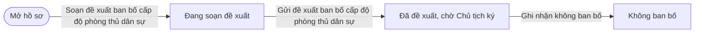
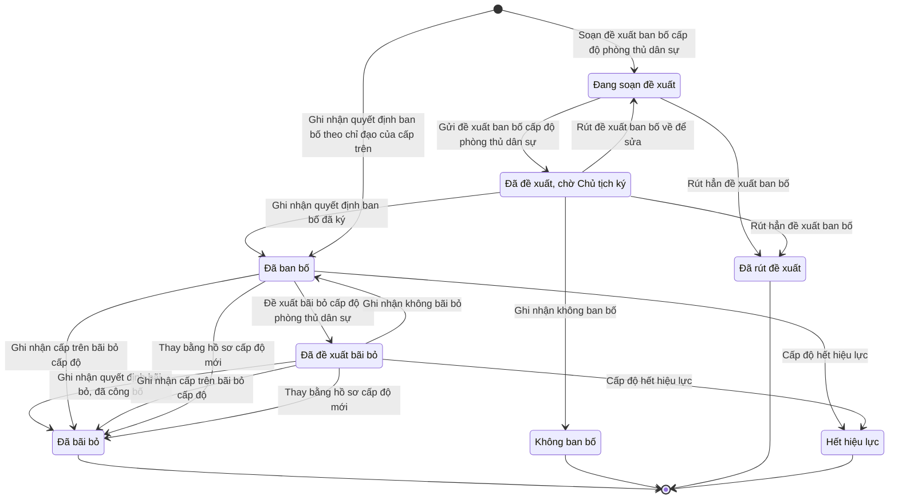

# qt-21 · Ban bố, bãi bỏ cấp độ PTDS

<!-- máy sinh: tom-tat -->
> **Hồ sơ:** Cấp độ phòng thủ dân sự của vụ việc (`CaseDefenceLevel`)
>
> **Trong sổ phạm vi:** 21 · Ban bố, bãi bỏ cấp độ PTDS (tầng 3)
>
> 18 bước · 8 chặng · 3 vai · 3 bảng quyết định · 2 hạn · 8 khớp nối.
>
> **Nguồn:** sổ nghiệp vụ `qt-21` · khai báo của app: `dqtv-app/core/processes/defence-level/workflow/case-defence-level.yaml`. Các bảng do máy sinh từ nguồn này.
<!-- hết: tom-tat -->

<!-- viết tay: dien-giai -->
## Diễn giải

*Phần này viết tay, diễn giải lại điều các bảng bên dưới ghi.*

### Quy trình này để làm gì

Theo dõi **cấp độ phòng thủ dân sự của một vụ việc ứng phó**: đề xuất ban bố, ghi quyết định ban bố đã ký, công bố và báo cáo cấp trên, đổi thời hạn áp dụng, rồi đề xuất và ghi quyết định bãi bỏ. Quyết định ban bố và quyết định bãi bỏ là quyết định ký **ngoài hệ**, người ký `commune_chairman` hoặc `province_chairman`; hệ chỉ ghi lại. Ô cấp độ cho chọn cấp độ 1 hoặc 2; ô cấp đề xuất cho chọn cấp xã hoặc cấp tỉnh.

Hồ sơ đi qua các chặng: *Đã đề xuất, chờ Chủ tịch ký* → *Đã ban bố* → *Đã đề xuất bãi bỏ* → *Đã bãi bỏ*; có thêm chặng *Không ban bố*.

### Khi nào bắt đầu

Hồ sơ luôn mở ra gắn với một **Vụ việc ứng phó** (quy trình 20), bằng một trong hai cửa:

- Trợ lý Tác huấn bấm **Đề xuất ban bố cấp độ phòng thủ dân sự**. Chỉ bắt buộc chọn vụ việc (`caseId`); cấp độ, lý do, biện pháp áp dụng ngay, phạm vi địa bàn, thời gian áp dụng, trách nhiệm thi hành, "theo chỉ đạo của cấp trên" và bản chụp tờ trình đã ký là ô nhập nếu có. Nơi nhận tờ trình là `commune_chairman` hoặc `province_chairman`. Hồ sơ vào *Đã đề xuất, chờ Chủ tịch ký*.
- Chỉ huy trưởng Ban CHQS xã bấm **Ghi nhận quyết định ban bố theo chỉ đạo của cấp trên** — ban bố theo chỉ đạo của cấp trên, không qua đề xuất của xã. Phải nhập `caseId`, `decisionNumber`, `subject`, `signedBy`, `signedDate`, `legalBasis`, `scanPath`. Hồ sơ vào thẳng *Đã ban bố*.

### Diễn ra thế nào

**Chặng "Đã đề xuất, chờ Chủ tịch ký".** Chỉ huy trưởng Ban CHQS xã (thuộc đơn vị chủ hồ sơ) ghi một trong hai kết quả:

- **Ghi nhận quyết định ban bố đã ký** — phải nhập `decisionNumber`, `subject`, `signedBy`, `signedDate`, `legalBasis`, `scanPath`; bước ghi lại người ký quyết định ban bố và xét thẩm quyền người ký; hồ sơ sang *Đã ban bố*.
- **Ghi nhận không ban bố** — phải ghi lý do; hồ sơ sang *Không ban bố*.

**Chặng "Đã ban bố"** — đang áp dụng biện pháp của cấp độ đã ban bố. Hồ sơ đứng yên, có hai việc:

- **Ghi nhận đã công bố, đã báo cáo cấp trên** (Chỉ huy trưởng) — bước ghi hai thời điểm: đã công bố lúc, đã báo cáo tỉnh lúc.
- **Kéo dài, rút ngắn thời gian áp dụng** (Trợ lý Tác huấn) — nhập ngày kết thúc mới, kéo dài hay rút ngắn, và người quyết định đổi thời hạn; bước xét thẩm quyền người quyết định; lặp được.

Trợ lý Tác huấn bấm **Đề xuất bãi bỏ cấp độ phòng thủ dân sự** (căn cứ bãi bỏ, "bãi bỏ theo chỉ đạo của cấp trên", bản chụp tờ trình đã ký là ô nhập nếu có; nơi nhận tờ trình là `commune_chairman` hoặc `province_chairman`); hồ sơ sang *Đã đề xuất bãi bỏ*.

**Chặng "Đã đề xuất bãi bỏ".** Chỉ huy trưởng ghi một trong hai kết quả:

- **Ghi nhận quyết định bãi bỏ, đã công bố** — phải nhập cùng sáu ô như bước ghi quyết định ban bố đã ký; bước xét thẩm quyền người ký quyết định bãi bỏ; hồ sơ sang *Đã bãi bỏ*.
- **Ghi nhận không bãi bỏ** — phải ghi lý do; hồ sơ quay về *Đã ban bố* (cấp độ còn hiệu lực).

### Kết thúc và để lại gì

Hồ sơ kết thúc ở chặng *Đã bãi bỏ*; tới đây thì vụ việc đóng lại được. Hồ sơ nối tới Vụ việc ứng phó (quy trình 20), ghi lúc mở. Tờ trình đề nghị ban bố hoặc bãi bỏ cấp độ là một văn bản đi (quy trình 1). Không hồ sơ nào của quy trình khác mở ra từ đây.

### Điều kiện chặn

- **Cấp độ phải hợp với cấp đề xuất** (xét ở bước đề xuất ban bố): cấp xã với cấp độ 1, cấp tỉnh với cấp độ 2 thì cho qua; để trống cấp độ thì cho qua (cấp độ mặc định trùng với cấp đơn vị). Thiếu cấp đề xuất thì dừng (`unit_level_unknown`); mọi trường hợp còn lại dừng (`level_not_for_unit`).
- **Người ký phải đúng thẩm quyền**, xét ở ba bước — ghi quyết định ban bố đã ký, đổi thời hạn, ghi quyết định bãi bỏ: cấp độ 1 là Chủ tịch UBND cấp xã (`commune_chairman`), cấp độ 2 là Chủ tịch UBND cấp tỉnh (`province_chairman`). Thiếu cấp độ (`level_unknown`), thiếu người ký (`authority_unknown`), hoặc mọi trường hợp còn lại (`wrong_authority`) thì dừng.
- Bảy bước không mở hồ sơ: người làm phải là người của đơn vị chủ hồ sơ. Hai bước mở hồ sơ không đòi gì trước.
- Hai bước "ghi nhận không" (không ban bố, không bãi bỏ) đòi phải có lý do.
- Quy trình này không có hạn.
<!-- hết viết tay -->

## 1. Đường đi ngắn nhất qua các chặng

<!-- máy sinh: luong-chinh -->
Đường ít bước nhất từ lúc mở hồ sơ tới chặng kết thúc xa nhất. Máy chọn theo số chặng, không theo ý nghĩa nghiệp vụ — trình tự công việc thật xem phần Diễn giải và bảng "Việc làm ở từng chặng" ở mục 6.

| # | Ai làm | Làm gì | Hồ sơ sang chặng |
|---|---|---|---|
| 1 | Trợ lý Tác huấn | Soạn đề xuất ban bố cấp độ phòng thủ dân sự | Đang soạn đề xuất |
| 2 | Hệ thống tự làm | Gửi đề xuất ban bố cấp độ phòng thủ dân sự | Đã đề xuất, chờ Chủ tịch ký |
| 3 | Chỉ huy trưởng Ban CHQS xã | Ghi nhận không ban bố | Không ban bố |

<!-- hết: luong-chinh -->

## 2. Hồ sơ và việc nó để lại

<!-- máy sinh: muc-tieu -->
**App gọi quy trình này là:** Cấp độ phòng thủ dân sự của vụ việc.

**Khi mở, hồ sơ này ghi mối nối tới:**
- Văn bản đến (1.incoming-document) — bước `recordDirectedDefenceLevel`, khớp nối `recordDirectedDefenceLevelFromIncomingDocument`
- Vụ việc ứng phó (20) — bước `proposeDefenceLevel`, khớp nối `defenceLevelOfCase`
- Vụ việc ứng phó (20) — bước `recordDirectedDefenceLevel`, khớp nối `defenceLevelOfCase`
<!-- hết: muc-tieu -->

## 3. Khởi phát và kết thúc

<!-- máy sinh: khoi-phat -->
**2 cửa vào** — bước mở hồ sơ:

| Bước mở | Ai mở | Hồ sơ vào chặng | App bắt buộc nhập |
|---|---|---|---|
| Soạn đề xuất ban bố cấp độ phòng thủ dân sự | Trợ lý Tác huấn | Đang soạn đề xuất | `caseId` |
| Ghi nhận quyết định ban bố theo chỉ đạo của cấp trên | Chỉ huy trưởng Ban CHQS xã | Đã ban bố | `caseId`, `incomingDocumentId`, `signedBy` |

**Kết thúc:** *Đã bãi bỏ* (`REVOKED`), *Không ban bố* (`NOT_DECLARED`), *Đã rút đề xuất* (`WITHDRAWN`), *Hết hiệu lực* (`EXPIRED`)
<!-- hết: khoi-phat -->

## 4. Vai trò

<!-- máy sinh: vai-tro -->
| Vai trong sổ | Tên trong app | Điều kiện | Làm những bước |
|---|---|---|---|
| `staff` | Trợ lý Tác huấn |  | Soạn đề xuất ban bố cấp độ phòng thủ dân sự · Sửa dự thảo đề xuất ban bố · Trình ký văn bản đề xuất ban bố cấp độ phòng thủ dân sự · Rút đề xuất ban bố về để sửa · Kéo dài, rút ngắn thời gian áp dụng · Trình ký văn bản đề xuất bãi bỏ cấp độ phòng thủ dân sự |
| `system` | Hệ thống tự làm |  | Gửi đề xuất ban bố cấp độ phòng thủ dân sự · Đề xuất bãi bỏ cấp độ phòng thủ dân sự · Cấp độ hết hiệu lực · Thay bằng hồ sơ cấp độ mới |
| `commander` | Chỉ huy trưởng Ban CHQS xã |  | Rút hẳn đề xuất ban bố · Ghi nhận quyết định ban bố đã ký · Ghi nhận quyết định ban bố theo chỉ đạo của cấp trên · Ghi nhận không ban bố · Ghi nhận đã công bố, đã báo cáo cấp trên · Ghi nhận quyết định bãi bỏ, đã công bố · Ghi nhận không bãi bỏ · Ghi nhận cấp trên bãi bỏ cấp độ |

*"Tên trong app" là tên app đặt cho mã chủ thể của vai. Hồ sơ thuộc đơn vị cấp khác thì người làm là người giữ vai ấy ở đơn vị nêu trong cột "Điều kiện" (nếu sổ có ghi) và ở cột "Người làm phải thuộc" của bảng "Theo khai báo của app" (mục 7).*
<!-- hết: vai-tro -->

## 5. Nhánh phụ

<!-- máy sinh: nhanh-phu -->
**Bước khác đưa hồ sơ sang chặng mới** — đường song song, rẽ nhánh hoặc kết thúc sớm:

| Bước | Ai làm | Từ chặng | Sang chặng |
|---|---|---|---|
| Rút hẳn đề xuất ban bố | Chỉ huy trưởng Ban CHQS xã | Đang soạn đề xuất, Đã đề xuất, chờ Chủ tịch ký | Đã rút đề xuất |
| Ghi nhận quyết định ban bố đã ký | Chỉ huy trưởng Ban CHQS xã | Đã đề xuất, chờ Chủ tịch ký | Đã ban bố |
| Đề xuất bãi bỏ cấp độ phòng thủ dân sự | Hệ thống tự làm | Đã ban bố | Đã đề xuất bãi bỏ |
| Ghi nhận quyết định bãi bỏ, đã công bố | Chỉ huy trưởng Ban CHQS xã | Đã đề xuất bãi bỏ | Đã bãi bỏ |
| Ghi nhận cấp trên bãi bỏ cấp độ | Chỉ huy trưởng Ban CHQS xã | Đã ban bố, Đã đề xuất bãi bỏ | Đã bãi bỏ |
| Cấp độ hết hiệu lực | Hệ thống tự làm | Đã ban bố, Đã đề xuất bãi bỏ | Hết hiệu lực |
| Thay bằng hồ sơ cấp độ mới | Hệ thống tự làm | Đã ban bố, Đã đề xuất bãi bỏ | Đã bãi bỏ |

**Quay lại một chặng hồ sơ đã đi qua** (tính theo đường ngắn nhất từ lúc mở):

| Bước | Ai làm | Từ chặng | Về chặng |
|---|---|---|---|
| Rút đề xuất ban bố về để sửa | Trợ lý Tác huấn | Đã đề xuất, chờ Chủ tịch ký | Đang soạn đề xuất |
| Ghi nhận không bãi bỏ | Chỉ huy trưởng Ban CHQS xã | Đã đề xuất bãi bỏ | Đã ban bố |

**Làm trong lúc hồ sơ đứng yên ở một chặng** — ghi nhận, bổ sung:

| Bước | Ai làm | Ở chặng |
|---|---|---|
| Sửa dự thảo đề xuất ban bố *(lặp được)* | Trợ lý Tác huấn | Đang soạn đề xuất |
| Trình ký văn bản đề xuất ban bố cấp độ phòng thủ dân sự | Trợ lý Tác huấn | Đang soạn đề xuất |
| Ghi nhận đã công bố, đã báo cáo cấp trên | Chỉ huy trưởng Ban CHQS xã | Đã ban bố |
| Kéo dài, rút ngắn thời gian áp dụng *(lặp được)* | Trợ lý Tác huấn | Đã ban bố |
| Trình ký văn bản đề xuất bãi bỏ cấp độ phòng thủ dân sự | Trợ lý Tác huấn | Đã ban bố |

**Cửa vào khác:** 2 bước cùng mở hồ sơ — xem mục 3.

<!-- hết: nhanh-phu -->

## 6. Các chặng và việc làm ở từng chặng

<!-- máy sinh: chang -->
| Chặng | Tên hiển thị | Vào bằng bước | Kết thúc? |
|---|---|---|---|
| `DRAFT` | Đang soạn đề xuất | Soạn đề xuất ban bố cấp độ phòng thủ dân sự · Rút đề xuất ban bố về để sửa |  |
| `PROPOSED` | Đã đề xuất, chờ Chủ tịch ký | Gửi đề xuất ban bố cấp độ phòng thủ dân sự |  |
| `DECLARED` | Đã ban bố | Ghi nhận quyết định ban bố đã ký · Ghi nhận quyết định ban bố theo chỉ đạo của cấp trên · Ghi nhận không bãi bỏ |  |
| `REVOKE_PROPOSED` | Đã đề xuất bãi bỏ | Đề xuất bãi bỏ cấp độ phòng thủ dân sự |  |
| `REVOKED` | Đã bãi bỏ | Ghi nhận quyết định bãi bỏ, đã công bố · Ghi nhận cấp trên bãi bỏ cấp độ · Thay bằng hồ sơ cấp độ mới | **kết thúc** |
| `NOT_DECLARED` | Không ban bố | Ghi nhận không ban bố | **kết thúc** |
| `WITHDRAWN` | Đã rút đề xuất | Rút hẳn đề xuất ban bố | **kết thúc** |
| `EXPIRED` | Hết hiệu lực | Cấp độ hết hiệu lực | **kết thúc** |

### Việc làm ở từng chặng

Hồ sơ đang ở chặng nào thì làm được những bước nào.

| Hồ sơ đang ở chặng | Bước làm tại chặng (hồ sơ đứng yên) | Bước đưa hồ sơ sang chặng khác |
|---|---|---|
| **Đang soạn đề xuất** | Sửa dự thảo đề xuất ban bố (lặp được) — Trợ lý Tác huấn Trình ký văn bản đề xuất ban bố cấp độ phòng thủ dân sự — Trợ lý Tác huấn | Gửi đề xuất ban bố cấp độ phòng thủ dân sự — Hệ thống tự làm → *Đã đề xuất, chờ Chủ tịch ký* Rút hẳn đề xuất ban bố — Chỉ huy trưởng Ban CHQS xã → *Đã rút đề xuất* |
| **Đã đề xuất, chờ Chủ tịch ký** | — | Rút đề xuất ban bố về để sửa — Trợ lý Tác huấn → *Đang soạn đề xuất* Rút hẳn đề xuất ban bố — Chỉ huy trưởng Ban CHQS xã → *Đã rút đề xuất* Ghi nhận quyết định ban bố đã ký — Chỉ huy trưởng Ban CHQS xã → *Đã ban bố* Ghi nhận không ban bố — Chỉ huy trưởng Ban CHQS xã → *Không ban bố* |
| **Đã ban bố** | Ghi nhận đã công bố, đã báo cáo cấp trên — Chỉ huy trưởng Ban CHQS xã Kéo dài, rút ngắn thời gian áp dụng (lặp được) — Trợ lý Tác huấn Trình ký văn bản đề xuất bãi bỏ cấp độ phòng thủ dân sự — Trợ lý Tác huấn | Đề xuất bãi bỏ cấp độ phòng thủ dân sự — Hệ thống tự làm → *Đã đề xuất bãi bỏ* Ghi nhận cấp trên bãi bỏ cấp độ — Chỉ huy trưởng Ban CHQS xã → *Đã bãi bỏ* Cấp độ hết hiệu lực — Hệ thống tự làm → *Hết hiệu lực* Thay bằng hồ sơ cấp độ mới — Hệ thống tự làm → *Đã bãi bỏ* |
| **Đã đề xuất bãi bỏ** | — | Ghi nhận quyết định bãi bỏ, đã công bố — Chỉ huy trưởng Ban CHQS xã → *Đã bãi bỏ* Ghi nhận không bãi bỏ — Chỉ huy trưởng Ban CHQS xã → *Đã ban bố* Ghi nhận cấp trên bãi bỏ cấp độ — Chỉ huy trưởng Ban CHQS xã → *Đã bãi bỏ* Cấp độ hết hiệu lực — Hệ thống tự làm → *Hết hiệu lực* Thay bằng hồ sơ cấp độ mới — Hệ thống tự làm → *Đã bãi bỏ* |
| **Đã bãi bỏ** | — | — (kết thúc) |
| **Không ban bố** | — | — (kết thúc) |
| **Đã rút đề xuất** | — | — (kết thúc) |
| **Hết hiệu lực** | — | — (kết thúc) |
<!-- hết: chang -->

## 7. Bảng bước

<!-- máy sinh: buoc -->
| # | Bước | Mã bước | Ai thực hiện | Từ chặng | Sang chặng | Phải có trước | Ghi lại |
|---|---|---|---|---|---|---|---|
| 1 | Soạn đề xuất ban bố cấp độ phòng thủ dân sự | `proposeDefenceLevel` | Trợ lý Tác huấn | — (mở hồ sơ) | `DRAFT` | `effectiveDatesInOrder` | mã tỉnh, mã xã, cấp độ, lý do ban bố, biện pháp áp dụng ngay, phạm vi địa bàn, áp dụng từ ngày, đến hết ngày, trách nhiệm thi hành, theo chỉ đạo của cấp trên, đã đề xuất lúc, nối tới Vụ việc ứng phó, đơn vị chủ hồ sơ, cấp đề xuất, người gửi đề xuất ban bố, nơi nhận đề xuất ban bố |
| 2 | Sửa dự thảo đề xuất ban bố | `editDefenceLevelProposal` | Trợ lý Tác huấn | `DRAFT` | giữ nguyên | người làm thuộc đơn vị chủ hồ sơ, `effectiveDatesInOrder` | lý do ban bố, biện pháp áp dụng ngay, phạm vi địa bàn, áp dụng từ ngày, đến hết ngày, trách nhiệm thi hành |
| 3 | Trình ký văn bản đề xuất ban bố cấp độ phòng thủ dân sự | `requestSubmitDefenceLevelProposalSignature` | Trợ lý Tác huấn | `DRAFT` | giữ nguyên | `noSubmitDefenceLevelProposalDocumentOpen`, người làm thuộc đơn vị chủ hồ sơ | nối tới Văn bản đi |
| 4 | Gửi đề xuất ban bố cấp độ phòng thủ dân sự | `submitDefenceLevelProposal` | Hệ thống tự làm | `DRAFT` | `PROPOSED` | `submitDefenceLevelProposalDocumentIssued` | đã đề xuất lúc, nơi nhận đề xuất ban bố |
| 5 | Rút đề xuất ban bố về để sửa | `withdrawDefenceLevelProposal` | Trợ lý Tác huấn | `PROPOSED` | `DRAFT` | người làm thuộc đơn vị chủ hồ sơ | rút đề xuất về sửa lúc |
| 6 | Rút hẳn đề xuất ban bố | `dropDefenceLevelProposal` | Chỉ huy trưởng Ban CHQS xã | `DRAFT`, `PROPOSED` | `WITHDRAWN` | vì sao rút hẳn đề xuất, người làm thuộc đơn vị chủ hồ sơ | vì sao rút hẳn đề xuất, rút hẳn đề xuất lúc |
| 7 | Ghi nhận quyết định ban bố đã ký | `recordDefenceLevelDecision` | Chỉ huy trưởng Ban CHQS xã | `PROPOSED` | `DECLARED` | người làm thuộc đơn vị chủ hồ sơ, `recordDefenceLevelDecisionFromIncomingDocumentUsable` | đã ban bố lúc, người ký quyết định ban bố, nối tới Văn bản đến |
| 8 | Ghi nhận quyết định ban bố theo chỉ đạo của cấp trên | `recordDirectedDefenceLevel` | Chỉ huy trưởng Ban CHQS xã | — (mở hồ sơ) | `DECLARED` | `effectiveDatesInOrder`, `recordDirectedDefenceLevelFromIncomingDocumentUsable` | mã tỉnh, mã xã, cấp độ, lý do ban bố, biện pháp áp dụng ngay, phạm vi địa bàn, áp dụng từ ngày, đến hết ngày, trách nhiệm thi hành, theo chỉ đạo của cấp trên, đã ban bố lúc, người ký quyết định ban bố, nối tới Vụ việc ứng phó, đơn vị chủ hồ sơ, cấp đề xuất, ghi nhận ban bố theo chỉ đạo cấp trên lúc, `id`, nối tới Văn bản đến |
| 9 | Ghi nhận không ban bố | `recordDefenceLevelNotDeclared` | Chỉ huy trưởng Ban CHQS xã | `PROPOSED` | `NOT_DECLARED` | lý do không ban bố, người làm thuộc đơn vị chủ hồ sơ | lý do không ban bố, ghi nhận không ban bố lúc |
| 10 | Ghi nhận đã công bố, đã báo cáo cấp trên | `announceDefenceLevel` | Chỉ huy trưởng Ban CHQS xã | `DECLARED` | giữ nguyên | người làm thuộc đơn vị chủ hồ sơ | đã công bố lúc, đã báo cáo tỉnh lúc |
| 11 | Kéo dài, rút ngắn thời gian áp dụng | `extendDefenceLevel` | Trợ lý Tác huấn | `DECLARED` | giữ nguyên | người làm thuộc đơn vị chủ hồ sơ, `effectiveDatesInOrder` | đến hết ngày, kéo dài hay rút ngắn, người quyết định đổi thời hạn |
| 12 | Trình ký văn bản đề xuất bãi bỏ cấp độ phòng thủ dân sự | `requestProposeRevokeDefenceLevelSignature` | Trợ lý Tác huấn | `DECLARED` | giữ nguyên | `ownRevokeAllowed`, `noProposeRevokeDefenceLevelDocumentOpen`, người làm thuộc đơn vị chủ hồ sơ | căn cứ bãi bỏ, bãi bỏ theo chỉ đạo của cấp trên, nối tới Văn bản đi, người gửi đề xuất bãi bỏ, nơi nhận đề xuất bãi bỏ |
| 13 | Đề xuất bãi bỏ cấp độ phòng thủ dân sự | `proposeRevokeDefenceLevel` | Hệ thống tự làm | `DECLARED` | `REVOKE_PROPOSED` | `proposeRevokeDefenceLevelDocumentIssued` | đã đề xuất bãi bỏ lúc |
| 14 | Ghi nhận quyết định bãi bỏ, đã công bố | `recordRevokeDefenceLevel` | Chỉ huy trưởng Ban CHQS xã | `REVOKE_PROPOSED` | `REVOKED` | người làm thuộc đơn vị chủ hồ sơ, `recordRevokeDefenceLevelFromIncomingDocumentUsable` | đã bãi bỏ lúc, `revokeAnnouncedAt`, người ký quyết định bãi bỏ, đã báo cáo cấp trên việc bãi bỏ lúc, nối tới Văn bản đến |
| 15 | Ghi nhận không bãi bỏ | `recordDefenceLevelRevokeDeclined` | Chỉ huy trưởng Ban CHQS xã | `REVOKE_PROPOSED` | `DECLARED` | lý do không bãi bỏ, người làm thuộc đơn vị chủ hồ sơ | lý do không bãi bỏ, ghi nhận không bãi bỏ lúc |
| 16 | Ghi nhận cấp trên bãi bỏ cấp độ | `recordUpperRevocation` | Chỉ huy trưởng Ban CHQS xã | `DECLARED`, `REVOKE_PROPOSED` | `REVOKED` | người làm thuộc đơn vị chủ hồ sơ, `recordUpperRevocationFromIncomingDocumentUsable` | đã bãi bỏ lúc, người ký quyết định bãi bỏ, căn cứ bãi bỏ, nối tới Văn bản đến |
| 17 | Cấp độ hết hiệu lực | `expireDefenceLevel` | Hệ thống tự làm | `DECLARED`, `REVOKE_PROPOSED` | `EXPIRED` | — | hết hiệu lực lúc |
| 18 | Thay bằng hồ sơ cấp độ mới | `supersedeDefenceLevel` | Hệ thống tự làm | `DECLARED`, `REVOKE_PROPOSED` | `REVOKED` | — | đã bãi bỏ lúc, căn cứ bãi bỏ, nối tới Cấp độ phòng thủ dân sự của vụ việc |

### Khi không đạt điều kiện

Mặc định: không đúng người, hồ sơ không ở đúng chặng, hoặc thiếu thứ "phải có trước" thì bước bị chặn, hồ sơ giữ nguyên. Bảng dưới chỉ kê những bước có kết quả riêng.

| # | Bước | Kết quả riêng |
|---|---|---|
| 4 | Gửi đề xuất ban bố cấp độ phòng thủ dân sự | bước này không do người nào bấm |
| 7 | Ghi nhận quyết định ban bố đã ký | bước dừng lại, hồ sơ giữ nguyên khi kết quả xét là: `level_unknown`, `authority_unknown`, `wrong_authority` |
| 11 | Kéo dài, rút ngắn thời gian áp dụng | bước dừng lại, hồ sơ giữ nguyên khi kết quả xét là: `level_unknown`, `authority_unknown`, `wrong_authority` |
| 13 | Đề xuất bãi bỏ cấp độ phòng thủ dân sự | bước này không do người nào bấm |
| 14 | Ghi nhận quyết định bãi bỏ, đã công bố | bước dừng lại, hồ sơ giữ nguyên khi kết quả xét là: `level_unknown`, `authority_unknown`, `wrong_authority` |
| 17 | Cấp độ hết hiệu lực | bước này không do người nào bấm |
| 18 | Thay bằng hồ sơ cấp độ mới | bước này không do người nào bấm |

### Điều kiện "phải có trước" bằng lời

Cột "Phải có trước" ở bảng bước có hai loại: ô dữ liệu thường (bước chỉ đòi ô ấy đã có giá trị) và điều kiện hệ tự xét. Bảng này diễn các điều kiện hệ tự xét theo đúng công thức sổ ghi; số ở cột cuối là số thứ tự bước.

| Điều kiện | Đúng khi | Bước đòi |
|---|---|---|
| `effectiveDatesInOrder` | `{"ge": [{"fact": "effectiveTo"}, {"fact": "effectiveFrom"}]}` | 1, 2, 8, 11 |
| `actorInOwnerUnit` | người đang làm là người của đơn vị ghi ở ô đơn vị chủ hồ sơ của hồ sơ này (theo danh mục người của đơn vị, `dm.unit-staff`) | 2, 3, 5, 6, 7, 9, 10, 11, 12, 14, 15, 16 |
| `noSubmitDefenceLevelProposalDocumentOpen` | KHÔNG (có hồ sơ Việc luật giao kèm văn bản đến, đi — Văn bản đi (qt-1.outgoing-document) chính là hồ sơ ghi ở ô nối `submitDefenceLevelProposalByDocument` của hồ sơ đang làm mà hồ sơ ấy đang ở chặng `DRAFT` hoặc `PENDING_SIGNATURE` hoặc `SIGNED`) | 3 |
| `submitDefenceLevelProposalDocumentIssued` | có hồ sơ Việc luật giao kèm văn bản đến, đi — Văn bản đi (qt-1.outgoing-document) chính là hồ sơ ghi ở ô nối `submitDefenceLevelProposalByDocument` của hồ sơ đang làm mà hồ sơ ấy đang ở chặng `ISSUED` | 4 |
| `recordDefenceLevelDecisionFromIncomingDocumentUsable` | có hồ sơ Việc luật giao kèm văn bản đến, đi — Văn bản đến (qt-1.incoming-document) chính là hồ sơ ghi ở ô nối `recordDefenceLevelDecisionFromIncomingDocument` của hồ sơ đang làm mà hồ sơ ấy đang ở chặng `RECEIVED` hoặc `DISTRIBUTED` | 7 |
| `recordDirectedDefenceLevelFromIncomingDocumentUsable` | có hồ sơ Việc luật giao kèm văn bản đến, đi — Văn bản đến (qt-1.incoming-document) chính là hồ sơ ghi ở ô nối `recordDirectedDefenceLevelFromIncomingDocument` của hồ sơ đang làm mà hồ sơ ấy đang ở chặng `RECEIVED` hoặc `DISTRIBUTED` | 8 |
| `ownRevokeAllowed` | KHÔNG (đã có ghi nhận ban bố theo chỉ đạo cấp trên lúc) | 12 |
| `noProposeRevokeDefenceLevelDocumentOpen` | KHÔNG (có hồ sơ Việc luật giao kèm văn bản đến, đi — Văn bản đi (qt-1.outgoing-document) chính là hồ sơ ghi ở ô nối `proposeRevokeDefenceLevelByDocument` của hồ sơ đang làm mà hồ sơ ấy đang ở chặng `DRAFT` hoặc `PENDING_SIGNATURE` hoặc `SIGNED`) | 12 |
| `proposeRevokeDefenceLevelDocumentIssued` | có hồ sơ Việc luật giao kèm văn bản đến, đi — Văn bản đi (qt-1.outgoing-document) chính là hồ sơ ghi ở ô nối `proposeRevokeDefenceLevelByDocument` của hồ sơ đang làm mà hồ sơ ấy đang ở chặng `ISSUED` | 13 |
| `recordRevokeDefenceLevelFromIncomingDocumentUsable` | có hồ sơ Việc luật giao kèm văn bản đến, đi — Văn bản đến (qt-1.incoming-document) chính là hồ sơ ghi ở ô nối `recordRevokeDefenceLevelFromIncomingDocument` của hồ sơ đang làm mà hồ sơ ấy đang ở chặng `RECEIVED` hoặc `DISTRIBUTED` | 14 |
| `recordUpperRevocationFromIncomingDocumentUsable` | có hồ sơ Việc luật giao kèm văn bản đến, đi — Văn bản đến (qt-1.incoming-document) chính là hồ sơ ghi ở ô nối `recordUpperRevocationFromIncomingDocument` của hồ sơ đang làm mà hồ sơ ấy đang ở chặng `RECEIVED` hoặc `DISTRIBUTED` | 16 |

### Theo khai báo của app

Người làm phải thuộc đơn vị nào, ô người dùng phải nhập, bước có lặp được không, và căn cứ pháp lý — lấy từ khai báo quy trình trong app.

| # | Bước | Người làm phải thuộc | Bắt buộc nhập | Nhập nếu có | Lặp được | Căn cứ |
|---|---|---|---|---|---|---|
| 1 | Soạn đề xuất ban bố cấp độ phòng thủ dân sự |  | `caseId` | cấp độ, lý do ban bố, biện pháp áp dụng ngay, phạm vi địa bàn, áp dụng từ ngày, đến hết ngày, trách nhiệm thi hành, theo chỉ đạo của cấp trên, tệp kèm đề xuất (nếu có) |  | NĐ200/2025/NĐ-CP Đ.14 k1 a · Đ.14 k4 · L18/2023/QH15 Đ.22 k1 |
| 2 | Sửa dự thảo đề xuất ban bố | đơn vị chủ hồ sơ | — | lý do ban bố, biện pháp áp dụng ngay, phạm vi địa bàn, áp dụng từ ngày, đến hết ngày, trách nhiệm thi hành, tệp kèm đề xuất (nếu có) | có | NĐ200/2025/NĐ-CP Đ.14 k4 |
| 3 | Trình ký văn bản đề xuất ban bố cấp độ phòng thủ dân sự | đơn vị chủ hồ sơ | — | dự thảo văn bản (PDF) |  | NĐ200/2025/NĐ-CP Đ.14 k1 a · NĐ30/2020/NĐ-CP Đ.13 |
| 4 | Gửi đề xuất ban bố cấp độ phòng thủ dân sự |  | — | — |  | NĐ200/2025/NĐ-CP Đ.14 k1 a |
| 5 | Rút đề xuất ban bố về để sửa | đơn vị chủ hồ sơ | — | — |  | NĐ200/2025/NĐ-CP Đ.14 k1 a |
| 6 | Rút hẳn đề xuất ban bố | đơn vị chủ hồ sơ | vì sao rút hẳn đề xuất | — |  | NĐ200/2025/NĐ-CP Đ.14 k1 a |
| 7 | Ghi nhận quyết định ban bố đã ký | đơn vị chủ hồ sơ | văn bản đến là quyết định ban bố đã ký, `signedBy` | ngày ký (để trống thì lấy ngày ghi trên văn bản đến) |  | NĐ200/2025/NĐ-CP Đ.14 k1 b · L18/2023/QH15 Đ.20 k1 a, b (sửa L98/2025/QH15 Đ.8 k2) |
| 8 | Ghi nhận quyết định ban bố theo chỉ đạo của cấp trên |  | `caseId`, văn bản đến là quyết định ban bố đã ký, `signedBy` | ngày ký (để trống thì lấy ngày ghi trên văn bản đến), cấp độ, lý do ban bố, biện pháp áp dụng ngay, phạm vi địa bàn, áp dụng từ ngày, đến hết ngày, trách nhiệm thi hành |  | NĐ200/2025/NĐ-CP Đ.14 k1 b · Đ.14 k4 · L18/2023/QH15 Đ.20 k1 a, b (sửa L98/2025/QH15 Đ.8 k2) |
| 9 | Ghi nhận không ban bố | đơn vị chủ hồ sơ | lý do không ban bố | — |  | NĐ200/2025/NĐ-CP Đ.14 k1 b |
| 10 | Ghi nhận đã công bố, đã báo cáo cấp trên | đơn vị chủ hồ sơ | — | — |  | NĐ200/2025/NĐ-CP Đ.14 k1 c · Đ.14 k5 |
| 11 | Kéo dài, rút ngắn thời gian áp dụng | đơn vị chủ hồ sơ | đến hết ngày, kéo dài hay rút ngắn, người quyết định đổi thời hạn | — | có | NĐ200/2025/NĐ-CP Đ.15 k4 |
| 12 | Trình ký văn bản đề xuất bãi bỏ cấp độ phòng thủ dân sự | đơn vị chủ hồ sơ | — | căn cứ bãi bỏ, bãi bỏ theo chỉ đạo của cấp trên, dự thảo văn bản (PDF) |  | NĐ200/2025/NĐ-CP Đ.15 k1 a · NĐ30/2020/NĐ-CP Đ.13 |
| 13 | Đề xuất bãi bỏ cấp độ phòng thủ dân sự |  | — | — |  | NĐ200/2025/NĐ-CP Đ.15 k1 a |
| 14 | Ghi nhận quyết định bãi bỏ, đã công bố | đơn vị chủ hồ sơ | văn bản đến là quyết định bãi bỏ đã ký, `signedBy` | ngày ký (để trống thì lấy ngày ghi trên văn bản đến) |  | NĐ200/2025/NĐ-CP Đ.15 k1 b · Đ.15 k1 c, d |
| 15 | Ghi nhận không bãi bỏ | đơn vị chủ hồ sơ | lý do không bãi bỏ | — |  | NĐ200/2025/NĐ-CP Đ.15 k1 b |
| 16 | Ghi nhận cấp trên bãi bỏ cấp độ | đơn vị chủ hồ sơ | người ký quyết định bãi bỏ, văn bản đến là văn bản cấp trên bãi bỏ cấp độ | căn cứ bãi bỏ |  | NĐ200/2025/NĐ-CP Đ.15 k1 b |
| 17 | Cấp độ hết hiệu lực |  | — | — |  | NĐ200/2025/NĐ-CP Đ.14 k4 d · Đ.15 k4 |
| 18 | Thay bằng hồ sơ cấp độ mới |  | hồ sơ cấp độ mới thay cho hồ sơ này | — |  | NĐ200/2025/NĐ-CP Đ.14 k1 b · Đ.15 |

### Điều kiện và ghi chú app khai cho từng bước

Lấy từ khai báo quy trình trong app. Lời trong ngoặc kép là câu app hiện cho người dùng. Chức danh người ký ngoài hệ app chỉ khai bằng mã.

| # | Bước | Điều kiện, ghi chú |
|---|---|---|
| 7 | Ghi nhận quyết định ban bố đã ký | · bước này ghi một quyết định ký NGOÀI hệ (`defenceLevelAuthorizedBy`), người ký: `commune_chairman`, `province_chairman` · không đòi bản chụp — app ghi: "bản số hoá lấy từ văn bản đến văn thư đã vào sổ (tầng đọc chép `scanPath` của văn bản ấy), không tải ảnh ở bước này" |
| 8 | Ghi nhận quyết định ban bố theo chỉ đạo của cấp trên | · bước này ghi một quyết định ký NGOÀI hệ (`defenceLevelAuthorizedBy`), người ký: `commune_chairman`, `province_chairman` · không đòi bản chụp — app ghi: "bản số hoá lấy từ văn bản đến văn thư đã vào sổ (tầng đọc chép `scanPath` của văn bản ấy), không tải ảnh ở bước này" |
| 12 | Trình ký văn bản đề xuất bãi bỏ cấp độ phòng thủ dân sự | · không làm được khi đã có ô "ghi nhận ban bố theo chỉ đạo cấp trên lúc" — app báo: "cấp độ này do cấp trên chỉ đạo ban bố — chỉ cấp trên bãi bỏ, đơn vị ghi lại quyết định bãi bỏ của cấp trên" |
| 14 | Ghi nhận quyết định bãi bỏ, đã công bố | · bước này ghi một quyết định ký NGOÀI hệ (`defenceLevelRevokeAuthorizedBy`), người ký: `commune_chairman`, `province_chairman` · không đòi bản chụp — app ghi: "bản số hoá lấy từ văn bản đến văn thư đã vào sổ (tầng đọc chép `scanPath` của văn bản ấy), không tải ảnh ở bước này" |
<!-- hết: buoc -->

## 8. Bảng quyết định, hạn, việc ngoài hệ

<!-- máy sinh: quyet-dinh -->
**Bảng `defence-level-authority`** — xét ở bước *Ghi nhận quyết định ban bố đã ký*; đầu vào: cấp độ, người ký quyết định ban bố. 5 dòng, dò từ trên xuống, dòng đầu tiên khớp thì dừng.

| Thứ tự dò (số sổ ghi) | Dòng | Khi | Thì |
|---|---|---|---|
| 1 | `level-unset` | chưa có cấp độ | `level_unknown` |
| 2 | `authority-unset` | chưa có người ký quyết định ban bố | `authority_unknown` |
| 3 | `level1-commune-chairman` | cấp độ là Phòng thủ dân sự cấp độ 1 (`level_1`) và người ký quyết định ban bố là Chủ tịch UBND cấp xã (`commune_chairman`) | cho qua |
| 4 | `level2-province-chairman` | cấp độ là Phòng thủ dân sự cấp độ 2 (`level_2`) và người ký quyết định ban bố là Chủ tịch UBND cấp tỉnh (`province_chairman`) | cho qua |
| 5 | `otherwise` | mọi trường hợp còn lại | `wrong_authority` |

**Bảng `defence-level-duration-authority`** — xét ở bước *Kéo dài, rút ngắn thời gian áp dụng*; đầu vào: cấp độ, người quyết định đổi thời hạn. 5 dòng, dò từ trên xuống, dòng đầu tiên khớp thì dừng.

| Thứ tự dò (số sổ ghi) | Dòng | Khi | Thì |
|---|---|---|---|
| 1 | `level-unset` | chưa có cấp độ | `level_unknown` |
| 2 | `authority-unset` | chưa có người quyết định đổi thời hạn | `authority_unknown` |
| 3 | `level1-commune-chairman` | cấp độ là Phòng thủ dân sự cấp độ 1 (`level_1`) và người quyết định đổi thời hạn là Chủ tịch UBND cấp xã (`commune_chairman`) | cho qua |
| 4 | `level2-province-chairman` | cấp độ là Phòng thủ dân sự cấp độ 2 (`level_2`) và người quyết định đổi thời hạn là Chủ tịch UBND cấp tỉnh (`province_chairman`) | cho qua |
| 5 | `otherwise` | mọi trường hợp còn lại | `wrong_authority` |

**Bảng `defence-level-revoke-authority`** — xét ở bước *Ghi nhận quyết định bãi bỏ, đã công bố*; đầu vào: cấp độ, người ký quyết định bãi bỏ. 5 dòng, dò từ trên xuống, dòng đầu tiên khớp thì dừng.

| Thứ tự dò (số sổ ghi) | Dòng | Khi | Thì |
|---|---|---|---|
| 1 | `level-unset` | chưa có cấp độ | `level_unknown` |
| 2 | `authority-unset` | chưa có người ký quyết định bãi bỏ | `authority_unknown` |
| 3 | `level1-commune-chairman` | cấp độ là Phòng thủ dân sự cấp độ 1 (`level_1`) và người ký quyết định bãi bỏ là Chủ tịch UBND cấp xã (`commune_chairman`) | cho qua |
| 4 | `level2-province-chairman` | cấp độ là Phòng thủ dân sự cấp độ 2 (`level_2`) và người ký quyết định bãi bỏ là Chủ tịch UBND cấp tỉnh (`province_chairman`) | cho qua |
| 5 | `otherwise` | mọi trường hợp còn lại | `wrong_authority` |

| Hạn | Tính từ | Thời hạn | Quá hạn thì |
|---|---|---|---|
| `expireDefenceLevel.deadline.declared` | `{"fact": "effectiveTo"}` | 0 ngày | hệ làm bước Cấp độ hết hiệu lực |
| `expireDefenceLevel.deadline.revoke_proposed` | `{"fact": "effectiveTo"}` | 0 ngày | hệ làm bước Cấp độ hết hiệu lực |

<!-- hết: quyet-dinh -->

## 9. Dữ liệu của hồ sơ

<!-- máy sinh: du-lieu -->
Các ô mà bước trong sổ ghi hoặc đòi. Số trong hai cột cuối là số thứ tự bước ở bảng bước (mục 7).

| Ô dữ liệu | Mã | Kiểu (app) | Giá trị cho phép | Loại ô (sổ) | Bước ghi | Bước đòi | Mô tả trong app |
|---|---|---|---|---|---|---|---|
| mã tỉnh | `provinceCode` | chữ |  | lưu trên hồ sơ (`stored`) | 1, 8 | — | Mã tỉnh — dùng lọc phạm vi theo hàng |
| mã xã | `communeCode` | chữ |  | lưu trên hồ sơ (`stored`) | 1, 8 | — | Mã xã |
| cấp độ | `level` | chọn một | Phòng thủ dân sự cấp độ 1 (`level_1`), Phòng thủ dân sự cấp độ 2 (`level_2`), `level_3` | lưu trên hồ sơ (`stored`) | 1, 8 | — | Cấp độ — xã ban bố cấp độ 1, Chủ tịch UBND tỉnh cấp độ 2, Thủ tướng cấp độ 3 (L18/2023 Đ.20 k1 sửa bởi L98/2025) |
| lý do ban bố | `reason` | chữ |  | đưa vào ở bước (`input`) | 1, 2, 8 | — | a) Lý do ban bố cấp độ phòng thủ dân sự — NĐ200/2025 Đ.14 k4 a |
| biện pháp áp dụng ngay | `measures` | chữ |  | đưa vào ở bước (`input`) | 1, 2, 8 | — | b) Các biện pháp cần áp dụng ngay — chọn trong sáu biện pháp của L18/2023 Đ.22 k1 |
| phạm vi địa bàn | `area` | chữ |  | đưa vào ở bước (`input`) | 1, 2, 8 | — | c) Phạm vi địa bàn áp dụng cấp độ — NĐ200/2025 Đ.14 k4 c |
| áp dụng từ ngày | `effectiveFrom` | ngày |  | đưa vào ở bước (`input`) | 1, 2, 8 | — | d) Thời gian bắt đầu thực hiện các biện pháp — NĐ200/2025 Đ.14 k4 d |
| đến hết ngày | `effectiveTo` | ngày |  | đưa vào ở bước (`input`) | 1, 2, 8, 11 | — | d) Thời gian kết thúc — kéo dài hoặc rút ngắn được, NĐ200/2025 Đ.15 k4 |
| trách nhiệm thi hành | `responsibilities` | chữ |  | đưa vào ở bước (`input`) | 1, 2, 8 | — | đ) Trách nhiệm của các tổ chức, cơ quan, đơn vị thi hành — NĐ200/2025 Đ.14 k4 đ |
| theo chỉ đạo của cấp trên | `upperDirected` | chọn một | Theo chỉ đạo của cấp trên (`yes`), Theo đề xuất của Ban chỉ huy phòng thủ dân sự cùng cấp (`no`) | đưa vào ở bước (`input`) | 1, 8 | — | Ban bố theo chỉ đạo của cấp trên, không qua đề xuất của xã — NĐ200/2025 Đ.14 k1 b |
| đã đề xuất lúc | `proposedAt` | ngày giờ |  | lưu trên hồ sơ (`stored`) | 1, 4 | — | Thời điểm Ban chỉ huy PTDS xã đề xuất |
| đơn vị chủ hồ sơ | `ownerUnit` |  |  | lưu trên hồ sơ (`stored`) | 1, 8 | — |  |
| cấp đề xuất | `ownerLevel` | chọn một | Cấp xã (`commune`), Cấp tỉnh (`province`) | đưa vào ở bước (`input`) | 1, 8 | — | Cấp của đơn vị đề xuất, làm chủ hồ sơ — xã hay tỉnh (sổ qt-21); hồ sơ cũ không có ô này là của xã |
| người gửi đề xuất ban bố | `proposedByActor` | chữ |  | lưu trên hồ sơ (`stored`) | 1 | — | Tài khoản đã gửi đề xuất ban bố |
| nơi nhận đề xuất ban bố | `proposedTo` | chọn một | Chủ tịch UBND cấp xã (`commune_chairman`), Chủ tịch UBND cấp tỉnh (`province_chairman`) | lưu trên hồ sơ (`stored`) | 1, 4 | — | Nơi nhận đề xuất ban bố — Chủ tịch UBND có thẩm quyền ban bố cấp độ ấy (L18/2023 Đ.20 k1) |
| rút đề xuất về sửa lúc | `proposalWithdrawnAt` | ngày giờ |  | lưu trên hồ sơ (`stored`) | 5 | — | Thời điểm rút đề xuất ban bố về để sửa (lần gần nhất) — hồ sơ về lại Đang soạn |
| lý do rút hẳn đề xuất | `dropReason` | chữ |  | đưa vào ở bước (`input`) | 6 | 6 | Lý do rút hẳn đề xuất ban bố — hồ sơ đóng ở WITHDRAWN |
| rút hẳn đề xuất lúc | `droppedAt` | ngày giờ |  | lưu trên hồ sơ (`stored`) | 6 | — | Thời điểm rút hẳn đề xuất ban bố |
| đã ban bố lúc | `declaredAt` | ngày giờ |  | lưu trên hồ sơ (`stored`) | 7, 8 | — | Thời điểm Chủ tịch UBND xã ký quyết định ban bố |
| người ký quyết định ban bố | `decidingAuthority` | chọn một | Chủ tịch UBND cấp xã (`commune_chairman`), Chủ tịch UBND cấp tỉnh (`province_chairman`) | đưa vào ở bước (`input`) | 7, 8 | — | Người ký quyết định ban bố — cấp độ 1 Chủ tịch UBND xã, cấp độ 2 Chủ tịch UBND tỉnh (L18/2023 Đ.20 k1) |
| ghi nhận ban bố theo chỉ đạo cấp trên lúc | `directedByUpperAt` | ngày giờ |  | lưu trên hồ sơ (`stored`) | 8 | — | Thời điểm ghi nhận quyết định ban bố theo chỉ đạo của cấp trên — có ô này thì chỉ cấp trên bãi bỏ, đơn vị chỉ ghi lại (NĐ200/2025 Đ.14 k1 b) |
| — | `id` |  |  | lưu trên hồ sơ (`stored`) | 8 | — |  |
| lý do không ban bố | `notDeclaredReason` | chữ |  | đưa vào ở bước (`input`) | 9 | 9 | Lý do Chủ tịch không ban bố cấp độ đã đề xuất — hồ sơ đóng ở NOT_DECLARED |
| ghi nhận không ban bố lúc | `notDeclaredAt` | ngày giờ |  | lưu trên hồ sơ (`stored`) | 9 | — | Thời điểm ghi nhận Chủ tịch không ban bố |
| đã công bố lúc | `announcedAt` | ngày giờ |  | lưu trên hồ sơ (`stored`) | 10 | — | Thời điểm công bố quyết định cho dân — NĐ200/2025 Đ.14 k1 c |
| đã báo cáo tỉnh lúc | `reportedAt` | ngày giờ |  | lưu trên hồ sơ (`stored`) | 10 | — | Thời điểm báo cáo Ban chỉ huy PTDS và UBND cấp tỉnh — NĐ200/2025 Đ.14 k1 c |
| kéo dài hay rút ngắn | `durationChange` | chọn một | Kéo dài (`extend`), Rút ngắn (`shorten`) | đưa vào ở bước (`input`) | 11 | — | Lần đổi thời hạn gần nhất là kéo dài hay rút ngắn — các lần trước đọc ở dòng thời gian (NĐ200/2025 Đ.15 k4) |
| người quyết định đổi thời hạn | `durationDecidedBy` | chọn một | Chủ tịch UBND cấp xã (`commune_chairman`), Chủ tịch UBND cấp tỉnh (`province_chairman`) | đưa vào ở bước (`input`) | 11 | — | Người quyết định kéo dài, rút ngắn — cùng người có thẩm quyền ban bố cấp độ ấy |
| căn cứ bãi bỏ | `revokeReason` | chữ |  | đưa vào ở bước (`input`) | 12, 16, 18 | — | Căn cứ bãi bỏ — kết quả, mức độ hoàn thành nhiệm vụ ứng phó, khắc phục (NĐ200/2025 Đ.15 k1 a) |
| bãi bỏ theo chỉ đạo của cấp trên | `revokeUpperDirected` | chọn một | Theo chỉ đạo của cấp trên (`yes`), Theo đề xuất của Ban chỉ huy phòng thủ dân sự cùng cấp (`no`) | đưa vào ở bước (`input`) | 12 | — | Bãi bỏ theo chỉ đạo của cấp trên, không qua đề xuất của Ban chỉ huy PTDS cùng cấp |
| người gửi đề xuất bãi bỏ | `revokeProposedByActor` | chữ |  | lưu trên hồ sơ (`stored`) | 12 | — | Tài khoản đã gửi đề xuất bãi bỏ |
| nơi nhận đề xuất bãi bỏ | `revokeProposedTo` | chọn một | Chủ tịch UBND cấp xã (`commune_chairman`), Chủ tịch UBND cấp tỉnh (`province_chairman`) | lưu trên hồ sơ (`stored`) | 12 | — | Nơi nhận đề xuất bãi bỏ — cùng người có thẩm quyền ban bố cấp độ ấy (NĐ200/2025 Đ.15 k1) |
| đã đề xuất bãi bỏ lúc | `revokeProposedAt` | ngày giờ |  | lưu trên hồ sơ (`stored`) | 13 | — | Thời điểm đề xuất bãi bỏ |
| đã bãi bỏ lúc | `revokedAt` | ngày giờ |  | lưu trên hồ sơ (`stored`) | 14, 16, 18 | — | Thời điểm Chủ tịch UBND xã ký quyết định bãi bỏ |
| — | `revokeAnnouncedAt` | ngày giờ |  | lưu trên hồ sơ (`stored`) | 14 | — | Thời điểm công bố quyết định bãi bỏ — NĐ200/2025 Đ.15 k1 c |
| người ký quyết định bãi bỏ | `revokingAuthority` | chọn một | Chủ tịch UBND cấp xã (`commune_chairman`), Chủ tịch UBND cấp tỉnh (`province_chairman`) | đưa vào ở bước (`input`) | 14, 16 | — | Người ký quyết định bãi bỏ — cùng người có thẩm quyền ban bố cấp độ ấy (NĐ200/2025 Đ.15 k1 b) |
| đã báo cáo cấp trên việc bãi bỏ lúc | `revokeReportedAt` | ngày giờ |  | lưu trên hồ sơ (`stored`) | 14 | — | Thời điểm báo cáo cấp trên việc bãi bỏ — NĐ200/2025 Đ.15 k1 c |
| lý do không bãi bỏ | `revokeDeclinedReason` | chữ |  | đưa vào ở bước (`input`) | 15 | 15 | Lý do Chủ tịch không bãi bỏ — cấp độ còn hiệu lực, hồ sơ về lại DECLARED |
| ghi nhận không bãi bỏ lúc | `revokeDeclinedAt` | ngày giờ |  | lưu trên hồ sơ (`stored`) | 15 | — | Thời điểm ghi nhận Chủ tịch không bãi bỏ (lần gần nhất) |
| hết hiệu lực lúc | `expiredAt` | ngày giờ |  | lưu trên hồ sơ (`stored`) | 17 | — | Thời điểm hệ ghi cấp độ hết hiệu lực — quá ngày kết thúc mà không gia hạn (NĐ200/2025 Đ.14 k4 d, Đ.15 k4) |
| — | `effectiveDatesInOrder` |  | có hay chưa | hệ suy ra (`derived`) | — | 1, 2, 8, 11 |  |
| người làm thuộc đơn vị chủ hồ sơ | `actorInOwnerUnit` |  | có hay chưa | hệ suy ra (`derived`) | — | 2, 3, 5, 6, 7, 9, 10, 11, 12, 14, 15, 16 |  |
| — | `noSubmitDefenceLevelProposalDocumentOpen` |  | có hay chưa | hệ suy ra (`derived`) | — | 3 |  |
| — | `submitDefenceLevelProposalDocumentIssued` |  | có hay chưa | hệ suy ra (`derived`) | — | 4 |  |
| — | `recordDefenceLevelDecisionFromIncomingDocumentUsable` |  | có hay chưa | hệ suy ra (`derived`) | — | 7 |  |
| — | `recordDirectedDefenceLevelFromIncomingDocumentUsable` |  | có hay chưa | hệ suy ra (`derived`) | — | 8 |  |
| — | `ownRevokeAllowed` |  |  | hệ suy ra (`derived`) | — | 12 |  |
| — | `noProposeRevokeDefenceLevelDocumentOpen` |  | có hay chưa | hệ suy ra (`derived`) | — | 12 |  |
| — | `proposeRevokeDefenceLevelDocumentIssued` |  | có hay chưa | hệ suy ra (`derived`) | — | 13 |  |
| — | `recordRevokeDefenceLevelFromIncomingDocumentUsable` |  | có hay chưa | hệ suy ra (`derived`) | — | 14 |  |
| — | `recordUpperRevocationFromIncomingDocumentUsable` |  | có hay chưa | hệ suy ra (`derived`) | — | 16 |  |

51 ô. Cột "Loại ô" là cách sổ phân loại ô, in kèm đúng chữ của sổ; ô nào người dùng phải nhập xem bảng "Theo khai báo của app" ở mục 7.
<!-- hết: du-lieu -->

## 10. Khớp nối với quy trình khác

<!-- máy sinh: khop-noi -->
| Quy trình kia | Hồ sơ kia | Quan hệ | Nội dung (mô tả trong app) | Bước ghi mối nối | Tên ô nối |
|---|---|---|---|---|---|
| 1.incoming-document | Văn bản đến | gắn với nhau ở một bước giữa chừng | Quyết định ban bố cấp độ phòng thủ dân sự của Chủ tịch UBND — văn bản đến đã vào sổ (NĐ200/2025/NĐ-CP Đ.14 k1… | 21·recordDefenceLevelDecision | `recordDefenceLevelDecisionFromIncomingDocument` |
| 1.incoming-document | Văn bản đến | hồ sơ này **mở ra có nối tới** hồ sơ kia | Quyết định ban bố cấp độ phòng thủ dân sự theo chỉ đạo của cấp trên — văn bản đến đã vào sổ (NĐ200/2025/NĐ-CP… | 21·recordDirectedDefenceLevel ⊕ | `recordDirectedDefenceLevelFromIncomingDocument` |
| 1.incoming-document | Văn bản đến | gắn với nhau ở một bước giữa chừng | Quyết định bãi bỏ cấp độ phòng thủ dân sự của Chủ tịch UBND — văn bản đến đã vào sổ (NĐ200/2025/NĐ-CP Đ.15 k1… | 21·recordRevokeDefenceLevel | `recordRevokeDefenceLevelFromIncomingDocument` |
| 1.incoming-document | Văn bản đến | gắn với nhau ở một bước giữa chừng | Văn bản cấp trên bãi bỏ cấp độ phòng thủ dân sự — văn bản đến đã vào sổ (NĐ200/2025/NĐ-CP Đ.15 k1 b) | 21·recordUpperRevocation | `recordUpperRevocationFromIncomingDocument` |
| 1.outgoing-document | Văn bản đi | có nối | Tờ trình đề nghị ban bố hoặc bãi bỏ cấp độ sinh TRƯỚC 13/10/2026 — từ ngày ấy đề xuất không còn là văn bản đi… | — | `defenceLevelByDocument` |
| 1.outgoing-document | Văn bản đi | gắn với nhau ở một bước giữa chừng | Văn bản đề xuất bãi bỏ cấp độ phòng thủ dân sự gửi Chủ tịch UBND — văn bản đi của Ban CHQS (NĐ200/2025 Đ.15 k… | 21·requestProposeRevokeDefenceLevelSignature | `proposeRevokeDefenceLevelByDocument` |
| 1.outgoing-document | Văn bản đi | gắn với nhau ở một bước giữa chừng | Văn bản đề xuất ban bố cấp độ phòng thủ dân sự gửi Chủ tịch UBND — văn bản đi của Ban CHQS (NĐ200/2025 Đ.14 k… | 21·requestSubmitDefenceLevelProposalSignature | `submitDefenceLevelProposalByDocument` |
| 20 | Vụ việc ứng phó | hồ sơ này **mở ra có nối tới** hồ sơ kia | Hồ sơ cấp độ phòng thủ dân sự của vụ việc ứng phó nào — NĐ200/2025 Đ.14, Đ.15 | 21·proposeDefenceLevel ⊕, 21·recordDirectedDefenceLevel ⊕ | `defenceLevelOfCase` |

8 khớp nối. ⊕ là bước tạo hồ sơ.

**Ô nối giữa các hồ sơ cùng mã quy trình, hoặc tới danh mục nền:** `supersededByDefenceLevel` (Cấp độ phòng thủ dân sự của vụ việc → Cấp độ phòng thủ dân sự của vụ việc) — bước Thay bằng hồ sơ cấp độ mới.
<!-- hết: khop-noi -->

## 11. Thông tin chung

<!-- máy sinh: thong-tin -->
| | |
|---|---|
| **Mã trong sổ** | `qt-21` |
| **Quy trình trong app** | `defence-level` (`workflow/case-defence-level.yaml`) — mặt công tác: `operations` |
| **Hồ sơ** | Cấp độ phòng thủ dân sự của vụ việc (`CaseDefenceLevel`) |
| **Căn cứ pháp lý từng bước** | cột "Căn cứ" ở bảng "Theo khai báo của app", mục 7 |
<!-- hết: thong-tin -->
