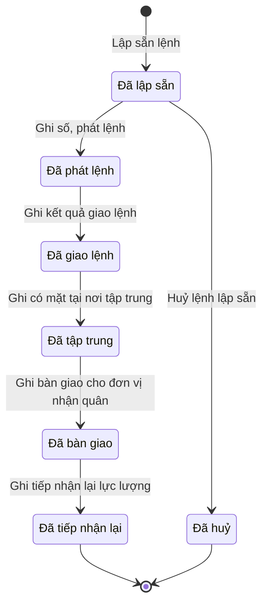

# qt-22 · Vụ huy động

<!-- máy sinh: tom-tat -->
> **Hồ sơ:** Đợt huy động lực lượng dự bị động viên (`ReserveMobilization`)
>
> **Trong sổ phạm vi:** 22 · Vụ huy động (tầng 3)
>
> 10 bước · 7 chặng · 2 vai · 5 bảng quyết định · 0 hạn · 10 khớp nối.
>
> **Nguồn:** sổ nghiệp vụ `qt-22` · khai báo của app: `dqtv-app/core/processes/reserve-mobilization/workflow/reserve-mobilization.yaml`. Các bảng do máy sinh từ nguồn này.
<!-- hết: tom-tat -->

<!-- viết tay: dien-giai -->
## Diễn giải

*Phần này viết tay, diễn giải lại điều các bảng bên dưới ghi.*

### Quy trình này để làm gì

Theo dõi một **đợt huy động lực lượng dự bị động viên**: lập sẵn bộ lệnh có tên từng quân nhân dự bị (lệnh để trống số, chờ quyết định huy động của cấp có thẩm quyền), rồi ghi số, phát lệnh, ghi kết quả giao lệnh tới từng người, ghi ai có mặt tại nơi tập trung, bàn giao cho đơn vị nhận quân, và tiếp nhận lại khi lực lượng hoàn thành nhiệm vụ.

Hồ sơ đi qua các chặng: *Đã lập sẵn* → *Đã phát lệnh* → *Đã giao lệnh* → *Đã tập trung* → *Đã bàn giao* → *Đã tiếp nhận lại*; ngoài ra có chặng *Đã huỷ*.

### Khi nào bắt đầu

Trợ lý Quân lực bấm **Lập sẵn lệnh**. Phải chọn loại lệnh (lệnh gọi hạ sĩ quan – binh sĩ, hoặc một trong ba loại lệnh chuyển tiếp của cấp trên) và những quân nhân dự bị có tên trong lệnh. Hồ sơ mở ra có nối tới **Đăng ký quân nhân dự bị** (quy trình 16) và vào chặng *Đã lập sẵn*. Loại lệnh chỉ để tra cứu.

### Diễn ra thế nào

**Chặng "Đã lập sẵn"**:

- **Rà soát danh sách** (Trợ lý Quân lực) — cập nhật lại những người có tên trong lệnh; bước ghi lại ngày lập sẵn. Lặp được.
- **Huỷ lệnh lập sẵn** (Chỉ huy trưởng Ban CHQS xã) — bắt buộc ghi lý do; hồ sơ sang *Đã huỷ*.
- **Ghi số, phát lệnh** (Chỉ huy trưởng Ban CHQS xã) — phải chọn quyết định huy động trong sổ văn bản đến, ghi người ký quyết định và số lệnh; lệnh, quyết định của cấp trên được chuyển tiếp là ô nhập nếu có. Không đòi bản chụp, vì quyết định đã nằm trong sổ văn bản đến. Người ký được xét theo bảng `mobilization-authority`. Hồ sơ sang *Đã phát lệnh*.

**Chặng "Đã phát lệnh".** Trợ lý Quân lực bấm **Ghi kết quả giao lệnh** cho từng người: `delivered` hoặc `unreachable`. Hồ sơ sang *Đã giao lệnh*.

**Chặng "Đã giao lệnh".** Trợ lý Quân lực bấm **Ghi có mặt tại nơi tập trung** cho từng người: `present`, `absent_with_reason` hoặc `absent_without_reason`; bước còn ghi ô `absenceProof` (giấy tờ chứng minh lý do vắng — ai ký, số giấy). Hồ sơ sang *Đã tập trung*.

**Chặng "Đã tập trung".** Trợ lý Quân lực bấm **Ghi bàn giao cho đơn vị nhận quân**: phải nhập đơn vị nhận quân, số biên bản giao nhận và biên bản giao nhận. Hồ sơ sang *Đã bàn giao*.

**Chặng "Đã bàn giao".** Trợ lý Quân lực bấm **Ghi tiếp nhận lại lực lượng**, gắn biên bản tiếp nhận lại đã ký. Hồ sơ sang *Đã tiếp nhận lại*.

**Người vắng không lý do** — hai việc làm tại chặng, ở cả *Đã tập trung* và *Đã bàn giao*:

- `openAbsenteeViolation` (Trợ lý Quân lực) — lập biên bản người vắng không lý do; ghi lại `absenteeMinutesDraftedAt`; chỉ qua được khi `assemblyStatus` là `absent_without_reason`.
- `signAbsenteeViolation` (Chỉ huy trưởng Ban CHQS xã) — ký biên bản; bước ghi ô nối `absenteeViolationCase`.

Biên bản do Trợ lý Quân lực lập, Chỉ huy trưởng ký, và chỉ lập, ký được sau khi đã ghi tập trung.

### Kết thúc và để lại gì

Hồ sơ kết thúc ở *Đã tiếp nhận lại* hoặc *Đã huỷ*. Các mối nối:

- **Đăng ký quân nhân dự bị** (16) — người có tên trong bộ lệnh, ghi lúc lập sẵn và mỗi lần rà soát.
- **Văn bản đến** (1) — quyết định huy động của cấp có thẩm quyền, và lệnh của cấp trên mà xã chuyển tiếp; cả hai ghi ở bước ghi số, phát lệnh.
- **Vụ việc vi phạm hành chính** (10) — vụ vi phạm lập cho người vắng không lý do khi huy động.

### Điều kiện chặn

- Mọi bước trừ bước lập sẵn: người làm phải là người của đơn vị chủ hồ sơ.
- Mỗi chặng chỉ có một bước đi tiếp, nên thứ tự phát lệnh → giao lệnh → tập trung → bàn giao → tiếp nhận lại là bắt buộc. Huỷ chỉ làm được ở *Đã lập sẵn* và phải ghi lý do.
- **Ghi số, phát lệnh** (bảng `mobilization-authority`): thiếu người ký quyết định huy động thì dừng (`authority_unknown`); người ký là Chủ tịch UBND tỉnh, Thủ tướng Chính phủ, Bộ trưởng Bộ Quốc phòng hoặc Chủ tịch nước thì cho qua; mọi trường hợp còn lại dừng (`wrong_authority`).
- **`openAbsenteeViolation`** (bảng `absentee-violation-ground`): `assemblyStatus` là `absent_without_reason` thì cho qua; còn lại dừng (`absence_not_unexcused`).
<!-- hết viết tay -->

## 1. Đường đi ngắn nhất qua các chặng

<!-- máy sinh: luong-chinh -->
Đường ít bước nhất từ lúc mở hồ sơ tới chặng kết thúc xa nhất. Máy chọn theo số chặng, không theo ý nghĩa nghiệp vụ — trình tự công việc thật xem phần Diễn giải và bảng "Việc làm ở từng chặng" ở mục 6.

| # | Ai làm | Làm gì | Hồ sơ sang chặng |
|---|---|---|---|
| 1 | Trợ lý Quân lực | Lập sẵn lệnh | Đã lập sẵn |
| 2 | Chỉ huy trưởng Ban CHQS xã | Ghi số, phát lệnh | Đã phát lệnh |
| 3 | Trợ lý Quân lực | Ghi kết quả giao lệnh | Đã giao lệnh |
| 4 | Trợ lý Quân lực | Ghi có mặt tại nơi tập trung | Đã tập trung |
| 5 | Trợ lý Quân lực | Ghi bàn giao cho đơn vị nhận quân | Đã bàn giao |
| 6 | Trợ lý Quân lực | Ghi tiếp nhận lại lực lượng | Đã tiếp nhận lại |

<!-- hết: luong-chinh -->

## 2. Hồ sơ và việc nó để lại

<!-- máy sinh: muc-tieu -->
**App gọi quy trình này là:** Huy động lực lượng dự bị động viên.

**Khi mở, hồ sơ này ghi mối nối tới:**
- Đăng ký quân nhân dự bị (16.reserve-registration) — bước `prepareMobilizationOrder`, khớp nối `mobilizedReservist`
- Đăng ký quân nhân dự bị (16.reserve-registration) — bước `prepareMobilizationOrder`, khớp nối `orderCoversReservist`

**Hồ sơ này để lại cho quy trình khác** (bước tạo hồ sơ của quy trình kia ghi mối nối về đây):
- Vụ việc vi phạm hành chính (10) — bước `openViolationFromSource`, khớp nối `violationFromReserveMobilization`
<!-- hết: muc-tieu -->

## 3. Khởi phát và kết thúc

<!-- máy sinh: khoi-phat -->
**1 cửa vào** — bước mở hồ sơ:

| Bước mở | Ai mở | Hồ sơ vào chặng | App bắt buộc nhập |
|---|---|---|---|
| Lập sẵn lệnh | Trợ lý Quân lực | Đã lập sẵn | loại lệnh, quân nhân dự bị có tên trong lệnh |

**Kết thúc:** *Đã tiếp nhận lại* (`CLOSED`), *Đã huỷ* (`CANCELLED`)
<!-- hết: khoi-phat -->

## 4. Vai trò

<!-- máy sinh: vai-tro -->
| Vai trong sổ | Tên trong app | Điều kiện | Làm những bước |
|---|---|---|---|
| `operator` | Trợ lý Quân lực |  | Lập sẵn lệnh · Rà soát danh sách · Ghi kết quả giao lệnh · Ghi có mặt tại nơi tập trung · Ghi bàn giao cho đơn vị nhận quân · Ghi tiếp nhận lại lực lượng · `openAbsenteeViolation` · `openVehicleOwnerViolation` |
| `commander` | Chỉ huy trưởng Ban CHQS xã |  | Huỷ lệnh lập sẵn · Ghi số, phát lệnh |

*"Tên trong app" là tên app đặt cho mã chủ thể của vai. Hồ sơ thuộc đơn vị cấp khác thì người làm là người giữ vai ấy ở đơn vị nêu trong cột "Điều kiện" (nếu sổ có ghi) và ở cột "Người làm phải thuộc" của bảng "Theo khai báo của app" (mục 7).*
<!-- hết: vai-tro -->

## 5. Nhánh phụ

<!-- máy sinh: nhanh-phu -->
**Bước khác đưa hồ sơ sang chặng mới** — đường song song, rẽ nhánh hoặc kết thúc sớm:

| Bước | Ai làm | Từ chặng | Sang chặng |
|---|---|---|---|
| Huỷ lệnh lập sẵn | Chỉ huy trưởng Ban CHQS xã | Đã lập sẵn | Đã huỷ |

**Làm trong lúc hồ sơ đứng yên ở một chặng** — ghi nhận, bổ sung:

| Bước | Ai làm | Ở chặng |
|---|---|---|
| Rà soát danh sách *(lặp được)* | Trợ lý Quân lực | Đã lập sẵn |
| `openAbsenteeViolation` | Trợ lý Quân lực | Đã tập trung, Đã bàn giao |
| `openVehicleOwnerViolation` | Trợ lý Quân lực | Đã tập trung, Đã bàn giao |

<!-- hết: nhanh-phu -->

## 6. Các chặng và việc làm ở từng chặng

<!-- máy sinh: chang -->
| Chặng | Tên hiển thị | Vào bằng bước | Kết thúc? |
|---|---|---|---|
| `PREPARED` | Đã lập sẵn | Lập sẵn lệnh |  |
| `ISSUED` | Đã phát lệnh | Ghi số, phát lệnh |  |
| `DELIVERED` | Đã giao lệnh | Ghi kết quả giao lệnh |  |
| `ASSEMBLED` | Đã tập trung | Ghi có mặt tại nơi tập trung |  |
| `HANDED_OVER` | Đã bàn giao | Ghi bàn giao cho đơn vị nhận quân |  |
| `CLOSED` | Đã tiếp nhận lại | Ghi tiếp nhận lại lực lượng | **kết thúc** |
| `CANCELLED` | Đã huỷ | Huỷ lệnh lập sẵn | **kết thúc** |

### Việc làm ở từng chặng

Hồ sơ đang ở chặng nào thì làm được những bước nào.

| Hồ sơ đang ở chặng | Bước làm tại chặng (hồ sơ đứng yên) | Bước đưa hồ sơ sang chặng khác |
|---|---|---|
| **Đã lập sẵn** | Rà soát danh sách (lặp được) — Trợ lý Quân lực | Huỷ lệnh lập sẵn — Chỉ huy trưởng Ban CHQS xã → *Đã huỷ* Ghi số, phát lệnh — Chỉ huy trưởng Ban CHQS xã → *Đã phát lệnh* |
| **Đã phát lệnh** | — | Ghi kết quả giao lệnh — Trợ lý Quân lực → *Đã giao lệnh* |
| **Đã giao lệnh** | — | Ghi có mặt tại nơi tập trung — Trợ lý Quân lực → *Đã tập trung* |
| **Đã tập trung** | `openAbsenteeViolation` — Trợ lý Quân lực `openVehicleOwnerViolation` — Trợ lý Quân lực | Ghi bàn giao cho đơn vị nhận quân — Trợ lý Quân lực → *Đã bàn giao* |
| **Đã bàn giao** | `openAbsenteeViolation` — Trợ lý Quân lực `openVehicleOwnerViolation` — Trợ lý Quân lực | Ghi tiếp nhận lại lực lượng — Trợ lý Quân lực → *Đã tiếp nhận lại* |
| **Đã tiếp nhận lại** | — | — (kết thúc) |
| **Đã huỷ** | — | — (kết thúc) |
<!-- hết: chang -->

## 7. Bảng bước

<!-- máy sinh: buoc -->
| # | Bước | Mã bước | Ai thực hiện | Từ chặng | Sang chặng | Phải có trước | Ghi lại |
|---|---|---|---|---|---|---|---|
| 1 | Lập sẵn lệnh | `prepareMobilizationOrder` | Trợ lý Quân lực | — (mở hồ sơ) | `PREPARED` | `reservistsArranged`, `reservistsStillRegistered`, `reservistsInOwnerCommune`, `vehiclesArranged`, `vehiclesStillRegistered` | đơn vị chủ hồ sơ, nối tới Đăng ký quân nhân dự bị, loại lệnh, ngày lập sẵn, nối `mobilizedReservist` (Người trong đợt huy động → Đăng ký quân nhân dự bị), số người quá tuổi ngạch dự bị (máy tính) |
| 2 | Rà soát danh sách | `revisePreparedOrders` | Trợ lý Quân lực | `PREPARED` | giữ nguyên | người làm thuộc đơn vị chủ hồ sơ, `reservistsArranged`, `reservistsStillRegistered`, `reservistsInOwnerCommune`, `vehiclesArranged`, `vehiclesStillRegistered` | nối tới Đăng ký quân nhân dự bị, ngày lập sẵn, nối `mobilizedReservist` (Người trong đợt huy động → Đăng ký quân nhân dự bị), nối tới Phương tiện trong sổ, số người quá tuổi ngạch dự bị (máy tính) |
| 3 | Huỷ lệnh lập sẵn | `cancelPreparedOrders` | Chỉ huy trưởng Ban CHQS xã | `PREPARED` | `CANCELLED` | người làm thuộc đơn vị chủ hồ sơ | lý do huỷ |
| 4 | Ghi số, phát lệnh | `numberMobilizationOrder` | Chỉ huy trưởng Ban CHQS xã | `PREPARED` | `ISSUED` | người làm thuộc đơn vị chủ hồ sơ, `mobilizationFromIncomingDocumentUsable`, `vehicleDecisionUsable` | nối tới Văn bản đến (`link.mobilizationFromIncomingDocument`), số lệnh, ngày phát lệnh, nối tới Văn bản đến (`link.relayedUpperOrder`), nối `vehicleMobilizationDecision`, quyết định có huy động người vận hành, người vận hành, điều khiển từng phương tiện, người ký quyết định huy động, người ký quyết định huy động phương tiện |
| 5 | Ghi kết quả giao lệnh | `deliverOrderToEach` | Trợ lý Quân lực | `ISSUED` | `DELIVERED` | người làm thuộc đơn vị chủ hồ sơ | `deliveryStatus`, giao quyết định tới chủ phương tiện, `receiptSignedBy`, `receiptSignedAt`, `receiptMode` |
| 6 | Ghi có mặt tại nơi tập trung | `recordAssembly` | Trợ lý Quân lực | `DELIVERED` | `ASSEMBLED` | người làm thuộc đơn vị chủ hồ sơ | `assemblyStatus`, `absenceProof`, tập trung phương tiện, `vehicleAbsenceProof` |
| 7 | Ghi bàn giao cho đơn vị nhận quân | `handOverForce` | Trợ lý Quân lực | `ASSEMBLED` | `HANDED_OVER` | người làm thuộc đơn vị chủ hồ sơ | đơn vị nhận quân, số biên bản giao nhận, biên bản giao nhận, ngày bàn giao, `handedOverVehicles`, `notHandedOverMembers` |
| 8 | Ghi tiếp nhận lại lực lượng | `receiveBackForce` | Trợ lý Quân lực | `HANDED_OVER` | `CLOSED` | người làm thuộc đơn vị chủ hồ sơ | ngày tiếp nhận lại, biên bản tiếp nhận lại, biên bản hoàn trả phương tiện, ghi chú hoàn trả phương tiện, tình trạng từng phương tiện khi hoàn trả, tình trạng từng người khi tiếp nhận lại |
| 9 | `openAbsenteeViolation` | `openAbsenteeViolation` | Trợ lý Quân lực | `ASSEMBLED`, `HANDED_OVER` | giữ nguyên | người làm thuộc đơn vị chủ hồ sơ | nối `absenteeViolationCase` |
| 10 | `openVehicleOwnerViolation` | `openVehicleOwnerViolation` | Trợ lý Quân lực | `ASSEMBLED`, `HANDED_OVER` | giữ nguyên | người làm thuộc đơn vị chủ hồ sơ | nối `vehicleOwnerViolationCase` |

### Khi không đạt điều kiện

Mặc định: không đúng người, hồ sơ không ở đúng chặng, hoặc thiếu thứ "phải có trước" thì bước bị chặn, hồ sơ giữ nguyên. Bảng dưới chỉ kê những bước có kết quả riêng.

| # | Bước | Kết quả riêng |
|---|---|---|
| 1 | Lập sẵn lệnh | bước dừng lại, hồ sơ giữ nguyên khi kết quả xét là: `over_reserve_age` |
| 2 | Rà soát danh sách | bước dừng lại, hồ sơ giữ nguyên khi kết quả xét là: `over_reserve_age` |
| 4 | Ghi số, phát lệnh | bước dừng lại, hồ sơ giữ nguyên khi kết quả xét là: `authority_unknown`, `wrong_authority`, `vehicle_authority_unknown`, `vehicle_wrong_authority` |
| 9 | `openAbsenteeViolation` | bước dừng lại, hồ sơ giữ nguyên khi kết quả xét là: `absence_not_unexcused` |
| 10 | `openVehicleOwnerViolation` | bước dừng lại, hồ sơ giữ nguyên khi kết quả xét là: `vehicle_absence_not_unexcused` |

### Điều kiện "phải có trước" bằng lời

Cột "Phải có trước" ở bảng bước có hai loại: ô dữ liệu thường (bước chỉ đòi ô ấy đã có giá trị) và điều kiện hệ tự xét. Bảng này diễn các điều kiện hệ tự xét theo đúng công thức sổ ghi; số ở cột cuối là số thứ tự bước.

| Điều kiện | Đúng khi | Bước đòi |
|---|---|---|
| `reservistsArranged` | mọi hồ sơ Sổ đăng ký người theo diện (qt-16) chính là hồ sơ ghi ở ô nối `orderCoversReservist` của hồ sơ đang làm đều thoả: đã có `reserveArranged` | 1, 2 |
| `reservistsStillRegistered` | mọi hồ sơ Sổ đăng ký người theo diện (qt-16) chính là hồ sơ ghi ở ô nối `orderCoversReservist` của hồ sơ đang làm đều thoả: đã có `reserveSoldier` | 1, 2 |
| `reservistsInOwnerCommune` | mọi hồ sơ Sổ đăng ký người theo diện (qt-16) chính là hồ sơ ghi ở ô nối `orderCoversReservist` của hồ sơ đang làm đều thoả: đơn vị chủ hồ sơ của hồ sơ đang xét bằng đơn vị chủ hồ sơ của hồ sơ này | 1, 2 |
| `vehiclesArranged` | mọi hồ sơ Sổ phương tiện chung (qt-33) chính là hồ sơ ghi ở ô nối `orderCoversVehicle` của hồ sơ đang làm đều thoả: đã có `vehicleArranged` | 1, 2 |
| `vehiclesStillRegistered` | mọi hồ sơ Sổ phương tiện chung (qt-33) chính là hồ sơ ghi ở ô nối `orderCoversVehicle` của hồ sơ đang làm đều thoả: hồ sơ ấy đang ở chặng `REGISTERED` VÀ `registerKind` là `reserve` | 1, 2 |
| `actorInOwnerUnit` | người đang làm là người của đơn vị ghi ở ô đơn vị chủ hồ sơ của hồ sơ này (theo danh mục người của đơn vị, `dm.unit-staff`) | 2, 3, 4, 5, 6, 7, 8, 9, 10 |
| `mobilizationFromIncomingDocumentUsable` | có hồ sơ Việc luật giao kèm văn bản đến, đi — Văn bản đến (qt-1.incoming-document) chính là hồ sơ ghi ở ô nối `mobilizationFromIncomingDocument` của hồ sơ đang làm mà hồ sơ ấy đang ở chặng `RECEIVED` hoặc `DISTRIBUTED` | 4 |
| `vehicleDecisionUsable` | KHÔNG (đã có nối tới Phương tiện trong sổ) HOẶC có hồ sơ Việc luật giao kèm văn bản đến, đi — Văn bản đến (qt-1.incoming-document) chính là hồ sơ ghi ở ô nối `vehicleMobilizationDecision` của hồ sơ đang làm mà hồ sơ ấy đang ở chặng `RECEIVED` hoặc `DISTRIBUTED` | 4 |
| `orderHasVehicles` | đã có nối tới Phương tiện trong sổ | đầu vào bảng quyết định (mục 8) |

### Theo khai báo của app

Người làm phải thuộc đơn vị nào, ô người dùng phải nhập, bước có lặp được không, và căn cứ pháp lý — lấy từ khai báo quy trình trong app.

| # | Bước | Người làm phải thuộc | Bắt buộc nhập | Nhập nếu có | Lặp được | Căn cứ |
|---|---|---|---|---|---|---|
| 1 | Lập sẵn lệnh |  | loại lệnh, quân nhân dự bị có tên trong lệnh | người có tên trong lệnh (máy tra), phương tiện kỹ thuật dự bị trong lệnh, số người quá tuổi ngạch dự bị (máy tính) |  | NĐ12/2025/NĐ-CP Đ.2, Đ.10 |
| 2 | Rà soát danh sách | đơn vị chủ hồ sơ | quân nhân dự bị có tên trong lệnh | người thêm vào (máy tra), người đưa ra (máy tra), phương tiện kỹ thuật dự bị trong lệnh, phương tiện thêm vào (máy tra), phương tiện đưa ra (máy tra), số người quá tuổi ngạch dự bị (máy tính) | có | NĐ12/2025/NĐ-CP Đ.10 |
| 3 | Huỷ lệnh lập sẵn | đơn vị chủ hồ sơ | lý do huỷ | — |  | sổ tri thức qt-22 |
| 4 | Ghi số, phát lệnh | đơn vị chủ hồ sơ | quyết định huy động trong sổ văn bản đến, người ký quyết định huy động, số lệnh | lệnh, quyết định của cấp trên được chuyển tiếp (nếu có), quyết định huy động phương tiện trong sổ văn bản đến (lệnh có xe), người ký quyết định huy động phương tiện, quyết định có huy động người vận hành, người vận hành, điều khiển từng phương tiện |  | L53/2019/QH14 Đ.25, Đ.26 · NĐ12/2025/NĐ-CP Đ.2 · L14/2026/QH16 Đ.7 k5 |
| 5 | Ghi kết quả giao lệnh | đơn vị chủ hồ sơ | kết quả giao lệnh của từng người | giao quyết định tới chủ phương tiện |  | L53/2019/QH14 Đ.27 |
| 6 | Ghi có mặt tại nơi tập trung | đơn vị chủ hồ sơ | có mặt, vắng của từng người | tập trung phương tiện, có mặt, vắng của từng phương tiện |  | L53/2019/QH14 Đ.28 |
| 7 | Ghi bàn giao cho đơn vị nhận quân | đơn vị chủ hồ sơ | đơn vị nhận quân, số biên bản giao nhận, biên bản giao nhận | phương tiện đã bàn giao, người có mặt không bàn giao, kèm lý do, bàn giao từng người (máy dựng) |  | L53/2019/QH14 Đ.28 |
| 8 | Ghi tiếp nhận lại lực lượng | đơn vị chủ hồ sơ | biên bản tiếp nhận lại | biên bản hoàn trả phương tiện, ghi chú hoàn trả phương tiện, tình trạng từng phương tiện khi hoàn trả, tình trạng từng người khi tiếp nhận lại |  | sổ tri thức qt-22 |
| — | Lập biên bản người vắng không lý do (`openMobilizationAbsenteeViolation`) |  | người vắng không lý do, hành vi vi phạm (danh mục NĐ218/2025) | — | có | NĐ218/2025/NĐ-CP Đ.51 |
| — | Ký biên bản, lập vụ vi phạm (`signMobilizationAbsenteeViolation`) |  | biên bản chờ ký | — | có | NĐ218/2025/NĐ-CP Đ.51 |
| — | Lập biên bản chủ phương tiện không đưa xe đến tập trung (`openMobilizationVehicleOwnerViolation`) |  | phương tiện vắng không lý do, hành vi vi phạm (danh mục NĐ218/2025), chủ phương tiện là cá nhân hay tổ chức | — | có | NĐ218/2025/NĐ-CP Đ.15 |
| — | Ký biên bản chủ phương tiện, lập vụ vi phạm (`signMobilizationVehicleOwnerViolation`) |  | biên bản chờ ký | — | có | NĐ218/2025/NĐ-CP Đ.15 |

### Điều kiện và ghi chú app khai cho từng bước

Lấy từ khai báo quy trình trong app. Lời trong ngoặc kép là câu app hiện cho người dùng. Chức danh người ký ngoài hệ app chỉ khai bằng mã.

| # | Bước | Điều kiện, ghi chú |
|---|---|---|
| 4 | Ghi số, phát lệnh | · không đòi bản chụp — app ghi: "Quyết định huy động của cấp có thẩm quyền đã nằm trong sổ văn bản đến (kèm bản chụp) — bước này nối đợt huy động vào dòng sổ ấy" |
<!-- hết: buoc -->

## 8. Bảng quyết định, hạn, việc ngoài hệ

<!-- máy sinh: quyet-dinh -->
**Bảng `absentee-violation-ground`** — xét ở bước *`openAbsenteeViolation`*; đầu vào: `assemblyStatus`. 2 dòng, dò từ trên xuống, dòng đầu tiên khớp thì dừng.

| Thứ tự dò (số sổ ghi) | Dòng | Khi | Thì |
|---|---|---|---|
| 1 | `unexcused` | `assemblyStatus` là `absent_without_reason` | cho qua |
| 2 | `otherwise` | mọi trường hợp còn lại | `absence_not_unexcused` |

**Bảng `mobilization-authority`** — xét ở bước *Ghi số, phát lệnh*; đầu vào: người ký quyết định huy động, `orderHasVehicles`, người ký quyết định huy động phương tiện. 5 dòng, dò từ trên xuống, dòng đầu tiên khớp thì dừng.

| Thứ tự dò (số sổ ghi) | Dòng | Khi | Thì |
|---|---|---|---|
| 1 | `signer-unset` | chưa có người ký quyết định huy động | `authority_unknown` |
| 2 | `vehicle-signer-unset` | chưa có người ký quyết định huy động phương tiện và đã có `orderHasVehicles` | `vehicle_authority_unknown` |
| 3 | `vehicle-wrong-authority` | người ký quyết định huy động phương tiện là Người khác (`other`) và đã có `orderHasVehicles` | `vehicle_wrong_authority` |
| 4 | `lawful` | người ký quyết định huy động là Chủ tịch UBND tỉnh (`province_chairman`) hoặc Thủ tướng Chính phủ (`prime_minister`) hoặc Bộ trưởng Bộ Quốc phòng (`defence_minister`) hoặc Chủ tịch nước (`president`) hoặc Người chỉ huy đơn vị quân đội quản lý nơi thiết quân luật (`martial_law_commander`) | cho qua |
| 5 | `otherwise` | mọi trường hợp còn lại | `wrong_authority` |

**Bảng `reserve-age-prepare`** — xét ở bước *Lập sẵn lệnh*; đầu vào: số người quá tuổi ngạch dự bị (máy tính). 2 dòng, dò từ trên xuống, dòng đầu tiên khớp thì dừng.

| Thứ tự dò (số sổ ghi) | Dòng | Khi | Thì |
|---|---|---|---|
| 1 | `someone-over-age` | số người quá tuổi ngạch dự bị (máy tính) từ 1 | `over_reserve_age` |
| 2 | `otherwise` | mọi trường hợp còn lại | cho qua |

**Bảng `reserve-age-revise`** — xét ở bước *Rà soát danh sách*; đầu vào: số người quá tuổi ngạch dự bị (máy tính). 2 dòng, dò từ trên xuống, dòng đầu tiên khớp thì dừng.

| Thứ tự dò (số sổ ghi) | Dòng | Khi | Thì |
|---|---|---|---|
| 1 | `someone-over-age` | số người quá tuổi ngạch dự bị (máy tính) từ 1 | `over_reserve_age` |
| 2 | `otherwise` | mọi trường hợp còn lại | cho qua |

**Bảng `vehicle-owner-violation-ground`** — xét ở bước *`openVehicleOwnerViolation`*; đầu vào: tập trung phương tiện. 2 dòng, dò từ trên xuống, dòng đầu tiên khớp thì dừng.

| Thứ tự dò (số sổ ghi) | Dòng | Khi | Thì |
|---|---|---|---|
| 1 | `unexcused` | tập trung phương tiện là `absent_without_reason` | cho qua |
| 2 | `otherwise` | mọi trường hợp còn lại | `vehicle_absence_not_unexcused` |

<!-- hết: quyet-dinh -->

## 9. Dữ liệu của hồ sơ

<!-- máy sinh: du-lieu -->
Các ô mà bước trong sổ ghi hoặc đòi. Số trong hai cột cuối là số thứ tự bước ở bảng bước (mục 7).

| Ô dữ liệu | Mã | Kiểu (app) | Giá trị cho phép | Loại ô (sổ) | Bước ghi | Bước đòi | Mô tả trong app |
|---|---|---|---|---|---|---|---|
| đơn vị chủ hồ sơ | `ownerUnit` |  |  | lưu trên hồ sơ (`stored`) | 1 | — |  |
| loại lệnh | `orderKind` | chọn một | Lệnh gọi hạ sĩ quan, binh sĩ dự bị nhập ngũ (Chỉ huy trưởng Ban CHQS xã) (`hsq_bs_call`), Chuyển lệnh gọi sĩ quan dự bị (`relay_officer_call`), Chuyển lệnh gọi quân nhân chuyên nghiệp, hạ sĩ quan, binh sĩ dự bị (`relay_nco_call`), Chuyển quyết định huy động phương tiện kỹ thuật dự bị (`relay_vehicle_decision`) | đưa vào ở bước (`input`) | 1 | — | Loại lệnh lập sẵn — chỉ để tra cứu |
| ngày lập sẵn | `preparedAt` | ngày |  | lưu trên hồ sơ (`stored`) | 1, 2 | — | Ngày lập sẵn (hoặc rà soát gần nhất) bộ lệnh |
| số người quá tuổi ngạch dự bị (máy tính) | `overReserveAgeCount` |  |  | đưa vào ở bước (`input`) | 1, 2 | — |  |
| lý do huỷ | `cancelReason` | chữ |  | đưa vào ở bước (`input`) | 3 | — | Vì sao huỷ bộ lệnh lập sẵn |
| số lệnh | `orderNumber` | chữ |  | đưa vào ở bước (`input`) | 4 | — | Số lệnh, ghi khi phát lệnh |
| ngày phát lệnh | `issuedAt` | ngày |  | lưu trên hồ sơ (`stored`) | 4 | — | Ngày ghi số, phát lệnh |
| quyết định có huy động người vận hành | `operatorsMobilized` | chọn một | Có (`yes`), Không (`no`) | đưa vào ở bước (`input`) | 4 | — | Quyết định huy động có huy động cả người vận hành, điều khiển phương tiện |
| người vận hành, điều khiển từng phương tiện | `vehicleOperators` | bảng |  | đưa vào ở bước (`input`) | 4 | — | Người vận hành, điều khiển từng phương tiện — họ tên, số định danh, số giấy phép lái xe |
| người ký quyết định huy động | `upperDecisionSignerTitle` | chọn một | Chủ tịch UBND tỉnh (`province_chairman`), Thủ tướng Chính phủ (`prime_minister`), Bộ trưởng Bộ Quốc phòng (`defence_minister`), Chủ tịch nước (`president`), Người chỉ huy đơn vị quân đội quản lý nơi thiết quân luật (`martial_law_commander`), Người khác (`other`) | đưa vào ở bước (`input`) | 4 | — | Người ký quyết định huy động của cấp có thẩm quyền — L53/2019 Đ.25, Đ.26 |
| người ký quyết định huy động phương tiện | `vehicleDecisionSignerTitle` | chọn một | Chủ tịch UBND tỉnh (`province_chairman`), Người chỉ huy đơn vị quân đội quản lý nơi thiết quân luật (`martial_law_commander`), Người khác (`other`) | đưa vào ở bước (`input`) | 4 | — | Người ký quyết định huy động phương tiện kỹ thuật dự bị — L53/2019 Đ.25 k3 c, Đ.26 |
| — | `deliveryStatus` | chọn một — ở hồ sơ con Người trong đợt huy động | `delivered`, `unreachable` | đưa vào ở bước (`input`) | 5 | — | Kết quả giao lệnh tới người này |
| giao quyết định tới chủ phương tiện | `vehicleOwnerDeliveryStatus` | chữ |  | đưa vào ở bước (`input`) | 5 | — | Kết quả giao quyết định huy động tới chủ phương tiện — sổ `vehicleOwnerDeliveryStatus` |
| — | `receiptSignedBy` | chọn một — ở hồ sơ con Người trong đợt huy động | `self`, `on_behalf` | đưa vào ở bước (`input`) | 5 | — | Người ký nhận lệnh — chính người được gọi hay người nhận thay (N11) |
| — | `receiptSignedAt` | ngày — ở hồ sơ con Người trong đợt huy động |  | đưa vào ở bước (`input`) | 5 | — | Ngày ký nhận lệnh huy động (N11) |
| — | `receiptMode` | chọn một — ở hồ sơ con Người trong đợt huy động | `in_person`, `via_commune`, `via_agency`, `public_service_account` | đưa vào ở bước (`input`) | 5 | — | Lệnh huy động tới tay người này bằng cách nào (N11) |
| — | `assemblyStatus` | chọn một — ở hồ sơ con Người trong đợt huy động | `present`, `absent_with_reason`, `absent_without_reason` | đưa vào ở bước (`input`) | 6 | — | Có mặt hay vắng tại nơi tập trung |
| — | `absenceProof` | chữ — ở hồ sơ con Người trong đợt huy động |  | đưa vào ở bước (`input`) | 6 | — | Xác nhận lý do vắng — ai xác nhận, số giấy |
| tập trung phương tiện | `vehicleAssemblyStatus` | chữ | `present`, `absent_with_reason`, `absent_without_reason` | đưa vào ở bước (`input`) | 6 | — | Phương tiện có mặt ngày tập trung — sổ `vehicleAssemblyStatus` |
| — | `vehicleAbsenceProof` |  |  | đưa vào ở bước (`input`) | 6 | — |  |
| đơn vị nhận quân | `receivingUnit` | chữ |  | đưa vào ở bước (`input`) | 7 | — | Đơn vị nhận quân |
| số biên bản giao nhận | `handoverRecordNumber` | chữ |  | đưa vào ở bước (`input`) | 7 | — | Số biên bản giao nhận với đơn vị nhận quân |
| biên bản giao nhận | `handoverScan` | tệp |  | đưa vào ở bước (`input`) | 7 | — | Biên bản giao nhận với đơn vị nhận quân, đã ký |
| ngày bàn giao | `handedOverAt` | ngày |  | lưu trên hồ sơ (`stored`) | 7 | — | Ngày bàn giao cho đơn vị nhận quân |
| — | `handedOverVehicles` |  |  | đưa vào ở bước (`input`) | 7 | — |  |
| — | `notHandedOverMembers` |  |  | đưa vào ở bước (`input`) | 7 | — |  |
| ngày tiếp nhận lại | `receivedBackAt` | ngày |  | lưu trên hồ sơ (`stored`) | 8 | — | Ngày xã tiếp nhận lại lực lượng sau khi hoàn thành nhiệm vụ |
| biên bản tiếp nhận lại | `receiveBackRecord` | tệp |  | đưa vào ở bước (`input`) | 8 | — | Biên bản tiếp nhận lại lực lượng, đã ký |
| biên bản hoàn trả phương tiện | `vehicleReturnRecord` | chữ |  | đưa vào ở bước (`input`) | 8 | — | Biên bản hoàn trả phương tiện cho chủ — sổ `vehicleReturnRecord` |
| ghi chú hoàn trả phương tiện | `vehicleReturnNote` | chữ |  | đưa vào ở bước (`input`) | 8 | — | Ghi chú khi hoàn trả phương tiện — sổ `vehicleReturnNote` |
| tình trạng từng phương tiện khi hoàn trả | `vehicleReturnConditions` | bảng |  | đưa vào ở bước (`input`) | 8 | — | Tình trạng từng phương tiện khi hoàn trả — lành lặn, hư hỏng, mất, bị phá huỷ; mô tả thiệt hại |
| tình trạng từng người khi tiếp nhận lại | `memberReturnConditions` |  |  | đưa vào ở bước (`input`) | 8 | — |  |
| — | `reservistsArranged` |  | có hay chưa | hệ suy ra (`derived`) | — | 1, 2 |  |
| — | `reservistsStillRegistered` |  | có hay chưa | hệ suy ra (`derived`) | — | 1, 2 |  |
| — | `reservistsInOwnerCommune` |  | có hay chưa | hệ suy ra (`derived`) | — | 1, 2 |  |
| — | `vehiclesArranged` |  | có hay chưa | hệ suy ra (`derived`) | — | 1, 2 |  |
| — | `vehiclesStillRegistered` |  | có hay chưa | hệ suy ra (`derived`) | — | 1, 2 |  |
| người làm thuộc đơn vị chủ hồ sơ | `actorInOwnerUnit` |  | có hay chưa | hệ suy ra (`derived`) | — | 2, 3, 4, 5, 6, 7, 8, 9, 10 |  |
| — | `mobilizationFromIncomingDocumentUsable` |  | có hay chưa | hệ suy ra (`derived`) | — | 4 |  |
| — | `vehicleDecisionUsable` |  | có hay chưa | hệ suy ra (`derived`) | — | 4 |  |
| — | `orderHasVehicles` |  | có hay chưa | hệ suy ra (`derived`) | — | — |  |

41 ô. Cột "Loại ô" là cách sổ phân loại ô, in kèm đúng chữ của sổ; ô nào người dùng phải nhập xem bảng "Theo khai báo của app" ở mục 7.
<!-- hết: du-lieu -->

## 10. Khớp nối với quy trình khác

<!-- máy sinh: khop-noi -->
| Quy trình kia | Hồ sơ kia | Quan hệ | Nội dung (mô tả trong app) | Bước ghi mối nối | Tên ô nối |
|---|---|---|---|---|---|
| 1.incoming-document | Văn bản đến | gắn với nhau ở một bước giữa chừng | Quyết định huy động của cấp có thẩm quyền trong sổ văn bản đến của xã | 22·numberMobilizationOrder | `mobilizationFromIncomingDocument` |
| 1.incoming-document | Văn bản đến | gắn với nhau ở một bước giữa chừng | Quyết định huy động phương tiện kỹ thuật dự bị của Chủ tịch UBND tỉnh (hoặc người chỉ huy nơi thiết quân luật… | 22·numberMobilizationOrder | `mobilizationVehicleDecision` |
| 1.incoming-document | Văn bản đến | gắn với nhau ở một bước giữa chừng | Lệnh, quyết định của cấp trên mà xã chuyển tiếp (ba loại lệnh chuyển) — trong sổ văn bản đến | 22·numberMobilizationOrder | `relayedUpperOrder` |
| 10 | Vụ việc vi phạm hành chính | có nối | Vụ vi phạm lập cho người vắng không lý do khi huy động | — | `mobilizationAbsenteeViolationCase` |
| 10 | Vụ việc vi phạm hành chính | có nối | Vụ vi phạm lập cho chủ phương tiện không đưa xe đến tập trung, không có lý do chính đáng | — | `mobilizationVehicleViolationCase` |
| 10 | Vụ việc vi phạm hành chính | hồ sơ kia **mở ra từ** hồ sơ này | Vụ vi phạm mở từ quân nhân dự bị vắng khi huy động (qt-22) | 10·openViolationFromSource ⊕ | `violationFromReserveMobilization` |
| 16.reserve-registration | Đăng ký quân nhân dự bị | hồ sơ này **mở ra có nối tới** hồ sơ kia | Người trong đợt huy động là quân nhân dự bị nào — dòng đăng ký ngạch dự bị của người ấy | 22·prepareMobilizationOrder ⊕, 22·revisePreparedOrders | `mobilizedReservist` |
| 16.reserve-registration | Đăng ký quân nhân dự bị | hồ sơ này **mở ra có nối tới** hồ sơ kia | Bộ lệnh lập sẵn có tên những quân nhân dự bị nào | 22·prepareMobilizationOrder ⊕, 22·revisePreparedOrders | `orderCoversReservist` |
| 33 | Phương tiện trong sổ | có nối | Phương tiện đã bàn giao cho đơn vị nhận quân — sổ qt-22 `handedOverVehicles` | — | `handedOverVehicle` |
| 33 | Phương tiện trong sổ | gắn với nhau ở một bước giữa chừng | Bộ lệnh huy động có những phương tiện kỹ thuật dự bị nào — sổ qt-22 `link.orderCoversVehicle` | 22·revisePreparedOrders | `orderCoversVehicle` |

10 khớp nối. ⊕ là bước tạo hồ sơ.

**Ô nối giữa các hồ sơ cùng mã quy trình, hoặc tới danh mục nền:** `memberOfReserveMobilization` (Người trong đợt huy động → Đợt huy động lực lượng dự bị động viên) — bước Lập sẵn lệnh, Rà soát danh sách.
<!-- hết: khop-noi -->

## 11. Thông tin chung

<!-- máy sinh: thong-tin -->
| | |
|---|---|
| **Mã trong sổ** | `qt-22` |
| **Quy trình trong app** | `reserve-mobilization` (`workflow/reserve-mobilization.yaml`) — mặt công tác: `personnel` |
| **Hồ sơ** | Đợt huy động lực lượng dự bị động viên (`ReserveMobilization`) |
| **Căn cứ pháp lý từng bước** | cột "Căn cứ" ở bảng "Theo khai báo của app", mục 7 |
<!-- hết: thong-tin -->
