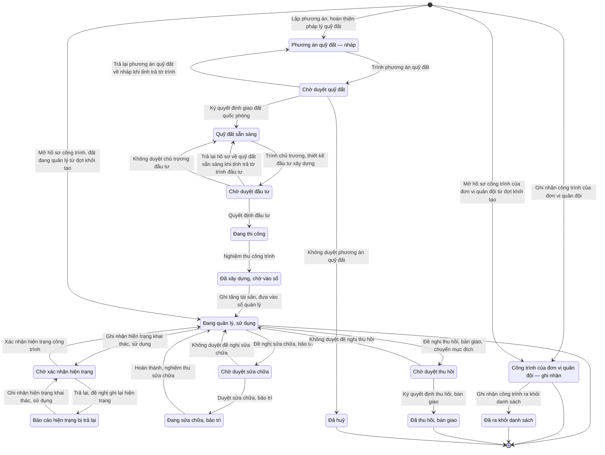

# qt-23 · Công trình, đất quốc phòng

<!-- máy sinh: tom-tat -->
> **Hồ sơ:** Công trình, đất đai quốc phòng (`DefenceWork`)
>
> **Trong sổ phạm vi:** 23 · Công trình, đất quốc phòng (tầng 2)
>
> 34 bước · 16 chặng · 4 vai · 0 bảng quyết định · 0 hạn · 21 khớp nối.
>
> **Nguồn:** sổ nghiệp vụ `qt-23` · khai báo của app: `dqtv-app/core/processes/defence-work/workflow/defence-work.yaml`. Các bảng do máy sinh từ nguồn này.
<!-- hết: tom-tat -->

<!-- viết tay: dien-giai -->
## Diễn giải

*Phần này viết tay, diễn giải lại điều các bảng bên dưới ghi.*

### Quy trình này để làm gì

Theo dõi một **công trình, mảnh đất quốc phòng**: xin quỹ đất, xin đầu tư xây dựng, ghi vào sổ tài sản, rồi quản lý, sửa chữa và thu hồi. Có năm loại: trụ sở, thao trường, bãi tập, doanh trại, đất quốc phòng.

Hồ sơ có 13 chặng, đi theo dòng: quỹ đất → đầu tư → vào sổ → quản lý → (bảo trì hoặc thu hồi). Từ chặng *Đang quản lý, sử dụng* rẽ ra ba vòng (ghi hiện trạng, sửa chữa, thu hồi); hai vòng đầu luôn quay về chính chặng ấy, vòng thu hồi quay về nếu không được duyệt.

### Khi nào bắt đầu

Nhân viên tài chính kiêm hậu cần bấm **Lập phương án, hoàn thiện pháp lý quỹ đất**, bắt buộc nhập tên công trình, đất, loại, diện tích, đơn vị quản lý (`unitId`) và việc gốc (`taskingId`); kế hoạch chứa công trình nhập nếu có. Hồ sơ mở ra có nối tới *Đơn vị dân quân tự vệ* (29), *Nhiệm vụ trên giao* (1) và *Kế hoạch, văn kiện* (2), rồi vào chặng *Chờ duyệt quỹ đất*.

### Diễn ra thế nào

**Người làm ở cấp tỉnh.** Sáu bước duyệt, không duyệt về quỹ đất, đầu tư, thu hồi và hai bước duyệt, không duyệt sửa chữa dưới đây do Bộ CHQS cấp tỉnh làm, là người thuộc cấp trên của chủ hồ sơ.

**Chặng "Chờ duyệt quỹ đất"**: **Ký quyết định giao đất quốc phòng** (nhập số, ngày, bản quét quyết định) → *Quỹ đất sẵn sàng*; hoặc **Không duyệt phương án quỹ đất** (ghi lý do) → *Đã huỷ*, kết thúc.

**Xin đầu tư** — bốn chặng nối nhau:

1. Ở *Quỹ đất sẵn sàng*, Nhân viên tài chính kiêm hậu cần bấm **Trình ký tờ trình đầu tư**, kèm tệp tờ trình; bước này ghi mối nối tới một *Văn bản đi* (quy trình 1). Hồ sơ sang *Chờ ký tờ trình đầu tư*.
2. Chỉ huy trưởng Ban CHQS xã bấm **Ký tờ trình** → *Tờ trình đầu tư đã ký, chờ vào sổ*. Hoặc **Trả lại tờ trình** (ghi cần sửa gì) → về *Quỹ đất sẵn sàng*; trả lại được cả sau khi đã ký.
3. Nhân viên văn thư bấm **Trình chủ trương, thiết kế đầu tư xây dựng**, nhập dự toán đầu tư và bản chụp tờ trình đã ký; nơi nhận là `province_chairman` → *Chờ duyệt đầu tư*.
4. **Quyết định đầu tư, nghiệm thu công trình** (số quyết định, ngày nghiệm thu, bản quét) → *Đã xây dựng, chờ vào sổ*; hoặc **Không duyệt chủ trương đầu tư** (ghi lý do) → về *Quỹ đất sẵn sàng*.

**Chặng "Đã xây dựng, chờ vào sổ"** — Nhân viên tài chính kiêm hậu cần bấm **Ghi tăng tài sản, đưa vào sổ quản lý**, nhập số vào sổ tài sản → *Đang quản lý, sử dụng*.

**Chặng "Đang quản lý, sử dụng"** — Nhân viên tài chính kiêm hậu cần mở một trong ba vòng:

- Hiện trạng: **Ghi nhận hiện trạng khai thác, sử dụng** (ghi hiện trạng và nối tới một *Lượt rà hiện trạng công trình*) → *Chờ xác nhận hiện trạng*. Chỉ huy trưởng Ban CHQS xã **Xác nhận hiện trạng công trình**, hoặc **Trả lại, đề nghị ghi lại hiện trạng** (ghi lý do). Cả hai đều đưa hồ sơ về *Đang quản lý, sử dụng*.
- Sửa chữa: **Đề nghị sửa chữa, bảo trì** (nội dung, dự toán; nối tới một *Lượt sửa chữa, bảo trì*) → *Chờ duyệt sửa chữa*. Bộ CHQS cấp tỉnh (thuộc cấp trên của chủ hồ sơ) **Duyệt sửa chữa, bảo trì** → *Đang sửa chữa, bảo trì*, hoặc **Không duyệt đề nghị sửa chữa** (ghi lý do) → về *Đang quản lý, sử dụng*. Nhân viên tài chính kiêm hậu cần bấm **Hoàn thành, nghiệm thu sửa chữa**, nhập ngày hoàn thành → về *Đang quản lý, sử dụng*.
- Thu hồi: **Đề nghị thu hồi, bàn giao, chuyển mục đích** (ghi lý do) → *Chờ duyệt thu hồi*. **Ký quyết định thu hồi, bàn giao** (số, ngày, bản quét) → *Đã thu hồi, bàn giao*, kết thúc; hoặc **Không duyệt đề nghị thu hồi** (ghi lý do) → về *Đang quản lý, sử dụng*.

Cũng tại chặng này, Nhân viên tài chính kiêm hậu cần làm bước `inventoryDefenceWork`, hồ sơ đứng yên: ghi `inventoryKind` (`annual` hoặc `five_year`), `inventoriedAt`, `inventoryMinutesScan`.

### Kết thúc và để lại gì

Hồ sơ có ba chặng kết thúc: *Đang quản lý, sử dụng*, *Đã thu hồi, bàn giao*, *Đã huỷ*. Lúc mở, hồ sơ ghi ba mối nối: việc gốc (quy trình 1), kế hoạch chứa công trình (quy trình 2) và đơn vị quản lý (quy trình 29). Giữa chừng, bước trình ký tờ trình đầu tư gắn hồ sơ với văn bản đi mang tờ trình (quy trình 1).

### Điều kiện chặn

- 12 bước đòi người làm là người của đơn vị chủ hồ sơ; 8 bước của Bộ CHQS cấp tỉnh đòi người làm là người của một đơn vị nằm trong ô cấp trên của chủ hồ sơ; bước mở không đòi gì.
- Sai người, sai chặng thì bước bị chặn, hồ sơ giữ nguyên.
- Các bước không duyệt, trả lại: bắt buộc ghi lý do (trả lại tờ trình: "cần sửa gì").
<!-- hết viết tay -->

## 1. Đường đi ngắn nhất qua các chặng

<!-- máy sinh: luong-chinh -->
Đường ít bước nhất từ lúc mở hồ sơ tới chặng kết thúc xa nhất. Máy chọn theo số chặng, không theo ý nghĩa nghiệp vụ — trình tự công việc thật xem phần Diễn giải và bảng "Việc làm ở từng chặng" ở mục 6.

| # | Ai làm | Làm gì | Hồ sơ sang chặng |
|---|---|---|---|
| 1 | Hệ thống tự làm | Mở hồ sơ công trình, đất đang quản lý từ đợt khởi tạo | Đang quản lý, sử dụng |
| 2 | Nhân viên tài chính kiêm hậu cần | Đề nghị thu hồi, bàn giao, chuyển mục đích | Chờ duyệt thu hồi |
| 3 | Bộ CHQS cấp tỉnh (thuộc cấp trên của chủ hồ sơ) | Ký quyết định thu hồi, bàn giao | Đã thu hồi, bàn giao |

<!-- hết: luong-chinh -->

## 2. Hồ sơ và việc nó để lại

<!-- máy sinh: muc-tieu -->
**App gọi quy trình này là:** Cụm RC-TC — Công trình, đất đai quốc phòng.

**Khi mở, hồ sơ này ghi mối nối tới:**
- Chỉ tiêu (2) — bước `proposeLand`, khớp nối `defenceWorkUnderTarget`
- Kế hoạch, văn kiện (2) — bước `proposeLand`, khớp nối `defenceWorkUnderPlan`
- Nhiệm vụ trên giao (1) — bước `proposeLand`, khớp nối `defenceWorkServesTasking`
- Đơn vị dân quân tự vệ (29) — bước `openDefenceWorkFromOnboarding`, khớp nối `managedByUnit`
- Đơn vị dân quân tự vệ (29) — bước `proposeLand`, khớp nối `managedByUnit`

**Hồ sơ này để lại cho quy trình khác** (bước tạo hồ sơ của quy trình kia ghi mối nối về đây):
- Công trình trong phạm vi bảo vệ (41) — bước `addZoneStructureByProvince`, khớp nối `protectedDefenceWork`
- Công trình trong phạm vi bảo vệ (41) — bước `reportZoneStructure`, khớp nối `protectedDefenceWork`
- Đề nghị cấp kinh phí (4.funding-request) — bước `estimateCommuneFundingRequest`, khớp nối `fundingRequestFromDefenceWork`
- Đề nghị cấp kinh phí (4.funding-request) — bước `estimateProvinceFundingRequest`, khớp nối `fundingRequestFromDefenceWork`
<!-- hết: muc-tieu -->

## 3. Khởi phát và kết thúc

<!-- máy sinh: khoi-phat -->
**4 cửa vào** — bước mở hồ sơ:

| Bước mở | Ai mở | Hồ sơ vào chặng | App bắt buộc nhập |
|---|---|---|---|
| Lập phương án, hoàn thiện pháp lý quỹ đất | Nhân viên tài chính kiêm hậu cần | Phương án quỹ đất — nháp | tên công trình, đất, loại, diện tích (m²), `unitId` |
| Ghi nhận công trình của đơn vị quân đội | Bộ CHQS cấp tỉnh | Công trình của đơn vị quân đội — ghi nhận | tên công trình, đất, mã xã, loại công trình, nhóm công trình, đơn vị quân đội quản lý, phạm vi bảo vệ, bản chụp quyết định, bản đồ phạm vi bảo vệ |
| Mở hồ sơ công trình, đất đang quản lý từ đợt khởi tạo | Hệ thống tự làm | Đang quản lý, sử dụng | tên công trình, đất, loại, diện tích (m²), `unitId`, dòng của đợt khởi tạo |
| Mở hồ sơ công trình của đơn vị quân đội từ đợt khởi tạo | Hệ thống tự làm | Công trình của đơn vị quân đội — ghi nhận | tên công trình, đất, loại công trình, nhóm công trình, đơn vị quân đội quản lý, đơn vị chủ hồ sơ, dòng của đợt khởi tạo |

**Kết thúc:** *Đang quản lý, sử dụng* (`in_use`), *Công trình của đơn vị quân đội — ghi nhận* (`external_listed`), *Đã ra khỏi danh sách* (`external_delisted`), *Đã thu hồi, bàn giao* (`withdrawn`), *Đã huỷ* (`cancelled`)
<!-- hết: khoi-phat -->

## 4. Vai trò

<!-- máy sinh: vai-tro -->
| Vai trong sổ | Tên trong app | Điều kiện | Làm những bước |
|---|---|---|---|
| `operator` | Nhân viên tài chính kiêm hậu cần |  | Lập phương án, hoàn thiện pháp lý quỹ đất · Trình ký tờ trình phương án quỹ đất · Trình ký tờ trình đầu tư · Nghiệm thu công trình · Ghi tăng tài sản, đưa vào sổ quản lý · Ghi nhận hiện trạng khai thác, sử dụng · Đề nghị sửa chữa, bảo trì · Hoàn thành, nghiệm thu sửa chữa · Đề nghị thu hồi, bàn giao, chuyển mục đích · Ghi kiểm kê công trình, đất · Cập nhật phạm vi bảo vệ |
| `system` | Hệ thống tự làm |  | Trình phương án quỹ đất · Trả lại phương án quỹ đất về nháp khi tỉnh trả tờ trình · Không duyệt phương án quỹ đất · Trình chủ trương, thiết kế đầu tư xây dựng · Trả lại hồ sơ về quỹ đất sẵn sàng khi tỉnh trả tờ trình đầu tư · Không duyệt chủ trương đầu tư · Không duyệt đề nghị sửa chữa · Không duyệt đề nghị thu hồi · Mở hồ sơ công trình, đất đang quản lý từ đợt khởi tạo · Mở hồ sơ công trình của đơn vị quân đội từ đợt khởi tạo |
| `provincialCmd` | Bộ CHQS cấp tỉnh | thuộc cấp trên của chủ hồ sơ (`actorInSuperiorUnit`, công thức ở mục 7) | Ký quyết định giao đất quốc phòng · Trình ký văn bản không duyệt phương án quỹ đất · Quyết định đầu tư · Trình ký văn bản không duyệt chủ trương đầu tư · Duyệt sửa chữa, bảo trì · Trình ký văn bản không duyệt đề nghị sửa chữa · Ký quyết định thu hồi, bàn giao · Trình ký văn bản không duyệt đề nghị thu hồi |
| `commander` | Chỉ huy trưởng Ban CHQS xã |  | Xác nhận hiện trạng công trình · Trả lại, đề nghị ghi lại hiện trạng |
| `provincialCmd` | Bộ CHQS cấp tỉnh |  | Ghi nhận công trình của đơn vị quân đội · Cập nhật công trình của đơn vị quân đội · Ghi nhận công trình ra khỏi danh sách |

*"Tên trong app" là tên app đặt cho mã chủ thể của vai. Hồ sơ thuộc đơn vị cấp khác thì người làm là người giữ vai ấy ở đơn vị nêu trong cột "Điều kiện" (nếu sổ có ghi) và ở cột "Người làm phải thuộc" của bảng "Theo khai báo của app" (mục 7).*
<!-- hết: vai-tro -->

## 5. Nhánh phụ

<!-- máy sinh: nhanh-phu -->
**Bước khác đưa hồ sơ sang chặng mới** — đường song song, rẽ nhánh hoặc kết thúc sớm:

| Bước | Ai làm | Từ chặng | Sang chặng |
|---|---|---|---|
| Trình phương án quỹ đất | Hệ thống tự làm | Phương án quỹ đất — nháp | Chờ duyệt quỹ đất |
| Ký quyết định giao đất quốc phòng | Bộ CHQS cấp tỉnh (thuộc cấp trên của chủ hồ sơ) | Chờ duyệt quỹ đất | Quỹ đất sẵn sàng |
| Không duyệt phương án quỹ đất | Hệ thống tự làm | Chờ duyệt quỹ đất | Đã huỷ |
| Trình chủ trương, thiết kế đầu tư xây dựng | Hệ thống tự làm | Quỹ đất sẵn sàng | Chờ duyệt đầu tư |
| Quyết định đầu tư | Bộ CHQS cấp tỉnh (thuộc cấp trên của chủ hồ sơ) | Chờ duyệt đầu tư | Đang thi công |
| Nghiệm thu công trình | Nhân viên tài chính kiêm hậu cần | Đang thi công | Đã xây dựng, chờ vào sổ |
| Ghi tăng tài sản, đưa vào sổ quản lý | Nhân viên tài chính kiêm hậu cần | Đã xây dựng, chờ vào sổ | Đang quản lý, sử dụng |
| Ghi nhận hiện trạng khai thác, sử dụng | Nhân viên tài chính kiêm hậu cần | Đang quản lý, sử dụng, Báo cáo hiện trạng bị trả lại | Chờ xác nhận hiện trạng |
| Trả lại, đề nghị ghi lại hiện trạng | Chỉ huy trưởng Ban CHQS xã | Chờ xác nhận hiện trạng | Báo cáo hiện trạng bị trả lại |
| Đề nghị sửa chữa, bảo trì | Nhân viên tài chính kiêm hậu cần | Đang quản lý, sử dụng | Chờ duyệt sửa chữa |
| Duyệt sửa chữa, bảo trì | Bộ CHQS cấp tỉnh (thuộc cấp trên của chủ hồ sơ) | Chờ duyệt sửa chữa | Đang sửa chữa, bảo trì |
| Ghi nhận công trình ra khỏi danh sách | Bộ CHQS cấp tỉnh | Công trình của đơn vị quân đội — ghi nhận | Đã ra khỏi danh sách |

**Quay lại một chặng hồ sơ đã đi qua** (tính theo đường ngắn nhất từ lúc mở):

| Bước | Ai làm | Từ chặng | Về chặng |
|---|---|---|---|
| Trả lại phương án quỹ đất về nháp khi tỉnh trả tờ trình | Hệ thống tự làm | Chờ duyệt quỹ đất | Phương án quỹ đất — nháp |
| Trả lại hồ sơ về quỹ đất sẵn sàng khi tỉnh trả tờ trình đầu tư | Hệ thống tự làm | Chờ duyệt đầu tư | Quỹ đất sẵn sàng |
| Không duyệt chủ trương đầu tư | Hệ thống tự làm | Chờ duyệt đầu tư | Quỹ đất sẵn sàng |
| Xác nhận hiện trạng công trình | Chỉ huy trưởng Ban CHQS xã | Chờ xác nhận hiện trạng | Đang quản lý, sử dụng |
| Không duyệt đề nghị sửa chữa | Hệ thống tự làm | Chờ duyệt sửa chữa | Đang quản lý, sử dụng |
| Hoàn thành, nghiệm thu sửa chữa | Nhân viên tài chính kiêm hậu cần | Đang sửa chữa, bảo trì | Đang quản lý, sử dụng |
| Không duyệt đề nghị thu hồi | Hệ thống tự làm | Chờ duyệt thu hồi | Đang quản lý, sử dụng |

**Làm trong lúc hồ sơ đứng yên ở một chặng** — ghi nhận, bổ sung:

| Bước | Ai làm | Ở chặng |
|---|---|---|
| Trình ký tờ trình phương án quỹ đất | Nhân viên tài chính kiêm hậu cần | Phương án quỹ đất — nháp |
| Trình ký văn bản không duyệt phương án quỹ đất | Bộ CHQS cấp tỉnh (thuộc cấp trên của chủ hồ sơ) | Chờ duyệt quỹ đất |
| Trình ký tờ trình đầu tư | Nhân viên tài chính kiêm hậu cần | Quỹ đất sẵn sàng |
| Trình ký văn bản không duyệt chủ trương đầu tư | Bộ CHQS cấp tỉnh (thuộc cấp trên của chủ hồ sơ) | Chờ duyệt đầu tư |
| Trình ký văn bản không duyệt đề nghị sửa chữa | Bộ CHQS cấp tỉnh (thuộc cấp trên của chủ hồ sơ) | Chờ duyệt sửa chữa |
| Trình ký văn bản không duyệt đề nghị thu hồi | Bộ CHQS cấp tỉnh (thuộc cấp trên của chủ hồ sơ) | Chờ duyệt thu hồi |
| Ghi kiểm kê công trình, đất | Nhân viên tài chính kiêm hậu cần | Đang quản lý, sử dụng |
| Cập nhật phạm vi bảo vệ | Nhân viên tài chính kiêm hậu cần | Đang quản lý, sử dụng, Chờ xác nhận hiện trạng, Chờ duyệt sửa chữa, Đang sửa chữa, bảo trì, Chờ duyệt thu hồi |
| Cập nhật công trình của đơn vị quân đội | Bộ CHQS cấp tỉnh | Công trình của đơn vị quân đội — ghi nhận |

**Cửa vào khác:** 4 bước cùng mở hồ sơ — xem mục 3.

<!-- hết: nhanh-phu -->

## 6. Các chặng và việc làm ở từng chặng

<!-- máy sinh: chang -->
| Chặng | Tên hiển thị | Vào bằng bước | Kết thúc? |
|---|---|---|---|
| `land_draft` | Phương án quỹ đất — nháp | Lập phương án, hoàn thiện pháp lý quỹ đất · Trả lại phương án quỹ đất về nháp khi tỉnh trả tờ trình |  |
| `pending_land` | Chờ duyệt quỹ đất | Trình phương án quỹ đất |  |
| `land_ready` | Quỹ đất sẵn sàng | Ký quyết định giao đất quốc phòng · Trả lại hồ sơ về quỹ đất sẵn sàng khi tỉnh trả tờ trình đầu tư · Không duyệt chủ trương đầu tư |  |
| `pending_investment` | Chờ duyệt đầu tư | Trình chủ trương, thiết kế đầu tư xây dựng |  |
| `under_construction` | Đang thi công | Quyết định đầu tư |  |
| `built` | Đã xây dựng, chờ vào sổ | Nghiệm thu công trình |  |
| `in_use` | Đang quản lý, sử dụng | Ghi tăng tài sản, đưa vào sổ quản lý · Xác nhận hiện trạng công trình · Không duyệt đề nghị sửa chữa · Hoàn thành, nghiệm thu sửa chữa · Không duyệt đề nghị thu hồi · Mở hồ sơ công trình, đất đang quản lý từ đợt khởi tạo | **kết thúc** — vẫn còn bước làm được |
| `pending_review` | Chờ xác nhận hiện trạng | Ghi nhận hiện trạng khai thác, sử dụng |  |
| `review_returned` | Báo cáo hiện trạng bị trả lại | Trả lại, đề nghị ghi lại hiện trạng |  |
| `pending_repair` | Chờ duyệt sửa chữa | Đề nghị sửa chữa, bảo trì |  |
| `under_repair` | Đang sửa chữa, bảo trì | Duyệt sửa chữa, bảo trì |  |
| `pending_withdrawal` | Chờ duyệt thu hồi | Đề nghị thu hồi, bàn giao, chuyển mục đích |  |
| `external_listed` | Công trình của đơn vị quân đội — ghi nhận | Ghi nhận công trình của đơn vị quân đội · Mở hồ sơ công trình của đơn vị quân đội từ đợt khởi tạo | **kết thúc** — vẫn còn bước làm được |
| `external_delisted` | Đã ra khỏi danh sách | Ghi nhận công trình ra khỏi danh sách | **kết thúc** |
| `withdrawn` | Đã thu hồi, bàn giao | Ký quyết định thu hồi, bàn giao | **kết thúc** |
| `cancelled` | Đã huỷ | Không duyệt phương án quỹ đất | **kết thúc** |

### Việc làm ở từng chặng

Hồ sơ đang ở chặng nào thì làm được những bước nào.

| Hồ sơ đang ở chặng | Bước làm tại chặng (hồ sơ đứng yên) | Bước đưa hồ sơ sang chặng khác |
|---|---|---|
| **Phương án quỹ đất — nháp** | Trình ký tờ trình phương án quỹ đất — Nhân viên tài chính kiêm hậu cần | Trình phương án quỹ đất — Hệ thống tự làm → *Chờ duyệt quỹ đất* |
| **Chờ duyệt quỹ đất** | Trình ký văn bản không duyệt phương án quỹ đất — Bộ CHQS cấp tỉnh (thuộc cấp trên của chủ hồ sơ) | Trả lại phương án quỹ đất về nháp khi tỉnh trả tờ trình — Hệ thống tự làm → *Phương án quỹ đất — nháp* Ký quyết định giao đất quốc phòng — Bộ CHQS cấp tỉnh (thuộc cấp trên của chủ hồ sơ) → *Quỹ đất sẵn sàng* Không duyệt phương án quỹ đất — Hệ thống tự làm → *Đã huỷ* |
| **Quỹ đất sẵn sàng** | Trình ký tờ trình đầu tư — Nhân viên tài chính kiêm hậu cần | Trình chủ trương, thiết kế đầu tư xây dựng — Hệ thống tự làm → *Chờ duyệt đầu tư* |
| **Chờ duyệt đầu tư** | Trình ký văn bản không duyệt chủ trương đầu tư — Bộ CHQS cấp tỉnh (thuộc cấp trên của chủ hồ sơ) | Trả lại hồ sơ về quỹ đất sẵn sàng khi tỉnh trả tờ trình đầu tư — Hệ thống tự làm → *Quỹ đất sẵn sàng* Quyết định đầu tư — Bộ CHQS cấp tỉnh (thuộc cấp trên của chủ hồ sơ) → *Đang thi công* Không duyệt chủ trương đầu tư — Hệ thống tự làm → *Quỹ đất sẵn sàng* |
| **Đang thi công** | — | Nghiệm thu công trình — Nhân viên tài chính kiêm hậu cần → *Đã xây dựng, chờ vào sổ* |
| **Đã xây dựng, chờ vào sổ** | — | Ghi tăng tài sản, đưa vào sổ quản lý — Nhân viên tài chính kiêm hậu cần → *Đang quản lý, sử dụng* |
| **Đang quản lý, sử dụng** | Ghi kiểm kê công trình, đất — Nhân viên tài chính kiêm hậu cần Cập nhật phạm vi bảo vệ — Nhân viên tài chính kiêm hậu cần | Ghi nhận hiện trạng khai thác, sử dụng — Nhân viên tài chính kiêm hậu cần → *Chờ xác nhận hiện trạng* Đề nghị sửa chữa, bảo trì — Nhân viên tài chính kiêm hậu cần → *Chờ duyệt sửa chữa* Đề nghị thu hồi, bàn giao, chuyển mục đích — Nhân viên tài chính kiêm hậu cần → *Chờ duyệt thu hồi* |
| **Chờ xác nhận hiện trạng** | Cập nhật phạm vi bảo vệ — Nhân viên tài chính kiêm hậu cần | Xác nhận hiện trạng công trình — Chỉ huy trưởng Ban CHQS xã → *Đang quản lý, sử dụng* Trả lại, đề nghị ghi lại hiện trạng — Chỉ huy trưởng Ban CHQS xã → *Báo cáo hiện trạng bị trả lại* |
| **Báo cáo hiện trạng bị trả lại** | — | Ghi nhận hiện trạng khai thác, sử dụng — Nhân viên tài chính kiêm hậu cần → *Chờ xác nhận hiện trạng* |
| **Chờ duyệt sửa chữa** | Trình ký văn bản không duyệt đề nghị sửa chữa — Bộ CHQS cấp tỉnh (thuộc cấp trên của chủ hồ sơ) Cập nhật phạm vi bảo vệ — Nhân viên tài chính kiêm hậu cần | Duyệt sửa chữa, bảo trì — Bộ CHQS cấp tỉnh (thuộc cấp trên của chủ hồ sơ) → *Đang sửa chữa, bảo trì* Không duyệt đề nghị sửa chữa — Hệ thống tự làm → *Đang quản lý, sử dụng* |
| **Đang sửa chữa, bảo trì** | Cập nhật phạm vi bảo vệ — Nhân viên tài chính kiêm hậu cần | Hoàn thành, nghiệm thu sửa chữa — Nhân viên tài chính kiêm hậu cần → *Đang quản lý, sử dụng* |
| **Chờ duyệt thu hồi** | Trình ký văn bản không duyệt đề nghị thu hồi — Bộ CHQS cấp tỉnh (thuộc cấp trên của chủ hồ sơ) Cập nhật phạm vi bảo vệ — Nhân viên tài chính kiêm hậu cần | Ký quyết định thu hồi, bàn giao — Bộ CHQS cấp tỉnh (thuộc cấp trên của chủ hồ sơ) → *Đã thu hồi, bàn giao* Không duyệt đề nghị thu hồi — Hệ thống tự làm → *Đang quản lý, sử dụng* |
| **Công trình của đơn vị quân đội — ghi nhận** | Cập nhật công trình của đơn vị quân đội — Bộ CHQS cấp tỉnh | Ghi nhận công trình ra khỏi danh sách — Bộ CHQS cấp tỉnh → *Đã ra khỏi danh sách* |
| **Đã ra khỏi danh sách** | — | — (kết thúc) |
| **Đã thu hồi, bàn giao** | — | — (kết thúc) |
| **Đã huỷ** | — | — (kết thúc) |
<!-- hết: chang -->

## 7. Bảng bước

<!-- máy sinh: buoc -->
| # | Bước | Mã bước | Ai thực hiện | Từ chặng | Sang chặng | Phải có trước | Ghi lại |
|---|---|---|---|---|---|---|---|
| 1 | Lập phương án, hoàn thiện pháp lý quỹ đất | `proposeLand` | Nhân viên tài chính kiêm hậu cần | — (mở hồ sơ) | `land_draft` | — | nối tới Đơn vị dân quân tự vệ, nối tới Kế hoạch, văn kiện, nối tới Nhiệm vụ trên giao, nối tới Chỉ tiêu, `planDocumentId`, mã tỉnh, mã xã, tên công trình, đất, loại, diện tích (m²), đơn vị chủ hồ sơ, cấp trên của chủ hồ sơ, `id` |
| 2 | Trình ký tờ trình phương án quỹ đất | `requestSubmitLandProposalSignature` | Nhân viên tài chính kiêm hậu cần | `land_draft` | giữ nguyên | `taskingAssigned`, `noSubmitLandProposalDocumentOpen`, người làm thuộc đơn vị chủ hồ sơ | nối tới Chỉ tiêu, nối tới Nhiệm vụ trên giao, nối tới Văn bản đi |
| 3 | Trình phương án quỹ đất | `submitLandProposal` | Hệ thống tự làm | `land_draft` | `pending_land` | `submitLandProposalDocumentIssued` | trình phương án quỹ đất lúc, nối `submissionDeliveredAs` |
| 4 | Trả lại phương án quỹ đất về nháp khi tỉnh trả tờ trình | `returnLandProposalByReceiver` | Hệ thống tự làm | `pending_land` | `land_draft` | — | —; **xoá:** trình phương án quỹ đất lúc |
| 5 | Ký quyết định giao đất quốc phòng | `approveLand` | Bộ CHQS cấp tỉnh (thuộc cấp trên của chủ hồ sơ) | `pending_land` | `land_ready` | người làm thuộc cấp trên của chủ hồ sơ, `submissionDistributedAtReceiver`, `noRejectLandDocumentOpen`, `approveLandFromIncomingDocumentUsable` | số QĐ giao đất, ngày QĐ giao đất, nối tới Văn bản đến |
| 6 | Trình ký văn bản không duyệt phương án quỹ đất | `requestRejectLandSignature` | Bộ CHQS cấp tỉnh (thuộc cấp trên của chủ hồ sơ) | `pending_land` | giữ nguyên | `submissionDistributedAtReceiver`, `noRejectLandDocumentOpen`, người làm thuộc cấp trên của chủ hồ sơ | lý do không duyệt — xã biết vì sao, nối tới Văn bản đi |
| 7 | Không duyệt phương án quỹ đất | `rejectLand` | Hệ thống tự làm | `pending_land` | `cancelled` | `rejectLandDocumentIssued` | nối `returnDeliveredAs` |
| 8 | Trình ký tờ trình đầu tư | `requestInvestmentSignature` | Nhân viên tài chính kiêm hậu cần | `land_ready` | giữ nguyên | người làm thuộc đơn vị chủ hồ sơ, `noProposeInvestmentDocumentOpen` | nối tới Văn bản đi (`link.defenceWorkSubmittedByDocument`), nối tới Văn bản đi (`link.proposeInvestmentByDocument`) |
| 9 | Trình chủ trương, thiết kế đầu tư xây dựng | `proposeInvestment` | Hệ thống tự làm | `land_ready` | `pending_investment` | `proposeInvestmentDocumentIssued` | nối `submissionDeliveredAs` |
| 10 | Trả lại hồ sơ về quỹ đất sẵn sàng khi tỉnh trả tờ trình đầu tư | `returnInvestmentProposalByReceiver` | Hệ thống tự làm | `pending_investment` | `land_ready` | — | — |
| 11 | Quyết định đầu tư | `approveInvestment` | Bộ CHQS cấp tỉnh (thuộc cấp trên của chủ hồ sơ) | `pending_investment` | `under_construction` | người làm thuộc cấp trên của chủ hồ sơ, `submissionDistributedAtReceiver`, `noRejectInvestmentDocumentOpen`, `approveInvestmentFromIncomingDocumentUsable` | số QĐ đầu tư, nối tới Văn bản đến |
| 12 | Nghiệm thu công trình | `completeConstruction` | Nhân viên tài chính kiêm hậu cần | `under_construction` | `built` | người làm thuộc đơn vị chủ hồ sơ | ngày nghiệm thu |
| 13 | Trình ký văn bản không duyệt chủ trương đầu tư | `requestRejectInvestmentSignature` | Bộ CHQS cấp tỉnh (thuộc cấp trên của chủ hồ sơ) | `pending_investment` | giữ nguyên | `submissionDistributedAtReceiver`, `noRejectInvestmentDocumentOpen`, người làm thuộc cấp trên của chủ hồ sơ | lý do không duyệt — xã biết vì sao, nối tới Văn bản đi |
| 14 | Không duyệt chủ trương đầu tư | `rejectInvestment` | Hệ thống tự làm | `pending_investment` | `land_ready` | `rejectInvestmentDocumentIssued` | nối `returnDeliveredAs` |
| 15 | Ghi tăng tài sản, đưa vào sổ quản lý | `recordAsset` | Nhân viên tài chính kiêm hậu cần | `built` | `in_use` | người làm thuộc đơn vị chủ hồ sơ | số vào sổ tài sản, phạm vi bảo vệ, bản chụp quyết định, bản đồ phạm vi bảo vệ |
| 16 | Ghi nhận hiện trạng khai thác, sử dụng | `reviewCondition` | Nhân viên tài chính kiêm hậu cần | `in_use`, `review_returned` | `pending_review` | người làm thuộc đơn vị chủ hồ sơ | hiện trạng công trình, đất, nối tới Lượt rà hiện trạng công trình; **xoá:** lý do từ chối |
| 17 | Xác nhận hiện trạng công trình | `confirmCondition` | Chỉ huy trưởng Ban CHQS xã | `pending_review` | `in_use` | người làm thuộc đơn vị chủ hồ sơ | kết quả xác nhận hiện trạng, chỉ huy trưởng quyết lúc |
| 18 | Trả lại, đề nghị ghi lại hiện trạng | `returnCondition` | Chỉ huy trưởng Ban CHQS xã | `pending_review` | `review_returned` | người làm thuộc đơn vị chủ hồ sơ | lý do từ chối, kết quả xác nhận hiện trạng, chỉ huy trưởng quyết lúc |
| 19 | Đề nghị sửa chữa, bảo trì | `requestRepair` | Nhân viên tài chính kiêm hậu cần | `in_use` | `pending_repair` | người làm thuộc đơn vị chủ hồ sơ | nội dung sửa chữa, bảo trì, dự toán sửa chữa, nối tới Lượt sửa chữa, bảo trì |
| 20 | Duyệt sửa chữa, bảo trì | `approveRepair` | Bộ CHQS cấp tỉnh (thuộc cấp trên của chủ hồ sơ) | `pending_repair` | `under_repair` | người làm thuộc cấp trên của chủ hồ sơ, `noRejectRepairDocumentOpen` | — |
| 21 | Trình ký văn bản không duyệt đề nghị sửa chữa | `requestRejectRepairSignature` | Bộ CHQS cấp tỉnh (thuộc cấp trên của chủ hồ sơ) | `pending_repair` | giữ nguyên | `noRejectRepairDocumentOpen`, người làm thuộc cấp trên của chủ hồ sơ | lý do không duyệt — xã biết vì sao, nối tới Văn bản đi |
| 22 | Không duyệt đề nghị sửa chữa | `rejectRepair` | Hệ thống tự làm | `pending_repair` | `in_use` | `rejectRepairDocumentIssued` | nối `returnDeliveredAs` |
| 23 | Hoàn thành, nghiệm thu sửa chữa | `completeRepair` | Nhân viên tài chính kiêm hậu cần | `under_repair` | `in_use` | người làm thuộc đơn vị chủ hồ sơ | ngày hoàn thành sửa chữa |
| 24 | Đề nghị thu hồi, bàn giao, chuyển mục đích | `requestWithdrawal` | Nhân viên tài chính kiêm hậu cần | `in_use` | `pending_withdrawal` | người làm thuộc đơn vị chủ hồ sơ | lý do thu hồi, bàn giao, chuyển mục đích |
| 25 | Ký quyết định thu hồi, bàn giao | `approveWithdrawal` | Bộ CHQS cấp tỉnh (thuộc cấp trên của chủ hồ sơ) | `pending_withdrawal` | `withdrawn` | người làm thuộc cấp trên của chủ hồ sơ, `noRejectWithdrawalDocumentOpen`, `approveWithdrawalFromIncomingDocumentUsable` | số QĐ thu hồi, ngày thu hồi, nối tới Văn bản đến |
| 26 | Trình ký văn bản không duyệt đề nghị thu hồi | `requestRejectWithdrawalSignature` | Bộ CHQS cấp tỉnh (thuộc cấp trên của chủ hồ sơ) | `pending_withdrawal` | giữ nguyên | `noRejectWithdrawalDocumentOpen`, người làm thuộc cấp trên của chủ hồ sơ | lý do không duyệt — xã biết vì sao, nối tới Văn bản đi |
| 27 | Không duyệt đề nghị thu hồi | `rejectWithdrawal` | Hệ thống tự làm | `pending_withdrawal` | `in_use` | `rejectWithdrawalDocumentIssued` | nối `returnDeliveredAs` |
| 28 | Ghi kiểm kê công trình, đất | `inventoryDefenceWork` | Nhân viên tài chính kiêm hậu cần | `in_use` | giữ nguyên | người làm thuộc đơn vị chủ hồ sơ | loại kiểm kê, ngày kiểm kê, biên bản kiểm kê (ảnh/bản quét) |
| 29 | Cập nhật phạm vi bảo vệ | `updateDefenceWorkProtectionScope` | Nhân viên tài chính kiêm hậu cần | `in_use`, `pending_review`, `pending_repair`, `under_repair`, `pending_withdrawal` | giữ nguyên | người làm thuộc đơn vị chủ hồ sơ | phạm vi bảo vệ, bản chụp quyết định, bản đồ phạm vi bảo vệ |
| 30 | Ghi nhận công trình của đơn vị quân đội | `registerMilitaryUnitWork` | Bộ CHQS cấp tỉnh | — (mở hồ sơ) | `external_listed` | — | đơn vị chủ hồ sơ, cấp trên của chủ hồ sơ, tên công trình, đất, loại công trình, nhóm công trình, đơn vị quân đội quản lý, phạm vi bảo vệ, bản chụp quyết định, bản đồ phạm vi bảo vệ |
| 31 | Cập nhật công trình của đơn vị quân đội | `updateMilitaryUnitWork` | Bộ CHQS cấp tỉnh | `external_listed` | giữ nguyên | người làm thuộc đơn vị chủ hồ sơ | tên công trình, đất, loại công trình, nhóm công trình, đơn vị quân đội quản lý, phạm vi bảo vệ, bản chụp quyết định, bản đồ phạm vi bảo vệ |
| 32 | Ghi nhận công trình ra khỏi danh sách | `delistMilitaryUnitWork` | Bộ CHQS cấp tỉnh | `external_listed` | `external_delisted` | người làm thuộc đơn vị chủ hồ sơ, `delistMilitaryUnitWorkFromIncomingDocumentUsable` | lý do ra khỏi danh sách, ngày quyết định, cơ quan ra quyết định, nối tới Văn bản đến |
| 33 | Mở hồ sơ công trình, đất đang quản lý từ đợt khởi tạo | `openDefenceWorkFromOnboarding` | Hệ thống tự làm | — (mở hồ sơ) | `in_use` | `defenceWorkOnboardingConfirmed` | đơn vị chủ hồ sơ, cấp trên của chủ hồ sơ, nối tới Đơn vị dân quân tự vệ, tên công trình, đất, loại, diện tích (m²), số QĐ giao đất, quyết định giao đất (ảnh/bản quét), số vào sổ tài sản, phạm vi bảo vệ, bản chụp quyết định, bản đồ phạm vi bảo vệ |
| 34 | Mở hồ sơ công trình của đơn vị quân đội từ đợt khởi tạo | `openMilitaryUnitWorkFromOnboarding` | Hệ thống tự làm | — (mở hồ sơ) | `external_listed` | `militaryUnitWorkOnboardingConfirmed` | đơn vị chủ hồ sơ, cấp trên của chủ hồ sơ, tên công trình, đất, loại công trình, nhóm công trình, đơn vị quân đội quản lý, phạm vi bảo vệ, bản chụp quyết định, bản đồ phạm vi bảo vệ |

### Khi không đạt điều kiện

Mặc định: không đúng người, hồ sơ không ở đúng chặng, hoặc thiếu thứ "phải có trước" thì bước bị chặn, hồ sơ giữ nguyên. Bảng dưới chỉ kê những bước có kết quả riêng.

| # | Bước | Kết quả riêng |
|---|---|---|
| 3 | Trình phương án quỹ đất | bước này không do người nào bấm |
| 4 | Trả lại phương án quỹ đất về nháp khi tỉnh trả tờ trình | bước này không do người nào bấm |
| 7 | Không duyệt phương án quỹ đất | bước này không do người nào bấm |
| 9 | Trình chủ trương, thiết kế đầu tư xây dựng | bước này không do người nào bấm |
| 10 | Trả lại hồ sơ về quỹ đất sẵn sàng khi tỉnh trả tờ trình đầu tư | bước này không do người nào bấm |
| 14 | Không duyệt chủ trương đầu tư | bước này không do người nào bấm |
| 22 | Không duyệt đề nghị sửa chữa | bước này không do người nào bấm |
| 27 | Không duyệt đề nghị thu hồi | bước này không do người nào bấm |
| 33 | Mở hồ sơ công trình, đất đang quản lý từ đợt khởi tạo | bước này không do người nào bấm |
| 34 | Mở hồ sơ công trình của đơn vị quân đội từ đợt khởi tạo | bước này không do người nào bấm |

### Điều kiện "phải có trước" bằng lời

Cột "Phải có trước" ở bảng bước có hai loại: ô dữ liệu thường (bước chỉ đòi ô ấy đã có giá trị) và điều kiện hệ tự xét. Bảng này diễn các điều kiện hệ tự xét theo đúng công thức sổ ghi; số ở cột cuối là số thứ tự bước.

| Điều kiện | Đúng khi | Bước đòi |
|---|---|---|
| `taskingAssigned` | đã có nối tới Chỉ tiêu HOẶC đã có nối tới Nhiệm vụ trên giao | 2 |
| `noSubmitLandProposalDocumentOpen` | KHÔNG (có hồ sơ Việc luật giao kèm văn bản đến, đi — Văn bản đi (qt-1.outgoing-document) chính là hồ sơ ghi ở ô nối `submitLandProposalByDocument` của hồ sơ đang làm mà hồ sơ ấy đang ở chặng `DRAFT` hoặc `PENDING_SIGNATURE` hoặc `SIGNED`) | 2 |
| `actorInOwnerUnit` | người đang làm là người của đơn vị ghi ở ô đơn vị chủ hồ sơ của hồ sơ này (theo danh mục người của đơn vị, `dm.unit-staff`) | 2, 8, 12, 15, 16, 17, 18, 19, 23, 24, 28, 29, 31, 32 |
| `submitLandProposalDocumentIssued` | có hồ sơ Việc luật giao kèm văn bản đến, đi — Văn bản đi (qt-1.outgoing-document) chính là hồ sơ ghi ở ô nối `submitLandProposalByDocument` của hồ sơ đang làm mà hồ sơ ấy đang ở chặng `ISSUED` | 3 |
| `actorInSuperiorUnit` | người đang làm là người của một đơn vị nằm trong ô cấp trên của chủ hồ sơ của hồ sơ này (theo danh mục người của đơn vị, `dm.unit-staff`) | 5, 6, 11, 13, 20, 21, 25, 26 |
| `submissionDistributedAtReceiver` | có hồ sơ Việc luật giao kèm văn bản đến, đi — Văn bản đến (qt-1.incoming-document) chính là hồ sơ ghi ở ô nối `submissionDeliveredAs` của hồ sơ đang làm mà hồ sơ ấy đang ở chặng `DISTRIBUTED` | 5, 6, 11, 13 |
| `noRejectLandDocumentOpen` | KHÔNG (có hồ sơ Việc luật giao kèm văn bản đến, đi — Văn bản đi (qt-1.outgoing-document) chính là hồ sơ ghi ở ô nối `rejectLandByDocument` của hồ sơ đang làm mà hồ sơ ấy đang ở chặng `DRAFT` hoặc `PENDING_SIGNATURE` hoặc `SIGNED`) | 5, 6 |
| `approveLandFromIncomingDocumentUsable` | có hồ sơ Việc luật giao kèm văn bản đến, đi — Văn bản đến (qt-1.incoming-document) chính là hồ sơ ghi ở ô nối `approveLandFromIncomingDocument` của hồ sơ đang làm mà hồ sơ ấy đang ở chặng `RECEIVED` hoặc `DISTRIBUTED` | 5 |
| `rejectLandDocumentIssued` | có hồ sơ Việc luật giao kèm văn bản đến, đi — Văn bản đi (qt-1.outgoing-document) chính là hồ sơ ghi ở ô nối `rejectLandByDocument` của hồ sơ đang làm mà hồ sơ ấy đang ở chặng `ISSUED` | 7 |
| `noProposeInvestmentDocumentOpen` | KHÔNG (có hồ sơ Việc luật giao kèm văn bản đến, đi — Văn bản đi (qt-1.outgoing-document) chính là hồ sơ ghi ở ô nối `proposeInvestmentByDocument` của hồ sơ đang làm mà hồ sơ ấy đang ở chặng `DRAFT` hoặc `PENDING_SIGNATURE` hoặc `SIGNED`) | 8 |
| `proposeInvestmentDocumentIssued` | có hồ sơ Việc luật giao kèm văn bản đến, đi — Văn bản đi (qt-1.outgoing-document) chính là hồ sơ ghi ở ô nối `proposeInvestmentByDocument` của hồ sơ đang làm mà hồ sơ ấy đang ở chặng `ISSUED` | 9 |
| `noRejectInvestmentDocumentOpen` | KHÔNG (có hồ sơ Việc luật giao kèm văn bản đến, đi — Văn bản đi (qt-1.outgoing-document) chính là hồ sơ ghi ở ô nối `rejectInvestmentByDocument` của hồ sơ đang làm mà hồ sơ ấy đang ở chặng `DRAFT` hoặc `PENDING_SIGNATURE` hoặc `SIGNED`) | 11, 13 |
| `approveInvestmentFromIncomingDocumentUsable` | có hồ sơ Việc luật giao kèm văn bản đến, đi — Văn bản đến (qt-1.incoming-document) chính là hồ sơ ghi ở ô nối `approveInvestmentFromIncomingDocument` của hồ sơ đang làm mà hồ sơ ấy đang ở chặng `RECEIVED` hoặc `DISTRIBUTED` | 11 |
| `rejectInvestmentDocumentIssued` | có hồ sơ Việc luật giao kèm văn bản đến, đi — Văn bản đi (qt-1.outgoing-document) chính là hồ sơ ghi ở ô nối `rejectInvestmentByDocument` của hồ sơ đang làm mà hồ sơ ấy đang ở chặng `ISSUED` | 14 |
| `noRejectRepairDocumentOpen` | KHÔNG (có hồ sơ Việc luật giao kèm văn bản đến, đi — Văn bản đi (qt-1.outgoing-document) chính là hồ sơ ghi ở ô nối `rejectRepairByDocument` của hồ sơ đang làm mà hồ sơ ấy đang ở chặng `DRAFT` hoặc `PENDING_SIGNATURE` hoặc `SIGNED`) | 20, 21 |
| `rejectRepairDocumentIssued` | có hồ sơ Việc luật giao kèm văn bản đến, đi — Văn bản đi (qt-1.outgoing-document) chính là hồ sơ ghi ở ô nối `rejectRepairByDocument` của hồ sơ đang làm mà hồ sơ ấy đang ở chặng `ISSUED` | 22 |
| `noRejectWithdrawalDocumentOpen` | KHÔNG (có hồ sơ Việc luật giao kèm văn bản đến, đi — Văn bản đi (qt-1.outgoing-document) chính là hồ sơ ghi ở ô nối `rejectWithdrawalByDocument` của hồ sơ đang làm mà hồ sơ ấy đang ở chặng `DRAFT` hoặc `PENDING_SIGNATURE` hoặc `SIGNED`) | 25, 26 |
| `approveWithdrawalFromIncomingDocumentUsable` | có hồ sơ Việc luật giao kèm văn bản đến, đi — Văn bản đến (qt-1.incoming-document) chính là hồ sơ ghi ở ô nối `approveWithdrawalFromIncomingDocument` của hồ sơ đang làm mà hồ sơ ấy đang ở chặng `RECEIVED` hoặc `DISTRIBUTED` | 25 |
| `rejectWithdrawalDocumentIssued` | có hồ sơ Việc luật giao kèm văn bản đến, đi — Văn bản đi (qt-1.outgoing-document) chính là hồ sơ ghi ở ô nối `rejectWithdrawalByDocument` của hồ sơ đang làm mà hồ sơ ấy đang ở chặng `ISSUED` | 27 |
| `delistMilitaryUnitWorkFromIncomingDocumentUsable` | có hồ sơ Việc luật giao kèm văn bản đến, đi — Văn bản đến (qt-1.incoming-document) chính là hồ sơ ghi ở ô nối `delistMilitaryUnitWorkFromIncomingDocument` của hồ sơ đang làm mà hồ sơ ấy đang ở chặng `RECEIVED` hoặc `DISTRIBUTED` | 32 |

### Theo khai báo của app

Người làm phải thuộc đơn vị nào, ô người dùng phải nhập, bước có lặp được không, và căn cứ pháp lý — lấy từ khai báo quy trình trong app.

| # | Bước | Người làm phải thuộc | Bắt buộc nhập | Nhập nếu có | Lặp được | Căn cứ |
|---|---|---|---|---|---|---|
| 1 | Lập phương án, hoàn thiện pháp lý quỹ đất |  | tên công trình, đất, loại, diện tích (m²), `unitId` | `taskingId`, `planDocumentIds` |  | L31/2024/QH15 Đ.200; NĐ102/2024/NĐ-CP Đ.79 |
| 2 | Trình ký tờ trình phương án quỹ đất | đơn vị chủ hồ sơ | tờ trình phương án quỹ đất (PDF) | `taskingId`, `planTargetIds` |  | L31/2024/QH15 Đ.200; NĐ102/2024/NĐ-CP Đ.79; NĐ30/2020/NĐ-CP Đ.13 |
| 3 | Trình phương án quỹ đất |  | — | — |  | L31/2024/QH15 Đ.200; NĐ102/2024/NĐ-CP Đ.79; NĐ30/2020/NĐ-CP Đ.18 |
| 4 | Trả lại phương án quỹ đất về nháp khi tỉnh trả tờ trình |  | — | — |  | NĐ30/2020/NĐ-CP Đ.21 k2 b |
| 5 | Ký quyết định giao đất quốc phòng | cấp trên của chủ hồ sơ | quyết định giao đất đã ký trong sổ văn bản đến | — |  | L31/2024/QH15 Đ.200; NĐ102/2024/NĐ-CP Đ.79; NQ66.12/2026/NQ-CP Đ.7 k3 |
| 6 | Trình ký văn bản không duyệt phương án quỹ đất | cấp trên của chủ hồ sơ | lý do không duyệt — xã biết vì sao, dự thảo văn bản không duyệt (PDF) | — |  | L31/2024/QH15 Đ.200; NĐ102/2024/NĐ-CP Đ.79; NĐ30/2020/NĐ-CP Đ.13 |
| 7 | Không duyệt phương án quỹ đất |  | lý do từ chối | — |  | L31/2024/QH15 Đ.200; NĐ102/2024/NĐ-CP Đ.79; NĐ30/2020/NĐ-CP Đ.18 |
| 8 | Trình ký tờ trình đầu tư | đơn vị chủ hồ sơ | tờ trình (PDF) | dự toán đầu tư |  | L58/2024/QH15; NQ66.12/2026/NQ-CP Đ.6 k2; NĐ30/2020/NĐ-CP Đ.10, Đ.13 |
| 9 | Trình chủ trương, thiết kế đầu tư xây dựng |  | — | — |  | L58/2024/QH15; NQ66.12/2026/NQ-CP Đ.6 k2; NĐ30/2020/NĐ-CP Đ.18, Đ.19 |
| 10 | Trả lại hồ sơ về quỹ đất sẵn sàng khi tỉnh trả tờ trình đầu tư |  | — | — |  | NĐ30/2020/NĐ-CP Đ.21 k2 b |
| 11 | Quyết định đầu tư | cấp trên của chủ hồ sơ | quyết định đầu tư đã ký trong sổ văn bản đến | — |  | L58/2024/QH15; NQ66.12/2026/NQ-CP Đ.6 k2 |
| 12 | Nghiệm thu công trình | đơn vị chủ hồ sơ | ngày nghiệm thu | — |  | L135/2025/QH15 Đ.57 k3, Đ.59 k2 đ |
| 13 | Trình ký văn bản không duyệt chủ trương đầu tư | cấp trên của chủ hồ sơ | lý do không duyệt — xã biết vì sao, dự thảo văn bản không duyệt (PDF) | — |  | L58/2024/QH15; NĐ30/2020/NĐ-CP Đ.13 |
| 14 | Không duyệt chủ trương đầu tư |  | lý do từ chối | — |  | L58/2024/QH15; NĐ30/2020/NĐ-CP Đ.18 |
| 15 | Ghi tăng tài sản, đưa vào sổ quản lý | đơn vị chủ hồ sơ | số vào sổ tài sản | phạm vi bảo vệ, bản chụp quyết định, bản đồ phạm vi bảo vệ |  | L15/2017/QH14 |
| 16 | Ghi nhận hiện trạng khai thác, sử dụng | đơn vị chủ hồ sơ | hiện trạng công trình, đất | — |  | L48/2019/QH14 Đ.7; QĐ1126/2026 Đ.16 k4 |
| 17 | Xác nhận hiện trạng công trình | đơn vị chủ hồ sơ | — | — |  | L48/2019/QH14 Đ.7; QĐ1126/2026 Đ.16 k4 |
| 18 | Trả lại, đề nghị ghi lại hiện trạng | đơn vị chủ hồ sơ | lý do từ chối | — |  | L48/2019/QH14 Đ.7; QĐ1126/2026 Đ.16 k4 |
| 19 | Đề nghị sửa chữa, bảo trì | đơn vị chủ hồ sơ | nội dung sửa chữa, bảo trì, dự toán sửa chữa | — |  | L15/2017/QH14; QĐ1126/2026 Đ.16 k4 |
| 20 | Duyệt sửa chữa, bảo trì | cấp trên của chủ hồ sơ | — | — |  | L15/2017/QH14; QĐ1126/2026 Đ.16 k4 |
| 21 | Trình ký văn bản không duyệt đề nghị sửa chữa | cấp trên của chủ hồ sơ | lý do không duyệt — xã biết vì sao, dự thảo văn bản không duyệt (PDF) | — |  | L15/2017/QH14; NĐ30/2020/NĐ-CP Đ.13 |
| 22 | Không duyệt đề nghị sửa chữa |  | lý do từ chối | — |  | L15/2017/QH14; NĐ30/2020/NĐ-CP Đ.18 |
| 23 | Hoàn thành, nghiệm thu sửa chữa | đơn vị chủ hồ sơ | ngày hoàn thành sửa chữa | — |  | L15/2017/QH14 |
| 24 | Đề nghị thu hồi, bàn giao, chuyển mục đích | đơn vị chủ hồ sơ | lý do thu hồi, bàn giao, chuyển mục đích | — |  | L31/2024/QH15 Đ.84, Đ.200 |
| 25 | Ký quyết định thu hồi, bàn giao | cấp trên của chủ hồ sơ | quyết định thu hồi, bàn giao đã ký trong sổ văn bản đến | — |  | L31/2024/QH15 Đ.84, Đ.200 |
| 26 | Trình ký văn bản không duyệt đề nghị thu hồi | cấp trên của chủ hồ sơ | lý do không duyệt — xã biết vì sao, dự thảo văn bản không duyệt (PDF) | — |  | L31/2024/QH15 Đ.200; NĐ30/2020/NĐ-CP Đ.13 |
| 27 | Không duyệt đề nghị thu hồi |  | lý do từ chối | — |  | L31/2024/QH15 Đ.200; NĐ30/2020/NĐ-CP Đ.18 |
| 28 | Ghi kiểm kê công trình, đất | đơn vị chủ hồ sơ | loại kiểm kê, ngày kiểm kê, biên bản kiểm kê (ảnh/bản quét) | — |  | L25/2023/QH15 Đ.14; CT-04 |
| 29 | Cập nhật phạm vi bảo vệ | đơn vị chủ hồ sơ | phạm vi bảo vệ, bản chụp quyết định, bản đồ phạm vi bảo vệ | — |  | L25/2023/QH15 Đ.10 k1 c, k2 b; Đ.14 k2 a |
| 30 | Ghi nhận công trình của đơn vị quân đội |  | tên công trình, đất, mã xã, loại công trình, nhóm công trình, đơn vị quân đội quản lý, phạm vi bảo vệ, bản chụp quyết định, bản đồ phạm vi bảo vệ | diện tích (m²) |  | L25/2023/QH15 Đ.10 k1 c, k2 b; Đ.14 k2 a |
| 31 | Cập nhật công trình của đơn vị quân đội | đơn vị chủ hồ sơ | — | tên công trình, đất, loại công trình, nhóm công trình, đơn vị quân đội quản lý, diện tích (m²), phạm vi bảo vệ, bản chụp quyết định, bản đồ phạm vi bảo vệ |  | L25/2023/QH15 Đ.10 k1 c, k2 b; Đ.14 k2 a |
| 32 | Ghi nhận công trình ra khỏi danh sách | đơn vị chủ hồ sơ | lý do ra khỏi danh sách, quyết định phá dỡ, chuyển mục đích đã ký trong sổ văn bản đến, cơ quan ra quyết định | — |  | L25/2023/QH15 Đ.12 k2 b, c; Đ.13 |
| 33 | Mở hồ sơ công trình, đất đang quản lý từ đợt khởi tạo |  | tên công trình, đất, loại, diện tích (m²), `unitId`, dòng của đợt khởi tạo | số QĐ giao đất, số vào sổ tài sản, phạm vi bảo vệ, quyết định giao đất (ảnh/bản quét), bản chụp quyết định, bản đồ phạm vi bảo vệ |  | sổ qt-23 · L31/2024/QH15 Đ.200; L15/2017/QH14 |
| 34 | Mở hồ sơ công trình của đơn vị quân đội từ đợt khởi tạo |  | tên công trình, đất, loại công trình, nhóm công trình, đơn vị quân đội quản lý, đơn vị chủ hồ sơ, dòng của đợt khởi tạo | diện tích (m²), phạm vi bảo vệ, bản chụp quyết định, bản đồ phạm vi bảo vệ |  | sổ qt-23 · L25/2023/QH15 Đ.10 k1 c, k2 b; Đ.14 k2 a |

### Điều kiện và ghi chú app khai cho từng bước

Lấy từ khai báo quy trình trong app. Lời trong ngoặc kép là câu app hiện cho người dùng. Chức danh người ký ngoài hệ app chỉ khai bằng mã.

| # | Bước | Điều kiện, ghi chú |
|---|---|---|
| 5 | Ký quyết định giao đất quốc phòng | · không đòi bản chụp — app ghi: "bản chụp quyết định giao đất lấy từ văn bản đến văn thư tỉnh đã vào sổ (tầng đọc chép `scanPath`), không tải ảnh ở bước này" |
| 11 | Quyết định đầu tư | · không đòi bản chụp — app ghi: "bản chụp quyết định đầu tư lấy từ văn bản đến văn thư tỉnh đã vào sổ (tầng đọc chép `scanPath`), không tải ảnh ở bước này" |
| 15 | Ghi tăng tài sản, đưa vào sổ quản lý | · không đòi bản chụp — app ghi: "assetLedgerNo là số dòng sổ kế toán tài sản, không phải văn bản phát hành riêng; biên bản nghiệm thu đính ở bước approveInvestment" |
| 16 | Ghi nhận hiện trạng khai thác, sử dụng | · tạo thêm một hồ sơ con: Lượt rà hiện trạng công trình (`ConditionReview`) |
| 19 | Đề nghị sửa chữa, bảo trì | · tạo thêm một hồ sơ con: Lượt sửa chữa, bảo trì (`RepairRound`) |
| 25 | Ký quyết định thu hồi, bàn giao | · không đòi bản chụp — app ghi: "bản chụp quyết định thu hồi lấy từ văn bản đến văn thư tỉnh đã vào sổ (tầng đọc chép `scanPath`), không tải ảnh ở bước này" |
| 28 | Ghi kiểm kê công trình, đất | · tạo thêm một hồ sơ con: Lượt kiểm kê công trình, đất (`InventoryRound`) |
| 32 | Ghi nhận công trình ra khỏi danh sách | · không đòi bản chụp — app ghi: "bản chụp quyết định phá dỡ, chuyển mục đích lấy từ văn bản đến văn thư tỉnh đã vào sổ (tầng đọc chép `scanPath`), không tải ảnh ở bước này" |
| 33 | Mở hồ sơ công trình, đất đang quản lý từ đợt khởi tạo | · không đòi bản chụp — app ghi: "bản quét đính từng dòng ở đợt khởi tạo (không bắt buộc) — dòng chưa đính thì đính sau trên hồ sơ (bước cập nhật phạm vi bảo vệ)" |
| 34 | Mở hồ sơ công trình của đơn vị quân đội từ đợt khởi tạo | · không đòi bản chụp — app ghi: "bản chụp phạm vi bảo vệ đính từng dòng ở đợt khởi tạo (không bắt buộc) — chưa đính thì đính sau (bước cập nhật công trình)" |
<!-- hết: buoc -->

## 8. Bảng quyết định, hạn, việc ngoài hệ

<!-- máy sinh: quyet-dinh -->

<!-- hết: quyet-dinh -->

## 9. Dữ liệu của hồ sơ

<!-- máy sinh: du-lieu -->
Các ô mà bước trong sổ ghi hoặc đòi. Số trong hai cột cuối là số thứ tự bước ở bảng bước (mục 7).

| Ô dữ liệu | Mã | Kiểu (app) | Giá trị cho phép | Loại ô (sổ) | Bước ghi | Bước đòi | Mô tả trong app |
|---|---|---|---|---|---|---|---|
| — | `planDocumentId` | chữ |  | lưu trên hồ sơ (`stored`) | 1 | — | id kế hoạch, dự án chứa công trình này — lọc nhanh, quan hệ thật ở defenceWorkUnderPlan |
| mã tỉnh | `provinceCode` | chữ |  | lưu trên hồ sơ (`stored`) | 1 | — | Mã tỉnh — dùng lọc phạm vi theo hàng |
| mã xã | `communeCode` | chữ |  | lưu trên hồ sơ (`stored`) | 1 | — | Mã xã |
| tên công trình, đất | `workName` | chữ |  | đưa vào ở bước (`input`) | 1, 30, 31, 33, 34 | — | Tên công trình/mảnh đất (vd Trụ sở Ban CHQS xã, Thao trường) |
| loại | `workType` | chọn một | Trụ sở làm việc (`headquarters`), Thao trường (`training_ground`), Bãi tập (`drill_field`), Doanh trại (`barracks`), Quỹ đất quốc phòng khác (`defence_land`), Công trình của đơn vị quân đội (`military_unit_work`) | đưa vào ở bước (`input`) | 1, 33 | — | Loại — trụ sở, thao trường, bãi tập (NQ66.12 Đ.7k3) · doanh trại, đất QP (NĐ102/2024 Đ.5) · công trình của đơn vị quân đội (sổ qt-23, 16/10/2026) |
| diện tích (m²) | `area` | số |  | đưa vào ở bước (`input`) | 1, 33 | — | Diện tích (m²) |
| đơn vị chủ hồ sơ | `ownerUnit` |  |  | lưu trên hồ sơ (`stored`) | 1, 30, 33, 34 | — |  |
| cấp trên của chủ hồ sơ | `superiorUnits` |  |  | hệ suy ra (`derived`) | 1, 30, 33, 34 | — |  |
| — | `id` |  |  | lưu trên hồ sơ (`stored`) | 1 | — |  |
| trình phương án quỹ đất lúc | `landProposalSubmittedAt` | ngày giờ |  | lưu trên hồ sơ (`stored`) | 3 | — | Thời điểm Ban CHQS xã trình phương án quỹ đất lên cấp tỉnh — UC-01 |
| số QĐ giao đất | `landDecisionNo` | chữ |  | lưu trên hồ sơ (`stored`) | 5, 33 | — | Số quyết định giao/thu hồi đất QP (UBND tỉnh) — UC-01 |
| ngày QĐ giao đất | `landDecisionDate` | ngày |  | lưu trên hồ sơ (`stored`) | 5 | — | Ngày quyết định giao đất — UC-01 |
| lý do từ chối | `rejectReason` | chữ |  | đưa vào ở bước (`input`) | 6, 13, 18, 21, 26 | — | Lý do cấp duyệt TỪ CHỐI đề nghị |
| số QĐ đầu tư | `investmentDecisionNo` | chữ |  | lưu trên hồ sơ (`stored`) | 11 | — | Số quyết định đầu tư (UBND tỉnh) — UC-02 |
| ngày nghiệm thu | `completionDate` | ngày |  | đưa vào ở bước (`input`) | 12 | — | Ngày nghiệm thu công trình — UC-02 |
| số vào sổ tài sản | `assetLedgerNo` | chữ |  | đưa vào ở bước (`input`) | 15, 33 | — | Số vào sổ tài sản công — đưa vào quản lý |
| phạm vi bảo vệ | `protectionScopeNote` | chữ |  | đưa vào ở bước (`input`) | 15, 29, 30, 31, 33, 34 | — | Phạm vi bảo vệ công trình theo quyết định — sổ qt-23 |
| bản chụp quyết định, bản đồ phạm vi bảo vệ | `protectionScopeScan` | tệp |  | đưa vào ở bước (`input`) | 15, 29, 30, 31, 33, 34 | — | Bản chụp quyết định, bản đồ phạm vi bảo vệ |
| hiện trạng | `conditionNote` | chữ |  | đưa vào ở bước (`input`) | 16 | — | Ghi nhận hiện trạng khai thác, sử dụng — UC-03 |
| kết quả xác nhận hiện trạng | `reviewOutcome` | chọn một | Đã xác nhận (`confirmed`), Trả lại để rà lại (`returned`) | lưu trên hồ sơ (`stored`) | 17, 18 | — | Kết quả xác nhận hiện trạng lượt gần nhất — UC-03 |
| chỉ huy trưởng quyết lúc | `reviewDecidedAt` | ngày giờ |  | lưu trên hồ sơ (`stored`) | 17, 18 | — | Thời điểm Chỉ huy trưởng quyết lượt rà gần nhất — UC-03 |
| nội dung sửa chữa | `repairReason` | chữ |  | đưa vào ở bước (`input`) | 19 | — | Lý do, nội dung sửa chữa, bảo trì — UC-04 |
| dự toán sửa chữa | `repairEstimate` | số |  | đưa vào ở bước (`input`) | 19 | — | Dự toán sửa chữa (đồng) — UC-04 |
| ngày hoàn thành sửa chữa | `repairCompletedDate` | ngày |  | đưa vào ở bước (`input`) | 23 | — | Ngày hoàn thành, nghiệm thu sửa chữa — UC-04 |
| lý do thu hồi | `withdrawalReason` | chữ |  | đưa vào ở bước (`input`) | 24 | — | Lý do thu hồi, bàn giao, chuyển mục đích — UC-05 |
| số QĐ thu hồi | `withdrawalDecisionNo` | chữ |  | lưu trên hồ sơ (`stored`) | 25 | — | Số quyết định thu hồi/bàn giao (UBND tỉnh) — UC-05 |
| ngày thu hồi | `withdrawalDate` | ngày |  | lưu trên hồ sơ (`stored`) | 25 | — | Ngày thu hồi, bàn giao — UC-05 |
| loại kiểm kê | `inventoryKind` | chọn một | Kiểm kê năm (`annual`), Tổng kiểm kê 5 năm (`five_year`) | lưu trên hồ sơ (`stored`) | 28 | — | Loại kiểm kê lượt gần nhất — năm hoặc tổng kiểm kê 5 năm |
| ngày kiểm kê | `inventoriedAt` | ngày |  | lưu trên hồ sơ (`stored`) | 28 | — | Ngày kiểm kê lượt gần nhất |
| biên bản kiểm kê (ảnh/bản quét) | `inventoryMinutesScan` | tệp |  | lưu trên hồ sơ (`stored`) | 28 | — | Ảnh/bản quét biên bản kiểm kê lượt gần nhất |
| loại công trình | `workClass` | chọn một | Loại A (`A`), Loại B (`B`), Loại C (`C`), Loại D (`D`) | đưa vào ở bước (`input`) | 30, 31, 34 | — | Loại công trình quốc phòng A–D (L25/2023/QH15) — công trình của đơn vị quân đội |
| nhóm công trình | `workGroup` | chọn một | Nhóm đặc biệt (`special`), Nhóm I (`group_1`), Nhóm II (`group_2`), Nhóm III (`group_3`) | đưa vào ở bước (`input`) | 30, 31, 34 | — | Nhóm công trình — đặc biệt, I, II, III (L25/2023/QH15) |
| đơn vị quân đội quản lý | `managingMilitaryUnit` | chữ |  | đưa vào ở bước (`input`) | 30, 31, 34 | — | Đơn vị quân đội quản lý công trình |
| lý do ra khỏi danh sách | `delistReason` | chọn một | Đã phá dỡ (Luật 25/2023 Đ.13) (`demolished`), Chuyển mục đích sang dân sự (Luật 25/2023 Đ.12 k2 b, c) (`converted_to_civil`) | đưa vào ở bước (`input`) | 32 | — | Lý do công trình của đơn vị quân đội ra khỏi danh sách |
| ngày quyết định | `delistDecisionDate` | ngày |  | lưu trên hồ sơ (`stored`) | 32 | — | Ngày quyết định phá dỡ, chuyển mục đích sang dân sự |
| cơ quan ra quyết định | `delistDecisionAgency` | chữ |  | đưa vào ở bước (`input`) | 32 | — | Cơ quan, người có thẩm quyền ra quyết định |
| quyết định giao đất (ảnh/bản quét) | `landDecisionScanPath` | tệp |  | đưa vào ở bước (`input`) | 33 | — | Ảnh/bản quét quyết định giao đất quốc phòng đã ký |
| — | `taskingAssigned` |  | có hay chưa | hệ suy ra (`derived`) | — | 2 |  |
| — | `noSubmitLandProposalDocumentOpen` |  | có hay chưa | hệ suy ra (`derived`) | — | 2 |  |
| người làm thuộc đơn vị chủ hồ sơ | `actorInOwnerUnit` |  | có hay chưa | hệ suy ra (`derived`) | — | 2, 8, 12, 15, 16, 17, 18, 19, 23, 24, 28, 29, 31, 32 |  |
| — | `submitLandProposalDocumentIssued` |  | có hay chưa | hệ suy ra (`derived`) | — | 3 |  |
| người làm thuộc cấp trên của chủ hồ sơ | `actorInSuperiorUnit` |  | có hay chưa | hệ suy ra (`derived`) | — | 5, 6, 11, 13, 20, 21, 25, 26 |  |
| — | `submissionDistributedAtReceiver` |  | có hay chưa | hệ suy ra (`derived`) | — | 5, 6, 11, 13 |  |
| — | `noRejectLandDocumentOpen` |  | có hay chưa | hệ suy ra (`derived`) | — | 5, 6 |  |
| — | `approveLandFromIncomingDocumentUsable` |  | có hay chưa | hệ suy ra (`derived`) | — | 5 |  |
| — | `rejectLandDocumentIssued` |  | có hay chưa | hệ suy ra (`derived`) | — | 7 |  |
| — | `noProposeInvestmentDocumentOpen` |  | có hay chưa | hệ suy ra (`derived`) | — | 8 |  |
| — | `proposeInvestmentDocumentIssued` |  | có hay chưa | hệ suy ra (`derived`) | — | 9 |  |
| — | `noRejectInvestmentDocumentOpen` |  | có hay chưa | hệ suy ra (`derived`) | — | 11, 13 |  |
| — | `approveInvestmentFromIncomingDocumentUsable` |  | có hay chưa | hệ suy ra (`derived`) | — | 11 |  |
| — | `rejectInvestmentDocumentIssued` |  | có hay chưa | hệ suy ra (`derived`) | — | 14 |  |
| — | `noRejectRepairDocumentOpen` |  | có hay chưa | hệ suy ra (`derived`) | — | 20, 21 |  |
| — | `rejectRepairDocumentIssued` |  | có hay chưa | hệ suy ra (`derived`) | — | 22 |  |
| — | `noRejectWithdrawalDocumentOpen` |  | có hay chưa | hệ suy ra (`derived`) | — | 25, 26 |  |
| — | `approveWithdrawalFromIncomingDocumentUsable` |  | có hay chưa | hệ suy ra (`derived`) | — | 25 |  |
| — | `rejectWithdrawalDocumentIssued` |  | có hay chưa | hệ suy ra (`derived`) | — | 27 |  |
| — | `delistMilitaryUnitWorkFromIncomingDocumentUsable` |  | có hay chưa | hệ suy ra (`derived`) | — | 32 |  |
| — | `defenceWorkOnboardingConfirmed` |  |  | đưa vào ở bước (`input`) | — | 33 |  |
| — | `militaryUnitWorkOnboardingConfirmed` |  |  | đưa vào ở bước (`input`) | — | 34 |  |

59 ô. Cột "Loại ô" là cách sổ phân loại ô, in kèm đúng chữ của sổ; ô nào người dùng phải nhập xem bảng "Theo khai báo của app" ở mục 7.
<!-- hết: du-lieu -->

## 10. Khớp nối với quy trình khác

<!-- máy sinh: khop-noi -->
| Quy trình kia | Hồ sơ kia | Quan hệ | Nội dung (mô tả trong app) | Bước ghi mối nối | Tên ô nối |
|---|---|---|---|---|---|
| 1 | Nhiệm vụ trên giao | hồ sơ này **mở ra có nối tới** hồ sơ kia | Việc gốc mà hồ sơ công trình quốc phòng này thực hiện (docs/123 §T, chốt 20/9/2026) | 23·proposeLand ⊕, 23·requestSubmitLandProposalSignature | `defenceWorkServesTasking` |
| 1.incoming-document | Văn bản đến | gắn với nhau ở một bước giữa chừng | Quyết định đầu tư xây dựng công trình quốc phòng — văn bản trong sổ văn bản đến của Bộ CHQS tỉnh (L58/2024/QH… | 23·approveInvestment | `approveInvestmentFromIncomingDocument` |
| 1.incoming-document | Văn bản đến | gắn với nhau ở một bước giữa chừng | Quyết định giao đất quốc phòng — văn bản trong sổ văn bản đến của Bộ CHQS tỉnh (L31/2024/QH15 Đ.200; NĐ102/20… | 23·approveLand | `approveLandFromIncomingDocument` |
| 1.incoming-document | Văn bản đến | gắn với nhau ở một bước giữa chừng | Quyết định thu hồi, bàn giao đất quốc phòng — văn bản trong sổ văn bản đến của Bộ CHQS tỉnh (L31/2024/QH15 Đ.… | 23·approveWithdrawal | `approveWithdrawalFromIncomingDocument` |
| 1.incoming-document | Văn bản đến | có nối | Văn bản không duyệt của Bộ CHQS tỉnh ở sổ văn bản đến của Ban CHQS xã | — | `defenceWorkReturnDeliveredAs` |
| 1.incoming-document | Văn bản đến | có nối | Tờ trình (phương án quỹ đất, chủ trương đầu tư) ở sổ văn bản đến của Bộ CHQS tỉnh (NĐ30/2020/NĐ-CP Đ.20–22) | — | `defenceWorkSubmissionDeliveredAs` |
| 1.incoming-document | Văn bản đến | gắn với nhau ở một bước giữa chừng | Quyết định phá dỡ, chuyển mục đích công trình sang dân sự — văn bản trong sổ văn bản đến của Bộ CHQS tỉnh (L2… | 23·delistMilitaryUnitWork | `delistMilitaryUnitWorkFromIncomingDocument` |
| 1.outgoing-document | Văn bản đi | gắn với nhau ở một bước giữa chừng | Tờ trình đi kèm mỗi lượt trình công trình quốc phòng — văn bản đi của Ban CHQS, đã ký và vào sổ (NĐ30/2020/NĐ… | 23·requestInvestmentSignature | `defenceWorkSubmittedByDocument` |
| 1.outgoing-document | Văn bản đi | gắn với nhau ở một bước giữa chừng | Tờ trình chủ trương, thiết kế đầu tư — văn bản đi của Ban CHQS xã; văn thư phát hành thì hồ sơ sang chờ duyệt… | 23·requestInvestmentSignature | `proposeInvestmentByDocument` |
| 1.outgoing-document | Văn bản đi | gắn với nhau ở một bước giữa chừng | Văn bản Bộ CHQS tỉnh không duyệt chủ trương đầu tư — văn bản đi của tỉnh | 23·requestRejectInvestmentSignature | `rejectInvestmentByDocument` |
| 1.outgoing-document | Văn bản đi | gắn với nhau ở một bước giữa chừng | Văn bản Bộ CHQS tỉnh không duyệt phương án quỹ đất — văn bản đi của tỉnh | 23·requestRejectLandSignature | `rejectLandByDocument` |
| 1.outgoing-document | Văn bản đi | gắn với nhau ở một bước giữa chừng | Văn bản Bộ CHQS tỉnh không duyệt đề nghị sửa chữa — văn bản đi của tỉnh | 23·requestRejectRepairSignature | `rejectRepairByDocument` |
| 1.outgoing-document | Văn bản đi | gắn với nhau ở một bước giữa chừng | Văn bản Bộ CHQS tỉnh không duyệt đề nghị thu hồi — văn bản đi của tỉnh | 23·requestRejectWithdrawalSignature | `rejectWithdrawalByDocument` |
| 1.outgoing-document | Văn bản đi | gắn với nhau ở một bước giữa chừng | Tờ trình phương án quỹ đất — văn bản đi của Ban CHQS xã, Chỉ huy trưởng ký (NĐ30/2020/NĐ-CP Đ.13, Đ.18) | 23·requestSubmitLandProposalSignature | `submitLandProposalByDocument` |
| 2 | Kế hoạch, văn kiện | hồ sơ này **mở ra có nối tới** hồ sơ kia | Công trình này nằm trong quy hoạch, kế hoạch đã phê duyệt — L25/2023/QH15 Đ.5 k4 | 23·proposeLand ⊕ | `defenceWorkUnderPlan` |
| 2 | Chỉ tiêu | hồ sơ này **mở ra có nối tới** hồ sơ kia | Công trình quốc phòng thực hiện theo dòng chỉ tiêu được giao — sổ qt-23 link.defenceWorkUnderTarget | 23·proposeLand ⊕, 23·requestSubmitLandProposalSignature | `defenceWorkUnderTarget` |
| 29 | Đơn vị dân quân tự vệ | hồ sơ này **mở ra có nối tới** hồ sơ kia | Đơn vị quản lý công trình, đất QP — E10 (NĐ102/2024 Đ.79) | 23·openDefenceWorkFromOnboarding ⊕, 23·proposeLand ⊕ | `managedByUnit` |
| 4.funding-request | Đề nghị cấp kinh phí | hồ sơ kia **mở ra từ** hồ sơ này | Dự trù/đề nghị kinh phí phát sinh từ công trình quốc phòng nào (đầu tư mới hoặc sửa chữa) — doc 112 §8.2 A7/A… | 4.funding-request·estimateCommuneFundingRequest ⊕, 4.funding-request·estimateProvinceFundingRequest ⊕ | `fundingRequestFromDefenceWork` |
| 41 | Công trình trong phạm vi bảo vệ | hồ sơ kia **mở ra từ** hồ sơ này | Công trình quốc phòng, khu quân sự có phạm vi bảo vệ mà công trình này nằm trong — sổ qt-41 (L25/2023/QH15 Đ.… | 41·addZoneStructureByProvince ⊕, 41·reportZoneStructure ⊕ | `protectedDefenceWork` |
| D16 | Tệp lưu trữ | có nối | Tệp thuộc hồ sơ công trình, đất quốc phòng nào | — | `fileOfDefenceWork` |
| D16 | Tệp lưu trữ | có nối | Tệp thuộc lượt kiểm kê công trình, đất quốc phòng nào | — | `fileOfInventoryRound` |

21 khớp nối. ⊕ là bước tạo hồ sơ.
<!-- hết: khop-noi -->

## 11. Thông tin chung

<!-- máy sinh: thong-tin -->
| | |
|---|---|
| **Mã trong sổ** | `qt-23` |
| **Quy trình trong app** | `defence-work` (`workflow/defence-work.yaml`) — mặt công tác: `operations` |
| **Hồ sơ** | Công trình, đất đai quốc phòng (`DefenceWork`) |
| **Căn cứ pháp lý từng bước** | cột "Căn cứ" ở bảng "Theo khai báo của app", mục 7 |
<!-- hết: thong-tin -->
