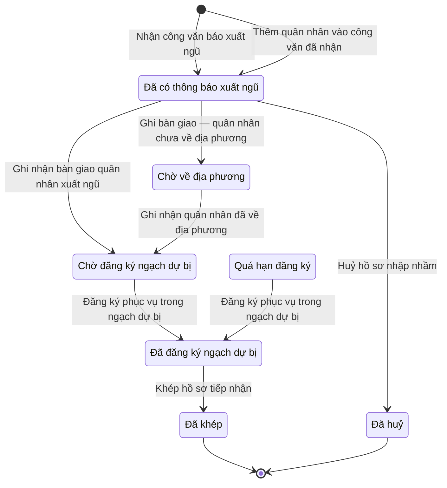

# qt-27 · Tiếp nhận quân nhân xuất ngũ

<!-- máy sinh: tom-tat -->
> **Hồ sơ:** Tiếp nhận quân nhân xuất ngũ (`DischargeIntake`)
>
> **Trong sổ phạm vi:** 27 · Tiếp nhận quân nhân xuất ngũ (tầng 3)
>
> 10 bước · 7 chặng · 2 vai · 0 bảng quyết định · 1 hạn · 7 khớp nối.
>
> **Nguồn:** sổ nghiệp vụ `qt-27` · khai báo của app: `dqtv-app/core/processes/discharge-intake/workflow/discharge-intake.yaml`. Các bảng do máy sinh từ nguồn này.
<!-- hết: tom-tat -->

<!-- viết tay: dien-giai -->
## Diễn giải

*Phần này viết tay, diễn giải lại điều các bảng bên dưới ghi.*

### Quy trình này để làm gì

Theo dõi việc **tiếp nhận một quân nhân xuất ngũ**: tỉnh nhận công văn báo xuất ngũ của đơn vị, ghi nhận bàn giao; xã ghi quân nhân đã về và đăng ký phục vụ trong ngạch dự bị; tỉnh khép hồ sơ. Mỗi hồ sơ gắn với một quyết định gọi nhập ngũ.

Hồ sơ đi qua các chặng: *Đã có thông báo xuất ngũ* → (*Chờ về địa phương*) → *Chờ đăng ký ngạch dự bị* → (*Quá hạn đăng ký*) → *Đã đăng ký ngạch dự bị* → *Đã khép*; ngoài ra có chặng *Đã huỷ*.

### Khi nào bắt đầu

Có hai cửa vào, đều do Bộ CHQS cấp tỉnh làm và đều đưa hồ sơ vào chặng *Đã có thông báo xuất ngũ*:

- **Nhận công văn báo xuất ngũ** — nhập quân nhân xuất ngũ, đơn vị bàn giao, ngày xuất ngũ dự kiến, số, ngày và bản chụp công văn.
- **Thêm quân nhân vào công văn đã nhận** — chỉ phải chọn quân nhân và công văn (`documentId`).

Cả hai bước đều mở hồ sơ có nối tới **Quyết định gọi nhập ngũ** (quy trình 17) của quân nhân ấy và tới công văn trong sổ văn bản đến. Phải đạt hai điều kiện trước khi mở:

- `personInService`: đúng khi ô `serviceRecordCalled` không phải là `no`;
- `noOpenIntakeForPerson`: đúng khi không có hồ sơ tiếp nhận nào nối tới cùng quyết định gọi nhập ngũ với hồ sơ đang làm mà còn chưa ở chặng *Đã huỷ* hoặc *Đã khép*.

### Diễn ra thế nào

**Chặng "Đã có thông báo xuất ngũ"** — chờ đơn vị bàn giao quân nhân cho tỉnh. Bộ CHQS cấp tỉnh (phải là người của đơn vị chủ hồ sơ) làm được:

- **Sửa thông tin công văn báo xuất ngũ** — sửa đơn vị bàn giao, ngày xuất ngũ dự kiến, số và ngày công văn; hồ sơ đứng yên. Bước đòi thêm điều kiện `noticeNotHandedOver`: không có hồ sơ tiếp nhận nào cùng công văn ấy đã ra khỏi hai chặng *Đã có thông báo xuất ngũ* và *Đã huỷ*.
- **Huỷ hồ sơ nhập nhầm** — bắt buộc ghi lý do; hồ sơ sang *Đã huỷ*. Dùng khi tỉnh nhập nhầm người; hồ sơ huỷ nhưng giữ vết.
- **Ghi nhận bàn giao quân nhân xuất ngũ** — nhập số và bản chụp biên bản bàn giao, số quyết định xuất ngũ, ngày xuất ngũ; hồ sơ sang thẳng *Chờ đăng ký ngạch dự bị*.
- **Ghi bàn giao — quân nhân chưa về địa phương** — nhập như trên, thêm lý do vì sao chưa về; hồ sơ sang *Chờ về địa phương*.

**Chặng "Chờ về địa phương".** Trợ lý Quân lực (phải là người của một đơn vị nằm trong ô `communeUnits` của hồ sơ) bấm **Ghi nhận quân nhân đã về địa phương**; bước ghi ngày về; hồ sơ sang *Chờ đăng ký ngạch dự bị*.

**Chặng "Chờ đăng ký ngạch dự bị".** Quân nhân phải đăng ký trong 15 ngày làm việc tính từ lúc hồ sơ vào chặng này. Trợ lý Quân lực bấm **Đăng ký phục vụ trong ngạch dự bị**: nhập ngày đăng ký, số giấy chứng nhận đăng ký quân nhân dự bị, bản quét phiếu quân nhân dự bị; hồ sơ sang *Đã đăng ký ngạch dự bị*. Quá 15 ngày làm việc chưa đăng ký thì hồ sơ sang *Quá hạn đăng ký*.

**Chặng "Quá hạn đăng ký".** Vẫn đăng ký được bằng đúng bước trên. Ngoài ra có hai việc làm tại chặng, theo thứ tự bắt buộc:

1. **Đề nghị xử lý vi phạm vì đăng ký muộn** (Trợ lý Quân lực) — bước ghi ngày đề nghị.
2. **Lập biên bản vi phạm vì đăng ký muộn** (Chỉ huy trưởng Ban CHQS xã) — phải có ngày đề nghị ở trên, thiếu thì hệ báo "Trợ lý Quân lực chưa đề nghị xử lý vi phạm cho hồ sơ này"; gắn một vụ việc vi phạm hành chính của quy trình 10.

**Chặng "Đã đăng ký ngạch dự bị".** Bộ CHQS cấp tỉnh bấm **Khép hồ sơ tiếp nhận**; hồ sơ sang *Đã khép*.

### Kết thúc và để lại gì

Hồ sơ kết thúc ở *Đã khép* hoặc *Đã huỷ*. Mối nối với quy trình khác:

- **Đăng ký quân nhân dự bị** (16) mở ra từ hồ sơ này — dòng đăng ký ngạch dự bị sinh từ hồ sơ tiếp nhận.
- **Vụ việc vi phạm hành chính** (10) gắn vào ở bước lập biên bản vi phạm.
- **Quyết định gọi nhập ngũ** (17) được nối từ lúc mở hồ sơ.
- **Văn bản đến** (1) — công văn báo xuất ngũ, nối ở hai bước mở.

### Điều kiện chặn

- Quy trình không có bảng quyết định nào. Không bước nào có kết quả chặn riêng.
- Hai bước mở: `personInService` và `noOpenIntakeForPerson` (nghĩa ở mục "Khi nào bắt đầu").
- Năm bước còn lại của tỉnh: người làm phải là người của đơn vị chủ hồ sơ. Bốn bước của xã đòi `actorInIntakeCommune` — người làm là người của một đơn vị nằm trong ô `communeUnits`.
- Sửa thông tin công văn: `noticeNotHandedOver` (nghĩa ở trên). Huỷ hồ sơ: phải có lý do huỷ.
- Bước đăng ký ngạch dự bị đòi `registeredAtNotAfterToday` — đúng khi ô `registeredAtInFuture` không phải là `yes`.
- Lập biên bản vi phạm: phải đã có ngày đề nghị xử lý vi phạm.
- Hạn duy nhất (`registrationWindow`): 15 ngày làm việc từ lúc vào chặng *Chờ đăng ký ngạch dự bị*; quá hạn thì hồ sơ sang *Quá hạn đăng ký*.
<!-- hết viết tay -->

## 1. Đường đi ngắn nhất qua các chặng

<!-- máy sinh: luong-chinh -->
Đường ít bước nhất từ lúc mở hồ sơ tới chặng kết thúc xa nhất. Máy chọn theo số chặng, không theo ý nghĩa nghiệp vụ — trình tự công việc thật xem phần Diễn giải và bảng "Việc làm ở từng chặng" ở mục 6.

| # | Ai làm | Làm gì | Hồ sơ sang chặng |
|---|---|---|---|
| 1 | Bộ CHQS cấp tỉnh | Nhận công văn báo xuất ngũ | Đã có thông báo xuất ngũ |
| 2 | Bộ CHQS cấp tỉnh | Ghi nhận bàn giao quân nhân xuất ngũ | Chờ đăng ký ngạch dự bị |
| 3 | Trợ lý Quân lực | Đăng ký phục vụ trong ngạch dự bị | Đã đăng ký ngạch dự bị |
| 4 | Bộ CHQS cấp tỉnh | Khép hồ sơ tiếp nhận | Đã khép |

<!-- hết: luong-chinh -->

## 2. Hồ sơ và việc nó để lại

<!-- máy sinh: muc-tieu -->
**App gọi quy trình này là:** Tiếp nhận quân nhân xuất ngũ.

**Khi mở, hồ sơ này ghi mối nối tới:**
- Quyết định gọi nhập ngũ (17.conscription-call) — bước `addToDischargeNotice`, khớp nối `intakeCoversServiceRecord`
- Quyết định gọi nhập ngũ (17.conscription-call) — bước `receiveDischargeNotice`, khớp nối `intakeCoversServiceRecord`
- Văn bản đến (1.incoming-document) — bước `addToDischargeNotice`, khớp nối `dischargeIntakeNotice`
- Văn bản đến (1.incoming-document) — bước `receiveDischargeNotice`, khớp nối `dischargeIntakeNotice`

**Hồ sơ này để lại cho quy trình khác** (bước tạo hồ sơ của quy trình kia ghi mối nối về đây):
- Vụ việc vi phạm hành chính (10) — bước `openViolationFromSource`, khớp nối `violationFromDischargeIntake`
- Đăng ký quân nhân dự bị (16.reserve-registration) — bước `registerReserveFromDischarge`, khớp nối `registeredFromDischarge`
<!-- hết: muc-tieu -->

## 3. Khởi phát và kết thúc

<!-- máy sinh: khoi-phat -->
**2 cửa vào** — bước mở hồ sơ:

| Bước mở | Ai mở | Hồ sơ vào chặng | App bắt buộc nhập |
|---|---|---|---|
| Nhận công văn báo xuất ngũ | Bộ CHQS cấp tỉnh | Đã có thông báo xuất ngũ | quân nhân xuất ngũ, `incomingDocumentId`, ngày xuất ngũ dự kiến |
| Thêm quân nhân vào công văn đã nhận | Bộ CHQS cấp tỉnh | Đã có thông báo xuất ngũ | quân nhân xuất ngũ, `documentId` |

**Kết thúc:** *Đã khép* (`CLOSED`), *Đã huỷ* (`CANCELLED`)
<!-- hết: khoi-phat -->

## 4. Vai trò

<!-- máy sinh: vai-tro -->
| Vai trong sổ | Tên trong app | Điều kiện | Làm những bước |
|---|---|---|---|
| `provinceOperator` | Bộ CHQS cấp tỉnh |  | Nhận công văn báo xuất ngũ · Huỷ hồ sơ nhập nhầm · Sửa thông tin công văn báo xuất ngũ · Thêm quân nhân vào công văn đã nhận · Ghi nhận bàn giao quân nhân xuất ngũ · Ghi bàn giao — quân nhân chưa về địa phương · Khép hồ sơ tiếp nhận |
| `communeOperator` | Trợ lý Quân lực |  | Ghi nhận quân nhân đã về địa phương · Đăng ký phục vụ trong ngạch dự bị · Đề nghị xử lý vi phạm vì đăng ký muộn |

*"Tên trong app" là tên app đặt cho mã chủ thể của vai. Hồ sơ thuộc đơn vị cấp khác thì người làm là người giữ vai ấy ở đơn vị nêu trong cột "Điều kiện" (nếu sổ có ghi) và ở cột "Người làm phải thuộc" của bảng "Theo khai báo của app" (mục 7).*
<!-- hết: vai-tro -->

## 5. Nhánh phụ

<!-- máy sinh: nhanh-phu -->
**Bước khác đưa hồ sơ sang chặng mới** — đường song song, rẽ nhánh hoặc kết thúc sớm:

| Bước | Ai làm | Từ chặng | Sang chặng |
|---|---|---|---|
| Huỷ hồ sơ nhập nhầm | Bộ CHQS cấp tỉnh | Đã có thông báo xuất ngũ | Đã huỷ |
| Ghi bàn giao — quân nhân chưa về địa phương | Bộ CHQS cấp tỉnh | Đã có thông báo xuất ngũ | Chờ về địa phương |
| Ghi nhận quân nhân đã về địa phương | Trợ lý Quân lực | Chờ về địa phương | Chờ đăng ký ngạch dự bị |

**Làm trong lúc hồ sơ đứng yên ở một chặng** — ghi nhận, bổ sung:

| Bước | Ai làm | Ở chặng |
|---|---|---|
| Sửa thông tin công văn báo xuất ngũ | Bộ CHQS cấp tỉnh | Đã có thông báo xuất ngũ |
| Đề nghị xử lý vi phạm vì đăng ký muộn | Trợ lý Quân lực | Quá hạn đăng ký |

**Cửa vào khác:** 2 bước cùng mở hồ sơ — xem mục 3.

<!-- hết: nhanh-phu -->

## 6. Các chặng và việc làm ở từng chặng

<!-- máy sinh: chang -->
| Chặng | Tên hiển thị | Vào bằng bước | Kết thúc? |
|---|---|---|---|
| `NOTIFIED` | Đã có thông báo xuất ngũ | Nhận công văn báo xuất ngũ · Thêm quân nhân vào công văn đã nhận |  |
| `AWAITING_RETURN` | Chờ về địa phương | Ghi bàn giao — quân nhân chưa về địa phương |  |
| `AWAITING_REGISTRATION` | Chờ đăng ký ngạch dự bị | Ghi nhận bàn giao quân nhân xuất ngũ · Ghi nhận quân nhân đã về địa phương |  |
| `REGISTRATION_OVERDUE` | Quá hạn đăng ký | quá hạn `registrationWindow` |  |
| `REGISTERED` | Đã đăng ký ngạch dự bị | Đăng ký phục vụ trong ngạch dự bị |  |
| `CLOSED` | Đã khép | Khép hồ sơ tiếp nhận | **kết thúc** |
| `CANCELLED` | Đã huỷ | Huỷ hồ sơ nhập nhầm | **kết thúc** |

### Việc làm ở từng chặng

Hồ sơ đang ở chặng nào thì làm được những bước nào.

| Hồ sơ đang ở chặng | Bước làm tại chặng (hồ sơ đứng yên) | Bước đưa hồ sơ sang chặng khác |
|---|---|---|
| **Đã có thông báo xuất ngũ** | Sửa thông tin công văn báo xuất ngũ — Bộ CHQS cấp tỉnh | Huỷ hồ sơ nhập nhầm — Bộ CHQS cấp tỉnh → *Đã huỷ* Ghi nhận bàn giao quân nhân xuất ngũ — Bộ CHQS cấp tỉnh → *Chờ đăng ký ngạch dự bị* Ghi bàn giao — quân nhân chưa về địa phương — Bộ CHQS cấp tỉnh → *Chờ về địa phương* |
| **Chờ về địa phương** | — | Ghi nhận quân nhân đã về địa phương — Trợ lý Quân lực → *Chờ đăng ký ngạch dự bị* |
| **Chờ đăng ký ngạch dự bị** | — | Đăng ký phục vụ trong ngạch dự bị — Trợ lý Quân lực → *Đã đăng ký ngạch dự bị* |
| **Quá hạn đăng ký** | Đề nghị xử lý vi phạm vì đăng ký muộn — Trợ lý Quân lực | Đăng ký phục vụ trong ngạch dự bị — Trợ lý Quân lực → *Đã đăng ký ngạch dự bị* |
| **Đã đăng ký ngạch dự bị** | — | Khép hồ sơ tiếp nhận — Bộ CHQS cấp tỉnh → *Đã khép* |
| **Đã khép** | — | — (kết thúc) |
| **Đã huỷ** | — | — (kết thúc) |
<!-- hết: chang -->

## 7. Bảng bước

<!-- máy sinh: buoc -->
| # | Bước | Mã bước | Ai thực hiện | Từ chặng | Sang chặng | Phải có trước | Ghi lại |
|---|---|---|---|---|---|---|---|
| 1 | Nhận công văn báo xuất ngũ | `receiveDischargeNotice` | Bộ CHQS cấp tỉnh | — (mở hồ sơ) | `NOTIFIED` | `personInService`, `noOpenIntakeForPerson`, `noticeIncomingDocumentUsable` | đơn vị chủ hồ sơ, `communeUnits`, nối tới Văn bản đến, đơn vị bàn giao, ngày xuất ngũ dự kiến, nối tới Quyết định gọi nhập ngũ, nối `intakeCoversAdmission` |
| 2 | Huỷ hồ sơ nhập nhầm | `cancelDischargeIntake` | Bộ CHQS cấp tỉnh | `NOTIFIED` | `CANCELLED` | người làm thuộc đơn vị chủ hồ sơ, lý do huỷ | lý do huỷ, ngày huỷ |
| 3 | Sửa thông tin công văn báo xuất ngũ | `editDischargeNotice` | Bộ CHQS cấp tỉnh | `NOTIFIED` | giữ nguyên | người làm thuộc đơn vị chủ hồ sơ, `noticeNotHandedOver` | đơn vị bàn giao, ngày xuất ngũ dự kiến |
| 4 | Thêm quân nhân vào công văn đã nhận | `addToDischargeNotice` | Bộ CHQS cấp tỉnh | — (mở hồ sơ) | `NOTIFIED` | `personInService`, `noOpenIntakeForPerson`, `noticeIncomingDocumentUsable` | đơn vị chủ hồ sơ, `communeUnits`, nối tới Văn bản đến, đơn vị bàn giao, ngày xuất ngũ dự kiến, nối tới Quyết định gọi nhập ngũ, nối `intakeCoversAdmission` |
| 5 | Ghi nhận bàn giao quân nhân xuất ngũ | `recordProvinceReceipt` | Bộ CHQS cấp tỉnh | `NOTIFIED` | `AWAITING_REGISTRATION` | người làm thuộc đơn vị chủ hồ sơ, `recordProvinceReceiptFromIncomingDocumentUsable` | số biên bản bàn giao, biên bản bàn giao, ngày tỉnh tiếp nhận, ngày xuất ngũ, nối tới Văn bản đến |
| 6 | Ghi bàn giao — quân nhân chưa về địa phương | `recordProvinceReceiptNotReturned` | Bộ CHQS cấp tỉnh | `NOTIFIED` | `AWAITING_RETURN` | người làm thuộc đơn vị chủ hồ sơ, `recordProvinceReceiptNotReturnedFromIncomingDocumentUsable` | số biên bản bàn giao, biên bản bàn giao, ngày tỉnh tiếp nhận, ngày xuất ngũ, vì sao chưa về địa phương, nối tới Văn bản đến |
| 7 | Ghi nhận quân nhân đã về địa phương | `recordReturnHome` | Trợ lý Quân lực | `AWAITING_RETURN` | `AWAITING_REGISTRATION` | `actorInIntakeCommune` | ngày về địa phương |
| 8 | Đăng ký phục vụ trong ngạch dự bị | `reRegisterDischarged` | Trợ lý Quân lực | `AWAITING_REGISTRATION`, `REGISTRATION_OVERDUE` | `REGISTERED` | `actorInIntakeCommune`, `registeredAtNotAfterToday` | ngày đăng ký ngạch dự bị, số giấy chứng nhận đăng ký QNDB, phiếu quân nhân dự bị, ngày đăng ký sau hôm nay |
| 9 | Đề nghị xử lý vi phạm vì đăng ký muộn | `openLateRegistrationViolation` | Trợ lý Quân lực | `REGISTRATION_OVERDUE` | giữ nguyên | `actorInIntakeCommune` | nối tới Vụ việc vi phạm hành chính |
| 10 | Khép hồ sơ tiếp nhận | `closeDischargeIntake` | Bộ CHQS cấp tỉnh | `REGISTERED` | `CLOSED` | người làm thuộc đơn vị chủ hồ sơ | ngày khép hồ sơ |

### Khi không đạt điều kiện

Mặc định: không đúng người, hồ sơ không ở đúng chặng, hoặc thiếu thứ "phải có trước" thì bước bị chặn, hồ sơ giữ nguyên. Bảng dưới chỉ kê những bước có kết quả riêng.

Không bước nào có kết quả riêng — tất cả theo mặc định.

### Điều kiện "phải có trước" bằng lời

Cột "Phải có trước" ở bảng bước có hai loại: ô dữ liệu thường (bước chỉ đòi ô ấy đã có giá trị) và điều kiện hệ tự xét. Bảng này diễn các điều kiện hệ tự xét theo đúng công thức sổ ghi; số ở cột cuối là số thứ tự bước.

| Điều kiện | Đúng khi | Bước đòi |
|---|---|---|
| `noOpenIntakeForPerson` | không có hồ sơ Tiếp nhận quân nhân xuất ngũ (qt-27) có ô nối `intakeCoversServiceRecord` trùng với ô nối `intakeCoversServiceRecord` của hồ sơ đang làm mà KHÔNG (hồ sơ ấy đang ở chặng `CANCELLED` hoặc `CLOSED`) | 1, 4 |
| `noticeIncomingDocumentUsable` | có hồ sơ Việc luật giao kèm văn bản đến, đi — Văn bản đến (qt-1.incoming-document) chính là hồ sơ ghi ở ô nối `dischargeIntakeNotice` của hồ sơ đang làm mà hồ sơ ấy đang ở chặng `RECEIVED` hoặc `DISTRIBUTED` | 1, 4 |
| `actorInOwnerUnit` | người đang làm là người của đơn vị ghi ở ô đơn vị chủ hồ sơ của hồ sơ này (theo danh mục người của đơn vị, `dm.unit-staff`) | 2, 3, 5, 6, 10 |
| `noticeNotHandedOver` | không có hồ sơ Tiếp nhận quân nhân xuất ngũ (qt-27) có ô nối `dischargeIntakeNotice` trùng với ô nối `dischargeIntakeNotice` của hồ sơ đang làm mà KHÔNG (hồ sơ ấy đang ở chặng `NOTIFIED` hoặc `CANCELLED`) | 3 |
| `recordProvinceReceiptFromIncomingDocumentUsable` | có hồ sơ Việc luật giao kèm văn bản đến, đi — Văn bản đến (qt-1.incoming-document) chính là hồ sơ ghi ở ô nối `recordProvinceReceiptFromIncomingDocument` của hồ sơ đang làm mà hồ sơ ấy đang ở chặng `RECEIVED` hoặc `DISTRIBUTED` | 5 |
| `recordProvinceReceiptNotReturnedFromIncomingDocumentUsable` | có hồ sơ Việc luật giao kèm văn bản đến, đi — Văn bản đến (qt-1.incoming-document) chính là hồ sơ ghi ở ô nối `recordProvinceReceiptNotReturnedFromIncomingDocument` của hồ sơ đang làm mà hồ sơ ấy đang ở chặng `RECEIVED` hoặc `DISTRIBUTED` | 6 |
| `actorInIntakeCommune` | người đang làm là người của một đơn vị nằm trong ô `communeUnits` của hồ sơ này (theo danh mục người của đơn vị, `dm.unit-staff`) | 7, 8, 9 |
| `registeredAtNotAfterToday` | KHÔNG (ngày đăng ký sau hôm nay là Sau hôm nay (`yes`)) | 8 |

### Theo khai báo của app

Người làm phải thuộc đơn vị nào, ô người dùng phải nhập, bước có lặp được không, và căn cứ pháp lý — lấy từ khai báo quy trình trong app.

| # | Bước | Người làm phải thuộc | Bắt buộc nhập | Nhập nếu có | Lặp được | Căn cứ |
|---|---|---|---|---|---|---|
| 1 | Nhận công văn báo xuất ngũ |  | quân nhân xuất ngũ, văn bản đến là công văn báo xuất ngũ, ngày xuất ngũ dự kiến | đơn vị bàn giao, đơn vị chủ hồ sơ |  | L78/2015/QH13 Đ.44 k3 |
| 2 | Huỷ hồ sơ nhập nhầm | đơn vị chủ hồ sơ | lý do huỷ | — |  | L78/2015/QH13 Đ.44 k3 |
| 3 | Sửa thông tin công văn báo xuất ngũ | đơn vị chủ hồ sơ | đơn vị bàn giao, ngày xuất ngũ dự kiến | — |  | L78/2015/QH13 Đ.44 k3 |
| 4 | Thêm quân nhân vào công văn đã nhận |  | quân nhân xuất ngũ, `documentId` | đơn vị chủ hồ sơ |  | L78/2015/QH13 Đ.44 k3 |
| 5 | Ghi nhận bàn giao quân nhân xuất ngũ | đơn vị chủ hồ sơ | biên bản bàn giao trong sổ văn bản đến, số biên bản bàn giao, biên bản bàn giao, số quyết định xuất ngũ, ngày xuất ngũ | — |  | L78/2015/QH13 Đ.44 k2, k4 |
| 6 | Ghi bàn giao — quân nhân chưa về địa phương | đơn vị chủ hồ sơ | biên bản bàn giao trong sổ văn bản đến, số biên bản bàn giao, biên bản bàn giao, số quyết định xuất ngũ, ngày xuất ngũ, vì sao chưa về địa phương | — |  | L78/2015/QH13 Đ.44 k2, k4 |
| 7 | Ghi nhận quân nhân đã về địa phương |  | — | — |  | L78/2015/QH13 Đ.45 |
| 8 | Đăng ký phục vụ trong ngạch dự bị |  | ngày đăng ký ngạch dự bị, số giấy chứng nhận đăng ký QNDB, phiếu quân nhân dự bị | — |  | L78/2015/QH13 Đ.45 |
| 9 | Đề nghị xử lý vi phạm vì đăng ký muộn |  | — | — |  | NĐ218/2025/NĐ-CP Đ.8 k2 b |
| 10 | Khép hồ sơ tiếp nhận | đơn vị chủ hồ sơ | — | — |  | L78/2015/QH13 Đ.44 k4 |
| — | Ghi quá hạn đăng ký ngạch dự bị (`markRegistrationOverdue`) |  | — | — |  | L78/2015/QH13 Đ.45 |
| — | Lập biên bản vi phạm vì đăng ký muộn (`recordLateRegistrationViolation`) |  | — | — |  | NĐ218/2025/NĐ-CP Đ.8 k2 b |

### Điều kiện và ghi chú app khai cho từng bước

Lấy từ khai báo quy trình trong app. Lời trong ngoặc kép là câu app hiện cho người dùng. Chức danh người ký ngoài hệ app chỉ khai bằng mã.

| # | Bước | Điều kiện, ghi chú |
|---|---|---|
| 1 | Nhận công văn báo xuất ngũ | · không đòi bản chụp — app ghi: "bản số hoá lấy từ văn bản đến văn thư đã vào sổ (tầng đọc chép `scanPath` của văn bản ấy), không tải ảnh ở bước này" |
| — | Lập biên bản vi phạm vì đăng ký muộn | · phải đã có ô "ngày đề nghị xử lý vi phạm" — thiếu thì app báo: "Trợ lý Quân lực chưa đề nghị xử lý vi phạm cho hồ sơ này" |
<!-- hết: buoc -->

## 8. Bảng quyết định, hạn, việc ngoài hệ

<!-- máy sinh: quyet-dinh -->
| Hạn | Tính từ | Thời hạn | Quá hạn thì |
|---|---|---|---|
| `registrationWindow` | khi hồ sơ vào chặng Chờ đăng ký ngạch dự bị | 15 ngày làm việc | hồ sơ sang *Quá hạn đăng ký* |

<!-- hết: quyet-dinh -->

## 9. Dữ liệu của hồ sơ

<!-- máy sinh: du-lieu -->
Các ô mà bước trong sổ ghi hoặc đòi. Số trong hai cột cuối là số thứ tự bước ở bảng bước (mục 7).

| Ô dữ liệu | Mã | Kiểu (app) | Giá trị cho phép | Loại ô (sổ) | Bước ghi | Bước đòi | Mô tả trong app |
|---|---|---|---|---|---|---|---|
| đơn vị chủ hồ sơ | `ownerUnit` | chữ |  | lưu trên hồ sơ (`stored`) | 1, 4 | — | Đơn vị chủ hồ sơ tiếp nhận — Bộ CHQS tỉnh nhận công văn |
| — | `communeUnits` | bảng |  | lưu trên hồ sơ (`stored`) | 1, 4 | — | Danh sách khoá đơn vị xã của người xuất ngũ (commune:<mã xã>) — hệ thống ghi lúc nhận công văn |
| đơn vị bàn giao | `dischargingUnit` | chữ |  | đưa vào ở bước (`input`) | 1, 3, 4 | — | Đơn vị quân đội bàn giao (L78/2015 Đ.44 k2) |
| ngày xuất ngũ dự kiến | `expectedDischargeDate` | ngày |  | đưa vào ở bước (`input`) | 1, 3, 4 | — | Ngày xuất ngũ dự kiến — báo trước 30 ngày (L78/2015 Đ.44 k3) |
| lý do huỷ | `cancelReason` | chữ |  | đưa vào ở bước (`input`) | 2 | 2 | Vì sao huỷ hồ sơ — tỉnh nhập nhầm người |
| ngày huỷ | `cancelledAt` | ngày |  | lưu trên hồ sơ (`stored`) | 2 | — | Ngày tỉnh huỷ hồ sơ |
| số biên bản bàn giao | `handoverRecordNumber` | chữ |  | đưa vào ở bước (`input`) | 5, 6 | — | Số biên bản bàn giao quân nhân xuất ngũ |
| biên bản bàn giao | `handoverScan` | tệp |  | đưa vào ở bước (`input`) | 5, 6 | — | Bản chụp biên bản bàn giao |
| ngày tỉnh tiếp nhận | `receivedAt` | ngày |  | lưu trên hồ sơ (`stored`) | 5, 6 | — | Ngày tỉnh ghi nhận bàn giao |
| ngày xuất ngũ | `dischargeDate` | ngày |  | đưa vào ở bước (`input`) | 5, 6 | — | Ngày xuất ngũ ghi trên quyết định |
| vì sao chưa về địa phương | `notReturnedNote` | chữ |  | đưa vào ở bước (`input`) | 6 | — | Bàn giao xong nhưng quân nhân chưa về địa phương — vì sao |
| ngày về địa phương | `returnedHomeAt` | ngày |  | lưu trên hồ sơ (`stored`) | 7 | — | Ngày xã ghi nhận quân nhân đã về |
| ngày đăng ký ngạch dự bị | `registeredAt` | ngày |  | đưa vào ở bước (`input`) | 8 | — | Ngày đăng ký phục vụ trong ngạch dự bị |
| số giấy chứng nhận đăng ký QNDB | `reserveCertificateNumber` | chữ |  | đưa vào ở bước (`input`) | 8 | — | Số giấy chứng nhận đăng ký quân nhân dự bị (NĐ13/2016 Đ.5, sửa bởi NĐ220/2025) |
| phiếu quân nhân dự bị | `reserveCardScan` | tệp |  | đưa vào ở bước (`input`) | 8 | — | Bản quét phiếu quân nhân dự bị |
| ngày đăng ký sau hôm nay | `registeredAtInFuture` | chọn một | Sau hôm nay (`yes`), Không sau hôm nay (`no`) | lưu trên hồ sơ (`stored`) | 8 | — | Ngày đăng ký có sau hôm nay không — máy chủ tính lúc đăng ký (sau hôm nay thì bước bị từ chối) |
| ngày khép hồ sơ | `closedAt` | ngày |  | lưu trên hồ sơ (`stored`) | 10 | — | Ngày tỉnh khép hồ sơ tiếp nhận |
| — | `personInService` |  |  | đưa vào ở bước (`input`) | — | 1, 4 |  |
| — | `noOpenIntakeForPerson` |  | có hay chưa | hệ suy ra (`derived`) | — | 1, 4 |  |
| — | `noticeIncomingDocumentUsable` |  | có hay chưa | hệ suy ra (`derived`) | — | 1, 4 |  |
| người làm thuộc đơn vị chủ hồ sơ | `actorInOwnerUnit` |  | có hay chưa | hệ suy ra (`derived`) | — | 2, 3, 5, 6, 10 |  |
| — | `noticeNotHandedOver` |  |  | hệ suy ra (`derived`) | — | 3 |  |
| — | `recordProvinceReceiptFromIncomingDocumentUsable` |  | có hay chưa | hệ suy ra (`derived`) | — | 5 |  |
| — | `recordProvinceReceiptNotReturnedFromIncomingDocumentUsable` |  | có hay chưa | hệ suy ra (`derived`) | — | 6 |  |
| — | `actorInIntakeCommune` |  | có hay chưa | hệ suy ra (`derived`) | — | 7, 8, 9 |  |
| — | `registeredAtNotAfterToday` |  | có hay chưa | hệ suy ra (`derived`) | — | 8 |  |

26 ô. Cột "Loại ô" là cách sổ phân loại ô, in kèm đúng chữ của sổ; ô nào người dùng phải nhập xem bảng "Theo khai báo của app" ở mục 7.
<!-- hết: du-lieu -->

## 10. Khớp nối với quy trình khác

<!-- máy sinh: khop-noi -->
| Quy trình kia | Hồ sơ kia | Quan hệ | Nội dung (mô tả trong app) | Bước ghi mối nối | Tên ô nối |
|---|---|---|---|---|---|
| 1.incoming-document | Văn bản đến | hồ sơ này **mở ra có nối tới** hồ sơ kia | Công văn báo xuất ngũ của đơn vị, đã vào sổ văn bản đến (L78/2015 Đ.44 k3) | 27·addToDischargeNotice ⊕, 27·receiveDischargeNotice ⊕ | `dischargeIntakeNotice` |
| 1.incoming-document | Văn bản đến | gắn với nhau ở một bước giữa chừng | Biên bản bàn giao quân nhân xuất ngũ — văn bản đến đã vào sổ (L78/2015/QH13 Đ.44 k2, k4) | 27·recordProvinceReceipt | `recordProvinceReceiptFromIncomingDocument` |
| 1.incoming-document | Văn bản đến | gắn với nhau ở một bước giữa chừng | Biên bản bàn giao khi quân nhân chưa về địa phương — văn bản đến đã vào sổ (L78/2015/QH13 Đ.44 k2, k4) | 27·recordProvinceReceiptNotReturned | `recordProvinceReceiptNotReturnedFromIncomingDocument` |
| 10 | Vụ việc vi phạm hành chính | gắn với nhau ở một bước giữa chừng | Vụ vi phạm hành chính vì không đăng ký phục vụ trong ngạch dự bị đúng hạn (NĐ218/2025/NĐ-CP Đ.8 k2 b) | 27·openLateRegistrationViolation | `lateRegistrationViolation` |
| 10 | Vụ việc vi phạm hành chính | hồ sơ kia **mở ra từ** hồ sơ này | Vụ vi phạm mở từ người xuất ngũ đăng ký ngạch dự bị muộn (qt-27) — NĐ218 Đ.8 k2b | 10·openViolationFromSource ⊕ | `violationFromDischargeIntake` |
| 16.reserve-registration | Đăng ký quân nhân dự bị | hồ sơ kia **mở ra từ** hồ sơ này | Dòng đăng ký ngạch dự bị sinh từ hồ sơ tiếp nhận xuất ngũ nào (qt-27) | 16.reserve-registration·registerReserveFromDischarge ⊕ | `registeredFromDischarge` |
| 17.conscription-call | Quyết định gọi nhập ngũ | hồ sơ này **mở ra có nối tới** hồ sơ kia | Quyết định gọi nhập ngũ của quân nhân được tiếp nhận (sổ qt-27) | 27·addToDischargeNotice ⊕, 27·receiveDischargeNotice ⊕ | `intakeCoversServiceRecord` |

7 khớp nối. ⊕ là bước tạo hồ sơ.
<!-- hết: khop-noi -->

## 11. Thông tin chung

<!-- máy sinh: thong-tin -->
| | |
|---|---|
| **Mã trong sổ** | `qt-27` |
| **Quy trình trong app** | `discharge-intake` (`workflow/discharge-intake.yaml`) — mặt công tác: `personnel` |
| **Hồ sơ** | Tiếp nhận quân nhân xuất ngũ (`DischargeIntake`) |
| **Căn cứ pháp lý từng bước** | cột "Căn cứ" ở bảng "Theo khai báo của app", mục 7 |
<!-- hết: thong-tin -->
