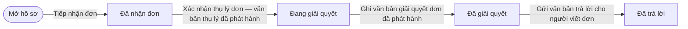
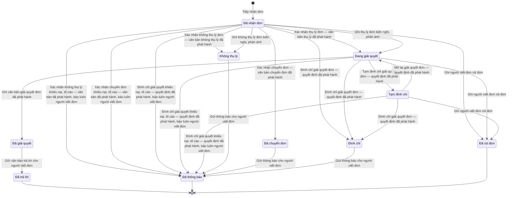

# qt-28 · Tiếp công dân, khiếu nại, tố cáo

<!-- máy sinh: tom-tat -->
> **Hồ sơ:** Đơn khiếu nại, tố cáo, kiến nghị, phản ánh (`Petition`)
>
> **Trong sổ phạm vi:** 28 · Tiếp công dân, khiếu nại, tố cáo (tầng 1)
>
> 30 bước · 10 chặng · 3 vai · 0 bảng quyết định · 5 hạn · 8 khớp nối.
>
> **Nguồn:** sổ nghiệp vụ `qt-28` · khai báo của app: `dqtv-app/core/processes/petition/workflow/petition.yaml`. Các bảng do máy sinh từ nguồn này.
<!-- hết: tom-tat -->

<!-- viết tay: dien-giai -->
## Diễn giải

*Phần này viết tay, diễn giải lại điều các bảng bên dưới ghi.*

### Quy trình này để làm gì

Theo dõi một **lá đơn** gửi tới đơn vị, thuộc một trong bốn loại: khiếu nại, tố cáo, kiến nghị, phản ánh. Hồ sơ đi từ lúc nhận đơn, qua phân loại, giải quyết, tới lúc người viết đơn nhận được trả lời hoặc thông báo.

Chỉ hai loại đơn vào hệ: đơn gửi đến Ban CHQS (xã, tỉnh, quân khu, Cục), và đơn UBND giao qua văn bản đến; đơn UBND tự giải quyết để ngoài hệ. Người ký quyết định giải quyết là người có thẩm quyền; người theo dõi đơn ghi vào hệ kèm bản ký.

Hồ sơ có 10 chặng. Đường chính: *Đã nhận đơn* → *Đang giải quyết* → *Đã giải quyết* → *Đã trả lời*. Các chặng rẽ: *Không thụ lý*, *Đã chuyển đơn*, *Tạm đình chỉ*, *Đình chỉ*, *Đã thông báo*, *Đã rút đơn*.

Về người làm: 11 bước do vai `operator` làm — dưới đây gọi là "người theo dõi đơn" — và một bước do hệ thống tự làm.

### Khi nào bắt đầu

Người theo dõi đơn bấm **Tiếp nhận đơn**. Phải nhập loại đơn, nội dung đơn, đơn đến qua đâu (trực tiếp, bưu điện, hoặc Uỷ ban nhân dân giao qua văn bản đến) và bản quét lá đơn; người viết đơn và văn bản đến của Uỷ ban nhân dân giao đơn là ô nhập nếu có. Bước ghi ngày nhận đơn.

### Diễn ra thế nào

**Chặng "Đã nhận đơn"** — phân loại, chọn một trong ba:

1. **Xác nhận thụ lý đơn** → *Đang giải quyết*.
2. **Không chấp nhận thụ lý đơn** → *Không thụ lý*; phải ghi lý do.
3. **Chuyển đơn đến cơ quan có thẩm quyền** → *Đã chuyển đơn*; phải ghi chuyển đến đâu.

Cả ba đều ghi kết quả phân loại và ngày phân loại. Ba bước này là quyết định trong hệ: thụ lý là "đồng ý", hai bước kia là "từ chối".

**Chặng "Đang giải quyết":**

- **Ghi quyết định giải quyết, kết luận** → *Đã giải quyết*; phải có số quyết định hoặc kết luận và bản đã ký.
- **Ghi tạm đình chỉ giải quyết đơn** → *Tạm đình chỉ*; phải ghi lý do. Từ đó **Mở lại giải quyết đơn** đưa hồ sơ quay về *Đang giải quyết*.
- **Ghi đình chỉ giải quyết đơn** → *Đình chỉ*; phải ghi lý do; bấm được cả khi đang tạm đình chỉ.

**Chặng "Đã giải quyết":** **Gửi văn bản trả lời cho người viết đơn** → *Đã trả lời*; phải có bản ký văn bản trả lời, cách gửi (trao tay hoặc bưu điện) và bằng chứng người viết đơn đã nhận.

**Ba chặng "Không thụ lý", "Đã chuyển đơn", "Đình chỉ":** đều chỉ còn một bước là **Gửi thông báo cho người viết đơn** → *Đã thông báo*; phải có bản ký thông báo, cách gửi và bằng chứng đã nhận.

**Rút đơn:** **Ghi người viết đơn rút đơn** bấm được ở *Đã nhận đơn*, *Đang giải quyết* và *Tạm đình chỉ*, đưa hồ sơ sang *Đã rút đơn*; phải có ghi nhận rút đơn.

**Quá hạn:** **Đánh dấu đơn quá hạn** không đổi chặng, chỉ ghi ô "quá hạn từ"; làm được ở *Đã nhận đơn*, *Đang giải quyết*, *Đã giải quyết*. Bước này không do người nào bấm, hệ thống tự làm; đã có ô "quá hạn từ" thì không ghi lại ("đơn đã được ghi quá hạn ở chặng này").

### Kết thúc và để lại gì

Hồ sơ kết thúc ở một trong ba chặng: *Đã trả lời*, *Đã thông báo*, *Đã rút đơn*. Đơn Uỷ ban nhân dân giao qua văn bản đến thì có nối tới Văn bản đến (quy trình 1).

### Điều kiện chặn

- Mọi bước trừ bước tiếp nhận và bước đánh dấu quá hạn: người làm phải là người của đơn vị chủ hồ sơ. Sai người, sai chặng, thiếu thứ phải có trước thì chặn, hồ sơ giữ nguyên.
- Thứ phải có trước ở từng bước: lý do, nơi chuyển đến, số và bản ký quyết định, bản ký văn bản, cách gửi, bằng chứng đã nhận.
- Năm hạn, quá hạn thì hệ làm bước đánh dấu quá hạn — "quá hạn thì cảnh báo, không chặn":
  - Phân loại, tính từ lúc đơn vào *Đã nhận đơn*: 7 ngày làm việc với khiếu nại, tố cáo; 10 ngày làm việc với kiến nghị, phản ánh.
  - Giải quyết, tính từ lúc đơn vào *Đang giải quyết*: 30 ngày.
  - Trả lời, tính từ lúc đơn vào *Đã giải quyết*: 3 ngày làm việc với khiếu nại, kiến nghị, phản ánh; 5 ngày làm việc với tố cáo.
<!-- hết viết tay -->

## 1. Đường đi ngắn nhất qua các chặng

<!-- máy sinh: luong-chinh -->
Đường ít bước nhất từ lúc mở hồ sơ tới chặng kết thúc xa nhất. Máy chọn theo số chặng, không theo ý nghĩa nghiệp vụ — trình tự công việc thật xem phần Diễn giải và bảng "Việc làm ở từng chặng" ở mục 6.

| # | Ai làm | Làm gì | Hồ sơ sang chặng |
|---|---|---|---|
| 1 | Chính trị viên | Tiếp nhận đơn | Đã nhận đơn |
| 2 | Hệ thống tự làm | Xác nhận thụ lý đơn — văn bản thụ lý đã phát hành | Đang giải quyết |
| 3 | Hệ thống tự làm | Ghi văn bản giải quyết đơn đã phát hành | Đã giải quyết |
| 4 | Hệ thống tự làm | Gửi văn bản trả lời cho người viết đơn | Đã trả lời |

<!-- hết: luong-chinh -->

## 2. Hồ sơ và việc nó để lại

<!-- máy sinh: muc-tieu -->
**App gọi quy trình này là:** Đơn khiếu nại, tố cáo, kiến nghị, phản ánh.

**Khi mở, hồ sơ này ghi mối nối tới:**
- Văn bản đến (1.incoming-document) — bước `receivePetition`, khớp nối `petitionFromIncomingDocument`
<!-- hết: muc-tieu -->

## 3. Khởi phát và kết thúc

<!-- máy sinh: khoi-phat -->
**1 cửa vào** — bước mở hồ sơ:

| Bước mở | Ai mở | Hồ sơ vào chặng | App bắt buộc nhập |
|---|---|---|---|
| Tiếp nhận đơn | Chính trị viên | Đã nhận đơn | loại đơn, nội dung đơn, đơn đến qua, bản quét lá đơn |

**Kết thúc:** *Đã trả lời* (`ANSWERED`), *Đã thông báo* (`NOTIFIED`), *Đã rút đơn* (`WITHDRAWN`)
<!-- hết: khoi-phat -->

## 4. Vai trò

<!-- máy sinh: vai-tro -->
| Vai trong sổ | Tên trong app | Điều kiện | Làm những bước |
|---|---|---|---|
| `petitionHandler` | Chính trị viên |  | Tiếp nhận đơn · Trình ký văn bản phân loại đơn · Ghi thụ lý đơn kiến nghị, phản ánh · Ghi không thụ lý đơn kiến nghị, phản ánh · Trình ký thông báo thụ lý cho người tố cáo · Trình ký thông báo nội dung tố cáo cho người bị tố cáo · Ghi người viết đơn rút đơn · Trình ký thông báo cho người viết đơn kiến nghị, phản ánh · Ghi nhận người viết đơn đã nhận |
| `system` | Hệ thống tự làm |  | Xác nhận thụ lý đơn — văn bản thụ lý đã phát hành · Xác nhận không thụ lý đơn — văn bản không thụ lý đã phát hành · Xác nhận chuyển đơn — văn bản chuyển đơn đã phát hành · Xác nhận không thụ lý khiếu nại, tố cáo — văn bản đã phát hành, báo luôn người viết đơn · Xác nhận chuyển đơn khiếu nại, tố cáo — văn bản đã phát hành, báo luôn người viết đơn · Đình chỉ giải quyết khiếu nại, tố cáo — quyết định đã phát hành, báo luôn người viết đơn · Tạm đình chỉ giải quyết đơn — quyết định đã phát hành · Mở lại giải quyết đơn — quyết định đã phát hành · Đình chỉ giải quyết đơn — quyết định đã phát hành · Ghi văn bản giải quyết đơn đã phát hành · Gửi văn bản trả lời cho người viết đơn · Gửi thông báo cho người viết đơn · Nhắc đơn khiếu nại, tố cáo quá hạn phân loại · Nhắc đơn kiến nghị, phản ánh quá hạn phân loại · Nhắc đơn tố cáo quá hạn thông báo kết luận · Đánh dấu đơn quá hạn · Nhắc thông báo thụ lý tố cáo quá hạn |
| `petitionVerifier` | Trợ lý Quân lực |  | Ghi kết quả xác minh · Trình ký quyết định tạm đình chỉ, đình chỉ, mở lại · Trình ký văn bản giải quyết đơn · Trình ký thông báo kết luận cho người tố cáo |

*"Tên trong app" là tên app đặt cho mã chủ thể của vai. Hồ sơ thuộc đơn vị cấp khác thì người làm là người giữ vai ấy ở đơn vị nêu trong cột "Điều kiện" (nếu sổ có ghi) và ở cột "Người làm phải thuộc" của bảng "Theo khai báo của app" (mục 7).*
<!-- hết: vai-tro -->

## 5. Nhánh phụ

<!-- máy sinh: nhanh-phu -->
**Bước khác đưa hồ sơ sang chặng mới** — đường song song, rẽ nhánh hoặc kết thúc sớm:

| Bước | Ai làm | Từ chặng | Sang chặng |
|---|---|---|---|
| Xác nhận không thụ lý đơn — văn bản không thụ lý đã phát hành | Hệ thống tự làm | Đã nhận đơn | Không thụ lý |
| Xác nhận chuyển đơn — văn bản chuyển đơn đã phát hành | Hệ thống tự làm | Đã nhận đơn | Đã chuyển đơn |
| Xác nhận không thụ lý khiếu nại, tố cáo — văn bản đã phát hành, báo luôn người viết đơn | Hệ thống tự làm | Đã nhận đơn | Đã thông báo |
| Xác nhận chuyển đơn khiếu nại, tố cáo — văn bản đã phát hành, báo luôn người viết đơn | Hệ thống tự làm | Đã nhận đơn | Đã thông báo |
| Đình chỉ giải quyết khiếu nại, tố cáo — quyết định đã phát hành, báo luôn người viết đơn | Hệ thống tự làm | Đã nhận đơn, Đang giải quyết, Tạm đình chỉ | Đã thông báo |
| Ghi thụ lý đơn kiến nghị, phản ánh | Chính trị viên | Đã nhận đơn | Đang giải quyết |
| Ghi không thụ lý đơn kiến nghị, phản ánh | Chính trị viên | Đã nhận đơn | Không thụ lý |
| Tạm đình chỉ giải quyết đơn — quyết định đã phát hành | Hệ thống tự làm | Đang giải quyết | Tạm đình chỉ |
| Đình chỉ giải quyết đơn — quyết định đã phát hành | Hệ thống tự làm | Đã nhận đơn, Đang giải quyết, Tạm đình chỉ | Đình chỉ |
| Ghi người viết đơn rút đơn | Chính trị viên | Đã nhận đơn, Đang giải quyết, Tạm đình chỉ | Đã rút đơn |
| Gửi thông báo cho người viết đơn | Hệ thống tự làm | Không thụ lý, Đã chuyển đơn, Đình chỉ | Đã thông báo |

**Quay lại một chặng hồ sơ đã đi qua** (tính theo đường ngắn nhất từ lúc mở):

| Bước | Ai làm | Từ chặng | Về chặng |
|---|---|---|---|
| Mở lại giải quyết đơn — quyết định đã phát hành | Hệ thống tự làm | Tạm đình chỉ | Đang giải quyết |

**Làm trong lúc hồ sơ đứng yên ở một chặng** — ghi nhận, bổ sung:

| Bước | Ai làm | Ở chặng |
|---|---|---|
| Trình ký văn bản phân loại đơn | Chính trị viên | Đã nhận đơn |
| Ghi kết quả xác minh *(lặp được)* | Trợ lý Quân lực | Đang giải quyết |
| Trình ký thông báo thụ lý cho người tố cáo | Chính trị viên | Đang giải quyết |
| Trình ký thông báo nội dung tố cáo cho người bị tố cáo | Chính trị viên | Đang giải quyết |
| Trình ký quyết định tạm đình chỉ, đình chỉ, mở lại | Trợ lý Quân lực | Đã nhận đơn, Đang giải quyết, Tạm đình chỉ |
| Trình ký văn bản giải quyết đơn | Trợ lý Quân lực | Đang giải quyết |
| Trình ký thông báo kết luận cho người tố cáo | Trợ lý Quân lực | Đã giải quyết |
| Trình ký thông báo cho người viết đơn kiến nghị, phản ánh | Chính trị viên | Đang giải quyết, Không thụ lý, Đã chuyển đơn, Đình chỉ |
| Ghi nhận người viết đơn đã nhận | Chính trị viên | Đã trả lời, Đã thông báo |
| Nhắc đơn khiếu nại, tố cáo quá hạn phân loại | Hệ thống tự làm | Đã nhận đơn |
| Nhắc đơn kiến nghị, phản ánh quá hạn phân loại | Hệ thống tự làm | Đã nhận đơn |
| Nhắc đơn tố cáo quá hạn thông báo kết luận | Hệ thống tự làm | Đã giải quyết |
| Đánh dấu đơn quá hạn | Hệ thống tự làm | Đang giải quyết |
| Nhắc thông báo thụ lý tố cáo quá hạn | Hệ thống tự làm | Đang giải quyết |

<!-- hết: nhanh-phu -->

## 6. Các chặng và việc làm ở từng chặng

<!-- máy sinh: chang -->
| Chặng | Tên hiển thị | Vào bằng bước | Kết thúc? |
|---|---|---|---|
| `RECEIVED` | Đã nhận đơn | Tiếp nhận đơn |  |
| `ACCEPTED` | Đang giải quyết | Xác nhận thụ lý đơn — văn bản thụ lý đã phát hành · Ghi thụ lý đơn kiến nghị, phản ánh · Mở lại giải quyết đơn — quyết định đã phát hành |  |
| `RESOLVED` | Đã giải quyết | Ghi văn bản giải quyết đơn đã phát hành |  |
| `ANSWERED` | Đã trả lời | Gửi văn bản trả lời cho người viết đơn | **kết thúc** — vẫn còn bước làm được |
| `SUSPENDED` | Tạm đình chỉ | Tạm đình chỉ giải quyết đơn — quyết định đã phát hành |  |
| `NOT_ACCEPTED` | Không thụ lý | Xác nhận không thụ lý đơn — văn bản không thụ lý đã phát hành · Ghi không thụ lý đơn kiến nghị, phản ánh |  |
| `TRANSFERRED` | Đã chuyển đơn | Xác nhận chuyển đơn — văn bản chuyển đơn đã phát hành |  |
| `TERMINATED` | Đình chỉ | Đình chỉ giải quyết đơn — quyết định đã phát hành |  |
| `NOTIFIED` | Đã thông báo | Xác nhận không thụ lý khiếu nại, tố cáo — văn bản đã phát hành, báo luôn người viết đơn · Xác nhận chuyển đơn khiếu nại, tố cáo — văn bản đã phát hành, báo luôn người viết đơn · Đình chỉ giải quyết khiếu nại, tố cáo — quyết định đã phát hành, báo luôn người viết đơn · Gửi thông báo cho người viết đơn | **kết thúc** — vẫn còn bước làm được |
| `WITHDRAWN` | Đã rút đơn | Ghi người viết đơn rút đơn | **kết thúc** |

### Việc làm ở từng chặng

Hồ sơ đang ở chặng nào thì làm được những bước nào.

| Hồ sơ đang ở chặng | Bước làm tại chặng (hồ sơ đứng yên) | Bước đưa hồ sơ sang chặng khác |
|---|---|---|
| **Đã nhận đơn** | Trình ký văn bản phân loại đơn — Chính trị viên Trình ký quyết định tạm đình chỉ, đình chỉ, mở lại — Trợ lý Quân lực Nhắc đơn khiếu nại, tố cáo quá hạn phân loại — Hệ thống tự làm Nhắc đơn kiến nghị, phản ánh quá hạn phân loại — Hệ thống tự làm | Xác nhận thụ lý đơn — văn bản thụ lý đã phát hành — Hệ thống tự làm → *Đang giải quyết* Xác nhận không thụ lý đơn — văn bản không thụ lý đã phát hành — Hệ thống tự làm → *Không thụ lý* Xác nhận chuyển đơn — văn bản chuyển đơn đã phát hành — Hệ thống tự làm → *Đã chuyển đơn* Xác nhận không thụ lý khiếu nại, tố cáo — văn bản đã phát hành, báo luôn người viết đơn — Hệ thống tự làm → *Đã thông báo* Xác nhận chuyển đơn khiếu nại, tố cáo — văn bản đã phát hành, báo luôn người viết đơn — Hệ thống tự làm → *Đã thông báo* Đình chỉ giải quyết khiếu nại, tố cáo — quyết định đã phát hành, báo luôn người viết đơn — Hệ thống tự làm → *Đã thông báo* Ghi thụ lý đơn kiến nghị, phản ánh — Chính trị viên → *Đang giải quyết* Ghi không thụ lý đơn kiến nghị, phản ánh — Chính trị viên → *Không thụ lý* Đình chỉ giải quyết đơn — quyết định đã phát hành — Hệ thống tự làm → *Đình chỉ* Ghi người viết đơn rút đơn — Chính trị viên → *Đã rút đơn* |
| **Đang giải quyết** | Ghi kết quả xác minh (lặp được) — Trợ lý Quân lực Trình ký thông báo thụ lý cho người tố cáo — Chính trị viên Trình ký thông báo nội dung tố cáo cho người bị tố cáo — Chính trị viên Trình ký quyết định tạm đình chỉ, đình chỉ, mở lại — Trợ lý Quân lực Trình ký văn bản giải quyết đơn — Trợ lý Quân lực Trình ký thông báo cho người viết đơn kiến nghị, phản ánh — Chính trị viên Đánh dấu đơn quá hạn — Hệ thống tự làm Nhắc thông báo thụ lý tố cáo quá hạn — Hệ thống tự làm | Đình chỉ giải quyết khiếu nại, tố cáo — quyết định đã phát hành, báo luôn người viết đơn — Hệ thống tự làm → *Đã thông báo* Tạm đình chỉ giải quyết đơn — quyết định đã phát hành — Hệ thống tự làm → *Tạm đình chỉ* Đình chỉ giải quyết đơn — quyết định đã phát hành — Hệ thống tự làm → *Đình chỉ* Ghi người viết đơn rút đơn — Chính trị viên → *Đã rút đơn* Ghi văn bản giải quyết đơn đã phát hành — Hệ thống tự làm → *Đã giải quyết* |
| **Đã giải quyết** | Trình ký thông báo kết luận cho người tố cáo — Trợ lý Quân lực Nhắc đơn tố cáo quá hạn thông báo kết luận — Hệ thống tự làm | Gửi văn bản trả lời cho người viết đơn — Hệ thống tự làm → *Đã trả lời* |
| **Đã trả lời** | Ghi nhận người viết đơn đã nhận — Chính trị viên | — (kết thúc) |
| **Tạm đình chỉ** | Trình ký quyết định tạm đình chỉ, đình chỉ, mở lại — Trợ lý Quân lực | Đình chỉ giải quyết khiếu nại, tố cáo — quyết định đã phát hành, báo luôn người viết đơn — Hệ thống tự làm → *Đã thông báo* Mở lại giải quyết đơn — quyết định đã phát hành — Hệ thống tự làm → *Đang giải quyết* Đình chỉ giải quyết đơn — quyết định đã phát hành — Hệ thống tự làm → *Đình chỉ* Ghi người viết đơn rút đơn — Chính trị viên → *Đã rút đơn* |
| **Không thụ lý** | Trình ký thông báo cho người viết đơn kiến nghị, phản ánh — Chính trị viên | Gửi thông báo cho người viết đơn — Hệ thống tự làm → *Đã thông báo* |
| **Đã chuyển đơn** | Trình ký thông báo cho người viết đơn kiến nghị, phản ánh — Chính trị viên | Gửi thông báo cho người viết đơn — Hệ thống tự làm → *Đã thông báo* |
| **Đình chỉ** | Trình ký thông báo cho người viết đơn kiến nghị, phản ánh — Chính trị viên | Gửi thông báo cho người viết đơn — Hệ thống tự làm → *Đã thông báo* |
| **Đã thông báo** | Ghi nhận người viết đơn đã nhận — Chính trị viên | — (kết thúc) |
| **Đã rút đơn** | — | — (kết thúc) |
<!-- hết: chang -->

## 7. Bảng bước

<!-- máy sinh: buoc -->
| # | Bước | Mã bước | Ai thực hiện | Từ chặng | Sang chặng | Phải có trước | Ghi lại |
|---|---|---|---|---|---|---|---|
| 1 | Tiếp nhận đơn | `receivePetition` | Chính trị viên | — (mở hồ sơ) | `RECEIVED` | loại đơn, nội dung đơn, đơn đến qua, bản quét lá đơn, `incomingDocumentLinkedWhenChannelIsDocument` | loại đơn, người viết đơn, nội dung đơn, đơn đến qua, bản quét lá đơn, văn bản đến của UBND giao đơn, nối tới Văn bản đến, ngày nhận đơn, đơn vị chủ hồ sơ, nối `petitionAboutInspection` |
| 2 | Trình ký văn bản phân loại đơn | `requestClassifyPetitionSignature` | Chính trị viên | `RECEIVED` | giữ nguyên | kết quả phân loại đề xuất, `proposedClassificationFitsKind`, `notAcceptedReasonGivenWhenProposed`, `transferTargetGivenWhenProposed`, `noClassifyPetitionDocumentOpen`, người làm thuộc đơn vị chủ hồ sơ | kết quả phân loại đề xuất, lý do không thụ lý, chuyển đến, nối tới Văn bản đi |
| 3 | Xác nhận thụ lý đơn — văn bản thụ lý đã phát hành | `acceptPetition` | Hệ thống tự làm | `RECEIVED` | `ACCEPTED` | `classifyPetitionDocumentIssued`, `proposedClassificationIsAccept` | kết quả phân loại, ngày phân loại |
| 4 | Xác nhận không thụ lý đơn — văn bản không thụ lý đã phát hành | `rejectPetition` | Hệ thống tự làm | `RECEIVED` | `NOT_ACCEPTED` | `classifyPetitionDocumentIssued`, `proposedClassificationIsNotAccept`, `petitionIsRecommendationOrFeedback` | kết quả phân loại, ngày phân loại |
| 5 | Xác nhận chuyển đơn — văn bản chuyển đơn đã phát hành | `transferPetition` | Hệ thống tự làm | `RECEIVED` | `TRANSFERRED` | `classifyPetitionDocumentIssued`, `proposedClassificationIsTransfer`, `petitionIsRecommendationOrFeedback` | kết quả phân loại, ngày phân loại |
| 6 | Xác nhận không thụ lý khiếu nại, tố cáo — văn bản đã phát hành, báo luôn người viết đơn | `rejectComplaintOrDenunciation` | Hệ thống tự làm | `RECEIVED` | `NOTIFIED` | `classifyPetitionDocumentIssued`, `proposedClassificationIsNotAccept`, `petitionIsComplaintOrDenunciation` | kết quả phân loại, ngày phân loại, ngày thông báo |
| 7 | Xác nhận chuyển đơn khiếu nại, tố cáo — văn bản đã phát hành, báo luôn người viết đơn | `transferComplaintOrDenunciation` | Hệ thống tự làm | `RECEIVED` | `NOTIFIED` | `classifyPetitionDocumentIssued`, `proposedClassificationIsTransfer`, `petitionIsComplaintOrDenunciation` | kết quả phân loại, ngày phân loại, ngày thông báo |
| 8 | Đình chỉ giải quyết khiếu nại, tố cáo — quyết định đã phát hành, báo luôn người viết đơn | `terminateComplaintOrDenunciation` | Hệ thống tự làm | `RECEIVED`, `ACCEPTED`, `SUSPENDED` | `NOTIFIED` | `suspensionDecisionDocumentIssued`, `proposedSuspensionActionIsTerminate`, `petitionIsComplaintOrDenunciation` | ngày thông báo |
| 9 | Ghi thụ lý đơn kiến nghị, phản ánh | `acceptRecommendationOrFeedback` | Chính trị viên | `RECEIVED` | `ACCEPTED` | `petitionIsRecommendationOrFeedback`, `noClassifyPetitionDocumentOpen`, người làm thuộc đơn vị chủ hồ sơ | kết quả phân loại, ngày phân loại |
| 10 | Ghi không thụ lý đơn kiến nghị, phản ánh | `rejectRecommendationOrFeedback` | Chính trị viên | `RECEIVED` | `NOT_ACCEPTED` | `petitionIsRecommendationOrFeedback`, lý do không thụ lý, `noClassifyPetitionDocumentOpen`, người làm thuộc đơn vị chủ hồ sơ | kết quả phân loại, lý do không thụ lý, ngày phân loại |
| 11 | Ghi kết quả xác minh | `recordVerificationResult` | Trợ lý Quân lực | `ACCEPTED` | giữ nguyên | kết quả xác minh, `noResolvePetitionDocumentOpen`, người làm thuộc đơn vị chủ hồ sơ | kết quả xác minh, bản quét kết quả xác minh, ngày ghi kết quả xác minh |
| 12 | Trình ký thông báo thụ lý cho người tố cáo | `requestNotifyDenouncerOfAcceptanceSignature` | Chính trị viên | `ACCEPTED` | giữ nguyên | `petitionIsDenunciation`, `classifyPetitionDocumentIssued`, `noNotifyDenouncerOfAcceptanceDocumentOpen`, `denouncerAcceptanceNoticeNotRecorded`, người làm thuộc đơn vị chủ hồ sơ | nối tới Văn bản đi |
| 13 | Trình ký thông báo nội dung tố cáo cho người bị tố cáo | `requestNotifyDenouncedOfContentSignature` | Chính trị viên | `ACCEPTED` | giữ nguyên | `petitionIsDenunciation`, `classifyPetitionDocumentIssued`, `noNotifyDenouncedOfContentDocumentOpen`, `denouncedContentNoticeNotRecorded`, người làm thuộc đơn vị chủ hồ sơ | nối tới Văn bản đi |
| 14 | Trình ký quyết định tạm đình chỉ, đình chỉ, mở lại | `requestSuspensionDecisionSignature` | Trợ lý Quân lực | `RECEIVED`, `ACCEPTED`, `SUSPENDED` | giữ nguyên | việc đề xuất trong quyết định, `proposedSuspensionActionFitsStage`, `suspensionReasonGivenWhenProposed`, `terminationReasonGivenWhenProposed`, `noSuspensionDecisionDocumentOpen`, người làm thuộc đơn vị chủ hồ sơ | việc đề xuất trong quyết định, lý do tạm đình chỉ — khi đề xuất tạm đình chỉ, lý do đình chỉ — khi đề xuất đình chỉ, nối tới Văn bản đi |
| 15 | Tạm đình chỉ giải quyết đơn — quyết định đã phát hành | `suspendPetition` | Hệ thống tự làm | `ACCEPTED` | `SUSPENDED` | `suspensionDecisionDocumentIssued`, `proposedSuspensionActionIsSuspend` | — |
| 16 | Mở lại giải quyết đơn — quyết định đã phát hành | `resumePetition` | Hệ thống tự làm | `SUSPENDED` | `ACCEPTED` | `suspensionDecisionDocumentIssued`, `proposedSuspensionActionIsResume` | — |
| 17 | Đình chỉ giải quyết đơn — quyết định đã phát hành | `terminatePetition` | Hệ thống tự làm | `RECEIVED`, `ACCEPTED`, `SUSPENDED` | `TERMINATED` | `suspensionDecisionDocumentIssued`, `proposedSuspensionActionIsTerminate`, `petitionIsRecommendationOrFeedback` | — |
| 18 | Ghi người viết đơn rút đơn | `withdrawPetition` | Chính trị viên | `RECEIVED`, `ACCEPTED`, `SUSPENDED` | `WITHDRAWN` | ghi nhận rút đơn, người làm thuộc đơn vị chủ hồ sơ | ghi nhận rút đơn |
| 19 | Trình ký văn bản giải quyết đơn | `requestResolvePetitionSignature` | Trợ lý Quân lực | `ACCEPTED` | giữ nguyên | `verificationRecorded`, `deliveryMethodGivenWhenResolveIsAnswer`, `noSuspensionDecisionDocumentOpen`, `denunciationNoticesIssuedWhenDenunciation`, người làm thuộc đơn vị chủ hồ sơ | cách gửi, nối tới Văn bản đi |
| 20 | Ghi văn bản giải quyết đơn đã phát hành | `resolvePetition` | Hệ thống tự làm | `ACCEPTED` | `RESOLVED` | `resolvePetitionDocumentIssued` | ngày giải quyết |
| 21 | Trình ký thông báo kết luận cho người tố cáo | `requestAnswerPetitionSignature` | Trợ lý Quân lực | `RESOLVED` | giữ nguyên | `petitionIsDenunciation`, cách gửi, `verificationRecorded`, `noAnswerPetitionDocumentOpen`, người làm thuộc đơn vị chủ hồ sơ | cách gửi, nối tới Văn bản đi |
| 22 | Gửi văn bản trả lời cho người viết đơn | `answerPetition` | Hệ thống tự làm | `RESOLVED` | `ANSWERED` | — | ngày trả lời |
| 23 | Trình ký thông báo cho người viết đơn kiến nghị, phản ánh | `requestNotifyPetitionerSignature` | Chính trị viên | `ACCEPTED`, `NOT_ACCEPTED`, `TRANSFERRED`, `TERMINATED` | giữ nguyên | `petitionIsRecommendationOrFeedback`, cách gửi, người làm thuộc đơn vị chủ hồ sơ, `noNotifyPetitionerDocumentOpen` | cách gửi, nối tới Văn bản đi |
| 24 | Gửi thông báo cho người viết đơn | `notifyPetitioner` | Hệ thống tự làm | `NOT_ACCEPTED`, `TRANSFERRED`, `TERMINATED` | `NOTIFIED` | — | ngày thông báo; **xoá:** `notifyPetitionerSignedAt` |
| 25 | Ghi nhận người viết đơn đã nhận | `recordPetitionDeliveryReceipt` | Chính trị viên | `ANSWERED`, `NOTIFIED` | giữ nguyên | `receiptNotRecorded`, người làm thuộc đơn vị chủ hồ sơ | ai ký nhận, ngày ký nhận, nhận qua, bằng chứng đã nhận, ngày ghi nhận đã nhận |
| 26 | Nhắc đơn khiếu nại, tố cáo quá hạn phân loại | `flagComplaintDenunciationIntakeOverdue` | Hệ thống tự làm | `RECEIVED` | giữ nguyên | `petitionIsComplaintOrDenunciation`, `complaintDenunciationIntakeNotFlagged` | nhắc khiếu nại, tố cáo quá hạn phân loại từ |
| 27 | Nhắc đơn kiến nghị, phản ánh quá hạn phân loại | `flagRecommendationFeedbackIntakeOverdue` | Hệ thống tự làm | `RECEIVED` | giữ nguyên | `petitionIsRecommendationOrFeedback`, `recommendationFeedbackIntakeNotFlagged` | nhắc kiến nghị, phản ánh quá hạn phân loại từ |
| 28 | Nhắc đơn tố cáo quá hạn thông báo kết luận | `flagDenunciationAnswerOverdue` | Hệ thống tự làm | `RESOLVED` | giữ nguyên | `petitionIsDenunciation`, `denunciationAnswerNotFlagged` | nhắc tố cáo quá hạn thông báo kết luận từ |
| 29 | Đánh dấu đơn quá hạn | `flagPetitionOverdue` | Hệ thống tự làm | `ACCEPTED` | giữ nguyên | — | quá hạn từ |
| 30 | Nhắc thông báo thụ lý tố cáo quá hạn | `flagDenunciationNoticeOverdue` | Hệ thống tự làm | `ACCEPTED` | giữ nguyên | `denunciationNoticesPending`, `denunciationNoticeNotFlagged` | nhắc thông báo thụ lý tố cáo quá hạn từ |

### Khi không đạt điều kiện

Mặc định: không đúng người, hồ sơ không ở đúng chặng, hoặc thiếu thứ "phải có trước" thì bước bị chặn, hồ sơ giữ nguyên. Bảng dưới chỉ kê những bước có kết quả riêng.

| # | Bước | Kết quả riêng |
|---|---|---|
| 3 | Xác nhận thụ lý đơn — văn bản thụ lý đã phát hành | bước này không do người nào bấm |
| 4 | Xác nhận không thụ lý đơn — văn bản không thụ lý đã phát hành | bước này không do người nào bấm |
| 5 | Xác nhận chuyển đơn — văn bản chuyển đơn đã phát hành | bước này không do người nào bấm |
| 6 | Xác nhận không thụ lý khiếu nại, tố cáo — văn bản đã phát hành, báo luôn người viết đơn | bước này không do người nào bấm |
| 7 | Xác nhận chuyển đơn khiếu nại, tố cáo — văn bản đã phát hành, báo luôn người viết đơn | bước này không do người nào bấm |
| 8 | Đình chỉ giải quyết khiếu nại, tố cáo — quyết định đã phát hành, báo luôn người viết đơn | bước này không do người nào bấm |
| 15 | Tạm đình chỉ giải quyết đơn — quyết định đã phát hành | bước này không do người nào bấm |
| 16 | Mở lại giải quyết đơn — quyết định đã phát hành | bước này không do người nào bấm |
| 17 | Đình chỉ giải quyết đơn — quyết định đã phát hành | bước này không do người nào bấm |
| 20 | Ghi văn bản giải quyết đơn đã phát hành | bước này không do người nào bấm |
| 22 | Gửi văn bản trả lời cho người viết đơn | bước này không do người nào bấm |
| 24 | Gửi thông báo cho người viết đơn | bước này không do người nào bấm |
| 26 | Nhắc đơn khiếu nại, tố cáo quá hạn phân loại | bước này không do người nào bấm |
| 27 | Nhắc đơn kiến nghị, phản ánh quá hạn phân loại | bước này không do người nào bấm |
| 28 | Nhắc đơn tố cáo quá hạn thông báo kết luận | bước này không do người nào bấm |
| 29 | Đánh dấu đơn quá hạn | bước này không do người nào bấm |
| 30 | Nhắc thông báo thụ lý tố cáo quá hạn | bước này không do người nào bấm |

### Điều kiện "phải có trước" bằng lời

Cột "Phải có trước" ở bảng bước có hai loại: ô dữ liệu thường (bước chỉ đòi ô ấy đã có giá trị) và điều kiện hệ tự xét. Bảng này diễn các điều kiện hệ tự xét theo đúng công thức sổ ghi; số ở cột cuối là số thứ tự bước.

| Điều kiện | Đúng khi | Bước đòi |
|---|---|---|
| `incomingDocumentLinkedWhenChannelIsDocument` | KHÔNG (đơn đến qua bằng `incoming_document`) HOẶC đã có nối tới Văn bản đến | 1 |
| `proposedClassificationFitsKind` | loại đơn là Khiếu nại (`complaint`) hoặc Tố cáo (`denunciation`) HOẶC kết quả phân loại đề xuất bằng `transfer` | 2 |
| `notAcceptedReasonGivenWhenProposed` | KHÔNG (kết quả phân loại đề xuất bằng `not_accept`) HOẶC đã có lý do không thụ lý | 2 |
| `transferTargetGivenWhenProposed` | KHÔNG (kết quả phân loại đề xuất bằng `transfer`) HOẶC đã có chuyển đến | 2 |
| `noClassifyPetitionDocumentOpen` | KHÔNG (có hồ sơ Việc luật giao kèm văn bản đến, đi — Văn bản đi (qt-1.outgoing-document) chính là hồ sơ ghi ở ô nối `classifyPetitionByDocument` của hồ sơ đang làm mà hồ sơ ấy đang ở chặng `DRAFT` hoặc `PENDING_SIGNATURE` hoặc `SIGNED`) | 2, 9, 10 |
| `actorInOwnerUnit` | người đang làm là người của đơn vị ghi ở ô đơn vị chủ hồ sơ của hồ sơ này (theo danh mục người của đơn vị, `dm.unit-staff`) | 2, 9, 10, 11, 12, 13, 14, 18, 19, 21, 23, 25 |
| `classifyPetitionDocumentIssued` | có hồ sơ Việc luật giao kèm văn bản đến, đi — Văn bản đi (qt-1.outgoing-document) chính là hồ sơ ghi ở ô nối `classifyPetitionByDocument` của hồ sơ đang làm mà hồ sơ ấy đang ở chặng `ISSUED` | 3, 4, 5, 6, 7, 12, 13 |
| `proposedClassificationIsAccept` | kết quả phân loại đề xuất bằng `accept` | 3 |
| `proposedClassificationIsNotAccept` | kết quả phân loại đề xuất bằng `not_accept` | 4, 6 |
| `petitionIsRecommendationOrFeedback` | loại đơn là Kiến nghị (`recommendation`) hoặc Phản ánh (`feedback`) | 4, 5, 9, 10, 17, 23, 27 |
| `proposedClassificationIsTransfer` | kết quả phân loại đề xuất bằng `transfer` | 5, 7 |
| `petitionIsComplaintOrDenunciation` | loại đơn là Khiếu nại (`complaint`) hoặc Tố cáo (`denunciation`) | 6, 7, 8, 26 |
| `suspensionDecisionDocumentIssued` | có hồ sơ Việc luật giao kèm văn bản đến, đi — Văn bản đi (qt-1.outgoing-document) chính là hồ sơ ghi ở ô nối `suspensionDecisionByDocument` của hồ sơ đang làm mà hồ sơ ấy đang ở chặng `ISSUED` | 8, 15, 16, 17 |
| `proposedSuspensionActionIsTerminate` | việc đề xuất trong quyết định bằng `terminate` | 8, 17 |
| `noResolvePetitionDocumentOpen` | KHÔNG (có hồ sơ Việc luật giao kèm văn bản đến, đi — Văn bản đi (qt-1.outgoing-document) chính là hồ sơ ghi ở ô nối `resolvePetitionByDocument` của hồ sơ đang làm mà hồ sơ ấy đang ở chặng `DRAFT` hoặc `PENDING_SIGNATURE` hoặc `SIGNED`) | 11 |
| `petitionIsDenunciation` | loại đơn là Tố cáo (`denunciation`) | 12, 13, 21, 28 |
| `noNotifyDenouncerOfAcceptanceDocumentOpen` | KHÔNG (có hồ sơ Việc luật giao kèm văn bản đến, đi — Văn bản đi (qt-1.outgoing-document) chính là hồ sơ ghi ở ô nối `notifyDenouncerOfAcceptanceByDocument` của hồ sơ đang làm mà hồ sơ ấy đang ở chặng `DRAFT` hoặc `PENDING_SIGNATURE` hoặc `SIGNED`) | 12 |
| `denouncerAcceptanceNoticeNotRecorded` | KHÔNG (có hồ sơ Việc luật giao kèm văn bản đến, đi — Văn bản đi (qt-1.outgoing-document) chính là hồ sơ ghi ở ô nối `notifyDenouncerOfAcceptanceByDocument` của hồ sơ đang làm mà hồ sơ ấy đang ở chặng `ISSUED`) | 12 |
| `noNotifyDenouncedOfContentDocumentOpen` | KHÔNG (có hồ sơ Việc luật giao kèm văn bản đến, đi — Văn bản đi (qt-1.outgoing-document) chính là hồ sơ ghi ở ô nối `notifyDenouncedOfContentByDocument` của hồ sơ đang làm mà hồ sơ ấy đang ở chặng `DRAFT` hoặc `PENDING_SIGNATURE` hoặc `SIGNED`) | 13 |
| `denouncedContentNoticeNotRecorded` | KHÔNG (có hồ sơ Việc luật giao kèm văn bản đến, đi — Văn bản đi (qt-1.outgoing-document) chính là hồ sơ ghi ở ô nối `notifyDenouncedOfContentByDocument` của hồ sơ đang làm mà hồ sơ ấy đang ở chặng `ISSUED`) | 13 |
| `proposedSuspensionActionFitsStage` | (việc đề xuất trong quyết định bằng `suspend` VÀ hồ sơ đang ở chặng `ACCEPTED`) HOẶC (việc đề xuất trong quyết định bằng `resume` VÀ hồ sơ đang ở chặng `SUSPENDED`) HOẶC (việc đề xuất trong quyết định bằng `terminate` VÀ hồ sơ đang ở chặng `RECEIVED` hoặc `ACCEPTED` hoặc `SUSPENDED`) | 14 |
| `suspensionReasonGivenWhenProposed` | KHÔNG (việc đề xuất trong quyết định bằng `suspend`) HOẶC đã có lý do tạm đình chỉ | 14 |
| `terminationReasonGivenWhenProposed` | KHÔNG (việc đề xuất trong quyết định bằng `terminate`) HOẶC đã có lý do đình chỉ | 14 |
| `noSuspensionDecisionDocumentOpen` | KHÔNG (có hồ sơ Việc luật giao kèm văn bản đến, đi — Văn bản đi (qt-1.outgoing-document) chính là hồ sơ ghi ở ô nối `suspensionDecisionByDocument` của hồ sơ đang làm mà hồ sơ ấy đang ở chặng `DRAFT` hoặc `PENDING_SIGNATURE` hoặc `SIGNED`) | 14, 19 |
| `proposedSuspensionActionIsSuspend` | việc đề xuất trong quyết định bằng `suspend` | 15 |
| `proposedSuspensionActionIsResume` | việc đề xuất trong quyết định bằng `resume` | 16 |
| `verificationRecorded` | đã có ngày ghi kết quả xác minh | 19, 21 |
| `deliveryMethodGivenWhenResolveIsAnswer` | loại đơn là Tố cáo (`denunciation`) HOẶC đã có cách gửi | 19 |
| `denunciationNoticesIssuedWhenDenunciation` | loại đơn là Khiếu nại (`complaint`) hoặc Kiến nghị (`recommendation`) hoặc Phản ánh (`feedback`) HOẶC (có hồ sơ Việc luật giao kèm văn bản đến, đi — Văn bản đi (qt-1.outgoing-document) chính là hồ sơ ghi ở ô nối `notifyDenouncerOfAcceptanceByDocument` của hồ sơ đang làm mà hồ sơ ấy đang ở chặng `ISSUED` VÀ có hồ sơ Việc luật giao kèm văn bản đến, đi — Văn bản đi (qt-1.outgoing-document) chính là hồ sơ ghi ở ô nối `notifyDenouncedOfContentByDocument` của hồ sơ đang làm mà hồ sơ ấy đang ở chặng `ISSUED`) | 19 |
| `resolvePetitionDocumentIssued` | có hồ sơ Việc luật giao kèm văn bản đến, đi — Văn bản đi (qt-1.outgoing-document) chính là hồ sơ ghi ở ô nối `resolvePetitionByDocument` của hồ sơ đang làm mà hồ sơ ấy đang ở chặng `ISSUED` | 20 |
| `noAnswerPetitionDocumentOpen` | KHÔNG (có hồ sơ Việc luật giao kèm văn bản đến, đi — Văn bản đi (qt-1.outgoing-document) chính là hồ sơ ghi ở ô nối `answerPetitionByDocument` của hồ sơ đang làm mà hồ sơ ấy đang ở chặng `DRAFT` hoặc `PENDING_SIGNATURE` hoặc `SIGNED`) | 21 |
| `noNotifyPetitionerDocumentOpen` | KHÔNG (có hồ sơ Việc luật giao kèm văn bản đến, đi — Văn bản đi (qt-1.outgoing-document) chính là hồ sơ ghi ở ô nối `notifyPetitionerByDocument` của hồ sơ đang làm mà hồ sơ ấy đang ở chặng `DRAFT` hoặc `PENDING_SIGNATURE` hoặc `SIGNED`) | 23 |
| `receiptNotRecorded` | KHÔNG (đã có ngày ghi nhận đã nhận) | 25 |
| `complaintDenunciationIntakeNotFlagged` | KHÔNG (đã có nhắc khiếu nại, tố cáo quá hạn phân loại từ) | 26 |
| `recommendationFeedbackIntakeNotFlagged` | KHÔNG (đã có nhắc kiến nghị, phản ánh quá hạn phân loại từ) | 27 |
| `denunciationAnswerNotFlagged` | KHÔNG (đã có nhắc tố cáo quá hạn thông báo kết luận từ) | 28 |
| `denunciationNoticesPending` | loại đơn là Tố cáo (`denunciation`) VÀ (KHÔNG (có hồ sơ Việc luật giao kèm văn bản đến, đi — Văn bản đi (qt-1.outgoing-document) chính là hồ sơ ghi ở ô nối `notifyDenouncerOfAcceptanceByDocument` của hồ sơ đang làm mà hồ sơ ấy đang ở chặng `ISSUED`) HOẶC KHÔNG (có hồ sơ Việc luật giao kèm văn bản đến, đi — Văn bản đi (qt-1.outgoing-document) chính là hồ sơ ghi ở ô nối `notifyDenouncedOfContentByDocument` của hồ sơ đang làm mà hồ sơ ấy đang ở chặng `ISSUED`)) | 30 |
| `denunciationNoticeNotFlagged` | KHÔNG (đã có nhắc thông báo thụ lý tố cáo quá hạn từ) | 30 |

### Theo khai báo của app

Người làm phải thuộc đơn vị nào, ô người dùng phải nhập, bước có lặp được không, và căn cứ pháp lý — lấy từ khai báo quy trình trong app.

| # | Bước | Người làm phải thuộc | Bắt buộc nhập | Nhập nếu có | Lặp được | Căn cứ |
|---|---|---|---|---|---|---|
| 1 | Tiếp nhận đơn |  | loại đơn, nội dung đơn, đơn đến qua, bản quét lá đơn | người viết đơn, văn bản đến của UBND giao đơn |  | L42/2013/QH13 Đ.28; L02/2011/QH13 Đ.27; L25/2018/QH14 Đ.24 |
| 2 | Trình ký văn bản phân loại đơn | đơn vị chủ hồ sơ | kết quả phân loại đề xuất | lý do không thụ lý, chuyển đến, dự thảo văn bản (PDF) |  | L02/2011/QH13 Đ.27; L25/2018/QH14 Đ.24, Đ.29; L42/2013/QH13 Đ.28; NĐ30/2020/NĐ-CP Đ.13 |
| 3 | Xác nhận thụ lý đơn — văn bản thụ lý đã phát hành |  | văn bản thụ lý đã phát hành | — |  | L02/2011/QH13 Đ.27; L25/2018/QH14 Đ.29 |
| 4 | Xác nhận không thụ lý đơn — văn bản không thụ lý đã phát hành |  | văn bản không thụ lý đã phát hành | — |  | L02/2011/QH13 Đ.11, Đ.27; L25/2018/QH14 Đ.29 |
| 5 | Xác nhận chuyển đơn — văn bản chuyển đơn đã phát hành |  | văn bản chuyển đơn đã phát hành | — |  | L42/2013/QH13 Đ.28; L25/2018/QH14 Đ.24 |
| 6 | Xác nhận không thụ lý khiếu nại, tố cáo — văn bản đã phát hành, báo luôn người viết đơn |  | văn bản không thụ lý đã phát hành | — |  | — |
| 7 | Xác nhận chuyển đơn khiếu nại, tố cáo — văn bản đã phát hành, báo luôn người viết đơn |  | văn bản chuyển đơn đã phát hành | — |  | — |
| 8 | Đình chỉ giải quyết khiếu nại, tố cáo — quyết định đã phát hành, báo luôn người viết đơn |  | quyết định đình chỉ đã phát hành | — |  | — |
| 9 | Ghi thụ lý đơn kiến nghị, phản ánh | đơn vị chủ hồ sơ | — | — |  | L42/2013/QH13 Đ.28 k1 |
| 10 | Ghi không thụ lý đơn kiến nghị, phản ánh | đơn vị chủ hồ sơ | lý do không thụ lý | — |  | L42/2013/QH13 Đ.28 k1 |
| 11 | Ghi kết quả xác minh | đơn vị chủ hồ sơ | kết quả xác minh | bản quét kết quả xác minh | có | L02/2011/QH13 Đ.29; L25/2018/QH14 Đ.31–32 |
| 12 | Trình ký thông báo thụ lý cho người tố cáo | đơn vị chủ hồ sơ | — | dự thảo văn bản (PDF) |  | L25/2018/QH14 Đ.29 k3; NĐ30/2020/NĐ-CP Đ.13 |
| 13 | Trình ký thông báo nội dung tố cáo cho người bị tố cáo | đơn vị chủ hồ sơ | — | dự thảo văn bản (PDF) |  | L25/2018/QH14 Đ.29 k3; NĐ30/2020/NĐ-CP Đ.13 |
| 14 | Trình ký quyết định tạm đình chỉ, đình chỉ, mở lại | đơn vị chủ hồ sơ | việc đề xuất trong quyết định | lý do tạm đình chỉ — khi đề xuất tạm đình chỉ, lý do đình chỉ — khi đề xuất đình chỉ, dự thảo quyết định (PDF) |  | L02/2011/QH13 Đ.11a; L136/2025/QH15; L25/2018/QH14 Đ.34; NĐ30/2020/NĐ-CP Đ.13 |
| 15 | Tạm đình chỉ giải quyết đơn — quyết định đã phát hành |  | quyết định tạm đình chỉ đã phát hành | — |  | L02/2011/QH13 Đ.11a; L136/2025/QH15; L25/2018/QH14 Đ.34 |
| 16 | Mở lại giải quyết đơn — quyết định đã phát hành |  | quyết định mở lại đã phát hành | — |  | L02/2011/QH13 Đ.11a; L136/2025/QH15; L25/2018/QH14 Đ.34 |
| 17 | Đình chỉ giải quyết đơn — quyết định đã phát hành |  | quyết định đình chỉ đã phát hành | — |  | L02/2011/QH13 Đ.11a; L136/2025/QH15; L25/2018/QH14 Đ.34 |
| 18 | Ghi người viết đơn rút đơn | đơn vị chủ hồ sơ | ghi nhận rút đơn | — |  | L02/2011/QH13 Đ.10; L136/2025/QH15; L25/2018/QH14 Đ.33 |
| 19 | Trình ký văn bản giải quyết đơn | đơn vị chủ hồ sơ | — | cách gửi, dự thảo văn bản (PDF) |  | L02/2011/QH13 Đ.31; L25/2018/QH14 Đ.35; NĐ30/2020/NĐ-CP Đ.13 |
| 20 | Ghi văn bản giải quyết đơn đã phát hành |  | văn bản giải quyết đã phát hành | — |  | L02/2011/QH13 Đ.31; L25/2018/QH14 Đ.35 |
| 21 | Trình ký thông báo kết luận cho người tố cáo | đơn vị chủ hồ sơ | cách gửi | dự thảo văn bản (PDF) |  | L25/2018/QH14 Đ.35 k2; NĐ30/2020/NĐ-CP Đ.13 |
| 22 | Gửi văn bản trả lời cho người viết đơn |  | — | văn bản trả lời đã phát hành |  | L02/2011/QH13 Đ.32; L25/2018/QH14 Đ.35 k2 |
| 23 | Trình ký thông báo cho người viết đơn kiến nghị, phản ánh | đơn vị chủ hồ sơ | cách gửi | dự thảo thông báo (PDF) |  | L42/2013/QH13 Đ.28 k1; NĐ30/2020/NĐ-CP Đ.13 |
| 24 | Gửi thông báo cho người viết đơn |  | — | văn bản báo người viết đơn đã phát hành |  | L02/2011/QH13 Đ.11a, Đ.27; L42/2013/QH13 Đ.28; L25/2018/QH14 Đ.29 |
| 25 | Ghi nhận người viết đơn đã nhận | đơn vị chủ hồ sơ | ai ký nhận, ngày ký nhận, nhận qua, bằng chứng đã nhận | — |  | L02/2011/QH13 Đ.32; L25/2018/QH14 Đ.35 k2 |
| 26 | Nhắc đơn khiếu nại, tố cáo quá hạn phân loại |  | — | — |  | L02/2011/QH13 Đ.27; L25/2018/QH14 Đ.24 |
| 27 | Nhắc đơn kiến nghị, phản ánh quá hạn phân loại |  | — | — |  | L42/2013/QH13 Đ.28 |
| 28 | Nhắc đơn tố cáo quá hạn thông báo kết luận |  | — | — |  | L25/2018/QH14 Đ.35 k2 |
| 29 | Đánh dấu đơn quá hạn |  | — | — |  | L02/2011/QH13 Đ.27–28, Đ.32; L25/2018/QH14 Đ.24, 30, 35 |
| 30 | Nhắc thông báo thụ lý tố cáo quá hạn |  | — | — |  | L25/2018/QH14 Đ.29 k3 |
| — | Ghi thông báo thụ lý cho người tố cáo đã phát hành (`recordDenouncerAcceptanceNoticeIssued`) |  | thông báo cho người tố cáo đã phát hành | — |  | L25/2018/QH14 Đ.29 k3 |
| — | Ghi thông báo nội dung tố cáo cho người bị tố cáo đã phát hành (`recordDenouncedContentNoticeIssued`) |  | thông báo cho người bị tố cáo đã phát hành | — |  | L25/2018/QH14 Đ.29 k3 |

### Điều kiện và ghi chú app khai cho từng bước

Lấy từ khai báo quy trình trong app. Lời trong ngoặc kép là câu app hiện cho người dùng. Chức danh người ký ngoài hệ app chỉ khai bằng mã.

| # | Bước | Điều kiện, ghi chú |
|---|---|---|
| 19 | Trình ký văn bản giải quyết đơn | · phải đã có ô "ngày ghi kết quả xác minh" — thiếu thì app báo: "chưa ghi kết quả xác minh" |
| 21 | Trình ký thông báo kết luận cho người tố cáo | · phải đã có ô "ngày ghi kết quả xác minh" — thiếu thì app báo: "chưa ghi kết quả xác minh" |
| 25 | Ghi nhận người viết đơn đã nhận | · không làm được khi đã có ô "ngày ghi nhận đã nhận" — app báo: "đã ghi nhận người viết đơn đã nhận" |
| 26 | Nhắc đơn khiếu nại, tố cáo quá hạn phân loại | · không làm được khi đã có ô "nhắc khiếu nại, tố cáo quá hạn phân loại từ" — app báo: "đã nhắc đơn quá hạn này" |
| 27 | Nhắc đơn kiến nghị, phản ánh quá hạn phân loại | · không làm được khi đã có ô "nhắc kiến nghị, phản ánh quá hạn phân loại từ" — app báo: "đã nhắc đơn quá hạn này" |
| 28 | Nhắc đơn tố cáo quá hạn thông báo kết luận | · không làm được khi đã có ô "nhắc tố cáo quá hạn thông báo kết luận từ" — app báo: "đã nhắc đơn quá hạn này" |
| 29 | Đánh dấu đơn quá hạn | · không làm được khi đã có ô "quá hạn từ" — app báo: "đơn đã được ghi quá hạn ở chặng này" |
| 30 | Nhắc thông báo thụ lý tố cáo quá hạn | · không làm được khi đã có ô "nhắc thông báo thụ lý tố cáo quá hạn từ" — app báo: "đã nhắc thông báo thụ lý tố cáo quá hạn" |
| — | Ghi thông báo thụ lý cho người tố cáo đã phát hành | · không làm được khi đã có ô "ngày phát hành thông báo cho người tố cáo" — app báo: "đã ghi thông báo cho người tố cáo phát hành" |
| — | Ghi thông báo nội dung tố cáo cho người bị tố cáo đã phát hành | · không làm được khi đã có ô "ngày phát hành thông báo cho người bị tố cáo" — app báo: "đã ghi thông báo cho người bị tố cáo phát hành" |
<!-- hết: buoc -->

## 8. Bảng quyết định, hạn, việc ngoài hệ

<!-- máy sinh: quyet-dinh -->
| Hạn | Tính từ | Thời hạn | Quá hạn thì |
|---|---|---|---|
| `acceptPetition.deadline.denunciation-notices` | khi hồ sơ vào chặng Đang giải quyết | 5 ngày làm việc | hệ làm bước Nhắc thông báo thụ lý tố cáo quá hạn |
| `answerPetition.deadline.denunciation` | khi hồ sơ vào chặng Đã giải quyết | 5 ngày làm việc | hệ làm bước Nhắc đơn tố cáo quá hạn thông báo kết luận |
| `classifyPetition.deadline.complaint-denunciation` | khi hồ sơ vào chặng Đã nhận đơn | 7 ngày làm việc | hệ làm bước Nhắc đơn khiếu nại, tố cáo quá hạn phân loại |
| `classifyPetition.deadline.recommendation-feedback` | khi hồ sơ vào chặng Đã nhận đơn | 10 ngày làm việc | hệ làm bước Nhắc đơn kiến nghị, phản ánh quá hạn phân loại |
| `resolvePetition.deadline` | khi hồ sơ vào chặng Đang giải quyết | 30 ngày | hệ làm bước Đánh dấu đơn quá hạn |

<!-- hết: quyet-dinh -->

## 9. Dữ liệu của hồ sơ

<!-- máy sinh: du-lieu -->
Các ô mà bước trong sổ ghi hoặc đòi. Số trong hai cột cuối là số thứ tự bước ở bảng bước (mục 7).

| Ô dữ liệu | Mã | Kiểu (app) | Giá trị cho phép | Loại ô (sổ) | Bước ghi | Bước đòi | Mô tả trong app |
|---|---|---|---|---|---|---|---|
| loại đơn | `petitionKind` | chọn một | Khiếu nại (`complaint`), Tố cáo (`denunciation`), Kiến nghị (`recommendation`), Phản ánh (`feedback`) | đưa vào ở bước (`input`) | 1 | 1 | Loại đơn — người dùng 5/10/2026: "có thêm phản ánh". Khiếu nại, tố cáo theo hai luật, hai trình tự; kiến nghị, phản ánh theo Luật Tiếp công dân |
| người viết đơn | `petitionerName` | chữ |  | đưa vào ở bước (`input`) | 1 | — | Họ tên người viết đơn — tố cáo có thể giấu tên |
| nội dung đơn | `petitionContent` | chữ |  | đưa vào ở bước (`input`) | 1 | 1 | Nội dung đơn |
| đơn đến qua | `receiveChannel` | chọn một | Nộp trực tiếp (`in_person`), Bưu điện (`post`), UBND giao qua văn bản đến (`incoming_document`) | đưa vào ở bước (`input`) | 1 | 1 | Đơn đến qua đâu — trực tiếp, bưu điện, hoặc UBND giao qua văn bản đến (người dùng 5/10/2026: "bỏ kênh công dân nhé") |
| bản quét lá đơn | `petitionScanPath` | tệp |  | đưa vào ở bước (`input`) | 1 | 1 | Ảnh/bản quét lá đơn |
| văn bản đến của UBND giao đơn | `sourceIncomingDocumentId` | chữ |  | đưa vào ở bước (`input`) | 1 | — | Văn bản đến của UBND giao đơn — chỉ với đơn UBND giao (người dùng 28/9/2026, phương án a) |
| ngày nhận đơn | `receivedAt` | ngày |  | lưu trên hồ sơ (`stored`) | 1 | — | Ngày nhận đơn |
| đơn vị chủ hồ sơ | `ownerUnit` |  |  | lưu trên hồ sơ (`stored`) | 1 | — |  |
| kết quả phân loại đề xuất | `proposedClassification` | chọn một | Thụ lý (`accept`), Không thụ lý (`not_accept`), Chuyển đơn (`transfer`) | đưa vào ở bước (`input`) | 2 | 2 | Kết quả phân loại đề xuất trong văn bản trình ký — thụ lý / không thụ lý / chuyển đơn |
| lý do không thụ lý | `notAcceptedReason` | chữ |  | đưa vào ở bước (`input`) | 2, 10 | 10 | Lý do không thụ lý |
| chuyển đến | `transferredTo` | chữ |  | đưa vào ở bước (`input`) | 2 | — | Cơ quan có thẩm quyền nhận đơn chuyển |
| kết quả phân loại | `classification` | chọn một | Thụ lý (`accept`), Không thụ lý (`not_accept`), Chuyển đơn (`transfer`) | lưu trên hồ sơ (`stored`) | 3, 4, 5, 6, 7, 9, 10 | — | Kết quả phân loại — thụ lý / không thụ lý / chuyển đơn |
| ngày phân loại | `classifiedAt` | ngày |  | lưu trên hồ sơ (`stored`) | 3, 4, 5, 6, 7, 9, 10 | — | Ngày phân loại |
| ngày thông báo | `notifiedAt` | ngày |  | lưu trên hồ sơ (`stored`) | 6, 7, 8, 24 | — | Ngày thông báo |
| kết quả xác minh | `verificationReport` | chữ |  | đưa vào ở bước (`input`) | 11 | 11 | Kết quả xác minh nội dung đơn |
| bản quét kết quả xác minh | `verificationReportScanPath` | tệp |  | đưa vào ở bước (`input`) | 11 | — | Bản quét báo cáo kết quả xác minh — không bắt buộc |
| ngày ghi kết quả xác minh | `petitionVerifiedAt` | ngày |  | lưu trên hồ sơ (`stored`) | 11 | — | Ngày ghi kết quả xác minh lần gần nhất |
| việc đề xuất trong quyết định | `proposedSuspensionAction` | chọn một | Tạm đình chỉ giải quyết (`suspend`), Đình chỉ giải quyết (`terminate`), Mở lại giải quyết (`resume`) | đưa vào ở bước (`input`) | 14 | 14 | Việc đề xuất trong quyết định trình ký — tạm đình chỉ / đình chỉ / mở lại giải quyết |
| lý do tạm đình chỉ | `suspensionReason` | chữ |  | đưa vào ở bước (`input`) | 14 | — | Lý do tạm đình chỉ giải quyết |
| lý do đình chỉ | `terminationReason` | chữ |  | đưa vào ở bước (`input`) | 14 | — | Lý do đình chỉ giải quyết |
| ghi nhận rút đơn | `withdrawalNote` | chữ |  | đưa vào ở bước (`input`) | 18 | 18 | Ghi nhận người viết đơn rút đơn |
| cách gửi | `deliveryMethod` | chọn một | Trao tận tay (`hand`), Bưu điện (`post`) | đưa vào ở bước (`input`) | 19, 21, 23 | 21, 23 | Cách gửi cho người viết đơn |
| ngày giải quyết | `resolvedAt` | ngày |  | lưu trên hồ sơ (`stored`) | 20 | — | Ngày giải quyết — văn bản giải quyết đã phát hành |
| ngày trả lời | `answeredAt` | ngày |  | lưu trên hồ sơ (`stored`) | 22 | — | Ngày trả lời |
| ai ký nhận | `receiptSignedBy` | chọn một | Người viết đơn ký nhận (`self`), Người nhận thay ký (`on_behalf`) | đưa vào ở bước (`input`) | 25 | — | Ai ký nhận — chính người viết đơn hay người nhận thay |
| ngày ký nhận | `receiptSignedAt` | ngày |  | đưa vào ở bước (`input`) | 25 | — | Ngày người viết đơn ký nhận |
| nhận qua | `receiptMode` | chọn một | Nhận trực tiếp (`in_person`), Qua bưu điện (phiếu báo phát) (`post`), Qua UBND cấp xã (`via_commune`), Qua cơ quan, tổ chức (`via_agency`), Qua tài khoản dịch vụ công (`public_service_account`) | đưa vào ở bước (`input`) | 25 | — | Nhận qua đâu |
| bằng chứng đã nhận | `deliveryProofPath` | tệp |  | đưa vào ở bước (`input`) | 25 | — | Bằng chứng người viết đơn đã nhận — chữ ký nhận, biên nhận bưu điện |
| ngày ghi nhận đã nhận | `receiptRecordedAt` | ngày |  | lưu trên hồ sơ (`stored`) | 25 | — | Ngày cán bộ ghi nhận đã nhận |
| nhắc khiếu nại, tố cáo quá hạn phân loại từ | `complaintDenunciationIntakeOverdueAt` | ngày |  | lưu trên hồ sơ (`stored`) | 26 | — | Ngày hệ nhắc đơn khiếu nại, tố cáo quá hạn 07 ngày làm việc ở "Đã nhận đơn" |
| nhắc kiến nghị, phản ánh quá hạn phân loại từ | `recommendationFeedbackIntakeOverdueAt` | ngày |  | lưu trên hồ sơ (`stored`) | 27 | — | Ngày hệ nhắc đơn kiến nghị, phản ánh quá hạn 10 ngày làm việc ở "Đã nhận đơn" |
| nhắc tố cáo quá hạn thông báo kết luận từ | `denunciationAnswerOverdueAt` | ngày |  | lưu trên hồ sơ (`stored`) | 28 | — | Ngày hệ nhắc đơn tố cáo quá hạn 05 ngày làm việc ở "Đã giải quyết" |
| quá hạn từ | `overdueAt` | ngày |  | lưu trên hồ sơ (`stored`) | 29 | — | Ngày hệ nhắc đơn quá hạn 30 ngày giải quyết — mở lại thì tính lại |
| nhắc thông báo thụ lý tố cáo quá hạn từ | `denunciationNoticeOverdueAt` | ngày |  | lưu trên hồ sơ (`stored`) | 30 | — | Ngày hệ nhắc hai thông báo thụ lý tố cáo quá hạn — nhắc một lần |
| — | `incomingDocumentLinkedWhenChannelIsDocument` |  | có hay chưa | hệ suy ra (`derived`) | — | 1 |  |
| — | `proposedClassificationFitsKind` |  | có hay chưa | hệ suy ra (`derived`) | — | 2 |  |
| — | `notAcceptedReasonGivenWhenProposed` |  | có hay chưa | hệ suy ra (`derived`) | — | 2 |  |
| — | `transferTargetGivenWhenProposed` |  | có hay chưa | hệ suy ra (`derived`) | — | 2 |  |
| — | `noClassifyPetitionDocumentOpen` |  | có hay chưa | hệ suy ra (`derived`) | — | 2, 9, 10 |  |
| người làm thuộc đơn vị chủ hồ sơ | `actorInOwnerUnit` |  | có hay chưa | hệ suy ra (`derived`) | — | 2, 9, 10, 11, 12, 13, 14, 18, 19, 21, 23, 25 |  |
| — | `classifyPetitionDocumentIssued` |  | có hay chưa | hệ suy ra (`derived`) | — | 3, 4, 5, 6, 7, 12, 13 |  |
| — | `proposedClassificationIsAccept` |  | có hay chưa | hệ suy ra (`derived`) | — | 3 |  |
| — | `proposedClassificationIsNotAccept` |  | có hay chưa | hệ suy ra (`derived`) | — | 4, 6 |  |
| — | `petitionIsRecommendationOrFeedback` |  | có hay chưa | hệ suy ra (`derived`) | — | 4, 5, 9, 10, 17, 23, 27 |  |
| — | `proposedClassificationIsTransfer` |  | có hay chưa | hệ suy ra (`derived`) | — | 5, 7 |  |
| — | `petitionIsComplaintOrDenunciation` |  | có hay chưa | hệ suy ra (`derived`) | — | 6, 7, 8, 26 |  |
| — | `suspensionDecisionDocumentIssued` |  | có hay chưa | hệ suy ra (`derived`) | — | 8, 15, 16, 17 |  |
| — | `proposedSuspensionActionIsTerminate` |  | có hay chưa | hệ suy ra (`derived`) | — | 8, 17 |  |
| — | `noResolvePetitionDocumentOpen` |  | có hay chưa | hệ suy ra (`derived`) | — | 11 |  |
| — | `petitionIsDenunciation` |  | có hay chưa | hệ suy ra (`derived`) | — | 12, 13, 21, 28 |  |
| — | `noNotifyDenouncerOfAcceptanceDocumentOpen` |  | có hay chưa | hệ suy ra (`derived`) | — | 12 |  |
| — | `denouncerAcceptanceNoticeNotRecorded` |  | có hay chưa | hệ suy ra (`derived`) | — | 12 |  |
| — | `noNotifyDenouncedOfContentDocumentOpen` |  | có hay chưa | hệ suy ra (`derived`) | — | 13 |  |
| — | `denouncedContentNoticeNotRecorded` |  | có hay chưa | hệ suy ra (`derived`) | — | 13 |  |
| — | `proposedSuspensionActionFitsStage` |  | có hay chưa | hệ suy ra (`derived`) | — | 14 |  |
| — | `suspensionReasonGivenWhenProposed` |  | có hay chưa | hệ suy ra (`derived`) | — | 14 |  |
| — | `terminationReasonGivenWhenProposed` |  | có hay chưa | hệ suy ra (`derived`) | — | 14 |  |
| — | `noSuspensionDecisionDocumentOpen` |  | có hay chưa | hệ suy ra (`derived`) | — | 14, 19 |  |
| — | `proposedSuspensionActionIsSuspend` |  | có hay chưa | hệ suy ra (`derived`) | — | 15 |  |
| — | `proposedSuspensionActionIsResume` |  | có hay chưa | hệ suy ra (`derived`) | — | 16 |  |
| — | `verificationRecorded` |  | có hay chưa | hệ suy ra (`derived`) | — | 19, 21 |  |
| — | `deliveryMethodGivenWhenResolveIsAnswer` |  | có hay chưa | hệ suy ra (`derived`) | — | 19 |  |
| — | `denunciationNoticesIssuedWhenDenunciation` |  | có hay chưa | hệ suy ra (`derived`) | — | 19 |  |
| — | `resolvePetitionDocumentIssued` |  | có hay chưa | hệ suy ra (`derived`) | — | 20 |  |
| — | `noAnswerPetitionDocumentOpen` |  | có hay chưa | hệ suy ra (`derived`) | — | 21 |  |
| — | `noNotifyPetitionerDocumentOpen` |  | có hay chưa | hệ suy ra (`derived`) | — | 23 |  |
| — | `receiptNotRecorded` |  | có hay chưa | hệ suy ra (`derived`) | — | 25 |  |
| — | `complaintDenunciationIntakeNotFlagged` |  | có hay chưa | hệ suy ra (`derived`) | — | 26 |  |
| — | `recommendationFeedbackIntakeNotFlagged` |  | có hay chưa | hệ suy ra (`derived`) | — | 27 |  |
| — | `denunciationAnswerNotFlagged` |  | có hay chưa | hệ suy ra (`derived`) | — | 28 |  |
| — | `denunciationNoticesPending` |  | có hay chưa | hệ suy ra (`derived`) | — | 30 |  |
| — | `denunciationNoticeNotFlagged` |  | có hay chưa | hệ suy ra (`derived`) | — | 30 |  |

72 ô. Cột "Loại ô" là cách sổ phân loại ô, in kèm đúng chữ của sổ; ô nào người dùng phải nhập xem bảng "Theo khai báo của app" ở mục 7.
<!-- hết: du-lieu -->

## 10. Khớp nối với quy trình khác

<!-- máy sinh: khop-noi -->
| Quy trình kia | Hồ sơ kia | Quan hệ | Nội dung (mô tả trong app) | Bước ghi mối nối | Tên ô nối |
|---|---|---|---|---|---|
| 1.incoming-document | Văn bản đến | hồ sơ này **mở ra có nối tới** hồ sơ kia | Đơn UBND giao Ban tham mưu qua văn bản đến — sổ qt-28, người dùng 28/9/2026 | 28·receivePetition ⊕ | `petitionFromIncomingDocument` |
| 1.outgoing-document | Văn bản đi | gắn với nhau ở một bước giữa chừng | Văn bản trả lời người viết đơn — văn bản đi, Chỉ huy trưởng ký (L02/2011/QH13 Đ.32; L25/2018/QH14 Đ.35 k2) | 28·requestAnswerPetitionSignature | `answerPetitionByDocument` |
| 1.outgoing-document | Văn bản đi | gắn với nhau ở một bước giữa chừng | Văn bản thụ lý, không thụ lý, chuyển đơn — văn bản đi, Chỉ huy trưởng ký (L02/2011/QH13 Đ.27; L25/2018/QH14 Đ… | 28·requestClassifyPetitionSignature | `classifyPetitionByDocument` |
| 1.outgoing-document | Văn bản đi | gắn với nhau ở một bước giữa chừng | Thông báo nội dung tố cáo cho người bị tố cáo — văn bản đi, Chỉ huy trưởng ký (L25/2018/QH14 Đ.29 k3; NĐ31/20… | 28·requestNotifyDenouncedOfContentSignature | `notifyDenouncedOfContentByDocument` |
| 1.outgoing-document | Văn bản đi | gắn với nhau ở một bước giữa chừng | Thông báo thụ lý tố cáo cho người tố cáo — văn bản đi, Chỉ huy trưởng ký (L25/2018/QH14 Đ.29 k3; NĐ31/2019 Mẫ… | 28·requestNotifyDenouncerOfAcceptanceSignature | `notifyDenouncerOfAcceptanceByDocument` |
| 1.outgoing-document | Văn bản đi | gắn với nhau ở một bước giữa chừng | Thông báo cho người viết đơn kiến nghị, phản ánh — văn bản đi, cán bộ ký, văn thư phát hành (L42/2013/QH13 Đ.… | 28·requestNotifyPetitionerSignature | `notifyPetitionerByDocument` |
| 1.outgoing-document | Văn bản đi | gắn với nhau ở một bước giữa chừng | Văn bản giải quyết đơn — văn bản đi, Chỉ huy trưởng ký (L02/2011/QH13 Đ.31; L25/2018/QH14 Đ.35) | 28·requestResolvePetitionSignature | `resolvePetitionByDocument` |
| 1.outgoing-document | Văn bản đi | gắn với nhau ở một bước giữa chừng | Quyết định tạm đình chỉ, đình chỉ, mở lại giải quyết đơn — văn bản đi, Chỉ huy trưởng ký (L02/2011/QH13 Đ.11a… | 28·requestSuspensionDecisionSignature | `suspensionDecisionByDocument` |

8 khớp nối. ⊕ là bước tạo hồ sơ.
<!-- hết: khop-noi -->

## 11. Thông tin chung

<!-- máy sinh: thong-tin -->
| | |
|---|---|
| **Mã trong sổ** | `qt-28` |
| **Quy trình trong app** | `petition` (`workflow/petition.yaml`) — mặt công tác: `political` |
| **Hồ sơ** | Đơn khiếu nại, tố cáo, kiến nghị, phản ánh (`Petition`) |
| **Căn cứ pháp lý từng bước** | cột "Căn cứ" ở bảng "Theo khai báo của app", mục 7 |
<!-- hết: thong-tin -->
