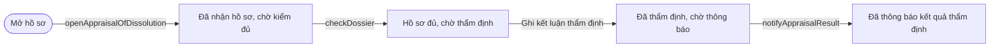
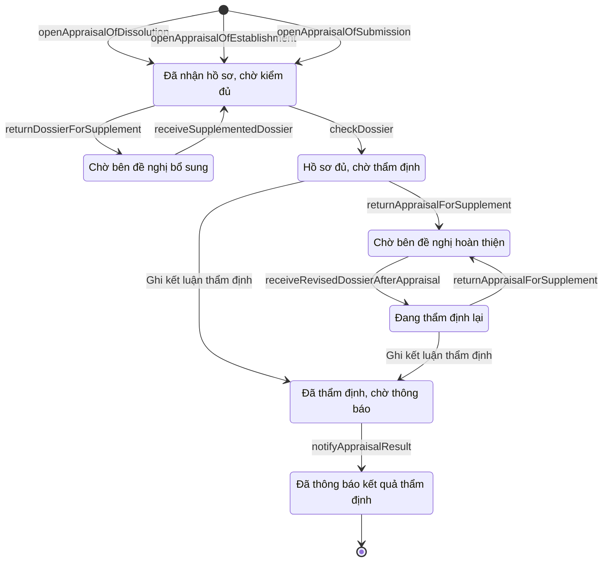

# qt-29.appraisal · Thành lập, tổ chức lại tổ chức — Hồ sơ thành lập tổ chức

<!-- máy sinh: tom-tat -->
> **Hồ sơ:** Hồ sơ thẩm định dùng chung (nhận, kiểm đủ, thẩm định, thông báo) (`OrganisationAppraisal`)
>
> **Trong sổ phạm vi:** Khuôn chung · Thẩm định hồ sơ ở một cấp (tỉnh, quân khu, Cục) — dùng chung qt-29, qt-31, qt-8 (tầng 1)
>
> 14 bước · 7 chặng · 2 vai · 1 bảng quyết định · 3 hạn · 7 khớp nối.
>
> **Nguồn:** sổ nghiệp vụ `qt-29.appraisal` · khai báo của app: `dqtv-app/core/processes/unit-organisation/workflow/organisation-appraisal.yaml`. Các bảng do máy sinh từ nguồn này.
<!-- hết: tom-tat -->

## 1. Đường đi ngắn nhất qua các chặng

<!-- máy sinh: luong-chinh -->
Đường ít bước nhất từ lúc mở hồ sơ tới chặng kết thúc xa nhất. Máy chọn theo số chặng, không theo ý nghĩa nghiệp vụ — trình tự công việc thật xem phần Diễn giải và bảng "Việc làm ở từng chặng" ở mục 6.

| # | Ai làm | Làm gì | Hồ sơ sang chặng |
|---|---|---|---|
| 1 | Hệ thống tự làm | `openAppraisalOfDissolution` | Đã nhận hồ sơ, chờ kiểm đủ |
| 2 | Cục Dân quân tự vệ | `checkDossier` | Hồ sơ đủ, chờ thẩm định |
| 3 | Cục Dân quân tự vệ | Ghi kết luận thẩm định | Đã thẩm định, chờ thông báo |
| 4 | Hệ thống tự làm | `notifyAppraisalResult` | Đã thông báo kết quả thẩm định |

<!-- hết: luong-chinh -->

## 2. Hồ sơ và việc nó để lại

<!-- máy sinh: muc-tieu -->
**App gọi quy trình này là:** Hồ sơ thẩm định dùng chung.

**Khi mở, hồ sơ này ghi mối nối tới:**
- Hồ sơ giải thể tổ chức (31) — bước `openAppraisalOfDissolution`, khớp nối `appraisalOfDissolution`
- Một vòng xử lý hồ sơ khen thưởng ở cấp trên (8.submission) — bước `openAppraisalOfSubmission`, khớp nối `appraisalOfSubmission`
<!-- hết: muc-tieu -->

## 3. Khởi phát và kết thúc

<!-- máy sinh: khoi-phat -->
**3 cửa vào** — bước mở hồ sơ:

| Bước mở | Ai mở | Hồ sơ vào chặng | App bắt buộc nhập |
|---|---|---|---|
| `openAppraisalOfDissolution` | Hệ thống tự làm | Đã nhận hồ sơ, chờ kiểm đủ | — |
| `openAppraisalOfEstablishment` | Hệ thống tự làm | Đã nhận hồ sơ, chờ kiểm đủ | — |
| `openAppraisalOfSubmission` | Hệ thống tự làm | Đã nhận hồ sơ, chờ kiểm đủ | — |

**Kết thúc:** *Đã thông báo kết quả thẩm định* (`APPRAISAL_NOTIFIED`)
<!-- hết: khoi-phat -->

## 4. Vai trò

<!-- máy sinh: vai-tro -->
| Vai trong sổ | Tên trong app | Điều kiện | Làm những bước |
|---|---|---|---|
| `system` | Hệ thống tự làm |  | `openAppraisalOfDissolution` · `openAppraisalOfEstablishment` · `openAppraisalOfSubmission` · Đánh dấu hồ sơ thẩm định quá hạn · `returnDossierForSupplement` · `returnAppraisalForSupplement` · `notifyAppraisalResult` |
| `appraiser` | Cục Dân quân tự vệ |  | `checkDossier` · `requestReturnDossierForSupplementSignature` · Ghi kết luận thẩm định · `receiveSupplementedDossier` · `requestReturnAppraisalForSupplementSignature` · `receiveRevisedDossierAfterAppraisal` · `requestAppraisalNoticeSignature` |

*"Tên trong app" là tên app đặt cho mã chủ thể của vai. Hồ sơ thuộc đơn vị cấp khác thì người làm là người giữ vai ấy ở đơn vị nêu trong cột "Điều kiện" (nếu sổ có ghi) và ở cột "Người làm phải thuộc" của bảng "Theo khai báo của app" (mục 7).*
<!-- hết: vai-tro -->

## 5. Nhánh phụ

<!-- máy sinh: nhanh-phu -->
**Bước khác đưa hồ sơ sang chặng mới** — đường song song, rẽ nhánh hoặc kết thúc sớm:

| Bước | Ai làm | Từ chặng | Sang chặng |
|---|---|---|---|
| `returnDossierForSupplement` | Hệ thống tự làm | Đã nhận hồ sơ, chờ kiểm đủ | Chờ bên đề nghị bổ sung |
| `returnAppraisalForSupplement` | Hệ thống tự làm | Hồ sơ đủ, chờ thẩm định, Đang thẩm định lại | Chờ bên đề nghị hoàn thiện |
| `receiveRevisedDossierAfterAppraisal` | Cục Dân quân tự vệ | Chờ bên đề nghị hoàn thiện | Đang thẩm định lại |

**Quay lại một chặng hồ sơ đã đi qua** (tính theo đường ngắn nhất từ lúc mở):

| Bước | Ai làm | Từ chặng | Về chặng |
|---|---|---|---|
| `receiveSupplementedDossier` | Cục Dân quân tự vệ | Chờ bên đề nghị bổ sung | Đã nhận hồ sơ, chờ kiểm đủ |

**Làm trong lúc hồ sơ đứng yên ở một chặng** — ghi nhận, bổ sung:

| Bước | Ai làm | Ở chặng |
|---|---|---|
| Đánh dấu hồ sơ thẩm định quá hạn | Hệ thống tự làm | Đã nhận hồ sơ, chờ kiểm đủ, Hồ sơ đủ, chờ thẩm định, Đã thông báo kết quả thẩm định, Chờ bên đề nghị bổ sung, Chờ bên đề nghị hoàn thiện, Đang thẩm định lại |
| `requestReturnDossierForSupplementSignature` | Cục Dân quân tự vệ | Đã nhận hồ sơ, chờ kiểm đủ |
| `requestReturnAppraisalForSupplementSignature` | Cục Dân quân tự vệ | Hồ sơ đủ, chờ thẩm định, Đang thẩm định lại |
| `requestAppraisalNoticeSignature` | Cục Dân quân tự vệ | Đã thẩm định, chờ thông báo |

**Cửa vào khác:** 3 bước cùng mở hồ sơ — xem mục 3.

<!-- hết: nhanh-phu -->

## 6. Các chặng và việc làm ở từng chặng

<!-- máy sinh: chang -->
| Chặng | Tên hiển thị | Vào bằng bước | Kết thúc? |
|---|---|---|---|
| `DOSSIER_RECEIVED` | Đã nhận hồ sơ, chờ kiểm đủ | `openAppraisalOfDissolution` · `openAppraisalOfEstablishment` · `openAppraisalOfSubmission` · `receiveSupplementedDossier` |  |
| `SUPPLEMENT_REQUESTED` | Chờ bên đề nghị bổ sung | `returnDossierForSupplement` |  |
| `DOSSIER_COMPLETE` | Hồ sơ đủ, chờ thẩm định | `checkDossier` |  |
| `APPRAISAL_SUPPLEMENT_REQUESTED` | Chờ bên đề nghị hoàn thiện | `returnAppraisalForSupplement` |  |
| `REAPPRAISING` | Đang thẩm định lại | `receiveRevisedDossierAfterAppraisal` |  |
| `APPRAISED` | Đã thẩm định, chờ thông báo | Ghi kết luận thẩm định |  |
| `APPRAISAL_NOTIFIED` | Đã thông báo kết quả thẩm định | `notifyAppraisalResult` | **kết thúc** — vẫn còn bước làm được |

### Việc làm ở từng chặng

Hồ sơ đang ở chặng nào thì làm được những bước nào.

| Hồ sơ đang ở chặng | Bước làm tại chặng (hồ sơ đứng yên) | Bước đưa hồ sơ sang chặng khác |
|---|---|---|
| **Đã nhận hồ sơ, chờ kiểm đủ** | Đánh dấu hồ sơ thẩm định quá hạn — Hệ thống tự làm `requestReturnDossierForSupplementSignature` — Cục Dân quân tự vệ | `checkDossier` — Cục Dân quân tự vệ → *Hồ sơ đủ, chờ thẩm định* `returnDossierForSupplement` — Hệ thống tự làm → *Chờ bên đề nghị bổ sung* |
| **Chờ bên đề nghị bổ sung** | Đánh dấu hồ sơ thẩm định quá hạn — Hệ thống tự làm | `receiveSupplementedDossier` — Cục Dân quân tự vệ → *Đã nhận hồ sơ, chờ kiểm đủ* |
| **Hồ sơ đủ, chờ thẩm định** | Đánh dấu hồ sơ thẩm định quá hạn — Hệ thống tự làm `requestReturnAppraisalForSupplementSignature` — Cục Dân quân tự vệ | Ghi kết luận thẩm định — Cục Dân quân tự vệ → *Đã thẩm định, chờ thông báo* `returnAppraisalForSupplement` — Hệ thống tự làm → *Chờ bên đề nghị hoàn thiện* |
| **Chờ bên đề nghị hoàn thiện** | Đánh dấu hồ sơ thẩm định quá hạn — Hệ thống tự làm | `receiveRevisedDossierAfterAppraisal` — Cục Dân quân tự vệ → *Đang thẩm định lại* |
| **Đang thẩm định lại** | Đánh dấu hồ sơ thẩm định quá hạn — Hệ thống tự làm `requestReturnAppraisalForSupplementSignature` — Cục Dân quân tự vệ | Ghi kết luận thẩm định — Cục Dân quân tự vệ → *Đã thẩm định, chờ thông báo* `returnAppraisalForSupplement` — Hệ thống tự làm → *Chờ bên đề nghị hoàn thiện* |
| **Đã thẩm định, chờ thông báo** | `requestAppraisalNoticeSignature` — Cục Dân quân tự vệ | `notifyAppraisalResult` — Hệ thống tự làm → *Đã thông báo kết quả thẩm định* |
| **Đã thông báo kết quả thẩm định** | Đánh dấu hồ sơ thẩm định quá hạn — Hệ thống tự làm | — (kết thúc) |
<!-- hết: chang -->

## 7. Bảng bước

<!-- máy sinh: buoc -->
| # | Bước | Mã bước | Ai thực hiện | Từ chặng | Sang chặng | Phải có trước | Ghi lại |
|---|---|---|---|---|---|---|---|
| 1 | `openAppraisalOfDissolution` | `openAppraisalOfDissolution` | Hệ thống tự làm | — (mở hồ sơ) | `DOSSIER_RECEIVED` | — | đơn vị chủ hồ sơ, nối tới Hồ sơ giải thể tổ chức, ngày nhận hồ sơ, hạn xử lý, hạn đang chạy |
| 2 | `openAppraisalOfEstablishment` | `openAppraisalOfEstablishment` | Hệ thống tự làm | — (mở hồ sơ) | `DOSSIER_RECEIVED` | — | đơn vị chủ hồ sơ, nối tới Hồ sơ thành lập tổ chức, ngày nhận hồ sơ, hạn xử lý, hạn đang chạy |
| 3 | `openAppraisalOfSubmission` | `openAppraisalOfSubmission` | Hệ thống tự làm | — (mở hồ sơ) | `DOSSIER_RECEIVED` | — | đơn vị chủ hồ sơ, nối tới Một vòng xử lý hồ sơ khen thưởng ở cấp trên, ngày nhận hồ sơ, hạn xử lý, hạn đang chạy |
| 4 | `checkDossier` | `checkDossier` | Cục Dân quân tự vệ | `DOSSIER_RECEIVED` | `DOSSIER_COMPLETE` | người làm thuộc đơn vị chủ hồ sơ | ngày xác nhận hồ sơ đủ, ngày xác nhận hồ sơ hợp lệ, hạn xử lý, hạn đang chạy; **xoá:** quá hạn từ |
| 5 | Đánh dấu hồ sơ thẩm định quá hạn | `flagAppraisalOverdue` | Hệ thống tự làm | `DOSSIER_RECEIVED`, `DOSSIER_COMPLETE`, `APPRAISAL_NOTIFIED`, `SUPPLEMENT_REQUESTED`, `APPRAISAL_SUPPLEMENT_REQUESTED`, `REAPPRAISING` | giữ nguyên | `deadlineRunningAndNotFlagged` | quá hạn từ |
| 6 | `requestReturnDossierForSupplementSignature` | `requestReturnDossierForSupplementSignature` | Cục Dân quân tự vệ | `DOSSIER_RECEIVED` | giữ nguyên | `noReturnDossierForSupplementDocumentOpen`, người làm thuộc đơn vị chủ hồ sơ | nội dung yêu cầu bổ sung, hoàn thiện, nối `returnDossierForSupplementByDocument` (Hồ sơ thành lập tổ chức → Văn bản đi) |
| 7 | `returnDossierForSupplement` | `returnDossierForSupplement` | Hệ thống tự làm | `DOSSIER_RECEIVED` | `SUPPLEMENT_REQUESTED` | `returnDossierForSupplementDocumentIssued` | hạn xử lý, hạn đang chạy |
| 8 | Ghi kết luận thẩm định | `appraiseProposal` | Cục Dân quân tự vệ | `DOSSIER_COMPLETE`, `REAPPRAISING` | `APPRAISED` | người làm thuộc đơn vị chủ hồ sơ | kết luận thẩm định, hồ sơ đạt hay không đạt, ngày thẩm định |
| 9 | `receiveSupplementedDossier` | `receiveSupplementedDossier` | Cục Dân quân tự vệ | `SUPPLEMENT_REQUESTED` | `DOSSIER_RECEIVED` | người làm thuộc đơn vị chủ hồ sơ, `receiveSupplementedDossierFromIncomingDocumentUsable` | ngày nhận hồ sơ bổ sung, hoàn thiện, nối `receiveSupplementedDossierFromIncomingDocument` (Hồ sơ thành lập tổ chức → Văn bản đến), hạn xử lý, hạn đang chạy |
| 10 | `requestReturnAppraisalForSupplementSignature` | `requestReturnAppraisalForSupplementSignature` | Cục Dân quân tự vệ | `DOSSIER_COMPLETE`, `REAPPRAISING` | giữ nguyên | `noReturnAppraisalForSupplementDocumentOpen`, người làm thuộc đơn vị chủ hồ sơ | nội dung yêu cầu bổ sung, hoàn thiện, nối `returnAppraisalForSupplementByDocument` (Hồ sơ thành lập tổ chức → Văn bản đi) |
| 11 | `returnAppraisalForSupplement` | `returnAppraisalForSupplement` | Hệ thống tự làm | `DOSSIER_COMPLETE`, `REAPPRAISING` | `APPRAISAL_SUPPLEMENT_REQUESTED` | `returnAppraisalForSupplementDocumentIssued` | ngày thẩm định, hạn xử lý, hạn đang chạy |
| 12 | `notifyAppraisalResult` | `notifyAppraisalResult` | Hệ thống tự làm | `APPRAISED` | `APPRAISAL_NOTIFIED` | `appraisalNoticeDocumentIssued` | ngày thông báo kết quả thẩm định; **xoá:** quá hạn từ |
| 13 | `receiveRevisedDossierAfterAppraisal` | `receiveRevisedDossierAfterAppraisal` | Cục Dân quân tự vệ | `APPRAISAL_SUPPLEMENT_REQUESTED` | `REAPPRAISING` | người làm thuộc đơn vị chủ hồ sơ, `receiveRevisedDossierAfterAppraisalFromIncomingDocumentUsable` | ngày nhận hồ sơ bổ sung, hoàn thiện, nối `receiveRevisedDossierFromIncomingDocument` (Hồ sơ thành lập tổ chức → Văn bản đến), hạn xử lý, hạn đang chạy |
| 14 | `requestAppraisalNoticeSignature` | `requestAppraisalNoticeSignature` | Cục Dân quân tự vệ | `APPRAISED` | giữ nguyên | người làm thuộc đơn vị chủ hồ sơ, `noAppraisalNoticeDocumentOpen` | hạn xử lý, hạn đang chạy, nối `appraisalNoticeByDocument` (Hồ sơ giải thể tổ chức → Văn bản đi) |

### Khi không đạt điều kiện

Mặc định: không đúng người, hồ sơ không ở đúng chặng, hoặc thiếu thứ "phải có trước" thì bước bị chặn, hồ sơ giữ nguyên. Bảng dưới chỉ kê những bước có kết quả riêng.

| # | Bước | Kết quả riêng |
|---|---|---|
| 1 | `openAppraisalOfDissolution` | bước này không do người nào bấm |
| 2 | `openAppraisalOfEstablishment` | bước này không do người nào bấm |
| 3 | `openAppraisalOfSubmission` | bước này không do người nào bấm |
| 5 | Đánh dấu hồ sơ thẩm định quá hạn | bước này không do người nào bấm |
| 7 | `returnDossierForSupplement` | bước này không do người nào bấm |
| 8 | Ghi kết luận thẩm định | kết quả xét `skip_appraisal` → hồ sơ sang *Đã thông báo kết quả thẩm định* |
| 11 | `returnAppraisalForSupplement` | bước này không do người nào bấm |
| 12 | `notifyAppraisalResult` | bước này không do người nào bấm |

### Điều kiện "phải có trước" bằng lời

Cột "Phải có trước" ở bảng bước có hai loại: ô dữ liệu thường (bước chỉ đòi ô ấy đã có giá trị) và điều kiện hệ tự xét. Bảng này diễn các điều kiện hệ tự xét theo đúng công thức sổ ghi; số ở cột cuối là số thứ tự bước.

| Điều kiện | Đúng khi | Bước đòi |
|---|---|---|
| `actorInOwnerUnit` | người đang làm là người của đơn vị ghi ở ô đơn vị chủ hồ sơ của hồ sơ này (theo danh mục người của đơn vị, `dm.unit-staff`) | 4, 6, 8, 9, 10, 13, 14 |
| `deadlineRunningAndNotFlagged` | đã có hạn xử lý VÀ KHÔNG (đã có quá hạn từ) | 5 |
| `noReturnDossierForSupplementDocumentOpen` | KHÔNG (có hồ sơ Việc luật giao kèm văn bản đến, đi — Văn bản đi (qt-1.outgoing-document) chính là hồ sơ ghi ở ô nối `returnDossierForSupplementByDocument` của hồ sơ đang làm mà hồ sơ ấy đang ở chặng `DRAFT` hoặc `PENDING_SIGNATURE` hoặc `SIGNED`) | 6 |
| `returnDossierForSupplementDocumentIssued` | có hồ sơ Việc luật giao kèm văn bản đến, đi — Văn bản đi (qt-1.outgoing-document) chính là hồ sơ ghi ở ô nối `returnDossierForSupplementByDocument` của hồ sơ đang làm mà hồ sơ ấy đang ở chặng `ISSUED` | 7 |
| `receiveSupplementedDossierFromIncomingDocumentUsable` | có hồ sơ Việc luật giao kèm văn bản đến, đi — Văn bản đến (qt-1.incoming-document) chính là hồ sơ ghi ở ô nối `receiveSupplementedDossierFromIncomingDocument` của hồ sơ đang làm mà hồ sơ ấy đang ở chặng `RECEIVED` hoặc `DISTRIBUTED` | 9 |
| `noReturnAppraisalForSupplementDocumentOpen` | KHÔNG (có hồ sơ Việc luật giao kèm văn bản đến, đi — Văn bản đi (qt-1.outgoing-document) chính là hồ sơ ghi ở ô nối `returnAppraisalForSupplementByDocument` của hồ sơ đang làm mà hồ sơ ấy đang ở chặng `DRAFT` hoặc `PENDING_SIGNATURE` hoặc `SIGNED`) | 10 |
| `returnAppraisalForSupplementDocumentIssued` | có hồ sơ Việc luật giao kèm văn bản đến, đi — Văn bản đi (qt-1.outgoing-document) chính là hồ sơ ghi ở ô nối `returnAppraisalForSupplementByDocument` của hồ sơ đang làm mà hồ sơ ấy đang ở chặng `ISSUED` | 11 |
| `appraisalNoticeDocumentIssued` | có hồ sơ Việc luật giao kèm văn bản đến, đi — Văn bản đi (qt-1.outgoing-document) chính là hồ sơ ghi ở ô nối `appraisalNoticeByDocument` của hồ sơ đang làm mà hồ sơ ấy đang ở chặng `ISSUED` | 12 |
| `receiveRevisedDossierAfterAppraisalFromIncomingDocumentUsable` | có hồ sơ Việc luật giao kèm văn bản đến, đi — Văn bản đến (qt-1.incoming-document) chính là hồ sơ ghi ở ô nối `receiveRevisedDossierFromIncomingDocument` của hồ sơ đang làm mà hồ sơ ấy đang ở chặng `RECEIVED` hoặc `DISTRIBUTED` | 13 |
| `noAppraisalNoticeDocumentOpen` | KHÔNG (có hồ sơ Việc luật giao kèm văn bản đến, đi — Văn bản đi (qt-1.outgoing-document) chính là hồ sơ ghi ở ô nối `appraisalNoticeByDocument` của hồ sơ đang làm mà hồ sơ ấy đang ở chặng `DRAFT` hoặc `PENDING_SIGNATURE` hoặc `SIGNED`) | 14 |
| `existingOrganizationNamed` | có hồ sơ Thành lập, tổ chức lại tổ chức (qt-29) chính là hồ sơ ghi ở ô nối `appraisalOfEstablishment` của hồ sơ đang làm mà `decisionType` là `rename` | đầu vào bảng quyết định (mục 8) |

### Theo khai báo của app

Người làm phải thuộc đơn vị nào, ô người dùng phải nhập, bước có lặp được không, và căn cứ pháp lý — lấy từ khai báo quy trình trong app.

| # | Bước | Người làm phải thuộc | Bắt buộc nhập | Nhập nếu có | Lặp được | Căn cứ |
|---|---|---|---|---|---|---|
| 5 | Đánh dấu hồ sơ thẩm định quá hạn |  | — | — |  | QĐ10/2025/QĐ-TTg Đ.6, Đ.8 (03 · 30 · 25 · 15 ngày làm việc) |
| 8 | Ghi kết luận thẩm định | đơn vị chủ hồ sơ | — | kết luận thẩm định, hồ sơ đạt hay không đạt, ngày thẩm định |  | QĐ10/2025/QĐ-TTg Đ.6, Đ.8 k4; TT93/2024/TT-BQP Đ.27 |
| — | Nhận hồ sơ đề nghị để thẩm định (`openAppraisal`) |  | ngày nhận hồ sơ | hồ sơ thành lập cần thẩm định, hồ sơ giải thể cần thẩm định, lượt trình hồ sơ khen thưởng cần thẩm định |  | QĐ10/2025/QĐ-TTg Đ.6, Đ.8 k2, k3; TT93/2024/TT-BQP Đ.27 |
| — | Xác nhận hồ sơ đủ thành phần (`checkAppraisalDossier`) | đơn vị chủ hồ sơ | — | ngày xác nhận hồ sơ đủ |  | QĐ10/2025/QĐ-TTg Đ.6, Đ.8 k3 |
| — | Trình ký văn bản thông báo kết quả thẩm định (`requestOrganisationAppraisalNoticeSignature`) | đơn vị chủ hồ sơ | — | dự thảo văn bản thông báo kết quả thẩm định (PDF) |  | QĐ10/2025/QĐ-TTg Đ.6, Đ.8 k4, k6; NĐ30/2020/NĐ-CP Đ.13 |
| — | Ghi thông báo kết quả thẩm định (`notifyOrganisationAppraisalResult`) |  | — | ngày thông báo kết quả thẩm định |  | QĐ10/2025/QĐ-TTg Đ.6, Đ.8 k4, k6 |
| — | Trình ký văn bản yêu cầu bổ sung hồ sơ (`requestAppraisalSupplementSignature`) | đơn vị chủ hồ sơ | bên đề nghị cần bổ sung những gì, dự thảo văn bản yêu cầu bổ sung hồ sơ (PDF) | — |  | QĐ10/2025/QĐ-TTg Đ.6 · NĐ30/2020/NĐ-CP Đ.13 |
| — | Yêu cầu bên đề nghị bổ sung hồ sơ (`returnAppraisalDossierForSupplement`) |  | — | — |  | QĐ10/2025/QĐ-TTg Đ.6 · NĐ30/2020/NĐ-CP Đ.18 |
| — | Ghi đã nhận hồ sơ bổ sung (`receiveAppraisalSupplementedDossier`) | đơn vị chủ hồ sơ | văn bản đến là hồ sơ bổ sung bên đề nghị gửi | ngày nhận hồ sơ bổ sung, hoàn thiện |  | QĐ10/2025/QĐ-TTg Đ.6 |
| — | Trình ký văn bản yêu cầu hoàn thiện hồ sơ sau thẩm định (`requestAppraisalRevisionSignature`) | đơn vị chủ hồ sơ | thẩm định chưa đạt ở đâu — bên đề nghị hoàn thiện những gì, dự thảo văn bản yêu cầu hoàn thiện hồ sơ (PDF) | — |  | QĐ10/2025/QĐ-TTg Đ.6 · NĐ30/2020/NĐ-CP Đ.13 |
| — | Yêu cầu bên đề nghị hoàn thiện hồ sơ sau thẩm định (`returnAppraisalForRevision`) |  | — | — |  | QĐ10/2025/QĐ-TTg Đ.6 · NĐ30/2020/NĐ-CP Đ.18 |
| — | Ghi đã nhận hồ sơ hoàn thiện (`receiveAppraisalRevisedDossier`) | đơn vị chủ hồ sơ | văn bản đến là hồ sơ hoàn thiện bên đề nghị gửi | ngày nhận hồ sơ bổ sung, hoàn thiện |  | QĐ10/2025/QĐ-TTg Đ.6 |

### Điều kiện và ghi chú app khai cho từng bước

Lấy từ khai báo quy trình trong app. Lời trong ngoặc kép là câu app hiện cho người dùng. Chức danh người ký ngoài hệ app chỉ khai bằng mã.

| # | Bước | Điều kiện, ghi chú |
|---|---|---|
| 5 | Đánh dấu hồ sơ thẩm định quá hạn | · phải đã có ô "hạn xử lý" — thiếu thì app báo: "hồ sơ không có hạn nào đang chạy" · không làm được khi đã có ô "quá hạn từ" — app báo: "hồ sơ đã được ghi quá hạn cho hạn đang chạy" |
| — | Nhận hồ sơ đề nghị để thẩm định | · hạn: 3 ngày làm việc — Kiểm hồ sơ đủ thành phần trong 03 ngày làm việc kể từ ngày nhận hồ sơ |
| — | Xác nhận hồ sơ đủ thành phần | · hạn: 30 ngày làm việc — Thẩm định trong 30 ngày làm việc kể từ khi nhận đủ hồ sơ |
| — | Trình ký văn bản thông báo kết quả thẩm định | · hạn: 25 ngày làm việc — Cấp có thẩm quyền quyết định trong 25 ngày làm việc kể từ ngày thông báo kết quả thẩm định |
| — | Yêu cầu bên đề nghị bổ sung hồ sơ | · hạn: 15 ngày làm việc — Bên đề nghị bổ sung hồ sơ trong 15 ngày làm việc kể từ ngày phát hành văn bản yêu cầu — chỉ nhắc |
| — | Ghi đã nhận hồ sơ bổ sung | · hạn: 3 ngày làm việc — Kiểm hồ sơ bổ sung đủ thành phần trong 03 ngày làm việc kể từ ngày nhận — QĐ10/2025/QĐ-TTg Đ.6 |
| — | Yêu cầu bên đề nghị hoàn thiện hồ sơ sau thẩm định | · hạn: 15 ngày làm việc — Bên đề nghị hoàn thiện hồ sơ trong 15 ngày làm việc kể từ ngày phát hành văn bản yêu cầu — chỉ nhắc |
| — | Ghi đã nhận hồ sơ hoàn thiện | · hạn: 15 ngày làm việc — Thẩm định lại hồ sơ đã hoàn thiện trong 15 ngày làm việc kể từ ngày nhận |
<!-- hết: buoc -->

## 8. Bảng quyết định, hạn, việc ngoài hệ

<!-- máy sinh: quyet-dinh -->
**Bảng `appraisal-path`** — xét ở bước *Ghi kết luận thẩm định*; đầu vào: `existingOrganizationNamed`. 2 dòng, dò từ trên xuống, dòng đầu tiên khớp thì dừng.

| Thứ tự dò (số sổ ghi) | Dòng | Khi | Thì |
|---|---|---|---|
| 0 | `renamed-skips` | đã có `existingOrganizationNamed` | `skip_appraisal` |
| 1 | `otherwise` | mọi trường hợp còn lại | cho qua |

| Hạn | Tính từ | Thời hạn | Quá hạn thì |
|---|---|---|---|
| `proposerRevision.deadline` | khi hồ sơ vào chặng Chờ bên đề nghị hoàn thiện | 15 ngày làm việc | hệ làm bước Đánh dấu hồ sơ thẩm định quá hạn |
| `proposerSupplement.deadline` | khi hồ sơ vào chặng Chờ bên đề nghị bổ sung | 15 ngày làm việc | hệ làm bước Đánh dấu hồ sơ thẩm định quá hạn |
| `reappraisal.deadline` | khi hồ sơ vào chặng Đang thẩm định lại | 15 ngày làm việc | hệ làm bước Đánh dấu hồ sơ thẩm định quá hạn |

<!-- hết: quyet-dinh -->

## 9. Dữ liệu của hồ sơ

<!-- máy sinh: du-lieu -->
Các ô mà bước trong sổ ghi hoặc đòi. Số trong hai cột cuối là số thứ tự bước ở bảng bước (mục 7).

| Ô dữ liệu | Mã | Kiểu (app) | Giá trị cho phép | Loại ô (sổ) | Bước ghi | Bước đòi | Mô tả trong app |
|---|---|---|---|---|---|---|---|
| đơn vị chủ hồ sơ | `ownerUnit` |  |  | lưu trên hồ sơ (`stored`) | 1, 2, 3 | — |  |
| ngày nhận hồ sơ | `dossierReceivedAt` | ngày |  | lưu trên hồ sơ (`stored`) | 1, 2, 3 | — | Ngày cơ quan thẩm định nhận hồ sơ đề nghị |
| hạn xử lý | `dueDate` | ngày |  | lưu trên hồ sơ (`stored`) | 1, 2, 3, 4, 7, 9, 11, 13, 14 | — | Hạn của việc đang chạy — tính theo ngày làm việc; trống khi không có hạn nào đang chạy |
| hạn đang chạy | `dueKind` | chọn một | `dossier_check`, `decision`, `refusal`, Kiểm hồ sơ đủ thành phần (03 ngày làm việc) (`centre_receipt`), Thẩm định hồ sơ (30 ngày làm việc) (`centre_appraisal`), Ra quyết định sau thông báo thẩm định (25 ngày làm việc) (`centre_decision`), Bên đề nghị bổ sung hồ sơ (15 ngày làm việc) (`centre_supplement`), Bên đề nghị hoàn thiện hồ sơ sau thẩm định (15 ngày làm việc) (`centre_revision`), Thẩm định lại hồ sơ (15 ngày làm việc) (`centre_reappraisal`) | lưu trên hồ sơ (`stored`) | 1, 2, 3, 4, 7, 9, 11, 13, 14 | — | Hạn đang chạy là hạn nào: kiểm đủ (03 ngày làm việc), thẩm định (30), quyết định (25), bên đề nghị bổ sung (15), hoàn thiện sau thẩm định (15), thẩm định lại (15) |
| ngày xác nhận hồ sơ đủ | `dossierCompleteAt` | ngày |  | lưu trên hồ sơ (`stored`) | 4 | — | Ngày cơ quan thẩm định xác nhận hồ sơ đủ thành phần |
| ngày xác nhận hồ sơ hợp lệ | `proposalValidAt` | ngày |  | lưu trên hồ sơ (`stored`) | 4 | — | Ngày xác nhận hồ sơ đề nghị hợp lệ — hồ sơ đủ cũng là hồ sơ hợp lệ; hồ sơ cha (thành lập, giải thể) đòi ngày này |
| quá hạn từ | `overdueAt` | ngày |  | lưu trên hồ sơ (`stored`) | 5 | — | Ngày hệ ghi quá hạn của hạn đang chạy — trống khi hạn chưa quá; bước mở hạn mới xoá mốc này |
| nội dung yêu cầu bổ sung, hoàn thiện | `supplementGuidanceNote` | chữ |  | đưa vào ở bước (`input`) | 6, 10 | — | Cơ quan thẩm định yêu cầu bổ sung, hoàn thiện những gì — lần gần nhất |
| kết luận thẩm định | `appraisalResult` | chữ |  | đưa vào ở bước (`input`) | 8 | — | Kết luận thẩm định |
| kết quả thẩm định | `appraisalOutcome` | chọn một | Đạt (`PASSED`), Không đạt (`FAILED`) | đưa vào ở bước (`input`) | 8 | — | Kết quả thẩm định — đạt hay không đạt |
| ngày thẩm định | `appraisedAt` | ngày |  | lưu trên hồ sơ (`stored`) | 8, 11 | — | Ngày thẩm định xong; yêu cầu hoàn thiện sau thẩm định chưa đạt cũng ghi ngày này |
| ngày nhận hồ sơ bổ sung, hoàn thiện | `supplementReceivedAt` | ngày |  | lưu trên hồ sơ (`stored`) | 9, 13 | — | Ngày nhận hồ sơ bổ sung, hoàn thiện của bên đề nghị — lần gần nhất |
| ngày thông báo kết quả thẩm định | `appraisalNotifiedAt` | ngày |  | lưu trên hồ sơ (`stored`) | 12 | — | Ngày thông báo kết quả thẩm định (văn bản thông báo phát hành ở Sổ văn bản đi) |
| người làm thuộc đơn vị chủ hồ sơ | `actorInOwnerUnit` |  | có hay chưa | hệ suy ra (`derived`) | — | 4, 6, 8, 9, 10, 13, 14 |  |
| — | `deadlineRunningAndNotFlagged` |  |  | hệ suy ra (`derived`) | — | 5 |  |
| — | `noReturnDossierForSupplementDocumentOpen` |  | có hay chưa | hệ suy ra (`derived`) | — | 6 |  |
| — | `returnDossierForSupplementDocumentIssued` |  | có hay chưa | hệ suy ra (`derived`) | — | 7 |  |
| — | `receiveSupplementedDossierFromIncomingDocumentUsable` |  | có hay chưa | hệ suy ra (`derived`) | — | 9 |  |
| — | `noReturnAppraisalForSupplementDocumentOpen` |  | có hay chưa | hệ suy ra (`derived`) | — | 10 |  |
| — | `returnAppraisalForSupplementDocumentIssued` |  | có hay chưa | hệ suy ra (`derived`) | — | 11 |  |
| — | `appraisalNoticeDocumentIssued` |  | có hay chưa | hệ suy ra (`derived`) | — | 12 |  |
| — | `receiveRevisedDossierAfterAppraisalFromIncomingDocumentUsable` |  | có hay chưa | hệ suy ra (`derived`) | — | 13 |  |
| — | `noAppraisalNoticeDocumentOpen` |  | có hay chưa | hệ suy ra (`derived`) | — | 14 |  |
| — | `existingOrganizationNamed` |  | có hay chưa | hệ suy ra (`derived`) | — | — |  |

24 ô. Cột "Loại ô" là cách sổ phân loại ô, in kèm đúng chữ của sổ; ô nào người dùng phải nhập xem bảng "Theo khai báo của app" ở mục 7.
<!-- hết: du-lieu -->

## 10. Khớp nối với quy trình khác

<!-- máy sinh: khop-noi -->
| Quy trình kia | Hồ sơ kia | Quan hệ | Nội dung (mô tả trong app) | Bước ghi mối nối | Tên ô nối |
|---|---|---|---|---|---|
| 1.incoming-document | Văn bản đến | có nối | Hồ sơ hoàn thiện sau thẩm định bên đề nghị gửi lại — văn bản đến đã vào sổ; mỗi lượt một cạnh, giữ lịch sử (s… | — | `appraisalRevisionFromIncomingDocument` |
| 1.incoming-document | Văn bản đến | có nối | Hồ sơ bổ sung bên đề nghị gửi lại — văn bản đến đã vào sổ; mỗi lượt một cạnh, giữ lịch sử (sổ link.receiveSup… | — | `appraisalSupplementFromIncomingDocument` |
| 1.outgoing-document | Văn bản đi | có nối | Văn bản yêu cầu bên đề nghị hoàn thiện hồ sơ sau thẩm định chưa đạt — sổ qt-29.appraisal link.returnAppraisal… | — | `appraisalRevisionByDocument` |
| 1.outgoing-document | Văn bản đi | có nối | Văn bản yêu cầu bên đề nghị bổ sung hồ sơ lúc kiểm đủ — sổ qt-29.appraisal link.returnDossierForSupplementByD… | — | `appraisalSupplementByDocument` |
| 1.outgoing-document | Văn bản đi | có nối | Văn bản thông báo kết quả thẩm định ở Sổ văn bản đi của cơ quan thẩm định — sổ qt-29.appraisal link.appraisal… | — | `organisationAppraisalNoticeByDocument` |
| 31 | Hồ sơ giải thể tổ chức | hồ sơ này **mở ra có nối tới** hồ sơ kia | Hồ sơ giải thể tổ chức mà hồ sơ thẩm định này thuộc về (QĐ10/2025/QĐ-TTg Đ.8) | 29.appraisal·openAppraisalOfDissolution ⊕ | `appraisalOfDissolution` |
| 8.submission | Một vòng xử lý hồ sơ khen thưởng ở cấp trên | hồ sơ này **mở ra có nối tới** hồ sơ kia | Lượt trình lên và xem xét hồ sơ khen thưởng mà hồ sơ thẩm định này thuộc về (TT93/2024/TT-BQP Đ.27) — lượt cầ… | 29.appraisal·openAppraisalOfSubmission ⊕ | `appraisalOfSubmission` |

7 khớp nối. ⊕ là bước tạo hồ sơ.

**Ô nối giữa các hồ sơ cùng mã quy trình, hoặc tới danh mục nền:** `appraisalOfEstablishment` (Hồ sơ thẩm định dùng chung (nhận, kiểm đủ, thẩm định, thông báo) → Hồ sơ thành lập tổ chức) — bước Nhận hồ sơ đề nghị để thẩm định.
<!-- hết: khop-noi -->

## 11. Thông tin chung

<!-- máy sinh: thong-tin -->
| | |
|---|---|
| **Mã trong sổ** | `qt-29.appraisal` |
| **Quy trình trong app** | `unit-organisation` (`workflow/organisation-appraisal.yaml`) — mặt công tác: `personnel` |
| **Hồ sơ** | Hồ sơ thẩm định dùng chung (nhận, kiểm đủ, thẩm định, thông báo) (`OrganisationAppraisal`) |
| **Cùng mã quy trình** | [qt-29](qt-29.html), [qt-29.board-reorganization](qt-29.board-reorganization.html), [qt-29.command-board](qt-29.command-board.html) |
| **Căn cứ pháp lý từng bước** | cột "Căn cứ" ở bảng "Theo khai báo của app", mục 7 |
<!-- hết: thong-tin -->
