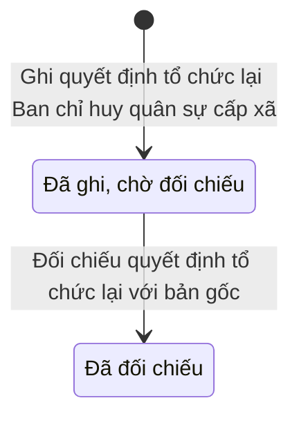

# qt-29.board-reorganization · Thành lập, tổ chức lại tổ chức — Hồ sơ tổ chức lại Ban chỉ huy quân sự cấp xã

<!-- máy sinh: tom-tat -->
> **Hồ sơ:** Hồ sơ tổ chức lại Ban chỉ huy quân sự cấp xã (`BoardReorganization`)
>
> **Trong sổ phạm vi:** 29 · Thành lập, tổ chức lại tổ chức — hồ sơ phụ board-reorganization (tầng 1)
>
> 2 bước · 2 chặng · 2 vai · 0 bảng quyết định · 0 hạn · 2 khớp nối.
>
> **Nguồn:** sổ nghiệp vụ `qt-29.board-reorganization` · khai báo của app: `dqtv-app/core/processes/unit-organisation/workflow/board-reorganization.yaml`. Các bảng do máy sinh từ nguồn này.
<!-- hết: tom-tat -->

## 1. Đường đi ngắn nhất qua các chặng

<!-- máy sinh: luong-chinh -->
Đường ít bước nhất từ lúc mở hồ sơ tới chặng kết thúc xa nhất. Máy chọn theo số chặng, không theo ý nghĩa nghiệp vụ — trình tự công việc thật xem phần Diễn giải và bảng "Việc làm ở từng chặng" ở mục 6.

| # | Ai làm | Làm gì | Hồ sơ sang chặng |
|---|---|---|---|
| 1 | Ban Dân quân tự vệ, Bộ CHQS cấp tỉnh | Ghi quyết định tổ chức lại Ban chỉ huy quân sự cấp xã | Đã ghi, chờ đối chiếu |
| 2 | Bộ CHQS cấp tỉnh | Đối chiếu quyết định tổ chức lại với bản gốc | Đã đối chiếu |

<!-- hết: luong-chinh -->

## 2. Hồ sơ và việc nó để lại

<!-- máy sinh: muc-tieu -->
**App gọi quy trình này là:** Tổ chức lại Ban chỉ huy quân sự cấp xã.

**Khi mở, hồ sơ này ghi mối nối tới:**
- Văn bản đến (1.incoming-document) — bước `recordBoardReorganization`, khớp nối `reorganizationByIncomingDocument`
<!-- hết: muc-tieu -->

## 3. Khởi phát và kết thúc

<!-- máy sinh: khoi-phat -->
**1 cửa vào** — bước mở hồ sơ:

| Bước mở | Ai mở | Hồ sơ vào chặng | App bắt buộc nhập |
|---|---|---|---|
| Ghi quyết định tổ chức lại Ban chỉ huy quân sự cấp xã | Ban Dân quân tự vệ, Bộ CHQS cấp tỉnh | Đã ghi, chờ đối chiếu | ban chỉ huy quân sự trong quyết định, quyết định tổ chức lại trong sổ văn bản đến |
<!-- hết: khoi-phat -->

## 4. Vai trò

<!-- máy sinh: vai-tro -->
| Vai trong sổ | Tên trong app | Điều kiện | Làm những bước |
|---|---|---|---|
| `provinceOperator` | Ban Dân quân tự vệ, Bộ CHQS cấp tỉnh |  | Ghi quyết định tổ chức lại Ban chỉ huy quân sự cấp xã |
| `province` | Bộ CHQS cấp tỉnh |  | Đối chiếu quyết định tổ chức lại với bản gốc |

*"Tên trong app" là tên app đặt cho mã chủ thể của vai. Hồ sơ thuộc đơn vị cấp khác thì người làm là người giữ vai ấy ở đơn vị nêu trong cột "Điều kiện" (nếu sổ có ghi) và ở cột "Người làm phải thuộc" của bảng "Theo khai báo của app" (mục 7).*
<!-- hết: vai-tro -->

## 5. Nhánh phụ

<!-- máy sinh: nhanh-phu -->
Không có bước nào ngoài luồng chính.
<!-- hết: nhanh-phu -->

## 6. Các chặng và việc làm ở từng chặng

<!-- máy sinh: chang -->
| Chặng | Tên hiển thị | Vào bằng bước | Kết thúc? |
|---|---|---|---|
| `RECORDED` | Đã ghi, chờ đối chiếu | Ghi quyết định tổ chức lại Ban chỉ huy quân sự cấp xã |  |
| `VERIFIED` | Đã đối chiếu | Đối chiếu quyết định tổ chức lại với bản gốc |  |

### Việc làm ở từng chặng

Hồ sơ đang ở chặng nào thì làm được những bước nào.

| Hồ sơ đang ở chặng | Bước làm tại chặng (hồ sơ đứng yên) | Bước đưa hồ sơ sang chặng khác |
|---|---|---|
| **Đã ghi, chờ đối chiếu** | — | Đối chiếu quyết định tổ chức lại với bản gốc — Bộ CHQS cấp tỉnh → *Đã đối chiếu* |
| **Đã đối chiếu** | — | — |
<!-- hết: chang -->

## 7. Bảng bước

<!-- máy sinh: buoc -->
| # | Bước | Mã bước | Ai thực hiện | Từ chặng | Sang chặng | Phải có trước | Ghi lại |
|---|---|---|---|---|---|---|---|
| 1 | Ghi quyết định tổ chức lại Ban chỉ huy quân sự cấp xã | `recordBoardReorganization` | Ban Dân quân tự vệ, Bộ CHQS cấp tỉnh | — (mở hồ sơ) | `RECORDED` | `reorganizationByIncomingDocumentUsable`, `effectiveAtNotBeforeSigned` | ngày ký quyết định, cấp ký quyết định, ngày quyết định có hiệu lực (trống: ngày ký), ghi chú — biên chế mới, phạm vi tổ chức lại, người ghi quyết định, nối tới Văn bản đến, nối tới Ban chỉ huy quân sự cấp xã |
| 2 | Đối chiếu quyết định tổ chức lại với bản gốc | `verifyBoardReorganization` | Bộ CHQS cấp tỉnh | `RECORDED` | `VERIFIED` | `notRecorder` | người đối chiếu bản gốc, ngày đối chiếu bản gốc, nối tới Văn bản đến |

### Khi không đạt điều kiện

Mặc định: không đúng người, hồ sơ không ở đúng chặng, hoặc thiếu thứ "phải có trước" thì bước bị chặn, hồ sơ giữ nguyên. Bảng dưới chỉ kê những bước có kết quả riêng.

Không bước nào có kết quả riêng — tất cả theo mặc định.

### Điều kiện "phải có trước" bằng lời

Cột "Phải có trước" ở bảng bước có hai loại: ô dữ liệu thường (bước chỉ đòi ô ấy đã có giá trị) và điều kiện hệ tự xét. Bảng này diễn các điều kiện hệ tự xét theo đúng công thức sổ ghi; số ở cột cuối là số thứ tự bước.

| Điều kiện | Đúng khi | Bước đòi |
|---|---|---|
| `reorganizationByIncomingDocumentUsable` | có hồ sơ Việc luật giao kèm văn bản đến, đi — Văn bản đến (qt-1.incoming-document) chính là hồ sơ ghi ở ô nối `reorganizationByIncomingDocument` của hồ sơ đang làm mà hồ sơ ấy đang ở chặng `RECEIVED` hoặc `DISTRIBUTED` | 1 |
| `notRecorder` | KHÔNG (người ghi quyết định là chính người đang làm) | 2 |

### Theo khai báo của app

Người làm phải thuộc đơn vị nào, ô người dùng phải nhập, bước có lặp được không, và căn cứ pháp lý — lấy từ khai báo quy trình trong app.

| # | Bước | Người làm phải thuộc | Bắt buộc nhập | Nhập nếu có | Lặp được | Căn cứ |
|---|---|---|---|---|---|---|
| 1 | Ghi quyết định tổ chức lại Ban chỉ huy quân sự cấp xã |  | ban chỉ huy quân sự trong quyết định, quyết định tổ chức lại trong sổ văn bản đến | ngày quyết định có hiệu lực (trống: ngày ký), ghi chú — biên chế mới, phạm vi tổ chức lại |  | L14/2026/QH16 Đ.9 k1, k3 · L48/2019/QH14 Đ.20 (sửa bởi L14/2026) · NĐ30/2020/NĐ-CP Đ.21, Đ.22 |
| 2 | Đối chiếu quyết định tổ chức lại với bản gốc |  | — | — |  | L14/2026/QH16 Đ.9 k1 · NĐ30/2020/NĐ-CP Đ.20–22 (N4) |
<!-- hết: buoc -->

## 8. Bảng quyết định, hạn, việc ngoài hệ

<!-- máy sinh: quyet-dinh -->

<!-- hết: quyet-dinh -->

## 9. Dữ liệu của hồ sơ

<!-- máy sinh: du-lieu -->
Các ô mà bước trong sổ ghi hoặc đòi. Số trong hai cột cuối là số thứ tự bước ở bảng bước (mục 7).

| Ô dữ liệu | Mã | Kiểu (app) | Giá trị cho phép | Loại ô (sổ) | Bước ghi | Bước đòi | Mô tả trong app |
|---|---|---|---|---|---|---|---|
| ngày ký quyết định | `decisionSignedAt` | ngày |  | lưu trên hồ sơ (`stored`) | 1 | — | Ngày ký quyết định — lấy từ văn bản đến |
| cấp ký quyết định | `decisionIssuer` | chữ |  | lưu trên hồ sơ (`stored`) | 1 | — | Cấp ký quyết định (ngành quân sự) |
| ngày có hiệu lực | `effectiveAt` | ngày |  | đưa vào ở bước (`input`) | 1 | — | Ngày quyết định tổ chức lại có hiệu lực (trống: ngày ký) |
| ghi chú | `note` | chữ |  | đưa vào ở bước (`input`) | 1 | — | Ghi chú — biên chế mới, phạm vi tổ chức lại |
| người ghi quyết định | `recordedBy` | chữ |  | lưu trên hồ sơ (`stored`) | 1 | — | Người ghi quyết định lên hệ |
| người đối chiếu bản gốc | `verifiedBy` | chữ |  | lưu trên hồ sơ (`stored`) | 2 | — | Người đối chiếu quyết định với bản gốc |
| ngày đối chiếu bản gốc | `verifiedAt` | ngày |  | lưu trên hồ sơ (`stored`) | 2 | — | Ngày đối chiếu quyết định với bản gốc |
| — | `reorganizationByIncomingDocumentUsable` |  | có hay chưa | hệ suy ra (`derived`) | — | 1 |  |
| — | `effectiveAtNotBeforeSigned` |  | có hay chưa | đưa vào ở bước (`input`) | — | 1 |  |
| — | `notRecorder` |  | có hay chưa | hệ suy ra (`derived`) | — | 2 |  |

10 ô. Cột "Loại ô" là cách sổ phân loại ô, in kèm đúng chữ của sổ; ô nào người dùng phải nhập xem bảng "Theo khai báo của app" ở mục 7.
<!-- hết: du-lieu -->

## 10. Khớp nối với quy trình khác

<!-- máy sinh: khop-noi -->
| Quy trình kia | Hồ sơ kia | Quan hệ | Nội dung (mô tả trong app) | Bước ghi mối nối | Tên ô nối |
|---|---|---|---|---|---|
| 1.incoming-document | Văn bản đến | hồ sơ này **mở ra có nối tới** hồ sơ kia | Quyết định tổ chức lại Ban CHQS cấp xã của ngành quân sự — dòng trong Sổ văn bản đến của Bộ CHQS cấp tỉnh (NĐ… | 29.board-reorganization·recordBoardReorganization ⊕ | `reorganizationByIncomingDocument` |
| 1.incoming-document | Văn bản đến | gắn với nhau ở một bước giữa chừng | Quyết định tổ chức lại đã chuyển vào Sổ văn bản đến của xã có Ban trong quyết định (N4; NĐ30/2020/NĐ-CP Đ.20–… | 29.board-reorganization·verifyBoardReorganization | `reorganizationDecisionDeliveredAs` |

2 khớp nối. ⊕ là bước tạo hồ sơ.

**Ô nối giữa các hồ sơ cùng mã quy trình, hoặc tới danh mục nền:** `reorganizationOfCommandBoard` (Hồ sơ tổ chức lại Ban chỉ huy quân sự cấp xã → Ban chỉ huy quân sự cấp xã) — bước Ghi quyết định tổ chức lại Ban chỉ huy quân sự cấp xã.
<!-- hết: khop-noi -->

## 11. Thông tin chung

<!-- máy sinh: thong-tin -->
| | |
|---|---|
| **Mã trong sổ** | `qt-29.board-reorganization` |
| **Quy trình trong app** | `unit-organisation` (`workflow/board-reorganization.yaml`) — mặt công tác: `personnel` |
| **Hồ sơ** | Hồ sơ tổ chức lại Ban chỉ huy quân sự cấp xã (`BoardReorganization`) |
| **Cùng mã quy trình** | [qt-29](qt-29.html), [qt-29.appraisal](qt-29.appraisal.html), [qt-29.command-board](qt-29.command-board.html) |
| **Căn cứ pháp lý từng bước** | cột "Căn cứ" ở bảng "Theo khai báo của app", mục 7 |
<!-- hết: thong-tin -->
