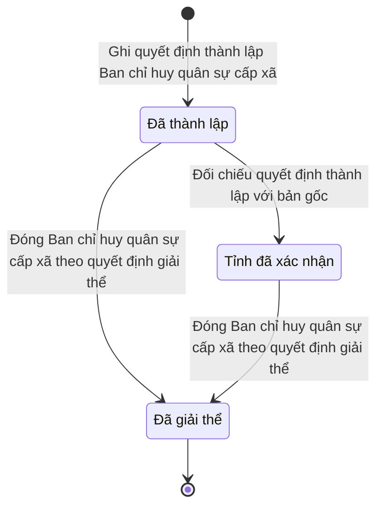

# qt-29.command-board · Thành lập, tổ chức lại tổ chức — Ban chỉ huy quân sự cấp xã

<!-- máy sinh: tom-tat -->
> **Hồ sơ:** Ban chỉ huy quân sự cấp xã (`CommandBoard`)
>
> **Trong sổ phạm vi:** 29 · Thành lập, tổ chức lại tổ chức — hồ sơ phụ command-board (tầng 1)
>
> 10 bước · 3 chặng · 6 vai · 0 bảng quyết định · 0 hạn · 5 khớp nối.
>
> **Nguồn:** sổ nghiệp vụ `qt-29.command-board` · khai báo của app: `dqtv-app/core/processes/unit-organisation/workflow/command-board.yaml`. Các bảng do máy sinh từ nguồn này.
<!-- hết: tom-tat -->

<!-- viết tay: dien-giai -->
## Diễn giải

*Phần này viết tay, diễn giải lại điều các bảng bên dưới ghi.*

### Quy trình này để làm gì

Đây là hồ sơ của một **Ban chỉ huy quân sự cấp xã**: ghi quyết định thành lập, rồi ghi dần con dấu, tài khoản riêng, trụ sở, thao trường và việc bố trí đủ chức danh khi từng thứ xong. Hồ sơ chỉ có một chặng, *Đã thành lập*; mọi việc sau khi mở đều làm trong lúc hồ sơ đứng yên ở chặng này.

### Khi nào bắt đầu

Bộ CHQS cấp tỉnh bấm **Ghi nhận quyết định thành lập Ban chỉ huy quân sự cấp xã**. Bắt buộc nhập mã xã, số quyết định thành lập, ngày quyết định có hiệu lực và bản quét quyết định; trực thuộc Bộ CHQS tỉnh nào và ghi chú là ô nhập nếu có. Hồ sơ vào thẳng chặng *Đã thành lập*.

### Diễn ra thế nào

Ở chặng *Đã thành lập*, các việc không buộc theo thứ tự nào, trừ hai chỗ nêu dưới (đổi con dấu, xác nhận đủ chức danh). Bốn bước ghi nhận lần đầu (con dấu, tài khoản, trụ sở, chức danh) chỉ làm được một lần; làm lại thì hệ báo đã ghi nhận rồi, sai sót thì "sửa hồ sơ pháp nhân".

- Nhân viên văn thư **Ghi nhận con dấu, đăng ký mẫu dấu** — số giấy chứng nhận mẫu dấu, ngày đăng ký, cơ quan cấp nếu có. **Đổi con dấu** (lặp được) chỉ làm được khi đã có ngày đăng ký mẫu dấu (thiếu thì hệ báo "Ban chưa có con dấu nào — ghi nhận con dấu trước"); bắt buộc nhập số giấy chứng nhận, ngày đăng ký mới, lý do đổi và ngày nộp lại dấu cũ.
- Nhân viên tài chính kiêm hậu cần **Ghi nhận tài khoản riêng** (số tài khoản, ngày mở, nơi mở) và **Ghi nhận trụ sở, thao trường** (địa chỉ trụ sở, ngày bố trí xong, đã có thao trường, bãi tập hay chưa).
- Trợ lý Quân lực **Xác nhận đã bố trí đủ chức danh**, nhập ngày xác nhận. Bước đòi trước điều kiện `hasAppointedStaff`: có một hồ sơ *Kiện toàn tổ chức, bổ nhiệm chỉ huy* (qt-30.commune-command) cùng đơn vị chủ hồ sơ đang ở chặng `APPOINTED`.
- Bộ CHQS cấp tỉnh (thuộc cấp trên của chủ hồ sơ) **Sửa thông tin Ban chỉ huy quân sự** — chỉ người của một đơn vị nằm trong ô cấp trên của chủ hồ sơ được làm; bước sửa tên đơn vị hành chính cấp xã, trực thuộc và ghi chú.

### Kết thúc và để lại gì

Hồ sơ ở chặng *Đã thành lập* suốt, và giữ thông tin pháp nhân của Ban: quyết định thành lập, con dấu, tài khoản riêng, trụ sở, thao trường và ngày xác nhận đủ chức danh. Hồ sơ còn nối với đợt khởi tạo hiện trạng: Ban vào hệ qua đợt khởi tạo nào.

### Điều kiện chặn

- Năm bước ghi con dấu, đổi dấu, tài khoản, trụ sở, chức danh: người làm phải là người của đơn vị chủ hồ sơ. Bước sửa thông tin: người làm là người của một đơn vị nằm trong ô cấp trên của chủ hồ sơ.
- Đổi con dấu phải có con dấu đã ghi; xác nhận đủ chức danh phải đạt `hasAppointedStaff`.
- Bốn bước ghi nhận lần đầu không ghi được lần hai.
- Sai người, sai chặng, thiếu thứ phải có trước thì bước bị chặn, hồ sơ giữ nguyên.
<!-- hết viết tay -->

## 1. Đường đi ngắn nhất qua các chặng

<!-- máy sinh: luong-chinh -->
Đường ít bước nhất từ lúc mở hồ sơ tới chặng kết thúc xa nhất. Máy chọn theo số chặng, không theo ý nghĩa nghiệp vụ — trình tự công việc thật xem phần Diễn giải và bảng "Việc làm ở từng chặng" ở mục 6.

| # | Ai làm | Làm gì | Hồ sơ sang chặng |
|---|---|---|---|
| 1 | Ban Dân quân tự vệ, Bộ CHQS cấp tỉnh | Ghi quyết định thành lập Ban chỉ huy quân sự cấp xã | Đã thành lập |
| 2 | Hệ thống tự làm | Đóng Ban chỉ huy quân sự cấp xã theo quyết định giải thể | Đã giải thể |

<!-- hết: luong-chinh -->

## 2. Hồ sơ và việc nó để lại

<!-- máy sinh: muc-tieu -->
**App gọi quy trình này là:** Ban chỉ huy quân sự cấp xã.

**Khi mở, hồ sơ này ghi mối nối tới:**
- Văn bản đến (1.incoming-document) — bước `establishBoard`, khớp nối `boardEstablishedByIncomingDocument`

**Hồ sơ này để lại cho quy trình khác** (bước tạo hồ sơ của quy trình kia ghi mối nối về đây):
- Hồ sơ giải thể tổ chức (31) — bước `recordBoardDisbandDecision`, khớp nối `dissolutionOfCommandBoard`
<!-- hết: muc-tieu -->

## 3. Khởi phát và kết thúc

<!-- máy sinh: khoi-phat -->
**1 cửa vào** — bước mở hồ sơ:

| Bước mở | Ai mở | Hồ sơ vào chặng | App bắt buộc nhập |
|---|---|---|---|
| Ghi quyết định thành lập Ban chỉ huy quân sự cấp xã | Ban Dân quân tự vệ, Bộ CHQS cấp tỉnh | Đã thành lập | mã xã, quyết định thành lập trong sổ văn bản đến |

**Kết thúc:** *Đã giải thể* (`DISBANDED`)
<!-- hết: khoi-phat -->

## 4. Vai trò

<!-- máy sinh: vai-tro -->
| Vai trong sổ | Tên trong app | Điều kiện | Làm những bước |
|---|---|---|---|
| `provinceOperator` | Ban Dân quân tự vệ, Bộ CHQS cấp tỉnh |  | Ghi quyết định thành lập Ban chỉ huy quân sự cấp xã |
| `province` | Bộ CHQS cấp tỉnh | thuộc cấp trên của chủ hồ sơ (`actorInSuperiorUnit`, công thức ở mục 7) | Đối chiếu quyết định thành lập với bản gốc · Sửa thông tin Ban chỉ huy quân sự |
| `clerk` | Nhân viên văn thư |  | Ghi nhận con dấu, đăng ký mẫu dấu · Đổi con dấu |
| `finance` | Nhân viên tài chính kiêm hậu cần |  | Ghi nhận tài khoản riêng · Ghi nhận trụ sở, thao trường |
| `personnel` | Trợ lý Quân lực |  | Xác nhận đã bố trí đủ chức danh |
| `system` | Hệ thống tự làm |  | Đóng Ban chỉ huy quân sự cấp xã theo quyết định giải thể · Ghi tổ chức lại Ban chỉ huy quân sự cấp xã theo quyết định |

*"Tên trong app" là tên app đặt cho mã chủ thể của vai. Hồ sơ thuộc đơn vị cấp khác thì người làm là người giữ vai ấy ở đơn vị nêu trong cột "Điều kiện" (nếu sổ có ghi) và ở cột "Người làm phải thuộc" của bảng "Theo khai báo của app" (mục 7).*
<!-- hết: vai-tro -->

## 5. Nhánh phụ

<!-- máy sinh: nhanh-phu -->
**Bước khác đưa hồ sơ sang chặng mới** — đường song song, rẽ nhánh hoặc kết thúc sớm:

| Bước | Ai làm | Từ chặng | Sang chặng |
|---|---|---|---|
| Đối chiếu quyết định thành lập với bản gốc | Bộ CHQS cấp tỉnh (thuộc cấp trên của chủ hồ sơ) | Đã thành lập | Tỉnh đã xác nhận |

**Làm trong lúc hồ sơ đứng yên ở một chặng** — ghi nhận, bổ sung:

| Bước | Ai làm | Ở chặng |
|---|---|---|
| Ghi nhận con dấu, đăng ký mẫu dấu | Nhân viên văn thư | Tỉnh đã xác nhận |
| Đổi con dấu *(lặp được)* | Nhân viên văn thư | Tỉnh đã xác nhận |
| Ghi nhận tài khoản riêng | Nhân viên tài chính kiêm hậu cần | Đã thành lập, Tỉnh đã xác nhận |
| Ghi nhận trụ sở, thao trường | Nhân viên tài chính kiêm hậu cần | Đã thành lập, Tỉnh đã xác nhận |
| Xác nhận đã bố trí đủ chức danh | Trợ lý Quân lực | Đã thành lập, Tỉnh đã xác nhận |
| Sửa thông tin Ban chỉ huy quân sự | Bộ CHQS cấp tỉnh (thuộc cấp trên của chủ hồ sơ) | Đã thành lập, Tỉnh đã xác nhận |
| Ghi tổ chức lại Ban chỉ huy quân sự cấp xã theo quyết định *(lặp được)* | Hệ thống tự làm | Đã thành lập, Tỉnh đã xác nhận |

<!-- hết: nhanh-phu -->

## 6. Các chặng và việc làm ở từng chặng

<!-- máy sinh: chang -->
| Chặng | Tên hiển thị | Vào bằng bước | Kết thúc? |
|---|---|---|---|
| `ESTABLISHED` | Đã thành lập | Ghi quyết định thành lập Ban chỉ huy quân sự cấp xã |  |
| `PROVINCE_CONFIRMED` | Tỉnh đã xác nhận | Đối chiếu quyết định thành lập với bản gốc |  |
| `DISBANDED` | Đã giải thể | Đóng Ban chỉ huy quân sự cấp xã theo quyết định giải thể | **kết thúc** |

### Việc làm ở từng chặng

Hồ sơ đang ở chặng nào thì làm được những bước nào.

| Hồ sơ đang ở chặng | Bước làm tại chặng (hồ sơ đứng yên) | Bước đưa hồ sơ sang chặng khác |
|---|---|---|
| **Đã thành lập** | Ghi nhận tài khoản riêng — Nhân viên tài chính kiêm hậu cần Ghi nhận trụ sở, thao trường — Nhân viên tài chính kiêm hậu cần Xác nhận đã bố trí đủ chức danh — Trợ lý Quân lực Sửa thông tin Ban chỉ huy quân sự — Bộ CHQS cấp tỉnh (thuộc cấp trên của chủ hồ sơ) Ghi tổ chức lại Ban chỉ huy quân sự cấp xã theo quyết định (lặp được) — Hệ thống tự làm | Đối chiếu quyết định thành lập với bản gốc — Bộ CHQS cấp tỉnh (thuộc cấp trên của chủ hồ sơ) → *Tỉnh đã xác nhận* Đóng Ban chỉ huy quân sự cấp xã theo quyết định giải thể — Hệ thống tự làm → *Đã giải thể* |
| **Tỉnh đã xác nhận** | Ghi nhận con dấu, đăng ký mẫu dấu — Nhân viên văn thư Đổi con dấu (lặp được) — Nhân viên văn thư Ghi nhận tài khoản riêng — Nhân viên tài chính kiêm hậu cần Ghi nhận trụ sở, thao trường — Nhân viên tài chính kiêm hậu cần Xác nhận đã bố trí đủ chức danh — Trợ lý Quân lực Sửa thông tin Ban chỉ huy quân sự — Bộ CHQS cấp tỉnh (thuộc cấp trên của chủ hồ sơ) Ghi tổ chức lại Ban chỉ huy quân sự cấp xã theo quyết định (lặp được) — Hệ thống tự làm | Đóng Ban chỉ huy quân sự cấp xã theo quyết định giải thể — Hệ thống tự làm → *Đã giải thể* |
| **Đã giải thể** | — | — (kết thúc) |
<!-- hết: chang -->

## 7. Bảng bước

<!-- máy sinh: buoc -->
| # | Bước | Mã bước | Ai thực hiện | Từ chặng | Sang chặng | Phải có trước | Ghi lại |
|---|---|---|---|---|---|---|---|
| 1 | Ghi quyết định thành lập Ban chỉ huy quân sự cấp xã | `establishBoard` | Ban Dân quân tự vệ, Bộ CHQS cấp tỉnh | — (mở hồ sơ) | `ESTABLISHED` | nối tới Văn bản đến, `boardEstablishedByIncomingDocumentUsable`, `communeHasNoOtherBoard` | mã tỉnh, mã xã, tên đơn vị hành chính cấp xã, ngày ký (chỉ khi sổ văn bản đến chưa ghi), cấp ký quyết định thành lập, ngày quyết định có hiệu lực (trống: ngày ký), trực thuộc, ghi chú, đơn vị chủ hồ sơ, cấp trên của chủ hồ sơ, người ghi quyết định, nối tới Văn bản đến |
| 2 | Đối chiếu quyết định thành lập với bản gốc | `verifyBoardEstablishment` | Bộ CHQS cấp tỉnh (thuộc cấp trên của chủ hồ sơ) | `ESTABLISHED` | `PROVINCE_CONFIRMED` | người làm thuộc cấp trên của chủ hồ sơ, `notRecorder` | ngày đối chiếu bản gốc, người đối chiếu bản gốc, nối `decisionDeliveredAs` |
| 3 | Ghi nhận con dấu, đăng ký mẫu dấu | `recordSeal` | Nhân viên văn thư | `PROVINCE_CONFIRMED` | giữ nguyên | người làm thuộc đơn vị chủ hồ sơ | số giấy chứng nhận mẫu dấu, cơ quan cấp giấy chứng nhận, ngày đăng ký mẫu dấu |
| 4 | Đổi con dấu | `replaceSeal` | Nhân viên văn thư | `PROVINCE_CONFIRMED` | giữ nguyên | người làm thuộc đơn vị chủ hồ sơ, ngày đăng ký mẫu dấu | số giấy chứng nhận mẫu dấu, cơ quan cấp giấy chứng nhận, ngày đăng ký mẫu dấu, lý do đổi dấu, ngày nộp lại dấu cũ |
| 5 | Ghi nhận tài khoản riêng | `recordAccount` | Nhân viên tài chính kiêm hậu cần | `ESTABLISHED`, `PROVINCE_CONFIRMED` | giữ nguyên | người làm thuộc đơn vị chủ hồ sơ | số tài khoản, nơi mở tài khoản, ngày mở tài khoản |
| 6 | Ghi nhận trụ sở, thao trường | `recordPremises` | Nhân viên tài chính kiêm hậu cần | `ESTABLISHED`, `PROVINCE_CONFIRMED` | giữ nguyên | người làm thuộc đơn vị chủ hồ sơ | địa chỉ trụ sở, ngày bố trí xong trụ sở, thao trường, bãi tập |
| 7 | Xác nhận đã bố trí đủ chức danh | `confirmStaffing` | Trợ lý Quân lực | `ESTABLISHED`, `PROVINCE_CONFIRMED` | giữ nguyên | người làm thuộc đơn vị chủ hồ sơ, `hasAppointedStaff` | ngày xác nhận đủ chức danh |
| 8 | Sửa thông tin Ban chỉ huy quân sự | `editBoard` | Bộ CHQS cấp tỉnh (thuộc cấp trên của chủ hồ sơ) | `ESTABLISHED`, `PROVINCE_CONFIRMED` | giữ nguyên | người làm thuộc cấp trên của chủ hồ sơ | ghi chú |
| 9 | Đóng Ban chỉ huy quân sự cấp xã theo quyết định giải thể | `closeBoardOnDisband` | Hệ thống tự làm | `ESTABLISHED`, `PROVINCE_CONFIRMED` | `DISBANDED` | — | ngày giải thể, số quyết định giải thể |
| 10 | Ghi tổ chức lại Ban chỉ huy quân sự cấp xã theo quyết định | `applyBoardReorganization` | Hệ thống tự làm | `ESTABLISHED`, `PROVINCE_CONFIRMED` | giữ nguyên | — | ngày tổ chức lại, nối tới Hồ sơ tổ chức lại Ban chỉ huy quân sự cấp xã |

### Khi không đạt điều kiện

Mặc định: không đúng người, hồ sơ không ở đúng chặng, hoặc thiếu thứ "phải có trước" thì bước bị chặn, hồ sơ giữ nguyên. Bảng dưới chỉ kê những bước có kết quả riêng.

| # | Bước | Kết quả riêng |
|---|---|---|
| 9 | Đóng Ban chỉ huy quân sự cấp xã theo quyết định giải thể | bước này không do người nào bấm |
| 10 | Ghi tổ chức lại Ban chỉ huy quân sự cấp xã theo quyết định | bước này không do người nào bấm |

### Điều kiện "phải có trước" bằng lời

Cột "Phải có trước" ở bảng bước có hai loại: ô dữ liệu thường (bước chỉ đòi ô ấy đã có giá trị) và điều kiện hệ tự xét. Bảng này diễn các điều kiện hệ tự xét theo đúng công thức sổ ghi; số ở cột cuối là số thứ tự bước.

| Điều kiện | Đúng khi | Bước đòi |
|---|---|---|
| `boardEstablishedByIncomingDocumentUsable` | có hồ sơ Việc luật giao kèm văn bản đến, đi — Văn bản đến (qt-1.incoming-document) chính là hồ sơ ghi ở ô nối `boardEstablishedByIncomingDocument` của hồ sơ đang làm mà hồ sơ ấy đang ở chặng `RECEIVED` hoặc `DISTRIBUTED` | 1 |
| `communeHasNoOtherBoard` | không có hồ sơ Thành lập, tổ chức lại tổ chức — Ban chỉ huy quân sự cấp xã (qt-29.command-board) có mã xã trùng với mã xã của hồ sơ đang làm mà hồ sơ ấy đang ở chặng `ESTABLISHED` hoặc `PROVINCE_CONFIRMED` | 1 |
| `actorInSuperiorUnit` | người đang làm là người của một đơn vị nằm trong ô cấp trên của chủ hồ sơ của hồ sơ này (theo danh mục người của đơn vị, `dm.unit-staff`) | 2, 8 |
| `notRecorder` | KHÔNG (người ghi quyết định là chính người đang làm) | 2 |
| `actorInOwnerUnit` | người đang làm là người của đơn vị ghi ở ô đơn vị chủ hồ sơ của hồ sơ này (theo danh mục người của đơn vị, `dm.unit-staff`) | 3, 4, 5, 6, 7 |
| `hasAppointedStaff` | có hồ sơ Kiện toàn tổ chức, bổ nhiệm chỉ huy — Nhân sự Ban chỉ huy quân sự cấp xã (qt-30.commune-command) (gọi là a) có đơn vị chủ hồ sơ trùng với đơn vị chủ hồ sơ của hồ sơ đang làm mà hồ sơ ấy đang ở chặng `APPOINTED` | 7 |

### Theo khai báo của app

Người làm phải thuộc đơn vị nào, ô người dùng phải nhập, bước có lặp được không, và căn cứ pháp lý — lấy từ khai báo quy trình trong app.

| # | Bước | Người làm phải thuộc | Bắt buộc nhập | Nhập nếu có | Lặp được | Căn cứ |
|---|---|---|---|---|---|---|
| 1 | Ghi quyết định thành lập Ban chỉ huy quân sự cấp xã |  | mã xã, quyết định thành lập trong sổ văn bản đến | ngày quyết định có hiệu lực (trống: ngày ký), ngày ký (chỉ khi sổ văn bản đến chưa ghi), cấp ký quyết định thành lập, trực thuộc, ghi chú |  | L14/2026/QH16 Đ.9 k1, k3 · L48/2019/QH14 Đ.20 (sửa bởi L14/2026) · NĐ30/2020/NĐ-CP Đ.21, Đ.22 |
| 2 | Đối chiếu quyết định thành lập với bản gốc | cấp trên của chủ hồ sơ | — | — |  | L14/2026/QH16 Đ.9 k1 · NĐ30/2020/NĐ-CP Đ.20–22 (N4) |
| 3 | Ghi nhận con dấu, đăng ký mẫu dấu | đơn vị chủ hồ sơ | số giấy chứng nhận mẫu dấu, ngày đăng ký mẫu dấu | cơ quan cấp giấy chứng nhận |  | NQ66/2026/UBTVQH15 Đ.3 k3 · QĐ1126/QĐ-TM Đ.13 |
| 4 | Đổi con dấu | đơn vị chủ hồ sơ | số giấy chứng nhận mẫu dấu, ngày đăng ký mẫu dấu, lý do đổi dấu, ngày nộp lại dấu cũ | cơ quan cấp giấy chứng nhận | có | L14/2026/QH16 Đ.9 k1 · TTLT83/2010 Đ.8 k5 · QĐ1126/QĐ-TM Đ.13 |
| 5 | Ghi nhận tài khoản riêng | đơn vị chủ hồ sơ | số tài khoản, ngày mở tài khoản | nơi mở tài khoản |  | NQ66/2026/UBTVQH15 Đ.3 k3 · QĐ1126/QĐ-TM Đ.16 k2 |
| 6 | Ghi nhận trụ sở, thao trường | đơn vị chủ hồ sơ | địa chỉ trụ sở, ngày bố trí xong trụ sở | thao trường, bãi tập |  | NQ66/2026/UBTVQH15 Đ.6 · QĐ1126/QĐ-TM Đ.16 k4 |
| 7 | Xác nhận đã bố trí đủ chức danh | đơn vị chủ hồ sơ | ngày xác nhận đủ chức danh | — |  | QĐ1126/QĐ-TM |
| 8 | Sửa thông tin Ban chỉ huy quân sự | cấp trên của chủ hồ sơ | — | ghi chú, số giấy chứng nhận mẫu dấu, cơ quan cấp giấy chứng nhận, ngày đăng ký mẫu dấu, số tài khoản, nơi mở tài khoản, ngày mở tài khoản, địa chỉ trụ sở, ngày bố trí xong trụ sở, thao trường, bãi tập, ngày xác nhận đủ chức danh |  | NQ66/2026/UBTVQH15 Đ.3 k1 |
| 9 | Đóng Ban chỉ huy quân sự cấp xã theo quyết định giải thể |  | `dissolutionDossierId`, ngày giải thể | số quyết định giải thể |  | L14/2026/QH16 Đ.9 k1, k3 · L48/2019/QH14 Đ.20 k2 |
| 10 | Ghi tổ chức lại Ban chỉ huy quân sự cấp xã theo quyết định |  | `reorganizationId`, ngày tổ chức lại | — | có | L14/2026/QH16 Đ.9 k1, k3 · L48/2019/QH14 Đ.20 (sửa bởi L14/2026) |
| — | Công nhận xã trọng điểm về quốc phòng (`designateKeyCommune`) |  | số quyết định công nhận, ngày công nhận, quyết định xã trọng điểm (ảnh/bản quét) | — | có | NĐ220/2025/NĐ-CP Đ.5 k2 |
| — | Thôi công nhận xã trọng điểm về quốc phòng (`endKeyDesignation`) |  | số quyết định công nhận, ngày thôi công nhận, quyết định xã trọng điểm (ảnh/bản quét) | — | có | NĐ220/2025/NĐ-CP Đ.5 k2 |

### Điều kiện và ghi chú app khai cho từng bước

Lấy từ khai báo quy trình trong app. Lời trong ngoặc kép là câu app hiện cho người dùng. Chức danh người ký ngoài hệ app chỉ khai bằng mã.

| # | Bước | Điều kiện, ghi chú |
|---|---|---|
| 3 | Ghi nhận con dấu, đăng ký mẫu dấu | · không làm được khi đã có ô "ngày đăng ký mẫu dấu" — app báo: "đã ghi nhận con dấu rồi — sai sót thì sửa hồ sơ pháp nhân, không ghi nhận lại" |
| 4 | Đổi con dấu | · phải đã có ô "ngày đăng ký mẫu dấu" — thiếu thì app báo: "Ban chưa có con dấu nào — ghi nhận con dấu trước" |
| 5 | Ghi nhận tài khoản riêng | · không làm được khi đã có ô "ngày mở tài khoản" — app báo: "đã ghi nhận tài khoản riêng rồi — sai sót thì sửa hồ sơ pháp nhân" |
| 6 | Ghi nhận trụ sở, thao trường | · không làm được khi đã có ô "ngày bố trí xong trụ sở" — app báo: "đã ghi nhận trụ sở rồi — sai sót thì sửa hồ sơ pháp nhân" |
| 7 | Xác nhận đã bố trí đủ chức danh | · không làm được khi đã có ô "ngày xác nhận đủ chức danh" — app báo: "đã xác nhận đủ chức danh rồi — bố trí thay đổi thì sửa hồ sơ pháp nhân" |
| — | Công nhận xã trọng điểm về quốc phòng | · tạo thêm một hồ sơ con: Lần công nhận xã trọng điểm quốc phòng (`KeyCommuneDesignation`) |
<!-- hết: buoc -->

## 8. Bảng quyết định, hạn, việc ngoài hệ

<!-- máy sinh: quyet-dinh -->

<!-- hết: quyet-dinh -->

## 9. Dữ liệu của hồ sơ

<!-- máy sinh: du-lieu -->
Các ô mà bước trong sổ ghi hoặc đòi. Số trong hai cột cuối là số thứ tự bước ở bảng bước (mục 7).

| Ô dữ liệu | Mã | Kiểu (app) | Giá trị cho phép | Loại ô (sổ) | Bước ghi | Bước đòi | Mô tả trong app |
|---|---|---|---|---|---|---|---|
| mã tỉnh | `provinceCode` | chữ |  | lưu trên hồ sơ (`stored`) | 1 | — | Mã tỉnh — dùng lọc phạm vi theo hàng; rỗng khi hồ sơ thuộc quân khu hoặc Bộ Quốc phòng |
| mã xã | `communeCode` | chữ |  | đưa vào ở bước (`input`) | 1 | — | Mã xã |
| tên đơn vị hành chính cấp xã | `communeName` | chữ |  | lưu trên hồ sơ (`stored`) | 1 | — | Tên đơn vị hành chính cấp xã |
| ngày ký quyết định thành lập | `establishDecisionSignedAt` | ngày |  | lưu trên hồ sơ (`stored`) | 1 | — | Ngày ký quyết định thành lập Ban chỉ huy quân sự cấp xã |
| cấp ký quyết định thành lập | `establishDecisionIssuer` | chữ |  | đưa vào ở bước (`input`) | 1 | — | Cấp ký quyết định thành lập Ban chỉ huy quân sự cấp xã (ngành quân sự) |
| ngày quyết định có hiệu lực | `establishedAt` | ngày |  | đưa vào ở bước (`input`) | 1 | — | Ngày quyết định thành lập có hiệu lực |
| trực thuộc | `superiorName` | chữ |  | lưu trên hồ sơ (`stored`) | 1 | — | Bộ chỉ huy quân sự cấp tỉnh mà Ban trực thuộc — NQ66 Đ.3 k1 |
| ghi chú | `note` | chữ |  | đưa vào ở bước (`input`) | 1, 8 | — | Ghi chú |
| đơn vị chủ hồ sơ | `ownerUnit` |  |  | lưu trên hồ sơ (`stored`) | 1 | — |  |
| cấp trên của chủ hồ sơ | `superiorUnits` |  |  | hệ suy ra (`derived`) | 1 | — |  |
| người ghi quyết định | `recordedBy` | chữ |  | lưu trên hồ sơ (`stored`) | 1 | — | Người ghi quyết định thành lập lên hệ |
| ngày đối chiếu bản gốc | `verifiedAt` | ngày |  | lưu trên hồ sơ (`stored`) | 2 | — | Ngày đối chiếu quyết định thành lập với bản gốc |
| người đối chiếu bản gốc | `verifiedBy` | chữ |  | lưu trên hồ sơ (`stored`) | 2 | — | Người đối chiếu quyết định thành lập với bản gốc |
| số giấy chứng nhận mẫu dấu | `sealNumber` | chữ |  | đưa vào ở bước (`input`) | 3, 4 | — | Số giấy chứng nhận đăng ký mẫu dấu |
| cơ quan cấp giấy chứng nhận | `sealIssuer` | chữ |  | đưa vào ở bước (`input`) | 3, 4 | — | Cơ quan quân sự cấp giấy chứng nhận mẫu dấu |
| ngày đăng ký mẫu dấu | `sealRegisteredAt` | ngày |  | lưu trên hồ sơ (`stored`) | 3, 4 | 4 | Ngày đăng ký mẫu dấu |
| lý do đổi dấu | `sealReplaceReason` | chữ |  | đưa vào ở bước (`input`) | 4 | — | Lý do đổi con dấu |
| ngày nộp lại dấu cũ | `oldSealReturnedAt` | ngày |  | đưa vào ở bước (`input`) | 4 | — | Ngày nộp lại dấu cũ và giấy chứng nhận cũ |
| số tài khoản | `accountNumber` | chữ |  | đưa vào ở bước (`input`) | 5 | — | Số tài khoản của Ban chỉ huy quân sự cấp xã |
| nơi mở tài khoản | `accountHolder` | chữ |  | đưa vào ở bước (`input`) | 5 | — | Kho bạc Nhà nước hoặc ngân hàng mở tài khoản |
| ngày mở tài khoản | `accountOpenedAt` | ngày |  | đưa vào ở bước (`input`) | 5 | — | Ngày mở tài khoản |
| địa chỉ trụ sở | `premisesAddress` | chữ |  | đưa vào ở bước (`input`) | 6 | — | Địa chỉ trụ sở làm việc |
| ngày bố trí xong trụ sở | `premisesConfirmedAt` | ngày |  | đưa vào ở bước (`input`) | 6 | — | Ngày bố trí xong trụ sở |
| thao trường, bãi tập | `hasTrainingGround` | chọn một | Đã có (`yes`), Chưa có (`no`) | đưa vào ở bước (`input`) | 6 | — | Đã có thao trường, bãi tập hay chưa |
| ngày xác nhận đủ chức danh | `staffingConfirmedAt` | ngày |  | đưa vào ở bước (`input`) | 7 | — | Ngày xác nhận đã bố trí đủ chức danh |
| ngày giải thể | `disbandedAt` | ngày |  | lưu trên hồ sơ (`stored`) | 9 | — | Ngày quyết định giải thể Ban chỉ huy quân sự cấp xã |
| số quyết định giải thể | `disbandDecision` | chữ |  | lưu trên hồ sơ (`stored`) | 9 | — | Số quyết định giải thể Ban chỉ huy quân sự cấp xã |
| ngày tổ chức lại | `reorganizedAt` | ngày |  | lưu trên hồ sơ (`stored`) | 10 | — | Ngày quyết định tổ chức lại Ban chỉ huy quân sự cấp xã có hiệu lực — lần gần nhất |
| — | `boardEstablishedByIncomingDocumentUsable` |  | có hay chưa | hệ suy ra (`derived`) | — | 1 |  |
| — | `communeHasNoOtherBoard` |  | có hay chưa | hệ suy ra (`derived`) | — | 1 |  |
| người làm thuộc cấp trên của chủ hồ sơ | `actorInSuperiorUnit` |  | có hay chưa | hệ suy ra (`derived`) | — | 2, 8 |  |
| — | `notRecorder` |  | có hay chưa | hệ suy ra (`derived`) | — | 2 |  |
| người làm thuộc đơn vị chủ hồ sơ | `actorInOwnerUnit` |  | có hay chưa | hệ suy ra (`derived`) | — | 3, 4, 5, 6, 7 |  |
| — | `hasAppointedStaff` |  | có hay chưa | hệ suy ra (`derived`) | — | 7 |  |

34 ô. Cột "Loại ô" là cách sổ phân loại ô, in kèm đúng chữ của sổ; ô nào người dùng phải nhập xem bảng "Theo khai báo của app" ở mục 7.
<!-- hết: du-lieu -->

## 10. Khớp nối với quy trình khác

<!-- máy sinh: khop-noi -->
| Quy trình kia | Hồ sơ kia | Quan hệ | Nội dung (mô tả trong app) | Bước ghi mối nối | Tên ô nối |
|---|---|---|---|---|---|
| 1.incoming-document | Văn bản đến | gắn với nhau ở một bước giữa chừng | Quyết định thành lập Ban CHQS cấp xã đã chuyển vào Sổ văn bản đến của chính Ban (N4; NĐ30/2020/NĐ-CP Đ.20–22) | 29.command-board·verifyBoardEstablishment | `boardDecisionDeliveredAs` |
| 1.incoming-document | Văn bản đến | hồ sơ này **mở ra có nối tới** hồ sơ kia | Quyết định thành lập Ban CHQS cấp xã của ngành quân sự — dòng trong Sổ văn bản đến của Bộ CHQS cấp tỉnh (NĐ30… | 29.command-board·establishBoard ⊕ · đòi: 29.command-board·establishBoard | `boardEstablishedByIncomingDocument` |
| 31 | Hồ sơ giải thể tổ chức | hồ sơ kia **mở ra từ** hồ sơ này | Ban chỉ huy quân sự cấp xã mà hồ sơ đề nghị giải thể — quyết định phát hành thì hệ đóng Ban (closeBoardOnDisb… | 31·recordBoardDisbandDecision ⊕ | `dissolutionOfCommandBoard` |
| D12 | Trang bị, phương tiện | gắn với nhau ở một bước giữa chừng | Ban chỉ huy quân sự cấp xã đang giữ trang bị (tủ súng tại trụ sở Ban) — TT76/2020/TT-BQP; đúng một trong ba v… | D12·transferHolderOnDisband | `heldByCommandBoard` |
| system-onboarding | Đợt khởi tạo hiện trạng | gắn với nhau ở một bước giữa chừng | Ban chỉ huy quân sự xã vào hệ qua đợt khởi tạo hiện trạng nào | system-onboarding·confirmOnboarding | `boardOnboardedIn` |

5 khớp nối. ⊕ là bước tạo hồ sơ.

**Ô nối giữa các hồ sơ cùng mã quy trình, hoặc tới danh mục nền:** `boardReorganizedByDossier` (Ban chỉ huy quân sự cấp xã → Hồ sơ tổ chức lại Ban chỉ huy quân sự cấp xã) — bước Ghi tổ chức lại Ban chỉ huy quân sự cấp xã theo quyết định.
<!-- hết: khop-noi -->

## 11. Thông tin chung

<!-- máy sinh: thong-tin -->
| | |
|---|---|
| **Mã trong sổ** | `qt-29.command-board` |
| **Quy trình trong app** | `unit-organisation` (`workflow/command-board.yaml`) — mặt công tác: `personnel` |
| **Hồ sơ** | Ban chỉ huy quân sự cấp xã (`CommandBoard`) |
| **Cùng mã quy trình** | [qt-29](qt-29.html), [qt-29.appraisal](qt-29.appraisal.html), [qt-29.board-reorganization](qt-29.board-reorganization.html) |
| **Căn cứ pháp lý từng bước** | cột "Căn cứ" ở bảng "Theo khai báo của app", mục 7 |
<!-- hết: thong-tin -->
