# qt-29 · Thành lập, tổ chức lại tổ chức

<!-- máy sinh: tom-tat -->
> **Hồ sơ:** Hồ sơ thành lập tổ chức (`OrganisationDossier`)
>
> **Trong sổ phạm vi:** 29 · Thành lập, tổ chức lại tổ chức (tầng 1)
>
> 50 bước · 7 chặng · 12 vai · 8 bảng quyết định · 4 hạn · 53 khớp nối.
>
> **Nguồn:** sổ nghiệp vụ `qt-29` · khai báo của app: `dqtv-app/core/processes/unit-organisation/workflow/establishment.yaml`. Các bảng do máy sinh từ nguồn này.
<!-- hết: tom-tat -->

<!-- viết tay: dien-giai -->
## Diễn giải

*Phần này viết tay, diễn giải lại điều các bảng bên dưới ghi.*

### Quy trình này để làm gì

Theo dõi một **hồ sơ thành lập tổ chức** từ lúc lập đề án tới lúc có quyết định thành lập, rồi ghi tiếp các việc sau thành lập (công bố, chỉ huy, quy chế, thành viên Hội đồng, con dấu, tài khoản nhẹ, danh mục trung tâm). Có chín loại tổ chức: sáu loại đơn vị dân quân tự vệ, Ban chỉ huy quân sự cơ quan, tổ chức, Hội đồng GDQP&AN và trung tâm GDQP&AN. Loại quyết định là thành lập, tổ chức lại hoặc đổi tên.

Hồ sơ có hai đường đi tới cùng một chặng kết thúc *Đã thành lập*:

- đường **đề án – tờ trình**: *Đang lập đề án* → *Chờ ký tờ trình* → *Đã ký, chờ gửi* → *Đã gửi, chờ xác nhận hồ sơ* → *Hồ sơ hợp lệ, chờ quyết định*;
- đường **trung tâm GDQP&AN**: *Đã nhận hồ sơ, chờ kiểm đủ* → *Hồ sơ đủ, chờ thẩm định* → *Đã thẩm định, chờ thông báo* → *Đã thông báo, chờ quyết định*.

### Khi nào bắt đầu

Có hai cửa vào:

- Trợ lý Quân lực bấm **Lập đề án thành lập tổ chức**; phải nhập tên tổ chức và việc gốc (`taskingId`); loại tổ chức, cấp, cấp đơn vị, thành phần, binh chủng, biên chế đề nghị, số và ngày đề án là ô nhập nếu có. Hồ sơ vào *Đang lập đề án*.
- Cục Dân quân tự vệ bấm **Nhận hồ sơ đề nghị trung tâm GDQP&AN**; phải nhập tên tổ chức, việc gốc, loại quyết định và nhà trường chủ quản. Hồ sơ vào *Đã nhận hồ sơ, chờ kiểm đủ*.

### Diễn ra thế nào

**Đường đề án – tờ trình** (mọi bước đòi người làm thuộc đơn vị chủ hồ sơ, trừ bước ghi ý kiến của Bộ CHQS tỉnh)

1. *Đang lập đề án*: Trợ lý Quân lực **Sửa đề án thành lập** (lặp được), rồi **Trình ký tờ trình thành lập** — đính tờ trình (PDF), hệ tạo một *Văn bản đi*; hồ sơ sang *Chờ ký tờ trình*.
2. *Chờ ký tờ trình*: Chỉ huy trưởng Ban CHQS xã **Ký tờ trình** (sang *Đã ký, chờ gửi*) hoặc **Trả lại tờ trình**, ghi cần sửa gì (về *Đang lập đề án*). Trả lại bấm được cả ở *Đã ký, chờ gửi*.
3. *Đã ký, chờ gửi*: Nhân viên văn thư **Gửi tờ trình thành lập**, phải có tờ trình đã ký, đã ghi số; nơi nhận tờ trình là `commune_chairman`, `province_military_command`; hồ sơ sang *Đã gửi, chờ xác nhận hồ sơ*.
4. *Đã gửi, chờ xác nhận hồ sơ*: Bộ CHQS cấp tỉnh **Xác nhận hồ sơ đề nghị hợp lệ** — ghi ngày xác nhận hồ sơ hợp lệ, sang *Hồ sơ hợp lệ, chờ quyết định*; hoặc **Yêu cầu bổ sung hồ sơ** — ghi cần bổ sung gì, xoá ngày xác nhận hợp lệ, về *Đang lập đề án*.
5. Ở cả hai chặng *Đã gửi* và *Hồ sơ hợp lệ*, hai ý kiến được ghi, lặp được, không đẩy chặng: Trợ lý Quân lực **Ghi nhận ý kiến Chủ tịch UBND xã** (nhập ý kiến, ngày, văn bản ý kiến); Ban Dân quân tự vệ, Bộ CHQS cấp tỉnh (thuộc cấp trên của chủ hồ sơ) **Ghi ý kiến của Bộ CHQS tỉnh**. Mỗi lần ghi hệ tạo một *Ý kiến về việc thành lập, giải thể đơn vị*. Ý kiến ghi trước hay sau khi xác nhận hợp lệ đều được.

**Đường trung tâm GDQP&AN** (mọi bước do Cục Dân quân tự vệ làm; người làm phải thuộc đơn vị chủ hồ sơ hoặc cấp trên của chủ hồ sơ)

1. *Đã nhận hồ sơ, chờ kiểm đủ*: **Yêu cầu nhà trường bổ sung hồ sơ trung tâm** (ghi cần bổ sung gì; lặp được, hồ sơ đứng yên); hoặc **Xác nhận hồ sơ trung tâm đủ thành phần** — ghi ngày xác nhận hồ sơ đủ và ngày xác nhận hồ sơ hợp lệ, sang *Hồ sơ đủ, chờ thẩm định*.
2. *Hồ sơ đủ, chờ thẩm định*: **Ghi kết luận thẩm định trung tâm** đưa hồ sơ sang *Đã thẩm định, chờ thông báo*; nếu loại quyết định là đổi tên thì kết quả xét là `skip_appraisal`, hồ sơ sang thẳng *Đã thông báo, chờ quyết định*. Hoặc **Trả lại hồ sơ trung tâm để bổ sung**: ghi kết luận thẩm định và cần bổ sung gì, hồ sơ quay về *Đã nhận hồ sơ, chờ kiểm đủ*.
3. *Đã thẩm định, chờ thông báo*: **Ghi thông báo kết quả thẩm định** — nhập số văn bản và đính bản quét thông báo; sang *Đã thông báo, chờ quyết định*.

**Ra quyết định.** Từ *Hồ sơ hợp lệ, chờ quyết định* hoặc *Đã thông báo, chờ quyết định*, Bộ CHQS cấp tỉnh **Ghi quyết định thành lập**, đưa hồ sơ sang *Đã thành lập*. Phải nhập ngày quyết định có hiệu lực và bản quét quyết định; số hiệu quyết định là ô nhập nếu có; hệ tạo một *Đơn vị dân quân tự vệ*. Phải có trước: ngày xác nhận hồ sơ hợp lệ (thiếu thì báo "hồ sơ đề nghị chưa được xác nhận hợp lệ"), người làm thuộc đơn vị chủ hồ sơ, và điều kiện `localUnitConsentsSatisfied` (xem Điều kiện chặn). Ở bước này bảng `unit-establishment-authority` xét loại tổ chức và cấp, cho ra một trong năm kết quả.

**Chặng "Đã thành lập"** — các việc ghi nhận, hồ sơ đứng yên:

- Bộ CHQS cấp tỉnh: **Ghi ngày công bố quyết định thành lập**, **Ghi nhận đã bổ nhiệm chỉ huy**.
- Trợ lý Quân lực: **Ghi quy chế hoạt động của Hội đồng**, **Ghi thành viên Hội đồng** (đều lặp được).
- Ban Dân quân tự vệ, Bộ CHQS cấp tỉnh (thuộc cấp trên của chủ hồ sơ): **Ghi con dấu của Ban CHQS cơ quan, tổ chức** (lặp được), **Mở tài khoản nhẹ cho Ban CHQS cơ quan, tổ chức**, **Đổi người giữ tài khoản nhẹ** (lặp được; phải mở tài khoản trước).
- Cục Dân quân tự vệ: **Báo cáo Thủ tướng danh sách thành viên Hội đồng** (lặp được; phải ghi thành viên trước; đính bản quét báo cáo), **Ghi trung tâm vào danh mục** (bắt nhập mã trung tâm).
- Ban chỉ huy quân sự cơ quan, tổ chức (vai `org-military-board`): `recordSeal` — ghi số con dấu, cơ quan cấp giấy chứng nhận mẫu dấu, ngày đăng ký mẫu dấu. Ban CHQS cơ quan, tổ chức tự ghi con dấu qua tài khoản nhẹ; nơi không có tài khoản thì Ban Dân quân tự vệ tỉnh ghi hộ.
- Chỉ huy trưởng Ban CHQS xã: `setReadiness` — ghi `readinessChangedAt` và nối tới *Lần chuyển mức sẵn sàng chiến đấu*.

### Kết thúc và để lại gì

Hồ sơ kết thúc ở *Đã thành lập*; ở chặng này vẫn còn 11 bước làm được. Không có đường dừng sớm nào khác.

Hồ sơ của quy trình khác mở ra từ đây là **Đợt học liên kết GDQP&AN** (G7), nối với trung tâm ở bước ký hợp đồng liên kết. Bước báo cáo Thủ tướng nối hồ sơ với một **Văn bản đi**. Trung tâm còn được các dòng danh mục liên kết và dòng điều chỉnh liên kết của quy trình G10 trỏ tới. Hồ sơ gắn với việc gốc (quy trình 1), với kế hoạch và chỉ tiêu mà tổ chức sắp thành lập cộng vào (quy trình 2), và với văn bản đi mang tờ trình, quyết định thành lập.

### Điều kiện chặn

- Sai người, sai chặng, thiếu thứ phải có trước thì bước bị chặn, hồ sơ giữ nguyên. Nhiều lỗi cùng lúc thì báo theo thứ tự quyền → chặng → thông tin.
- Người làm phải thuộc: đơn vị chủ hồ sơ ở 16 bước (kể cả năm bước của Bộ CHQS cấp tỉnh); cấp trên của chủ hồ sơ ở bốn bước của Ban Dân quân tự vệ tỉnh; đơn vị chủ hồ sơ hoặc cấp trên ở sáu bước của Cục trên đường trung tâm.
- `localUnitConsentsSatisfied` (bước ghi quyết định) đúng khi: KHÔNG (loại tổ chức là Đơn vị DQTV do Chỉ huy trưởng Ban CHQS xã quyết định) HOẶC (ý kiến Chủ tịch xã là Nhất trí hoặc Nhất trí có điều kiện VÀ ý kiến Bộ CHQS tỉnh là Nhất trí hoặc Nhất trí có điều kiện). Tức là: loại tổ chức khác thì điều kiện tự đúng; riêng đơn vị DQTV do Chỉ huy trưởng Ban CHQS xã quyết định thì phải đủ cả hai ý kiến nhất trí.
- Bảng `unit-establishment-authority` (15 dòng), xét ở bước ghi quyết định: loại tổ chức và cấp cho ra `AC-TLQL`, `AC-BDQt`, `AC-BCHt`, `AC-PDQqk` hoặc `AC-CUC` — hồ sơ sang *Đã thành lập*. Bước dừng khi: chưa có loại tổ chức (`type-unset`); Hội đồng hoặc trung tâm chưa có cấp (`level_unknown`); trung tâm ở cấp xã, tỉnh, quân khu hoặc Hội đồng ở quân khu, trung ương (`no_rule`).
- Bảng `d17-host-conditions`, xét ở bước ghi quyết định: `hostKind` là `economic_org` thì phải đủ `partyLeadership` là `yes`, `inLocalPlan` là `yes`, `operatingMonths` từ 24, `eligibleWorkerCount` từ 9; thiếu thì dừng (`d17-unmet`). `hostKind` khác, hoặc chưa có, thì cho qua.
- Bảng `organization-appraisal-required`, xét ở bước ghi kết luận thẩm định: thành lập, tổ chức lại thì cho qua; đổi tên thì `skip_appraisal`.
- Đổi người giữ tài khoản nhẹ: phải đã mở tài khoản nhẹ. Báo cáo Thủ tướng: phải đã ghi thành viên.
- Sáu hạn, tính bằng ngày làm việc, quá hạn thì chặn: 3 ngày từ khi làm bước nhận hồ sơ trung tâm (Cục kiểm đủ trong 03 ngày); 30 ngày từ khi làm bước xác nhận hồ sơ trung tâm đủ (Cục thẩm định trong 30 ngày kể từ khi nhận đủ hồ sơ); 10 ngày từ khi hồ sơ vào *Đã gửi, chờ xác nhận hồ sơ*; 5 ngày từ khi vào *Hồ sơ hợp lệ, chờ quyết định*; 25 ngày từ khi vào *Đã thông báo, chờ quyết định*; 5 ngày từ khi vào *Đã thành lập* (hạn `recordCommandersAppointed.deadline`).
<!-- hết viết tay -->

## 1. Đường đi ngắn nhất qua các chặng

<!-- máy sinh: luong-chinh -->
Đường ít bước nhất từ lúc mở hồ sơ tới chặng kết thúc xa nhất. Máy chọn theo số chặng, không theo ý nghĩa nghiệp vụ — trình tự công việc thật xem phần Diễn giải và bảng "Việc làm ở từng chặng" ở mục 6.

| # | Ai làm | Làm gì | Hồ sơ sang chặng |
|---|---|---|---|
| 1 | Cục Dân quân tự vệ | Nhận hồ sơ đề nghị trung tâm GDQP&AN | Đang thẩm định |
| 2 | Trợ lý Quân lực | Ghi văn bản không đồng ý thành lập của cấp trên | Không được thành lập |

<!-- hết: luong-chinh -->

## 2. Hồ sơ và việc nó để lại

<!-- máy sinh: muc-tieu -->
**App gọi quy trình này là:** Thành lập tổ chức.

**Khi mở, hồ sơ này ghi mối nối tới:**
- Chỉ tiêu (2) — bước `draftUnit`, khớp nối `dossierUnderTarget`
- Chỉ tiêu (2) — bước `receiveOrganizationDossier`, khớp nối `dossierUnderTarget`
- Kế hoạch, văn kiện (2) — bước `draftUnit`, khớp nối `dossierUnderPlan`
- Nhiệm vụ trên giao (1) — bước `draftUnit`, khớp nối `organisationDossierServesTasking`
- Nhiệm vụ trên giao (1) — bước `receiveOrganizationDossier`, khớp nối `organisationDossierServesTasking`
- Nhiệm vụ trên giao (1) — bước `recordCouncilEstablishment`, khớp nối `organisationDossierServesTasking`
- Văn bản đến (1.incoming-document) — bước `receiveOrganizationDossier`, khớp nối `receiveOrganizationDossierFromIncomingDocument`
- Văn bản đến (1.incoming-document) — bước `recordCouncilEstablishment`, khớp nối `organisationDossierDecidedByIncomingDocument`

**Hồ sơ này để lại cho quy trình khác** (bước tạo hồ sơ của quy trình kia ghi mối nối về đây):
- Chiến sĩ dân quân tự vệ (16.enlistment) — bước `admitFromPool`, khớp nối `assignedToUnit`
- Chiến sĩ dân quân tự vệ (16.enlistment) — bước `admitInExpansion`, khớp nối `assignedToUnit`
- Chức vụ chỉ huy dân quân tự vệ (30) — bước `openTenureFromEstablishment`, khớp nối `tenureOfUnit`
- Chức vụ chỉ huy dân quân tự vệ (30) — bước `planTenure`, khớp nối `tenureOfBoard`
- Công trình, đất đai quốc phòng (23) — bước `openDefenceWorkFromOnboarding`, khớp nối `managedByUnit`
- Công trình, đất đai quốc phòng (23) — bước `proposeLand`, khớp nối `managedByUnit`
- Hồ sơ giải thể tổ chức (31) — bước `receiveDissolutionDossier`, khớp nối `dissolutionOfCentre`
- Hồ sơ giải thể tổ chức (31) — bước `requestDisbandSignature`, khớp nối `dissolutionOfBoard`
- Hồ sơ giải thể tổ chức (31) — bước `requestDisbandSignature`, khớp nối `dissolutionOfUnit`
- Hồ sơ khen thưởng (8) — bước `recordUnitSelection`, khớp nối `awardCaseForUnit`
- Lệnh điều động (13a) — bước `proposeDeployment`, khớp nối `deploysUnit`
- Lệnh điều động (13a) — bước `receiveUpperDeploymentDecision`, khớp nối `deploysUnit`
- Trang bị, phương tiện (D12) — bước `registerEquipment`, khớp nối `heldByUnit`
- Trang bị, phương tiện (D12) — bước `registerFromInventory`, khớp nối `heldByUnit`
- Trang phục, sao mũ, phù hiệu (D11.uniform) — bước `issueReissueOrder`, khớp nối `allocatedToUnit`
- Trang phục, sao mũ, phù hiệu (D11.uniform) — bước `requisitionUniform`, khớp nối `allocatedToUnit`
- Đợt học liên kết GDQP&AN (G7) — bước `signLinkageContract`, khớp nối `courseAtCentre`
- Đợt kiểm kê (15) — bước `openInventoryCheck`, khớp nối `checkedByUnit`
- Đợt tuyên truyền, vận động (11) — bước `planOutreach`, khớp nối `outreachOfUnit`
<!-- hết: muc-tieu -->

## 3. Khởi phát và kết thúc

<!-- máy sinh: khoi-phat -->
**3 cửa vào** — bước mở hồ sơ:

| Bước mở | Ai mở | Hồ sơ vào chặng | App bắt buộc nhập |
|---|---|---|---|
| Lập đề án thành lập tổ chức | Trợ lý Quân lực | Đang lập đề án | tên tổ chức, `taskingId` |
| Nhận hồ sơ đề nghị trung tâm GDQP&AN | Cục Dân quân tự vệ | Đang thẩm định | tên tổ chức, `taskingId`, loại quyết định, nhà trường chủ quản, `incomingDocumentId` |
| Ghi quyết định thành lập Hội đồng GDQP&AN cấp quân khu, trung ương | `standingBody` | Đã thành lập | tên tổ chức, `taskingId`, `incomingDocumentId`, thành viên Hội đồng |

**Kết thúc:** *Đã thành lập* (`ESTABLISHED`), *Không được thành lập* (`ESTABLISHMENT_REFUSED`), *Đã huỷ đề nghị* (`CANCELLED`)
<!-- hết: khoi-phat -->

## 4. Vai trò

<!-- máy sinh: vai-tro -->
| Vai trong sổ | Tên trong app | Điều kiện | Làm những bước |
|---|---|---|---|
| `personnel` | Trợ lý Quân lực |  | Lập đề án thành lập tổ chức · Sửa đề án thành lập · Trình ký tờ trình thành lập · Huỷ đề nghị thành lập · Rút tờ trình đã gửi về sửa · Trả hồ sơ đã tiếp nhận về để bổ sung · Ghi nhận ý kiến Chủ tịch UBND xã · Trình ký quyết định thành lập · Trình ký văn bản không đồng ý thành lập · Ghi nhận quyết định thành lập của cấp trên · Ghi văn bản không đồng ý thành lập của cấp trên · Chuyển người theo danh sách vào đơn vị mới · Ghi quy chế hoạt động của Hội đồng · Ghi thành viên Hội đồng |
| `clerk` | Nhân viên văn thư |  | Gửi tờ trình thành lập · Vào sổ, phát hành quyết định thành lập · Vào sổ, phát hành văn bản không đồng ý thành lập |
| `approver` | Bộ CHQS cấp tỉnh |  | Xác nhận hồ sơ đề nghị hợp lệ · Yêu cầu bổ sung hồ sơ · Ghi ngày công bố quyết định thành lập · Ghi nhận đã bổ nhiệm chỉ huy · Ghi quyết định kiện toàn Hội đồng GDQP&AN |
| `AC-BDQt` | Ban Dân quân tự vệ, Bộ CHQS cấp tỉnh |  | Trình ký văn bản trả hồ sơ (Bộ CHQS cấp tỉnh) · Trình ký quyết định thành lập (Bộ CHQS cấp tỉnh) · Trình ký văn bản không đồng ý thành lập (Bộ CHQS cấp tỉnh) |
| `system` | Hệ thống tự làm |  | Trả hồ sơ đã tiếp nhận về cấp đề nghị (Bộ CHQS cấp tỉnh) · Trả lại tờ trình thành lập về cấp đề nghị khi văn thư cấp nhận trả văn bản · Trả hồ sơ đã tiếp nhận về cấp đề nghị (quân khu) · Báo cáo Thủ tướng danh sách thành viên Hội đồng · Đánh dấu hồ sơ thành lập quá hạn · `moveSubUnitOnDisband` |
| `AC-PDQqk` | Phòng Dân quân tự vệ, quân khu |  | Trình ký văn bản trả hồ sơ (quân khu) · Trình ký quyết định thành lập (quân khu) · Trình ký văn bản không đồng ý thành lập (quân khu) |
| `AC-BDQt` | Ban Dân quân tự vệ, Bộ CHQS cấp tỉnh | thuộc cấp trên của chủ hồ sơ (`actorInSuperiorUnit`, công thức ở mục 7) | Ghi ý kiến của Bộ CHQS tỉnh · Ghi con dấu của Ban CHQS cơ quan, tổ chức · Mở tài khoản nhẹ cho Ban CHQS cơ quan, tổ chức · Đổi người giữ tài khoản nhẹ |
| `AC-CUC` | Cục Dân quân tự vệ |  | Nhận hồ sơ đề nghị trung tâm GDQP&AN · Ghi quyết định thành lập của cấp Bộ trở lên · Ghi văn bản không đồng ý thành lập của cấp Bộ trở lên · Trình ký báo cáo Thủ tướng danh sách thành viên Hội đồng · Ghi trung tâm vào danh mục |
| `AC-NVVTt` | Văn thư Bộ CHQS cấp tỉnh |  | Vào sổ, cấp số và phát hành quyết định thành lập (Bộ CHQS cấp tỉnh) · Vào sổ, phát hành văn bản không đồng ý thành lập (Bộ CHQS cấp tỉnh) |
| `AC-NVVTqk` | Văn thư quân khu |  | Vào sổ, cấp số và phát hành quyết định thành lập (quân khu) · Vào sổ, phát hành văn bản không đồng ý thành lập (quân khu) |
| `standingBody` | `standingBody` |  | Ghi quyết định thành lập Hội đồng GDQP&AN cấp quân khu, trung ương |
| `org-military-board` | Phó chỉ huy trưởng Ban CHQS cơ quan, tổ chức |  | `recordSeal` |
| `commander` | Chỉ huy trưởng Ban CHQS xã |  | `setReadiness` |

*"Tên trong app" là tên app đặt cho mã chủ thể của vai. Hồ sơ thuộc đơn vị cấp khác thì người làm là người giữ vai ấy ở đơn vị nêu trong cột "Điều kiện" (nếu sổ có ghi) và ở cột "Người làm phải thuộc" của bảng "Theo khai báo của app" (mục 7).*
<!-- hết: vai-tro -->

## 5. Nhánh phụ

<!-- máy sinh: nhanh-phu -->
**Bước khác đưa hồ sơ sang chặng mới** — đường song song, rẽ nhánh hoặc kết thúc sớm:

| Bước | Ai làm | Từ chặng | Sang chặng |
|---|---|---|---|
| Huỷ đề nghị thành lập | Trợ lý Quân lực | Đang lập đề án | Đã huỷ đề nghị |
| Gửi tờ trình thành lập | Nhân viên văn thư | Đang lập đề án | Đã gửi, chờ xác nhận hồ sơ |
| Xác nhận hồ sơ đề nghị hợp lệ | Bộ CHQS cấp tỉnh | Đã gửi, chờ xác nhận hồ sơ | Hồ sơ hợp lệ, chờ quyết định |
| Vào sổ, phát hành quyết định thành lập | Nhân viên văn thư | Hồ sơ hợp lệ, chờ quyết định | Đã thành lập |
| Vào sổ, cấp số và phát hành quyết định thành lập (Bộ CHQS cấp tỉnh) | Văn thư Bộ CHQS cấp tỉnh | Hồ sơ hợp lệ, chờ quyết định, Đang lập đề án | Đã thành lập |
| Vào sổ, cấp số và phát hành quyết định thành lập (quân khu) | Văn thư quân khu | Hồ sơ hợp lệ, chờ quyết định | Đã thành lập |
| Vào sổ, phát hành văn bản không đồng ý thành lập | Nhân viên văn thư | Hồ sơ hợp lệ, chờ quyết định | Không được thành lập |
| Vào sổ, phát hành văn bản không đồng ý thành lập (Bộ CHQS cấp tỉnh) | Văn thư Bộ CHQS cấp tỉnh | Hồ sơ hợp lệ, chờ quyết định | Không được thành lập |
| Vào sổ, phát hành văn bản không đồng ý thành lập (quân khu) | Văn thư quân khu | Hồ sơ hợp lệ, chờ quyết định | Không được thành lập |
| Ghi nhận quyết định thành lập của cấp trên | Trợ lý Quân lực | Đã gửi, chờ xác nhận hồ sơ, Hồ sơ hợp lệ, chờ quyết định | Đã thành lập |
| Ghi quyết định thành lập của cấp Bộ trở lên | Cục Dân quân tự vệ | Đã gửi, chờ xác nhận hồ sơ, Hồ sơ hợp lệ, chờ quyết định, Đang thẩm định | Đã thành lập |
| Ghi văn bản không đồng ý thành lập của cấp Bộ trở lên | Cục Dân quân tự vệ | Đã gửi, chờ xác nhận hồ sơ, Hồ sơ hợp lệ, chờ quyết định, Đang thẩm định | Không được thành lập |

**Quay lại một chặng hồ sơ đã đi qua** (tính theo đường ngắn nhất từ lúc mở):

| Bước | Ai làm | Từ chặng | Về chặng |
|---|---|---|---|
| Rút tờ trình đã gửi về sửa | Trợ lý Quân lực | Đã gửi, chờ xác nhận hồ sơ | Đang lập đề án |
| Yêu cầu bổ sung hồ sơ | Bộ CHQS cấp tỉnh | Đã gửi, chờ xác nhận hồ sơ | Đang lập đề án |
| Trả hồ sơ đã tiếp nhận về để bổ sung | Trợ lý Quân lực | Hồ sơ hợp lệ, chờ quyết định | Đang lập đề án |
| Trả hồ sơ đã tiếp nhận về cấp đề nghị (Bộ CHQS cấp tỉnh) | Hệ thống tự làm | Hồ sơ hợp lệ, chờ quyết định | Đang lập đề án |
| Trả lại tờ trình thành lập về cấp đề nghị khi văn thư cấp nhận trả văn bản | Hệ thống tự làm | Đã gửi, chờ xác nhận hồ sơ, Hồ sơ hợp lệ, chờ quyết định | Đang lập đề án |
| Trả hồ sơ đã tiếp nhận về cấp đề nghị (quân khu) | Hệ thống tự làm | Hồ sơ hợp lệ, chờ quyết định | Đang lập đề án |

**Làm trong lúc hồ sơ đứng yên ở một chặng** — ghi nhận, bổ sung:

| Bước | Ai làm | Ở chặng |
|---|---|---|
| Sửa đề án thành lập *(lặp được)* | Trợ lý Quân lực | Đang lập đề án |
| Trình ký tờ trình thành lập | Trợ lý Quân lực | Đang lập đề án |
| Trình ký văn bản trả hồ sơ (Bộ CHQS cấp tỉnh) | Ban Dân quân tự vệ, Bộ CHQS cấp tỉnh | Hồ sơ hợp lệ, chờ quyết định |
| Trình ký văn bản trả hồ sơ (quân khu) | Phòng Dân quân tự vệ, quân khu | Hồ sơ hợp lệ, chờ quyết định |
| Ghi nhận ý kiến Chủ tịch UBND xã *(lặp được)* | Trợ lý Quân lực | Đã gửi, chờ xác nhận hồ sơ, Hồ sơ hợp lệ, chờ quyết định |
| Ghi ý kiến của Bộ CHQS tỉnh *(lặp được)* | Ban Dân quân tự vệ, Bộ CHQS cấp tỉnh (thuộc cấp trên của chủ hồ sơ) | Đã gửi, chờ xác nhận hồ sơ, Hồ sơ hợp lệ, chờ quyết định |
| Trình ký quyết định thành lập | Trợ lý Quân lực | Hồ sơ hợp lệ, chờ quyết định |
| Trình ký quyết định thành lập (Bộ CHQS cấp tỉnh) | Ban Dân quân tự vệ, Bộ CHQS cấp tỉnh | Hồ sơ hợp lệ, chờ quyết định, Đang lập đề án |
| Trình ký quyết định thành lập (quân khu) | Phòng Dân quân tự vệ, quân khu | Hồ sơ hợp lệ, chờ quyết định |
| Trình ký văn bản không đồng ý thành lập | Trợ lý Quân lực | Hồ sơ hợp lệ, chờ quyết định |
| Trình ký văn bản không đồng ý thành lập (Bộ CHQS cấp tỉnh) | Ban Dân quân tự vệ, Bộ CHQS cấp tỉnh | Hồ sơ hợp lệ, chờ quyết định |
| Trình ký văn bản không đồng ý thành lập (quân khu) | Phòng Dân quân tự vệ, quân khu | Hồ sơ hợp lệ, chờ quyết định |
| Ghi ngày công bố quyết định thành lập | Bộ CHQS cấp tỉnh | Đã thành lập |
| Ghi nhận đã bổ nhiệm chỉ huy | Bộ CHQS cấp tỉnh | Đã thành lập |
| Chuyển người theo danh sách vào đơn vị mới *(lặp được)* | Trợ lý Quân lực | Đã thành lập |
| Ghi quy chế hoạt động của Hội đồng *(lặp được)* | Trợ lý Quân lực | Đã thành lập |
| Ghi thành viên Hội đồng *(lặp được)* | Trợ lý Quân lực | Đã thành lập |
| Ghi con dấu của Ban CHQS cơ quan, tổ chức *(lặp được)* | Ban Dân quân tự vệ, Bộ CHQS cấp tỉnh (thuộc cấp trên của chủ hồ sơ) | Đã thành lập |
| Mở tài khoản nhẹ cho Ban CHQS cơ quan, tổ chức | Ban Dân quân tự vệ, Bộ CHQS cấp tỉnh (thuộc cấp trên của chủ hồ sơ) | Đã thành lập |
| Ghi quyết định kiện toàn Hội đồng GDQP&AN *(lặp được)* | Bộ CHQS cấp tỉnh | Đã thành lập |
| Đổi người giữ tài khoản nhẹ *(lặp được)* | Ban Dân quân tự vệ, Bộ CHQS cấp tỉnh (thuộc cấp trên của chủ hồ sơ) | Đã thành lập |
| Trình ký báo cáo Thủ tướng danh sách thành viên Hội đồng | Cục Dân quân tự vệ | Đã thành lập |
| Báo cáo Thủ tướng danh sách thành viên Hội đồng | Hệ thống tự làm | Đã thành lập |
| Ghi trung tâm vào danh mục | Cục Dân quân tự vệ | Đã thành lập |
| Đánh dấu hồ sơ thành lập quá hạn | Hệ thống tự làm | Đã gửi, chờ xác nhận hồ sơ, Hồ sơ hợp lệ, chờ quyết định, Đang lập đề án, Đã thành lập |
| `moveSubUnitOnDisband` | Hệ thống tự làm | Đã thành lập |
| `recordSeal` | Phó chỉ huy trưởng Ban CHQS cơ quan, tổ chức | Đã thành lập |
| `setReadiness` | Chỉ huy trưởng Ban CHQS xã | Đã thành lập |

**Cửa vào khác:** 3 bước cùng mở hồ sơ — xem mục 3.

<!-- hết: nhanh-phu -->

## 6. Các chặng và việc làm ở từng chặng

<!-- máy sinh: chang -->
| Chặng | Tên hiển thị | Vào bằng bước | Kết thúc? |
|---|---|---|---|
| `PROPOSED` | Đang lập đề án | Lập đề án thành lập tổ chức · Rút tờ trình đã gửi về sửa · Yêu cầu bổ sung hồ sơ · Trả hồ sơ đã tiếp nhận về để bổ sung · Trả hồ sơ đã tiếp nhận về cấp đề nghị (Bộ CHQS cấp tỉnh) · Trả lại tờ trình thành lập về cấp đề nghị khi văn thư cấp nhận trả văn bản · Trả hồ sơ đã tiếp nhận về cấp đề nghị (quân khu) |  |
| `SUBMITTED` | Đã gửi, chờ xác nhận hồ sơ | Gửi tờ trình thành lập |  |
| `VALIDATED` | Hồ sơ hợp lệ, chờ quyết định | Xác nhận hồ sơ đề nghị hợp lệ |  |
| `UNDER_APPRAISAL` | Đang thẩm định | Nhận hồ sơ đề nghị trung tâm GDQP&AN |  |
| `ESTABLISHED` | Đã thành lập | Vào sổ, phát hành quyết định thành lập · Vào sổ, cấp số và phát hành quyết định thành lập (Bộ CHQS cấp tỉnh) · Vào sổ, cấp số và phát hành quyết định thành lập (quân khu) · Ghi nhận quyết định thành lập của cấp trên · Ghi quyết định thành lập của cấp Bộ trở lên · Ghi quyết định thành lập Hội đồng GDQP&AN cấp quân khu, trung ương | **kết thúc** — vẫn còn bước làm được |
| `ESTABLISHMENT_REFUSED` | Không được thành lập | Vào sổ, phát hành văn bản không đồng ý thành lập · Vào sổ, phát hành văn bản không đồng ý thành lập (Bộ CHQS cấp tỉnh) · Vào sổ, phát hành văn bản không đồng ý thành lập (quân khu) · Ghi văn bản không đồng ý thành lập của cấp trên · Ghi văn bản không đồng ý thành lập của cấp Bộ trở lên | **kết thúc** |
| `CANCELLED` | Đã huỷ đề nghị | Huỷ đề nghị thành lập | **kết thúc** |

```mermaid
stateDiagram-v2
    state "Đang lập đề án" as s0
    state "Đã gửi, chờ xác nhận hồ sơ" as s1
    state "Hồ sơ hợp lệ, chờ quyết định" as s2
    state "Đang thẩm định" as s3
    state "Đã thành lập" as s4
    state "Không được thành lập" as s5
    state "Đã huỷ đề nghị" as s6
    [*] --> s0: Lập đề án thành lập tổ chức
    s0 --> s6: Huỷ đề nghị thành lập
    s0 --> s1: Gửi tờ trình thành lập
    s1 --> s0: Rút tờ trình đã gửi về sửa
    s1 --> s2: Xác nhận hồ sơ đề nghị hợp lệ
    s1 --> s0: Yêu cầu bổ sung hồ sơ
    s2 --> s0: Trả hồ sơ đã tiếp nhận về để bổ sung
    s2 --> s0: Trả hồ sơ đã tiếp nhận về cấp đề nghị (Bộ CHQS cấp tỉnh)
    s1 --> s0: Trả lại tờ trình thành lập về cấp đề nghị khi văn thư cấp nhận trả văn bản
    s2 --> s0: Trả lại tờ trình thành lập về cấp đề nghị khi văn thư cấp nhận trả văn bản
    s2 --> s0: Trả hồ sơ đã tiếp nhận về cấp đề nghị (quân khu)
    [*] --> s3: Nhận hồ sơ đề nghị trung tâm GDQP&AN
    s2 --> s4: Vào sổ, phát hành quyết định thành lập
    s2 --> s4: Vào sổ, cấp số và phát hành quyết định thành lập (Bộ CHQS cấp tỉnh)
    s0 --> s4: Vào sổ, cấp số và phát hành quyết định thành lập (Bộ CHQS cấp tỉnh)
    s2 --> s4: Vào sổ, cấp số và phát hành quyết định thành lập (quân khu)
    s2 --> s5: Vào sổ, phát hành văn bản không đồng ý thành lập
    s2 --> s5: Vào sổ, phát hành văn bản không đồng ý thành lập (Bộ CHQS cấp tỉnh)
    s2 --> s5: Vào sổ, phát hành văn bản không đồng ý thành lập (quân khu)
    s1 --> s4: Ghi nhận quyết định thành lập của cấp trên
    s2 --> s4: Ghi nhận quyết định thành lập của cấp trên
    s1 --> s4: Ghi quyết định thành lập của cấp Bộ trở lên
    s2 --> s4: Ghi quyết định thành lập của cấp Bộ trở lên
    s3 --> s4: Ghi quyết định thành lập của cấp Bộ trở lên
    s1 --> s5: Ghi văn bản không đồng ý thành lập của cấp trên
    s2 --> s5: Ghi văn bản không đồng ý thành lập của cấp trên
    s3 --> s5: Ghi văn bản không đồng ý thành lập của cấp trên
    s1 --> s5: Ghi văn bản không đồng ý thành lập của cấp Bộ trở lên
    s2 --> s5: Ghi văn bản không đồng ý thành lập của cấp Bộ trở lên
    s3 --> s5: Ghi văn bản không đồng ý thành lập của cấp Bộ trở lên
    [*] --> s4: Ghi quyết định thành lập Hội đồng GDQP&AN cấp quân khu, trung ương
    s4 --> [*]
    s5 --> [*]
    s6 --> [*]
```

### Việc làm ở từng chặng

Hồ sơ đang ở chặng nào thì làm được những bước nào.

| Hồ sơ đang ở chặng | Bước làm tại chặng (hồ sơ đứng yên) | Bước đưa hồ sơ sang chặng khác |
|---|---|---|
| **Đang lập đề án** | Sửa đề án thành lập (lặp được) — Trợ lý Quân lực Trình ký tờ trình thành lập — Trợ lý Quân lực Trình ký quyết định thành lập (Bộ CHQS cấp tỉnh) — Ban Dân quân tự vệ, Bộ CHQS cấp tỉnh Đánh dấu hồ sơ thành lập quá hạn — Hệ thống tự làm | Huỷ đề nghị thành lập — Trợ lý Quân lực → *Đã huỷ đề nghị* Gửi tờ trình thành lập — Nhân viên văn thư → *Đã gửi, chờ xác nhận hồ sơ* Vào sổ, cấp số và phát hành quyết định thành lập (Bộ CHQS cấp tỉnh) — Văn thư Bộ CHQS cấp tỉnh → *Đã thành lập* |
| **Đã gửi, chờ xác nhận hồ sơ** | Ghi nhận ý kiến Chủ tịch UBND xã (lặp được) — Trợ lý Quân lực Ghi ý kiến của Bộ CHQS tỉnh (lặp được) — Ban Dân quân tự vệ, Bộ CHQS cấp tỉnh (thuộc cấp trên của chủ hồ sơ) Đánh dấu hồ sơ thành lập quá hạn — Hệ thống tự làm | Rút tờ trình đã gửi về sửa — Trợ lý Quân lực → *Đang lập đề án* Xác nhận hồ sơ đề nghị hợp lệ — Bộ CHQS cấp tỉnh → *Hồ sơ hợp lệ, chờ quyết định* Yêu cầu bổ sung hồ sơ — Bộ CHQS cấp tỉnh → *Đang lập đề án* Trả lại tờ trình thành lập về cấp đề nghị khi văn thư cấp nhận trả văn bản — Hệ thống tự làm → *Đang lập đề án* Ghi nhận quyết định thành lập của cấp trên — Trợ lý Quân lực → *Đã thành lập* Ghi quyết định thành lập của cấp Bộ trở lên — Cục Dân quân tự vệ → *Đã thành lập* Ghi văn bản không đồng ý thành lập của cấp trên — Trợ lý Quân lực → *Không được thành lập* Ghi văn bản không đồng ý thành lập của cấp Bộ trở lên — Cục Dân quân tự vệ → *Không được thành lập* |
| **Hồ sơ hợp lệ, chờ quyết định** | Trình ký văn bản trả hồ sơ (Bộ CHQS cấp tỉnh) — Ban Dân quân tự vệ, Bộ CHQS cấp tỉnh Trình ký văn bản trả hồ sơ (quân khu) — Phòng Dân quân tự vệ, quân khu Ghi nhận ý kiến Chủ tịch UBND xã (lặp được) — Trợ lý Quân lực Ghi ý kiến của Bộ CHQS tỉnh (lặp được) — Ban Dân quân tự vệ, Bộ CHQS cấp tỉnh (thuộc cấp trên của chủ hồ sơ) Trình ký quyết định thành lập — Trợ lý Quân lực Trình ký quyết định thành lập (Bộ CHQS cấp tỉnh) — Ban Dân quân tự vệ, Bộ CHQS cấp tỉnh Trình ký quyết định thành lập (quân khu) — Phòng Dân quân tự vệ, quân khu Trình ký văn bản không đồng ý thành lập — Trợ lý Quân lực Trình ký văn bản không đồng ý thành lập (Bộ CHQS cấp tỉnh) — Ban Dân quân tự vệ, Bộ CHQS cấp tỉnh Trình ký văn bản không đồng ý thành lập (quân khu) — Phòng Dân quân tự vệ, quân khu Đánh dấu hồ sơ thành lập quá hạn — Hệ thống tự làm | Trả hồ sơ đã tiếp nhận về để bổ sung — Trợ lý Quân lực → *Đang lập đề án* Trả hồ sơ đã tiếp nhận về cấp đề nghị (Bộ CHQS cấp tỉnh) — Hệ thống tự làm → *Đang lập đề án* Trả lại tờ trình thành lập về cấp đề nghị khi văn thư cấp nhận trả văn bản — Hệ thống tự làm → *Đang lập đề án* Trả hồ sơ đã tiếp nhận về cấp đề nghị (quân khu) — Hệ thống tự làm → *Đang lập đề án* Vào sổ, phát hành quyết định thành lập — Nhân viên văn thư → *Đã thành lập* Vào sổ, cấp số và phát hành quyết định thành lập (Bộ CHQS cấp tỉnh) — Văn thư Bộ CHQS cấp tỉnh → *Đã thành lập* Vào sổ, cấp số và phát hành quyết định thành lập (quân khu) — Văn thư quân khu → *Đã thành lập* Vào sổ, phát hành văn bản không đồng ý thành lập — Nhân viên văn thư → *Không được thành lập* Vào sổ, phát hành văn bản không đồng ý thành lập (Bộ CHQS cấp tỉnh) — Văn thư Bộ CHQS cấp tỉnh → *Không được thành lập* Vào sổ, phát hành văn bản không đồng ý thành lập (quân khu) — Văn thư quân khu → *Không được thành lập* Ghi nhận quyết định thành lập của cấp trên — Trợ lý Quân lực → *Đã thành lập* Ghi quyết định thành lập của cấp Bộ trở lên — Cục Dân quân tự vệ → *Đã thành lập* Ghi văn bản không đồng ý thành lập của cấp trên — Trợ lý Quân lực → *Không được thành lập* Ghi văn bản không đồng ý thành lập của cấp Bộ trở lên — Cục Dân quân tự vệ → *Không được thành lập* |
| **Đang thẩm định** | — | Ghi quyết định thành lập của cấp Bộ trở lên — Cục Dân quân tự vệ → *Đã thành lập* Ghi văn bản không đồng ý thành lập của cấp trên — Trợ lý Quân lực → *Không được thành lập* Ghi văn bản không đồng ý thành lập của cấp Bộ trở lên — Cục Dân quân tự vệ → *Không được thành lập* |
| **Đã thành lập** | Ghi ngày công bố quyết định thành lập — Bộ CHQS cấp tỉnh Ghi nhận đã bổ nhiệm chỉ huy — Bộ CHQS cấp tỉnh Chuyển người theo danh sách vào đơn vị mới (lặp được) — Trợ lý Quân lực Ghi quy chế hoạt động của Hội đồng (lặp được) — Trợ lý Quân lực Ghi thành viên Hội đồng (lặp được) — Trợ lý Quân lực Ghi con dấu của Ban CHQS cơ quan, tổ chức (lặp được) — Ban Dân quân tự vệ, Bộ CHQS cấp tỉnh (thuộc cấp trên của chủ hồ sơ) Mở tài khoản nhẹ cho Ban CHQS cơ quan, tổ chức — Ban Dân quân tự vệ, Bộ CHQS cấp tỉnh (thuộc cấp trên của chủ hồ sơ) Ghi quyết định kiện toàn Hội đồng GDQP&AN (lặp được) — Bộ CHQS cấp tỉnh Đổi người giữ tài khoản nhẹ (lặp được) — Ban Dân quân tự vệ, Bộ CHQS cấp tỉnh (thuộc cấp trên của chủ hồ sơ) Trình ký báo cáo Thủ tướng danh sách thành viên Hội đồng — Cục Dân quân tự vệ Báo cáo Thủ tướng danh sách thành viên Hội đồng — Hệ thống tự làm Ghi trung tâm vào danh mục — Cục Dân quân tự vệ Đánh dấu hồ sơ thành lập quá hạn — Hệ thống tự làm `moveSubUnitOnDisband` — Hệ thống tự làm `recordSeal` — Phó chỉ huy trưởng Ban CHQS cơ quan, tổ chức `setReadiness` — Chỉ huy trưởng Ban CHQS xã | — (kết thúc) |
| **Không được thành lập** | — | — (kết thúc) |
| **Đã huỷ đề nghị** | — | — (kết thúc) |
<!-- hết: chang -->

## 7. Bảng bước

<!-- máy sinh: buoc -->
| # | Bước | Mã bước | Ai thực hiện | Từ chặng | Sang chặng | Phải có trước | Ghi lại |
|---|---|---|---|---|---|---|---|
| 1 | Lập đề án thành lập tổ chức | `draftUnit` | Trợ lý Quân lực | — (mở hồ sơ) | `PROPOSED` | — | `planDocumentId`, mã tỉnh, mã xã, `unitName`, cấp đơn vị, thành phần, binh chủng, biên chế đề nghị, số đề án, ngày lập đề án, nối tới Kế hoạch, văn kiện, nối tới Đơn vị dân quân tự vệ, nối tới Chỉ tiêu, nối tới Nhiệm vụ trên giao, loại tổ chức, cấp, `hostKind`, `partyLeadership`, `inLocalPlan`, `operatingMonths`, `eligibleWorkerCount`, đơn vị chủ hồ sơ, cấp trên của chủ hồ sơ, loại quyết định, `decidingUnit` |
| 2 | Sửa đề án thành lập | `editUnit` | Trợ lý Quân lực | `PROPOSED` | giữ nguyên | người làm thuộc đơn vị chủ hồ sơ | biên chế đề nghị |
| 3 | Trình ký tờ trình thành lập | `requestUnitSignature` | Trợ lý Quân lực | `PROPOSED` | giữ nguyên | người làm thuộc đơn vị chủ hồ sơ, `existingOrganizationNamed`, `originWorkChosen`, `noOrganisationDossierSubmittedDocumentOpen` | đề nghị bổ nhiệm chỉ huy kèm tờ trình, nối `submissionListsMember`, nối tới Văn bản đi |
| 4 | Huỷ đề nghị thành lập | `cancelUnitProposal` | Trợ lý Quân lực | `PROPOSED` | `CANCELLED` | người làm thuộc đơn vị chủ hồ sơ, vì sao huỷ đề nghị | vì sao huỷ đề nghị, ngày huỷ đề nghị |
| 5 | Gửi tờ trình thành lập | `submitUnitProposal` | Nhân viên văn thư | `PROPOSED` | `SUBMITTED` | người làm thuộc đơn vị chủ hồ sơ, `organisationDossierSubmittedDocumentIssued` | hạn xử lý, hạn đang chạy, nối `submissionDeliveredAs` |
| 6 | Rút tờ trình đã gửi về sửa | `withdrawUnitProposal` | Trợ lý Quân lực | `SUBMITTED` | `PROPOSED` | người làm thuộc đơn vị chủ hồ sơ | ngày rút tờ trình về; **xoá:** hạn xử lý, hạn đang chạy, quá hạn từ |
| 7 | Xác nhận hồ sơ đề nghị hợp lệ | `confirmUnitProposalValid` | Bộ CHQS cấp tỉnh | `SUBMITTED` | `VALIDATED` | `proposalReceivedByDecidingLevel`, `actorInDecidingUnit` | ngày xác nhận hồ sơ hợp lệ |
| 8 | Yêu cầu bổ sung hồ sơ | `requestUnitProposalSupplement` | Bộ CHQS cấp tỉnh | `SUBMITTED` | `PROPOSED` | `proposalReceivedByDecidingLevel`, `actorInDecidingUnit` | cần bổ sung gì; **xoá:** ngày xác nhận hồ sơ hợp lệ |
| 9 | Trả hồ sơ đã tiếp nhận về để bổ sung | `returnUnitProposalAfterAcceptance` | Trợ lý Quân lực | `VALIDATED` | `PROPOSED` | `establishmentDecidedByCommune`, vì sao trả hồ sơ, cần bổ sung gì, `actorInDecidingUnit` | vì sao trả hồ sơ, cần bổ sung gì, ngày trả hồ sơ về cấp đề nghị; **xoá:** hạn xử lý, hạn đang chạy, quá hạn từ, ngày xác nhận hồ sơ hợp lệ |
| 10 | Trình ký văn bản trả hồ sơ (Bộ CHQS cấp tỉnh) | `requestReturnUnitProposalAfterAcceptanceByProvinceSignature` | Ban Dân quân tự vệ, Bộ CHQS cấp tỉnh | `VALIDATED` | giữ nguyên | `establishmentDecidedByProvince`, vì sao trả hồ sơ, cấp đề nghị cần bổ sung gì, `actorInDecidingUnit`, `noProposalReturnByProvinceDocumentOpen` | vì sao trả hồ sơ, cấp đề nghị cần bổ sung gì, nối tới Văn bản đi |
| 11 | Trả hồ sơ đã tiếp nhận về cấp đề nghị (Bộ CHQS cấp tỉnh) | `returnUnitProposalAfterAcceptanceByProvince` | Hệ thống tự làm | `VALIDATED` | `PROPOSED` | — | ngày trả hồ sơ về cấp đề nghị, nối `returnDeliveredAs`; **xoá:** hạn xử lý, hạn đang chạy, quá hạn từ, ngày xác nhận hồ sơ hợp lệ, `proposalReturnByProvinceSignatureRequestedAt`, `proposalReturnByProvinceSignedAt` |
| 12 | Trả lại tờ trình thành lập về cấp đề nghị khi văn thư cấp nhận trả văn bản | `returnUnitProposalByReceiver` | Hệ thống tự làm | `SUBMITTED`, `VALIDATED` | `PROPOSED` | — | ngày trả hồ sơ về cấp đề nghị, lý do trả hồ sơ về cấp đề nghị; **xoá:** ngày xác nhận hồ sơ hợp lệ, hạn xử lý, hạn đang chạy, quá hạn từ |
| 13 | Trình ký văn bản trả hồ sơ (quân khu) | `requestReturnUnitProposalAfterAcceptanceByMilitaryRegionSignature` | Phòng Dân quân tự vệ, quân khu | `VALIDATED` | giữ nguyên | `establishmentDecidedByMilitaryRegion`, vì sao trả hồ sơ, cấp đề nghị cần bổ sung gì, `actorInDecidingUnit`, `noProposalReturnByRegionDocumentOpen` | vì sao trả hồ sơ, cấp đề nghị cần bổ sung gì, nối tới Văn bản đi |
| 14 | Trả hồ sơ đã tiếp nhận về cấp đề nghị (quân khu) | `returnUnitProposalAfterAcceptanceByMilitaryRegion` | Hệ thống tự làm | `VALIDATED` | `PROPOSED` | — | ngày trả hồ sơ về cấp đề nghị, nối `returnDeliveredAs`; **xoá:** hạn xử lý, hạn đang chạy, quá hạn từ, ngày xác nhận hồ sơ hợp lệ, `proposalReturnByRegionSignatureRequestedAt`, `proposalReturnByRegionSignedAt` |
| 15 | Ghi nhận ý kiến Chủ tịch UBND xã | `recordUnitConsent` | Trợ lý Quân lực | `SUBMITTED`, `VALIDATED` | giữ nguyên | người làm thuộc đơn vị chủ hồ sơ | ý kiến Chủ tịch xã, văn bản ý kiến của Chủ tịch xã, ngày Chủ tịch xã cho ý kiến, nối `consentOfUnit` (Ý kiến về việc thành lập, giải thể đơn vị → Đơn vị dân quân tự vệ) |
| 16 | Ghi ý kiến của Bộ CHQS tỉnh | `recordProvinceUnitConsent` | Ban Dân quân tự vệ, Bộ CHQS cấp tỉnh (thuộc cấp trên của chủ hồ sơ) | `SUBMITTED`, `VALIDATED` | giữ nguyên | người làm thuộc cấp trên của chủ hồ sơ, `submissionDistributedAtReceiver` | ý kiến Bộ CHQS tỉnh, ngày tỉnh cho ý kiến |
| 17 | Nhận hồ sơ đề nghị trung tâm GDQP&AN | `receiveOrganizationDossier` | Cục Dân quân tự vệ | — (mở hồ sơ) | `UNDER_APPRAISAL` | `originWorkChosen`, `receiveOrganizationDossierFromIncomingDocumentUsable` | loại tổ chức, loại quyết định, cấp, đơn vị chủ hồ sơ, cấp trên của chủ hồ sơ, `unitName`, nhà trường chủ quản, hạn xử lý, hạn đang chạy, nối `dossierChangesOrganization`, nối tới Chỉ tiêu, nối tới Nhiệm vụ trên giao, nối tới Văn bản đến, `id` |
| 18 | Trình ký quyết định thành lập | `requestEstablishmentDecisionSignature` | Trợ lý Quân lực | `VALIDATED` | giữ nguyên | `localUnitConsentsSatisfied`, `establishmentDecidedByCommune`, `originWorkChosen`, `actorInDecidingUnit`, `noOrganisationDossierDecidedDocumentOpen` | nối tới Văn bản đi |
| 19 | Vào sổ, phát hành quyết định thành lập | `publishEstablishmentDecision` | Nhân viên văn thư | `VALIDATED` | `ESTABLISHED` | `establishmentDecidedByCommune`, `actorInDecidingUnit`, `organisationDossierDecidedDocumentIssued` | ngày quyết định có hiệu lực, nối tới Đơn vị dân quân tự vệ, hạn xử lý, hạn đang chạy, nối `unitServesTasking` (Đơn vị dân quân tự vệ → Nhiệm vụ trên giao), nối `unitUnderPlan` (Đơn vị dân quân tự vệ → Kế hoạch, văn kiện), nối `unitUnderTarget` (Đơn vị dân quân tự vệ → Chỉ tiêu), nối `subUnitOf` (Đơn vị dân quân tự vệ → Đơn vị dân quân tự vệ), nối `militiaUnitDecidedByDocument` (Đơn vị dân quân tự vệ → Văn bản đi), ngày mở việc chuyển người theo danh sách, hạn bổ nhiệm chỉ huy đơn vị mới |
| 20 | Trình ký quyết định thành lập (Bộ CHQS cấp tỉnh) | `requestEstablishmentDecisionSignatureByProvince` | Ban Dân quân tự vệ, Bộ CHQS cấp tỉnh | `VALIDATED`, `PROPOSED` | giữ nguyên | `establishmentDecidedByProvince`, `originWorkChosen`, `actorInDecidingUnit`, `noOrganisationDossierDecidedDocumentOpen` | nối tới Văn bản đi, hạn xử lý, hạn đang chạy, ngày xác nhận hồ sơ hợp lệ |
| 21 | Vào sổ, cấp số và phát hành quyết định thành lập (Bộ CHQS cấp tỉnh) | `publishEstablishmentDecisionByProvince` | Văn thư Bộ CHQS cấp tỉnh | `VALIDATED`, `PROPOSED` | `ESTABLISHED` | `establishmentDecidedByProvince`, `actorInDecidingUnit`, `organisationDossierDecidedDocumentIssued` | ngày quyết định có hiệu lực, nối tới Đơn vị dân quân tự vệ, nối tới Ban chỉ huy quân sự cơ quan, tổ chức, hạn xử lý, hạn đang chạy, nối `decisionDeliveredAs`, ngày mở việc chuyển người theo danh sách, hạn bổ nhiệm chỉ huy đơn vị mới |
| 22 | Trình ký quyết định thành lập (quân khu) | `requestEstablishmentDecisionSignatureByMilitaryRegion` | Phòng Dân quân tự vệ, quân khu | `VALIDATED` | giữ nguyên | `establishmentDecidedByMilitaryRegion`, `originWorkChosen`, `actorInDecidingUnit`, `noOrganisationDossierDecidedDocumentOpen` | nối tới Văn bản đi, hạn xử lý, hạn đang chạy |
| 23 | Vào sổ, cấp số và phát hành quyết định thành lập (quân khu) | `publishEstablishmentDecisionByMilitaryRegion` | Văn thư quân khu | `VALIDATED` | `ESTABLISHED` | `establishmentDecidedByMilitaryRegion`, `actorInDecidingUnit`, `organisationDossierDecidedDocumentIssued` | ngày quyết định có hiệu lực, nối tới Đơn vị dân quân tự vệ, hạn xử lý, hạn đang chạy, nối `decisionDeliveredAs`, nối `unitServesTasking` (Đơn vị dân quân tự vệ → Nhiệm vụ trên giao), nối `unitUnderPlan` (Đơn vị dân quân tự vệ → Kế hoạch, văn kiện), nối `unitUnderTarget` (Đơn vị dân quân tự vệ → Chỉ tiêu), nối `subUnitOf` (Đơn vị dân quân tự vệ → Đơn vị dân quân tự vệ), nối `militiaUnitDecidedByDocument` (Đơn vị dân quân tự vệ → Văn bản đi), ngày mở việc chuyển người theo danh sách, hạn bổ nhiệm chỉ huy đơn vị mới |
| 24 | Trình ký văn bản không đồng ý thành lập | `requestEstablishmentRefusalSignature` | Trợ lý Quân lực | `VALIDATED` | giữ nguyên | `establishmentDecidedByCommune`, lý do không đồng ý thành lập, `actorInDecidingUnit`, `noOrganisationDossierRefusedDocumentOpen` | lý do không đồng ý thành lập, nối tới Văn bản đi, hạn xử lý, hạn đang chạy; **xoá:** quá hạn từ |
| 25 | Vào sổ, phát hành văn bản không đồng ý thành lập | `publishEstablishmentRefusal` | Nhân viên văn thư | `VALIDATED` | `ESTABLISHMENT_REFUSED` | `establishmentDecidedByCommune`, `actorInDecidingUnit`, `organisationDossierRefusedDocumentIssued` | ngày văn bản không đồng ý |
| 26 | Trình ký văn bản không đồng ý thành lập (Bộ CHQS cấp tỉnh) | `requestEstablishmentRefusalSignatureByProvince` | Ban Dân quân tự vệ, Bộ CHQS cấp tỉnh | `VALIDATED` | giữ nguyên | `establishmentDecidedByProvince`, lý do không đồng ý thành lập, `actorInDecidingUnit`, `noOrganisationDossierRefusedDocumentOpen` | lý do không đồng ý thành lập, nối tới Văn bản đi, hạn xử lý, hạn đang chạy; **xoá:** quá hạn từ |
| 27 | Vào sổ, phát hành văn bản không đồng ý thành lập (Bộ CHQS cấp tỉnh) | `publishEstablishmentRefusalByProvince` | Văn thư Bộ CHQS cấp tỉnh | `VALIDATED` | `ESTABLISHMENT_REFUSED` | `establishmentDecidedByProvince`, `actorInDecidingUnit`, `organisationDossierRefusedDocumentIssued` | ngày văn bản không đồng ý, nối `decisionDeliveredAs` |
| 28 | Trình ký văn bản không đồng ý thành lập (quân khu) | `requestEstablishmentRefusalSignatureByMilitaryRegion` | Phòng Dân quân tự vệ, quân khu | `VALIDATED` | giữ nguyên | `establishmentDecidedByMilitaryRegion`, lý do không đồng ý thành lập, `actorInDecidingUnit`, `noOrganisationDossierRefusedDocumentOpen` | lý do không đồng ý thành lập, nối tới Văn bản đi, hạn xử lý, hạn đang chạy; **xoá:** quá hạn từ |
| 29 | Vào sổ, phát hành văn bản không đồng ý thành lập (quân khu) | `publishEstablishmentRefusalByMilitaryRegion` | Văn thư quân khu | `VALIDATED` | `ESTABLISHMENT_REFUSED` | `establishmentDecidedByMilitaryRegion`, `actorInDecidingUnit`, `organisationDossierRefusedDocumentIssued` | ngày văn bản không đồng ý, nối `decisionDeliveredAs` |
| 30 | Ghi nhận quyết định thành lập của cấp trên | `recordEstablishmentDecision` | Trợ lý Quân lực | `SUBMITTED`, `VALIDATED` | `ESTABLISHED` | người làm thuộc đơn vị chủ hồ sơ, `decidedBelowMinistryLevel`, `organisationDossierDecidedByIncomingDocumentUsable` | ngày quyết định có hiệu lực, cơ quan ban hành quyết định thành lập, nối tới Văn bản đến, nối tới Đơn vị dân quân tự vệ, nối tới Ban chỉ huy quân sự cơ quan, tổ chức, nối tới Hội đồng giáo dục quốc phòng và an ninh, hạn xử lý, hạn đang chạy, ngày mở việc chuyển người theo danh sách, hạn bổ nhiệm chỉ huy đơn vị mới |
| 31 | Ghi quyết định thành lập của cấp Bộ trở lên | `recordEstablishmentDecisionByBureau` | Cục Dân quân tự vệ | `SUBMITTED`, `VALIDATED`, `UNDER_APPRAISAL` | `ESTABLISHED` | `decidedAtMinistryLevelOrAbove`, `organisationDossierDecidedByIncomingDocumentUsable`, `appraisalSettled` | ngày quyết định có hiệu lực, cơ quan ban hành quyết định thành lập, nối tới Văn bản đến, nối tới Đơn vị dân quân tự vệ, nối tới Trung tâm giáo dục quốc phòng và an ninh, nối tới Hội đồng giáo dục quốc phòng và an ninh, hạn xử lý, hạn đang chạy, hạn bổ nhiệm chỉ huy đơn vị mới |
| 32 | Ghi văn bản không đồng ý thành lập của cấp trên | `recordEstablishmentRefusal` | Trợ lý Quân lực | `SUBMITTED`, `VALIDATED`, `UNDER_APPRAISAL` | `ESTABLISHMENT_REFUSED` | người làm thuộc đơn vị chủ hồ sơ, lý do không đồng ý (theo văn bản), `decidedBelowMinistryLevel`, `organisationDossierRefusedByIncomingDocumentUsable`, `appraisalSettled` | lý do không đồng ý (theo văn bản), ngày văn bản không đồng ý, nối tới Văn bản đến |
| 33 | Ghi văn bản không đồng ý thành lập của cấp Bộ trở lên | `recordEstablishmentRefusalByBureau` | Cục Dân quân tự vệ | `SUBMITTED`, `VALIDATED`, `UNDER_APPRAISAL` | `ESTABLISHMENT_REFUSED` | lý do không đồng ý (theo văn bản), `decidedAtMinistryLevelOrAbove`, `organisationDossierRefusedByIncomingDocumentUsable`, `appraisalSettled` | lý do không đồng ý (theo văn bản), ngày văn bản không đồng ý, nối tới Văn bản đến |
| 34 | Ghi ngày công bố quyết định thành lập | `announceEstablishmentDecision` | Bộ CHQS cấp tỉnh | `ESTABLISHED` | giữ nguyên | người làm thuộc đơn vị chủ hồ sơ | ngày công bố quyết định |
| 35 | Ghi nhận đã bổ nhiệm chỉ huy | `recordCommandersAppointed` | Bộ CHQS cấp tỉnh | `ESTABLISHED` | giữ nguyên | người làm thuộc đơn vị chủ hồ sơ | ngày ghi nhận bổ nhiệm chỉ huy; **xoá:** hạn xử lý, hạn đang chạy, quá hạn từ |
| 36 | Chuyển người theo danh sách vào đơn vị mới | `placeListedMembers` | Trợ lý Quân lực | `ESTABLISHED` | giữ nguyên | người làm thuộc đơn vị chủ hồ sơ, `listedMembersToPlace` | ngày chuyển xong người theo danh sách, số người đã chuyển theo danh sách |
| 37 | Ghi quy chế hoạt động của Hội đồng | `recordCouncilCharter` | Trợ lý Quân lực | `ESTABLISHED` | giữ nguyên | người làm thuộc đơn vị chủ hồ sơ, `recordCouncilCharterFromIncomingDocumentUsable` | ngày ghi nhận quy chế, nối `recordCouncilCharterFromIncomingDocument` |
| 38 | Ghi thành viên Hội đồng | `recordOrganizationMembers` | Trợ lý Quân lực | `ESTABLISHED` | giữ nguyên | người làm thuộc đơn vị chủ hồ sơ | thành viên Hội đồng, ngày ghi nhận thành viên |
| 39 | Ghi con dấu của Ban CHQS cơ quan, tổ chức | `recordSealOnBehalf` | Ban Dân quân tự vệ, Bộ CHQS cấp tỉnh (thuộc cấp trên của chủ hồ sơ) | `ESTABLISHED` | giữ nguyên | người làm thuộc cấp trên của chủ hồ sơ, `sealCertificateDocumentUsable` | số con dấu, cơ quan cấp giấy chứng nhận mẫu dấu, ngày đăng ký mẫu dấu, nối tới Văn bản đến |
| 40 | Mở tài khoản nhẹ cho Ban CHQS cơ quan, tổ chức | `openLightAccount` | Ban Dân quân tự vệ, Bộ CHQS cấp tỉnh (thuộc cấp trên của chủ hồ sơ) | `ESTABLISHED` | giữ nguyên | người làm thuộc cấp trên của chủ hồ sơ | ngày mở tài khoản nhẹ |
| 41 | Ghi quyết định thành lập Hội đồng GDQP&AN cấp quân khu, trung ương | `recordCouncilEstablishment` | `standingBody` | — (mở hồ sơ) | `ESTABLISHED` | `organisationDossierDecidedByIncomingDocumentUsable`, `actorInCouncilHoldingUnit` | loại tổ chức, cấp, ngày quyết định có hiệu lực, cơ quan ban hành quyết định thành lập, thành viên Hội đồng — họ tên, chức vụ, vai trong Hội đồng, ngày ghi nhận thành viên, loại quyết định, nối tới Nhiệm vụ trên giao, nối tới Văn bản đến, nối tới Hội đồng giáo dục quốc phòng và an ninh, đơn vị chủ hồ sơ, `councilHoldingUnit` |
| 42 | Ghi quyết định kiện toàn Hội đồng GDQP&AN | `recordCouncilReorganization` | Bộ CHQS cấp tỉnh | `ESTABLISHED` | giữ nguyên | `isDefenceEducationCouncil`, người làm thuộc đơn vị chủ hồ sơ, `organisationDossierReorganizedByIncomingDocumentUsable` | ngày kiện toàn Hội đồng, cơ quan ban hành quyết định kiện toàn, thành viên Hội đồng sau kiện toàn, ngày ghi nhận thành viên, nối tới Văn bản đến |
| 43 | Đổi người giữ tài khoản nhẹ | `changeAccountHolder` | Ban Dân quân tự vệ, Bộ CHQS cấp tỉnh (thuộc cấp trên của chủ hồ sơ) | `ESTABLISHED` | giữ nguyên | người làm thuộc cấp trên của chủ hồ sơ, ngày mở tài khoản nhẹ | người giữ tài khoản nhẹ, ngày đổi người giữ tài khoản |
| 44 | Trình ký báo cáo Thủ tướng danh sách thành viên Hội đồng | `requestReportCouncilMembersToPrimeMinisterSignature` | Cục Dân quân tự vệ | `ESTABLISHED` | giữ nguyên | ngày ghi nhận thành viên, `noOrganisationDossierReportedDocumentOpen`, người làm thuộc đơn vị chủ hồ sơ | nối tới Văn bản đi |
| 45 | Báo cáo Thủ tướng danh sách thành viên Hội đồng | `reportCouncilMembersToPrimeMinister` | Hệ thống tự làm | `ESTABLISHED` | giữ nguyên | `organisationDossierReportedDocumentIssued`, `reportCouncilMembersToPrimeMinisterNotSent` | ngày báo cáo Thủ tướng |
| 46 | Ghi trung tâm vào danh mục | `updateCentreCatalogue` | Cục Dân quân tự vệ | `ESTABLISHED` | giữ nguyên | `actorInOwnerOrSuperiorUnit` | mã trung tâm, `centreStatus`, ngày vào danh mục trung tâm |
| 47 | Đánh dấu hồ sơ thành lập quá hạn | `flagEstablishmentOverdue` | Hệ thống tự làm | `SUBMITTED`, `VALIDATED`, `PROPOSED`, `ESTABLISHED` | giữ nguyên | `deadlineRunningAndNotFlagged` | quá hạn từ |
| 48 | `moveSubUnitOnDisband` | `moveSubUnitOnDisband` | Hệ thống tự làm | `ESTABLISHED` | giữ nguyên | `parentDisbandedWithMoveChosen`, `subUnitDestination` | nối `subUnitOf` (Đơn vị dân quân tự vệ → Đơn vị dân quân tự vệ), nối `subUnitMovedByDisband` (Đơn vị dân quân tự vệ → Hồ sơ giải thể tổ chức), `subUnitDestination` |
| 49 | `recordSeal` | `recordSeal` | Phó chỉ huy trưởng Ban CHQS cơ quan, tổ chức | `ESTABLISHED` | giữ nguyên | người làm thuộc đơn vị chủ hồ sơ, `sealCertificateDocumentUsable` | số con dấu, cơ quan cấp giấy chứng nhận mẫu dấu, ngày đăng ký mẫu dấu, nối tới Văn bản đến |
| 50 | `setReadiness` | `setReadiness` | Chỉ huy trưởng Ban CHQS xã | `ESTABLISHED` | giữ nguyên | người làm thuộc đơn vị chủ hồ sơ | `readinessLevel`, `readinessChangedAt`, nối `readinessOfUnit` (Lần chuyển mức sẵn sàng chiến đấu → Đơn vị dân quân tự vệ) |

### Khi không đạt điều kiện

Mặc định: không đúng người, hồ sơ không ở đúng chặng, hoặc thiếu thứ "phải có trước" thì bước bị chặn, hồ sơ giữ nguyên. Bảng dưới chỉ kê những bước có kết quả riêng.

| # | Bước | Kết quả riêng |
|---|---|---|
| 11 | Trả hồ sơ đã tiếp nhận về cấp đề nghị (Bộ CHQS cấp tỉnh) | bước này không do người nào bấm |
| 12 | Trả lại tờ trình thành lập về cấp đề nghị khi văn thư cấp nhận trả văn bản | bước này không do người nào bấm |
| 14 | Trả hồ sơ đã tiếp nhận về cấp đề nghị (quân khu) | bước này không do người nào bấm |
| 19 | Vào sổ, phát hành quyết định thành lập | bước dừng lại, hồ sơ giữ nguyên khi kết quả xét là: `d17-unmet` |
| 45 | Báo cáo Thủ tướng danh sách thành viên Hội đồng | bước này không do người nào bấm |
| 47 | Đánh dấu hồ sơ thành lập quá hạn | bước này không do người nào bấm |
| 48 | `moveSubUnitOnDisband` | bước này không do người nào bấm |

### Điều kiện "phải có trước" bằng lời

Cột "Phải có trước" ở bảng bước có hai loại: ô dữ liệu thường (bước chỉ đòi ô ấy đã có giá trị) và điều kiện hệ tự xét. Bảng này diễn các điều kiện hệ tự xét theo đúng công thức sổ ghi; số ở cột cuối là số thứ tự bước.

| Điều kiện | Đúng khi | Bước đòi |
|---|---|---|
| `actorInOwnerUnit` | người đang làm là người của đơn vị ghi ở ô đơn vị chủ hồ sơ của hồ sơ này (theo danh mục người của đơn vị, `dm.unit-staff`) | 2, 3, 4, 5, 6, 15, 30, 32, 34, 35, 36, 37, 38, 42, 44, 49, 50 |
| `existingOrganizationNamed` | loại quyết định là Thành lập (`establish`) HOẶC đã có nối `dossierChangesOrganization` | 3 |
| `originWorkChosen` | đã có nối tới Chỉ tiêu HOẶC đã có nối tới Nhiệm vụ trên giao | 3, 17, 18, 20, 22 |
| `noOrganisationDossierSubmittedDocumentOpen` | KHÔNG (có hồ sơ Việc luật giao kèm văn bản đến, đi — Văn bản đi (qt-1.outgoing-document) chính là hồ sơ ghi ở ô nối `organisationDossierSubmittedByDocument` của hồ sơ đang làm mà hồ sơ ấy đang ở chặng `DRAFT` hoặc `PENDING_SIGNATURE` hoặc `SIGNED`) | 3 |
| `organisationDossierSubmittedDocumentIssued` | có hồ sơ Việc luật giao kèm văn bản đến, đi — Văn bản đi (qt-1.outgoing-document) chính là hồ sơ ghi ở ô nối `organisationDossierSubmittedByDocument` của hồ sơ đang làm mà hồ sơ ấy đang ở chặng `ISSUED` | 5 |
| `proposalReceivedByDecidingLevel` | KHÔNG (đã có nối `submissionDeliveredAs`) HOẶC có hồ sơ Việc luật giao kèm văn bản đến, đi — Văn bản đến (qt-1.incoming-document) chính là hồ sơ ghi ở ô nối `submissionDeliveredAs` của hồ sơ đang làm mà hồ sơ ấy đang ở chặng `DISTRIBUTED` | 7, 8 |
| `actorInDecidingUnit` | người đang làm là người của đơn vị ghi ở ô `decidingUnit` của hồ sơ này (theo danh mục người của đơn vị, `dm.unit-staff`) | 7, 8, 9, 10, 13, 18, 19, 20, 21, 22, 23, 24, 25, 26, 27, 28, 29 |
| `establishmentDecidedByCommune` | loại tổ chức là Đơn vị DQTV do Chỉ huy trưởng Ban CHQS xã quyết định (`commune-level-unit`) | 9, 18, 19, 24, 25 |
| `establishmentDecidedByProvince` | loại tổ chức là Đơn vị DQTV cấp xã do Bộ CHQS tỉnh quyết định (`commune-province-decided-unit`) hoặc Trung đội dân quân cơ động (`mobile-militia-platoon`) hoặc Đơn vị DQTV do Bộ CHQS tỉnh quyết định (`province-level-unit`) hoặc Ban chỉ huy quân sự cơ quan, tổ chức (`org-military-board`) | 10, 20, 21, 26, 27 |
| `noProposalReturnByProvinceDocumentOpen` | KHÔNG (có hồ sơ Việc luật giao kèm văn bản đến, đi — Văn bản đi (qt-1.outgoing-document) chính là hồ sơ ghi ở ô nối `proposalReturnByProvinceByDocument` của hồ sơ đang làm mà hồ sơ ấy đang ở chặng `DRAFT` hoặc `PENDING_SIGNATURE` hoặc `SIGNED`) | 10 |
| `establishmentDecidedByMilitaryRegion` | loại tổ chức là Tiểu đoàn tự vệ, hải đội, hải đoàn (`battalion-or-naval-squadron`) | 13, 22, 23, 28, 29 |
| `noProposalReturnByRegionDocumentOpen` | KHÔNG (có hồ sơ Việc luật giao kèm văn bản đến, đi — Văn bản đi (qt-1.outgoing-document) chính là hồ sơ ghi ở ô nối `proposalReturnByRegionByDocument` của hồ sơ đang làm mà hồ sơ ấy đang ở chặng `DRAFT` hoặc `PENDING_SIGNATURE` hoặc `SIGNED`) | 13 |
| `actorInSuperiorUnit` | người đang làm là người của một đơn vị nằm trong ô cấp trên của chủ hồ sơ của hồ sơ này (theo danh mục người của đơn vị, `dm.unit-staff`) | 16, 39, 40, 43 |
| `submissionDistributedAtReceiver` | có hồ sơ Việc luật giao kèm văn bản đến, đi — Văn bản đến (qt-1.incoming-document) chính là hồ sơ ghi ở ô nối `submissionDeliveredAs` của hồ sơ đang làm mà hồ sơ ấy đang ở chặng `DISTRIBUTED` | 16 |
| `receiveOrganizationDossierFromIncomingDocumentUsable` | có hồ sơ Việc luật giao kèm văn bản đến, đi — Văn bản đến (qt-1.incoming-document) chính là hồ sơ ghi ở ô nối `receiveOrganizationDossierFromIncomingDocument` của hồ sơ đang làm mà hồ sơ ấy đang ở chặng `RECEIVED` hoặc `DISTRIBUTED` | 17 |
| `localUnitConsentsSatisfied` | KHÔNG (loại tổ chức là Đơn vị DQTV do Chỉ huy trưởng Ban CHQS xã quyết định (`commune-level-unit`)) HOẶC (ý kiến Chủ tịch xã là Nhất trí (`agreed`) hoặc Nhất trí có điều kiện (`conditional`) VÀ ý kiến Bộ CHQS tỉnh là Nhất trí (`agreed`) hoặc Nhất trí có điều kiện (`conditional`)) | 18 |
| `noOrganisationDossierDecidedDocumentOpen` | KHÔNG (có hồ sơ Việc luật giao kèm văn bản đến, đi — Văn bản đi (qt-1.outgoing-document) chính là hồ sơ ghi ở ô nối `organisationDossierDecidedByDocument` của hồ sơ đang làm mà hồ sơ ấy đang ở chặng `DRAFT` hoặc `PENDING_SIGNATURE` hoặc `SIGNED`) | 18, 20, 22 |
| `organisationDossierDecidedDocumentIssued` | có hồ sơ Việc luật giao kèm văn bản đến, đi — Văn bản đi (qt-1.outgoing-document) chính là hồ sơ ghi ở ô nối `organisationDossierDecidedByDocument` của hồ sơ đang làm mà hồ sơ ấy đang ở chặng `ISSUED` | 19, 21, 23 |
| `noOrganisationDossierRefusedDocumentOpen` | KHÔNG (có hồ sơ Việc luật giao kèm văn bản đến, đi — Văn bản đi (qt-1.outgoing-document) chính là hồ sơ ghi ở ô nối `organisationDossierRefusedByDocument` của hồ sơ đang làm mà hồ sơ ấy đang ở chặng `DRAFT` hoặc `PENDING_SIGNATURE` hoặc `SIGNED`) | 24, 26, 28 |
| `organisationDossierRefusedDocumentIssued` | có hồ sơ Việc luật giao kèm văn bản đến, đi — Văn bản đi (qt-1.outgoing-document) chính là hồ sơ ghi ở ô nối `organisationDossierRefusedByDocument` của hồ sơ đang làm mà hồ sơ ấy đang ở chặng `ISSUED` | 25, 27, 29 |
| `decidedBelowMinistryLevel` | loại tổ chức là Đơn vị DQTV cấp xã do Bộ CHQS tỉnh quyết định (`commune-province-decided-unit`) hoặc Trung đội dân quân cơ động (`mobile-militia-platoon`) hoặc Đơn vị DQTV do Bộ CHQS tỉnh quyết định (`province-level-unit`) hoặc Tiểu đoàn tự vệ, hải đội, hải đoàn (`battalion-or-naval-squadron`) hoặc Ban chỉ huy quân sự cơ quan, tổ chức (`org-military-board`) HOẶC (loại tổ chức là Hội đồng giáo dục quốc phòng và an ninh (`gdqp_council`) VÀ cấp là Cấp xã (`commune`) hoặc Cấp tỉnh (`province`)) | 30, 32 |
| `organisationDossierDecidedByIncomingDocumentUsable` | có hồ sơ Việc luật giao kèm văn bản đến, đi — Văn bản đến (qt-1.incoming-document) chính là hồ sơ ghi ở ô nối `organisationDossierDecidedByIncomingDocument` của hồ sơ đang làm mà hồ sơ ấy đang ở chặng `RECEIVED` hoặc `DISTRIBUTED` | 30, 31, 41 |
| `decidedAtMinistryLevelOrAbove` | loại tổ chức là Đại đội DQTV pháo binh, pháo phòng không (`aa-artillery-company`) hoặc `ministry_military_board` hoặc Trung tâm giáo dục quốc phòng và an ninh (`gdqp_centre`) HOẶC (loại tổ chức là Hội đồng giáo dục quốc phòng và an ninh (`gdqp_council`) VÀ cấp là Trung ương (`central`)) | 31, 33 |
| `appraisalSettled` | KHÔNG (hồ sơ đang ở chặng `UNDER_APPRAISAL`) HOẶC có hồ sơ Thẩm định hồ sơ ở một cấp (tỉnh, quân khu, Cục) — Hồ sơ thẩm định dùng chung (nhận, kiểm đủ, thẩm định, thông báo) (qt-29.appraisal) có ô nối `appraisalOfEstablishment` trỏ về chính hồ sơ đang làm mà hồ sơ ấy đang ở chặng `APPRAISAL_NOTIFIED` | 31, 32, 33 |
| `organisationDossierRefusedByIncomingDocumentUsable` | có hồ sơ Việc luật giao kèm văn bản đến, đi — Văn bản đến (qt-1.incoming-document) chính là hồ sơ ghi ở ô nối `organisationDossierRefusedByIncomingDocument` của hồ sơ đang làm mà hồ sơ ấy đang ở chặng `RECEIVED` hoặc `DISTRIBUTED` | 32, 33 |
| `listedMembersToPlace` | đã có ngày mở việc chuyển người theo danh sách | 36 |
| `recordCouncilCharterFromIncomingDocumentUsable` | có hồ sơ Việc luật giao kèm văn bản đến, đi — Văn bản đến (qt-1.incoming-document) chính là hồ sơ ghi ở ô nối `recordCouncilCharterFromIncomingDocument` của hồ sơ đang làm mà hồ sơ ấy đang ở chặng `RECEIVED` hoặc `DISTRIBUTED` | 37 |
| `sealCertificateDocumentUsable` | có hồ sơ Việc luật giao kèm văn bản đến, đi — Văn bản đến (qt-1.incoming-document) chính là hồ sơ ghi ở ô nối `sealCertificateDocument` của hồ sơ đang làm mà hồ sơ ấy đang ở chặng `RECEIVED` hoặc `DISTRIBUTED` | 39, 49 |
| `actorInCouncilHoldingUnit` | người đang làm là người của đơn vị ghi ở ô `councilHoldingUnit` của hồ sơ này (theo danh mục người của đơn vị, `dm.unit-staff`) | 41 |
| `isDefenceEducationCouncil` | loại tổ chức là Hội đồng giáo dục quốc phòng và an ninh (`gdqp_council`) | 42 |
| `organisationDossierReorganizedByIncomingDocumentUsable` | có hồ sơ Việc luật giao kèm văn bản đến, đi — Văn bản đến (qt-1.incoming-document) chính là hồ sơ ghi ở ô nối `organisationDossierReorganizedByIncomingDocument` của hồ sơ đang làm mà hồ sơ ấy đang ở chặng `RECEIVED` hoặc `DISTRIBUTED` | 42 |
| `noOrganisationDossierReportedDocumentOpen` | KHÔNG (có hồ sơ Việc luật giao kèm văn bản đến, đi — Văn bản đi (qt-1.outgoing-document) chính là hồ sơ ghi ở ô nối `organisationDossierReportedByDocument` của hồ sơ đang làm mà hồ sơ ấy đang ở chặng `DRAFT` hoặc `PENDING_SIGNATURE` hoặc `SIGNED`) | 44 |
| `organisationDossierReportedDocumentIssued` | có hồ sơ Việc luật giao kèm văn bản đến, đi — Văn bản đi (qt-1.outgoing-document) chính là hồ sơ ghi ở ô nối `organisationDossierReportedByDocument` của hồ sơ đang làm mà hồ sơ ấy đang ở chặng `ISSUED` | 45 |
| `reportCouncilMembersToPrimeMinisterNotSent` | KHÔNG (đã có ngày báo cáo Thủ tướng) | 45 |
| `actorInOwnerOrSuperiorUnit` | người đang làm là người của đơn vị ghi ở ô đơn vị chủ hồ sơ của hồ sơ này HOẶC là người của một đơn vị nằm trong ô cấp trên của chủ hồ sơ của hồ sơ này (theo danh mục người của đơn vị, `dm.unit-staff`) | 46 |
| `deadlineRunningAndNotFlagged` | đã có hạn xử lý VÀ KHÔNG (đã có quá hạn từ) | 47 |
| `parentDisbandedWithMoveChosen` | có hồ sơ Giải thể tổ chức (qt-31) có ô nối `dissolutionOfUnit` trùng với ô nối `subUnitOf` của hồ sơ đang làm mà hồ sơ ấy đang ở chặng `DISBANDED` | 48 |
| `subUnitDestination` | ô hệ tự suy ra | 48 |
| `subUnitReceiverChosen` | có hồ sơ Giải thể tổ chức (qt-31) có ô nối `dissolutionOfUnit` trùng với ô nối `subUnitOf` của hồ sơ đang làm mà hồ sơ ấy đang ở chặng `DISBANDED` VÀ đã có `pendingItemPlan` | đầu vào bảng quyết định (mục 8) |

### Theo khai báo của app

Người làm phải thuộc đơn vị nào, ô người dùng phải nhập, bước có lặp được không, và căn cứ pháp lý — lấy từ khai báo quy trình trong app.

| # | Bước | Người làm phải thuộc | Bắt buộc nhập | Nhập nếu có | Lặp được | Căn cứ |
|---|---|---|---|---|---|---|
| 1 | Lập đề án thành lập tổ chức |  | tên tổ chức, `taskingId` | loại tổ chức, cấp, cấp đơn vị, thành phần, binh chủng, biên chế đề nghị, số đề án, ngày lập đề án, `planDocumentIds`, `planTargetIds`, `militiaUnitId`, `hostOrganisationId` |  | L48/2019/QH14 Đ.15, Đ.22 k1; L30/2013/QH13 Đ.44 k4; QĐ2910/2020 thủ tục số 3 |
| 2 | Sửa đề án thành lập | đơn vị chủ hồ sơ | — | tên tổ chức, cấp đơn vị, thành phần, binh chủng, biên chế đề nghị, số đề án | có | L48/2019/QH14 Đ.22 k1 |
| 3 | Trình ký tờ trình thành lập | đơn vị chủ hồ sơ | tờ trình (PDF) | — |  | QĐ2910/2020 thủ tục số 3; NĐ30/2020/NĐ-CP Đ.10, Đ.13 |
| 4 | Huỷ đề nghị thành lập | đơn vị chủ hồ sơ | vì sao huỷ đề nghị | — |  | L48/2019/QH14 Đ.22 k1; NĐ30/2020/NĐ-CP Đ.13 (văn bản chưa phát hành) |
| 5 | Gửi tờ trình thành lập | đơn vị chủ hồ sơ | — | — |  | QĐ2910/2020 thủ tục số 3; NĐ30/2020/NĐ-CP Đ.18, Đ.19 |
| 6 | Rút tờ trình đã gửi về sửa | đơn vị chủ hồ sơ | — | — |  | QĐ2910/2020 thủ tục số 3 (hồ sơ chưa được tiếp nhận) |
| 7 | Xác nhận hồ sơ đề nghị hợp lệ | `decidingUnit` | — | ngày xác nhận hồ sơ hợp lệ |  | QĐ2910/2020 thủ tục số 3 |
| 8 | Yêu cầu bổ sung hồ sơ | `decidingUnit` | cần bổ sung gì | — |  | QĐ2910/2020 thủ tục số 3 |
| 9 | Trả hồ sơ đã tiếp nhận về để bổ sung | `decidingUnit` | vì sao trả hồ sơ, cần bổ sung gì | — |  | L48/2019/QH14 Đ.22 k1 d; QĐ2910/2020 thủ tục số 3 |
| 10 | Trình ký văn bản trả hồ sơ (Bộ CHQS cấp tỉnh) | `decidingUnit` | vì sao trả hồ sơ, cấp đề nghị cần bổ sung gì, dự thảo văn bản trả hồ sơ (Bộ CHQS cấp tỉnh) (PDF) | — |  | QĐ2910/2020 thủ tục số 3; NĐ30/2020/NĐ-CP Đ.13 |
| 11 | Trả hồ sơ đã tiếp nhận về cấp đề nghị (Bộ CHQS cấp tỉnh) |  | — | — |  | QĐ2910/2020 thủ tục số 3; NĐ30/2020/NĐ-CP Đ.18, Đ.20 |
| 12 | Trả lại tờ trình thành lập về cấp đề nghị khi văn thư cấp nhận trả văn bản |  | — | lý do trả hồ sơ về cấp đề nghị, `incomingId` |  | NĐ30/2020/NĐ-CP Đ.21 k2 b |
| 13 | Trình ký văn bản trả hồ sơ (quân khu) | `decidingUnit` | vì sao trả hồ sơ, cấp đề nghị cần bổ sung gì, dự thảo văn bản trả hồ sơ (quân khu) (PDF) | — |  | QĐ2910/2020 thủ tục số 3; NĐ30/2020/NĐ-CP Đ.13 |
| 14 | Trả hồ sơ đã tiếp nhận về cấp đề nghị (quân khu) |  | — | — |  | QĐ2910/2020 thủ tục số 3; NĐ30/2020/NĐ-CP Đ.18, Đ.20 |
| 15 | Ghi nhận ý kiến Chủ tịch UBND xã | đơn vị chủ hồ sơ | ý kiến, ngày Chủ tịch xã cho ý kiến, văn bản ý kiến của Chủ tịch xã | điều kiện kèm theo | có | L48/2019/QH14 Đ.22 k1 d (sửa khoản 10 Điều 10 L98/2025) |
| 16 | Ghi ý kiến của Bộ CHQS tỉnh | cấp trên của chủ hồ sơ | ý kiến | điều kiện kèm theo | có | L48/2019/QH14 Đ.22 k1 d (sửa khoản 10 Điều 10 L98/2025) |
| 17 | Nhận hồ sơ đề nghị trung tâm GDQP&AN |  | tên tổ chức, `taskingId`, loại quyết định, nhà trường chủ quản, văn bản đến là hồ sơ đề nghị nhà trường gửi | `centreId`, số đề án |  | L30/2013/QH13 Đ.8 k2 a; QĐ10/2025/QĐ-TTg Đ.6 |
| 18 | Trình ký quyết định thành lập | `decidingUnit` | dự thảo quyết định thành lập (PDF) | — |  | L48/2019/QH14 Đ.22 k1 d (sửa khoản 10 Điều 10 L98/2025); NĐ30/2020/NĐ-CP Đ.10, Đ.13 |
| 19 | Vào sổ, phát hành quyết định thành lập | `decidingUnit` | — | ngày quyết định có hiệu lực |  | L48/2019/QH14 Đ.22 k1 d; NĐ30/2020/NĐ-CP Đ.15, Đ.16 k2 a, Đ.18 k1 |
| 20 | Trình ký quyết định thành lập (Bộ CHQS cấp tỉnh) | `decidingUnit` | dự thảo quyết định thành lập (PDF) | — |  | L48/2019/QH14 Đ.22 k1 c (sửa khoản 10 Điều 10 L98/2025); NĐ30/2020/NĐ-CP Đ.10, Đ.13 |
| 21 | Vào sổ, cấp số và phát hành quyết định thành lập (Bộ CHQS cấp tỉnh) | `decidingUnit` | — | ngày quyết định có hiệu lực |  | L48/2019/QH14 Đ.22 k1 c; NĐ30/2020/NĐ-CP Đ.15, Đ.16 k2 a, Đ.18 k1 |
| 22 | Trình ký quyết định thành lập (quân khu) | `decidingUnit` | dự thảo quyết định thành lập (PDF) | — |  | L48/2019/QH14 Đ.22 k1 b; NĐ30/2020/NĐ-CP Đ.10, Đ.13 |
| 23 | Vào sổ, cấp số và phát hành quyết định thành lập (quân khu) | `decidingUnit` | — | ngày quyết định có hiệu lực |  | L48/2019/QH14 Đ.22 k1 b; NĐ30/2020/NĐ-CP Đ.15, Đ.16 k2 a, Đ.18 k1 |
| 24 | Trình ký văn bản không đồng ý thành lập | `decidingUnit` | dự thảo văn bản không đồng ý thành lập (PDF), lý do không đồng ý thành lập | — |  | L48/2019/QH14 Đ.22 k1 d; QĐ2910/2020 thủ tục số 3, bước 3; NĐ30/2020/NĐ-CP Đ.10, Đ.13 |
| 25 | Vào sổ, phát hành văn bản không đồng ý thành lập | `decidingUnit` | — | ngày văn bản không đồng ý |  | L48/2019/QH14 Đ.22 k1 d; NĐ30/2020/NĐ-CP Đ.15, Đ.16 k2 a, Đ.18 k1 |
| 26 | Trình ký văn bản không đồng ý thành lập (Bộ CHQS cấp tỉnh) | `decidingUnit` | dự thảo văn bản không đồng ý thành lập (PDF), lý do không đồng ý thành lập | — |  | L48/2019/QH14 Đ.22 k1 c; QĐ2910/2020 thủ tục số 3, bước 3; NĐ30/2020/NĐ-CP Đ.10, Đ.13 |
| 27 | Vào sổ, phát hành văn bản không đồng ý thành lập (Bộ CHQS cấp tỉnh) | `decidingUnit` | — | ngày văn bản không đồng ý |  | L48/2019/QH14 Đ.22 k1 c; NĐ30/2020/NĐ-CP Đ.15, Đ.16 k2 a, Đ.18 k1 |
| 28 | Trình ký văn bản không đồng ý thành lập (quân khu) | `decidingUnit` | dự thảo văn bản không đồng ý thành lập (PDF), lý do không đồng ý thành lập | — |  | L48/2019/QH14 Đ.22 k1 b; QĐ2910/2020 thủ tục số 3, bước 3; NĐ30/2020/NĐ-CP Đ.10, Đ.13 |
| 29 | Vào sổ, phát hành văn bản không đồng ý thành lập (quân khu) | `decidingUnit` | — | ngày văn bản không đồng ý |  | L48/2019/QH14 Đ.22 k1 b; NĐ30/2020/NĐ-CP Đ.15, Đ.16 k2 a, Đ.18 k1 |
| 30 | Ghi nhận quyết định thành lập của cấp trên | đơn vị chủ hồ sơ | quyết định thành lập trong sổ văn bản đến, ngày quyết định có hiệu lực | — |  | L48/2019/QH14 Đ.22 k1 a, b, c, e (sửa bởi L98/2025, L14/2026); L30/2013/QH13 Đ.44 k4; NĐ30/2020/NĐ-CP Đ.3 k6 |
| 31 | Ghi quyết định thành lập của cấp Bộ trở lên |  | quyết định thành lập trong sổ văn bản đến của Cục, ngày quyết định có hiệu lực | — |  | L48/2019/QH14 Đ.22 k1 a; L30/2013/QH13 Đ.8 k2, Đ.44; QĐ10/2025/QĐ-TTg Đ.6; NĐ30/2020/NĐ-CP Đ.3 k6 |
| 32 | Ghi văn bản không đồng ý thành lập của cấp trên | đơn vị chủ hồ sơ | văn bản không đồng ý thành lập trong sổ văn bản đến, lý do không đồng ý (theo văn bản) | ngày văn bản không đồng ý |  | L48/2019/QH14 Đ.22 k1; NĐ30/2020/NĐ-CP Đ.3 k6 |
| 33 | Ghi văn bản không đồng ý thành lập của cấp Bộ trở lên |  | văn bản không đồng ý thành lập trong sổ văn bản đến của Cục, lý do không đồng ý (theo văn bản) | ngày văn bản không đồng ý |  | L48/2019/QH14 Đ.22 k1 a; QĐ10/2025/QĐ-TTg Đ.6; NĐ30/2020/NĐ-CP Đ.3 k6 |
| 34 | Ghi ngày công bố quyết định thành lập | đơn vị chủ hồ sơ | ngày công bố quyết định | — |  | QĐ2910/2020 thủ tục số 3 |
| 35 | Ghi nhận đã bổ nhiệm chỉ huy | đơn vị chủ hồ sơ | ngày ghi nhận bổ nhiệm chỉ huy | — |  | L48/2019/QH14 Đ.23 |
| 36 | Chuyển người theo danh sách vào đơn vị mới | đơn vị chủ hồ sơ | — | ngày chuyển vào đơn vị (để trống là hôm nay) | có | L48/2019/QH14 Đ.10 k4, Đ.15; QĐ2910/QĐ-BQP năm 2020 thủ tục số 3 (mẫu 4) |
| 37 | Ghi quy chế hoạt động của Hội đồng | đơn vị chủ hồ sơ | số quyết định ban hành quy chế, quy chế hoạt động (ảnh/bản quét) | — | có | L30/2013/QH13 Đ.44 k4 |
| 38 | Ghi thành viên Hội đồng | đơn vị chủ hồ sơ | thành viên Hội đồng | — | có | L30/2013/QH13 Đ.44 k4 |
| 39 | Ghi con dấu của Ban CHQS cơ quan, tổ chức | cấp trên của chủ hồ sơ | số con dấu, cơ quan cấp giấy chứng nhận mẫu dấu, ngày đăng ký mẫu dấu, giấy chứng nhận mẫu dấu trong sổ văn bản đến | — | có | L48/2019/QH14 Đ.21 k3; NĐ30/2020/NĐ-CP Đ.3 k6 |
| 40 | Mở tài khoản nhẹ cho Ban CHQS cơ quan, tổ chức | cấp trên của chủ hồ sơ | — | ngày mở tài khoản nhẹ |  | chốt 25/9/2026 — Ban CHQS cơ quan, tổ chức đã thành lập có tài khoản nhẹ |
| 41 | Ghi quyết định thành lập Hội đồng GDQP&AN cấp quân khu, trung ương |  | tên tổ chức, `taskingId`, quyết định thành lập Hội đồng của Thủ tướng trong Sổ văn bản đến, thành viên Hội đồng — họ tên, chức vụ, vai trong Hội đồng | ngày quyết định có hiệu lực, số quyết định ban hành quy chế |  | L30/2013/QH13 Đ.44 k3, k4; QĐ405/2026/QĐ-TTg; NĐ30/2020/NĐ-CP Đ.3 k6 |
| 42 | Ghi quyết định kiện toàn Hội đồng GDQP&AN |  | quyết định kiện toàn Hội đồng trong Sổ văn bản đến, thành viên Hội đồng sau kiện toàn | ngày kiện toàn Hội đồng | có | L30/2013/QH13 Đ.44 k4; NĐ30/2020/NĐ-CP Đ.3 k6 |
| 43 | Đổi người giữ tài khoản nhẹ | cấp trên của chủ hồ sơ | người giữ tài khoản nhẹ | — | có | chốt 25/9/2026 — Ban CHQS cơ quan, tổ chức đã thành lập có tài khoản nhẹ; 69_ — kiện toàn: đổi người giữ tài khoản |
| 44 | Trình ký báo cáo Thủ tướng danh sách thành viên Hội đồng | đơn vị chủ hồ sơ | dự thảo báo cáo Thủ tướng danh sách thành viên Hội đồng (PDF) | — |  | 70_ Nhóm I (chốt 25/9/2026) — tổng hợp báo cáo Thủ tướng; NĐ30/2020/NĐ-CP Đ.13 |
| 45 | Báo cáo Thủ tướng danh sách thành viên Hội đồng |  | — | — |  | 70_ Nhóm I (chốt 25/9/2026); NĐ30/2020/NĐ-CP Đ.18 |
| 46 | Ghi trung tâm vào danh mục | đơn vị chủ hồ sơ · cấp trên của chủ hồ sơ | mã trung tâm | — |  | QĐ10/2025/QĐ-TTg Đ.6 |
| 47 | Đánh dấu hồ sơ thành lập quá hạn |  | — | — |  | QĐ2910/QĐ-BQP năm 2020, thủ tục số 3 (10 ngày làm việc kiểm hồ sơ, 05 ngày làm việc ra quyết định) |
| — | Ghi con dấu của Ban (Ban tự ghi) (`recordOrgBoardSeal`) |  | số con dấu, cơ quan cấp giấy chứng nhận mẫu dấu, ngày đăng ký mẫu dấu, giấy chứng nhận mẫu dấu trong sổ văn bản đến | — | có | L48/2019/QH14 Đ.21 k3; NĐ30/2020/NĐ-CP Đ.3 k6 |

### Điều kiện và ghi chú app khai cho từng bước

Lấy từ khai báo quy trình trong app. Lời trong ngoặc kép là câu app hiện cho người dùng. Chức danh người ký ngoài hệ app chỉ khai bằng mã.

| # | Bước | Điều kiện, ghi chú |
|---|---|---|
| 3 | Trình ký tờ trình thành lập | · tạo thêm một hồ sơ con: Văn bản đi (`OutgoingDocument`) |
| 5 | Gửi tờ trình thành lập | · app khai nơi nhận: `commune_chairman`, `province_military_command`, `military_region_commander` · hạn: 10 ngày làm việc — Cơ quan tiếp nhận kiểm tính hợp lệ của hồ sơ và trình cấp có thẩm quyền trong 10 ngày làm việc kể từ ngày nhận được hồ sơ — QĐ2910/2020 thủ tục số 3, bước 2 |
| 15 | Ghi nhận ý kiến Chủ tịch UBND xã | · tạo thêm một hồ sơ con: Ý kiến về việc thành lập, giải thể đơn vị (`UnitConsent`) |
| 16 | Ghi ý kiến của Bộ CHQS tỉnh | · tạo thêm một hồ sơ con: Ý kiến về việc thành lập, giải thể đơn vị (`UnitConsent`) |
| 18 | Trình ký quyết định thành lập | · tạo thêm một hồ sơ con: Văn bản đi (`OutgoingDocument`) |
| 19 | Vào sổ, phát hành quyết định thành lập | · tạo thêm một hồ sơ con: Đơn vị dân quân tự vệ (`MilitiaUnit`) |
| 20 | Trình ký quyết định thành lập (Bộ CHQS cấp tỉnh) | · tạo thêm một hồ sơ con: Văn bản đi (`OutgoingDocument`) · hạn: 5 ngày làm việc — Cấp có thẩm quyền ra quyết định trong 05 ngày làm việc kể từ ngày nhận được hồ sơ — QĐ2910/2020 thủ tục số 3, bước 3 |
| 21 | Vào sổ, cấp số và phát hành quyết định thành lập (Bộ CHQS cấp tỉnh) | · tạo thêm một hồ sơ con: Đơn vị dân quân tự vệ (`MilitiaUnit`) |
| 22 | Trình ký quyết định thành lập (quân khu) | · tạo thêm một hồ sơ con: Văn bản đi (`OutgoingDocument`) · hạn: 5 ngày làm việc — Cấp có thẩm quyền ra quyết định trong 05 ngày làm việc kể từ ngày nhận được hồ sơ — QĐ2910/2020 thủ tục số 3, bước 3 |
| 23 | Vào sổ, cấp số và phát hành quyết định thành lập (quân khu) | · tạo thêm một hồ sơ con: Đơn vị dân quân tự vệ (`MilitiaUnit`) |
| 24 | Trình ký văn bản không đồng ý thành lập | · tạo thêm một hồ sơ con: Văn bản đi (`OutgoingDocument`) |
| 26 | Trình ký văn bản không đồng ý thành lập (Bộ CHQS cấp tỉnh) | · tạo thêm một hồ sơ con: Văn bản đi (`OutgoingDocument`) · hạn: 5 ngày làm việc — Cấp có thẩm quyền ra quyết định (đồng ý hoặc không đồng ý) trong 05 ngày làm việc kể từ ngày nhận được hồ sơ — QĐ2910/2020 thủ tục số 3, bước 3 |
| 28 | Trình ký văn bản không đồng ý thành lập (quân khu) | · tạo thêm một hồ sơ con: Văn bản đi (`OutgoingDocument`) · hạn: 5 ngày làm việc — Cấp có thẩm quyền ra quyết định (đồng ý hoặc không đồng ý) trong 05 ngày làm việc kể từ ngày nhận được hồ sơ — QĐ2910/2020 thủ tục số 3, bước 3 |
| 30 | Ghi nhận quyết định thành lập của cấp trên | · tạo thêm một hồ sơ con: Đơn vị dân quân tự vệ (`MilitiaUnit`) |
| 31 | Ghi quyết định thành lập của cấp Bộ trở lên | · tạo thêm một hồ sơ con: Đơn vị dân quân tự vệ (`MilitiaUnit`) |
| 36 | Chuyển người theo danh sách vào đơn vị mới | · phải đã có ô "ngày mở việc chuyển người theo danh sách" — thiếu thì app báo: "tờ trình thành lập không kèm danh sách người — không có ai để chuyển" |
| 41 | Ghi quyết định thành lập Hội đồng GDQP&AN cấp quân khu, trung ương | · tạo thêm một hồ sơ con: Hội đồng giáo dục quốc phòng và an ninh (`DefenceEducationCouncil`) |
| 43 | Đổi người giữ tài khoản nhẹ | · phải đã có ô "ngày mở tài khoản nhẹ" — thiếu thì app báo: "chưa mở tài khoản nhẹ cho Ban này" |
| 44 | Trình ký báo cáo Thủ tướng danh sách thành viên Hội đồng | · phải đã có ô "ngày ghi nhận thành viên" — thiếu thì app báo: "chưa ghi danh sách thành viên Hội đồng" |
| 45 | Báo cáo Thủ tướng danh sách thành viên Hội đồng | · không làm được khi đã có ô "ngày báo cáo Thủ tướng" — app báo: "đã ghi rồi" |
| 47 | Đánh dấu hồ sơ thành lập quá hạn | · phải đã có ô "hạn xử lý" — thiếu thì app báo: "hồ sơ không có hạn nào đang chạy" · không làm được khi đã có ô "quá hạn từ" — app báo: "hồ sơ đã được ghi quá hạn cho hạn đang chạy" |
<!-- hết: buoc -->

## 8. Bảng quyết định, hạn, việc ngoài hệ

<!-- máy sinh: quyet-dinh -->
**Bảng `d17-host-conditions`** — xét ở bước *Vào sổ, phát hành quyết định thành lập*; đầu vào: `hostKind`, `partyLeadership`, `inLocalPlan`, `operatingMonths`, `eligibleWorkerCount`. 4 dòng, dò từ trên xuống, dòng đầu tiên khớp thì dừng.

| Thứ tự dò (số sổ ghi) | Dòng | Khi | Thì |
|---|---|---|---|
| 1 | `not-in-enterprise` | `hostKind` là `state_agency` hoặc `political_org` hoặc `socio_political_org` hoặc `public_service` | cho qua |
| 2 | `no-host` | chưa có `hostKind` | cho qua |
| 3 | `enterprise-all-met` | `hostKind` là `economic_org` và `partyLeadership` là `yes` và `inLocalPlan` là `yes` và `operatingMonths` từ 24 và `eligibleWorkerCount` từ 9 | cho qua |
| 4 | `enterprise-unmet` | `hostKind` là `economic_org` | `d17-unmet` |

**Bảng `deadline-appoint-days`** — xét ở bước *—*; đầu vào: loại tổ chức. 3 dòng, dòng đầu tiên khớp thì dừng.

| Thứ tự dò (số sổ ghi) | Dòng | Khi | Thì |
|---|---|---|---|
| — | `days-5` | loại tổ chức là Đại đội DQTV pháo binh, pháo phòng không (`aa-artillery-company`) hoặc Tiểu đoàn tự vệ, hải đội, hải đoàn (`battalion-or-naval-squadron`) hoặc Đơn vị DQTV do Bộ CHQS tỉnh quyết định (`province-level-unit`) hoặc Ban chỉ huy quân sự cơ quan, tổ chức (`org-military-board`) hoặc Đơn vị DQTV do Chỉ huy trưởng Ban CHQS xã quyết định (`commune-level-unit`) hoặc Đơn vị DQTV cấp xã do Bộ CHQS tỉnh quyết định (`commune-province-decided-unit`) hoặc Trung đội dân quân cơ động (`mobile-militia-platoon`) | `5` |
| — | `days-none` | loại tổ chức là `ministry_military_board` hoặc Trung tâm giáo dục quốc phòng và an ninh (`gdqp_centre`) hoặc Hội đồng giáo dục quốc phòng và an ninh (`gdqp_council`) | `none` |
| — | `type-unset` | chưa có loại tổ chức | `none` |

**Bảng `deadline-decision-days`** — xét ở bước *—*; đầu vào: loại tổ chức. 4 dòng, dòng đầu tiên khớp thì dừng.

| Thứ tự dò (số sổ ghi) | Dòng | Khi | Thì |
|---|---|---|---|
| — | `days-25` | loại tổ chức là Trung tâm giáo dục quốc phòng và an ninh (`gdqp_centre`) | `25` |
| — | `days-5` | loại tổ chức là Đại đội DQTV pháo binh, pháo phòng không (`aa-artillery-company`) hoặc Tiểu đoàn tự vệ, hải đội, hải đoàn (`battalion-or-naval-squadron`) hoặc Đơn vị DQTV do Chỉ huy trưởng Ban CHQS xã quyết định (`commune-level-unit`) hoặc Đơn vị DQTV cấp xã do Bộ CHQS tỉnh quyết định (`commune-province-decided-unit`) hoặc Trung đội dân quân cơ động (`mobile-militia-platoon`) hoặc Ban chỉ huy quân sự cơ quan, tổ chức (`org-military-board`) hoặc Đơn vị DQTV do Bộ CHQS tỉnh quyết định (`province-level-unit`) | `5` |
| — | `days-none` | loại tổ chức là Hội đồng giáo dục quốc phòng và an ninh (`gdqp_council`) hoặc `ministry_military_board` | `none` |
| — | `type-unset` | chưa có loại tổ chức | `none` |

**Bảng `deadline-dossier-check-days`** — xét ở bước *—*; đầu vào: loại tổ chức. 5 dòng, dòng đầu tiên khớp thì dừng.

| Thứ tự dò (số sổ ghi) | Dòng | Khi | Thì |
|---|---|---|---|
| — | `days-10` | loại tổ chức là Đại đội DQTV pháo binh, pháo phòng không (`aa-artillery-company`) hoặc Tiểu đoàn tự vệ, hải đội, hải đoàn (`battalion-or-naval-squadron`) hoặc Đơn vị DQTV do Chỉ huy trưởng Ban CHQS xã quyết định (`commune-level-unit`) hoặc Đơn vị DQTV cấp xã do Bộ CHQS tỉnh quyết định (`commune-province-decided-unit`) hoặc Trung đội dân quân cơ động (`mobile-militia-platoon`) hoặc Ban chỉ huy quân sự cơ quan, tổ chức (`org-military-board`) hoặc Đơn vị DQTV do Bộ CHQS tỉnh quyết định (`province-level-unit`) | `10` |
| — | `days-15` | loại tổ chức là `ministry_military_board` | `15` |
| — | `days-30` | loại tổ chức là Trung tâm giáo dục quốc phòng và an ninh (`gdqp_centre`) | `30` |
| — | `days-none` | loại tổ chức là Hội đồng giáo dục quốc phòng và an ninh (`gdqp_council`) | `none` |
| — | `type-unset` | chưa có loại tổ chức | `none` |

**Bảng `deadline-receipt-days`** — xét ở bước *—*; đầu vào: loại tổ chức. 3 dòng, dòng đầu tiên khớp thì dừng.

| Thứ tự dò (số sổ ghi) | Dòng | Khi | Thì |
|---|---|---|---|
| — | `days-3` | loại tổ chức là Trung tâm giáo dục quốc phòng và an ninh (`gdqp_centre`) | `3` |
| — | `days-none` | loại tổ chức là Đại đội DQTV pháo binh, pháo phòng không (`aa-artillery-company`) hoặc Tiểu đoàn tự vệ, hải đội, hải đoàn (`battalion-or-naval-squadron`) hoặc Đơn vị DQTV do Chỉ huy trưởng Ban CHQS xã quyết định (`commune-level-unit`) hoặc Đơn vị DQTV cấp xã do Bộ CHQS tỉnh quyết định (`commune-province-decided-unit`) hoặc Hội đồng giáo dục quốc phòng và an ninh (`gdqp_council`) hoặc `ministry_military_board` hoặc Trung đội dân quân cơ động (`mobile-militia-platoon`) hoặc Ban chỉ huy quân sự cơ quan, tổ chức (`org-military-board`) hoặc Đơn vị DQTV do Bộ CHQS tỉnh quyết định (`province-level-unit`) | `none` |
| — | `type-unset` | chưa có loại tổ chức | `none` |

**Bảng `deadline-supplement-guidance-days`** — xét ở bước *—*; đầu vào: loại tổ chức. 5 dòng, dòng đầu tiên khớp thì dừng.

| Thứ tự dò (số sổ ghi) | Dòng | Khi | Thì |
|---|---|---|---|
| — | `days-10` | loại tổ chức là Đại đội DQTV pháo binh, pháo phòng không (`aa-artillery-company`) hoặc Tiểu đoàn tự vệ, hải đội, hải đoàn (`battalion-or-naval-squadron`) hoặc Đơn vị DQTV do Chỉ huy trưởng Ban CHQS xã quyết định (`commune-level-unit`) hoặc Đơn vị DQTV cấp xã do Bộ CHQS tỉnh quyết định (`commune-province-decided-unit`) hoặc Trung đội dân quân cơ động (`mobile-militia-platoon`) hoặc Ban chỉ huy quân sự cơ quan, tổ chức (`org-military-board`) hoặc Đơn vị DQTV do Bộ CHQS tỉnh quyết định (`province-level-unit`) | `none` |
| — | `days-30` | loại tổ chức là Trung tâm giáo dục quốc phòng và an ninh (`gdqp_centre`) | `none` |
| — | `days-5` | loại tổ chức là `ministry_military_board` | `5` |
| — | `days-none` | loại tổ chức là Hội đồng giáo dục quốc phòng và an ninh (`gdqp_council`) | `none` |
| — | `type-unset` | chưa có loại tổ chức | `none` |

**Bảng `sub-unit-destination`** — xét ở bước *—*; đầu vào: `subUnitReceiverChosen`. 2 dòng, dò từ trên xuống, dòng đầu tiên khớp thì dừng.

| Thứ tự dò (số sổ ghi) | Dòng | Khi | Thì |
|---|---|---|---|
| 0 | `as-chosen` | đã có `subUnitReceiverChosen` | `as-chosen` |
| 1 | `by-default` | mọi trường hợp còn lại | `superior-unit` |

**Bảng `unit-establishment-authority`** — xét ở bước *—*; đầu vào: loại tổ chức, cấp. 17 dòng, dòng đầu tiên khớp thì dừng.

| Thứ tự dò (số sổ ghi) | Dòng | Khi | Thì |
|---|---|---|---|
| — | `aa-artillery-company` | loại tổ chức là Đại đội DQTV pháo binh, pháo phòng không (`aa-artillery-company`) | `AC-CUC` |
| — | `battalion-or-naval-squadron` | loại tổ chức là Tiểu đoàn tự vệ, hải đội, hải đoàn (`battalion-or-naval-squadron`) | `AC-PDQqk` |
| — | `central-gdqp-council` | loại tổ chức là Hội đồng giáo dục quốc phòng và an ninh (`gdqp_council`) và cấp là Trung ương (`central`) | `AC-CUC` |
| — | `commune-gdqp-council` | loại tổ chức là Hội đồng giáo dục quốc phòng và an ninh (`gdqp_council`) và cấp là Cấp xã (`commune`) | `AC-TLQL` |
| — | `commune-level-unit` | loại tổ chức là Đơn vị DQTV do Chỉ huy trưởng Ban CHQS xã quyết định (`commune-level-unit`) | `AC-TLQL` |
| — | `commune-province-decided-unit` | loại tổ chức là Đơn vị DQTV cấp xã do Bộ CHQS tỉnh quyết định (`commune-province-decided-unit`) | `AC-BDQt` |
| — | `gdqp-centre-level-unset` | loại tổ chức là Trung tâm giáo dục quốc phòng và an ninh (`gdqp_centre`) và chưa có cấp | `level_unknown` |
| — | `gdqp-centre-other-level` | loại tổ chức là Trung tâm giáo dục quốc phòng và an ninh (`gdqp_centre`) và cấp là Cấp xã (`commune`) hoặc Cấp tỉnh (`province`) hoặc Quân khu (`region`) | `no_rule` |
| — | `gdqp-council-level-unset` | loại tổ chức là Hội đồng giáo dục quốc phòng và an ninh (`gdqp_council`) và chưa có cấp | `level_unknown` |
| — | `military-school-gdqp-centre` | loại tổ chức là Trung tâm giáo dục quốc phòng và an ninh (`gdqp_centre`) và cấp là Trung ương (`central`) | `AC-CUC` |
| — | `ministry_military_board` | loại tổ chức là `ministry_military_board` | `AC-CUC` |
| — | `mobile-militia-platoon` | loại tổ chức là Trung đội dân quân cơ động (`mobile-militia-platoon`) | `AC-BDQt` |
| — | `org-military-board` | loại tổ chức là Ban chỉ huy quân sự cơ quan, tổ chức (`org-military-board`) | `AC-BDQt` |
| — | `province-gdqp-council` | loại tổ chức là Hội đồng giáo dục quốc phòng và an ninh (`gdqp_council`) và cấp là Cấp tỉnh (`province`) | `AC-BCHt` |
| — | `province-level-unit` | loại tổ chức là Đơn vị DQTV do Bộ CHQS tỉnh quyết định (`province-level-unit`) | `AC-BDQt` |
| — | `region-gdqp-council` | loại tổ chức là Hội đồng giáo dục quốc phòng và an ninh (`gdqp_council`) và cấp là Quân khu (`region`) | `AC-PDQqk` |
| — | `type-unset` | chưa có loại tổ chức | `type-unset` |

| Hạn | Tính từ | Thời hạn | Quá hạn thì |
|---|---|---|---|
| `confirmUnitProposalValid.deadline` | khi hồ sơ vào chặng Đã gửi, chờ xác nhận hồ sơ | {'fact': 'dossierCheckDays'} ngày làm việc | hệ làm bước Đánh dấu hồ sơ thành lập quá hạn |
| `establishUnit.deadline` | khi hồ sơ vào chặng Hồ sơ hợp lệ, chờ quyết định | {'fact': 'decisionDays'} ngày làm việc | hệ làm bước Đánh dấu hồ sơ thành lập quá hạn |
| `recordCommandersAppointed.deadline` | khi hồ sơ vào chặng Đã thành lập | {'fact': 'appointDays'} ngày làm việc | hệ làm bước Đánh dấu hồ sơ thành lập quá hạn |
| `supplementGuidance.deadline` | khi hồ sơ vào chặng Đã gửi, chờ xác nhận hồ sơ | {'fact': 'supplementGuidanceDays'} ngày làm việc | hệ làm bước Đánh dấu hồ sơ thành lập quá hạn |

<!-- hết: quyet-dinh -->

## 9. Dữ liệu của hồ sơ

<!-- máy sinh: du-lieu -->
Các ô mà bước trong sổ ghi hoặc đòi. Số trong hai cột cuối là số thứ tự bước ở bảng bước (mục 7).

| Ô dữ liệu | Mã | Kiểu (app) | Giá trị cho phép | Loại ô (sổ) | Bước ghi | Bước đòi | Mô tả trong app |
|---|---|---|---|---|---|---|---|
| — | `planDocumentId` |  |  | lưu trên hồ sơ (`stored`) | 1 | — |  |
| mã tỉnh | `provinceCode` | chữ |  | lưu trên hồ sơ (`stored`) | 1 | — | Mã tỉnh — dùng lọc phạm vi theo hàng; rỗng khi hồ sơ thuộc quân khu hoặc Bộ Quốc phòng |
| mã xã | `communeCode` | chữ |  | lưu trên hồ sơ (`stored`) | 1 | — | Mã xã đề nghị; rỗng khi tổ chức thuộc cấp tỉnh trở lên |
| — | `unitName` |  |  | lưu trên hồ sơ (`stored`) | 1, 17 | — |  |
| cấp đơn vị | `echelon` | chọn một | Tổ (`team`), Tiểu đội (`squad`), Trung đội (`platoon`), Đại đội (`company`), Tiểu đoàn (`battalion`), Khẩu đội (`gun_crew`), Hải đội (`naval_squad`), Hải đoàn (`naval_flotilla`) | đưa vào ở bước (`input`) | 1 | — | Cấp đơn vị DQTV — chỉ khi loại là đơn vị dân quân tự vệ (Đ.15) |
| thành phần | `unitType` | chọn một | Tại chỗ (`local`), Cơ động (`mobile`), Thường trực (`standing`), Biển (`maritime`), Binh chủng (`specialist`) | đưa vào ở bước (`input`) | 1 | — | Thành phần đơn vị DQTV — Đ.6, Đ.15 k2 |
| binh chủng | `branch` | chọn một | Bộ binh (`infantry`), Pháo binh (`artillery`), Pháo phòng không (`air_defence`), Trinh sát (`recon`), Thông tin (`signal`), Công binh (`engineer`), Phòng hoá (`chemical`), Y tế (`medical`), Dân quân biển (`naval`) | đưa vào ở bước (`input`) | 1 | — | Binh chủng đơn vị DQTV — Đ.22 k1 a so với k1 c |
| biên chế đề nghị | `authorizedStrength` | số |  | đưa vào ở bước (`input`) | 1, 2 | — | Quân số biên chế đề nghị duyệt |
| số đề án | `proposalRef` | chữ |  | đưa vào ở bước (`input`) | 1 | — | Số đề án, tờ trình của cấp đề nghị |
| ngày lập đề án | `proposedAt` | ngày |  | đưa vào ở bước (`input`) | 1 | — | Ngày lập đề án |
| loại tổ chức | `organizationType` | chọn một | Đại đội DQTV pháo binh, pháo phòng không (`aa-artillery-company`), Tiểu đoàn tự vệ, hải đội, hải đoàn (`battalion-or-naval-squadron`), Đơn vị DQTV do Bộ CHQS tỉnh quyết định (`province-level-unit`), Ban chỉ huy quân sự cơ quan, tổ chức (`org-military-board`), Đơn vị DQTV do Chỉ huy trưởng Ban CHQS xã quyết định (`commune-level-unit`), Đơn vị DQTV cấp xã do Bộ CHQS tỉnh quyết định (`commune-province-decided-unit`), Trung đội dân quân cơ động (`mobile-militia-platoon`), Hội đồng giáo dục quốc phòng và an ninh (`gdqp_council`), Trung tâm giáo dục quốc phòng và an ninh (`gdqp_centre`), `ministry_military_board` | đưa vào ở bước (`input`) | 1, 17, 41 | — | Loại tổ chức — quyết định ai ghi quyết định thành lập (L48/2019 Đ.21, Đ.22 k1 sửa bởi L98/2025 Đ.10 k10; QĐ10/2025/QĐ-TTg Đ.9; L30/2013 Đ.44) |
| cấp | `level` | chọn một | Cấp xã (`commune`), Cấp tỉnh (`province`), Quân khu (`region`), Trung ương (`central`) | lưu trên hồ sơ (`stored`) | 1, 17, 41 | — | Cấp của tổ chức — tách Hội đồng GDQP&AN cấp xã khỏi cấp tỉnh |
| — | `hostKind` |  |  | đưa vào ở bước (`input`) | 1 | — |  |
| — | `partyLeadership` |  |  | đưa vào ở bước (`input`) | 1 | — |  |
| — | `inLocalPlan` |  |  | đưa vào ở bước (`input`) | 1 | — |  |
| — | `operatingMonths` |  |  | đưa vào ở bước (`input`) | 1 | — |  |
| — | `eligibleWorkerCount` |  |  | đưa vào ở bước (`input`) | 1 | — |  |
| đơn vị chủ hồ sơ | `ownerUnit` |  |  | lưu trên hồ sơ (`stored`) | 1, 17, 41 | — |  |
| cấp trên của chủ hồ sơ | `superiorUnits` |  |  | hệ suy ra (`derived`) | 1, 17 | — |  |
| loại quyết định | `decisionType` | chọn một | Thành lập (`establish`), Tổ chức lại (`reorganize`), Đổi tên (`rename`) | đưa vào ở bước (`input`) | 1, 17, 41 | — | Thành lập, tổ chức lại hay đổi tên — đổi tên thì không qua thẩm định (QĐ10/2025/QĐ-TTg Đ.6) |
| — | `decidingUnit` | chữ |  | lưu trên hồ sơ (`stored`) | 1 | — | Đơn vị có thẩm quyền quyết định thành lập — id trong danh mục đơn vị (OrgUnit); người quyết ngoài hệ thì là đơn vị ghi quyết định ấy trên hệ |
| đề nghị bổ nhiệm chỉ huy kèm tờ trình | `proposedCommandPosts` | bảng |  | lưu trên hồ sơ (`stored`) | 3 | — | Đề nghị bổ nhiệm chỉ huy kèm tờ trình thành lập mới nhất — mỗi dòng: chiến sĩ (mã) và chức vụ dự kiến giữ |
| lý do huỷ đề nghị | `cancelReason` | chữ |  | đưa vào ở bước (`input`) | 4 | 4 | Đơn vị lập huỷ đề nghị thành lập vì sao |
| ngày huỷ đề nghị | `cancelledAt` | ngày |  | lưu trên hồ sơ (`stored`) | 4 | — | Ngày đơn vị lập huỷ đề nghị thành lập |
| hạn xử lý | `dueDate` | ngày |  | lưu trên hồ sơ (`stored`) | 5, 17, 19, 20, 21, 22, 23, 24, 26, 28, 30, 31 | — | Hạn của việc đang chạy ở cấp có thẩm quyền quyết định — tính theo ngày làm việc, QĐ2910/2020 thủ tục số 3; trống khi không có hạn nào đang chạy |
| hạn đang chạy | `dueKind` | chọn một | Kiểm hồ sơ và trình (10 ngày làm việc) (`dossier_check`), Ra quyết định (05 ngày làm việc) (`decision`), Ký văn bản không đồng ý (05 ngày làm việc) (`refusal`), Kiểm hồ sơ trung tâm đủ thành phần (03 ngày làm việc) (`centre_receipt`), Thẩm định hồ sơ trung tâm (30 ngày làm việc) (`centre_appraisal`), Quyết định thành lập trung tâm (25 ngày làm việc) (`centre_decision`), Nhà trường bổ sung hồ sơ trung tâm (15 ngày làm việc) (`centre_supplement`), Nhà trường hoàn thiện hồ sơ sau thẩm định (15 ngày làm việc) (`centre_revision`) | lưu trên hồ sơ (`stored`) | 5, 17, 19, 20, 21, 22, 23, 24, 26, 28, 30, 31 | — | Hạn đang chạy là hạn nào: kiểm hồ sơ và trình (10 ngày làm việc) · ra quyết định (05) · ký văn bản không đồng ý (05) · trung tâm GDQP&AN: kiểm đủ (03), thẩm định (30), quyết định (25), nhà trường bổ… |
| ngày rút tờ trình về | `withdrawnAt` | ngày |  | lưu trên hồ sơ (`stored`) | 6 | — | Ngày đơn vị lập rút tờ trình đã gửi về để sửa — lần gần nhất |
| ngày xác nhận hồ sơ hợp lệ | `proposalValidAt` | ngày |  | lưu trên hồ sơ (`stored`) | 7, 20 | — | Ngày cấp quyết định xác nhận hồ sơ đề nghị hợp lệ |
| nội dung yêu cầu bổ sung | `supplementGuidanceNote` | chữ |  | đưa vào ở bước (`input`) | 8 | — | Cấp quyết định yêu cầu bổ sung gì — lần gần nhất |
| lý do trả hồ sơ về cấp đề nghị | `proposalReturnReason` | chữ |  | đưa vào ở bước (`input`) | 9, 10, 12, 13 | 9, 10, 13 | Cấp quyết trả hồ sơ đã tiếp nhận về cấp đề nghị vì sao, cần bổ sung gì — lần gần nhất |
| ngày trả hồ sơ về cấp đề nghị | `proposalReturnedAt` | ngày |  | lưu trên hồ sơ (`stored`) | 9, 11, 12, 14 | — | Ngày hồ sơ đã tiếp nhận được trả về cấp đề nghị — lần gần nhất |
| ý kiến Chủ tịch xã | `chairmanConsent` | chọn một | Nhất trí (`agreed`), Nhất trí có điều kiện (`conditional`), Không nhất trí (`refused`) | đưa vào ở bước (`input`) | 15 | — | Ý kiến Chủ tịch UBND cấp xã — Đ.22 k1 d |
| văn bản ý kiến của Chủ tịch xã | `chairmanConsentDocument` | tệp |  | đưa vào ở bước (`input`) | 15 | — | Văn bản ý kiến của Chủ tịch UBND cấp xã (ảnh/bản quét) |
| ngày Chủ tịch xã cho ý kiến | `chairmanConsentAt` | ngày |  | lưu trên hồ sơ (`stored`) | 15 | — | Ngày Chủ tịch UBND cấp xã cho ý kiến |
| ý kiến Bộ CHQS tỉnh | `provinceConsent` | chọn một | Nhất trí (`agreed`), Nhất trí có điều kiện (`conditional`), Không nhất trí (`refused`) | đưa vào ở bước (`input`) | 16 | — | Ý kiến Chỉ huy trưởng Bộ CHQS cấp tỉnh — Đ.22 k1 d; tỉnh ghi thẳng trên hệ |
| ngày tỉnh cho ý kiến | `provinceConsentAt` | ngày |  | lưu trên hồ sơ (`stored`) | 16 | — | Ngày Bộ CHQS tỉnh cho ý kiến |
| nhà trường chủ quản | `hostSchool` | chữ |  | đưa vào ở bước (`input`) | 17 | — | Nhà trường chủ quản của trung tâm GDQP&AN — người đề nghị |
| — | `id` |  |  | lưu trên hồ sơ (`stored`) | 17 | — |  |
| ngày quyết định có hiệu lực | `establishedAt` | ngày |  | đưa vào ở bước (`input`) | 19, 21, 23, 30, 31, 41 | — | Ngày quyết định thành lập có hiệu lực |
| ngày mở việc chuyển người theo danh sách | `listedMembersDueAt` | ngày |  | lưu trên hồ sơ (`stored`) | 19, 21, 23, 30 | — | Ngày hệ mở việc chuyển người theo danh sách kèm tờ trình vào đơn vị mới — trống khi tờ trình không kèm ai |
| hạn bổ nhiệm chỉ huy đơn vị mới | `commandersAppointmentDueAt` | ngày |  | lưu trên hồ sơ (`stored`) | 19, 21, 23, 30, 31 | — | Hạn bổ nhiệm chỉ huy đơn vị mới thành lập — 05 ngày làm việc kể từ ngày quyết định thành lập có hiệu lực; trống khi tờ trình không đề nghị bổ nhiệm ai |
| lý do không đồng ý thành lập | `establishmentRefusalReason` | chữ |  | đưa vào ở bước (`input`) | 24, 26, 28, 32, 33 | 24, 26, 28, 32, 33 | Lý do không đồng ý thành lập |
| ngày văn bản không đồng ý | `refusedAt` | ngày |  | lưu trên hồ sơ (`stored`) | 25, 27, 29, 32, 33 | — | Ngày văn bản không đồng ý thành lập |
| cơ quan ban hành quyết định thành lập | `decisionIssuedBy` | chữ |  | lưu trên hồ sơ (`stored`) | 30, 31, 41 | — | Cơ quan ban hành quyết định thành lập khi không phải đơn vị chủ hồ sơ — cấp quyết định ban hành trên hệ, hoặc nơi gửi của văn bản đến đã chọn |
| ngày công bố quyết định | `announcedAt` | ngày |  | lưu trên hồ sơ (`stored`) | 34 | — | Ngày công bố quyết định thành lập |
| ngày ghi nhận bổ nhiệm chỉ huy | `commandersAppointedAt` | ngày |  | lưu trên hồ sơ (`stored`) | 35 | — | Ngày ghi nhận đã bổ nhiệm chỉ huy của tổ chức |
| ngày chuyển xong người theo danh sách | `listedMembersPlacedAt` | ngày |  | lưu trên hồ sơ (`stored`) | 36 | — | Ngày trợ lý đã chuyển xong người theo danh sách kèm tờ trình vào đơn vị mới |
| số người đã chuyển theo danh sách | `listedMembersPlacedCount` | số |  | lưu trên hồ sơ (`stored`) | 36 | — | Số người theo danh sách đã chuyển vào đơn vị mới ở lượt chuyển gần nhất |
| ngày ghi nhận quy chế | `charterRecordedAt` | ngày |  | lưu trên hồ sơ (`stored`) | 37 | — | Ngày ghi nhận quy chế hoạt động |
| thành viên Hội đồng | `members` | chữ |  | đưa vào ở bước (`input`) | 38, 41, 42 | — | Thành viên của Hội đồng — họ tên, chức vụ, vai trong Hội đồng |
| ngày ghi nhận thành viên | `membersRecordedAt` | ngày |  | lưu trên hồ sơ (`stored`) | 38, 41, 42 | 44 | Ngày ghi nhận danh sách thành viên |
| số con dấu | `sealNumber` | chữ |  | đưa vào ở bước (`input`) | 39, 49 | — | Số con dấu riêng của Ban CHQS cơ quan, tổ chức — Đ.21 k3 |
| cơ quan cấp giấy chứng nhận mẫu dấu | `sealIssuer` | chữ |  | đưa vào ở bước (`input`) | 39, 49 | — | Cơ quan cấp giấy chứng nhận mẫu dấu |
| ngày đăng ký mẫu dấu | `sealRegisteredAt` | ngày |  | đưa vào ở bước (`input`) | 39, 49 | — | Ngày đăng ký mẫu dấu |
| ngày mở tài khoản nhẹ | `lightAccountOpenedAt` | ngày |  | lưu trên hồ sơ (`stored`) | 40 | 43 | Ngày mở tài khoản nhẹ trên hệ cho Ban CHQS cơ quan, tổ chức |
| — | `councilHoldingUnit` |  |  | đưa vào ở bước (`input`) | 41 | — |  |
| ngày kiện toàn Hội đồng | `reorganizedAt` | ngày |  | lưu trên hồ sơ (`stored`) | 42 | — | Ngày quyết định kiện toàn Hội đồng gần nhất |
| cơ quan ban hành quyết định kiện toàn | `reorganizationDecisionIssuedBy` | chữ | có hay chưa | lưu trên hồ sơ (`stored`) | 42 | — | Cơ quan ban hành quyết định kiện toàn gần nhất — nơi gửi của văn bản đến |
| người giữ tài khoản nhẹ | `lightAccountHolder` | chữ |  | đưa vào ở bước (`input`) | 43 | — | Người giữ tài khoản nhẹ — họ tên, chức vụ trong Ban CHQS cơ quan, tổ chức |
| ngày đổi người giữ tài khoản | `accountHolderChangedAt` | ngày |  | lưu trên hồ sơ (`stored`) | 43 | — | Ngày đổi người giữ tài khoản nhẹ lần gần nhất |
| ngày báo cáo Thủ tướng | `councilReportedAt` | ngày |  | lưu trên hồ sơ (`stored`) | 45 | — | Ngày báo cáo Thủ tướng danh sách thành viên Hội đồng — lần gần nhất |
| mã trung tâm | `centreCode` | chữ — ở hồ sơ con Trung tâm giáo dục quốc phòng và an ninh |  | đưa vào ở bước (`input`) | 46 | — | Mã trung tâm — khoá tra cứu trong danh mục, không trùng |
| — | `centreStatus` | chọn một — ở hồ sơ con Trung tâm giáo dục quốc phòng và an ninh | `operating`, `suspended`, `disbanded` | lưu trên hồ sơ (`stored`) | 46 | — | Tình trạng trong danh mục — trống là chưa vào danh mục |
| ngày vào danh mục trung tâm | `centreCatalogueUpdatedAt` | ngày |  | lưu trên hồ sơ (`stored`) | 46 | — | Ngày Cục đưa trung tâm vào danh mục |
| quá hạn từ | `overdueAt` | ngày |  | lưu trên hồ sơ (`stored`) | 47 | — | Ngày hệ ghi hồ sơ thành lập quá hạn của hạn đang chạy — trống khi hạn chưa quá hoặc không có hạn nào đang chạy |
| — | `subUnitDestination` |  | `as-chosen`, `superior-unit` | hệ suy ra (`derived`) | 48 | 48 |  |
| — | `readinessLevel` |  |  | đưa vào ở bước (`input`) | 50 | — |  |
| — | `readinessChangedAt` |  |  | đưa vào ở bước (`input`) | 50 | — |  |
| người làm thuộc đơn vị chủ hồ sơ | `actorInOwnerUnit` |  | có hay chưa | hệ suy ra (`derived`) | — | 2, 3, 4, 5, 6, 15, 30, 32, 34, 35, 36, 37, 38, 42, 44, 49, 50 |  |
| — | `existingOrganizationNamed` |  | có hay chưa | hệ suy ra (`derived`) | — | 3 |  |
| — | `originWorkChosen` |  | có hay chưa | hệ suy ra (`derived`) | — | 3, 17, 18, 20, 22 |  |
| — | `noOrganisationDossierSubmittedDocumentOpen` |  | có hay chưa | hệ suy ra (`derived`) | — | 3 |  |
| — | `organisationDossierSubmittedDocumentIssued` |  | có hay chưa | hệ suy ra (`derived`) | — | 5 |  |
| — | `proposalReceivedByDecidingLevel` |  | có hay chưa | hệ suy ra (`derived`) | — | 7, 8 |  |
| — | `actorInDecidingUnit` |  | có hay chưa | hệ suy ra (`derived`) | — | 7, 8, 9, 10, 13, 18, 19, 20, 21, 22, 23, 24, 25, 26, 27, 28, 29 |  |
| — | `establishmentDecidedByCommune` |  | có hay chưa | hệ suy ra (`derived`) | — | 9, 18, 19, 24, 25 |  |
| — | `establishmentDecidedByProvince` |  | có hay chưa | hệ suy ra (`derived`) | — | 10, 20, 21, 26, 27 |  |
| — | `noProposalReturnByProvinceDocumentOpen` |  | có hay chưa | hệ suy ra (`derived`) | — | 10 |  |
| — | `establishmentDecidedByMilitaryRegion` |  | có hay chưa | hệ suy ra (`derived`) | — | 13, 22, 23, 28, 29 |  |
| — | `noProposalReturnByRegionDocumentOpen` |  | có hay chưa | hệ suy ra (`derived`) | — | 13 |  |
| người làm thuộc cấp trên của chủ hồ sơ | `actorInSuperiorUnit` |  | có hay chưa | hệ suy ra (`derived`) | — | 16, 39, 40, 43 |  |
| — | `submissionDistributedAtReceiver` |  | có hay chưa | hệ suy ra (`derived`) | — | 16 |  |
| — | `receiveOrganizationDossierFromIncomingDocumentUsable` |  | có hay chưa | hệ suy ra (`derived`) | — | 17 |  |
| — | `localUnitConsentsSatisfied` |  | có hay chưa | hệ suy ra (`derived`) | — | 18 |  |
| — | `noOrganisationDossierDecidedDocumentOpen` |  | có hay chưa | hệ suy ra (`derived`) | — | 18, 20, 22 |  |
| — | `organisationDossierDecidedDocumentIssued` |  | có hay chưa | hệ suy ra (`derived`) | — | 19, 21, 23 |  |
| — | `noOrganisationDossierRefusedDocumentOpen` |  | có hay chưa | hệ suy ra (`derived`) | — | 24, 26, 28 |  |
| — | `organisationDossierRefusedDocumentIssued` |  | có hay chưa | hệ suy ra (`derived`) | — | 25, 27, 29 |  |
| — | `decidedBelowMinistryLevel` |  | có hay chưa | hệ suy ra (`derived`) | — | 30, 32 |  |
| — | `organisationDossierDecidedByIncomingDocumentUsable` |  | có hay chưa | hệ suy ra (`derived`) | — | 30, 31, 41 |  |
| — | `decidedAtMinistryLevelOrAbove` |  | có hay chưa | hệ suy ra (`derived`) | — | 31, 33 |  |
| — | `appraisalSettled` |  | có hay chưa | hệ suy ra (`derived`) | — | 31, 32, 33 |  |
| — | `organisationDossierRefusedByIncomingDocumentUsable` |  | có hay chưa | hệ suy ra (`derived`) | — | 32, 33 |  |
| — | `listedMembersToPlace` |  | có hay chưa | hệ suy ra (`derived`) | — | 36 |  |
| — | `recordCouncilCharterFromIncomingDocumentUsable` |  | có hay chưa | hệ suy ra (`derived`) | — | 37 |  |
| — | `sealCertificateDocumentUsable` |  | có hay chưa | hệ suy ra (`derived`) | — | 39, 49 |  |
| — | `actorInCouncilHoldingUnit` |  | có hay chưa | hệ suy ra (`derived`) | — | 41 |  |
| — | `isDefenceEducationCouncil` |  | có hay chưa | hệ suy ra (`derived`) | — | 42 |  |
| — | `organisationDossierReorganizedByIncomingDocumentUsable` |  | có hay chưa | hệ suy ra (`derived`) | — | 42 |  |
| — | `noOrganisationDossierReportedDocumentOpen` |  | có hay chưa | hệ suy ra (`derived`) | — | 44 |  |
| — | `organisationDossierReportedDocumentIssued` |  | có hay chưa | hệ suy ra (`derived`) | — | 45 |  |
| — | `reportCouncilMembersToPrimeMinisterNotSent` |  | có hay chưa | hệ suy ra (`derived`) | — | 45 |  |
| — | `actorInOwnerOrSuperiorUnit` |  | có hay chưa | hệ suy ra (`derived`) | — | 46 |  |
| — | `deadlineRunningAndNotFlagged` |  |  | hệ suy ra (`derived`) | — | 47 |  |
| — | `parentDisbandedWithMoveChosen` |  | có hay chưa | hệ suy ra (`derived`) | — | 48 |  |
| — | `subUnitReceiverChosen` |  | có hay chưa | hệ suy ra (`derived`) | — | — |  |

106 ô. Cột "Loại ô" là cách sổ phân loại ô, in kèm đúng chữ của sổ; ô nào người dùng phải nhập xem bảng "Theo khai báo của app" ở mục 7.
<!-- hết: du-lieu -->

## 10. Khớp nối với quy trình khác

<!-- máy sinh: khop-noi -->
| Quy trình kia | Hồ sơ kia | Quan hệ | Nội dung (mô tả trong app) | Bước ghi mối nối | Tên ô nối |
|---|---|---|---|---|---|
| 1 | Nhiệm vụ trên giao | hồ sơ này **mở ra có nối tới** hồ sơ kia | Việc gốc mà hồ sơ thành lập này thực hiện — mọi văn bản đi sinh từ hồ sơ kế thừa việc này (docs/123 §T) | 29·draftUnit ⊕, 29·receiveOrganizationDossier ⊕, 29·recordCouncilEstablishment ⊕ | `organisationDossierServesTasking` |
| 1 | Nhiệm vụ trên giao | gắn với nhau ở một bước giữa chừng | Việc gốc mà đề án thành lập/giải thể đơn vị này thực hiện — mọi văn bản đi sinh từ hồ sơ kế thừa việc này (do… | 29·publishEstablishmentDecision, 29·publishEstablishmentDecisionByMilitaryRegion | `unitServesTasking` |
| 1.incoming-document | Văn bản đến | gắn với nhau ở một bước giữa chừng | Quyết định thành lập / văn bản không đồng ý của Bộ CHQS cấp tỉnh, quân khu ở Sổ văn bản đến của cấp đề nghị —… | 29·publishEstablishmentDecisionByMilitaryRegion, 29·publishEstablishmentDecisionByProvince, 29·publishEstablishmentRefusalByMilitaryRegion, 29·publishEstablishmentRefusalByProvince | `establishmentDecisionDeliveredAs` |
| 1.incoming-document | Văn bản đến | có nối | Văn bản trả hồ sơ thành lập đã vào Sổ văn bản đến của cấp đề nghị trong hệ (NĐ30/2020/NĐ-CP Đ.20–22) | — | `establishmentReturnDeliveredAs` |
| 1.incoming-document | Văn bản đến | có nối | Tờ trình thành lập tổ chức ở Sổ văn bản đến của cấp nhận trong hệ — Bộ CHQS cấp tỉnh, quân khu (N2; NĐ30/2020… | — | `establishmentSubmissionDeliveredAs` |
| 1.incoming-document | Văn bản đến | hồ sơ này **mở ra có nối tới** hồ sơ kia | Quyết định thành lập của cấp khác gửi về — dòng trong Sổ văn bản đến của đơn vị chủ hồ sơ (NĐ30/2020/NĐ-CP Đ.… | 29·recordCouncilEstablishment ⊕, 29·recordEstablishmentDecision, 29·recordEstablishmentDecisionByBureau | `organisationDossierDecidedByIncomingDocument` |
| 1.incoming-document | Văn bản đến | gắn với nhau ở một bước giữa chừng | Văn bản không đồng ý thành lập của cấp ngoài hệ gửi về — dòng trong Sổ văn bản đến (NĐ30/2020/NĐ-CP Đ.3 k6) | 29·recordEstablishmentRefusal, 29·recordEstablishmentRefusalByBureau | `organisationDossierRefusedByIncomingDocument` |
| 1.incoming-document | Văn bản đến | gắn với nhau ở một bước giữa chừng | Quyết định kiện toàn Hội đồng GDQP&AN — dòng trong Sổ văn bản đến của cơ quan thường trực ghi quyết định (20/… | 29·recordCouncilReorganization | `organisationDossierReorganizedByIncomingDocument` |
| 1.incoming-document | Văn bản đến | hồ sơ này **mở ra có nối tới** hồ sơ kia | Hồ sơ đề nghị thành lập, tổ chức lại trung tâm GDQP&AN nhà trường gửi — văn bản đến đã vào sổ (QĐ10/2025/QĐ-T… | 29·receiveOrganizationDossier ⊕ | `receiveOrganizationDossierFromIncomingDocument` |
| 1.incoming-document | Văn bản đến | gắn với nhau ở một bước giữa chừng | Hồ sơ hoàn thiện sau thẩm định nhà trường gửi lại — văn bản đến đã vào sổ (QĐ10/2025/QĐ-TTg Đ.6) | 29.appraisal·receiveRevisedDossierAfterAppraisal | `receiveRevisedDossierFromIncomingDocument` |
| 1.incoming-document | Văn bản đến | gắn với nhau ở một bước giữa chừng | Hồ sơ bổ sung nhà trường gửi lại — văn bản đến đã vào sổ (QĐ10/2025/QĐ-TTg Đ.6) | 29.appraisal·receiveSupplementedDossier | `receiveSupplementedDossierFromIncomingDocument` |
| 1.incoming-document | Văn bản đến | gắn với nhau ở một bước giữa chừng | Giấy chứng nhận mẫu dấu của Ban CHQS cơ quan, tổ chức — dòng trong Sổ văn bản đến của Ban (L48/2019/QH14 Đ.21… | 29·recordSeal, 29·recordSealOnBehalf | `sealCertificateDocument` |
| 1.outgoing-document | Văn bản đi | gắn với nhau ở một bước giữa chừng | Quyết định thành lập đơn vị — văn bản đi của cơ quan người ký, số hiệu theo nguồn số của cơ quan ấy, có bản k… | 29·publishEstablishmentDecision, 29·publishEstablishmentDecisionByMilitaryRegion | `militiaUnitDecidedByDocument` |
| 1.outgoing-document | Văn bản đi | có nối | KHÔNG GHI NỮA (12/10/2026) — tờ trình thành lập và giải thể đi trên hồ sơ thành lập, hồ sơ giải thể; giữ để t… | — | `militiaUnitSubmittedByDocument` |
| 1.outgoing-document | Văn bản đi | gắn với nhau ở một bước giữa chừng | Quyết định thành lập — sổ văn bản đi của cơ quan người ký | 29·requestEstablishmentDecisionSignature, 29·requestEstablishmentDecisionSignatureByMilitaryRegion, 29·requestEstablishmentDecisionSignatureByProvince | `organisationDossierDecidedByDocument` |
| 1.outgoing-document | Văn bản đi | gắn với nhau ở một bước giữa chừng | Văn bản không đồng ý thành lập — sổ văn bản đi của cấp có thẩm quyền quyết trong hệ (ba vai), mỗi lượt trình… | 29·requestEstablishmentRefusalSignature, 29·requestEstablishmentRefusalSignatureByMilitaryRegion, 29·requestEstablishmentRefusalSignatureByProvince | `organisationDossierRefusedByDocument` |
| 1.outgoing-document | Văn bản đi | gắn với nhau ở một bước giữa chừng | Báo cáo Thủ tướng danh sách thành viên Hội đồng GDQP&AN Trung ương — văn bản đi (qt-30, 5/10/2026) | 29·requestReportCouncilMembersToPrimeMinisterSignature | `organisationDossierReportedByDocument` |
| 1.outgoing-document | Văn bản đi | gắn với nhau ở một bước giữa chừng | Tờ trình đề nghị thành lập — sổ văn bản đi của cấp đề nghị | 29·requestUnitSignature | `organisationDossierSubmittedByDocument` |
| 1.outgoing-document | Văn bản đi | gắn với nhau ở một bước giữa chừng | Văn bản Bộ CHQS tỉnh trả hồ sơ đề nghị thành lập đã tiếp nhận về cấp đề nghị — sổ văn bản đi của tỉnh, mỗi lư… | 29·requestReturnUnitProposalAfterAcceptanceByProvinceSignature | `proposalReturnByProvinceByDocument` |
| 1.outgoing-document | Văn bản đi | gắn với nhau ở một bước giữa chừng | Văn bản quân khu trả hồ sơ đề nghị thành lập đã tiếp nhận về cấp đề nghị — sổ văn bản đi của quân khu, mỗi lư… | 29·requestReturnUnitProposalAfterAcceptanceByMilitaryRegionSignature | `proposalReturnByRegionByDocument` |
| 1.outgoing-document | Văn bản đi | gắn với nhau ở một bước giữa chừng | Văn bản Cục yêu cầu nhà trường hoàn thiện hồ sơ thành lập trung tâm sau thẩm định chưa đạt — sổ văn bản đi củ… | 29.appraisal·requestReturnAppraisalForSupplementSignature | `returnAppraisalForSupplementByDocument` |
| 1.outgoing-document | Văn bản đi | gắn với nhau ở một bước giữa chừng | Văn bản Cục yêu cầu nhà trường bổ sung hồ sơ thành lập trung tâm GDQP&AN — sổ văn bản đi của Cục | 29.appraisal·requestReturnDossierForSupplementSignature | `returnDossierForSupplementByDocument` |
| 11 | Đợt tuyên truyền, vận động | hồ sơ kia **mở ra từ** hồ sơ này | Một đợt tuyên truyền, vận động của đơn vị — Luật Đ.10 | 11·planOutreach ⊕ | `outreachOfUnit` |
| 13a | Lệnh điều động | hồ sơ kia **mở ra từ** hồ sơ này | Đơn vị được điều động — một lệnh có thể điều động nhiều đơn vị | 13a·editDeployment, 13a·proposeDeployment ⊕, 13a·receiveUpperDeploymentDecision ⊕ | `deploysUnit` |
| 15 | Đợt kiểm kê | hồ sơ kia **mở ra từ** hồ sơ này | Đợt kiểm kê soát kho của đơn vị nào | 15·openInventoryCheck ⊕ | `checkedByUnit` |
| 16 | Sổ nghĩa vụ | gắn với nhau ở một bước giữa chừng | Đơn vị dự kiến biên chế người được xét trong kỳ tuyển chọn — ghi cạnh số quyết định tuyển chọn, Luật Đ.10 k4 | D2·assignCandidateUnits, D2·reassignStrandedCandidateUnit | `candidateProposedUnit` |
| 16.enlistment | Chiến sĩ dân quân tự vệ | hồ sơ kia **mở ra từ** hồ sơ này | Biên chế vào đơn vị — điểm chốt chặng 1 | 16.enlistment·admitFromPool ⊕, 16.enlistment·admitInExpansion ⊕, 16.enlistment·transferUnit | `assignedToUnit` |
| 2 | Kế hoạch, văn kiện | hồ sơ này **mở ra có nối tới** hồ sơ kia | Đề án, kế hoạch tổ chức lực lượng mà hồ sơ thực hiện | 29·draftUnit ⊕ | `dossierUnderPlan` |
| 2 | Chỉ tiêu | hồ sơ này **mở ra có nối tới** hồ sơ kia | Dòng chỉ tiêu mà tổ chức sắp thành lập cộng vào — chép sang đơn vị khi thành lập | 29·draftUnit ⊕, 29·receiveOrganizationDossier ⊕ | `dossierUnderTarget` |
| 2 | Tình huống dự kiến | gắn với nhau ở một bước giữa chừng | Đơn vị Dân quân tự vệ dự kiến huy động cho tình huống này — L18/2023 Đ.12 k2 đ | 2·addPlannedSituation, 2·editPlannedSituation | `situationUsesUnit` |
| 2 | Kế hoạch, văn kiện | gắn với nhau ở một bước giữa chừng | Đơn vị này tổ chức theo đề án, kế hoạch tổ chức xây dựng lực lượng của địa phương — L48/2019/QH14 Đ.38 k2 | 29·publishEstablishmentDecision, 29·publishEstablishmentDecisionByMilitaryRegion | `unitUnderPlan` |
| 2 | Chỉ tiêu | gắn với nhau ở một bước giữa chừng | Đơn vị dân quân này tổ chức theo chỉ tiêu tổ chức lực lượng được giao — L48/2019/QH14 Đ.15 (tổ chức đơn vị DQ… | 29·publishEstablishmentDecision, 29·publishEstablishmentDecisionByMilitaryRegion | `unitUnderTarget` |
| 20 | Vụ việc ứng phó | gắn với nhau ở một bước giữa chừng | Đơn vị tham gia ứng phó | 20·commitForce | `respondsWithUnit` |
| 23 | Công trình, đất đai quốc phòng | hồ sơ kia **mở ra từ** hồ sơ này | Đơn vị quản lý công trình, đất QP — E10 (NĐ102/2024 Đ.79) | 23·openDefenceWorkFromOnboarding ⊕, 23·proposeLand ⊕ | `managedByUnit` |
| 3 | Bản giao chỉ tiêu, mốc xuống cấp dưới | có nối | KHÔNG GHI NỮA (18/10) — đơn vị dân quân không nhận bản giao; kế hoạch hai bậc chia cho cấp dưới có tài khoản | — | `assignedToMilitiaUnit` |
| 30 | Chức vụ chỉ huy dân quân tự vệ | hồ sơ kia **mở ra từ** hồ sơ này | Chức vụ chỉ huy của Ban chỉ huy quân sự cơ quan, tổ chức nào — Đ.21 k2 | 30·planTenure ⊕ | `tenureOfBoard` |
| 30 | Chức vụ chỉ huy dân quân tự vệ | hồ sơ kia **mở ra từ** hồ sơ này | Chức vụ chỉ huy của đơn vị nào — Đ.19 k2 | 30·editTenure, 30·openTenureFromEstablishment ⊕ | `tenureOfUnit` |
| 31 | Hồ sơ giải thể tổ chức | gắn với nhau ở một bước giữa chừng | Ý kiến của một bên về việc giải thể — Đ.22 k1 d, k2 | 31·recordDisbandConsent, 31·recordProvinceDisbandConsent | `consentOfDissolution` |
| 31 | Hồ sơ giải thể tổ chức | hồ sơ kia **mở ra từ** hồ sơ này | Ban CHQS cơ quan, tổ chức mà hồ sơ đề nghị giải thể — một quyết định có thể giải thể nhiều Ban | 31·requestDisbandSignature ⊕ | `dissolutionOfBoard` |
| 31 | Hồ sơ giải thể tổ chức | hồ sơ kia **mở ra từ** hồ sơ này | Trung tâm GDQP&AN mà hồ sơ đề nghị giải thể | 31·receiveDissolutionDossier ⊕ | `dissolutionOfCentre` |
| 31 | Hồ sơ giải thể tổ chức | hồ sơ kia **mở ra từ** hồ sơ này | Đơn vị DQTV mà hồ sơ đề nghị giải thể — một quyết định có thể giải thể nhiều đơn vị; quyết định đặt từng đơn… | 31·requestDisbandSignature ⊕ | `dissolutionOfUnit` |
| 31 | Hồ sơ giải thể tổ chức | gắn với nhau ở một bước giữa chừng | Hồ sơ giải thể đơn vị cấp trên đã chuyển đơn vị con này sang đơn vị khác — L48/2019/QH14 Đ.15, Đ.22 k2 | 29·moveSubUnitOnDisband | `subUnitMovedByDisband` |
| 7 | Phong trào thi đua | gắn với nhau ở một bước giữa chừng | Tập thể xuất sắc được lựa chọn khi tổng kết phong trào — 23/VBHN-BQP Đ.6 k4 a | 7·issueCampaignSummary | `summaryOutstandingUnit` |
| 8 | Hồ sơ khen thưởng | hồ sơ kia **mở ra từ** hồ sơ này | Hồ sơ khen thưởng của tập thể nào — FR-01/02 BA E16, dựng bổ sung 13/08/2026 (DANH-GIA-E16.md gap #2) | 8·recordUnitSelection ⊕ | `awardCaseForUnit` |
| D11.uniform | Trang phục, sao mũ, phù hiệu | hồ sơ kia **mở ra từ** hồ sơ này | Đơn vị nhận đợt trang phục — E09 (L48/2019 Đ.24) | D11.uniform·issueReissueOrder ⊕, D11.uniform·requisitionUniform ⊕ | `allocatedToUnit` |
| D12 | Trang bị, phương tiện | gắn với nhau ở một bước giữa chừng | Ban chỉ huy quân sự cơ quan, tổ chức đang giữ trang bị — TT76/2020/TT-BQP; đúng một trong ba với heldByUnit,… | D12·transferHolderOnDisband | `heldByOrgBoard` |
| D12 | Trang bị, phương tiện | hồ sơ kia **mở ra từ** hồ sơ này | Đơn vị nào đang giữ trang bị, phương tiện — nền của hàm tính sẵn sàng | D12·registerEquipment ⊕, D12·registerFromInventory ⊕, D12·reportIncident, D12·transferHolderOnDisband | `heldByUnit` |
| G10 | Dòng danh mục liên kết | gắn với nhau ở một bước giữa chừng | Cơ sở giáo dục học môn GDQP&AN ở trung tâm nào | G10·applyLinkageCatalogue | `linkageEntryAtCentre` |
| G10 | Dòng điều chỉnh liên kết | gắn với nhau ở một bước giữa chừng | Trung tâm đang liên kết (bỏ, chuyển đi) hoặc trung tâm tạm dừng | G10·addLinkageChangeLine | `linkageLineFromCentre` |
| G10 | Dòng điều chỉnh liên kết | gắn với nhau ở một bước giữa chừng | Trung tâm nhận trường (thêm, chuyển tới) | G10·addLinkageChangeLine | `linkageLineToCentre` |
| G10.centre-proposal | Đề nghị điều chỉnh liên kết của trung tâm | có nối | Trung tâm đề nghị — chủ của đề nghị | — | `centreProposalOfCentre` |
| G7 | Đợt học liên kết GDQP&AN | hồ sơ kia **mở ra từ** hồ sơ này | Đợt học tổ chức ở trung tâm GDQP&AN nào — trung tâm của phiên ký hợp đồng | G7·signLinkageContract ⊕ | `courseAtCentre` |
| system-onboarding | Đợt khởi tạo hiện trạng | gắn với nhau ở một bước giữa chừng | Đơn vị vào hệ qua đợt khởi tạo hiện trạng nào — căn cứ là quyết định thành lập trong tệp | system-onboarding·confirmOnboarding | `unitOnboardedIn` |

53 khớp nối. ⊕ là bước tạo hồ sơ.

**Ô nối giữa các hồ sơ cùng mã quy trình, hoặc tới danh mục nền:** `dossierEstablishedBoard` (Hồ sơ thành lập tổ chức → Ban chỉ huy quân sự cơ quan, tổ chức) — bước Vào sổ, cấp số và phát hành quyết định thành lập (Bộ CHQS cấp tỉnh), Ghi nhận quyết định thành lập của cấp trên; `dossierEstablishedCentre` (Hồ sơ thành lập tổ chức → Trung tâm giáo dục quốc phòng và an ninh) — bước Ghi quyết định thành lập của cấp Bộ trở lên; `dossierEstablishedCouncil` (Hồ sơ thành lập tổ chức → Hội đồng giáo dục quốc phòng và an ninh) — bước Ghi nhận quyết định thành lập của cấp trên, Ghi quyết định thành lập của cấp Bộ trở lên, Ghi quyết định thành lập Hội đồng GDQP&AN cấp quân khu, trung ương; `dossierEstablishedUnit` (Hồ sơ thành lập tổ chức → Đơn vị dân quân tự vệ) — bước Vào sổ, phát hành quyết định thành lập, Vào sổ, cấp số và phát hành quyết định thành lập (Bộ CHQS cấp tỉnh), Vào sổ, cấp số và phát hành quyết định thành lập (quân khu), Ghi nhận quyết định thành lập của cấp trên, Ghi quyết định thành lập của cấp Bộ trở lên; `dossierOfHost` (Hồ sơ thành lập tổ chức → Cơ quan, tổ chức, doanh nghiệp) — bước Lập đề án thành lập tổ chức; `dossierParentUnit` (Hồ sơ thành lập tổ chức → Đơn vị dân quân tự vệ) — bước Lập đề án thành lập tổ chức; `dossierTargetsCentre` (Hồ sơ thành lập tổ chức → Trung tâm giáo dục quốc phòng và an ninh) — bước Nhận hồ sơ đề nghị trung tâm GDQP&AN; `subUnitOf` (Đơn vị dân quân tự vệ → Đơn vị dân quân tự vệ) — bước Vào sổ, phát hành quyết định thành lập, Vào sổ, cấp số và phát hành quyết định thành lập (Bộ CHQS cấp tỉnh), Vào sổ, cấp số và phát hành quyết định thành lập (quân khu); `submissionListsMember` (Văn bản đi → Chiến sĩ dân quân tự vệ) — bước Trình ký tờ trình thành lập; `unitOfBase` (Đơn vị dân quân tự vệ → Cơ sở dân quân tự vệ) — bước Vào sổ, phát hành quyết định thành lập, Vào sổ, cấp số và phát hành quyết định thành lập (Bộ CHQS cấp tỉnh), Vào sổ, cấp số và phát hành quyết định thành lập (quân khu).
<!-- hết: khop-noi -->

## 11. Thông tin chung

<!-- máy sinh: thong-tin -->
| | |
|---|---|
| **Mã trong sổ** | `qt-29` |
| **Quy trình trong app** | `unit-organisation` (`workflow/establishment.yaml`) — mặt công tác: `personnel` |
| **Hồ sơ** | Hồ sơ thành lập tổ chức (`OrganisationDossier`) |
| **Cùng mã quy trình** | [qt-29.appraisal](qt-29.appraisal.html), [qt-29.board-reorganization](qt-29.board-reorganization.html), [qt-29.command-board](qt-29.command-board.html) |
| **Căn cứ pháp lý từng bước** | cột "Căn cứ" ở bảng "Theo khai báo của app", mục 7 |
<!-- hết: thong-tin -->
