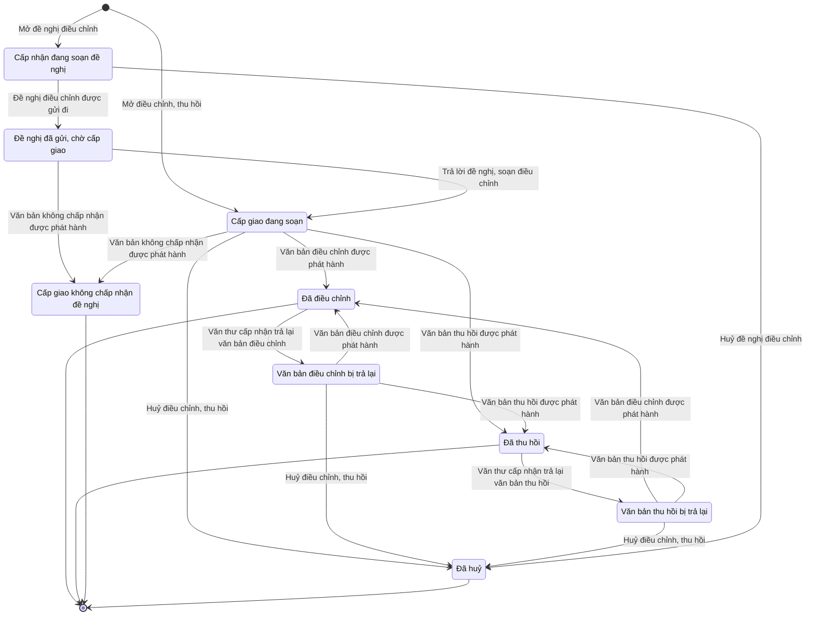

# qt-3.adjustment · Giao chỉ tiêu hai bậc — Điều chỉnh, thu hồi bản giao

<!-- máy sinh: tom-tat -->
> **Hồ sơ:** Điều chỉnh, thu hồi bản giao (`AssignmentAdjustment`)
>
> **Trong sổ phạm vi:** 3 · Giao chỉ tiêu hai bậc — hồ sơ phụ adjustment: điều chỉnh, thu hồi bản giao (tầng 2)
>
> 17 bước · 9 chặng · 3 vai · 0 bảng quyết định · 0 hạn · 6 khớp nối.
>
> **Nguồn:** sổ nghiệp vụ `qt-3.adjustment` · khai báo của app: `dqtv-app/core/processes/assignment/workflow/assignment-adjustment.yaml`. Các bảng do máy sinh từ nguồn này.
<!-- hết: tom-tat -->

## 1. Đường đi ngắn nhất qua các chặng

<!-- máy sinh: luong-chinh -->
Đường ít bước nhất từ lúc mở hồ sơ tới chặng kết thúc xa nhất. Máy chọn theo số chặng, không theo ý nghĩa nghiệp vụ — trình tự công việc thật xem phần Diễn giải và bảng "Việc làm ở từng chặng" ở mục 6.

| # | Ai làm | Làm gì | Hồ sơ sang chặng |
|---|---|---|---|
| 1 | Ban Dân quân tự vệ, Bộ CHQS cấp tỉnh | Mở điều chỉnh, thu hồi | Cấp giao đang soạn |
| 2 | Hệ thống tự làm | Văn bản điều chỉnh được phát hành | Đã điều chỉnh |

<!-- hết: luong-chinh -->

## 2. Hồ sơ và việc nó để lại

<!-- máy sinh: muc-tieu -->
**App gọi quy trình này là:** Điều chỉnh, thu hồi bản giao.
<!-- hết: muc-tieu -->

## 3. Khởi phát và kết thúc

<!-- máy sinh: khoi-phat -->
**2 cửa vào** — bước mở hồ sơ:

| Bước mở | Ai mở | Hồ sơ vào chặng | App bắt buộc nhập |
|---|---|---|---|
| Mở điều chỉnh, thu hồi | Ban Dân quân tự vệ, Bộ CHQS cấp tỉnh | Cấp giao đang soạn | `assignmentId` |
| Mở đề nghị điều chỉnh | Trợ lý Tác huấn | Cấp nhận đang soạn đề nghị | `assignmentId` |

**Kết thúc:** *Đã điều chỉnh* (`ADJUSTED`), *Đã thu hồi* (`REVOKED`), *Cấp giao không chấp nhận đề nghị* (`REJECTED`), *Đã huỷ* (`CANCELLED`)
<!-- hết: khoi-phat -->

## 4. Vai trò

<!-- máy sinh: vai-tro -->
| Vai trong sổ | Tên trong app | Điều kiện | Làm những bước |
|---|---|---|---|
| `operator` | Ban Dân quân tự vệ, Bộ CHQS cấp tỉnh |  | Mở điều chỉnh, thu hồi · Sửa điều chỉnh, thu hồi · Huỷ điều chỉnh, thu hồi · Trình ký văn bản điều chỉnh · Trình ký văn bản thu hồi · Trả lời đề nghị, soạn điều chỉnh · Trình ký văn bản không chấp nhận đề nghị |
| `system` | Hệ thống tự làm |  | Văn bản điều chỉnh được phát hành · Văn bản thu hồi được phát hành · Văn thư cấp nhận trả lại văn bản điều chỉnh · Văn thư cấp nhận trả lại văn bản thu hồi · Đề nghị điều chỉnh được gửi đi · Văn bản không chấp nhận được phát hành |
| `receiverAssistant` | Trợ lý Tác huấn |  | Mở đề nghị điều chỉnh · Sửa đề nghị điều chỉnh · Huỷ đề nghị điều chỉnh · Trình ký văn bản đề nghị điều chỉnh |

*"Tên trong app" là tên app đặt cho mã chủ thể của vai. Hồ sơ thuộc đơn vị cấp khác thì người làm là người giữ vai ấy ở đơn vị nêu trong cột "Điều kiện" (nếu sổ có ghi) và ở cột "Người làm phải thuộc" của bảng "Theo khai báo của app" (mục 7).*
<!-- hết: vai-tro -->

## 5. Nhánh phụ

<!-- máy sinh: nhanh-phu -->
**Bước khác đưa hồ sơ sang chặng mới** — đường song song, rẽ nhánh hoặc kết thúc sớm:

| Bước | Ai làm | Từ chặng | Sang chặng |
|---|---|---|---|
| Huỷ điều chỉnh, thu hồi | Ban Dân quân tự vệ, Bộ CHQS cấp tỉnh | Cấp giao đang soạn, Văn bản điều chỉnh bị trả lại, Văn bản thu hồi bị trả lại | Đã huỷ |
| Văn bản thu hồi được phát hành | Hệ thống tự làm | Cấp giao đang soạn, Văn bản điều chỉnh bị trả lại, Văn bản thu hồi bị trả lại | Đã thu hồi |
| Văn thư cấp nhận trả lại văn bản điều chỉnh | Hệ thống tự làm | Đã điều chỉnh | Văn bản điều chỉnh bị trả lại |
| Văn thư cấp nhận trả lại văn bản thu hồi | Hệ thống tự làm | Đã thu hồi | Văn bản thu hồi bị trả lại |
| Huỷ đề nghị điều chỉnh | Trợ lý Tác huấn | Cấp nhận đang soạn đề nghị | Đã huỷ |
| Đề nghị điều chỉnh được gửi đi | Hệ thống tự làm | Cấp nhận đang soạn đề nghị | Đề nghị đã gửi, chờ cấp giao |
| Trả lời đề nghị, soạn điều chỉnh | Ban Dân quân tự vệ, Bộ CHQS cấp tỉnh | Đề nghị đã gửi, chờ cấp giao | Cấp giao đang soạn |
| Văn bản không chấp nhận được phát hành | Hệ thống tự làm | Đề nghị đã gửi, chờ cấp giao, Cấp giao đang soạn | Cấp giao không chấp nhận đề nghị |

**Làm trong lúc hồ sơ đứng yên ở một chặng** — ghi nhận, bổ sung:

| Bước | Ai làm | Ở chặng |
|---|---|---|
| Sửa điều chỉnh, thu hồi | Ban Dân quân tự vệ, Bộ CHQS cấp tỉnh | Cấp giao đang soạn, Văn bản điều chỉnh bị trả lại, Văn bản thu hồi bị trả lại |
| Trình ký văn bản điều chỉnh | Ban Dân quân tự vệ, Bộ CHQS cấp tỉnh | Cấp giao đang soạn, Văn bản điều chỉnh bị trả lại, Văn bản thu hồi bị trả lại |
| Trình ký văn bản thu hồi | Ban Dân quân tự vệ, Bộ CHQS cấp tỉnh | Cấp giao đang soạn, Văn bản điều chỉnh bị trả lại, Văn bản thu hồi bị trả lại |
| Sửa đề nghị điều chỉnh | Trợ lý Tác huấn | Cấp nhận đang soạn đề nghị |
| Trình ký văn bản đề nghị điều chỉnh | Trợ lý Tác huấn | Cấp nhận đang soạn đề nghị |
| Trình ký văn bản không chấp nhận đề nghị | Ban Dân quân tự vệ, Bộ CHQS cấp tỉnh | Đề nghị đã gửi, chờ cấp giao, Cấp giao đang soạn |

**Cửa vào khác:** 2 bước cùng mở hồ sơ — xem mục 3.

<!-- hết: nhanh-phu -->

## 6. Các chặng và việc làm ở từng chặng

<!-- máy sinh: chang -->
| Chặng | Tên hiển thị | Vào bằng bước | Kết thúc? |
|---|---|---|---|
| `REQUEST_DRAFT` | Cấp nhận đang soạn đề nghị | Mở đề nghị điều chỉnh |  |
| `REQUESTED` | Đề nghị đã gửi, chờ cấp giao | Đề nghị điều chỉnh được gửi đi |  |
| `DRAFT` | Cấp giao đang soạn | Mở điều chỉnh, thu hồi · Trả lời đề nghị, soạn điều chỉnh |  |
| `ADJUSTMENT_RETURNED` | Văn bản điều chỉnh bị trả lại | Văn thư cấp nhận trả lại văn bản điều chỉnh |  |
| `REVOCATION_RETURNED` | Văn bản thu hồi bị trả lại | Văn thư cấp nhận trả lại văn bản thu hồi |  |
| `ADJUSTED` | Đã điều chỉnh | Văn bản điều chỉnh được phát hành | **kết thúc** — vẫn còn bước làm được |
| `REVOKED` | Đã thu hồi | Văn bản thu hồi được phát hành | **kết thúc** — vẫn còn bước làm được |
| `REJECTED` | Cấp giao không chấp nhận đề nghị | Văn bản không chấp nhận được phát hành | **kết thúc** |
| `CANCELLED` | Đã huỷ | Huỷ điều chỉnh, thu hồi · Huỷ đề nghị điều chỉnh | **kết thúc** |

### Việc làm ở từng chặng

Hồ sơ đang ở chặng nào thì làm được những bước nào.

| Hồ sơ đang ở chặng | Bước làm tại chặng (hồ sơ đứng yên) | Bước đưa hồ sơ sang chặng khác |
|---|---|---|
| **Cấp nhận đang soạn đề nghị** | Sửa đề nghị điều chỉnh — Trợ lý Tác huấn Trình ký văn bản đề nghị điều chỉnh — Trợ lý Tác huấn | Huỷ đề nghị điều chỉnh — Trợ lý Tác huấn → *Đã huỷ* Đề nghị điều chỉnh được gửi đi — Hệ thống tự làm → *Đề nghị đã gửi, chờ cấp giao* |
| **Đề nghị đã gửi, chờ cấp giao** | Trình ký văn bản không chấp nhận đề nghị — Ban Dân quân tự vệ, Bộ CHQS cấp tỉnh | Trả lời đề nghị, soạn điều chỉnh — Ban Dân quân tự vệ, Bộ CHQS cấp tỉnh → *Cấp giao đang soạn* Văn bản không chấp nhận được phát hành — Hệ thống tự làm → *Cấp giao không chấp nhận đề nghị* |
| **Cấp giao đang soạn** | Sửa điều chỉnh, thu hồi — Ban Dân quân tự vệ, Bộ CHQS cấp tỉnh Trình ký văn bản điều chỉnh — Ban Dân quân tự vệ, Bộ CHQS cấp tỉnh Trình ký văn bản thu hồi — Ban Dân quân tự vệ, Bộ CHQS cấp tỉnh Trình ký văn bản không chấp nhận đề nghị — Ban Dân quân tự vệ, Bộ CHQS cấp tỉnh | Huỷ điều chỉnh, thu hồi — Ban Dân quân tự vệ, Bộ CHQS cấp tỉnh → *Đã huỷ* Văn bản điều chỉnh được phát hành — Hệ thống tự làm → *Đã điều chỉnh* Văn bản thu hồi được phát hành — Hệ thống tự làm → *Đã thu hồi* Văn bản không chấp nhận được phát hành — Hệ thống tự làm → *Cấp giao không chấp nhận đề nghị* |
| **Văn bản điều chỉnh bị trả lại** | Sửa điều chỉnh, thu hồi — Ban Dân quân tự vệ, Bộ CHQS cấp tỉnh Trình ký văn bản điều chỉnh — Ban Dân quân tự vệ, Bộ CHQS cấp tỉnh Trình ký văn bản thu hồi — Ban Dân quân tự vệ, Bộ CHQS cấp tỉnh | Huỷ điều chỉnh, thu hồi — Ban Dân quân tự vệ, Bộ CHQS cấp tỉnh → *Đã huỷ* Văn bản điều chỉnh được phát hành — Hệ thống tự làm → *Đã điều chỉnh* Văn bản thu hồi được phát hành — Hệ thống tự làm → *Đã thu hồi* |
| **Văn bản thu hồi bị trả lại** | Sửa điều chỉnh, thu hồi — Ban Dân quân tự vệ, Bộ CHQS cấp tỉnh Trình ký văn bản điều chỉnh — Ban Dân quân tự vệ, Bộ CHQS cấp tỉnh Trình ký văn bản thu hồi — Ban Dân quân tự vệ, Bộ CHQS cấp tỉnh | Huỷ điều chỉnh, thu hồi — Ban Dân quân tự vệ, Bộ CHQS cấp tỉnh → *Đã huỷ* Văn bản điều chỉnh được phát hành — Hệ thống tự làm → *Đã điều chỉnh* Văn bản thu hồi được phát hành — Hệ thống tự làm → *Đã thu hồi* |
| **Đã điều chỉnh** | — | Văn thư cấp nhận trả lại văn bản điều chỉnh — Hệ thống tự làm → *Văn bản điều chỉnh bị trả lại* |
| **Đã thu hồi** | — | Văn thư cấp nhận trả lại văn bản thu hồi — Hệ thống tự làm → *Văn bản thu hồi bị trả lại* |
| **Cấp giao không chấp nhận đề nghị** | — | — (kết thúc) |
| **Đã huỷ** | — | — (kết thúc) |
<!-- hết: chang -->

## 7. Bảng bước

<!-- máy sinh: buoc -->
| # | Bước | Mã bước | Ai thực hiện | Từ chặng | Sang chặng | Phải có trước | Ghi lại |
|---|---|---|---|---|---|---|---|
| 1 | Mở điều chỉnh, thu hồi | `openAssignmentAdjustment` | Ban Dân quân tự vệ, Bộ CHQS cấp tỉnh | — (mở hồ sơ) | `DRAFT` | `assignmentOpenForAdjustment`, `noOtherAdjustmentOpen` | `id`, nối tới Bản giao chỉ tiêu, mốc xuống cấp dưới, đơn vị chủ hồ sơ, `receiverUnit`, do ai khởi đầu, điều chỉnh hay thu hồi, số mới (bỏ trống nếu thu hồi), hạn mới (để trống là giữ hạn cũ), vì sao điều chỉnh, thu hồi |
| 2 | Sửa điều chỉnh, thu hồi | `editAssignmentAdjustment` | Ban Dân quân tự vệ, Bộ CHQS cấp tỉnh | `DRAFT`, `ADJUSTMENT_RETURNED`, `REVOCATION_RETURNED` | giữ nguyên | người làm thuộc đơn vị chủ hồ sơ, `noAdjustmentDocumentOpen` | số mới (bỏ trống nếu thu hồi), hạn mới (để trống là giữ hạn cũ), vì sao điều chỉnh, thu hồi |
| 3 | Huỷ điều chỉnh, thu hồi | `cancelAssignmentAdjustment` | Ban Dân quân tự vệ, Bộ CHQS cấp tỉnh | `DRAFT`, `ADJUSTMENT_RETURNED`, `REVOCATION_RETURNED` | `CANCELLED` | người làm thuộc đơn vị chủ hồ sơ, `notFromRequest`, `noAdjustmentDocumentOpen` | — |
| 4 | Trình ký văn bản điều chỉnh | `requestAssignmentAdjustmentSignature` | Ban Dân quân tự vệ, Bộ CHQS cấp tỉnh | `DRAFT`, `ADJUSTMENT_RETURNED`, `REVOCATION_RETURNED` | giữ nguyên | người làm thuộc đơn vị chủ hồ sơ, `isAdjust`, số mới, `noAdjustmentDocumentOpen`, `noAdjustmentRejectDocumentOpen` | nối tới Văn bản đi |
| 5 | Trình ký văn bản thu hồi | `requestAssignmentRevocationSignature` | Ban Dân quân tự vệ, Bộ CHQS cấp tỉnh | `DRAFT`, `ADJUSTMENT_RETURNED`, `REVOCATION_RETURNED` | giữ nguyên | người làm thuộc đơn vị chủ hồ sơ, `isRevoke`, `nothingReportedOnAssignment`, `noAdjustmentDocumentOpen`, `noAdjustmentRejectDocumentOpen` | nối tới Văn bản đi |
| 6 | Văn bản điều chỉnh được phát hành | `issueAssignmentAdjustment` | Hệ thống tự làm | `DRAFT`, `ADJUSTMENT_RETURNED`, `REVOCATION_RETURNED` | `ADJUSTED` | `adjustmentDocumentIssued`, `isAdjust` | nối tới Văn bản đến |
| 7 | Văn bản thu hồi được phát hành | `issueAssignmentRevocation` | Hệ thống tự làm | `DRAFT`, `ADJUSTMENT_RETURNED`, `REVOCATION_RETURNED` | `REVOKED` | `adjustmentDocumentIssued`, `isRevoke` | nối tới Văn bản đến |
| 8 | Văn thư cấp nhận trả lại văn bản điều chỉnh | `returnAdjustmentByReceiver` | Hệ thống tự làm | `ADJUSTED` | `ADJUSTMENT_RETURNED` | — | lý do văn thư cấp nhận trả lại, ngày văn bản bị trả |
| 9 | Văn thư cấp nhận trả lại văn bản thu hồi | `returnRevocationDocumentByReceiver` | Hệ thống tự làm | `REVOKED` | `REVOCATION_RETURNED` | — | lý do văn thư cấp nhận trả lại, ngày văn bản bị trả |
| 10 | Mở đề nghị điều chỉnh | `openAdjustmentRequest` | Trợ lý Tác huấn | — (mở hồ sơ) | `REQUEST_DRAFT` | `assignmentAcceptedForRequest`, `noOtherAdjustmentOpen` | `id`, nối tới Bản giao chỉ tiêu, mốc xuống cấp dưới, đơn vị chủ hồ sơ, `receiverUnit`, do ai khởi đầu, cấp nhận đề nghị, vì sao đề nghị điều chỉnh, số mới đề nghị, hạn mới đề nghị |
| 11 | Sửa đề nghị điều chỉnh | `editAdjustmentRequest` | Trợ lý Tác huấn | `REQUEST_DRAFT` | giữ nguyên | `actorInReceiverUnit`, `noAdjustmentRequestDocumentOpen` | cấp nhận đề nghị, vì sao đề nghị điều chỉnh, số mới đề nghị, hạn mới đề nghị |
| 12 | Huỷ đề nghị điều chỉnh | `cancelAdjustmentRequest` | Trợ lý Tác huấn | `REQUEST_DRAFT` | `CANCELLED` | `actorInReceiverUnit`, `noAdjustmentRequestDocumentOpen` | — |
| 13 | Trình ký văn bản đề nghị điều chỉnh | `requestAdjustmentRequestSignature` | Trợ lý Tác huấn | `REQUEST_DRAFT` | giữ nguyên | `actorInReceiverUnit`, `noAdjustmentRequestDocumentOpen`, cấp nhận đề nghị, vì sao đề nghị | nối tới Văn bản đi |
| 14 | Đề nghị điều chỉnh được gửi đi | `submitAdjustmentRequest` | Hệ thống tự làm | `REQUEST_DRAFT` | `REQUESTED` | `adjustmentRequestDocumentIssued` | ngày đề nghị vào hồ sơ, nối tới Văn bản đến |
| 15 | Trả lời đề nghị, soạn điều chỉnh | `answerAdjustmentRequest` | Ban Dân quân tự vệ, Bộ CHQS cấp tỉnh | `REQUESTED` | `DRAFT` | người làm thuộc đơn vị chủ hồ sơ, `adjustmentRequestDistributedAtReceiver` | điều chỉnh hay thu hồi, số mới (bỏ trống nếu thu hồi), hạn mới (để trống là giữ hạn cũ), vì sao điều chỉnh, thu hồi |
| 16 | Văn bản không chấp nhận được phát hành | `rejectAdjustmentRequest` | Hệ thống tự làm | `REQUESTED`, `DRAFT` | `REJECTED` | `adjustmentRejectDocumentIssued` | nối tới Văn bản đến |
| 17 | Trình ký văn bản không chấp nhận đề nghị | `requestRejectAdjustmentRequestSignature` | Ban Dân quân tự vệ, Bộ CHQS cấp tỉnh | `REQUESTED`, `DRAFT` | giữ nguyên | người làm thuộc đơn vị chủ hồ sơ, `fromRequest`, `adjustmentRequestDistributedAtReceiver`, `noAdjustmentRejectDocumentOpen`, `noAdjustmentDocumentOpen`, vì sao không chấp nhận | vì sao không chấp nhận, nối tới Văn bản đi |

### Khi không đạt điều kiện

Mặc định: không đúng người, hồ sơ không ở đúng chặng, hoặc thiếu thứ "phải có trước" thì bước bị chặn, hồ sơ giữ nguyên. Bảng dưới chỉ kê những bước có kết quả riêng.

| # | Bước | Kết quả riêng |
|---|---|---|
| 6 | Văn bản điều chỉnh được phát hành | bước này không do người nào bấm |
| 7 | Văn bản thu hồi được phát hành | bước này không do người nào bấm |
| 8 | Văn thư cấp nhận trả lại văn bản điều chỉnh | bước này không do người nào bấm |
| 9 | Văn thư cấp nhận trả lại văn bản thu hồi | bước này không do người nào bấm |
| 14 | Đề nghị điều chỉnh được gửi đi | bước này không do người nào bấm |
| 16 | Văn bản không chấp nhận được phát hành | bước này không do người nào bấm |

### Điều kiện "phải có trước" bằng lời

Cột "Phải có trước" ở bảng bước có hai loại: ô dữ liệu thường (bước chỉ đòi ô ấy đã có giá trị) và điều kiện hệ tự xét. Bảng này diễn các điều kiện hệ tự xét theo đúng công thức sổ ghi; số ở cột cuối là số thứ tự bước.

| Điều kiện | Đúng khi | Bước đòi |
|---|---|---|
| `assignmentOpenForAdjustment` | có hồ sơ Giao chỉ tiêu hai bậc (qt-3) chính là hồ sơ ghi ở ô nối `adjustmentOfAssignment` của hồ sơ đang làm mà hồ sơ ấy đang ở chặng `DELEGATED` hoặc `ACCEPTED` | 1 |
| `noOtherAdjustmentOpen` | không có hồ sơ Giao chỉ tiêu hai bậc — Điều chỉnh, thu hồi bản giao (qt-3.adjustment) có ô nối `adjustmentOfAssignment` trùng với ô nối `adjustmentOfAssignment` của hồ sơ đang làm mà hồ sơ ấy đang ở chặng `REQUEST_DRAFT` hoặc `REQUESTED` hoặc `DRAFT` hoặc `ADJUSTMENT_RETURNED` hoặc `REVOCATION_RETURNED` | 1, 10 |
| `actorInOwnerUnit` | người đang làm là người của đơn vị ghi ở ô đơn vị chủ hồ sơ của hồ sơ này (theo danh mục người của đơn vị, `dm.unit-staff`) | 2, 3, 4, 5, 15, 17 |
| `noAdjustmentDocumentOpen` | KHÔNG (có hồ sơ Việc luật giao kèm văn bản đến, đi — Văn bản đi (qt-1.outgoing-document) chính là hồ sơ ghi ở ô nối `adjustmentByDocument` của hồ sơ đang làm mà hồ sơ ấy đang ở chặng `DRAFT` hoặc `PENDING_SIGNATURE` hoặc `SIGNED`) | 2, 3, 4, 5, 17 |
| `notFromRequest` | do ai khởi đầu là Cấp giao tự điều chỉnh (`assigner`) | 3 |
| `isAdjust` | điều chỉnh hay thu hồi là Điều chỉnh số, hạn (`adjust`) | 4, 6 |
| `noAdjustmentRejectDocumentOpen` | KHÔNG (có hồ sơ Việc luật giao kèm văn bản đến, đi — Văn bản đi (qt-1.outgoing-document) chính là hồ sơ ghi ở ô nối `adjustmentRejectByDocument` của hồ sơ đang làm mà hồ sơ ấy đang ở chặng `DRAFT` hoặc `PENDING_SIGNATURE` hoặc `SIGNED`) | 4, 5, 17 |
| `isRevoke` | điều chỉnh hay thu hồi là Thu hồi (`revoke`) | 5, 7 |
| `nothingReportedOnAssignment` | có hồ sơ Giao chỉ tiêu hai bậc (qt-3) chính là hồ sơ ghi ở ô nối `adjustmentOfAssignment` của hồ sơ đang làm mà không có hồ sơ Giao chỉ tiêu hai bậc — Kết quả trả lên cấp trên (qt-3.assignment-result) có `planAssignmentId` trỏ về chính hồ sơ vừa nêu mà hồ sơ ấy đang ở chặng `REPORTED` hoặc `SUPPLEMENT_REQUESTED` hoặc `SUPERSEDED` | 5 |
| `adjustmentDocumentIssued` | có hồ sơ Việc luật giao kèm văn bản đến, đi — Văn bản đi (qt-1.outgoing-document) chính là hồ sơ ghi ở ô nối `adjustmentByDocument` của hồ sơ đang làm mà hồ sơ ấy đang ở chặng `ISSUED` | 6, 7 |
| `assignmentAcceptedForRequest` | có hồ sơ Giao chỉ tiêu hai bậc (qt-3) chính là hồ sơ ghi ở ô nối `adjustmentOfAssignment` của hồ sơ đang làm mà hồ sơ ấy đang ở chặng `ACCEPTED` | 10 |
| `actorInReceiverUnit` | người đang làm là người của đơn vị ghi ở ô `receiverUnit` của hồ sơ này (theo danh mục người của đơn vị, `dm.unit-staff`) | 11, 12, 13 |
| `noAdjustmentRequestDocumentOpen` | KHÔNG (có hồ sơ Việc luật giao kèm văn bản đến, đi — Văn bản đi (qt-1.outgoing-document) chính là hồ sơ ghi ở ô nối `adjustmentRequestByDocument` của hồ sơ đang làm mà hồ sơ ấy đang ở chặng `DRAFT` hoặc `PENDING_SIGNATURE` hoặc `SIGNED`) | 11, 12, 13 |
| `adjustmentRequestDocumentIssued` | có hồ sơ Việc luật giao kèm văn bản đến, đi — Văn bản đi (qt-1.outgoing-document) chính là hồ sơ ghi ở ô nối `adjustmentRequestByDocument` của hồ sơ đang làm mà hồ sơ ấy đang ở chặng `ISSUED` | 14 |
| `adjustmentRequestDistributedAtReceiver` | có hồ sơ Việc luật giao kèm văn bản đến, đi — Văn bản đến (qt-1.incoming-document) chính là hồ sơ ghi ở ô nối `adjustmentRequestDeliveredAs` của hồ sơ đang làm mà hồ sơ ấy đang ở chặng `DISTRIBUTED` | 15, 17 |
| `adjustmentRejectDocumentIssued` | có hồ sơ Việc luật giao kèm văn bản đến, đi — Văn bản đi (qt-1.outgoing-document) chính là hồ sơ ghi ở ô nối `adjustmentRejectByDocument` của hồ sơ đang làm mà hồ sơ ấy đang ở chặng `ISSUED` | 16 |
| `fromRequest` | do ai khởi đầu là Cấp nhận đề nghị (`request`) | 17 |

### Theo khai báo của app

Người làm phải thuộc đơn vị nào, ô người dùng phải nhập, bước có lặp được không, và căn cứ pháp lý — lấy từ khai báo quy trình trong app.

| # | Bước | Người làm phải thuộc | Bắt buộc nhập | Nhập nếu có | Lặp được | Căn cứ |
|---|---|---|---|---|---|---|
| 1 | Mở điều chỉnh, thu hồi |  | `assignmentId` | điều chỉnh hay thu hồi, vì sao điều chỉnh, thu hồi, số mới (bỏ trống nếu thu hồi), hạn mới (để trống là giữ hạn cũ) |  | NĐ30/2020/NĐ-CP Đ.18 k3 (sửa đổi bằng văn bản có hình thức tương đương) |
| 2 | Sửa điều chỉnh, thu hồi | đơn vị chủ hồ sơ | — | điều chỉnh hay thu hồi, số mới (bỏ trống nếu thu hồi), hạn mới (để trống là giữ hạn cũ), vì sao điều chỉnh, thu hồi |  | NĐ30/2020/NĐ-CP Đ.18 k3 |
| 3 | Huỷ điều chỉnh, thu hồi | đơn vị chủ hồ sơ | — | — |  | NĐ30/2020/NĐ-CP Đ.18 k3 |
| 4 | Trình ký văn bản điều chỉnh | đơn vị chủ hồ sơ | — | dự thảo văn bản (PDF) |  | NĐ30/2020/NĐ-CP Đ.13 (trình ký) · Đ.18 k3 |
| 5 | Trình ký văn bản thu hồi | đơn vị chủ hồ sơ | — | dự thảo văn bản (PDF) |  | NĐ30/2020/NĐ-CP Đ.13 (trình ký) · Đ.18 k3, k4 |
| 6 | Văn bản điều chỉnh được phát hành |  | — | — |  | NĐ30/2020/NĐ-CP Đ.18 k3 |
| 7 | Văn bản thu hồi được phát hành |  | — | — |  | NĐ30/2020/NĐ-CP Đ.18 k3, k4 |
| 8 | Văn thư cấp nhận trả lại văn bản điều chỉnh |  | — | lý do văn thư cấp nhận trả lại |  | NĐ30/2020/NĐ-CP Đ.21 k2 b |
| 9 | Văn thư cấp nhận trả lại văn bản thu hồi |  | — | lý do văn thư cấp nhận trả lại |  | NĐ30/2020/NĐ-CP Đ.21 k2 b |
| 10 | Mở đề nghị điều chỉnh |  | `assignmentId` | cấp nhận đề nghị, vì sao đề nghị điều chỉnh, số mới đề nghị, hạn mới đề nghị |  | NĐ168/2018/NĐ-CP Đ.12 (quan hệ chỉ đạo, báo cáo) |
| 11 | Sửa đề nghị điều chỉnh | `receiverUnit` | — | cấp nhận đề nghị, vì sao đề nghị điều chỉnh, số mới đề nghị, hạn mới đề nghị |  | NĐ168/2018/NĐ-CP Đ.12 |
| 12 | Huỷ đề nghị điều chỉnh | `receiverUnit` | — | — |  | NĐ168/2018/NĐ-CP Đ.12 |
| 13 | Trình ký văn bản đề nghị điều chỉnh | `receiverUnit` | — | dự thảo văn bản (PDF) |  | NĐ30/2020/NĐ-CP Đ.13 (trình ký) · NĐ168/2018/NĐ-CP Đ.12 |
| 14 | Đề nghị điều chỉnh được gửi đi |  | — | — |  | NĐ30/2020/NĐ-CP Đ.18 |
| 15 | Trả lời đề nghị, soạn điều chỉnh | đơn vị chủ hồ sơ | — | điều chỉnh hay thu hồi, vì sao điều chỉnh, thu hồi, số mới (bỏ trống nếu thu hồi), hạn mới (để trống là giữ hạn cũ) |  | NĐ168/2018/NĐ-CP Đ.12 |
| 16 | Văn bản không chấp nhận được phát hành |  | — | — |  | NĐ168/2018/NĐ-CP Đ.12 · NĐ30/2020/NĐ-CP Đ.18 |
| 17 | Trình ký văn bản không chấp nhận đề nghị | đơn vị chủ hồ sơ | — | vì sao không chấp nhận, dự thảo văn bản (PDF) |  | NĐ30/2020/NĐ-CP Đ.13 (trình ký) · NĐ168/2018/NĐ-CP Đ.12 |
<!-- hết: buoc -->

## 8. Bảng quyết định, hạn, việc ngoài hệ

<!-- máy sinh: quyet-dinh -->

<!-- hết: quyet-dinh -->

## 9. Dữ liệu của hồ sơ

<!-- máy sinh: du-lieu -->
Các ô mà bước trong sổ ghi hoặc đòi. Số trong hai cột cuối là số thứ tự bước ở bảng bước (mục 7).

| Ô dữ liệu | Mã | Kiểu (app) | Giá trị cho phép | Loại ô (sổ) | Bước ghi | Bước đòi | Mô tả trong app |
|---|---|---|---|---|---|---|---|
| — | `id` |  |  | lưu trên hồ sơ (`stored`) | 1, 10 | — |  |
| đơn vị chủ hồ sơ | `ownerUnit` |  |  | lưu trên hồ sơ (`stored`) | 1, 10 | — |  |
| — | `receiverUnit` | chữ |  | lưu trên hồ sơ (`stored`) | 1, 10 | — | Đơn vị nhận bản giao (id đơn vị) — chỉ cán bộ đơn vị này làm bước của cấp nhận |
| do ai khởi đầu | `adjustmentOrigin` | chọn một | Cấp nhận đề nghị (`request`), Cấp giao tự điều chỉnh (`assigner`) | lưu trên hồ sơ (`stored`) | 1, 10 | — | Hồ sơ do cấp nhận đề nghị hay cấp giao tự mở |
| điều chỉnh hay thu hồi | `adjustmentKind` | chọn một | Điều chỉnh số, hạn (`adjust`), Thu hồi (`revoke`) | đưa vào ở bước (`input`) | 1, 15 | — | Điều chỉnh số, hạn hay thu hồi |
| số mới | `proposedAdjustedQty` | số |  | lưu trên hồ sơ (`stored`) | 1, 2, 10, 11, 15 | 4 | Số mới đề xuất |
| hạn mới | `proposedDueDate` | ngày |  | đưa vào ở bước (`input`) | 1, 2, 10, 11, 15 | — | Hạn mới đề xuất — trống là giữ hạn cũ |
| vì sao điều chỉnh | `adjustmentReason` | chữ |  | lưu trên hồ sơ (`stored`) | 1, 2, 15 | — | Vì sao cấp giao điều chỉnh, thu hồi |
| lý do văn thư cấp nhận trả lại | `adjustmentReturnReason` | chữ |  | lưu trên hồ sơ (`stored`) | 8, 9 | — | Vì sao văn thư cấp nhận trả lại văn bản điều chỉnh, thu hồi |
| ngày văn bản bị trả | `adjustmentReturnedAt` | ngày |  | lưu trên hồ sơ (`stored`) | 8, 9 | — | Ngày văn thư cấp nhận trả lại văn bản |
| cấp nhận đề nghị | `adjustmentRequestKind` | chọn một | Xin gia hạn (`extend`), Xin giảm số (`reduce`), Không đủ khả năng thực hiện (`notCompetent`) | đưa vào ở bước (`input`) | 10, 11 | 13 | Cấp nhận đề nghị gì |
| vì sao đề nghị | `adjustmentRequestReason` | chữ |  | đưa vào ở bước (`input`) | 10, 11 | 13 | Cấp nhận nói vì sao đề nghị |
| ngày đề nghị vào hồ sơ | `adjustmentRequestedAt` | ngày |  | lưu trên hồ sơ (`stored`) | 14 | — | Ngày văn bản đề nghị được phát hành |
| vì sao không chấp nhận | `adjustmentRejectReason` | chữ |  | đưa vào ở bước (`input`) | 17 | 17 | Vì sao cấp giao không chấp nhận đề nghị |
| — | `assignmentOpenForAdjustment` |  | có hay chưa | hệ suy ra (`derived`) | — | 1 |  |
| — | `noOtherAdjustmentOpen` |  | có hay chưa | hệ suy ra (`derived`) | — | 1, 10 |  |
| người làm thuộc đơn vị chủ hồ sơ | `actorInOwnerUnit` |  | có hay chưa | hệ suy ra (`derived`) | — | 2, 3, 4, 5, 15, 17 |  |
| — | `noAdjustmentDocumentOpen` |  | có hay chưa | hệ suy ra (`derived`) | — | 2, 3, 4, 5, 17 |  |
| — | `notFromRequest` |  | có hay chưa | hệ suy ra (`derived`) | — | 3 |  |
| — | `isAdjust` |  | có hay chưa | hệ suy ra (`derived`) | — | 4, 6 |  |
| — | `noAdjustmentRejectDocumentOpen` |  | có hay chưa | hệ suy ra (`derived`) | — | 4, 5, 17 |  |
| — | `isRevoke` |  | có hay chưa | hệ suy ra (`derived`) | — | 5, 7 |  |
| — | `nothingReportedOnAssignment` |  | có hay chưa | hệ suy ra (`derived`) | — | 5 |  |
| — | `adjustmentDocumentIssued` |  | có hay chưa | hệ suy ra (`derived`) | — | 6, 7 |  |
| — | `assignmentAcceptedForRequest` |  | có hay chưa | hệ suy ra (`derived`) | — | 10 |  |
| — | `actorInReceiverUnit` |  | có hay chưa | hệ suy ra (`derived`) | — | 11, 12, 13 |  |
| — | `noAdjustmentRequestDocumentOpen` |  | có hay chưa | hệ suy ra (`derived`) | — | 11, 12, 13 |  |
| — | `adjustmentRequestDocumentIssued` |  | có hay chưa | hệ suy ra (`derived`) | — | 14 |  |
| — | `adjustmentRequestDistributedAtReceiver` |  | có hay chưa | hệ suy ra (`derived`) | — | 15, 17 |  |
| — | `adjustmentRejectDocumentIssued` |  | có hay chưa | hệ suy ra (`derived`) | — | 16 |  |
| — | `fromRequest` |  | có hay chưa | hệ suy ra (`derived`) | — | 17 |  |

31 ô. Cột "Loại ô" là cách sổ phân loại ô, in kèm đúng chữ của sổ; ô nào người dùng phải nhập xem bảng "Theo khai báo của app" ở mục 7.
<!-- hết: du-lieu -->

## 10. Khớp nối với quy trình khác

<!-- máy sinh: khop-noi -->
| Quy trình kia | Hồ sơ kia | Quan hệ | Nội dung (mô tả trong app) | Bước ghi mối nối | Tên ô nối |
|---|---|---|---|---|---|
| 1.incoming-document | Văn bản đến | gắn với nhau ở một bước giữa chừng | Văn bản đến ở sổ của cấp nhận, mang văn bản điều chỉnh, thu hồi bản giao này | 3.adjustment·issueAssignmentAdjustment, 3.adjustment·issueAssignmentRevocation | `adjustmentDeliveredAs` |
| 1.incoming-document | Văn bản đến | gắn với nhau ở một bước giữa chừng | Văn bản không chấp nhận đề nghị ở sổ văn bản đến của cấp nhận | 3.adjustment·rejectAdjustmentRequest | `adjustmentRejectDeliveredAs` |
| 1.incoming-document | Văn bản đến | gắn với nhau ở một bước giữa chừng | Văn bản đề nghị điều chỉnh ở sổ văn bản đến của cấp giao — NĐ30/2020 Đ.20–23 | 3.adjustment·submitAdjustmentRequest | `adjustmentRequestDeliveredAs` |
| 1.outgoing-document | Văn bản đi | gắn với nhau ở một bước giữa chừng | Văn bản điều chỉnh hoặc thu hồi bản giao — NĐ30/2020/NĐ-CP Đ.18 k3 | 3.adjustment·requestAssignmentAdjustmentSignature, 3.adjustment·requestAssignmentRevocationSignature | `adjustmentByDocument` |
| 1.outgoing-document | Văn bản đi | gắn với nhau ở một bước giữa chừng | Văn bản không chấp nhận đề nghị điều chỉnh của cấp giao — NĐ30/2020 (văn bản đi vào sổ) | 3.adjustment·requestRejectAdjustmentRequestSignature | `adjustmentRejectByDocument` |
| 1.outgoing-document | Văn bản đi | gắn với nhau ở một bước giữa chừng | Văn bản đề nghị điều chỉnh của cấp nhận gửi cấp giao — NĐ30/2020 (văn bản đi vào sổ) | 3.adjustment·requestAdjustmentRequestSignature | `adjustmentRequestByDocument` |

6 khớp nối. ⊕ là bước tạo hồ sơ.
<!-- hết: khop-noi -->

## 11. Thông tin chung

<!-- máy sinh: thong-tin -->
| | |
|---|---|
| **Mã trong sổ** | `qt-3.adjustment` |
| **Quy trình trong app** | `assignment` (`workflow/assignment-adjustment.yaml`) — mặt công tác: `common` |
| **Hồ sơ** | Điều chỉnh, thu hồi bản giao (`AssignmentAdjustment`) |
| **Cùng mã quy trình** | [qt-3](qt-3.html), [qt-3.assignment-result](qt-3.assignment-result.html), [qt-3.target-actual](qt-3.target-actual.html) |
| **Căn cứ pháp lý từng bước** | cột "Căn cứ" ở bảng "Theo khai báo của app", mục 7 |
<!-- hết: thong-tin -->
