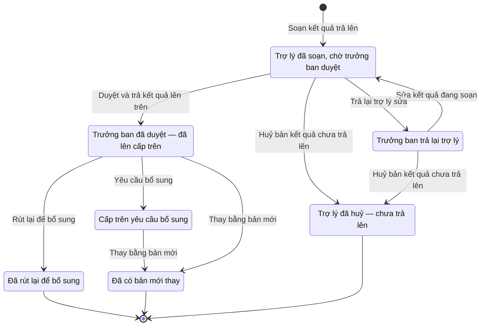

# qt-3.assignment-result · Giao chỉ tiêu hai bậc — Kết quả trả lên cấp trên

<!-- máy sinh: tom-tat -->
> **Hồ sơ:** Kết quả trả lên cấp trên (`AssignmentResult`)
>
> **Trong sổ phạm vi:** 3 · Giao chỉ tiêu hai bậc — hồ sơ phụ assignment-result (tầng 2)
>
> 9 bước · 7 chặng · 4 vai · 3 bảng quyết định · 0 hạn · 5 khớp nối.
>
> **Nguồn:** sổ nghiệp vụ `qt-3.assignment-result` · khai báo của app: `dqtv-app/core/processes/assignment/workflow/assignment-result.yaml`. Các bảng do máy sinh từ nguồn này.
<!-- hết: tom-tat -->

<!-- viết tay: dien-giai -->
## Diễn giải

*Phần này viết tay, diễn giải lại điều các bảng bên dưới ghi.*

### Quy trình này để làm gì

Cấp nhận việc trả **kết quả** của một bản giao lên cấp đã giao: trợ lý soạn con số, trưởng ban duyệt, con số lên cấp trên; cấp trên cần thì yêu cầu bổ sung. Số trả lên là số đạt luỹ kế tính đến lần báo ấy — bản sau thay bản trước, không cộng dồn. Người làm: Trợ lý Tác huấn, Chỉ huy trưởng Ban CHQS xã (bên trả kết quả) và Ban Dân quân tự vệ, Bộ CHQS cấp tỉnh (trợ lý bên giao).

Hồ sơ có sáu chặng: *Trợ lý đã soạn, chờ trưởng ban duyệt* → *Trưởng ban đã duyệt — đã lên cấp trên*; các chặng rẽ là *Trưởng ban trả lại trợ lý*, *Cấp trên yêu cầu bổ sung*, *Đã rút lại để bổ sung*, *Đã có bản mới thay*.

### Khi nào bắt đầu

Trợ lý Tác huấn bấm **Soạn kết quả trả lên**. Bắt buộc chọn bản giao được trả kết quả (`assignmentId`), nhập số trả lên và đánh dấu đây có phải báo cáo cuối hay không; kỳ báo, những dòng tính vào kết quả và lời nói thêm là ô nhập nếu có. Bước chép tên việc cấp trên giao và thước đo từ bản giao sang. Hồ sơ vào chặng *Trợ lý đã soạn, chờ trưởng ban duyệt*.

### Diễn ra thế nào

**Chặng "Trợ lý đã soạn, chờ trưởng ban duyệt"** — chưa rời khỏi cấp mình. Trợ lý **Sửa kết quả đang soạn**. Chỉ huy trưởng **Duyệt và trả kết quả lên trên** (ghi được chức danh người ký báo cáo và số hiệu báo cáo đã ký; hai ô này chỉ để hiển thị) — hồ sơ sang *Trưởng ban đã duyệt — đã lên cấp trên*. Hoặc Chỉ huy trưởng **Trả lại trợ lý sửa** (ghi lý do) — hồ sơ sang *Trưởng ban trả lại trợ lý*.

**Chặng "Trưởng ban trả lại trợ lý".** Trợ lý dùng lại bước sửa kết quả; sửa xong hồ sơ về chặng chờ duyệt.

**Chặng "Trưởng ban đã duyệt — đã lên cấp trên"** — cấp trên đọc chính con số này. Có ba lối ra:

- Chỉ huy trưởng bên trả **Rút lại để bổ sung** (ghi lý do) — hồ sơ sang *Đã rút lại để bổ sung*; số cũ còn hiệu lực tới khi có bản mới.
- Trợ lý bên giao **Yêu cầu bổ sung** (bắt buộc ghi cần bổ sung gì; hạn bổ sung nếu có) — hồ sơ sang *Cấp trên yêu cầu bổ sung*; số cũ vẫn tính tới khi bản mới được duyệt.
- Chỉ huy trưởng bên trả **Thay bằng bản mới** — hồ sơ sang *Đã có bản mới thay*.

**Chặng "Cấp trên yêu cầu bổ sung".** Chỉ còn bước thay bằng bản mới, cũng do Chỉ huy trưởng bên trả làm; bước ghi ngày bản mới được duyệt thay bản này.

### Kết thúc và để lại gì

Hồ sơ kết thúc ở *Đã rút lại để bổ sung* hoặc *Đã có bản mới thay*.

Mối nối với quy trình khác (mục 10): đợt tuyển quân (17) gắn kết quả của đợt vào bản kết quả này ở bước `closeConscriptionDrive`; hồ sơ thí sinh sơ tuyển vào trường Quân đội (36) gắn vào ở bước `sendDossierToProvince`; những dòng chỉ tiêu của cấp mình (quy trình 2) được tính vào lần trả kết quả. Số lên cấp trên ngay khi được duyệt; việc cấp trên nhận bản cuối để đóng bản giao là bước của hồ sơ bản giao (quy trình 3), không nằm ở hồ sơ này.

### Điều kiện chặn

- Bước của bên trả kết quả (trừ bước mở hồ sơ) đòi người làm là người của đơn vị chủ hồ sơ; bước *Yêu cầu bổ sung* đòi người làm là người của đơn vị ghi ở ô `assignerUnit` (`actorInUpperUnit`) và phải ghi cần bổ sung gì.
- Không đúng người, sai chặng, thiếu thứ phải có trước thì chặn, hồ sơ giữ nguyên.
- Trả lại trợ lý và rút lại đều phải ghi lý do. Hạn bổ sung do cấp trên ghi, không bắt buộc.
<!-- hết viết tay -->

## 1. Đường đi ngắn nhất qua các chặng

<!-- máy sinh: luong-chinh -->
Đường ít bước nhất từ lúc mở hồ sơ tới chặng kết thúc xa nhất. Máy chọn theo số chặng, không theo ý nghĩa nghiệp vụ — trình tự công việc thật xem phần Diễn giải và bảng "Việc làm ở từng chặng" ở mục 6.

| # | Ai làm | Làm gì | Hồ sơ sang chặng |
|---|---|---|---|
| 1 | Trợ lý Tác huấn | Soạn kết quả trả lên | Trợ lý đã soạn, chờ trưởng ban duyệt |
| 2 | Chỉ huy trưởng Ban CHQS xã | Duyệt và trả kết quả lên trên | Trưởng ban đã duyệt — đã lên cấp trên |
| 3 | Chỉ huy trưởng Ban CHQS xã | Rút lại để bổ sung | Đã rút lại để bổ sung |

<!-- hết: luong-chinh -->

## 2. Hồ sơ và việc nó để lại

<!-- máy sinh: muc-tieu -->
**App gọi quy trình này là:** Kết quả trả lên cấp trên.

**Khi mở, hồ sơ này ghi mối nối tới:**
- Chỉ tiêu (2) — bước `draftAssignmentResult`, khớp nối `resultCoversTarget`
<!-- hết: muc-tieu -->

## 3. Khởi phát và kết thúc

<!-- máy sinh: khoi-phat -->
**1 cửa vào** — bước mở hồ sơ:

| Bước mở | Ai mở | Hồ sơ vào chặng | App bắt buộc nhập |
|---|---|---|---|
| Soạn kết quả trả lên | Trợ lý Tác huấn | Trợ lý đã soạn, chờ trưởng ban duyệt | `assignmentId`, báo cáo cuối |

**Kết thúc:** *Đã rút lại để bổ sung* (`WITHDRAWN`), *Đã có bản mới thay* (`SUPERSEDED`), *Trợ lý đã huỷ — chưa trả lên* (`CANCELLED`)
<!-- hết: khoi-phat -->

## 4. Vai trò

<!-- máy sinh: vai-tro -->
| Vai trong sổ | Tên trong app | Điều kiện | Làm những bước |
|---|---|---|---|
| `operator` | Trợ lý Tác huấn |  | Soạn kết quả trả lên · Sửa kết quả đang soạn · Huỷ bản kết quả chưa trả lên |
| `commander` | Chỉ huy trưởng Ban CHQS xã |  | Duyệt và trả kết quả lên trên · Trả lại trợ lý sửa · Rút lại để bổ sung · Thay bằng bản mới |
| `assignerAssistant` | Ban Dân quân tự vệ, Bộ CHQS cấp tỉnh |  | Trình ký yêu cầu bổ sung |
| `system` | Hệ thống tự làm |  | Yêu cầu bổ sung |

*"Tên trong app" là tên app đặt cho mã chủ thể của vai. Hồ sơ thuộc đơn vị cấp khác thì người làm là người giữ vai ấy ở đơn vị nêu trong cột "Điều kiện" (nếu sổ có ghi) và ở cột "Người làm phải thuộc" của bảng "Theo khai báo của app" (mục 7).*
<!-- hết: vai-tro -->

## 5. Nhánh phụ

<!-- máy sinh: nhanh-phu -->
**Bước khác đưa hồ sơ sang chặng mới** — đường song song, rẽ nhánh hoặc kết thúc sớm:

| Bước | Ai làm | Từ chặng | Sang chặng |
|---|---|---|---|
| Huỷ bản kết quả chưa trả lên | Trợ lý Tác huấn | Trợ lý đã soạn, chờ trưởng ban duyệt, Trưởng ban trả lại trợ lý | Trợ lý đã huỷ — chưa trả lên |
| Trả lại trợ lý sửa | Chỉ huy trưởng Ban CHQS xã | Trợ lý đã soạn, chờ trưởng ban duyệt | Trưởng ban trả lại trợ lý |
| Yêu cầu bổ sung | Hệ thống tự làm | Trưởng ban đã duyệt — đã lên cấp trên | Cấp trên yêu cầu bổ sung |
| Thay bằng bản mới | Chỉ huy trưởng Ban CHQS xã | Cấp trên yêu cầu bổ sung, Trưởng ban đã duyệt — đã lên cấp trên | Đã có bản mới thay |

**Quay lại một chặng hồ sơ đã đi qua** (tính theo đường ngắn nhất từ lúc mở):

| Bước | Ai làm | Từ chặng | Về chặng |
|---|---|---|---|
| Sửa kết quả đang soạn | Trợ lý Tác huấn | Trợ lý đã soạn, chờ trưởng ban duyệt, Trưởng ban trả lại trợ lý | Trợ lý đã soạn, chờ trưởng ban duyệt |

**Làm trong lúc hồ sơ đứng yên ở một chặng** — ghi nhận, bổ sung:

| Bước | Ai làm | Ở chặng |
|---|---|---|
| Trình ký yêu cầu bổ sung | Ban Dân quân tự vệ, Bộ CHQS cấp tỉnh | Trưởng ban đã duyệt — đã lên cấp trên |

<!-- hết: nhanh-phu -->

## 6. Các chặng và việc làm ở từng chặng

<!-- máy sinh: chang -->
| Chặng | Tên hiển thị | Vào bằng bước | Kết thúc? |
|---|---|---|---|
| `DRAFT` | Trợ lý đã soạn, chờ trưởng ban duyệt | Soạn kết quả trả lên · Sửa kết quả đang soạn |  |
| `REPORTED` | Trưởng ban đã duyệt — đã lên cấp trên | Duyệt và trả kết quả lên trên |  |
| `RETURNED` | Trưởng ban trả lại trợ lý | Trả lại trợ lý sửa |  |
| `WITHDRAWN` | Đã rút lại để bổ sung | Rút lại để bổ sung | **kết thúc** |
| `SUPPLEMENT_REQUESTED` | Cấp trên yêu cầu bổ sung | Yêu cầu bổ sung |  |
| `SUPERSEDED` | Đã có bản mới thay | Thay bằng bản mới | **kết thúc** |
| `CANCELLED` | Trợ lý đã huỷ — chưa trả lên | Huỷ bản kết quả chưa trả lên | **kết thúc** |

### Việc làm ở từng chặng

Hồ sơ đang ở chặng nào thì làm được những bước nào.

| Hồ sơ đang ở chặng | Bước làm tại chặng (hồ sơ đứng yên) | Bước đưa hồ sơ sang chặng khác |
|---|---|---|
| **Trợ lý đã soạn, chờ trưởng ban duyệt** | Sửa kết quả đang soạn — Trợ lý Tác huấn | Huỷ bản kết quả chưa trả lên — Trợ lý Tác huấn → *Trợ lý đã huỷ — chưa trả lên* Duyệt và trả kết quả lên trên — Chỉ huy trưởng Ban CHQS xã → *Trưởng ban đã duyệt — đã lên cấp trên* Trả lại trợ lý sửa — Chỉ huy trưởng Ban CHQS xã → *Trưởng ban trả lại trợ lý* |
| **Trưởng ban đã duyệt — đã lên cấp trên** | Trình ký yêu cầu bổ sung — Ban Dân quân tự vệ, Bộ CHQS cấp tỉnh | Rút lại để bổ sung — Chỉ huy trưởng Ban CHQS xã → *Đã rút lại để bổ sung* Yêu cầu bổ sung — Hệ thống tự làm → *Cấp trên yêu cầu bổ sung* Thay bằng bản mới — Chỉ huy trưởng Ban CHQS xã → *Đã có bản mới thay* |
| **Trưởng ban trả lại trợ lý** | — | Sửa kết quả đang soạn — Trợ lý Tác huấn → *Trợ lý đã soạn, chờ trưởng ban duyệt* Huỷ bản kết quả chưa trả lên — Trợ lý Tác huấn → *Trợ lý đã huỷ — chưa trả lên* |
| **Đã rút lại để bổ sung** | — | — (kết thúc) |
| **Cấp trên yêu cầu bổ sung** | — | Thay bằng bản mới — Chỉ huy trưởng Ban CHQS xã → *Đã có bản mới thay* |
| **Đã có bản mới thay** | — | — (kết thúc) |
| **Trợ lý đã huỷ — chưa trả lên** | — | — (kết thúc) |
<!-- hết: chang -->

## 7. Bảng bước

<!-- máy sinh: buoc -->
| # | Bước | Mã bước | Ai thực hiện | Từ chặng | Sang chặng | Phải có trước | Ghi lại |
|---|---|---|---|---|---|---|---|
| 1 | Soạn kết quả trả lên | `draftAssignmentResult` | Trợ lý Tác huấn | — (mở hồ sơ) | `DRAFT` | `assignmentAccepted`, `outputMatchesMeasure` | mã tỉnh, mã xã, `level`, nối tới Bản giao chỉ tiêu, mốc xuống cấp dưới, `planAssignmentId`, việc cấp trên giao, thước đo, số trả lên, kỳ báo, báo cáo cuối, ngày soạn, nói thêm, đơn vị chủ hồ sơ, `assignerUnit`, nối tới Chỉ tiêu, tệp kết quả làm ngoài hệ, danh sách kết quả nhập vào |
| 2 | Sửa kết quả đang soạn | `editAssignmentResult` | Trợ lý Tác huấn | `DRAFT`, `RETURNED` | `DRAFT` | người làm thuộc đơn vị chủ hồ sơ, `outputMatchesMeasure` | số trả lên, báo cáo cuối, kỳ báo, nói thêm, nối tới Chỉ tiêu, tệp kết quả làm ngoài hệ, danh sách kết quả nhập vào; **xoá:** lý do trưởng ban trả lại |
| 3 | Huỷ bản kết quả chưa trả lên | `discardAssignmentResult` | Trợ lý Tác huấn | `DRAFT`, `RETURNED` | `CANCELLED` | người làm thuộc đơn vị chủ hồ sơ, lý do huỷ | ngày huỷ, lý do huỷ |
| 4 | Duyệt và trả kết quả lên trên | `approveAssignmentResult` | Chỉ huy trưởng Ban CHQS xã | `DRAFT` | `REPORTED` | người làm thuộc đơn vị chủ hồ sơ, `assignmentAccepted` | ngày trưởng ban duyệt |
| 5 | Trả lại trợ lý sửa | `rejectAssignmentResult` | Chỉ huy trưởng Ban CHQS xã | `DRAFT` | `RETURNED` | người làm thuộc đơn vị chủ hồ sơ | lý do trả lại |
| 6 | Rút lại để bổ sung | `withdrawAssignmentResult` | Chỉ huy trưởng Ban CHQS xã | `REPORTED` | `WITHDRAWN` | người làm thuộc đơn vị chủ hồ sơ | lý do rút lại |
| 7 | Trình ký yêu cầu bổ sung | `requestRequestResultSupplementSignature` | Ban Dân quân tự vệ, Bộ CHQS cấp tỉnh | `REPORTED` | giữ nguyên | `actorInUpperUnit`, cần bổ sung gì, `noRequestResultSupplementDocumentOpen` | cần bổ sung gì, hạn bổ sung (nếu có), nối tới Văn bản đi |
| 8 | Yêu cầu bổ sung | `requestResultSupplement` | Hệ thống tự làm | `REPORTED` | `SUPPLEMENT_REQUESTED` | `requestResultSupplementDocumentIssued` | nối tới Văn bản đến |
| 9 | Thay bằng bản mới | `supersedeAssignmentResult` | Chỉ huy trưởng Ban CHQS xã | `SUPPLEMENT_REQUESTED`, `REPORTED` | `SUPERSEDED` | người làm thuộc đơn vị chủ hồ sơ | `supersededAt` |

### Khi không đạt điều kiện

Mặc định: không đúng người, hồ sơ không ở đúng chặng, hoặc thiếu thứ "phải có trước" thì bước bị chặn, hồ sơ giữ nguyên. Bảng dưới chỉ kê những bước có kết quả riêng.

| # | Bước | Kết quả riêng |
|---|---|---|
| 1 | Soạn kết quả trả lên | bước dừng lại, hồ sơ giữ nguyên khi kết quả xét là: `two_sources`, `file_required`, `no_result` |
| 2 | Sửa kết quả đang soạn | bước dừng lại, hồ sơ giữ nguyên khi kết quả xét là: `two_sources`, `file_required`, `no_result` |
| 4 | Duyệt và trả kết quả lên trên | nhánh `final`: hồ sơ sang *Trưởng ban đã duyệt — đã lên cấp trên*, ghi thêm `finalResultReportedAt` |
| 8 | Yêu cầu bổ sung | bước này không do người nào bấm |

### Điều kiện "phải có trước" bằng lời

Cột "Phải có trước" ở bảng bước có hai loại: ô dữ liệu thường (bước chỉ đòi ô ấy đã có giá trị) và điều kiện hệ tự xét. Bảng này diễn các điều kiện hệ tự xét theo đúng công thức sổ ghi; số ở cột cuối là số thứ tự bước.

| Điều kiện | Đúng khi | Bước đòi |
|---|---|---|
| `assignmentAccepted` | có hồ sơ Giao chỉ tiêu hai bậc (qt-3) chính là hồ sơ ghi ở ô nối `resultOfAssignment` của hồ sơ đang làm mà hồ sơ ấy đang ở chặng `ACCEPTED` | 1, 4 |
| `outputMatchesMeasure` | KHÔNG (đã có nối tới Chỉ tiêu) HOẶC `outputMeasureKey` bằng thước đo | 1, 2 |
| `actorInOwnerUnit` | người đang làm là người của đơn vị ghi ở ô đơn vị chủ hồ sơ của hồ sơ này (theo danh mục người của đơn vị, `dm.unit-staff`) | 2, 3, 4, 5, 6, 9 |
| `actorInUpperUnit` | người đang làm là người của đơn vị ghi ở ô `assignerUnit` của hồ sơ này (theo danh mục người của đơn vị, `dm.unit-staff`) | 7 |
| `noRequestResultSupplementDocumentOpen` | KHÔNG (có hồ sơ Việc luật giao kèm văn bản đến, đi — Văn bản đi (qt-1.outgoing-document) chính là hồ sơ ghi ở ô nối `requestResultSupplementByDocument` của hồ sơ đang làm mà hồ sơ ấy đang ở chặng `DRAFT` hoặc `PENDING_SIGNATURE` hoặc `SIGNED`) | 7 |
| `requestResultSupplementDocumentIssued` | có hồ sơ Việc luật giao kèm văn bản đến, đi — Văn bản đi (qt-1.outgoing-document) chính là hồ sơ ghi ở ô nối `requestResultSupplementByDocument` của hồ sơ đang làm mà hồ sơ ấy đang ở chặng `ISSUED` | 8 |

### Theo khai báo của app

Người làm phải thuộc đơn vị nào, ô người dùng phải nhập, bước có lặp được không, và căn cứ pháp lý — lấy từ khai báo quy trình trong app.

| # | Bước | Người làm phải thuộc | Bắt buộc nhập | Nhập nếu có | Lặp được | Căn cứ |
|---|---|---|---|---|---|---|
| 1 | Soạn kết quả trả lên |  | `assignmentId`, báo cáo cuối | đầu ra được chọn (tối đa một), tệp kết quả làm ngoài hệ, danh sách kết quả nhập vào, số trả lên, kỳ báo, nói thêm |  | NĐ168/2018/NĐ-CP Đ.15 k1 |
| 2 | Sửa kết quả đang soạn | đơn vị chủ hồ sơ | — | đầu ra được chọn (tối đa một), tệp kết quả làm ngoài hệ, danh sách kết quả nhập vào, số trả lên, báo cáo cuối, kỳ báo, nói thêm |  | NĐ168/2018/NĐ-CP Đ.15 k1 |
| 3 | Huỷ bản kết quả chưa trả lên | đơn vị chủ hồ sơ | lý do huỷ | — |  | sổ qt-3 · step:discardAssignmentResult |
| 4 | Duyệt và trả kết quả lên trên | đơn vị chủ hồ sơ | — | người ký báo cáo, số hiệu báo cáo đã ký (nếu có) |  | NĐ168/2018/NĐ-CP Đ.15 · L48/2019/QH14 Đ.38 k2 |
| 5 | Trả lại trợ lý sửa | đơn vị chủ hồ sơ | lý do trả lại | — |  | NĐ168/2018/NĐ-CP Đ.15 |
| 6 | Rút lại để bổ sung | đơn vị chủ hồ sơ | lý do rút lại | — |  | NĐ168/2018/NĐ-CP Đ.15 |
| 7 | Trình ký yêu cầu bổ sung | `assignerUnit` | cần bổ sung gì | hạn bổ sung (nếu có) |  | NĐ30/2020/NĐ-CP Đ.13 (trình ký) · NĐ168/2018/NĐ-CP Đ.15 (chế độ báo cáo) |
| 8 | Yêu cầu bổ sung |  | — | — |  | NĐ168/2018/NĐ-CP Đ.15 (chế độ báo cáo) · NĐ09/2019/NĐ-CP Đ.12 · NĐ30/2020/NĐ-CP Đ.18 |
| 9 | Thay bằng bản mới | đơn vị chủ hồ sơ | — | — |  | NĐ168/2018/NĐ-CP Đ.15 |
<!-- hết: buoc -->

## 8. Bảng quyết định, hạn, việc ngoài hệ

<!-- máy sinh: quyet-dinh -->
**Bảng `result-final`** — xét ở bước *Duyệt và trả kết quả lên trên*; đầu vào: báo cáo cuối. 3 dòng, dò từ trên xuống, dòng đầu tiên khớp thì dừng.

| Thứ tự dò (số sổ ghi) | Dòng | Khi | Thì |
|---|---|---|---|
| 1 | `final` | báo cáo cuối là Báo cáo cuối của việc này (`yes`) | `final` |
| 2 | `partial` | báo cáo cuối là Báo giữa chừng — còn báo tiếp (`no`) | cho qua |
| 3 | `unknown` | chưa có báo cáo cuối | cho qua |

**Bảng `result-source`** — xét ở bước *Soạn kết quả trả lên*; đầu vào: `pickedOutput`, tệp kết quả làm ngoài hệ, danh sách kết quả nhập vào, `resultShape`. 7 dòng, dò từ trên xuống, dòng đầu tiên khớp thì dừng.

| Thứ tự dò (số sổ ghi) | Dòng | Khi | Thì |
|---|---|---|---|
| 1 | `output-and-file` | đã có `pickedOutput` và đã có tệp kết quả làm ngoài hệ | `two_sources` |
| 2 | `output-and-list` | đã có `pickedOutput` và đã có danh sách kết quả nhập vào | `two_sources` |
| 3 | `output` | đã có `pickedOutput` | cho qua |
| 4 | `file` | đã có tệp kết quả làm ngoài hệ | cho qua |
| 5 | `list` | đã có danh sách kết quả nhập vào và `resultShape` là `danh-sach` | cho qua |
| 6 | `list-needs-file` | đã có danh sách kết quả nhập vào | `file_required` |
| 7 | `nothing` | mọi trường hợp còn lại | `no_result` |

**Bảng `result-source-edit`** — xét ở bước *Sửa kết quả đang soạn*; đầu vào: `pickedOutput`, tệp kết quả làm ngoài hệ, danh sách kết quả nhập vào, `resultShape`. 7 dòng, dò từ trên xuống, dòng đầu tiên khớp thì dừng.

| Thứ tự dò (số sổ ghi) | Dòng | Khi | Thì |
|---|---|---|---|
| 1 | `output-and-file` | đã có `pickedOutput` và đã có tệp kết quả làm ngoài hệ | `two_sources` |
| 2 | `output-and-list` | đã có `pickedOutput` và đã có danh sách kết quả nhập vào | `two_sources` |
| 3 | `output` | đã có `pickedOutput` | cho qua |
| 4 | `file` | đã có tệp kết quả làm ngoài hệ | cho qua |
| 5 | `list` | đã có danh sách kết quả nhập vào và `resultShape` là `danh-sach` | cho qua |
| 6 | `list-needs-file` | đã có danh sách kết quả nhập vào | `file_required` |
| 7 | `nothing` | mọi trường hợp còn lại | `no_result` |

<!-- hết: quyet-dinh -->

## 9. Dữ liệu của hồ sơ

<!-- máy sinh: du-lieu -->
Các ô mà bước trong sổ ghi hoặc đòi. Số trong hai cột cuối là số thứ tự bước ở bảng bước (mục 7).

| Ô dữ liệu | Mã | Kiểu (app) | Giá trị cho phép | Loại ô (sổ) | Bước ghi | Bước đòi | Mô tả trong app |
|---|---|---|---|---|---|---|---|
| mã tỉnh | `provinceCode` | chữ |  | lưu trên hồ sơ (`stored`) | 1 | — | Mã tỉnh — rỗng khi hồ sơ thuộc quân khu hoặc Cục |
| mã xã | `communeCode` | chữ |  | lưu trên hồ sơ (`stored`) | 1 | — | Mã xã — rỗng khi cấp báo ở trên xã |
| — | `level` | chọn một | `central`, `region`, `province`, `commune` | lưu trên hồ sơ (`stored`) | 1 | — | Cấp trả kết quả — cấp của chính đơn vị soạn bản này |
| — | `planAssignmentId` | chữ |  | lưu trên hồ sơ (`stored`) | 1 | — | id bản giao được trả kết quả — lọc nhanh, quan hệ thật ở resultOfAssignment |
| việc cấp trên giao | `assignmentTitle` | chữ |  | lưu trên hồ sơ (`stored`) | 1 | — | Tên việc cấp trên giao — chép lúc soạn để bản ghi tự đọc được |
| thước đo | `measureKey` | chữ |  | lưu trên hồ sơ (`stored`) | 1 | — | Thước của bản giao — chép lúc soạn, để số này không bị đọc bằng một thước khác |
| số trả lên | `reportedQty` | số |  | đưa vào ở bước (`input`) | 1, 2 | — | Số đạt LUỸ KẾ tính đến lần báo này — bản sau thay bản trước, không cộng dồn |
| kỳ báo | `periodKey` | chữ |  | lưu trên hồ sơ (`stored`) | 1, 2 | — | Kỳ báo — trống là báo theo yêu cầu, không theo kỳ |
| báo cáo cuối | `isFinal` | chọn một | Báo cáo cuối của việc này (`yes`), Báo giữa chừng — còn báo tiếp (`no`) | đưa vào ở bước (`input`) | 1, 2 | — | Đây có phải báo cáo cuối của việc được giao không |
| ngày soạn | `draftedAt` | ngày |  | lưu trên hồ sơ (`stored`) | 1 | — | Ngày trợ lý soạn |
| nói thêm | `note` | chữ |  | lưu trên hồ sơ (`stored`) | 1, 2 | — | Cấp dưới nói thêm — vì sao thiếu, vì sao vượt |
| đơn vị chủ hồ sơ | `ownerUnit` |  |  | lưu trên hồ sơ (`stored`) | 1 | — |  |
| — | `assignerUnit` | chữ |  | lưu trên hồ sơ (`stored`) | 1 | — | Đơn vị giao việc (id đơn vị) — chỉ cán bộ đơn vị này yêu cầu bổ sung được |
| tệp kết quả làm ngoài hệ | `outsideResultFilePath` | tệp |  | đưa vào ở bước (`input`) | 1, 2 | — | Tệp kết quả làm ngoài hệ — danh sách gộp, biên bản… (ảnh, PDF, Word, Excel) |
| danh sách kết quả nhập vào | `outsideResultList` | chữ |  | đưa vào ở bước (`input`) | 1, 2 | — | Danh sách kết quả làm ngoài hệ nhập vào — mỗi dòng một hồ sơ |
| ngày huỷ | `cancelledAt` | ngày |  | lưu trên hồ sơ (`stored`) | 3 | — | Ngày trợ lý huỷ bản kết quả chưa trả lên |
| lý do huỷ | `cancelReason` | chữ |  | đưa vào ở bước (`input`) | 3 | 3 | Vì sao trợ lý huỷ bản kết quả chưa trả lên |
| ngày trưởng ban duyệt | `reportedAt` | ngày |  | lưu trên hồ sơ (`stored`) | 4 | — | Ngày trưởng ban duyệt và trả lên |
| lý do trưởng ban trả lại | `returnReason` | chữ |  | lưu trên hồ sơ (`stored`) | 5 | — | Vì sao trưởng ban trả lại cho trợ lý sửa |
| lý do rút lại | `withdrawReason` | chữ |  | lưu trên hồ sơ (`stored`) | 6 | — | Vì sao rút bản đã trả lên về sửa |
| cấp trên yêu cầu bổ sung | `supplementRequestReason` | chữ |  | đưa vào ở bước (`input`) | 7 | 7 | Cấp trên cần bổ sung gì, vì sao |
| hạn bổ sung | `supplementDueDate` | ngày |  | lưu trên hồ sơ (`stored`) | 7 | — | Hạn bổ sung do cấp trên ghi — không bắt buộc |
| — | `supersededAt` | ngày |  | lưu trên hồ sơ (`stored`) | 9 | — | Ngày bản mới được duyệt thay bản này |
| — | `assignmentAccepted` |  | có hay chưa | hệ suy ra (`derived`) | — | 1, 4 |  |
| — | `outputMatchesMeasure` |  | có hay chưa | hệ suy ra (`derived`) | — | 1, 2 |  |
| người làm thuộc đơn vị chủ hồ sơ | `actorInOwnerUnit` |  | có hay chưa | hệ suy ra (`derived`) | — | 2, 3, 4, 5, 6, 9 |  |
| — | `actorInUpperUnit` |  | có hay chưa | hệ suy ra (`derived`) | — | 7 |  |
| — | `noRequestResultSupplementDocumentOpen` |  | có hay chưa | hệ suy ra (`derived`) | — | 7 |  |
| — | `requestResultSupplementDocumentIssued` |  | có hay chưa | hệ suy ra (`derived`) | — | 8 |  |
| — | `pickedOutput` |  |  | đưa vào ở bước (`input`) | — | — |  |
| — | `resultShape` |  | `danh-sach`, `so-kem-van-ban` | đưa vào ở bước (`input`) | — | — |  |

31 ô. Cột "Loại ô" là cách sổ phân loại ô, in kèm đúng chữ của sổ; ô nào người dùng phải nhập xem bảng "Theo khai báo của app" ở mục 7.
<!-- hết: du-lieu -->

## 10. Khớp nối với quy trình khác

<!-- máy sinh: khop-noi -->
| Quy trình kia | Hồ sơ kia | Quan hệ | Nội dung (mô tả trong app) | Bước ghi mối nối | Tên ô nối |
|---|---|---|---|---|---|
| 1.incoming-document | Văn bản đến | gắn với nhau ở một bước giữa chừng | Văn bản yêu cầu bổ sung ở sổ văn bản đến của cấp báo | 13a·rejectDeployment, 15·rejectInventoryCheck, 17·requestCandidateListSupplement, 23·rejectInvestment, 23·rejectLand, 23·rejectRepair, 23·rejectWithdrawal, 29·returnUnitProposalAfterAcceptanceByMilitaryRegion, 29·returnUnitProposalAfterAcceptanceByProvince, 3.assignment-result·requestResultSupplement, 30·returnAppointmentDossierByCentral, 30·returnAppointmentDossierByCommune, 30·returnAppointmentDossierByMilitaryRegion, 30·returnAppointmentDossierByProvince, 30·returnDismissalDossierByCentral, 30·returnDismissalDossierByCommune, 30·returnDismissalDossierByMilitaryRegion, 30·returnDismissalDossierByProvince, 31·returnDisbandDossier, 34·requestArrangementSupplement, 5·returnSubordinateReport, 6·returnAdHocReport, D11.training-allocation·rejectTrainingAllocation, D4·rejectServiceRecognitionProposal, G10.centre-proposal·returnCentreProposal | `returnDeliveredAs` |
| 1.outgoing-document | Văn bản đi | gắn với nhau ở một bước giữa chừng | Văn bản yêu cầu bổ sung kết quả của cấp giao — NĐ30/2020 (văn bản đi vào sổ) | 3.assignment-result·requestRequestResultSupplementSignature | `requestResultSupplementByDocument` |
| 17 | Đợt tuyển quân | gắn với nhau ở một bước giữa chừng | Kết quả của đợt báo lên bản giao chỉ tiêu nào (qt-3) | 17·closeConscriptionDrive | `driveFinalResult` |
| 2 | Chỉ tiêu | hồ sơ này **mở ra có nối tới** hồ sơ kia | Đầu ra (dòng chỉ tiêu cùng thước của cấp mình) được chọn cho lần trả kết quả này — nhiều nhất một | 3.assignment-result·draftAssignmentResult ⊕, 3.assignment-result·editAssignmentResult | `resultCoversTarget` |
| 36 | Thí sinh sơ tuyển vào trường Quân đội | gắn với nhau ở một bước giữa chừng | Hồ sơ lên tỉnh đi kèm bản kết quả giao việc nào (qt-3) | 36·requestSendDossierToProvinceSignature | `candidateReportedBy` |

5 khớp nối. ⊕ là bước tạo hồ sơ.
<!-- hết: khop-noi -->

## 11. Thông tin chung

<!-- máy sinh: thong-tin -->
| | |
|---|---|
| **Mã trong sổ** | `qt-3.assignment-result` |
| **Quy trình trong app** | `assignment` (`workflow/assignment-result.yaml`) — mặt công tác: `common` |
| **Hồ sơ** | Kết quả trả lên cấp trên (`AssignmentResult`) |
| **Cùng mã quy trình** | [qt-3](qt-3.html), [qt-3.adjustment](qt-3.adjustment.html), [qt-3.target-actual](qt-3.target-actual.html) |
| **Căn cứ pháp lý từng bước** | cột "Căn cứ" ở bảng "Theo khai báo của app", mục 7 |
<!-- hết: thong-tin -->
