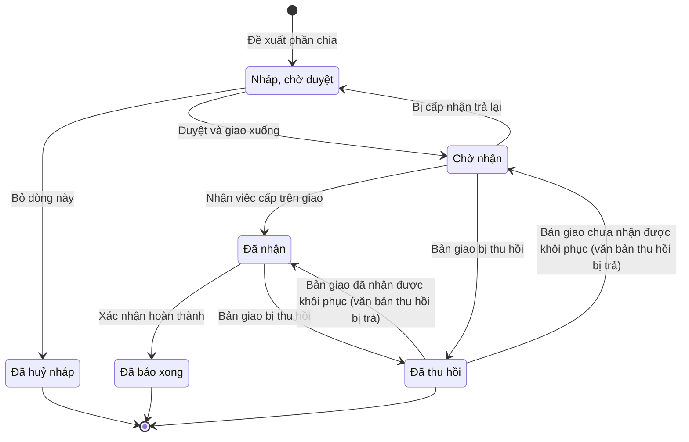

# qt-3 · Giao chỉ tiêu hai bậc

<!-- máy sinh: tom-tat -->
> **Hồ sơ:** Bản giao chỉ tiêu, mốc xuống cấp dưới (`PlanAssignment`)
>
> **Trong sổ phạm vi:** 3 · Giao chỉ tiêu hai bậc (tầng 2)
>
> 16 bước · 6 chặng · 3 vai · 2 bảng quyết định · 0 hạn · 8 khớp nối.
>
> **Nguồn:** sổ nghiệp vụ `qt-3` · khai báo của app: `dqtv-app/core/processes/assignment/workflow/plan-assignment.yaml`. Các bảng do máy sinh từ nguồn này.
<!-- hết: tom-tat -->

<!-- viết tay: dien-giai -->
## Diễn giải

*Phần này viết tay, diễn giải lại điều các bảng bên dưới ghi.*

### Quy trình này để làm gì

Cấp trên chia một chỉ tiêu có số, hoặc một mốc công việc, xuống cấp dưới và theo dõi **bản giao** ấy tới lúc cấp dưới báo xong. Có hai bên: **bên giao** (trợ lý soạn, chỉ huy duyệt và ký) và **bên nhận** (chỉ huy nhận, trợ lý báo). Người làm là: Ban Dân quân tự vệ, Bộ CHQS cấp tỉnh (trợ lý bên giao); Chỉ huy trưởng Ban CHQS xã (chỉ huy bên giao và chỉ huy bên nhận); Trợ lý Tác huấn (trợ lý bên nhận).

Hồ sơ đi qua các chặng: *Nháp, chờ duyệt* → *Chờ nhận* → *Đã nhận* → *Đã báo xong*; ba chặng rẽ là *Đã huỷ nháp*, *Đã trả lại*, *Đã thu hồi*.

### Khi nào bắt đầu

Trợ lý bên giao bấm **Đề xuất phần chia**. Phải chọn nhiệm vụ trên giao mà bản giao bóc ra (`taskingId`) và giao gì — một chỉ tiêu có số hay một mốc công việc. Hồ sơ mở ra có nối tới hồ sơ *Nhiệm vụ trên giao* của quy trình 1, vào chặng *Nháp, chờ duyệt*.

### Diễn ra thế nào

**Chặng "Nháp, chờ duyệt"** (bên giao). Trợ lý **Sửa phần chia** (số chia cho nơi nhận, hạn cấp dưới phải xong, ghi chú), hoặc **Bỏ dòng này** (ghi lý do) để sang *Đã huỷ nháp*. Chỉ huy bên giao **Duyệt và giao xuống**: phải chọn văn bản đã phát hành trong sổ văn bản đi của cấp mình; hồ sơ sang *Chờ nhận*. Trợ lý cấp trên chỉ tạo bản nháp, chỉ huy là người duyệt.

**Chặng "Chờ nhận"** (bên nhận quyết). Chỉ huy bên nhận **Nhận việc cấp trên giao** — hồ sơ sang *Đã nhận* và sinh ra một nhiệm vụ trên giao ở cấp nhận. Hoặc trợ lý bên nhận **Trả lại cho cấp trên**: phải ghi lý do không nhận được và kèm bản chụp văn bản đề nghị đã ký; hồ sơ sang *Đã trả lại*.

**Chặng "Đã nhận"** — bên nhận làm, bên giao theo dõi:

- Trợ lý bên nhận **Báo cáo đã thực hiện xong**; hồ sơ đứng yên, ghi "ngày cấp nhận báo xong". Chỉ làm được khi "giao gì" là *Định tính — xong hay chưa, người xác nhận* (`isTaskAssignment`), và không bấm được lần nữa khi đã có ngày báo xong.
- Trợ lý bên giao **Xác nhận hoàn thành** — phải có ngày cấp nhận báo xong — hồ sơ sang *Đã báo xong*. Bản cuối được cấp trên xác nhận thì bản giao mới đóng.
- Trợ lý bên giao **Nhắc cấp nhận** (lặp được, cả ở *Chờ nhận*); trợ lý bên nhận **Báo tiến độ theo lời nhắc** — phải có lần nhắc trước — ghi tiến độ tới nay và vướng gì. Mỗi lần nhắc xoá câu trả lời cũ; đây là việc còn nợ cho tới khi có ngày báo tiến độ, và không làm được khi đã báo xong.
- Chỉ huy bên nhận **Đề nghị điều chỉnh**: chọn một trong ba loại — *Xin gia hạn*, *Xin giảm số*, *Không đủ khả năng thực hiện* (`notCompetent`) — và ghi vì sao. Không đề nghị được khi đang có một đề nghị chờ trả lời. Chỉ huy bên giao trả lời bằng **Không chấp nhận đề nghị điều chỉnh** (ghi vì sao), hoặc bằng văn bản điều chỉnh dưới đây.

**Điều chỉnh và thu hồi** (bên giao, ở *Chờ nhận* và *Đã nhận*). Trợ lý **Soạn điều chỉnh**: ghi số mới (0 là thu hồi), vì sao, hạn mới nếu có. Chỉ huy **Ký văn bản điều chỉnh** — phải có bản soạn trước (ô "số mới") và chọn văn bản đã phát hành; số chia và hạn được cập nhật, hồ sơ đứng yên. Chỉ huy **Ký văn bản thu hồi** — cũng phải có bản soạn trước, chọn văn bản đã phát hành, và đạt điều kiện `nothingReported`: không có hồ sơ kết quả nào của bản giao này (qt-3.assignment-result) đang ở chặng `REPORTED`, `SUPPLEMENT_REQUESTED` hoặc `SUPERSEDED` — hồ sơ sang *Đã thu hồi*. Thu hồi là điều chỉnh về 0, giữ lịch sử.

### Kết thúc và để lại gì

Hồ sơ kết thúc ở *Đã báo xong*, *Đã huỷ nháp*, *Đã trả lại* hoặc *Đã thu hồi*. Trả lại thì cấp trên phải chia lại; thu hồi thì phần số về lại phần chưa giao.

Mối nối sang quy trình khác: bản giao bóc ra từ một nhiệm vụ trên giao của cấp mình, và nhiệm vụ trên giao ở cấp dưới sinh ra khi nhận bản giao (quy trình 1); văn bản giao việc, văn bản điều chỉnh, văn bản thu hồi là văn bản đi (quy trình 1, hồ sơ văn bản đi) gắn vào lúc duyệt, ký điều chỉnh, ký thu hồi. Bản giao còn nối tới chỉ tiêu hoặc mốc thời gian được chia xuống (quy trình 2) và tới đơn vị dân quân nhận bản giao (quy trình 29).

### Điều kiện chặn

- Bước của bên giao (trừ bước mở hồ sơ) đòi người làm là người của đơn vị chủ hồ sơ; bước của bên nhận đòi người làm là người của đơn vị ghi ở ô `toAdminUnitId` (`actorInReceiverUnit`). Không đúng người, sai chặng, thiếu thứ phải có trước thì chặn, hồ sơ giữ nguyên; không bước nào có kết quả chặn riêng.
- Thứ tự buộc bằng "phải có trước": báo xong rồi mới xác nhận hoàn thành; có lời nhắc rồi mới báo tiến độ; soạn điều chỉnh rồi mới ký điều chỉnh hoặc ký thu hồi; có đề nghị đang mở thì mới bấm không chấp nhận.
- Chỉ bản giao định tính mới *Báo cáo đã thực hiện xong* được; chỉ thu hồi được khi chưa có hồ sơ kết quả nào đã báo lên.
- Ba chỗ chặn nữa: báo xong lần hai, báo tiến độ sau khi đã báo xong, đề nghị điều chỉnh khi đề nghị trước còn chờ.
<!-- hết viết tay -->

## 1. Đường đi ngắn nhất qua các chặng

<!-- máy sinh: luong-chinh -->
Đường ít bước nhất từ lúc mở hồ sơ tới chặng kết thúc xa nhất. Máy chọn theo số chặng, không theo ý nghĩa nghiệp vụ — trình tự công việc thật xem phần Diễn giải và bảng "Việc làm ở từng chặng" ở mục 6.

| # | Ai làm | Làm gì | Hồ sơ sang chặng |
|---|---|---|---|
| 1 | Ban Dân quân tự vệ, Bộ CHQS cấp tỉnh | Đề xuất phần chia | Nháp, chờ duyệt |
| 2 | Hệ thống tự làm | Duyệt và giao xuống | Chờ nhận |
| 3 | Hệ thống tự làm | Nhận việc cấp trên giao | Đã nhận |
| 4 | Ban Dân quân tự vệ, Bộ CHQS cấp tỉnh | Xác nhận hoàn thành | Đã báo xong |

<!-- hết: luong-chinh -->

## 2. Hồ sơ và việc nó để lại

<!-- máy sinh: muc-tieu -->
**App gọi quy trình này là:** Bản giao xuống cấp dưới.

**Khi mở, hồ sơ này ghi mối nối tới:**
- Chỉ tiêu (2) — bước `draftAssignment`, khớp nối `assignsTarget`
- Mốc thời gian (2) — bước `draftAssignment`, khớp nối `assignsTask`
- Nhiệm vụ trên giao (1) — bước `draftAssignment`, khớp nối `hasAssignment`
<!-- hết: muc-tieu -->

## 3. Khởi phát và kết thúc

<!-- máy sinh: khoi-phat -->
**1 cửa vào** — bước mở hồ sơ:

| Bước mở | Ai mở | Hồ sơ vào chặng | App bắt buộc nhập |
|---|---|---|---|
| Đề xuất phần chia | Ban Dân quân tự vệ, Bộ CHQS cấp tỉnh | Nháp, chờ duyệt | `taskingId`, giao gì |

**Kết thúc:** *Đã huỷ nháp* (`CANCELLED`), *Đã báo xong* (`DONE`), *Đã thu hồi* (`WITHDRAWN`)
<!-- hết: khoi-phat -->

## 4. Vai trò

<!-- máy sinh: vai-tro -->
| Vai trong sổ | Tên trong app | Điều kiện | Làm những bước |
|---|---|---|---|
| `operator` | Ban Dân quân tự vệ, Bộ CHQS cấp tỉnh |  | Đề xuất phần chia · Sửa phần chia · Bỏ dòng này · Trình ký văn bản giao việc · Xác nhận hoàn thành · Nhắc cấp nhận |
| `system` | Hệ thống tự làm |  | Duyệt và giao xuống · Nhận việc cấp trên giao · Bị cấp nhận trả lại · Bản giao mang số, hạn mới · Bản giao bị thu hồi · Bản giao lùi về số, hạn trước điều chỉnh · Bản giao đã nhận được khôi phục (văn bản thu hồi bị trả) · Bản giao chưa nhận được khôi phục (văn bản thu hồi bị trả) |
| `receiverAssistant` | Trợ lý Tác huấn |  | Báo cáo đã thực hiện xong · Báo tiến độ theo lời nhắc |

*"Tên trong app" là tên app đặt cho mã chủ thể của vai. Hồ sơ thuộc đơn vị cấp khác thì người làm là người giữ vai ấy ở đơn vị nêu trong cột "Điều kiện" (nếu sổ có ghi) và ở cột "Người làm phải thuộc" của bảng "Theo khai báo của app" (mục 7).*
<!-- hết: vai-tro -->

## 5. Nhánh phụ

<!-- máy sinh: nhanh-phu -->
**Bước khác đưa hồ sơ sang chặng mới** — đường song song, rẽ nhánh hoặc kết thúc sớm:

| Bước | Ai làm | Từ chặng | Sang chặng |
|---|---|---|---|
| Bỏ dòng này | Ban Dân quân tự vệ, Bộ CHQS cấp tỉnh | Nháp, chờ duyệt | Đã huỷ nháp |
| Bản giao bị thu hồi | Hệ thống tự làm | Chờ nhận, Đã nhận | Đã thu hồi |
| Bản giao đã nhận được khôi phục (văn bản thu hồi bị trả) | Hệ thống tự làm | Đã thu hồi | Đã nhận |

**Quay lại một chặng hồ sơ đã đi qua** (tính theo đường ngắn nhất từ lúc mở):

| Bước | Ai làm | Từ chặng | Về chặng |
|---|---|---|---|
| Bị cấp nhận trả lại | Hệ thống tự làm | Chờ nhận | Nháp, chờ duyệt |
| Bản giao chưa nhận được khôi phục (văn bản thu hồi bị trả) | Hệ thống tự làm | Đã thu hồi | Chờ nhận |

**Làm trong lúc hồ sơ đứng yên ở một chặng** — ghi nhận, bổ sung:

| Bước | Ai làm | Ở chặng |
|---|---|---|
| Sửa phần chia | Ban Dân quân tự vệ, Bộ CHQS cấp tỉnh | Nháp, chờ duyệt |
| Trình ký văn bản giao việc | Ban Dân quân tự vệ, Bộ CHQS cấp tỉnh | Nháp, chờ duyệt |
| Báo cáo đã thực hiện xong | Trợ lý Tác huấn | Đã nhận |
| Nhắc cấp nhận *(lặp được)* | Ban Dân quân tự vệ, Bộ CHQS cấp tỉnh | Chờ nhận, Đã nhận |
| Báo tiến độ theo lời nhắc | Trợ lý Tác huấn | Đã nhận |
| Bản giao mang số, hạn mới *(lặp được)* | Hệ thống tự làm | Chờ nhận, Đã nhận |
| Bản giao lùi về số, hạn trước điều chỉnh *(lặp được)* | Hệ thống tự làm | Chờ nhận, Đã nhận |

<!-- hết: nhanh-phu -->

## 6. Các chặng và việc làm ở từng chặng

<!-- máy sinh: chang -->
| Chặng | Tên hiển thị | Vào bằng bước | Kết thúc? |
|---|---|---|---|
| `DRAFT` | Nháp, chờ duyệt | Đề xuất phần chia · Bị cấp nhận trả lại |  |
| `CANCELLED` | Đã huỷ nháp | Bỏ dòng này | **kết thúc** |
| `DELEGATED` | Chờ nhận | Duyệt và giao xuống · Bản giao chưa nhận được khôi phục (văn bản thu hồi bị trả) |  |
| `ACCEPTED` | Đã nhận | Nhận việc cấp trên giao · Bản giao đã nhận được khôi phục (văn bản thu hồi bị trả) |  |
| `DONE` | Đã báo xong | Xác nhận hoàn thành | **kết thúc** |
| `WITHDRAWN` | Đã thu hồi | Bản giao bị thu hồi | **kết thúc** — vẫn còn bước làm được |

### Việc làm ở từng chặng

Hồ sơ đang ở chặng nào thì làm được những bước nào.

| Hồ sơ đang ở chặng | Bước làm tại chặng (hồ sơ đứng yên) | Bước đưa hồ sơ sang chặng khác |
|---|---|---|
| **Nháp, chờ duyệt** | Sửa phần chia — Ban Dân quân tự vệ, Bộ CHQS cấp tỉnh Trình ký văn bản giao việc — Ban Dân quân tự vệ, Bộ CHQS cấp tỉnh | Bỏ dòng này — Ban Dân quân tự vệ, Bộ CHQS cấp tỉnh → *Đã huỷ nháp* Duyệt và giao xuống — Hệ thống tự làm → *Chờ nhận* |
| **Đã huỷ nháp** | — | — (kết thúc) |
| **Chờ nhận** | Nhắc cấp nhận (lặp được) — Ban Dân quân tự vệ, Bộ CHQS cấp tỉnh Bản giao mang số, hạn mới (lặp được) — Hệ thống tự làm Bản giao lùi về số, hạn trước điều chỉnh (lặp được) — Hệ thống tự làm | Nhận việc cấp trên giao — Hệ thống tự làm → *Đã nhận* Bị cấp nhận trả lại — Hệ thống tự làm → *Nháp, chờ duyệt* Bản giao bị thu hồi — Hệ thống tự làm → *Đã thu hồi* |
| **Đã nhận** | Báo cáo đã thực hiện xong — Trợ lý Tác huấn Nhắc cấp nhận (lặp được) — Ban Dân quân tự vệ, Bộ CHQS cấp tỉnh Báo tiến độ theo lời nhắc — Trợ lý Tác huấn Bản giao mang số, hạn mới (lặp được) — Hệ thống tự làm Bản giao lùi về số, hạn trước điều chỉnh (lặp được) — Hệ thống tự làm | Xác nhận hoàn thành — Ban Dân quân tự vệ, Bộ CHQS cấp tỉnh → *Đã báo xong* Bản giao bị thu hồi — Hệ thống tự làm → *Đã thu hồi* |
| **Đã báo xong** | — | — (kết thúc) |
| **Đã thu hồi** | — | Bản giao đã nhận được khôi phục (văn bản thu hồi bị trả) — Hệ thống tự làm → *Đã nhận* Bản giao chưa nhận được khôi phục (văn bản thu hồi bị trả) — Hệ thống tự làm → *Chờ nhận* |
<!-- hết: chang -->

## 7. Bảng bước

<!-- máy sinh: buoc -->
| # | Bước | Mã bước | Ai thực hiện | Từ chặng | Sang chặng | Phải có trước | Ghi lại |
|---|---|---|---|---|---|---|---|
| 1 | Đề xuất phần chia | `draftAssignment` | Ban Dân quân tự vệ, Bộ CHQS cấp tỉnh | — (mở hồ sơ) | `DRAFT` | `notTargetDelegatedByCommune` | giao gì, `fromLevel`, việc được giao, đơn vị chủ hồ sơ, `receiverUnit`, nối tới Nhiệm vụ trên giao, nối tới Chỉ tiêu, nối tới Mốc thời gian, `id` |
| 2 | Sửa phần chia | `editDraftAssignment` | Ban Dân quân tự vệ, Bộ CHQS cấp tỉnh | `DRAFT` | giữ nguyên | `noAssignmentDocumentOpen`, người làm thuộc đơn vị chủ hồ sơ | số chia cho nơi nhận, hạn cấp dưới phải xong, ghi chú cho cấp dưới |
| 3 | Bỏ dòng này | `discardDraftAssignment` | Ban Dân quân tự vệ, Bộ CHQS cấp tỉnh | `DRAFT` | `CANCELLED` | `noAssignmentDocumentOpen`, người làm thuộc đơn vị chủ hồ sơ | ghi chú cho cấp dưới |
| 4 | Duyệt và giao xuống | `approveAssignment` | Hệ thống tự làm | `DRAFT` | `DELEGATED` | `assignmentDocumentIssued` | số hiệu văn bản giao việc, `documentSubject`, nối tới Văn bản đi, nối tới Văn bản đến |
| 5 | Trình ký văn bản giao việc | `requestAssignmentSignature` | Ban Dân quân tự vệ, Bộ CHQS cấp tỉnh | `DRAFT` | giữ nguyên | người làm thuộc đơn vị chủ hồ sơ, `noAssignmentDocumentOpen` | nối tới Văn bản đi |
| 6 | Nhận việc cấp trên giao | `acceptAssignment` | Hệ thống tự làm | `DELEGATED` | `ACCEPTED` | — | ngày cấp dưới nhận, nối tới Nhiệm vụ trên giao |
| 7 | Bị cấp nhận trả lại | `returnAssignment` | Hệ thống tự làm | `DELEGATED` | `DRAFT` | — | ngày trả lại, lý do không nhận được; **xoá:** nối tới Văn bản đi, nối tới Văn bản đến |
| 8 | Báo cáo đã thực hiện xong | `completeAssignment` | Trợ lý Tác huấn | `ACCEPTED` | giữ nguyên | `actorInReceiverUnit`, `isTaskAssignment` | ngày cấp nhận báo xong |
| 9 | Xác nhận hoàn thành | `confirmAssignmentDone` | Ban Dân quân tự vệ, Bộ CHQS cấp tỉnh | `ACCEPTED` | `DONE` | ngày cấp nhận báo xong, người làm thuộc đơn vị chủ hồ sơ | ngày cấp dưới báo xong |
| 10 | Nhắc cấp nhận | `remindAssignment` | Ban Dân quân tự vệ, Bộ CHQS cấp tỉnh | `DELEGATED`, `ACCEPTED` | giữ nguyên | người làm thuộc đơn vị chủ hồ sơ | lần nhắc gần nhất; **xoá:** ngày báo tiến độ theo lời nhắc, tiến độ báo theo lời nhắc |
| 11 | Báo tiến độ theo lời nhắc | `answerReminder` | Trợ lý Tác huấn | `ACCEPTED` | giữ nguyên | `actorInReceiverUnit`, lần nhắc gần nhất | ngày báo tiến độ theo lời nhắc, tiến độ tới nay, vướng gì (nếu có) |
| 12 | Bản giao mang số, hạn mới | `approveAssignmentAdjustment` | Hệ thống tự làm | `DELEGATED`, `ACCEPTED` | giữ nguyên | — | số chia cho nơi nhận, hạn cấp dưới phải xong |
| 13 | Bản giao bị thu hồi | `revokeAssignment` | Hệ thống tự làm | `DELEGATED`, `ACCEPTED` | `WITHDRAWN` | — | số chia cho nơi nhận, ngày thu hồi |
| 14 | Bản giao lùi về số, hạn trước điều chỉnh | `revertAssignmentAdjustment` | Hệ thống tự làm | `DELEGATED`, `ACCEPTED` | giữ nguyên | — | số chia cho nơi nhận, hạn cấp dưới phải xong |
| 15 | Bản giao đã nhận được khôi phục (văn bản thu hồi bị trả) | `returnRevocationByReceiver` | Hệ thống tự làm | `WITHDRAWN` | `ACCEPTED` | `assignmentWasAccepted` | số chia cho nơi nhận, hạn cấp dưới phải xong; **xoá:** ngày thu hồi |
| 16 | Bản giao chưa nhận được khôi phục (văn bản thu hồi bị trả) | `returnUnacceptedRevocationByReceiver` | Hệ thống tự làm | `WITHDRAWN` | `DELEGATED` | `assignmentNotYetAccepted` | số chia cho nơi nhận, hạn cấp dưới phải xong; **xoá:** ngày thu hồi |

### Khi không đạt điều kiện

Mặc định: không đúng người, hồ sơ không ở đúng chặng, hoặc thiếu thứ "phải có trước" thì bước bị chặn, hồ sơ giữ nguyên. Bảng dưới chỉ kê những bước có kết quả riêng.

| # | Bước | Kết quả riêng |
|---|---|---|
| 1 | Đề xuất phần chia | bước dừng lại, hồ sơ giữ nguyên khi kết quả xét là: `receiver-not-direct-subordinate` |
| 4 | Duyệt và giao xuống | bước này không do người nào bấm |
| 5 | Trình ký văn bản giao việc | bước dừng lại, hồ sơ giữ nguyên khi kết quả xét là: `over-target` |
| 6 | Nhận việc cấp trên giao | bước này không do người nào bấm |
| 7 | Bị cấp nhận trả lại | bước này không do người nào bấm |
| 12 | Bản giao mang số, hạn mới | bước này không do người nào bấm |
| 13 | Bản giao bị thu hồi | bước này không do người nào bấm |
| 14 | Bản giao lùi về số, hạn trước điều chỉnh | bước này không do người nào bấm |
| 15 | Bản giao đã nhận được khôi phục (văn bản thu hồi bị trả) | bước này không do người nào bấm |
| 16 | Bản giao chưa nhận được khôi phục (văn bản thu hồi bị trả) | bước này không do người nào bấm |

### Điều kiện "phải có trước" bằng lời

Cột "Phải có trước" ở bảng bước có hai loại: ô dữ liệu thường (bước chỉ đòi ô ấy đã có giá trị) và điều kiện hệ tự xét. Bảng này diễn các điều kiện hệ tự xét theo đúng công thức sổ ghi; số ở cột cuối là số thứ tự bước.

| Điều kiện | Đúng khi | Bước đòi |
|---|---|---|
| `notTargetDelegatedByCommune` | KHÔNG (`fromLevel` là `commune` VÀ giao gì là Định lượng — đếm được, hệ tự tính (`target`)) | 1 |
| `noAssignmentDocumentOpen` | KHÔNG (có hồ sơ Việc luật giao kèm văn bản đến, đi — Văn bản đi (qt-1.outgoing-document) chính là hồ sơ ghi ở ô nối `assignmentByDocument` của hồ sơ đang làm mà hồ sơ ấy đang ở chặng `DRAFT` hoặc `PENDING_SIGNATURE` hoặc `SIGNED`) | 2, 3, 5 |
| `actorInOwnerUnit` | người đang làm là người của đơn vị ghi ở ô đơn vị chủ hồ sơ của hồ sơ này (theo danh mục người của đơn vị, `dm.unit-staff`) | 2, 3, 5, 9, 10 |
| `assignmentDocumentIssued` | có hồ sơ Việc luật giao kèm văn bản đến, đi — Văn bản đi (qt-1.outgoing-document) chính là hồ sơ ghi ở ô nối `assignmentByDocument` của hồ sơ đang làm mà hồ sơ ấy đang ở chặng `ISSUED` | 4 |
| `actorInReceiverUnit` | người đang làm là người của đơn vị ghi ở ô `receiverUnit` của hồ sơ này (theo danh mục người của đơn vị, `dm.unit-staff`) | 8, 11 |
| `isTaskAssignment` | giao gì là Định tính — xong hay chưa, người xác nhận (`task`) | 8 |
| `assignmentWasAccepted` | đã có ngày cấp dưới nhận | 15 |
| `assignmentNotYetAccepted` | KHÔNG (đã có ngày cấp dưới nhận) | 16 |

### Theo khai báo của app

Người làm phải thuộc đơn vị nào, ô người dùng phải nhập, bước có lặp được không, và căn cứ pháp lý — lấy từ khai báo quy trình trong app.

| # | Bước | Người làm phải thuộc | Bắt buộc nhập | Nhập nếu có | Lặp được | Căn cứ |
|---|---|---|---|---|---|---|
| 1 | Đề xuất phần chia |  | `taskingId`, giao gì | — |  | NĐ168/2018/NĐ-CP Đ.3 k3 (giao chỉ tiêu cho địa phương) |
| 2 | Sửa phần chia | đơn vị chủ hồ sơ | — | số chia cho nơi nhận, hạn cấp dưới phải xong, ghi chú cho cấp dưới |  | NĐ168/2018/NĐ-CP Đ.3 k3 |
| 3 | Bỏ dòng này | đơn vị chủ hồ sơ | lý do bỏ dòng này | — |  | NĐ168/2018/NĐ-CP Đ.3 k3 |
| 4 | Duyệt và giao xuống |  | `outgoingDocumentIds` | — |  | NĐ168/2018/NĐ-CP Đ.3 k3 · L48/2019/QH14 Đ.38 k2 |
| 5 | Trình ký văn bản giao việc | đơn vị chủ hồ sơ | `outgoingDocumentIds` | — |  | NĐ30/2020/NĐ-CP Đ.13 (trình ký) · NĐ168/2018/NĐ-CP Đ.3 k3 |
| 6 | Nhận việc cấp trên giao |  | — | — |  | NĐ168/2018/NĐ-CP Đ.3 k3 · L48/2019/QH14 Đ.38 k2 |
| 7 | Bị cấp nhận trả lại |  | lý do không nhận được | — |  | NĐ30/2020/NĐ-CP Đ.21 k2 b · NĐ168/2018/NĐ-CP Đ.12 (quan hệ chỉ đạo, báo cáo) |
| 8 | Báo cáo đã thực hiện xong | `receiverUnit` | — | — |  | NĐ168/2018/NĐ-CP Đ.15 (chế độ báo cáo) |
| 9 | Xác nhận hoàn thành | đơn vị chủ hồ sơ | — | — |  | QĐ23/2018/QĐ-TTg · NĐ168/2018/NĐ-CP Đ.15 |
| 10 | Nhắc cấp nhận | đơn vị chủ hồ sơ | — | ghi chú cho cấp dưới | có | NĐ168/2018/NĐ-CP Đ.12 (quan hệ chỉ đạo, kiểm tra, đôn đốc) |
| 11 | Báo tiến độ theo lời nhắc | `receiverUnit` | tiến độ tới nay, vướng gì (nếu có) | — |  | NĐ168/2018/NĐ-CP Đ.12 (quan hệ chỉ đạo, kiểm tra, đôn đốc) |
| 12 | Bản giao mang số, hạn mới |  | `adjustmentId` | — | có | NĐ30/2020/NĐ-CP Đ.18 k3 |
| 13 | Bản giao bị thu hồi |  | `adjustmentId` | — |  | NĐ30/2020/NĐ-CP Đ.18 k3, k4 (thu hồi văn bản đã phát hành) |
| 14 | Bản giao lùi về số, hạn trước điều chỉnh |  | `adjustmentId` | — | có | NĐ30/2020/NĐ-CP Đ.21 k2 b |
| 15 | Bản giao đã nhận được khôi phục (văn bản thu hồi bị trả) |  | `adjustmentId` | — | có | NĐ30/2020/NĐ-CP Đ.21 k2 b |
| 16 | Bản giao chưa nhận được khôi phục (văn bản thu hồi bị trả) |  | `adjustmentId` | — | có | NĐ30/2020/NĐ-CP Đ.21 k2 b |

### Điều kiện và ghi chú app khai cho từng bước

Lấy từ khai báo quy trình trong app. Lời trong ngoặc kép là câu app hiện cho người dùng. Chức danh người ký ngoài hệ app chỉ khai bằng mã.

| # | Bước | Điều kiện, ghi chú |
|---|---|---|
| 6 | Nhận việc cấp trên giao | · tạo thêm một hồ sơ con: Nhiệm vụ trên giao (`MissionTasking`) |
| 8 | Báo cáo đã thực hiện xong | · không làm được khi đã có ô "ngày cấp nhận báo xong" — app báo: "đã báo xong — đang chờ cấp giao xác nhận" |
| 9 | Xác nhận hoàn thành | · phải đã có ô "ngày cấp nhận báo xong" — thiếu thì app báo: "cấp nhận chưa báo xong — chưa có gì để xác nhận" |
| 11 | Báo tiến độ theo lời nhắc | · phải đã có ô "lần nhắc gần nhất" — thiếu thì app báo: "cấp giao chưa nhắc — chưa có gì để trả lời" · không làm được khi đã có ô "ngày cấp nhận báo xong" — app báo: "đã báo xong — lời nhắc không còn gì để trả lời" · là việc còn nợ cho tới khi có ô "ngày báo tiến độ theo lời nhắc" |
<!-- hết: buoc -->

## 8. Bảng quyết định, hạn, việc ngoài hệ

<!-- máy sinh: quyet-dinh -->
**Bảng `assignment-receiver`** — xét ở bước *Đề xuất phần chia*; đầu vào: `fromLevel`, loại nơi nhận. 8 dòng, dò từ trên xuống, dòng đầu tiên khớp thì dừng.

| Thứ tự dò (số sổ ghi) | Dòng | Khi | Thì |
|---|---|---|---|
| 1 | `central-to-region` | `fromLevel` là `central` và loại nơi nhận là Quân khu (`region`) | cho qua |
| 2 | `central-to-ministry-board` | `fromLevel` là `central` và loại nơi nhận là Ban chỉ huy quân sự bộ, ngành (`ministry_military_board`) | cho qua |
| 3 | `region-to-province` | `fromLevel` là `region` và loại nơi nhận là Bộ chỉ huy quân sự cấp tỉnh (`province`) | cho qua |
| 4 | `province-to-commune` | `fromLevel` là `province` và loại nơi nhận là Ban chỉ huy quân sự cấp xã (`commune`) | cho qua |
| 5 | `province-to-org-board` | `fromLevel` là `province` và loại nơi nhận là Ban chỉ huy quân sự cơ quan, tổ chức (`org_military_board`) | cho qua |
| 90 | `level-unset` | chưa có `fromLevel` | `receiver-not-direct-subordinate` |
| 91 | `receiver-unset` | chưa có loại nơi nhận | `receiver-not-direct-subordinate` |
| 99 | `otherwise` | mọi trường hợp còn lại | `receiver-not-direct-subordinate` |

**Bảng `sign-within-target`** — xét ở bước *Trình ký văn bản giao việc*; đầu vào: `batchOverTargetQty`. 3 dòng, dòng đầu tiên khớp thì dừng.

| Thứ tự dò (số sổ ghi) | Dòng | Khi | Thì |
|---|---|---|---|
| — | `over` | `batchOverTargetQty` từ 1 | `over-target` |
| — | `unset` | chưa có `batchOverTargetQty` | `over-target` |
| — | `within` | `batchOverTargetQty` nhỏ hơn 1 | cho qua |

<!-- hết: quyet-dinh -->

## 9. Dữ liệu của hồ sơ

<!-- máy sinh: du-lieu -->
Các ô mà bước trong sổ ghi hoặc đòi. Số trong hai cột cuối là số thứ tự bước ở bảng bước (mục 7).

| Ô dữ liệu | Mã | Kiểu (app) | Giá trị cho phép | Loại ô (sổ) | Bước ghi | Bước đòi | Mô tả trong app |
|---|---|---|---|---|---|---|---|
| giao gì | `assignmentKind` | chọn một | Định lượng — đếm được, hệ tự tính (`target`), Định tính — xong hay chưa, người xác nhận (`task`) | đưa vào ở bước (`input`) | 1 | — | Giao một chỉ tiêu có số, hay một mốc công việc |
| — | `fromLevel` | chữ | `central`, `region`, `province`, `commune` | đưa vào ở bước (`input`) | 1 | — | Cấp của bên GIAO — central / region / province / commune |
| việc được giao | `title` | chữ |  | lưu trên hồ sơ (`stored`) | 1 | — | Tên việc được giao — chép từ chỉ tiêu, mốc gốc lúc giao |
| đơn vị chủ hồ sơ | `ownerUnit` |  |  | lưu trên hồ sơ (`stored`) | 1 | — |  |
| — | `receiverUnit` | chữ |  | lưu trên hồ sơ (`stored`) | 1 | — | Đơn vị nhận bản giao (id đơn vị) — chỉ cán bộ đơn vị này làm được bước của cấp nhận |
| — | `id` |  |  | lưu trên hồ sơ (`stored`) | 1 | — |  |
| số chia cho nơi nhận | `delegatedQty` | số |  | lưu trên hồ sơ (`stored`) | 2, 12, 13, 14, 15, 16 | — | Số chia cho đích này — chỉ có nghĩa khi giao một chỉ tiêu |
| hạn cấp dưới phải xong | `dueDate` | ngày |  | lưu trên hồ sơ (`stored`) | 2, 12, 14, 15, 16 | — | Hạn cấp dưới phải xong |
| ghi chú cho cấp dưới | `note` | chữ |  | lưu trên hồ sơ (`stored`) | 2, 3 | — | Ghi chú |
| số hiệu văn bản giao việc | `documentNumber` | chữ |  | lưu trên hồ sơ (`stored`) | 4 | — | Số hiệu văn bản giao việc — chép lúc giao |
| — | `documentSubject` | chữ |  | lưu trên hồ sơ (`stored`) | 4 | — | Trích yếu văn bản giao việc — chép lúc giao |
| ngày cấp dưới nhận | `acceptedAt` | ngày |  | lưu trên hồ sơ (`stored`) | 6 | — | Ngày cấp dưới nhận |
| ngày trả lại | `returnedAt` | ngày |  | lưu trên hồ sơ (`stored`) | 7 | — | Ngày trả lại |
| lý do không nhận được | `returnReason` | chữ |  | lưu trên hồ sơ (`stored`) | 7 | — | Lý do cấp dưới trả lại |
| ngày cấp nhận báo xong | `finalResultReportedAt` | ngày |  | lưu trên hồ sơ (`stored`) | 8 | 9 | Ngày cấp nhận báo xong — mốc: đóng việc; số: bản báo cuối được duyệt. Gỡ khi cấp trên yêu cầu bổ sung |
| ngày cấp dưới báo xong | `completedAt` | ngày |  | lưu trên hồ sơ (`stored`) | 9 | — | Ngày cấp dưới báo xong |
| lần nhắc gần nhất | `remindedAt` | ngày |  | lưu trên hồ sơ (`stored`) | 10 | 11 | Lần gần nhất cấp giao nhắc cấp nhận |
| ngày báo tiến độ theo lời nhắc | `reminderAnsweredAt` | ngày |  | lưu trên hồ sơ (`stored`) | 11 | — | Ngày cấp nhận báo tiến độ theo lời nhắc gần nhất |
| tiến độ báo theo lời nhắc | `reminderAnswer` | chữ |  | đưa vào ở bước (`input`) | 11 | — | Cấp nhận báo tiến độ gì khi bị nhắc |
| ngày thu hồi | `revokedAt` | ngày |  | lưu trên hồ sơ (`stored`) | 13 | — | Ngày cấp giao thu hồi bản giao |
| — | `notTargetDelegatedByCommune` |  | có hay chưa | hệ suy ra (`derived`) | — | 1 |  |
| — | `noAssignmentDocumentOpen` |  | có hay chưa | hệ suy ra (`derived`) | — | 2, 3, 5 |  |
| người làm thuộc đơn vị chủ hồ sơ | `actorInOwnerUnit` |  | có hay chưa | hệ suy ra (`derived`) | — | 2, 3, 5, 9, 10 |  |
| — | `assignmentDocumentIssued` |  | có hay chưa | hệ suy ra (`derived`) | — | 4 |  |
| — | `actorInReceiverUnit` |  | có hay chưa | hệ suy ra (`derived`) | — | 8, 11 |  |
| — | `isTaskAssignment` |  |  | hệ suy ra (`derived`) | — | 8 |  |
| — | `assignmentWasAccepted` |  | có hay chưa | hệ suy ra (`derived`) | — | 15 |  |
| — | `assignmentNotYetAccepted` |  | có hay chưa | hệ suy ra (`derived`) | — | 16 |  |
| — | `batchOverTargetQty` |  |  | đưa vào ở bước (`input`) | — | — |  |
| loại nơi nhận | `receiverKind` | chọn một | Quân khu (`region`), Bộ chỉ huy quân sự cấp tỉnh (`province`), Ban chỉ huy quân sự cấp xã (`commune`), Ban chỉ huy quân sự cơ quan, tổ chức (`org_military_board`), Ban chỉ huy quân sự bộ, ngành (`ministry_military_board`) | đưa vào ở bước (`input`) | — | — | Loại nơi nhận bản giao — quân khu · tỉnh · xã · Ban CHQS cơ quan, tổ chức · Ban CHQS bộ, ngành |

30 ô. Cột "Loại ô" là cách sổ phân loại ô, in kèm đúng chữ của sổ; ô nào người dùng phải nhập xem bảng "Theo khai báo của app" ở mục 7.
<!-- hết: du-lieu -->

## 10. Khớp nối với quy trình khác

<!-- máy sinh: khop-noi -->
| Quy trình kia | Hồ sơ kia | Quan hệ | Nội dung (mô tả trong app) | Bước ghi mối nối | Tên ô nối |
|---|---|---|---|---|---|
| 1 | Nhiệm vụ trên giao | hồ sơ này **mở ra có nối tới** hồ sơ kia | Bản giao này bóc ra từ nhiệm vụ nào của cấp mình | 3·draftAssignment ⊕ | `hasAssignment` |
| 1 | Nhiệm vụ trên giao | gắn với nhau ở một bước giữa chừng | Nhiệm vụ ở cấp dưới sinh ra khi cấp ấy nhận bản giao — chỗ vòng khép lại | 3·acceptAssignment | `raisedTasking` |
| 1.incoming-document | Văn bản đến | gắn với nhau ở một bước giữa chừng | Văn bản đến ở sổ của cấp nhận, mang văn bản giao việc của bản giao này — NĐ30/2020 Đ.20–23 | 3·approveAssignment | `assignmentDeliveredAs` |
| 1.outgoing-document | Văn bản đi | gắn với nhau ở một bước giữa chừng | Văn bản giao việc của cấp trên — TT77 Đ.7 k2 a; NĐ30/2020 (mọi văn bản đi đều vào sổ) | 3·approveAssignment, 3·requestAssignmentSignature | `assignmentByDocument` |
| 2 | Chỉ tiêu | hồ sơ này **mở ra có nối tới** hồ sơ kia | Chỉ tiêu được chia xuống — NĐ168/2018/NĐ-CP Đ.3 k3 (giao chỉ tiêu cho địa phương) | 3·draftAssignment ⊕ | `assignsTarget` |
| 2 | Mốc thời gian | hồ sơ này **mở ra có nối tới** hồ sơ kia | Mốc công việc được giao xuống | 3·draftAssignment ⊕ | `assignsTask` |
| 2 | Chỉ tiêu | gắn với nhau ở một bước giữa chừng | Chỉ tiêu này lập ra để đáp lần giao nào của cấp trên — rỗng khi cấp mình tự đặt (`selfExecuted`) | 1·addTaskingTarget | `fulfils` |
| 29 | Đơn vị dân quân tự vệ | có nối | KHÔNG GHI NỮA (18/10) — đơn vị dân quân không nhận bản giao; kế hoạch hai bậc chia cho cấp dưới có tài khoản | — | `assignedToMilitiaUnit` |

8 khớp nối. ⊕ là bước tạo hồ sơ.
<!-- hết: khop-noi -->

## 11. Thông tin chung

<!-- máy sinh: thong-tin -->
| | |
|---|---|
| **Mã trong sổ** | `qt-3` |
| **Quy trình trong app** | `assignment` (`workflow/plan-assignment.yaml`) — mặt công tác: `common` |
| **Hồ sơ** | Bản giao chỉ tiêu, mốc xuống cấp dưới (`PlanAssignment`) |
| **Cùng mã quy trình** | [qt-3.adjustment](qt-3.adjustment.html), [qt-3.assignment-result](qt-3.assignment-result.html), [qt-3.target-actual](qt-3.target-actual.html) |
| **Căn cứ pháp lý từng bước** | cột "Căn cứ" ở bảng "Theo khai báo của app", mục 7 |
<!-- hết: thong-tin -->
