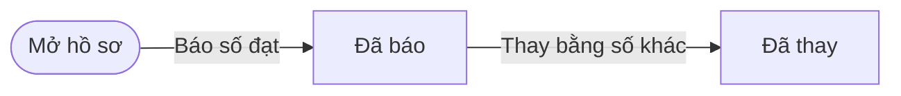
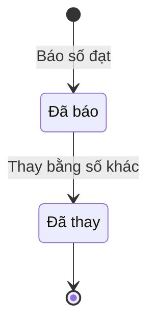

# qt-3.target-actual · Giao chỉ tiêu hai bậc — Số đạt đã báo

<!-- máy sinh: tom-tat -->
> **Hồ sơ:** Số đạt đã báo (`TargetActual`)
>
> **Trong sổ phạm vi:** 3 · Giao chỉ tiêu hai bậc — hồ sơ phụ target-actual (tầng 2)
>
> 2 bước · 2 chặng · 1 vai · 0 bảng quyết định · 0 hạn · 1 khớp nối.
>
> **Nguồn:** sổ nghiệp vụ `qt-3.target-actual` · khai báo của app: `dqtv-app/core/processes/assignment/workflow/target-actual.yaml`. Các bảng do máy sinh từ nguồn này.
<!-- hết: tom-tat -->

<!-- viết tay: dien-giai -->
## Diễn giải

*Phần này viết tay, diễn giải lại điều các bảng bên dưới ghi.*

### Quy trình này để làm gì

Ghi lại **số đạt đã báo** cho một dòng chỉ tiêu trong một kỳ báo cáo, kèm số hiệu văn bản báo cáo mang con số ấy. Hồ sơ chỉ có hai chặng: *Đã báo* (số này đang tính vào chỉ tiêu) và *Đã thay* (một bản báo sau đã thay số này). Đơn vị báo có thể là xã, tỉnh, quân khu hoặc Cục.

### Khi nào bắt đầu

Vai `assistant` bấm **Báo số đạt**. Phải chọn dòng chỉ tiêu (`planTargetIds`), kỳ báo cáo, số đã đạt, số hiệu văn bản báo cáo và ngày báo; ghi chú là ô nhập nếu có. Hồ sơ mở ra có nối tới dòng *Chỉ tiêu* của quy trình 2 và vào thẳng chặng *Đã báo*. Bước chép tên chỉ tiêu và thước đo sang để bản ghi tự đọc được.

### Diễn ra thế nào

**Chặng "Đã báo".** Số đã báo tính ngay vào chỉ tiêu. Lối ra duy nhất là **Thay bằng số khác**, cũng do vai `assistant` làm: phải ghi lý do thay số (theo mô tả ô: báo nhầm, hoặc số đã điều chỉnh) và số hiệu văn bản báo thay; hồ sơ sang *Đã thay*.

**Chặng "Đã thay".** Không còn bước nào.

### Kết thúc và để lại gì

Hồ sơ kết thúc ở *Đã thay*. Mối nối duy nhất là tới dòng chỉ tiêu (quy trình 2), ghi ở bước báo số đạt.

### Điều kiện chặn

- *Báo số đạt* đòi phải có số hiệu văn bản báo cáo. *Thay bằng số khác* đòi lý do thay số, số hiệu văn bản báo thay, và người làm là người của đơn vị chủ hồ sơ.
- Không đúng người, sai chặng, thiếu thứ phải có trước thì chặn, hồ sơ giữ nguyên.
<!-- hết viết tay -->

## 1. Đường đi ngắn nhất qua các chặng

<!-- máy sinh: luong-chinh -->
Đường ít bước nhất từ lúc mở hồ sơ tới chặng kết thúc xa nhất. Máy chọn theo số chặng, không theo ý nghĩa nghiệp vụ — trình tự công việc thật xem phần Diễn giải và bảng "Việc làm ở từng chặng" ở mục 6.

| # | Ai làm | Làm gì | Hồ sơ sang chặng |
|---|---|---|---|
| 1 | Trợ lý Quân lực | Báo số đạt | Đã báo |
| 2 | Trợ lý Quân lực | Thay bằng số khác | Đã thay |

<!-- hết: luong-chinh -->

## 2. Hồ sơ và việc nó để lại

<!-- máy sinh: muc-tieu -->
**App gọi quy trình này là:** Số đạt đã báo.

**Khi mở, hồ sơ này ghi mối nối tới:**
- Chỉ tiêu (2) — bước `reportActual`, khớp nối `actualUnderTarget`
<!-- hết: muc-tieu -->

## 3. Khởi phát và kết thúc

<!-- máy sinh: khoi-phat -->
**1 cửa vào** — bước mở hồ sơ:

| Bước mở | Ai mở | Hồ sơ vào chặng | App bắt buộc nhập |
|---|---|---|---|
| Báo số đạt | Trợ lý Quân lực | Đã báo | `planTargetIds`, kỳ báo cáo, số đã đạt, số hiệu văn bản báo cáo, ngày báo |

**Kết thúc:** *Đã thay* (`SUPERSEDED`)
<!-- hết: khoi-phat -->

## 4. Vai trò

<!-- máy sinh: vai-tro -->
| Vai trong sổ | Tên trong app | Điều kiện | Làm những bước |
|---|---|---|---|
| `operator` | Trợ lý Quân lực |  | Báo số đạt · Thay bằng số khác |

*"Tên trong app" là tên app đặt cho mã chủ thể của vai. Hồ sơ thuộc đơn vị cấp khác thì người làm là người giữ vai ấy ở đơn vị nêu trong cột "Điều kiện" (nếu sổ có ghi) và ở cột "Người làm phải thuộc" của bảng "Theo khai báo của app" (mục 7).*
<!-- hết: vai-tro -->

## 5. Nhánh phụ

<!-- máy sinh: nhanh-phu -->
Không có bước nào ngoài luồng chính.
<!-- hết: nhanh-phu -->

## 6. Các chặng và việc làm ở từng chặng

<!-- máy sinh: chang -->
| Chặng | Tên hiển thị | Vào bằng bước | Kết thúc? |
|---|---|---|---|
| `REPORTED` | Đã báo | Báo số đạt |  |
| `SUPERSEDED` | Đã thay | Thay bằng số khác | **kết thúc** |

### Việc làm ở từng chặng

Hồ sơ đang ở chặng nào thì làm được những bước nào.

| Hồ sơ đang ở chặng | Bước làm tại chặng (hồ sơ đứng yên) | Bước đưa hồ sơ sang chặng khác |
|---|---|---|
| **Đã báo** | — | Thay bằng số khác — Trợ lý Quân lực → *Đã thay* |
| **Đã thay** | — | — (kết thúc) |
<!-- hết: chang -->

## 7. Bảng bước

<!-- máy sinh: buoc -->
| # | Bước | Mã bước | Ai thực hiện | Từ chặng | Sang chặng | Phải có trước | Ghi lại |
|---|---|---|---|---|---|---|---|
| 1 | Báo số đạt | `reportActual` | Trợ lý Quân lực | — (mở hồ sơ) | `REPORTED` | số hiệu văn bản báo cáo | mã tỉnh, mã xã, `reporterUnitCode`, `planTargetId`, dòng chỉ tiêu, thước đo, kỳ báo cáo, số đã đạt, số hiệu văn bản báo cáo, ngày báo, ghi chú, nối tới Chỉ tiêu, đơn vị chủ hồ sơ |
| 2 | Thay bằng số khác | `supersedeActual` | Trợ lý Quân lực | `REPORTED` | `SUPERSEDED` | số hiệu văn bản báo thay, lý do thay số, người làm thuộc đơn vị chủ hồ sơ | lý do thay số, số hiệu văn bản báo thay |

### Khi không đạt điều kiện

Mặc định: không đúng người, hồ sơ không ở đúng chặng, hoặc thiếu thứ "phải có trước" thì bước bị chặn, hồ sơ giữ nguyên. Bảng dưới chỉ kê những bước có kết quả riêng.

Không bước nào có kết quả riêng — tất cả theo mặc định.

### Điều kiện "phải có trước" bằng lời

Cột "Phải có trước" ở bảng bước có hai loại: ô dữ liệu thường (bước chỉ đòi ô ấy đã có giá trị) và điều kiện hệ tự xét. Bảng này diễn các điều kiện hệ tự xét theo đúng công thức sổ ghi; số ở cột cuối là số thứ tự bước.

| Điều kiện | Đúng khi | Bước đòi |
|---|---|---|
| `actorInOwnerUnit` | người đang làm là người của đơn vị ghi ở ô đơn vị chủ hồ sơ của hồ sơ này (theo danh mục người của đơn vị, `dm.unit-staff`) | 2 |

### Theo khai báo của app

Người làm phải thuộc đơn vị nào, ô người dùng phải nhập, bước có lặp được không, và căn cứ pháp lý — lấy từ khai báo quy trình trong app.

| # | Bước | Người làm phải thuộc | Bắt buộc nhập | Nhập nếu có | Lặp được | Căn cứ |
|---|---|---|---|---|---|---|
| 1 | Báo số đạt |  | `planTargetIds`, kỳ báo cáo, số đã đạt, số hiệu văn bản báo cáo, ngày báo | ghi chú |  | NĐ168/2018/NĐ-CP Đ.15 k1 (chế độ báo cáo công tác quốc phòng bằng văn bản) |
| 2 | Thay bằng số khác | đơn vị chủ hồ sơ | lý do thay số, số hiệu văn bản báo thay | — |  | NĐ168/2018/NĐ-CP Đ.15 k2 (báo cáo đột xuất khi có thay đổi) |
<!-- hết: buoc -->

## 8. Bảng quyết định, hạn, việc ngoài hệ

<!-- máy sinh: quyet-dinh -->

<!-- hết: quyet-dinh -->

## 9. Dữ liệu của hồ sơ

<!-- máy sinh: du-lieu -->
Các ô mà bước trong sổ ghi hoặc đòi. Số trong hai cột cuối là số thứ tự bước ở bảng bước (mục 7).

| Ô dữ liệu | Mã | Kiểu (app) | Giá trị cho phép | Loại ô (sổ) | Bước ghi | Bước đòi | Mô tả trong app |
|---|---|---|---|---|---|---|---|
| mã tỉnh | `provinceCode` | chữ |  | lưu trên hồ sơ (`stored`) | 1 | — | Mã tỉnh — rỗng khi bản ghi thuộc Cục |
| mã xã | `communeCode` | chữ |  | lưu trên hồ sơ (`stored`) | 1 | — | Mã xã — rỗng khi bản ghi ở cấp trên xã |
| — | `reporterUnitCode` | chữ |  | lưu trên hồ sơ (`stored`) | 1 | — | Mã đơn vị báo — xã, tỉnh, quân khu hoặc Cục; kỳ chốt sổ khoá theo cặp kỳ × đơn vị |
| — | `planTargetId` | chữ |  | lưu trên hồ sơ (`stored`) | 1 | — | id dòng chỉ tiêu được báo — lọc nhanh, quan hệ thật ở actualUnderTarget |
| dòng chỉ tiêu | `targetName` | chữ |  | lưu trên hồ sơ (`stored`) | 1 | — | Tên chỉ tiêu — chép lúc báo để bản ghi tự đọc được |
| thước đo | `measureKey` | chữ |  | lưu trên hồ sơ (`stored`) | 1 | — | Thước của dòng chỉ tiêu — chép lúc báo, để số này không bị đọc bằng một thước khác |
| kỳ báo cáo | `periodKey` | chữ |  | lưu trên hồ sơ (`stored`) | 1 | — | Kỳ báo cáo — Nghị định 168/2018/NĐ-CP Điều 15 khoản 1 quy định nhịp báo của từng cấp |
| số đã đạt | `reportedQty` | số |  | đưa vào ở bước (`input`) | 1 | — | Số đã đạt trong kỳ này, theo thước của dòng chỉ tiêu |
| số hiệu văn bản báo cáo | `evidenceRef` | chữ |  | đưa vào ở bước (`input`) | 1 | 1 | Số hiệu văn bản báo cáo mang con số này — không có căn cứ thì không kiểm lại được |
| ngày báo | `reportedAt` | ngày |  | đưa vào ở bước (`input`) | 1 | — | Ngày báo |
| ghi chú | `note` | chữ |  | lưu trên hồ sơ (`stored`) | 1 | — | Ghi chú |
| đơn vị chủ hồ sơ | `ownerUnit` |  |  | lưu trên hồ sơ (`stored`) | 1 | — |  |
| lý do thay số | `supersedeReason` | chữ |  | đưa vào ở bước (`input`) | 2 | 2 | Lý do thay bằng bản khác — báo nhầm, hoặc số đã điều chỉnh |
| số hiệu văn bản báo thay | `supersedingEvidenceRef` | chữ |  | đưa vào ở bước (`input`) | 2 | 2 | Số hiệu văn bản báo thay — văn bản mới mang con số thay cho số cũ |
| người làm thuộc đơn vị chủ hồ sơ | `actorInOwnerUnit` |  | có hay chưa | hệ suy ra (`derived`) | — | 2 |  |

15 ô. Cột "Loại ô" là cách sổ phân loại ô, in kèm đúng chữ của sổ; ô nào người dùng phải nhập xem bảng "Theo khai báo của app" ở mục 7.
<!-- hết: du-lieu -->

## 10. Khớp nối với quy trình khác

<!-- máy sinh: khop-noi -->
| Quy trình kia | Hồ sơ kia | Quan hệ | Nội dung (mô tả trong app) | Bước ghi mối nối | Tên ô nối |
|---|---|---|---|---|---|
| 2 | Chỉ tiêu | hồ sơ này **mở ra có nối tới** hồ sơ kia | Số đạt này báo cho dòng chỉ tiêu nào — Nghị định 168/2018/NĐ-CP Điều 15 khoản 1 (chế độ báo cáo công tác quốc… | 3.target-actual·reportActual ⊕ | `actualUnderTarget` |

1 khớp nối. ⊕ là bước tạo hồ sơ.
<!-- hết: khop-noi -->

## 11. Thông tin chung

<!-- máy sinh: thong-tin -->
| | |
|---|---|
| **Mã trong sổ** | `qt-3.target-actual` |
| **Quy trình trong app** | `assignment` (`workflow/target-actual.yaml`) — mặt công tác: `common` |
| **Hồ sơ** | Số đạt đã báo (`TargetActual`) |
| **Cùng mã quy trình** | [qt-3](qt-3.html), [qt-3.adjustment](qt-3.adjustment.html), [qt-3.assignment-result](qt-3.assignment-result.html) |
| **Căn cứ pháp lý từng bước** | cột "Căn cứ" ở bảng "Theo khai báo của app", mục 7 |
<!-- hết: thong-tin -->
