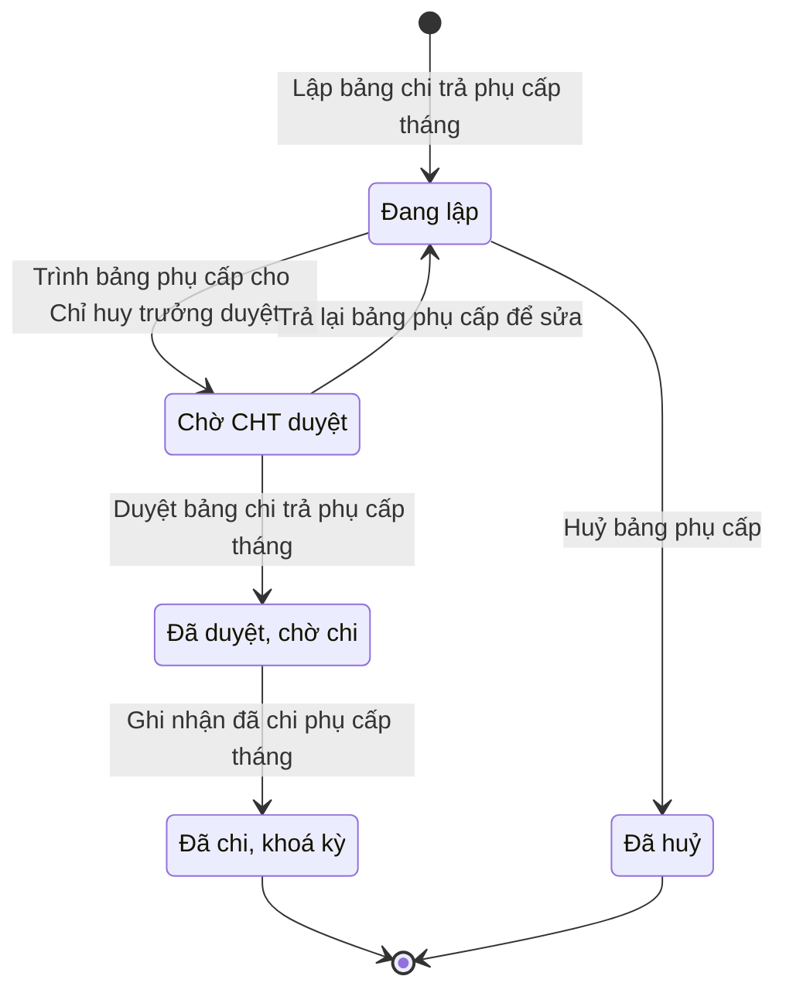

# qt-30.allowance-sheet · Bảng chi trả phụ cấp chức vụ tháng của xã — Bảng chi trả phụ cấp chức vụ tháng

<!-- máy sinh: tom-tat -->
> **Hồ sơ:** Bảng chi trả phụ cấp chức vụ tháng (`PositionAllowanceSheet`)
>
> **Trong sổ phạm vi:** 30 · Bảng chi trả phụ cấp chức vụ tháng của xã — NVTC lập, CHT duyệt, rút khoản 4 dự toán bằng đề nghị đi thẳng, NVTC ghi đã chi và khoá kỳ (NĐ72 Đ.7 k2, Đ.10 k3; Luật DQTV Đ.38 k4; thêm 5/10/2026)
>
> 7 bước · 5 chặng · 2 vai · 0 bảng quyết định · 0 hạn · 3 khớp nối.
>
> **Nguồn:** sổ nghiệp vụ `qt-30.allowance-sheet` · khai báo của app: `dqtv-app/core/processes/command-tenure/workflow/allowance-sheet.yaml`. Các bảng do máy sinh từ nguồn này.
<!-- hết: tom-tat -->

<!-- viết tay: dien-giai -->
## Diễn giải

*Phần này viết tay, diễn giải lại điều các bảng bên dưới ghi.*

### Quy trình này để làm gì

Mỗi kỳ tháng lập một **bảng chi trả phụ cấp chức vụ** cho cả xã. Bảng có mỗi người một dòng: chức vụ, số ngày giữ chức, hưởng cả tháng hay 50%, phụ cấp chức vụ, thâm niên, đặc thù và tổng. Bảng đi qua bốn chặng: *Đang lập* → *Chờ CHT duyệt* → *Đã duyệt, chờ chi* → *Đã chi, khoá kỳ*.

### Khi nào bắt đầu

Nhân viên tài chính kiêm hậu cần bấm **Lập bảng chi trả phụ cấp tháng**, nhập năm và tháng; ghi chú là ô nhập nếu có. Bước này lưu tháng, tổng tiền và hai ô `daysHeldInMonth`, `monthHalves`.

### Diễn ra thế nào

1. **Đang lập.** Nhân viên tài chính soát từng dòng. Dòng nào cần sửa thì **Điều chỉnh một dòng của bảng** (lặp được): chọn dòng, nhập số tiền đúng và bắt buộc ghi lý do. Hệ đếm số dòng đã điều chỉnh tay.
2. Xong thì **Trình bảng phụ cấp cho Chỉ huy trưởng duyệt** — phải chọn đề nghị cấp kinh phí khoản 4 đi kèm và dự toán năm. Bước đòi trước điều kiện `withinItem4Remaining`: đúng khi ô `itemOverRemaining` không phải là `yes`; bước ghi ô `itemOverRemaining` và mối nối `sheetFundingRequest`. Bảng sang *Chờ CHT duyệt*; lúc này đề nghị cấp kinh phí khoản 4 đã lập và đang giữ chỗ.
3. **Chờ CHT duyệt.** Chỉ huy trưởng Ban CHQS xã **Duyệt bảng chi trả phụ cấp tháng** (sang *Đã duyệt, chờ chi*), hoặc **Trả lại bảng phụ cấp để sửa** — phải ghi cần sửa gì; bảng về *Đang lập*. Hai bước này là quyết định trong hệ (đồng ý, từ chối). Trả lại thì mối nối `sheetFundingRequest` bị xoá, đề nghị cấp kinh phí đi kèm được gỡ.
4. **Đã duyệt, chờ chi.** Nhân viên tài chính **Ghi nhận đã chi phụ cấp tháng**, bắt buộc đính chứng từ chi trả (bảng có chữ ký nhận hoặc biên lai chuyển khoản). Bảng sang *Đã chi, khoá kỳ*.

### Kết thúc và để lại gì

Bảng kết thúc ở *Đã chi, khoá kỳ*; kỳ đã chi thì không lập lại. Bảng gắn với dự toán ngân sách năm (quy trình 4) mà nó rút khoản 4, ghi ở bước trình; và với đề nghị cấp kinh phí khoản 4 (4.funding-request) phát sinh từ bảng.

### Điều kiện chặn

- Mọi bước sau bước lập: người làm phải là người của đơn vị chủ hồ sơ. Sai người, sai chặng, thiếu thứ phải có trước thì bước bị chặn, bảng giữ nguyên.
- Điều chỉnh dòng thiếu lý do, trả lại thiếu "cần sửa gì", ghi đã chi thiếu chứng từ đều bị chặn.
- Trình duyệt bị chặn khi ô `itemOverRemaining` là `yes` (điều kiện `withinItem4Remaining`).
- Công thức `month-allowance-factor` tính phần tháng được hưởng.
<!-- hết viết tay -->

## 1. Đường đi ngắn nhất qua các chặng

<!-- máy sinh: luong-chinh -->
Đường ít bước nhất từ lúc mở hồ sơ tới chặng kết thúc xa nhất. Máy chọn theo số chặng, không theo ý nghĩa nghiệp vụ — trình tự công việc thật xem phần Diễn giải và bảng "Việc làm ở từng chặng" ở mục 6.

| # | Ai làm | Làm gì | Hồ sơ sang chặng |
|---|---|---|---|
| 1 | Nhân viên tài chính kiêm hậu cần | Lập bảng chi trả phụ cấp tháng | Đang lập |
| 2 | Nhân viên tài chính kiêm hậu cần | Trình bảng phụ cấp cho Chỉ huy trưởng duyệt | Chờ CHT duyệt |
| 3 | Chỉ huy trưởng Ban CHQS xã | Duyệt bảng chi trả phụ cấp tháng | Đã duyệt, chờ chi |
| 4 | Nhân viên tài chính kiêm hậu cần | Ghi nhận đã chi phụ cấp tháng | Đã chi, khoá kỳ |

<!-- hết: luong-chinh -->

## 2. Hồ sơ và việc nó để lại

<!-- máy sinh: muc-tieu -->
**App gọi quy trình này là:** Bảng chi trả phụ cấp chức vụ tháng.

**Hồ sơ này để lại cho quy trình khác** (bước tạo hồ sơ của quy trình kia ghi mối nối về đây):
- Phiếu chi (12a.payment-voucher) — bước `recordCommunePaymentVoucher`, khớp nối `voucherForSheet`
- Phiếu chi (12a.payment-voucher) — bước `recordProvincePaymentVoucher`, khớp nối `voucherForSheet`
<!-- hết: muc-tieu -->

## 3. Khởi phát và kết thúc

<!-- máy sinh: khoi-phat -->
**1 cửa vào** — bước mở hồ sơ:

| Bước mở | Ai mở | Hồ sơ vào chặng | App bắt buộc nhập |
|---|---|---|---|
| Lập bảng chi trả phụ cấp tháng | Nhân viên tài chính kiêm hậu cần | Đang lập | năm, tháng |

**Kết thúc:** *Đã chi, khoá kỳ* (`PAID`), *Đã huỷ* (`CANCELLED`)
<!-- hết: khoi-phat -->

## 4. Vai trò

<!-- máy sinh: vai-tro -->
| Vai trong sổ | Tên trong app | Điều kiện | Làm những bước |
|---|---|---|---|
| `operator` | Nhân viên tài chính kiêm hậu cần |  | Lập bảng chi trả phụ cấp tháng · Điều chỉnh một dòng của bảng · Trình bảng phụ cấp cho Chỉ huy trưởng duyệt · Huỷ bảng phụ cấp · Ghi nhận đã chi phụ cấp tháng |
| `verifier` | Chỉ huy trưởng Ban CHQS xã |  | Duyệt bảng chi trả phụ cấp tháng · Trả lại bảng phụ cấp để sửa |

*"Tên trong app" là tên app đặt cho mã chủ thể của vai. Hồ sơ thuộc đơn vị cấp khác thì người làm là người giữ vai ấy ở đơn vị nêu trong cột "Điều kiện" (nếu sổ có ghi) và ở cột "Người làm phải thuộc" của bảng "Theo khai báo của app" (mục 7).*
<!-- hết: vai-tro -->

## 5. Nhánh phụ

<!-- máy sinh: nhanh-phu -->
**Bước khác đưa hồ sơ sang chặng mới** — đường song song, rẽ nhánh hoặc kết thúc sớm:

| Bước | Ai làm | Từ chặng | Sang chặng |
|---|---|---|---|
| Huỷ bảng phụ cấp | Nhân viên tài chính kiêm hậu cần | Đang lập | Đã huỷ |

**Quay lại một chặng hồ sơ đã đi qua** (tính theo đường ngắn nhất từ lúc mở):

| Bước | Ai làm | Từ chặng | Về chặng |
|---|---|---|---|
| Trả lại bảng phụ cấp để sửa | Chỉ huy trưởng Ban CHQS xã | Chờ CHT duyệt | Đang lập |

**Làm trong lúc hồ sơ đứng yên ở một chặng** — ghi nhận, bổ sung:

| Bước | Ai làm | Ở chặng |
|---|---|---|
| Điều chỉnh một dòng của bảng *(lặp được)* | Nhân viên tài chính kiêm hậu cần | Đang lập |

<!-- hết: nhanh-phu -->

## 6. Các chặng và việc làm ở từng chặng

<!-- máy sinh: chang -->
| Chặng | Tên hiển thị | Vào bằng bước | Kết thúc? |
|---|---|---|---|
| `DRAFT` | Đang lập | Lập bảng chi trả phụ cấp tháng · Trả lại bảng phụ cấp để sửa |  |
| `SUBMITTED` | Chờ CHT duyệt | Trình bảng phụ cấp cho Chỉ huy trưởng duyệt |  |
| `APPROVED` | Đã duyệt, chờ chi | Duyệt bảng chi trả phụ cấp tháng |  |
| `PAID` | Đã chi, khoá kỳ | Ghi nhận đã chi phụ cấp tháng | **kết thúc** |
| `CANCELLED` | Đã huỷ | Huỷ bảng phụ cấp | **kết thúc** |

### Việc làm ở từng chặng

Hồ sơ đang ở chặng nào thì làm được những bước nào.

| Hồ sơ đang ở chặng | Bước làm tại chặng (hồ sơ đứng yên) | Bước đưa hồ sơ sang chặng khác |
|---|---|---|
| **Đang lập** | Điều chỉnh một dòng của bảng (lặp được) — Nhân viên tài chính kiêm hậu cần | Trình bảng phụ cấp cho Chỉ huy trưởng duyệt — Nhân viên tài chính kiêm hậu cần → *Chờ CHT duyệt* Huỷ bảng phụ cấp — Nhân viên tài chính kiêm hậu cần → *Đã huỷ* |
| **Chờ CHT duyệt** | — | Duyệt bảng chi trả phụ cấp tháng — Chỉ huy trưởng Ban CHQS xã → *Đã duyệt, chờ chi* Trả lại bảng phụ cấp để sửa — Chỉ huy trưởng Ban CHQS xã → *Đang lập* |
| **Đã duyệt, chờ chi** | — | Ghi nhận đã chi phụ cấp tháng — Nhân viên tài chính kiêm hậu cần → *Đã chi, khoá kỳ* |
| **Đã chi, khoá kỳ** | — | — (kết thúc) |
| **Đã huỷ** | — | — (kết thúc) |
<!-- hết: chang -->

## 7. Bảng bước

<!-- máy sinh: buoc -->
| # | Bước | Mã bước | Ai thực hiện | Từ chặng | Sang chặng | Phải có trước | Ghi lại |
|---|---|---|---|---|---|---|---|
| 1 | Lập bảng chi trả phụ cấp tháng | `openAllowanceSheet` | Nhân viên tài chính kiêm hậu cần | — (mở hồ sơ) | `DRAFT` | `sheetPeriodFree` | năm, tháng, tổng tiền, `daysHeldInMonth`, `monthHalves`, đơn vị chủ hồ sơ, `id` |
| 2 | Điều chỉnh một dòng của bảng | `adjustAllowanceSheetLine` | Nhân viên tài chính kiêm hậu cần | `DRAFT` | giữ nguyên | lý do điều chỉnh, người làm thuộc đơn vị chủ hồ sơ | lý do điều chỉnh, `lineAdjusted` |
| 3 | Trình bảng phụ cấp cho Chỉ huy trưởng duyệt | `submitAllowanceSheet` | Nhân viên tài chính kiêm hậu cần | `DRAFT` | `SUBMITTED` | người làm thuộc đơn vị chủ hồ sơ, năm | — |
| 4 | Duyệt bảng chi trả phụ cấp tháng | `approveAllowanceSheet` | Chỉ huy trưởng Ban CHQS xã | `SUBMITTED` | `APPROVED` | người làm thuộc đơn vị chủ hồ sơ | duyệt lúc |
| 5 | Trả lại bảng phụ cấp để sửa | `returnAllowanceSheet` | Chỉ huy trưởng Ban CHQS xã | `SUBMITTED` | `DRAFT` | cần sửa gì, người làm thuộc đơn vị chủ hồ sơ | cần sửa gì |
| 6 | Huỷ bảng phụ cấp | `cancelAllowanceSheet` | Nhân viên tài chính kiêm hậu cần | `DRAFT` | `CANCELLED` | lý do huỷ, người làm thuộc đơn vị chủ hồ sơ | lý do huỷ |
| 7 | Ghi nhận đã chi phụ cấp tháng | `recordAllowanceSheetPaid` | Nhân viên tài chính kiêm hậu cần | `APPROVED` | `PAID` | chứng từ chi trả — bảng có chữ ký nhận hoặc biên lai, người làm thuộc đơn vị chủ hồ sơ, `sheetVoucherCoversTotal` | đã chi lúc, chứng từ chi trả — bảng có chữ ký nhận hoặc biên lai |

### Khi không đạt điều kiện

Mặc định: không đúng người, hồ sơ không ở đúng chặng, hoặc thiếu thứ "phải có trước" thì bước bị chặn, hồ sơ giữ nguyên. Bảng dưới chỉ kê những bước có kết quả riêng.

Không bước nào có kết quả riêng — tất cả theo mặc định.

### Điều kiện "phải có trước" bằng lời

Cột "Phải có trước" ở bảng bước có hai loại: ô dữ liệu thường (bước chỉ đòi ô ấy đã có giá trị) và điều kiện hệ tự xét. Bảng này diễn các điều kiện hệ tự xét theo đúng công thức sổ ghi; số ở cột cuối là số thứ tự bước.

| Điều kiện | Đúng khi | Bước đòi |
|---|---|---|
| `sheetPeriodFree` | không có hồ sơ Bảng chi trả phụ cấp chức vụ tháng của xã — Bảng chi trả phụ cấp chức vụ tháng (qt-30.allowance-sheet) có đơn vị chủ hồ sơ trùng với đơn vị chủ hồ sơ của hồ sơ đang làm mà KHÔNG (hồ sơ ấy đang ở chặng `CANCELLED`) VÀ năm của hồ sơ đang xét bằng năm của hồ sơ này VÀ tháng của hồ sơ đang xét bằng tháng của hồ sơ này | 1 |
| `actorInOwnerUnit` | người đang làm là người của đơn vị ghi ở ô đơn vị chủ hồ sơ của hồ sơ này (theo danh mục người của đơn vị, `dm.unit-staff`) | 2, 3, 4, 5, 6, 7 |
| `sheetVoucherCoversTotal` | `sheetVouchersTotal` bằng tổng tiền | 7 |

### Theo khai báo của app

Người làm phải thuộc đơn vị nào, ô người dùng phải nhập, bước có lặp được không, và căn cứ pháp lý — lấy từ khai báo quy trình trong app.

| # | Bước | Người làm phải thuộc | Bắt buộc nhập | Nhập nếu có | Lặp được | Căn cứ |
|---|---|---|---|---|---|---|
| 1 | Lập bảng chi trả phụ cấp tháng |  | năm, tháng | ghi chú |  | NĐ72/2020/NĐ-CP Đ.7 k2, Đ.9, Đ.10 · L48/2019/QH14 Đ.33, Đ.38 k4 |
| 2 | Điều chỉnh một dòng của bảng | đơn vị chủ hồ sơ | dòng cần điều chỉnh, số tiền đúng của dòng, lý do điều chỉnh | — | có | NĐ72/2020/NĐ-CP Đ.7 k2 |
| 3 | Trình bảng phụ cấp cho Chỉ huy trưởng duyệt | đơn vị chủ hồ sơ | — | — |  | L48/2019/QH14 Đ.38 k4 · QĐ1126/QĐ-TM Đ.16 k2 |
| 4 | Duyệt bảng chi trả phụ cấp tháng | đơn vị chủ hồ sơ | — | — |  | QĐ1126/QĐ-TM Đ.2 k3 |
| 5 | Trả lại bảng phụ cấp để sửa | đơn vị chủ hồ sơ | cần sửa gì | — |  | QĐ1126/QĐ-TM Đ.2 k3 |
| 6 | Huỷ bảng phụ cấp |  | lý do huỷ | — |  | QĐ1126/QĐ-TM Đ.16 k2 |
| 7 | Ghi nhận đã chi phụ cấp tháng | đơn vị chủ hồ sơ | chứng từ chi trả — bảng có chữ ký nhận hoặc biên lai | — |  | QĐ1126/QĐ-TM Đ.16 k2 · NĐ72/2020/NĐ-CP Đ.10 k3 |

### Điều kiện và ghi chú app khai cho từng bước

Lấy từ khai báo quy trình trong app. Lời trong ngoặc kép là câu app hiện cho người dùng. Chức danh người ký ngoài hệ app chỉ khai bằng mã.

| # | Bước | Điều kiện, ghi chú |
|---|---|---|
| 4 | Duyệt bảng chi trả phụ cấp tháng | · bước này là một quyết định trong hệ, kết quả: đồng ý |
| 5 | Trả lại bảng phụ cấp để sửa | · bước này là một quyết định trong hệ, kết quả: từ chối, phải ghi ô "cần sửa gì" |
<!-- hết: buoc -->

## 8. Bảng quyết định, hạn, việc ngoài hệ

<!-- máy sinh: quyet-dinh -->
**Công thức:** `month-allowance-factor` — xem trong sổ.

<!-- hết: quyet-dinh -->

## 9. Dữ liệu của hồ sơ

<!-- máy sinh: du-lieu -->
Các ô mà bước trong sổ ghi hoặc đòi. Số trong hai cột cuối là số thứ tự bước ở bảng bước (mục 7).

| Ô dữ liệu | Mã | Kiểu (app) | Giá trị cho phép | Loại ô (sổ) | Bước ghi | Bước đòi | Mô tả trong app |
|---|---|---|---|---|---|---|---|
| năm | `periodYear` | số |  | đưa vào ở bước (`input`) | 1 | 3 | Năm của kỳ chi trả |
| tháng | `periodMonth` | số |  | đưa vào ở bước (`input`) | 1 | — | Tháng của kỳ chi trả, 1–12 |
| tổng tiền | `totalAmount` | số |  | đưa vào ở bước (`input`) | 1 | — | Tổng tiền của bảng — cộng từ dòng |
| — | `daysHeldInMonth` |  |  | đưa vào ở bước (`input`) | 1 | — |  |
| — | `monthHalves` |  |  | hệ suy ra (`derived`) | 1 | — |  |
| đơn vị chủ hồ sơ | `ownerUnit` |  |  | lưu trên hồ sơ (`stored`) | 1 | — |  |
| — | `id` |  |  | lưu trên hồ sơ (`stored`) | 1 | — |  |
| lý do điều chỉnh | `adjustReason` |  |  | đưa vào ở bước (`input`) | 2 | 2 |  |
| — | `lineAdjusted` |  |  | lưu trên hồ sơ (`stored`) | 2 | — |  |
| duyệt lúc | `approvedAt` | ngày giờ |  | lưu trên hồ sơ (`stored`) | 4 | — | CHT duyệt lúc — QĐ1126 Đ.2 k3 |
| lý do trả lại | `returnReason` | chữ |  | đưa vào ở bước (`input`) | 5 | 5 | Lý do CHT trả lại lần gần nhất |
| lý do huỷ | `cancelReason` | chữ |  | đưa vào ở bước (`input`) | 6 | 6 | Lý do NVTC huỷ bảng còn nháp (sổ qt-30.allowance-sheet `cancelAllowanceSheet`) |
| đã chi lúc | `paidAt` | ngày giờ |  | lưu trên hồ sơ (`stored`) | 7 | — | NVTC ghi đã chi lúc — khoá kỳ (QĐ1126 Đ.16 k2) |
| chứng từ chi trả | `paymentScanPath` | tệp |  | đưa vào ở bước (`input`) | 7 | 7 | Chứng từ chi trả — bảng có chữ ký nhận hoặc biên lai chuyển khoản |
| — | `sheetPeriodFree` |  | có hay chưa | hệ suy ra (`derived`) | — | 1 |  |
| người làm thuộc đơn vị chủ hồ sơ | `actorInOwnerUnit` |  |  | hệ suy ra (`derived`) | — | 2, 3, 4, 5, 6, 7 |  |
| — | `sheetVoucherCoversTotal` |  | có hay chưa | hệ suy ra (`derived`) | — | 7 |  |

17 ô. Cột "Loại ô" là cách sổ phân loại ô, in kèm đúng chữ của sổ; ô nào người dùng phải nhập xem bảng "Theo khai báo của app" ở mục 7.
<!-- hết: du-lieu -->

## 10. Khớp nối với quy trình khác

<!-- máy sinh: khop-noi -->
| Quy trình kia | Hồ sơ kia | Quan hệ | Nội dung (mô tả trong app) | Bước ghi mối nối | Tên ô nối |
|---|---|---|---|---|---|
| 12a.payment-voucher | Phiếu chi | hồ sơ kia **mở ra từ** hồ sơ này | Phiếu chi này chi bảng phụ cấp chức vụ tháng nào — NĐ72/2020 Đ.7, L48/2019 Đ.38 k4 | 12a.payment-voucher·recordCommunePaymentVoucher ⊕, 12a.payment-voucher·recordProvincePaymentVoucher ⊕ | `voucherForSheet` |
| 4 | Dự toán ngân sách năm | có nối | Dự toán năm mà bảng chi trả phụ cấp chức vụ tháng rút khoản 4 — L48/2019 Đ.38 k4 | — | `allowanceSheetOfPlan` |
| 4.funding-request | Đề nghị cấp kinh phí | có nối | Đề nghị cấp kinh phí khoản 4 phát sinh từ bảng chi trả phụ cấp chức vụ tháng nào — L48/2019 Đ.38 k4, NĐ72/202… | — | `fundingRequestFromAllowanceSheet` |

3 khớp nối. ⊕ là bước tạo hồ sơ.
<!-- hết: khop-noi -->

## 11. Thông tin chung

<!-- máy sinh: thong-tin -->
| | |
|---|---|
| **Mã trong sổ** | `qt-30.allowance-sheet` |
| **Quy trình trong app** | `command-tenure` (`workflow/allowance-sheet.yaml`) — mặt công tác: `personnel` |
| **Hồ sơ** | Bảng chi trả phụ cấp chức vụ tháng (`PositionAllowanceSheet`) |
| **Cùng mã quy trình** | [qt-30](qt-30.html), [qt-30.commune-command](qt-30.commune-command.html) |
| **Căn cứ pháp lý từng bước** | cột "Căn cứ" ở bảng "Theo khai báo của app", mục 7 |
<!-- hết: thong-tin -->
