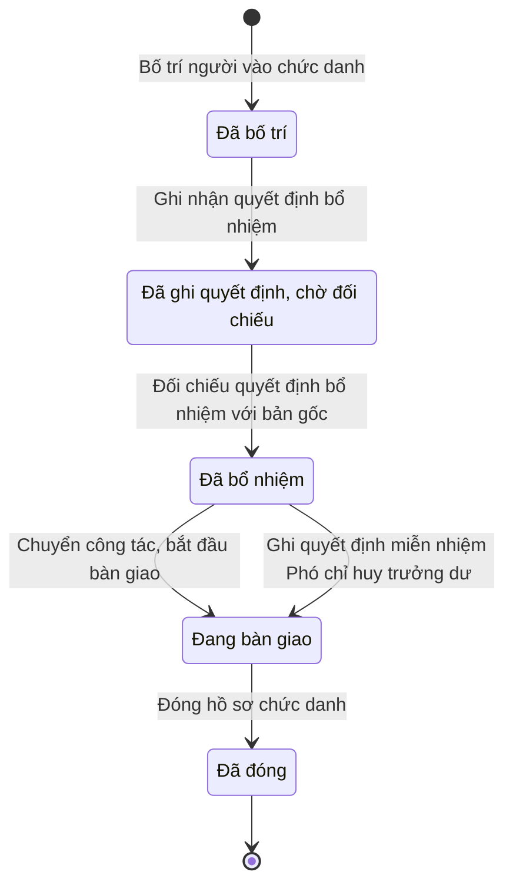

# qt-30.commune-command · Kiện toàn tổ chức, bổ nhiệm chỉ huy — Nhân sự Ban chỉ huy quân sự cấp xã

<!-- máy sinh: tom-tat -->
> **Hồ sơ:** Nhân sự Ban chỉ huy quân sự cấp xã (`CommandAssignment`)
>
> **Trong sổ phạm vi:** 30 · Kiện toàn tổ chức, bổ nhiệm chỉ huy — hồ sơ phụ commune-command (tầng 1)
>
> 8 bước · 5 chặng · 3 vai · 3 bảng quyết định · 0 hạn · 7 khớp nối.
>
> **Nguồn:** sổ nghiệp vụ `qt-30.commune-command` · khai báo của app: `dqtv-app/core/processes/command-tenure/workflow/commune-command.yaml`. Các bảng do máy sinh từ nguồn này.
<!-- hết: tom-tat -->

<!-- viết tay: dien-giai -->
## Diễn giải

*Phần này viết tay, diễn giải lại điều các bảng bên dưới ghi.*

### Quy trình này để làm gì

Quy trình theo dõi **một người giữ một chức danh trong Ban chỉ huy quân sự cấp xã**: xếp người vào chức danh, ghi quyết định bổ nhiệm, gán vai dùng hệ theo chức trách, rồi tới lúc chuyển công tác hay miễn nhiệm thì bàn giao và đóng hồ sơ. Hồ sơ đi qua bốn chặng: *Đã bố trí* → *Đã bổ nhiệm* → *Đang bàn giao* → *Đã đóng*. Hồ sơ đã đóng vẫn giữ làm lịch sử, không xoá.

### Khi nào bắt đầu

Chỉ huy trưởng Ban CHQS xã bấm **Bố trí người vào chức danh**, nhập chức danh và người giữ chức; ngày bố trí và công dân tương ứng là ô nhập nếu có. Hồ sơ mở ra có nối tới công dân trong độ tuổi (quy trình 16). Bước ghi mã vai gắn với chức danh.

Bước mở bị bảng `deputy-cap` xét; kết quả `over_cap` hoặc `cap_unknown` thì không bố trí được (xem Điều kiện chặn).

### Diễn ra thế nào

1. **Đã bố trí** — đã xếp người, chờ quyết định bổ nhiệm. Chỉ huy trưởng **Sửa thông tin bố trí** (người giữ chức, là công chức hay không, ngày bố trí). Trợ lý Quân lực **Ghi nhận quyết định bổ nhiệm**: số quyết định theo bản đã ký ngoài hệ, ngày bổ nhiệm, bản quét; hồ sơ sang *Đã bổ nhiệm*.
2. **Đã bổ nhiệm** — đang thực hiện chức trách. Chỉ huy trưởng làm được, hồ sơ đứng yên:
   - **Gán vai theo chức trách** — phải có ngày bổ nhiệm trước; không gán lần hai được ("chức danh này đã được gán vai rồi").
   - **Ghi nhận thay đổi, chuyển công tác** (lặp được) — ghi ngày chuyển, chuyển đến đâu, căn cứ nếu có; mỗi lần tạo một hồ sơ con *Lần chuyển công tác của một chức danh*.

   Hai lối sang *Đang bàn giao*:
   - Chỉ huy trưởng bấm **Chuyển công tác, bắt đầu bàn giao**, ghi lý do đóng.
   - Bộ CHQS cấp tỉnh — người của một đơn vị nằm trong ô cấp trên của chủ hồ sơ; người dùng nói "chỉ cán bộ của cấp trên TRỰC TIẾP quản lý đơn vị đó" — **Ghi quyết định miễn nhiệm Phó chỉ huy trưởng dư**: phải có số quyết định miễn nhiệm, bản quét và ngày miễn nhiệm. Đây là quyết định miễn nhiệm của Chủ tịch UBND tỉnh; phụ cấp chức vụ tính tới ngày miễn nhiệm.
3. **Đang bàn giao** — Chỉ huy trưởng **Đóng hồ sơ chức danh**, nhập ngày bàn giao (con dấu, chữ ký số, kho, tài khoản, hồ sơ). Hồ sơ sang *Đã đóng*.

### Kết thúc và để lại gì

Hồ sơ kết thúc ở *Đã đóng*. Mối nối với quy trình khác: học viên đào tạo Chỉ huy trưởng (quy trình 18) gắn tới hồ sơ này ở bước `assignTrainee` của quy trình kia; việc rà Phó chỉ huy trưởng dư (XT.deputy-surplus) gắn ở bước `closeDeputySurplusReview` của quy trình kia; chức danh vào hệ qua đợt khởi tạo hiện trạng nào (system-onboarding) cũng được ghi trên hồ sơ.

### Điều kiện chặn

- Sai người, sai chặng, thiếu thứ phải có trước thì bước bị chặn, hồ sơ giữ nguyên; nhiều lỗi cùng lúc báo theo thứ tự quyền → chặng → thông tin. Bước miễn nhiệm Phó chỉ huy trưởng dư chỉ người của một đơn vị cấp trên của chủ hồ sơ được làm; bước mở hồ sơ không đòi gì; các bước còn lại người làm phải là người của đơn vị chủ hồ sơ.
- Bảng `deputy-cap` ở bước bố trí (6 dòng, dò từ trên xuống), ba đầu vào: thiếu `isDeputyPost` thì chặn (`cap_unknown`); `isDeputyPost` là `no` thì cho qua (`within_cap`); là `yes` thì xét `deputiesHeld` — với `keyDefenceCommune` là `yes`, nhỏ hơn 2 thì qua, từ 2 thì chặn (`over_cap`); với `keyDefenceCommune` là `no`, nhỏ hơn 1 thì qua, từ 1 thì chặn.
- Gán vai phải sau khi có ngày bổ nhiệm, và chỉ gán một lần.
- Quy trình không đặt hạn nào.
<!-- hết viết tay -->

## 1. Đường đi ngắn nhất qua các chặng

<!-- máy sinh: luong-chinh -->
Đường ít bước nhất từ lúc mở hồ sơ tới chặng kết thúc xa nhất. Máy chọn theo số chặng, không theo ý nghĩa nghiệp vụ — trình tự công việc thật xem phần Diễn giải và bảng "Việc làm ở từng chặng" ở mục 6.

| # | Ai làm | Làm gì | Hồ sơ sang chặng |
|---|---|---|---|
| 1 | Chỉ huy trưởng Ban CHQS xã | Bố trí người vào chức danh | Đã bố trí |
| 2 | Ban Dân quân tự vệ, Bộ CHQS cấp tỉnh (thuộc cấp trên của chủ hồ sơ) | Ghi nhận quyết định bổ nhiệm | Đã ghi quyết định, chờ đối chiếu |
| 3 | Bộ CHQS cấp tỉnh (thuộc cấp trên của chủ hồ sơ) | Đối chiếu quyết định bổ nhiệm với bản gốc | Đã bổ nhiệm |
| 4 | Chỉ huy trưởng Ban CHQS xã | Chuyển công tác, bắt đầu bàn giao | Đang bàn giao |
| 5 | Chỉ huy trưởng Ban CHQS xã | Đóng hồ sơ chức danh | Đã đóng |

<!-- hết: luong-chinh -->

## 2. Hồ sơ và việc nó để lại

<!-- máy sinh: muc-tieu -->
**App gọi quy trình này là:** E19 — Nhân sự Ban chỉ huy quân sự cấp xã.

**Khi mở, hồ sơ này ghi mối nối tới:**
- Công dân trong độ tuổi (16) — bước `assignPosition`, khớp nối `assignmentHeldBy`
<!-- hết: muc-tieu -->

## 3. Khởi phát và kết thúc

<!-- máy sinh: khoi-phat -->
**1 cửa vào** — bước mở hồ sơ:

| Bước mở | Ai mở | Hồ sơ vào chặng | App bắt buộc nhập |
|---|---|---|---|
| Bố trí người vào chức danh | Chỉ huy trưởng Ban CHQS xã | Đã bố trí | chức danh, người giữ chức |

**Kết thúc:** *Đã đóng* (`CLOSED`)
<!-- hết: khoi-phat -->

## 4. Vai trò

<!-- máy sinh: vai-tro -->
| Vai trong sổ | Tên trong app | Điều kiện | Làm những bước |
|---|---|---|---|
| `commander` | Chỉ huy trưởng Ban CHQS xã |  | Bố trí người vào chức danh · Sửa thông tin bố trí · Chuyển công tác, bắt đầu bàn giao · Đóng hồ sơ chức danh · Ghi nhận thay đổi, chuyển công tác |
| `provinceOperator` | Ban Dân quân tự vệ, Bộ CHQS cấp tỉnh | thuộc cấp trên của chủ hồ sơ (`actorInSuperiorUnit`, công thức ở mục 7) | Ghi nhận quyết định bổ nhiệm |
| `province` | Bộ CHQS cấp tỉnh | thuộc cấp trên của chủ hồ sơ (`actorInSuperiorUnit`, công thức ở mục 7) | Đối chiếu quyết định bổ nhiệm với bản gốc · Ghi quyết định miễn nhiệm Phó chỉ huy trưởng dư |

*"Tên trong app" là tên app đặt cho mã chủ thể của vai. Hồ sơ thuộc đơn vị cấp khác thì người làm là người giữ vai ấy ở đơn vị nêu trong cột "Điều kiện" (nếu sổ có ghi) và ở cột "Người làm phải thuộc" của bảng "Theo khai báo của app" (mục 7).*
<!-- hết: vai-tro -->

## 5. Nhánh phụ

<!-- máy sinh: nhanh-phu -->
**Bước khác đưa hồ sơ sang chặng mới** — đường song song, rẽ nhánh hoặc kết thúc sớm:

| Bước | Ai làm | Từ chặng | Sang chặng |
|---|---|---|---|
| Ghi quyết định miễn nhiệm Phó chỉ huy trưởng dư | Bộ CHQS cấp tỉnh (thuộc cấp trên của chủ hồ sơ) | Đã bổ nhiệm | Đang bàn giao |

**Làm trong lúc hồ sơ đứng yên ở một chặng** — ghi nhận, bổ sung:

| Bước | Ai làm | Ở chặng |
|---|---|---|
| Sửa thông tin bố trí | Chỉ huy trưởng Ban CHQS xã | Đã bố trí |
| Ghi nhận thay đổi, chuyển công tác *(lặp được)* | Chỉ huy trưởng Ban CHQS xã | Đã bổ nhiệm |

<!-- hết: nhanh-phu -->

## 6. Các chặng và việc làm ở từng chặng

<!-- máy sinh: chang -->
| Chặng | Tên hiển thị | Vào bằng bước | Kết thúc? |
|---|---|---|---|
| `PLANNED` | Đã bố trí | Bố trí người vào chức danh |  |
| `DECISION_RECORDED` | Đã ghi quyết định, chờ đối chiếu | Ghi nhận quyết định bổ nhiệm |  |
| `APPOINTED` | Đã bổ nhiệm | Đối chiếu quyết định bổ nhiệm với bản gốc |  |
| `HANDING_OVER` | Đang bàn giao | Chuyển công tác, bắt đầu bàn giao · Ghi quyết định miễn nhiệm Phó chỉ huy trưởng dư |  |
| `CLOSED` | Đã đóng | Đóng hồ sơ chức danh | **kết thúc** |

### Việc làm ở từng chặng

Hồ sơ đang ở chặng nào thì làm được những bước nào.

| Hồ sơ đang ở chặng | Bước làm tại chặng (hồ sơ đứng yên) | Bước đưa hồ sơ sang chặng khác |
|---|---|---|
| **Đã bố trí** | Sửa thông tin bố trí — Chỉ huy trưởng Ban CHQS xã | Ghi nhận quyết định bổ nhiệm — Ban Dân quân tự vệ, Bộ CHQS cấp tỉnh (thuộc cấp trên của chủ hồ sơ) → *Đã ghi quyết định, chờ đối chiếu* |
| **Đã ghi quyết định, chờ đối chiếu** | — | Đối chiếu quyết định bổ nhiệm với bản gốc — Bộ CHQS cấp tỉnh (thuộc cấp trên của chủ hồ sơ) → *Đã bổ nhiệm* |
| **Đã bổ nhiệm** | Ghi nhận thay đổi, chuyển công tác (lặp được) — Chỉ huy trưởng Ban CHQS xã | Chuyển công tác, bắt đầu bàn giao — Chỉ huy trưởng Ban CHQS xã → *Đang bàn giao* Ghi quyết định miễn nhiệm Phó chỉ huy trưởng dư — Bộ CHQS cấp tỉnh (thuộc cấp trên của chủ hồ sơ) → *Đang bàn giao* |
| **Đang bàn giao** | — | Đóng hồ sơ chức danh — Chỉ huy trưởng Ban CHQS xã → *Đã đóng* |
| **Đã đóng** | — | — (kết thúc) |
<!-- hết: chang -->

## 7. Bảng bước

<!-- máy sinh: buoc -->
| # | Bước | Mã bước | Ai thực hiện | Từ chặng | Sang chặng | Phải có trước | Ghi lại |
|---|---|---|---|---|---|---|---|
| 1 | Bố trí người vào chức danh | `assignPosition` | Chỉ huy trưởng Ban CHQS xã | — (mở hồ sơ) | `PLANNED` | — | mã tỉnh, mã xã, chức danh, `assignmentIsDeputy`, mã vai, người giữ chức, là công chức, ngày bố trí, nối tới Công dân trong độ tuổi, đơn vị chủ hồ sơ |
| 2 | Sửa thông tin bố trí | `editAssignment` | Chỉ huy trưởng Ban CHQS xã | `PLANNED` | giữ nguyên | người làm thuộc đơn vị chủ hồ sơ | người giữ chức, là công chức, ngày bố trí |
| 3 | Ghi nhận quyết định bổ nhiệm | `recordAppointment` | Ban Dân quân tự vệ, Bộ CHQS cấp tỉnh (thuộc cấp trên của chủ hồ sơ) | `PLANNED` | `DECISION_RECORDED` | người làm thuộc cấp trên của chủ hồ sơ, `commandAssignmentAppointedByIncomingDocumentUsable` | cơ quan ban hành quyết định bổ nhiệm, ngày bổ nhiệm, người ghi quyết định bổ nhiệm, nối tới Văn bản đến |
| 4 | Đối chiếu quyết định bổ nhiệm với bản gốc | `verifyAppointment` | Bộ CHQS cấp tỉnh (thuộc cấp trên của chủ hồ sơ) | `DECISION_RECORDED` | `APPOINTED` | người làm thuộc cấp trên của chủ hồ sơ, `notRecorder` | ngày đối chiếu, người đối chiếu, `rbacGrantedAt`, nối `appointmentDecisionDeliveredAs` (Chức vụ chỉ huy dân quân tự vệ → Văn bản đến) |
| 5 | Chuyển công tác, bắt đầu bàn giao | `startHandover` | Chỉ huy trưởng Ban CHQS xã | `APPOINTED` | `HANDING_OVER` | người làm thuộc đơn vị chủ hồ sơ | lý do đóng, diện rời ghế |
| 6 | Ghi quyết định miễn nhiệm Phó chỉ huy trưởng dư | `recordSurplusDismissal` | Bộ CHQS cấp tỉnh (thuộc cấp trên của chủ hồ sơ) | `APPOINTED` | `HANDING_OVER` | người làm thuộc cấp trên của chủ hồ sơ, `commandAssignmentDismissedByIncomingDocumentUsable` | cơ quan ban hành quyết định miễn nhiệm, ngày miễn nhiệm, lý do đóng, nối tới Văn bản đến |
| 7 | Đóng hồ sơ chức danh | `closeAssignment` | Chỉ huy trưởng Ban CHQS xã | `HANDING_OVER` | `CLOSED` | người làm thuộc đơn vị chủ hồ sơ | ngày bàn giao |
| 8 | Ghi nhận thay đổi, chuyển công tác | `transferAssignment` | Chỉ huy trưởng Ban CHQS xã | `APPOINTED` | giữ nguyên | người làm thuộc đơn vị chủ hồ sơ | chuyển đến, ngày chuyển công tác, căn cứ chuyển công tác, nối tới Lần chuyển công tác của một chức danh |

### Khi không đạt điều kiện

Mặc định: không đúng người, hồ sơ không ở đúng chặng, hoặc thiếu thứ "phải có trước" thì bước bị chặn, hồ sơ giữ nguyên. Bảng dưới chỉ kê những bước có kết quả riêng.

| # | Bước | Kết quả riêng |
|---|---|---|
| 1 | Bố trí người vào chức danh | bước dừng lại, hồ sơ giữ nguyên khi kết quả xét là: `over_cap`, `cap_unknown` |
| 5 | Chuyển công tác, bắt đầu bàn giao | bước dừng lại, hồ sơ giữ nguyên khi kết quả xét là: `canh_bao_roi_van_ban_thi_boi_hoan` |
| 6 | Ghi quyết định miễn nhiệm Phó chỉ huy trưởng dư | bước dừng lại, hồ sơ giữ nguyên khi kết quả xét là: `not_surplus` |

### Điều kiện "phải có trước" bằng lời

Cột "Phải có trước" ở bảng bước có hai loại: ô dữ liệu thường (bước chỉ đòi ô ấy đã có giá trị) và điều kiện hệ tự xét. Bảng này diễn các điều kiện hệ tự xét theo đúng công thức sổ ghi; số ở cột cuối là số thứ tự bước.

| Điều kiện | Đúng khi | Bước đòi |
|---|---|---|
| `actorInOwnerUnit` | người đang làm là người của đơn vị ghi ở ô đơn vị chủ hồ sơ của hồ sơ này (theo danh mục người của đơn vị, `dm.unit-staff`) | 2, 5, 7, 8 |
| `actorInSuperiorUnit` | người đang làm là người của một đơn vị nằm trong ô cấp trên của chủ hồ sơ của hồ sơ này (theo danh mục người của đơn vị, `dm.unit-staff`) | 3, 4, 6 |
| `commandAssignmentAppointedByIncomingDocumentUsable` | có hồ sơ Việc luật giao kèm văn bản đến, đi — Văn bản đến (qt-1.incoming-document) chính là hồ sơ ghi ở ô nối `commandAssignmentAppointedByIncomingDocument` của hồ sơ đang làm mà hồ sơ ấy đang ở chặng `RECEIVED` hoặc `DISTRIBUTED` | 3 |
| `notRecorder` | KHÔNG (người ghi quyết định bổ nhiệm là chính người đang làm) | 4 |
| `commandAssignmentDismissedByIncomingDocumentUsable` | có hồ sơ Việc luật giao kèm văn bản đến, đi — Văn bản đến (qt-1.incoming-document) chính là hồ sơ ghi ở ô nối `commandAssignmentDismissedByIncomingDocument` của hồ sơ đang làm mà hồ sơ ấy đang ở chặng `RECEIVED` hoặc `DISTRIBUTED` | 6 |
| `leaverIsCommittedTrainee` | có hồ sơ Đào tạo CHT Ban CHQS xã (chuyển tiếp) (qt-18) có ô nối `traineeAssignedTo` trỏ về chính hồ sơ đang làm mà hồ sơ ấy đang ở chặng `ASSIGNED` | đầu vào bảng quyết định (mục 8) |

### Theo khai báo của app

Người làm phải thuộc đơn vị nào, ô người dùng phải nhập, bước có lặp được không, và căn cứ pháp lý — lấy từ khai báo quy trình trong app.

| # | Bước | Người làm phải thuộc | Bắt buộc nhập | Nhập nếu có | Lặp được | Căn cứ |
|---|---|---|---|---|---|---|
| 1 | Bố trí người vào chức danh |  | chức danh, người giữ chức | ngày bố trí, `citizenId` |  | QĐ1126/QĐ-TM; NĐ72/2020/NĐ-CP Đ.4 k1 (sửa khoản 2 Điều 5 NĐ220/2025) |
| 2 | Sửa thông tin bố trí | đơn vị chủ hồ sơ | — | người giữ chức, là công chức, ngày bố trí |  | QĐ1126/QĐ-TM |
| 3 | Ghi nhận quyết định bổ nhiệm | cấp trên của chủ hồ sơ | quyết định bổ nhiệm trong sổ văn bản đến, ngày bổ nhiệm | — |  | L14/2026/QH16 Đ.9 k4, Đ.2 k1 b |
| 4 | Đối chiếu quyết định bổ nhiệm với bản gốc | cấp trên của chủ hồ sơ | — | — |  | L14/2026/QH16 Đ.9 k4 · NĐ30/2020/NĐ-CP Đ.20–22 (N4) |
| 5 | Chuyển công tác, bắt đầu bàn giao | đơn vị chủ hồ sơ | lý do đóng | diện rời ghế, ngày kết thúc sớm của học viên (chỉ khi người rời ghế là học viên đang cam kết; bỏ trống thì lấy hôm nay), lý do kết thúc sớm của học viên (chỉ khi người rời ghế là học viên đang cam kết), diễn giải việc kết thúc sớm của học viên (chỉ khi người rời ghế là học viên đang cam kết) |  | QĐ1126/QĐ-TM — ⚠️ chưa có văn bản quy định trình tự bàn giao (khoảng trống G11) · TTLT01/2013 Đ.19 k2 (diện rời ghế) |
| 6 | Ghi quyết định miễn nhiệm Phó chỉ huy trưởng dư | cấp trên của chủ hồ sơ | quyết định miễn nhiệm trong sổ văn bản đến, ngày miễn nhiệm | — |  | L48/2019/QH14 Đ.23 k2 · NĐ220/2025/NĐ-CP Đ.5 k2 |
| 7 | Đóng hồ sơ chức danh | đơn vị chủ hồ sơ | ngày bàn giao | — |  | QĐ1126/QĐ-TM |
| 8 | Ghi nhận thay đổi, chuyển công tác | đơn vị chủ hồ sơ | ngày chuyển công tác, chuyển đến | căn cứ chuyển công tác | có | QĐ1126/QĐ-TM |
| — | Gán vai theo chức trách (`grantRole`) |  | — | — |  | QĐ1126/QĐ-TM Đ.1–20; TT29/2020/TT-BQP Đ.4–17 |
| — | Chốt số tháng công tác tính thâm niên (`countSeniority`) |  | số tháng công tác, chốt tới ngày | — |  | L48/2019/QH14 Đ.33 k4 · L14/2026/QH16 Đ.9 k9 · NĐ72/2020/NĐ-CP Đ.10 · NĐ220/2025/NĐ-CP Đ.5 k5 |

### Điều kiện và ghi chú app khai cho từng bước

Lấy từ khai báo quy trình trong app. Lời trong ngoặc kép là câu app hiện cho người dùng. Chức danh người ký ngoài hệ app chỉ khai bằng mã.

| # | Bước | Điều kiện, ghi chú |
|---|---|---|
| 8 | Ghi nhận thay đổi, chuyển công tác | · tạo thêm một hồ sơ con: Lần chuyển công tác của một chức danh (`AssignmentTransfer`) |
| — | Gán vai theo chức trách | · phải đã có ô "ngày bổ nhiệm" — thiếu thì app báo: "chưa có quyết định bổ nhiệm thì chưa gán được vai — quyền phải đi sau thẩm quyền" · không làm được khi đã có `rbacGrantedAt` — app báo: "chức danh này đã được gán vai rồi" |
<!-- hết: buoc -->

## 8. Bảng quyết định, hạn, việc ngoài hệ

<!-- máy sinh: quyet-dinh -->
**Bảng `deputy-cap`** — xét ở bước *Bố trí người vào chức danh*; đầu vào: `isDeputyPost`, `keyDefenceCommune`, `deputiesHeld`. 10 dòng, dò từ trên xuống, dòng đầu tiên khớp thì dừng.

| Thứ tự dò (số sổ ghi) | Dòng | Khi | Thì |
|---|---|---|---|
| 0 | `post-unset` | chưa có `isDeputyPost` | `cap_unknown` |
| 1 | `held-unset` | `isDeputyPost` là `yes` và chưa có `deputiesHeld` | `cap_unknown` |
| 2 | `not-deputy-held-unset` | `isDeputyPost` là `no` và chưa có `deputiesHeld` | cho qua |
| 3 | `not-deputy` | `isDeputyPost` là `no` | cho qua |
| 6 | `key-within` | `isDeputyPost` là `yes` và `keyDefenceCommune` là `yes` và `deputiesHeld` nhỏ hơn 2 | cho qua |
| 7 | `key-full` | `isDeputyPost` là `yes` và `keyDefenceCommune` là `yes` và `deputiesHeld` từ 2 | `over_cap` |
| 8 | `standard-within` | `isDeputyPost` là `yes` và `keyDefenceCommune` là `no` và `deputiesHeld` nhỏ hơn 1 | cho qua |
| 9 | `standard-full` | `isDeputyPost` là `yes` và `keyDefenceCommune` là `no` và `deputiesHeld` từ 1 | `over_cap` |
| 10 | `unrecorded-commune-within` | `isDeputyPost` là `yes` và chưa có `keyDefenceCommune` và `deputiesHeld` nhỏ hơn 1 | cho qua |
| 11 | `unrecorded-commune-full` | `isDeputyPost` là `yes` và chưa có `keyDefenceCommune` và `deputiesHeld` từ 1 | `over_cap` |

**Bảng `surplus-dismissal`** — xét ở bước *Ghi quyết định miễn nhiệm Phó chỉ huy trưởng dư*; đầu vào: `assignmentIsDeputy`, `keyDefenceCommune`, `deputiesHeld`. 9 dòng, dò từ trên xuống, dòng đầu tiên khớp thì dừng.

| Thứ tự dò (số sổ ghi) | Dòng | Khi | Thì |
|---|---|---|---|
| 0 | `post-unset` | chưa có `assignmentIsDeputy` | `not_surplus` |
| 1 | `not-deputy` | `assignmentIsDeputy` là `no` | `not_surplus` |
| 2 | `held-unset` | `assignmentIsDeputy` là `yes` và chưa có `deputiesHeld` | `not_surplus` |
| 3 | `key-surplus` | `assignmentIsDeputy` là `yes` và `keyDefenceCommune` là `yes` và `deputiesHeld` từ 3 | cho qua |
| 4 | `key-within` | `assignmentIsDeputy` là `yes` và `keyDefenceCommune` là `yes` và `deputiesHeld` nhỏ hơn 3 | `not_surplus` |
| 5 | `standard-surplus` | `assignmentIsDeputy` là `yes` và `keyDefenceCommune` là `no` và `deputiesHeld` từ 2 | cho qua |
| 6 | `standard-within` | `assignmentIsDeputy` là `yes` và `keyDefenceCommune` là `no` và `deputiesHeld` nhỏ hơn 2 | `not_surplus` |
| 7 | `unrecorded-commune-surplus` | `assignmentIsDeputy` là `yes` và chưa có `keyDefenceCommune` và `deputiesHeld` từ 2 | cho qua |
| 8 | `unrecorded-commune-within` | `assignmentIsDeputy` là `yes` và chưa có `keyDefenceCommune` và `deputiesHeld` nhỏ hơn 2 | `not_surplus` |

**Bảng `traineeCommitmentOnHandover`** — xét ở bước *Chuyển công tác, bắt đầu bàn giao*; đầu vào: `leaverIsCommittedTrainee`, diện rời ghế. 6 dòng, dòng đầu tiên khớp thì dừng.

| Thứ tự dò (số sổ ghi) | Dòng | Khi | Thì |
|---|---|---|---|
| — | `daCoHocVienCamKet` | đã có `leaverIsCommittedTrainee` và diện rời ghế là Không chấp hành sự phân công của tổ chức (`refused_assignment`) hoặc Bị thôi việc — 2 năm liên tiếp không hoàn thành nhiệm vụ (`dismissed_non_performance`) hoặc Lý do khác (`other`) | `canh_bao_roi_van_ban_thi_boi_hoan` |
| — | `khongCoHocVien` | chưa có `leaverIsCommittedTrainee` | cho qua |
| — | `luanChuyenCungTinh` | đã có `leaverIsCommittedTrainee` và diện rời ghế là Luân chuyển cùng chức danh sang xã khác trong tỉnh (`same_post_rotation_in_province`) | cho qua |
| — | `roiGheKhongLoi` | đã có `leaverIsCommittedTrainee` và diện rời ghế là Nghỉ hưu, nghỉ chế độ (`retirement`) hoặc Không còn thuộc đối tượng quy hoạch (`not_in_plan`) hoặc Sức khoẻ không đảm bảo (`health`) hoặc Từ trần (`death`) | cho qua |
| — | `thangChucCaoHon` | đã có `leaverIsCommittedTrainee` và diện rời ghế là Được bố trí chức vụ cao hơn (`higher_post`) | cho qua |
| — | `tuXinThoiHoacKyLuat` | đã có `leaverIsCommittedTrainee` và diện rời ghế là Tự xin thôi việc, được cấp có thẩm quyền đồng ý (`voluntary_resignation`) hoặc Bị kỷ luật giáng chức, cách chức (`disciplinary_demotion`) | cho qua |

<!-- hết: quyet-dinh -->

## 9. Dữ liệu của hồ sơ

<!-- máy sinh: du-lieu -->
Các ô mà bước trong sổ ghi hoặc đòi. Số trong hai cột cuối là số thứ tự bước ở bảng bước (mục 7).

| Ô dữ liệu | Mã | Kiểu (app) | Giá trị cho phép | Loại ô (sổ) | Bước ghi | Bước đòi | Mô tả trong app |
|---|---|---|---|---|---|---|---|
| mã tỉnh | `provinceCode` | chữ |  | lưu trên hồ sơ (`stored`) | 1 | — | Mã tỉnh — dùng lọc phạm vi theo hàng; rỗng khi hồ sơ thuộc quân khu hoặc Bộ Quốc phòng |
| mã xã | `communeCode` | chữ |  | lưu trên hồ sơ (`stored`) | 1 | — | Mã xã |
| chức danh | `positionName` | chữ |  | đưa vào ở bước (`input`) | 1 | — | Tên chức danh — chép từ danh mục QĐ1126 tại thời điểm bố trí |
| — | `assignmentIsDeputy` | chọn một | `yes`, `no` | lưu trên hồ sơ (`stored`) | 1 | — | Là chức vụ Phó Chỉ huy trưởng — hệ đóng dấu theo chức danh lúc bố trí (sổ qt-30.commune-command `assignmentIsDeputy`); đếm định biên Phó |
| mã vai | `roleCode` | chữ | `AC-CHT`, `AC-PCHT`, `AC-CTV`, `AC-CTVP`, `AC-TLQL`, `AC-TLTH`, `AC-NVQK`, `AC-NVVT`, `AC-NVTC` | lưu trên hồ sơ (`stored`) | 1 | — | Mã vai RBAC gắn với chức danh |
| người giữ chức | `holderName` | chữ |  | đưa vào ở bước (`input`) | 1, 2 | — | Họ tên người giữ chức danh |
| là công chức | `isCivilServant` | chọn một | Công chức (`yes`), Không chuyên trách (`no`) | đưa vào ở bước (`input`) | 1, 2 | — | Là công chức — CHT, Phó CHT, Trợ lý. Quyết định chế độ lương hay phụ cấp |
| ngày bố trí | `assignedAt` | ngày |  | đưa vào ở bước (`input`) | 1, 2 | — | Ngày bố trí vào biên chế Ban CHQS |
| đơn vị chủ hồ sơ | `ownerUnit` |  |  | lưu trên hồ sơ (`stored`) | 1 | — |  |
| cơ quan ban hành quyết định bổ nhiệm | `decisionIssuedBy` | chữ |  | lưu trên hồ sơ (`stored`) | 3 | — | Cơ quan ban hành quyết định bổ nhiệm — nơi gửi của văn bản đến đã chọn |
| ngày bổ nhiệm | `appointedAt` | ngày |  | lưu trên hồ sơ (`stored`) | 3 | — | Ngày có quyết định bổ nhiệm |
| người ghi quyết định bổ nhiệm | `recordedBy` | chữ |  | lưu trên hồ sơ (`stored`) | 3 | — | Người ghi quyết định bổ nhiệm (trợ lý Bộ CHQS tỉnh) |
| ngày đối chiếu | `verifiedAt` | ngày |  | lưu trên hồ sơ (`stored`) | 4 | — | Ngày đối chiếu quyết định bổ nhiệm |
| người đối chiếu | `verifiedBy` | chữ |  | lưu trên hồ sơ (`stored`) | 4 | — | Người đối chiếu quyết định bổ nhiệm với bản gốc — khác người ghi |
| — | `rbacGrantedAt` | ngày giờ |  | lưu trên hồ sơ (`stored`) | 4 | — | Thời điểm gán vai RBAC theo chức trách QĐ1126 |
| lý do đóng | `closedReason` | chữ |  | đưa vào ở bước (`input`) | 5, 6 | — | Lý do đóng: chuyển công tác, nghỉ, thay đổi biên chế |
| diện rời ghế | `leaveGround` | chọn một | Được bố trí chức vụ cao hơn (`higher_post`), Luân chuyển cùng chức danh sang xã khác trong tỉnh (`same_post_rotation_in_province`), Nghỉ hưu, nghỉ chế độ (`retirement`), Không còn thuộc đối tượng quy hoạch (`not_in_plan`), Sức khoẻ không đảm bảo (`health`), Từ trần (`death`), Tự xin thôi việc, được cấp có thẩm quyền đồng ý (`voluntary_resignation`), Bị kỷ luật giáng chức, cách chức (`disciplinary_demotion`), Không chấp hành sự phân công của tổ chức (`refused_assignment`), Bị thôi việc — 2 năm liên tiếp không hoàn thành nhiệm vụ (`dismissed_non_performance`), Lý do khác (`other`) | đưa vào ở bước (`input`) | 5 | — | Diện rời ghế — quyết định học viên đang cam kết có phải bồi hoàn không (TTLT01/2013 Đ.19 k2, Đ.20; TT87/2011 Đ.15 k8) |
| cơ quan ban hành quyết định miễn nhiệm | `dismissalDecisionIssuedBy` | chữ |  | lưu trên hồ sơ (`stored`) | 6 | — | Cơ quan ban hành quyết định miễn nhiệm — nơi gửi của văn bản đến đã chọn |
| ngày miễn nhiệm | `dismissedAt` | ngày |  | đưa vào ở bước (`input`) | 6 | — | Ngày quyết định miễn nhiệm có hiệu lực — phụ cấp chức vụ tính tới ngày này |
| ngày bàn giao | `handoverAt` | ngày |  | đưa vào ở bước (`input`) | 7 | — | Ngày bàn giao — con dấu, chữ ký số, kho, tài khoản, hồ sơ |
| chuyển đến | `transferTo` | chữ |  | đưa vào ở bước (`input`) | 8 | — | Chuyển đi đâu, giữ chức gì |
| ngày chuyển công tác | `transferredAt` | ngày |  | đưa vào ở bước (`input`) | 8 | — | Ngày chuyển công tác |
| căn cứ chuyển công tác | `transferNote` | chữ |  | đưa vào ở bước (`input`) | 8 | — | Căn cứ chuyển công tác |
| người làm thuộc đơn vị chủ hồ sơ | `actorInOwnerUnit` |  | có hay chưa | hệ suy ra (`derived`) | — | 2, 5, 7, 8 |  |
| người làm thuộc cấp trên của chủ hồ sơ | `actorInSuperiorUnit` |  | có hay chưa | hệ suy ra (`derived`) | — | 3, 4, 6 |  |
| — | `commandAssignmentAppointedByIncomingDocumentUsable` |  | có hay chưa | hệ suy ra (`derived`) | — | 3 |  |
| — | `notRecorder` |  | có hay chưa | hệ suy ra (`derived`) | — | 4 |  |
| — | `commandAssignmentDismissedByIncomingDocumentUsable` |  | có hay chưa | hệ suy ra (`derived`) | — | 6 |  |
| — | `isDeputyPost` |  | `yes`, `no` | đưa vào ở bước (`input`) | — | — |  |
| — | `keyDefenceCommune` |  | `yes`, `no` | đưa vào ở bước (`input`) | — | — |  |
| — | `deputiesHeld` |  |  | đưa vào ở bước (`input`) | — | — |  |
| — | `leaverIsCommittedTrainee` |  | có hay chưa | hệ suy ra (`derived`) | — | — |  |

32 ô. Cột "Loại ô" là cách sổ phân loại ô, in kèm đúng chữ của sổ; ô nào người dùng phải nhập xem bảng "Theo khai báo của app" ở mục 7.
<!-- hết: du-lieu -->

## 10. Khớp nối với quy trình khác

<!-- máy sinh: khop-noi -->
| Quy trình kia | Hồ sơ kia | Quan hệ | Nội dung (mô tả trong app) | Bước ghi mối nối | Tên ô nối |
|---|---|---|---|---|---|
| 1.incoming-document | Văn bản đến | gắn với nhau ở một bước giữa chừng | Quyết định bổ nhiệm chức danh Ban chỉ huy quân sự cấp xã, nằm trong sổ văn bản đến của đơn vị ghi nhận (L14/2… | 30.commune-command·recordAppointment | `commandAssignmentAppointedByIncomingDocument` |
| 1.incoming-document | Văn bản đến | có nối | Quyết định bổ nhiệm chức danh Ban CHQS cấp xã đã chuyển xuống Sổ văn bản đến của xã sau khi tỉnh đối chiếu (N… | — | `commandAssignmentDecisionDeliveredAs` |
| 1.incoming-document | Văn bản đến | gắn với nhau ở một bước giữa chừng | Quyết định miễn nhiệm chức danh Ban chỉ huy quân sự cấp xã, nằm trong sổ văn bản đến của đơn vị ghi nhận (L48… | 30.commune-command·recordSurplusDismissal | `commandAssignmentDismissedByIncomingDocument` |
| 16 | Công dân trong độ tuổi | hồ sơ này **mở ra có nối tới** hồ sơ kia | Ai giữ chức danh Ban chỉ huy quân sự cấp xã — Luật DQTV Đ.20 k1, QĐ1126 | 30.commune-command·assignPosition ⊕ | `assignmentHeldBy` |
| 18 | Học viên đào tạo Chỉ huy trưởng | gắn với nhau ở một bước giữa chừng | Bố trí sử dụng sau đào tạo — TTLT01/2013 Đ.19 k1, k3 | 18·assignTrainee, 18·releaseTraineeSeat | `traineeAssignedTo` |
| XT.deputy-surplus | Việc rà Phó chỉ huy trưởng dư sau khi thôi trọng điểm | gắn với nhau ở một bước giữa chừng | Khép bằng quyết định miễn nhiệm ghi trên hồ sơ chức vụ nào (qt-30) | XT.deputy-surplus·closeDeputySurplusReview | `surplusClosedByDismissal` |
| system-onboarding | Đợt khởi tạo hiện trạng | gắn với nhau ở một bước giữa chừng | Chức danh Ban chỉ huy vào hệ qua đợt khởi tạo hiện trạng nào — căn cứ là quyết định bổ nhiệm | system-onboarding·confirmOnboarding | `assignmentOnboardedIn` |

7 khớp nối. ⊕ là bước tạo hồ sơ.
<!-- hết: khop-noi -->

## 11. Thông tin chung

<!-- máy sinh: thong-tin -->
| | |
|---|---|
| **Mã trong sổ** | `qt-30.commune-command` |
| **Quy trình trong app** | `command-tenure` (`workflow/commune-command.yaml`) — mặt công tác: `personnel` |
| **Hồ sơ** | Nhân sự Ban chỉ huy quân sự cấp xã (`CommandAssignment`) |
| **Cùng mã quy trình** | [qt-30](qt-30.html), [qt-30.allowance-sheet](qt-30.allowance-sheet.html) |
| **Căn cứ pháp lý từng bước** | cột "Căn cứ" ở bảng "Theo khai báo của app", mục 7 |
<!-- hết: thong-tin -->
