# qt-30 · Kiện toàn tổ chức, bổ nhiệm chỉ huy

<!-- máy sinh: tom-tat -->
> **Hồ sơ:** Chức vụ chỉ huy dân quân tự vệ (`CommandTenure`)
>
> **Trong sổ phạm vi:** 30 · Kiện toàn tổ chức, bổ nhiệm chỉ huy (tầng 1)
>
> 67 bước · 9 chặng · 12 vai · 2 bảng quyết định · 14 hạn · 26 khớp nối.
>
> **Nguồn:** sổ nghiệp vụ `qt-30` · khai báo của app: `dqtv-app/core/processes/command-tenure/workflow/command-tenure.yaml`. Các bảng do máy sinh từ nguồn này.
<!-- hết: tom-tat -->

<!-- viết tay: dien-giai -->
## Diễn giải

*Phần này viết tay, diễn giải lại điều các bảng bên dưới ghi.*

### Quy trình này để làm gì

Quy trình theo dõi **một chức vụ chỉ huy dân quân tự vệ do một người giữ**, từ lúc người ấy được đưa vào quy hoạch nguồn, qua xin ý kiến, bổ nhiệm, tới khi thôi giữ chức. Có bảy giá trị chức vụ: `battalion-flotilla-commander`, `company-squadron-commander`, `org-board-commander`, `commune-level-commander`, `self-defence-platoon-squad-commander`, `commune-board-assistant`, `council-member`.

Hồ sơ đi qua bảy chặng: *Trong quy hoạch nguồn* → *Chờ ký tờ trình* → *Đã ký, chờ gửi* → *Chờ đồng thuận hai bên* → *Đang giữ chức* → (*Bị giáng chức, cách chức*) → *Đã thôi giữ chức*. Ngày bổ nhiệm là mốc bắt đầu hưởng phụ cấp chức vụ, ngày thôi giữ chức là mốc dừng; hồ sơ đã thôi giữ vẫn giữ làm lịch sử.

### Khi nào bắt đầu

Trợ lý Quân lực bấm **Đưa vào quy hoạch nguồn chỉ huy**. Phải nhập người (`memberId`), chức vụ và việc gốc (`taskingId`); đơn vị, chức vụ kiêm nhiệm, số tháng công tác, ghi chú là ô nhập nếu có. Hồ sơ mở ra có nối tới chiến sĩ dân quân tự vệ giữ chức vụ (16.enlistment) và nhiệm vụ trên giao (quy trình 1). Cấp của hồ sơ do máy tự lấy theo cấp đơn vị của người mở.

### Diễn ra thế nào

1. **Trong quy hoạch nguồn.** Trợ lý Quân lực **Sửa thông tin quy hoạch** (hồ sơ đứng yên), rồi **Trình ký tờ trình xin ý kiến bổ nhiệm** — phải đính tờ trình (PDF), có thể dùng tờ trình chung của lô; hồ sơ sang *Chờ ký tờ trình*.
2. **Chờ ký tờ trình.** Chỉ huy trưởng Ban CHQS xã **Ký tờ trình** (sang *Đã ký, chờ gửi*) hoặc **Trả lại tờ trình**, ghi cần sửa gì (về *Trong quy hoạch nguồn*). Trả lại bấm được cả khi đã ký mà chưa gửi.
3. **Đã ký, chờ gửi.** Nhân viên văn thư **Gửi tờ trình xin ý kiến Chủ tịch UBND xã và Bộ CHQS tỉnh**, kèm bản chụp tờ trình đã ký; hồ sơ sang *Chờ đồng thuận hai bên*. Nơi nhận tờ trình: `commune_chairman`, `province_military_command`.
4. **Chờ đồng thuận hai bên.** Hai ý kiến ghi riêng, lặp được, không đẩy chặng, mỗi lần ghi tạo một hồ sơ con *Ý kiến về việc bổ nhiệm chức vụ*: Trợ lý Quân lực của đơn vị chủ hồ sơ **Ghi nhận ý kiến Chủ tịch UBND xã** (ý kiến, ngày, kèm văn bản ý kiến); Ban Dân quân tự vệ, Bộ CHQS cấp tỉnh — phải là người của một đơn vị nằm trong ô cấp trên của chủ hồ sơ — **Ghi ý kiến của Bộ CHQS tỉnh** thẳng trên hệ. Ý kiến là nhất trí, nhất trí có điều kiện, hoặc không nhất trí. Từ đây có hai lối ra:
   - **Ký quyết định bổ nhiệm** — do vai `approver` làm. Ghi ngày bổ nhiệm, số quyết định, bản quét quyết định, cấp bổ nhiệm (`appointingAuthority`), gắn một văn bản đi; hồ sơ sang *Đang giữ chức*. Bước này bị hai bảng quyết định xét (xem Điều kiện chặn).
   - **Rút hồ sơ về quy hoạch** — Trợ lý Quân lực ghi lý do; hồ sơ về *Trong quy hoạch nguồn*.
5. **Đang giữ chức.** Chỉ huy trưởng Ban CHQS xã bấm **Giáng chức, cách chức** — phải chọn một vụ việc kỷ luật (`disciplinaryCaseId`, quy trình D15); bước đòi đã có mối nối tới chiến sĩ dân quân tự vệ và hai ô `caseStatus`, `caseDisciplinaryForm`; ghi hình thức kỷ luật, ngày quyết định kỷ luật, lý do; hồ sơ sang *Bị giáng chức, cách chức*. Hoặc bấm **Miễn nhiệm, thôi giữ chức**.
6. **Bị giáng chức, cách chức.** Chỉ huy trưởng bấm **Hết hiệu lực kỷ luật, trở lại giữ chức** (về *Đang giữ chức*) hoặc **Miễn nhiệm, thôi giữ chức**.

**Miễn nhiệm, thôi giữ chức** bấm được từ cả hai chặng trên; phải nhập ngày thôi giữ chức, căn cứ và lý do; bản quét và số hiệu quyết định miễn nhiệm là ô nhập nếu có.

### Kết thúc và để lại gì

Hồ sơ kết thúc ở *Đã thôi giữ chức*. Văn bản đi (1.outgoing-document) gắn vào hồ sơ ở ba bước: tờ trình khi trình ký, quyết định bổ nhiệm, quyết định miễn nhiệm. Vụ việc kỷ luật (D15) gắn vào ở bước giáng chức, cách chức. Đơn vị dân quân tự vệ (29) gắn ở bước sửa thông tin quy hoạch.

### Điều kiện chặn

- Sai người, sai chặng, thiếu thứ phải có trước thì bước bị chặn, hồ sơ giữ nguyên; nhiều lỗi cùng lúc báo theo thứ tự quyền → chặng → thông tin. Bước ghi ý kiến của tỉnh chỉ người của một đơn vị cấp trên của chủ hồ sơ được làm; bước mở hồ sơ không đòi gì; các bước còn lại người làm phải là người của đơn vị chủ hồ sơ.
- Bảng `tenure-consent` (3 dòng, dò từ trên xuống): với chức vụ `commune-level-commander`, thiếu ý kiến Chủ tịch UBND xã hoặc thiếu ý kiến Bộ CHQS tỉnh thì không ký được quyết định (`consent-missing`). Mọi trường hợp còn lại bảng cho qua.
- Bảng `tenure-appointment-authority` (30 dòng): mỗi chức vụ có một mã cấp bổ nhiệm đúng (riêng `council-member` theo `level` của hồ sơ); bảng kiểm ô `appointingAuthority`. Sai mã thì chặn (`wrong_authority`); để trống thì chặn (`signer_unknown`); thiếu chức vụ (`post-unset`) hoặc `council-member` thiếu `level` (`level_unknown`) cũng chặn. Riêng chức vụ `commune-board-assistant` luôn ra kết quả `awaiting-bqp-regulation` và bị chặn.
- Giáng chức, cách chức phải có một vụ việc kỷ luật (D15) làm căn cứ.
<!-- hết viết tay -->

## 1. Đường đi ngắn nhất qua các chặng

<!-- máy sinh: luong-chinh -->
Đường ít bước nhất từ lúc mở hồ sơ tới chặng kết thúc xa nhất. Máy chọn theo số chặng, không theo ý nghĩa nghiệp vụ — trình tự công việc thật xem phần Diễn giải và bảng "Việc làm ở từng chặng" ở mục 6.

| # | Ai làm | Làm gì | Hồ sơ sang chặng |
|---|---|---|---|
| 1 | Trợ lý Quân lực (`personnel`) | Đưa vào quy hoạch nguồn chỉ huy | Trong quy hoạch nguồn |
| 2 | Nhân viên văn thư (`clerk`) | Vào sổ, phát hành quyết định bổ nhiệm | Đang giữ chức |
| 3 | Nhân viên văn thư (`clerk`) | Vào sổ, phát hành quyết định miễn nhiệm | Đã thôi giữ chức |

<!-- hết: luong-chinh -->

## 2. Hồ sơ và việc nó để lại

<!-- máy sinh: muc-tieu -->
**App gọi quy trình này là:** Chức vụ chỉ huy dân quân tự vệ.

**Khi mở, hồ sơ này ghi mối nối tới:**
- Ban chỉ huy quân sự cơ quan, tổ chức (29) — bước `planTenure`, khớp nối `tenureOfBoard`
- Chiến sĩ dân quân tự vệ (16.enlistment) — bước `openTenureFromEstablishment`, khớp nối `tenureHeldBy`
- Chiến sĩ dân quân tự vệ (16.enlistment) — bước `planTenure`, khớp nối `tenureHeldBy`
- Nhiệm vụ trên giao (1) — bước `openTenureFromEstablishment`, khớp nối `commandTenureServesTasking`
- Nhiệm vụ trên giao (1) — bước `planTenure`, khớp nối `commandTenureServesTasking`
- Văn bản đi (1.outgoing-document) — bước `openTenureFromEstablishment`, khớp nối `submissionProposesTenure`
- Đơn vị dân quân tự vệ (29) — bước `openTenureFromEstablishment`, khớp nối `tenureOfUnit`

**Hồ sơ này để lại cho quy trình khác** (bước tạo hồ sơ của quy trình kia ghi mối nối về đây):
- Vụ việc kỷ luật (D15) — bước `openDisciplinaryCase`, khớp nối `disciplinaryCaseForTenure`
<!-- hết: muc-tieu -->

## 3. Khởi phát và kết thúc

<!-- máy sinh: khoi-phat -->
**2 cửa vào** — bước mở hồ sơ:

| Bước mở | Ai mở | Hồ sơ vào chặng | App bắt buộc nhập |
|---|---|---|---|
| Đưa vào quy hoạch nguồn chỉ huy | Trợ lý Quân lực (`personnel`) | Trong quy hoạch nguồn | chức vụ, `taskingId` |
| Mở hồ sơ bổ nhiệm theo danh sách kèm tờ trình thành lập đơn vị | Hệ thống tự làm | Trong quy hoạch nguồn | `memberId`, chức vụ, `unitId`, hạn xử lý, `submissionDocumentId` |

**Kết thúc:** *Đã thôi giữ chức* (`ENDED`)
<!-- hết: khoi-phat -->

## 4. Vai trò

<!-- máy sinh: vai-tro -->
| Vai trong sổ | Tên trong app | Điều kiện | Làm những bước |
|---|---|---|---|
| `personnel` | Trợ lý Quân lực (`personnel`) |  | Đưa vào quy hoạch nguồn chỉ huy · Sửa thông tin quy hoạch · Trình ký tờ trình xin ý kiến bổ nhiệm · Ghi nhận ý kiến Chủ tịch UBND xã · Trình ký quyết định bổ nhiệm · Trình ký quyết định bổ nhiệm (đơn vị tự quyết định, không qua tờ trình) · Ghi nhận quyết định bổ nhiệm của cấp trên · Rút hồ sơ về quy hoạch · Trình ký quyết định miễn nhiệm · Ghi nhận quyết định miễn nhiệm của cấp trên · Trình ký tờ trình đề nghị miễn nhiệm |
| `system` | Hệ thống tự làm |  | Mở hồ sơ bổ nhiệm theo danh sách kèm tờ trình thành lập đơn vị · Trả hồ sơ đề nghị bổ nhiệm về đơn vị khi văn thư cấp quyết định trả lại tờ trình · Trả hồ sơ đề nghị miễn nhiệm về đơn vị khi văn thư cấp quyết định trả lại tờ trình · Đánh dấu hồ sơ bổ nhiệm, miễn nhiệm quá hạn · Ghi người giữ chức đã thôi làm dân quân — mở việc miễn nhiệm · Ghi người giữ chức đã chuyển đơn vị — mở việc miễn nhiệm · Thôi giữ chức theo quyết định giải thể đơn vị |
| `clerk` | Nhân viên văn thư (`clerk`) |  | Gửi tờ trình xin ý kiến Chủ tịch UBND xã và Bộ CHQS tỉnh · Gửi tờ trình đề nghị bổ nhiệm lên cấp có thẩm quyền · Vào sổ, phát hành quyết định bổ nhiệm · Vào sổ, phát hành quyết định miễn nhiệm · Vào sổ, gửi tờ trình đề nghị miễn nhiệm lên cấp có thẩm quyền |
| `AC-BDQt` | Ban Dân quân tự vệ, Bộ CHQS cấp tỉnh | thuộc cấp trên của chủ hồ sơ (`actorInSuperiorUnit`, công thức ở mục 7) | Ghi ý kiến của Bộ CHQS tỉnh · Tiếp nhận hồ sơ đề nghị bổ nhiệm (Bộ CHQS cấp tỉnh) · Trình ký văn bản trả lại hồ sơ đề nghị bổ nhiệm (Bộ CHQS cấp tỉnh) · Trình ký quyết định bổ nhiệm (Bộ CHQS cấp tỉnh) · Trình ký quyết định miễn nhiệm (Bộ CHQS cấp tỉnh) · Tiếp nhận hồ sơ đề nghị miễn nhiệm (Bộ CHQS cấp tỉnh) · Trình ký văn bản trả lại hồ sơ đề nghị miễn nhiệm (Bộ CHQS cấp tỉnh) · Ghi ý kiến của Bộ CHQS tỉnh về hồ sơ đề nghị của cơ quan, tổ chức gửi Ban CHQS cấp xã |
| `AC-NVVTt` | Văn thư Bộ CHQS cấp tỉnh |  | Trả lại hồ sơ đề nghị bổ nhiệm (Bộ CHQS cấp tỉnh) — văn bản trả lại đã phát hành · Trả lại hồ sơ đề nghị miễn nhiệm (Bộ CHQS cấp tỉnh) — văn bản trả lại đã phát hành |
| `AC-NVVTt` | Văn thư Bộ CHQS cấp tỉnh | thuộc cấp trên của chủ hồ sơ (`actorInSuperiorUnit`, công thức ở mục 7) | Vào sổ, cấp số và phát hành quyết định bổ nhiệm (Bộ CHQS cấp tỉnh) · Vào sổ, cấp số và phát hành quyết định miễn nhiệm (Bộ CHQS cấp tỉnh) |
| `AC-PDQqk` | Phòng Dân quân tự vệ, quân khu | thuộc cấp trên của chủ hồ sơ (`actorInSuperiorUnit`, công thức ở mục 7) | Tiếp nhận hồ sơ đề nghị bổ nhiệm (quân khu) · Trình ký văn bản trả lại hồ sơ đề nghị bổ nhiệm (quân khu) · Trình ký quyết định bổ nhiệm (quân khu) · Trình ký quyết định miễn nhiệm (quân khu) · Tiếp nhận hồ sơ đề nghị miễn nhiệm (quân khu) · Trình ký văn bản trả lại hồ sơ đề nghị miễn nhiệm (quân khu) |
| `AC-NVVTqk` | Văn thư quân khu |  | Trả lại hồ sơ đề nghị bổ nhiệm (quân khu) — văn bản trả lại đã phát hành · Trả lại hồ sơ đề nghị miễn nhiệm (quân khu) — văn bản trả lại đã phát hành |
| `AC-NVVTqk` | Văn thư quân khu | thuộc cấp trên của chủ hồ sơ (`actorInSuperiorUnit`, công thức ở mục 7) | Vào sổ, cấp số và phát hành quyết định bổ nhiệm (quân khu) · Vào sổ, cấp số và phát hành quyết định miễn nhiệm (quân khu) |
| `commander` | Chỉ huy trưởng Ban CHQS xã |  | Giáng chức, cách chức · Hết hiệu lực kỷ luật, trở lại giữ chức · Thôi giữ chức do bị cách chức |
| `AC-TLQL` | Trợ lý Quân lực (`AC-TLQL`) |  | Ghi nhận ý kiến Chủ tịch UBND xã về hồ sơ đề nghị của cơ quan, tổ chức (Ban CHQS cấp xã) · Tiếp nhận hồ sơ đề nghị bổ nhiệm (Ban CHQS cấp xã — hồ sơ của cơ quan, tổ chức) · Trình ký văn bản trả hồ sơ đề nghị bổ nhiệm (Ban CHQS cấp xã — hồ sơ của cơ quan, tổ chức) · Trình ký quyết định bổ nhiệm (Ban CHQS cấp xã — hồ sơ của cơ quan, tổ chức) · Trình ký quyết định miễn nhiệm (Ban CHQS cấp xã — hồ sơ của cơ quan, tổ chức) · Tiếp nhận hồ sơ đề nghị miễn nhiệm (Ban CHQS cấp xã — hồ sơ của cơ quan, tổ chức) · Trình ký văn bản trả hồ sơ đề nghị miễn nhiệm (Ban CHQS cấp xã — hồ sơ của cơ quan, tổ chức) |
| `AC-NVVT` | Nhân viên văn thư (`AC-NVVT`) |  | Trả hồ sơ đề nghị bổ nhiệm về đơn vị đề nghị (Ban CHQS cấp xã — hồ sơ của cơ quan, tổ chức) · Vào sổ, cấp số và phát hành quyết định bổ nhiệm (Ban CHQS cấp xã — hồ sơ của cơ quan, tổ chức) · Vào sổ, cấp số và phát hành quyết định miễn nhiệm (Ban CHQS cấp xã — hồ sơ của cơ quan, tổ chức) · Trả hồ sơ đề nghị miễn nhiệm về đơn vị đề nghị (Ban CHQS cấp xã — hồ sơ của cơ quan, tổ chức) |
| `AC-PKH` | Phòng Kế hoạch tổng hợp, Cục Dân quân tự vệ | thuộc cấp trên của chủ hồ sơ (`actorInSuperiorUnit`, công thức ở mục 7) | Ghi quyết định bổ nhiệm của Bộ trưởng Bộ Quốc phòng (Cục Dân quân tự vệ) · Ghi quyết định miễn nhiệm của Bộ trưởng Bộ Quốc phòng (Cục Dân quân tự vệ) · Tiếp nhận hồ sơ đề nghị bổ nhiệm (Cục Dân quân tự vệ — hồ sơ của Ban CHQS bộ, ngành) · Trình ký văn bản trả hồ sơ đề nghị bổ nhiệm (Cục Dân quân tự vệ — hồ sơ của Ban CHQS bộ, ngành) · Tiếp nhận hồ sơ đề nghị miễn nhiệm (Cục Dân quân tự vệ — hồ sơ của Ban CHQS bộ, ngành) · Trình ký văn bản trả hồ sơ đề nghị miễn nhiệm (Cục Dân quân tự vệ — hồ sơ của Ban CHQS bộ, ngành) |
| `AC-NVVTc` | Văn thư Cục Dân quân tự vệ |  | Trả hồ sơ đề nghị bổ nhiệm về đơn vị đề nghị (Cục Dân quân tự vệ — hồ sơ của Ban CHQS bộ, ngành) · Trả hồ sơ đề nghị miễn nhiệm về đơn vị đề nghị (Cục Dân quân tự vệ — hồ sơ của Ban CHQS bộ, ngành) |

*"Tên trong app" là tên app đặt cho mã chủ thể của vai. Hồ sơ thuộc đơn vị cấp khác thì người làm là người giữ vai ấy ở đơn vị nêu trong cột "Điều kiện" (nếu sổ có ghi) và ở cột "Người làm phải thuộc" của bảng "Theo khai báo của app" (mục 7).*
<!-- hết: vai-tro -->

## 5. Nhánh phụ

<!-- máy sinh: nhanh-phu -->
**Bước khác đưa hồ sơ sang chặng mới** — đường song song, rẽ nhánh hoặc kết thúc sớm:

| Bước | Ai làm | Từ chặng | Sang chặng |
|---|---|---|---|
| Gửi tờ trình xin ý kiến Chủ tịch UBND xã và Bộ CHQS tỉnh | Nhân viên văn thư (`clerk`) | Trong quy hoạch nguồn | Chờ đồng thuận hai bên |
| Gửi tờ trình đề nghị bổ nhiệm lên cấp có thẩm quyền | Nhân viên văn thư (`clerk`) | Trong quy hoạch nguồn | Chờ cấp trên quyết định |
| Ghi nhận quyết định bổ nhiệm của cấp trên | Trợ lý Quân lực (`personnel`) | Chờ cấp trên quyết định | Đang giữ chức |
| Tiếp nhận hồ sơ đề nghị bổ nhiệm (Bộ CHQS cấp tỉnh) | Ban Dân quân tự vệ, Bộ CHQS cấp tỉnh (thuộc cấp trên của chủ hồ sơ) | Chờ cấp trên quyết định | Đã tiếp nhận hồ sơ bổ nhiệm |
| Vào sổ, cấp số và phát hành quyết định bổ nhiệm (Bộ CHQS cấp tỉnh) | Văn thư Bộ CHQS cấp tỉnh (thuộc cấp trên của chủ hồ sơ) | Đã tiếp nhận hồ sơ bổ nhiệm | Đang giữ chức |
| Tiếp nhận hồ sơ đề nghị bổ nhiệm (quân khu) | Phòng Dân quân tự vệ, quân khu (thuộc cấp trên của chủ hồ sơ) | Chờ cấp trên quyết định | Đã tiếp nhận hồ sơ bổ nhiệm |
| Vào sổ, cấp số và phát hành quyết định bổ nhiệm (quân khu) | Văn thư quân khu (thuộc cấp trên của chủ hồ sơ) | Đã tiếp nhận hồ sơ bổ nhiệm | Đang giữ chức |
| Giáng chức, cách chức | Chỉ huy trưởng Ban CHQS xã | Đang giữ chức | Bị giáng chức, cách chức |
| Ghi nhận quyết định miễn nhiệm của cấp trên | Trợ lý Quân lực (`personnel`) | Đang giữ chức, Bị giáng chức, cách chức, Đã gửi đề nghị miễn nhiệm | Đã thôi giữ chức |
| Vào sổ, cấp số và phát hành quyết định miễn nhiệm (Bộ CHQS cấp tỉnh) | Văn thư Bộ CHQS cấp tỉnh (thuộc cấp trên của chủ hồ sơ) | Đang giữ chức, Bị giáng chức, cách chức, Đã tiếp nhận hồ sơ miễn nhiệm | Đã thôi giữ chức |
| Vào sổ, cấp số và phát hành quyết định miễn nhiệm (quân khu) | Văn thư quân khu (thuộc cấp trên của chủ hồ sơ) | Đang giữ chức, Bị giáng chức, cách chức, Đã tiếp nhận hồ sơ miễn nhiệm | Đã thôi giữ chức |
| Vào sổ, gửi tờ trình đề nghị miễn nhiệm lên cấp có thẩm quyền | Nhân viên văn thư (`clerk`) | Đang giữ chức, Bị giáng chức, cách chức | Đã gửi đề nghị miễn nhiệm |
| Tiếp nhận hồ sơ đề nghị miễn nhiệm (Bộ CHQS cấp tỉnh) | Ban Dân quân tự vệ, Bộ CHQS cấp tỉnh (thuộc cấp trên của chủ hồ sơ) | Đã gửi đề nghị miễn nhiệm | Đã tiếp nhận hồ sơ miễn nhiệm |
| Tiếp nhận hồ sơ đề nghị miễn nhiệm (quân khu) | Phòng Dân quân tự vệ, quân khu (thuộc cấp trên của chủ hồ sơ) | Đã gửi đề nghị miễn nhiệm | Đã tiếp nhận hồ sơ miễn nhiệm |
| Tiếp nhận hồ sơ đề nghị bổ nhiệm (Ban CHQS cấp xã — hồ sơ của cơ quan, tổ chức) | Trợ lý Quân lực (`AC-TLQL`) | Chờ cấp trên quyết định | Đã tiếp nhận hồ sơ bổ nhiệm |
| Vào sổ, cấp số và phát hành quyết định bổ nhiệm (Ban CHQS cấp xã — hồ sơ của cơ quan, tổ chức) | Nhân viên văn thư (`AC-NVVT`) | Đã tiếp nhận hồ sơ bổ nhiệm | Đang giữ chức |
| Vào sổ, cấp số và phát hành quyết định miễn nhiệm (Ban CHQS cấp xã — hồ sơ của cơ quan, tổ chức) | Nhân viên văn thư (`AC-NVVT`) | Đang giữ chức, Bị giáng chức, cách chức, Đã tiếp nhận hồ sơ miễn nhiệm | Đã thôi giữ chức |
| Tiếp nhận hồ sơ đề nghị miễn nhiệm (Ban CHQS cấp xã — hồ sơ của cơ quan, tổ chức) | Trợ lý Quân lực (`AC-TLQL`) | Đã gửi đề nghị miễn nhiệm | Đã tiếp nhận hồ sơ miễn nhiệm |
| Ghi quyết định bổ nhiệm của Bộ trưởng Bộ Quốc phòng (Cục Dân quân tự vệ) | Phòng Kế hoạch tổng hợp, Cục Dân quân tự vệ (thuộc cấp trên của chủ hồ sơ) | Đã tiếp nhận hồ sơ bổ nhiệm | Đang giữ chức |
| Ghi quyết định miễn nhiệm của Bộ trưởng Bộ Quốc phòng (Cục Dân quân tự vệ) | Phòng Kế hoạch tổng hợp, Cục Dân quân tự vệ (thuộc cấp trên của chủ hồ sơ) | Đã tiếp nhận hồ sơ miễn nhiệm | Đã thôi giữ chức |
| Tiếp nhận hồ sơ đề nghị bổ nhiệm (Cục Dân quân tự vệ — hồ sơ của Ban CHQS bộ, ngành) | Phòng Kế hoạch tổng hợp, Cục Dân quân tự vệ (thuộc cấp trên của chủ hồ sơ) | Chờ cấp trên quyết định | Đã tiếp nhận hồ sơ bổ nhiệm |
| Tiếp nhận hồ sơ đề nghị miễn nhiệm (Cục Dân quân tự vệ — hồ sơ của Ban CHQS bộ, ngành) | Phòng Kế hoạch tổng hợp, Cục Dân quân tự vệ (thuộc cấp trên của chủ hồ sơ) | Đã gửi đề nghị miễn nhiệm | Đã tiếp nhận hồ sơ miễn nhiệm |
| Thôi giữ chức do bị cách chức | Chỉ huy trưởng Ban CHQS xã | Bị giáng chức, cách chức | Đã thôi giữ chức |
| Thôi giữ chức theo quyết định giải thể đơn vị | Hệ thống tự làm | Đang giữ chức, Bị giáng chức, cách chức, Đã gửi đề nghị miễn nhiệm, Đã tiếp nhận hồ sơ miễn nhiệm | Đã thôi giữ chức |

**Quay lại một chặng hồ sơ đã đi qua** (tính theo đường ngắn nhất từ lúc mở):

| Bước | Ai làm | Từ chặng | Về chặng |
|---|---|---|---|
| Rút hồ sơ về quy hoạch | Trợ lý Quân lực (`personnel`) | Chờ đồng thuận hai bên, Chờ cấp trên quyết định, Đã tiếp nhận hồ sơ bổ nhiệm | Trong quy hoạch nguồn |
| Trả lại hồ sơ đề nghị bổ nhiệm (Bộ CHQS cấp tỉnh) — văn bản trả lại đã phát hành | Văn thư Bộ CHQS cấp tỉnh | Chờ cấp trên quyết định, Đã tiếp nhận hồ sơ bổ nhiệm | Trong quy hoạch nguồn |
| Trả lại hồ sơ đề nghị bổ nhiệm (quân khu) — văn bản trả lại đã phát hành | Văn thư quân khu | Chờ cấp trên quyết định, Đã tiếp nhận hồ sơ bổ nhiệm | Trong quy hoạch nguồn |
| Hết hiệu lực kỷ luật, trở lại giữ chức | Chỉ huy trưởng Ban CHQS xã | Bị giáng chức, cách chức | Đang giữ chức |
| Trả hồ sơ đề nghị bổ nhiệm về đơn vị đề nghị (Ban CHQS cấp xã — hồ sơ của cơ quan, tổ chức) | Nhân viên văn thư (`AC-NVVT`) | Chờ cấp trên quyết định, Đã tiếp nhận hồ sơ bổ nhiệm | Trong quy hoạch nguồn |
| Trả hồ sơ đề nghị bổ nhiệm về đơn vị đề nghị (Cục Dân quân tự vệ — hồ sơ của Ban CHQS bộ, ngành) | Văn thư Cục Dân quân tự vệ | Chờ cấp trên quyết định, Đã tiếp nhận hồ sơ bổ nhiệm | Trong quy hoạch nguồn |
| Trả hồ sơ đề nghị bổ nhiệm về đơn vị khi văn thư cấp quyết định trả lại tờ trình | Hệ thống tự làm | Chờ cấp trên quyết định | Trong quy hoạch nguồn |

**Làm trong lúc hồ sơ đứng yên ở một chặng** — ghi nhận, bổ sung:

| Bước | Ai làm | Ở chặng |
|---|---|---|
| Sửa thông tin quy hoạch | Trợ lý Quân lực (`personnel`) | Trong quy hoạch nguồn |
| Trình ký tờ trình xin ý kiến bổ nhiệm | Trợ lý Quân lực (`personnel`) | Trong quy hoạch nguồn |
| Ghi nhận ý kiến Chủ tịch UBND xã *(lặp được)* | Trợ lý Quân lực (`personnel`) | Chờ đồng thuận hai bên |
| Ghi ý kiến của Bộ CHQS tỉnh *(lặp được)* | Ban Dân quân tự vệ, Bộ CHQS cấp tỉnh (thuộc cấp trên của chủ hồ sơ) | Chờ đồng thuận hai bên |
| Trình ký quyết định bổ nhiệm | Trợ lý Quân lực (`personnel`) | Chờ đồng thuận hai bên |
| Trình ký quyết định bổ nhiệm (đơn vị tự quyết định, không qua tờ trình) | Trợ lý Quân lực (`personnel`) | Trong quy hoạch nguồn |
| Trình ký văn bản trả lại hồ sơ đề nghị bổ nhiệm (Bộ CHQS cấp tỉnh) | Ban Dân quân tự vệ, Bộ CHQS cấp tỉnh (thuộc cấp trên của chủ hồ sơ) | Chờ cấp trên quyết định, Đã tiếp nhận hồ sơ bổ nhiệm |
| Trình ký quyết định bổ nhiệm (Bộ CHQS cấp tỉnh) | Ban Dân quân tự vệ, Bộ CHQS cấp tỉnh (thuộc cấp trên của chủ hồ sơ) | Đã tiếp nhận hồ sơ bổ nhiệm |
| Trình ký văn bản trả lại hồ sơ đề nghị bổ nhiệm (quân khu) | Phòng Dân quân tự vệ, quân khu (thuộc cấp trên của chủ hồ sơ) | Chờ cấp trên quyết định, Đã tiếp nhận hồ sơ bổ nhiệm |
| Trình ký quyết định bổ nhiệm (quân khu) | Phòng Dân quân tự vệ, quân khu (thuộc cấp trên của chủ hồ sơ) | Đã tiếp nhận hồ sơ bổ nhiệm |
| Trình ký quyết định miễn nhiệm | Trợ lý Quân lực (`personnel`) | Đang giữ chức, Bị giáng chức, cách chức |
| Trình ký quyết định miễn nhiệm (Bộ CHQS cấp tỉnh) | Ban Dân quân tự vệ, Bộ CHQS cấp tỉnh (thuộc cấp trên của chủ hồ sơ) | Đang giữ chức, Bị giáng chức, cách chức, Đã tiếp nhận hồ sơ miễn nhiệm |
| Trình ký quyết định miễn nhiệm (quân khu) | Phòng Dân quân tự vệ, quân khu (thuộc cấp trên của chủ hồ sơ) | Đang giữ chức, Bị giáng chức, cách chức, Đã tiếp nhận hồ sơ miễn nhiệm |
| Trình ký tờ trình đề nghị miễn nhiệm | Trợ lý Quân lực (`personnel`) | Đang giữ chức, Bị giáng chức, cách chức |
| Trình ký văn bản trả lại hồ sơ đề nghị miễn nhiệm (Bộ CHQS cấp tỉnh) | Ban Dân quân tự vệ, Bộ CHQS cấp tỉnh (thuộc cấp trên của chủ hồ sơ) | Đã gửi đề nghị miễn nhiệm, Đã tiếp nhận hồ sơ miễn nhiệm |
| Trả lại hồ sơ đề nghị miễn nhiệm (Bộ CHQS cấp tỉnh) — văn bản trả lại đã phát hành *(lặp được)* | Văn thư Bộ CHQS cấp tỉnh | Đã gửi đề nghị miễn nhiệm, Đã tiếp nhận hồ sơ miễn nhiệm |
| Trình ký văn bản trả lại hồ sơ đề nghị miễn nhiệm (quân khu) | Phòng Dân quân tự vệ, quân khu (thuộc cấp trên của chủ hồ sơ) | Đã gửi đề nghị miễn nhiệm, Đã tiếp nhận hồ sơ miễn nhiệm |
| Trả lại hồ sơ đề nghị miễn nhiệm (quân khu) — văn bản trả lại đã phát hành *(lặp được)* | Văn thư quân khu | Đã gửi đề nghị miễn nhiệm, Đã tiếp nhận hồ sơ miễn nhiệm |
| Ghi nhận ý kiến Chủ tịch UBND xã về hồ sơ đề nghị của cơ quan, tổ chức (Ban CHQS cấp xã) *(lặp được)* | Trợ lý Quân lực (`AC-TLQL`) | Đã tiếp nhận hồ sơ bổ nhiệm |
| Ghi ý kiến của Bộ CHQS tỉnh về hồ sơ đề nghị của cơ quan, tổ chức gửi Ban CHQS cấp xã *(lặp được)* | Ban Dân quân tự vệ, Bộ CHQS cấp tỉnh (thuộc cấp trên của chủ hồ sơ) | Đã tiếp nhận hồ sơ bổ nhiệm |
| Trình ký văn bản trả hồ sơ đề nghị bổ nhiệm (Ban CHQS cấp xã — hồ sơ của cơ quan, tổ chức) | Trợ lý Quân lực (`AC-TLQL`) | Chờ cấp trên quyết định, Đã tiếp nhận hồ sơ bổ nhiệm |
| Trình ký quyết định bổ nhiệm (Ban CHQS cấp xã — hồ sơ của cơ quan, tổ chức) | Trợ lý Quân lực (`AC-TLQL`) | Đã tiếp nhận hồ sơ bổ nhiệm |
| Trình ký quyết định miễn nhiệm (Ban CHQS cấp xã — hồ sơ của cơ quan, tổ chức) | Trợ lý Quân lực (`AC-TLQL`) | Đang giữ chức, Bị giáng chức, cách chức, Đã tiếp nhận hồ sơ miễn nhiệm |
| Trình ký văn bản trả hồ sơ đề nghị miễn nhiệm (Ban CHQS cấp xã — hồ sơ của cơ quan, tổ chức) | Trợ lý Quân lực (`AC-TLQL`) | Đã gửi đề nghị miễn nhiệm, Đã tiếp nhận hồ sơ miễn nhiệm |
| Trả hồ sơ đề nghị miễn nhiệm về đơn vị đề nghị (Ban CHQS cấp xã — hồ sơ của cơ quan, tổ chức) | Nhân viên văn thư (`AC-NVVT`) | Đã gửi đề nghị miễn nhiệm, Đã tiếp nhận hồ sơ miễn nhiệm |
| Trình ký văn bản trả hồ sơ đề nghị bổ nhiệm (Cục Dân quân tự vệ — hồ sơ của Ban CHQS bộ, ngành) | Phòng Kế hoạch tổng hợp, Cục Dân quân tự vệ (thuộc cấp trên của chủ hồ sơ) | Chờ cấp trên quyết định, Đã tiếp nhận hồ sơ bổ nhiệm |
| Trình ký văn bản trả hồ sơ đề nghị miễn nhiệm (Cục Dân quân tự vệ — hồ sơ của Ban CHQS bộ, ngành) | Phòng Kế hoạch tổng hợp, Cục Dân quân tự vệ (thuộc cấp trên của chủ hồ sơ) | Đã gửi đề nghị miễn nhiệm, Đã tiếp nhận hồ sơ miễn nhiệm |
| Trả hồ sơ đề nghị miễn nhiệm về đơn vị đề nghị (Cục Dân quân tự vệ — hồ sơ của Ban CHQS bộ, ngành) | Văn thư Cục Dân quân tự vệ | Đã gửi đề nghị miễn nhiệm, Đã tiếp nhận hồ sơ miễn nhiệm |
| Trả hồ sơ đề nghị miễn nhiệm về đơn vị khi văn thư cấp quyết định trả lại tờ trình | Hệ thống tự làm | Đã gửi đề nghị miễn nhiệm |
| Đánh dấu hồ sơ bổ nhiệm, miễn nhiệm quá hạn | Hệ thống tự làm | Trong quy hoạch nguồn, Chờ đồng thuận hai bên, Chờ cấp trên quyết định, Đang giữ chức, Bị giáng chức, cách chức, Đã tiếp nhận hồ sơ bổ nhiệm, Đã gửi đề nghị miễn nhiệm, Đã tiếp nhận hồ sơ miễn nhiệm |
| Ghi người giữ chức đã thôi làm dân quân — mở việc miễn nhiệm | Hệ thống tự làm | Đang giữ chức, Bị giáng chức, cách chức, Đã gửi đề nghị miễn nhiệm, Đã tiếp nhận hồ sơ miễn nhiệm |
| Ghi người giữ chức đã chuyển đơn vị — mở việc miễn nhiệm | Hệ thống tự làm | Đang giữ chức, Bị giáng chức, cách chức, Đã gửi đề nghị miễn nhiệm, Đã tiếp nhận hồ sơ miễn nhiệm |

**Cửa vào khác:** 2 bước cùng mở hồ sơ — xem mục 3.

<!-- hết: nhanh-phu -->

## 6. Các chặng và việc làm ở từng chặng

<!-- máy sinh: chang -->
| Chặng | Tên hiển thị | Vào bằng bước | Kết thúc? |
|---|---|---|---|
| `PLANNED` | Trong quy hoạch nguồn | Đưa vào quy hoạch nguồn chỉ huy · Mở hồ sơ bổ nhiệm theo danh sách kèm tờ trình thành lập đơn vị · Rút hồ sơ về quy hoạch · Trả lại hồ sơ đề nghị bổ nhiệm (Bộ CHQS cấp tỉnh) — văn bản trả lại đã phát hành · Trả lại hồ sơ đề nghị bổ nhiệm (quân khu) — văn bản trả lại đã phát hành · Trả hồ sơ đề nghị bổ nhiệm về đơn vị đề nghị (Ban CHQS cấp xã — hồ sơ của cơ quan, tổ chức) · Trả hồ sơ đề nghị bổ nhiệm về đơn vị đề nghị (Cục Dân quân tự vệ — hồ sơ của Ban CHQS bộ, ngành) · Trả hồ sơ đề nghị bổ nhiệm về đơn vị khi văn thư cấp quyết định trả lại tờ trình |  |
| `AWAITING_CONSENT` | Chờ đồng thuận hai bên | Gửi tờ trình xin ý kiến Chủ tịch UBND xã và Bộ CHQS tỉnh |  |
| `AWAITING_SUPERIOR_DECISION` | Chờ cấp trên quyết định | Gửi tờ trình đề nghị bổ nhiệm lên cấp có thẩm quyền |  |
| `APPOINTMENT_DOSSIER_ACCEPTED` | Đã tiếp nhận hồ sơ bổ nhiệm | Tiếp nhận hồ sơ đề nghị bổ nhiệm (Bộ CHQS cấp tỉnh) · Tiếp nhận hồ sơ đề nghị bổ nhiệm (quân khu) · Tiếp nhận hồ sơ đề nghị bổ nhiệm (Ban CHQS cấp xã — hồ sơ của cơ quan, tổ chức) · Tiếp nhận hồ sơ đề nghị bổ nhiệm (Cục Dân quân tự vệ — hồ sơ của Ban CHQS bộ, ngành) |  |
| `DISMISSAL_PROPOSED` | Đã gửi đề nghị miễn nhiệm | Vào sổ, gửi tờ trình đề nghị miễn nhiệm lên cấp có thẩm quyền |  |
| `DISMISSAL_DOSSIER_ACCEPTED` | Đã tiếp nhận hồ sơ miễn nhiệm | Tiếp nhận hồ sơ đề nghị miễn nhiệm (Bộ CHQS cấp tỉnh) · Tiếp nhận hồ sơ đề nghị miễn nhiệm (quân khu) · Tiếp nhận hồ sơ đề nghị miễn nhiệm (Ban CHQS cấp xã — hồ sơ của cơ quan, tổ chức) · Tiếp nhận hồ sơ đề nghị miễn nhiệm (Cục Dân quân tự vệ — hồ sơ của Ban CHQS bộ, ngành) |  |
| `SERVING` | Đang giữ chức | Vào sổ, phát hành quyết định bổ nhiệm · Ghi nhận quyết định bổ nhiệm của cấp trên · Vào sổ, cấp số và phát hành quyết định bổ nhiệm (Bộ CHQS cấp tỉnh) · Vào sổ, cấp số và phát hành quyết định bổ nhiệm (quân khu) · Hết hiệu lực kỷ luật, trở lại giữ chức · Vào sổ, cấp số và phát hành quyết định bổ nhiệm (Ban CHQS cấp xã — hồ sơ của cơ quan, tổ chức) · Ghi quyết định bổ nhiệm của Bộ trưởng Bộ Quốc phòng (Cục Dân quân tự vệ) |  |
| `DEMOTED` | Bị giáng chức, cách chức | Giáng chức, cách chức |  |
| `ENDED` | Đã thôi giữ chức | Vào sổ, phát hành quyết định miễn nhiệm · Ghi nhận quyết định miễn nhiệm của cấp trên · Vào sổ, cấp số và phát hành quyết định miễn nhiệm (Bộ CHQS cấp tỉnh) · Vào sổ, cấp số và phát hành quyết định miễn nhiệm (quân khu) · Vào sổ, cấp số và phát hành quyết định miễn nhiệm (Ban CHQS cấp xã — hồ sơ của cơ quan, tổ chức) · Ghi quyết định miễn nhiệm của Bộ trưởng Bộ Quốc phòng (Cục Dân quân tự vệ) · Thôi giữ chức do bị cách chức · Thôi giữ chức theo quyết định giải thể đơn vị | **kết thúc** |

```mermaid
stateDiagram-v2
    state "Trong quy hoạch nguồn" as s0
    state "Chờ đồng thuận hai bên" as s1
    state "Chờ cấp trên quyết định" as s2
    state "Đã tiếp nhận hồ sơ bổ nhiệm" as s3
    state "Đã gửi đề nghị miễn nhiệm" as s4
    state "Đã tiếp nhận hồ sơ miễn nhiệm" as s5
    state "Đang giữ chức" as s6
    state "Bị giáng chức, cách chức" as s7
    state "Đã thôi giữ chức" as s8
    [*] --> s0: Đưa vào quy hoạch nguồn chỉ huy
    [*] --> s0: Mở hồ sơ bổ nhiệm theo danh sách kèm tờ trình thành lập đơn vị
    s0 --> s1: Gửi tờ trình xin ý kiến Chủ tịch UBND xã và Bộ CHQS tỉnh
    s0 --> s2: Gửi tờ trình đề nghị bổ nhiệm lên cấp có thẩm quyền
    s1 --> s6: Vào sổ, phát hành quyết định bổ nhiệm
    s2 --> s6: Vào sổ, phát hành quyết định bổ nhiệm
    s0 --> s6: Vào sổ, phát hành quyết định bổ nhiệm
    s2 --> s6: Ghi nhận quyết định bổ nhiệm của cấp trên
    s1 --> s0: Rút hồ sơ về quy hoạch
    s2 --> s0: Rút hồ sơ về quy hoạch
    s3 --> s0: Rút hồ sơ về quy hoạch
    s2 --> s3: Tiếp nhận hồ sơ đề nghị bổ nhiệm (Bộ CHQS cấp tỉnh)
    s2 --> s0: Trả lại hồ sơ đề nghị bổ nhiệm (Bộ CHQS cấp tỉnh) — văn bản trả lại đã phát hành
    s3 --> s0: Trả lại hồ sơ đề nghị bổ nhiệm (Bộ CHQS cấp tỉnh) — văn bản trả lại đã phát hành
    s3 --> s6: Vào sổ, cấp số và phát hành quyết định bổ nhiệm (Bộ CHQS cấp tỉnh)
    s2 --> s3: Tiếp nhận hồ sơ đề nghị bổ nhiệm (quân khu)
    s2 --> s0: Trả lại hồ sơ đề nghị bổ nhiệm (quân khu) — văn bản trả lại đã phát hành
    s3 --> s0: Trả lại hồ sơ đề nghị bổ nhiệm (quân khu) — văn bản trả lại đã phát hành
    s3 --> s6: Vào sổ, cấp số và phát hành quyết định bổ nhiệm (quân khu)
    s6 --> s7: Giáng chức, cách chức
    s7 --> s6: Hết hiệu lực kỷ luật, trở lại giữ chức
    s6 --> s8: Vào sổ, phát hành quyết định miễn nhiệm
    s7 --> s8: Vào sổ, phát hành quyết định miễn nhiệm
    s6 --> s8: Ghi nhận quyết định miễn nhiệm của cấp trên
    s7 --> s8: Ghi nhận quyết định miễn nhiệm của cấp trên
    s4 --> s8: Ghi nhận quyết định miễn nhiệm của cấp trên
    s6 --> s8: Vào sổ, cấp số và phát hành quyết định miễn nhiệm (Bộ CHQS cấp tỉnh)
    s7 --> s8: Vào sổ, cấp số và phát hành quyết định miễn nhiệm (Bộ CHQS cấp tỉnh)
    s5 --> s8: Vào sổ, cấp số và phát hành quyết định miễn nhiệm (Bộ CHQS cấp tỉnh)
    s6 --> s8: Vào sổ, cấp số và phát hành quyết định miễn nhiệm (quân khu)
    s7 --> s8: Vào sổ, cấp số và phát hành quyết định miễn nhiệm (quân khu)
    s5 --> s8: Vào sổ, cấp số và phát hành quyết định miễn nhiệm (quân khu)
    s6 --> s4: Vào sổ, gửi tờ trình đề nghị miễn nhiệm lên cấp có thẩm quyền
    s7 --> s4: Vào sổ, gửi tờ trình đề nghị miễn nhiệm lên cấp có thẩm quyền
    s4 --> s5: Tiếp nhận hồ sơ đề nghị miễn nhiệm (Bộ CHQS cấp tỉnh)
    s4 --> s5: Tiếp nhận hồ sơ đề nghị miễn nhiệm (quân khu)
    s2 --> s3: Tiếp nhận hồ sơ đề nghị bổ nhiệm (Ban CHQS cấp xã — hồ sơ của cơ quan, tổ chức)
    s2 --> s0: Trả hồ sơ đề nghị bổ nhiệm về đơn vị đề nghị (Ban CHQS cấp xã — hồ sơ của cơ quan, tổ chức)
    s3 --> s0: Trả hồ sơ đề nghị bổ nhiệm về đơn vị đề nghị (Ban CHQS cấp xã — hồ sơ của cơ quan, tổ chức)
    s3 --> s6: Vào sổ, cấp số và phát hành quyết định bổ nhiệm (Ban CHQS cấp xã — hồ sơ của cơ quan, tổ chức)
    s6 --> s8: Vào sổ, cấp số và phát hành quyết định miễn nhiệm (Ban CHQS cấp xã — hồ sơ của cơ quan, tổ chức)
    s7 --> s8: Vào sổ, cấp số và phát hành quyết định miễn nhiệm (Ban CHQS cấp xã — hồ sơ của cơ quan, tổ chức)
    s5 --> s8: Vào sổ, cấp số và phát hành quyết định miễn nhiệm (Ban CHQS cấp xã — hồ sơ của cơ quan, tổ chức)
    s4 --> s5: Tiếp nhận hồ sơ đề nghị miễn nhiệm (Ban CHQS cấp xã — hồ sơ của cơ quan, tổ chức)
    s3 --> s6: Ghi quyết định bổ nhiệm của Bộ trưởng Bộ Quốc phòng (Cục Dân quân tự vệ)
    s5 --> s8: Ghi quyết định miễn nhiệm của Bộ trưởng Bộ Quốc phòng (Cục Dân quân tự vệ)
    s2 --> s3: Tiếp nhận hồ sơ đề nghị bổ nhiệm (Cục Dân quân tự vệ — hồ sơ của Ban CHQS bộ, ngành)
    s2 --> s0: Trả hồ sơ đề nghị bổ nhiệm về đơn vị đề nghị (Cục Dân quân tự vệ — hồ sơ của Ban CHQS bộ, ngành)
    s3 --> s0: Trả hồ sơ đề nghị bổ nhiệm về đơn vị đề nghị (Cục Dân quân tự vệ — hồ sơ của Ban CHQS bộ, ngành)
    s4 --> s5: Tiếp nhận hồ sơ đề nghị miễn nhiệm (Cục Dân quân tự vệ — hồ sơ của Ban CHQS bộ, ngành)
    s2 --> s0: Trả hồ sơ đề nghị bổ nhiệm về đơn vị khi văn thư cấp quyết định trả lại tờ trình
    s7 --> s8: Thôi giữ chức do bị cách chức
    s6 --> s8: Thôi giữ chức theo quyết định giải thể đơn vị
    s7 --> s8: Thôi giữ chức theo quyết định giải thể đơn vị
    s4 --> s8: Thôi giữ chức theo quyết định giải thể đơn vị
    s5 --> s8: Thôi giữ chức theo quyết định giải thể đơn vị
    s8 --> [*]
```

### Việc làm ở từng chặng

Hồ sơ đang ở chặng nào thì làm được những bước nào.

| Hồ sơ đang ở chặng | Bước làm tại chặng (hồ sơ đứng yên) | Bước đưa hồ sơ sang chặng khác |
|---|---|---|
| **Trong quy hoạch nguồn** | Sửa thông tin quy hoạch — Trợ lý Quân lực (`personnel`) Trình ký tờ trình xin ý kiến bổ nhiệm — Trợ lý Quân lực (`personnel`) Trình ký quyết định bổ nhiệm (đơn vị tự quyết định, không qua tờ trình) — Trợ lý Quân lực (`personnel`) Đánh dấu hồ sơ bổ nhiệm, miễn nhiệm quá hạn — Hệ thống tự làm | Gửi tờ trình xin ý kiến Chủ tịch UBND xã và Bộ CHQS tỉnh — Nhân viên văn thư (`clerk`) → *Chờ đồng thuận hai bên* Gửi tờ trình đề nghị bổ nhiệm lên cấp có thẩm quyền — Nhân viên văn thư (`clerk`) → *Chờ cấp trên quyết định* Vào sổ, phát hành quyết định bổ nhiệm — Nhân viên văn thư (`clerk`) → *Đang giữ chức* |
| **Chờ đồng thuận hai bên** | Ghi nhận ý kiến Chủ tịch UBND xã (lặp được) — Trợ lý Quân lực (`personnel`) Ghi ý kiến của Bộ CHQS tỉnh (lặp được) — Ban Dân quân tự vệ, Bộ CHQS cấp tỉnh (thuộc cấp trên của chủ hồ sơ) Trình ký quyết định bổ nhiệm — Trợ lý Quân lực (`personnel`) Đánh dấu hồ sơ bổ nhiệm, miễn nhiệm quá hạn — Hệ thống tự làm | Vào sổ, phát hành quyết định bổ nhiệm — Nhân viên văn thư (`clerk`) → *Đang giữ chức* Rút hồ sơ về quy hoạch — Trợ lý Quân lực (`personnel`) → *Trong quy hoạch nguồn* |
| **Chờ cấp trên quyết định** | Trình ký văn bản trả lại hồ sơ đề nghị bổ nhiệm (Bộ CHQS cấp tỉnh) — Ban Dân quân tự vệ, Bộ CHQS cấp tỉnh (thuộc cấp trên của chủ hồ sơ) Trình ký văn bản trả lại hồ sơ đề nghị bổ nhiệm (quân khu) — Phòng Dân quân tự vệ, quân khu (thuộc cấp trên của chủ hồ sơ) Trình ký văn bản trả hồ sơ đề nghị bổ nhiệm (Ban CHQS cấp xã — hồ sơ của cơ quan, tổ chức) — Trợ lý Quân lực (`AC-TLQL`) Trình ký văn bản trả hồ sơ đề nghị bổ nhiệm (Cục Dân quân tự vệ — hồ sơ của Ban CHQS bộ, ngành) — Phòng Kế hoạch tổng hợp, Cục Dân quân tự vệ (thuộc cấp trên của chủ hồ sơ) Đánh dấu hồ sơ bổ nhiệm, miễn nhiệm quá hạn — Hệ thống tự làm | Vào sổ, phát hành quyết định bổ nhiệm — Nhân viên văn thư (`clerk`) → *Đang giữ chức* Ghi nhận quyết định bổ nhiệm của cấp trên — Trợ lý Quân lực (`personnel`) → *Đang giữ chức* Rút hồ sơ về quy hoạch — Trợ lý Quân lực (`personnel`) → *Trong quy hoạch nguồn* Tiếp nhận hồ sơ đề nghị bổ nhiệm (Bộ CHQS cấp tỉnh) — Ban Dân quân tự vệ, Bộ CHQS cấp tỉnh (thuộc cấp trên của chủ hồ sơ) → *Đã tiếp nhận hồ sơ bổ nhiệm* Trả lại hồ sơ đề nghị bổ nhiệm (Bộ CHQS cấp tỉnh) — văn bản trả lại đã phát hành — Văn thư Bộ CHQS cấp tỉnh → *Trong quy hoạch nguồn* Tiếp nhận hồ sơ đề nghị bổ nhiệm (quân khu) — Phòng Dân quân tự vệ, quân khu (thuộc cấp trên của chủ hồ sơ) → *Đã tiếp nhận hồ sơ bổ nhiệm* Trả lại hồ sơ đề nghị bổ nhiệm (quân khu) — văn bản trả lại đã phát hành — Văn thư quân khu → *Trong quy hoạch nguồn* Tiếp nhận hồ sơ đề nghị bổ nhiệm (Ban CHQS cấp xã — hồ sơ của cơ quan, tổ chức) — Trợ lý Quân lực (`AC-TLQL`) → *Đã tiếp nhận hồ sơ bổ nhiệm* Trả hồ sơ đề nghị bổ nhiệm về đơn vị đề nghị (Ban CHQS cấp xã — hồ sơ của cơ quan, tổ chức) — Nhân viên văn thư (`AC-NVVT`) → *Trong quy hoạch nguồn* Tiếp nhận hồ sơ đề nghị bổ nhiệm (Cục Dân quân tự vệ — hồ sơ của Ban CHQS bộ, ngành) — Phòng Kế hoạch tổng hợp, Cục Dân quân tự vệ (thuộc cấp trên của chủ hồ sơ) → *Đã tiếp nhận hồ sơ bổ nhiệm* Trả hồ sơ đề nghị bổ nhiệm về đơn vị đề nghị (Cục Dân quân tự vệ — hồ sơ của Ban CHQS bộ, ngành) — Văn thư Cục Dân quân tự vệ → *Trong quy hoạch nguồn* Trả hồ sơ đề nghị bổ nhiệm về đơn vị khi văn thư cấp quyết định trả lại tờ trình — Hệ thống tự làm → *Trong quy hoạch nguồn* |
| **Đã tiếp nhận hồ sơ bổ nhiệm** | Trình ký văn bản trả lại hồ sơ đề nghị bổ nhiệm (Bộ CHQS cấp tỉnh) — Ban Dân quân tự vệ, Bộ CHQS cấp tỉnh (thuộc cấp trên của chủ hồ sơ) Trình ký quyết định bổ nhiệm (Bộ CHQS cấp tỉnh) — Ban Dân quân tự vệ, Bộ CHQS cấp tỉnh (thuộc cấp trên của chủ hồ sơ) Trình ký văn bản trả lại hồ sơ đề nghị bổ nhiệm (quân khu) — Phòng Dân quân tự vệ, quân khu (thuộc cấp trên của chủ hồ sơ) Trình ký quyết định bổ nhiệm (quân khu) — Phòng Dân quân tự vệ, quân khu (thuộc cấp trên của chủ hồ sơ) Ghi nhận ý kiến Chủ tịch UBND xã về hồ sơ đề nghị của cơ quan, tổ chức (Ban CHQS cấp xã) (lặp được) — Trợ lý Quân lực (`AC-TLQL`) Ghi ý kiến của Bộ CHQS tỉnh về hồ sơ đề nghị của cơ quan, tổ chức gửi Ban CHQS cấp xã (lặp được) — Ban Dân quân tự vệ, Bộ CHQS cấp tỉnh (thuộc cấp trên của chủ hồ sơ) Trình ký văn bản trả hồ sơ đề nghị bổ nhiệm (Ban CHQS cấp xã — hồ sơ của cơ quan, tổ chức) — Trợ lý Quân lực (`AC-TLQL`) Trình ký quyết định bổ nhiệm (Ban CHQS cấp xã — hồ sơ của cơ quan, tổ chức) — Trợ lý Quân lực (`AC-TLQL`) Trình ký văn bản trả hồ sơ đề nghị bổ nhiệm (Cục Dân quân tự vệ — hồ sơ của Ban CHQS bộ, ngành) — Phòng Kế hoạch tổng hợp, Cục Dân quân tự vệ (thuộc cấp trên của chủ hồ sơ) Đánh dấu hồ sơ bổ nhiệm, miễn nhiệm quá hạn — Hệ thống tự làm | Rút hồ sơ về quy hoạch — Trợ lý Quân lực (`personnel`) → *Trong quy hoạch nguồn* Trả lại hồ sơ đề nghị bổ nhiệm (Bộ CHQS cấp tỉnh) — văn bản trả lại đã phát hành — Văn thư Bộ CHQS cấp tỉnh → *Trong quy hoạch nguồn* Vào sổ, cấp số và phát hành quyết định bổ nhiệm (Bộ CHQS cấp tỉnh) — Văn thư Bộ CHQS cấp tỉnh (thuộc cấp trên của chủ hồ sơ) → *Đang giữ chức* Trả lại hồ sơ đề nghị bổ nhiệm (quân khu) — văn bản trả lại đã phát hành — Văn thư quân khu → *Trong quy hoạch nguồn* Vào sổ, cấp số và phát hành quyết định bổ nhiệm (quân khu) — Văn thư quân khu (thuộc cấp trên của chủ hồ sơ) → *Đang giữ chức* Trả hồ sơ đề nghị bổ nhiệm về đơn vị đề nghị (Ban CHQS cấp xã — hồ sơ của cơ quan, tổ chức) — Nhân viên văn thư (`AC-NVVT`) → *Trong quy hoạch nguồn* Vào sổ, cấp số và phát hành quyết định bổ nhiệm (Ban CHQS cấp xã — hồ sơ của cơ quan, tổ chức) — Nhân viên văn thư (`AC-NVVT`) → *Đang giữ chức* Ghi quyết định bổ nhiệm của Bộ trưởng Bộ Quốc phòng (Cục Dân quân tự vệ) — Phòng Kế hoạch tổng hợp, Cục Dân quân tự vệ (thuộc cấp trên của chủ hồ sơ) → *Đang giữ chức* Trả hồ sơ đề nghị bổ nhiệm về đơn vị đề nghị (Cục Dân quân tự vệ — hồ sơ của Ban CHQS bộ, ngành) — Văn thư Cục Dân quân tự vệ → *Trong quy hoạch nguồn* |
| **Đã gửi đề nghị miễn nhiệm** | Trình ký văn bản trả lại hồ sơ đề nghị miễn nhiệm (Bộ CHQS cấp tỉnh) — Ban Dân quân tự vệ, Bộ CHQS cấp tỉnh (thuộc cấp trên của chủ hồ sơ) Trả lại hồ sơ đề nghị miễn nhiệm (Bộ CHQS cấp tỉnh) — văn bản trả lại đã phát hành (lặp được) — Văn thư Bộ CHQS cấp tỉnh Trình ký văn bản trả lại hồ sơ đề nghị miễn nhiệm (quân khu) — Phòng Dân quân tự vệ, quân khu (thuộc cấp trên của chủ hồ sơ) Trả lại hồ sơ đề nghị miễn nhiệm (quân khu) — văn bản trả lại đã phát hành (lặp được) — Văn thư quân khu Trình ký văn bản trả hồ sơ đề nghị miễn nhiệm (Ban CHQS cấp xã — hồ sơ của cơ quan, tổ chức) — Trợ lý Quân lực (`AC-TLQL`) Trả hồ sơ đề nghị miễn nhiệm về đơn vị đề nghị (Ban CHQS cấp xã — hồ sơ của cơ quan, tổ chức) — Nhân viên văn thư (`AC-NVVT`) Trình ký văn bản trả hồ sơ đề nghị miễn nhiệm (Cục Dân quân tự vệ — hồ sơ của Ban CHQS bộ, ngành) — Phòng Kế hoạch tổng hợp, Cục Dân quân tự vệ (thuộc cấp trên của chủ hồ sơ) Trả hồ sơ đề nghị miễn nhiệm về đơn vị đề nghị (Cục Dân quân tự vệ — hồ sơ của Ban CHQS bộ, ngành) — Văn thư Cục Dân quân tự vệ Trả hồ sơ đề nghị miễn nhiệm về đơn vị khi văn thư cấp quyết định trả lại tờ trình — Hệ thống tự làm Đánh dấu hồ sơ bổ nhiệm, miễn nhiệm quá hạn — Hệ thống tự làm Ghi người giữ chức đã thôi làm dân quân — mở việc miễn nhiệm — Hệ thống tự làm Ghi người giữ chức đã chuyển đơn vị — mở việc miễn nhiệm — Hệ thống tự làm | Ghi nhận quyết định miễn nhiệm của cấp trên — Trợ lý Quân lực (`personnel`) → *Đã thôi giữ chức* Tiếp nhận hồ sơ đề nghị miễn nhiệm (Bộ CHQS cấp tỉnh) — Ban Dân quân tự vệ, Bộ CHQS cấp tỉnh (thuộc cấp trên của chủ hồ sơ) → *Đã tiếp nhận hồ sơ miễn nhiệm* Tiếp nhận hồ sơ đề nghị miễn nhiệm (quân khu) — Phòng Dân quân tự vệ, quân khu (thuộc cấp trên của chủ hồ sơ) → *Đã tiếp nhận hồ sơ miễn nhiệm* Tiếp nhận hồ sơ đề nghị miễn nhiệm (Ban CHQS cấp xã — hồ sơ của cơ quan, tổ chức) — Trợ lý Quân lực (`AC-TLQL`) → *Đã tiếp nhận hồ sơ miễn nhiệm* Tiếp nhận hồ sơ đề nghị miễn nhiệm (Cục Dân quân tự vệ — hồ sơ của Ban CHQS bộ, ngành) — Phòng Kế hoạch tổng hợp, Cục Dân quân tự vệ (thuộc cấp trên của chủ hồ sơ) → *Đã tiếp nhận hồ sơ miễn nhiệm* Thôi giữ chức theo quyết định giải thể đơn vị — Hệ thống tự làm → *Đã thôi giữ chức* |
| **Đã tiếp nhận hồ sơ miễn nhiệm** | Trình ký quyết định miễn nhiệm (Bộ CHQS cấp tỉnh) — Ban Dân quân tự vệ, Bộ CHQS cấp tỉnh (thuộc cấp trên của chủ hồ sơ) Trình ký quyết định miễn nhiệm (quân khu) — Phòng Dân quân tự vệ, quân khu (thuộc cấp trên của chủ hồ sơ) Trình ký văn bản trả lại hồ sơ đề nghị miễn nhiệm (Bộ CHQS cấp tỉnh) — Ban Dân quân tự vệ, Bộ CHQS cấp tỉnh (thuộc cấp trên của chủ hồ sơ) Trả lại hồ sơ đề nghị miễn nhiệm (Bộ CHQS cấp tỉnh) — văn bản trả lại đã phát hành (lặp được) — Văn thư Bộ CHQS cấp tỉnh Trình ký văn bản trả lại hồ sơ đề nghị miễn nhiệm (quân khu) — Phòng Dân quân tự vệ, quân khu (thuộc cấp trên của chủ hồ sơ) Trả lại hồ sơ đề nghị miễn nhiệm (quân khu) — văn bản trả lại đã phát hành (lặp được) — Văn thư quân khu Trình ký quyết định miễn nhiệm (Ban CHQS cấp xã — hồ sơ của cơ quan, tổ chức) — Trợ lý Quân lực (`AC-TLQL`) Trình ký văn bản trả hồ sơ đề nghị miễn nhiệm (Ban CHQS cấp xã — hồ sơ của cơ quan, tổ chức) — Trợ lý Quân lực (`AC-TLQL`) Trả hồ sơ đề nghị miễn nhiệm về đơn vị đề nghị (Ban CHQS cấp xã — hồ sơ của cơ quan, tổ chức) — Nhân viên văn thư (`AC-NVVT`) Trình ký văn bản trả hồ sơ đề nghị miễn nhiệm (Cục Dân quân tự vệ — hồ sơ của Ban CHQS bộ, ngành) — Phòng Kế hoạch tổng hợp, Cục Dân quân tự vệ (thuộc cấp trên của chủ hồ sơ) Trả hồ sơ đề nghị miễn nhiệm về đơn vị đề nghị (Cục Dân quân tự vệ — hồ sơ của Ban CHQS bộ, ngành) — Văn thư Cục Dân quân tự vệ Đánh dấu hồ sơ bổ nhiệm, miễn nhiệm quá hạn — Hệ thống tự làm Ghi người giữ chức đã thôi làm dân quân — mở việc miễn nhiệm — Hệ thống tự làm Ghi người giữ chức đã chuyển đơn vị — mở việc miễn nhiệm — Hệ thống tự làm | Vào sổ, cấp số và phát hành quyết định miễn nhiệm (Bộ CHQS cấp tỉnh) — Văn thư Bộ CHQS cấp tỉnh (thuộc cấp trên của chủ hồ sơ) → *Đã thôi giữ chức* Vào sổ, cấp số và phát hành quyết định miễn nhiệm (quân khu) — Văn thư quân khu (thuộc cấp trên của chủ hồ sơ) → *Đã thôi giữ chức* Vào sổ, cấp số và phát hành quyết định miễn nhiệm (Ban CHQS cấp xã — hồ sơ của cơ quan, tổ chức) — Nhân viên văn thư (`AC-NVVT`) → *Đã thôi giữ chức* Ghi quyết định miễn nhiệm của Bộ trưởng Bộ Quốc phòng (Cục Dân quân tự vệ) — Phòng Kế hoạch tổng hợp, Cục Dân quân tự vệ (thuộc cấp trên của chủ hồ sơ) → *Đã thôi giữ chức* Thôi giữ chức theo quyết định giải thể đơn vị — Hệ thống tự làm → *Đã thôi giữ chức* |
| **Đang giữ chức** | Trình ký quyết định miễn nhiệm — Trợ lý Quân lực (`personnel`) Trình ký quyết định miễn nhiệm (Bộ CHQS cấp tỉnh) — Ban Dân quân tự vệ, Bộ CHQS cấp tỉnh (thuộc cấp trên của chủ hồ sơ) Trình ký quyết định miễn nhiệm (quân khu) — Phòng Dân quân tự vệ, quân khu (thuộc cấp trên của chủ hồ sơ) Trình ký tờ trình đề nghị miễn nhiệm — Trợ lý Quân lực (`personnel`) Trình ký quyết định miễn nhiệm (Ban CHQS cấp xã — hồ sơ của cơ quan, tổ chức) — Trợ lý Quân lực (`AC-TLQL`) Đánh dấu hồ sơ bổ nhiệm, miễn nhiệm quá hạn — Hệ thống tự làm Ghi người giữ chức đã thôi làm dân quân — mở việc miễn nhiệm — Hệ thống tự làm Ghi người giữ chức đã chuyển đơn vị — mở việc miễn nhiệm — Hệ thống tự làm | Giáng chức, cách chức — Chỉ huy trưởng Ban CHQS xã → *Bị giáng chức, cách chức* Vào sổ, phát hành quyết định miễn nhiệm — Nhân viên văn thư (`clerk`) → *Đã thôi giữ chức* Ghi nhận quyết định miễn nhiệm của cấp trên — Trợ lý Quân lực (`personnel`) → *Đã thôi giữ chức* Vào sổ, cấp số và phát hành quyết định miễn nhiệm (Bộ CHQS cấp tỉnh) — Văn thư Bộ CHQS cấp tỉnh (thuộc cấp trên của chủ hồ sơ) → *Đã thôi giữ chức* Vào sổ, cấp số và phát hành quyết định miễn nhiệm (quân khu) — Văn thư quân khu (thuộc cấp trên của chủ hồ sơ) → *Đã thôi giữ chức* Vào sổ, gửi tờ trình đề nghị miễn nhiệm lên cấp có thẩm quyền — Nhân viên văn thư (`clerk`) → *Đã gửi đề nghị miễn nhiệm* Vào sổ, cấp số và phát hành quyết định miễn nhiệm (Ban CHQS cấp xã — hồ sơ của cơ quan, tổ chức) — Nhân viên văn thư (`AC-NVVT`) → *Đã thôi giữ chức* Thôi giữ chức theo quyết định giải thể đơn vị — Hệ thống tự làm → *Đã thôi giữ chức* |
| **Bị giáng chức, cách chức** | Trình ký quyết định miễn nhiệm — Trợ lý Quân lực (`personnel`) Trình ký quyết định miễn nhiệm (Bộ CHQS cấp tỉnh) — Ban Dân quân tự vệ, Bộ CHQS cấp tỉnh (thuộc cấp trên của chủ hồ sơ) Trình ký quyết định miễn nhiệm (quân khu) — Phòng Dân quân tự vệ, quân khu (thuộc cấp trên của chủ hồ sơ) Trình ký tờ trình đề nghị miễn nhiệm — Trợ lý Quân lực (`personnel`) Trình ký quyết định miễn nhiệm (Ban CHQS cấp xã — hồ sơ của cơ quan, tổ chức) — Trợ lý Quân lực (`AC-TLQL`) Đánh dấu hồ sơ bổ nhiệm, miễn nhiệm quá hạn — Hệ thống tự làm Ghi người giữ chức đã thôi làm dân quân — mở việc miễn nhiệm — Hệ thống tự làm Ghi người giữ chức đã chuyển đơn vị — mở việc miễn nhiệm — Hệ thống tự làm | Hết hiệu lực kỷ luật, trở lại giữ chức — Chỉ huy trưởng Ban CHQS xã → *Đang giữ chức* Vào sổ, phát hành quyết định miễn nhiệm — Nhân viên văn thư (`clerk`) → *Đã thôi giữ chức* Ghi nhận quyết định miễn nhiệm của cấp trên — Trợ lý Quân lực (`personnel`) → *Đã thôi giữ chức* Vào sổ, cấp số và phát hành quyết định miễn nhiệm (Bộ CHQS cấp tỉnh) — Văn thư Bộ CHQS cấp tỉnh (thuộc cấp trên của chủ hồ sơ) → *Đã thôi giữ chức* Vào sổ, cấp số và phát hành quyết định miễn nhiệm (quân khu) — Văn thư quân khu (thuộc cấp trên của chủ hồ sơ) → *Đã thôi giữ chức* Vào sổ, gửi tờ trình đề nghị miễn nhiệm lên cấp có thẩm quyền — Nhân viên văn thư (`clerk`) → *Đã gửi đề nghị miễn nhiệm* Vào sổ, cấp số và phát hành quyết định miễn nhiệm (Ban CHQS cấp xã — hồ sơ của cơ quan, tổ chức) — Nhân viên văn thư (`AC-NVVT`) → *Đã thôi giữ chức* Thôi giữ chức do bị cách chức — Chỉ huy trưởng Ban CHQS xã → *Đã thôi giữ chức* Thôi giữ chức theo quyết định giải thể đơn vị — Hệ thống tự làm → *Đã thôi giữ chức* |
| **Đã thôi giữ chức** | — | — (kết thúc) |
<!-- hết: chang -->

## 7. Bảng bước

<!-- máy sinh: buoc -->
| # | Bước | Mã bước | Ai thực hiện | Từ chặng | Sang chặng | Phải có trước | Ghi lại |
|---|---|---|---|---|---|---|---|
| 1 | Đưa vào quy hoạch nguồn chỉ huy | `planTenure` | Trợ lý Quân lực (`personnel`) | — (mở hồ sơ) | `PLANNED` | `taskingAssigned`, `companyBattalionNotOpenedByCommune`, `orgBoardOpenedByOwnBoard`, `selfDefenceSquadOpenedByOrg`, `ownerLevelMatchesPost` | nối tới Chiến sĩ dân quân tự vệ, nối tới Nhiệm vụ trên giao, mã tỉnh, mã xã, người giữ chức vụ, họ tên người giữ chức (chỉ huy Ban CHQS cơ quan, tổ chức, bộ, ngành), chức vụ, đơn vị, thôn, chức vụ kiêm nhiệm, số tháng công tác, diện phụ cấp đặc thù, ghi chú, đơn vị chủ hồ sơ, cấp trên của chủ hồ sơ, `ownerLevel`, nối tới Ban chỉ huy quân sự cơ quan, tổ chức |
| 2 | Mở hồ sơ bổ nhiệm theo danh sách kèm tờ trình thành lập đơn vị | `openTenureFromEstablishment` | Hệ thống tự làm | — (mở hồ sơ) | `PLANNED` | — | ý kiến Chủ tịch UBND xã, ý kiến Bộ CHQS tỉnh, hệ mở theo tờ trình thành lập ngày, hạn xử lý, hạn đang chạy, nối tới Chiến sĩ dân quân tự vệ, nối tới Đơn vị dân quân tự vệ, nối tới Nhiệm vụ trên giao, nối tới Văn bản đi, mã tỉnh, mã xã, người giữ chức vụ, chức vụ, đơn vị, thôn, diện phụ cấp đặc thù, đơn vị chủ hồ sơ, cấp trên của chủ hồ sơ |
| 3 | Sửa thông tin quy hoạch | `editTenure` | Trợ lý Quân lực (`personnel`) | `PLANNED` | giữ nguyên | người làm thuộc đơn vị chủ hồ sơ | người giữ chức vụ, họ tên người giữ chức (chỉ huy Ban CHQS cơ quan, tổ chức, bộ, ngành), đơn vị, thôn, chức vụ kiêm nhiệm, số tháng công tác, ghi chú, nối tới Chiến sĩ dân quân tự vệ, nối tới Đơn vị dân quân tự vệ |
| 4 | Trình ký tờ trình xin ý kiến bổ nhiệm | `requestTenureSignature` | Trợ lý Quân lực (`personnel`) | `PLANNED` | giữ nguyên | người làm thuộc đơn vị chủ hồ sơ, `holderPlacedInUnit`, `notOwnDecisionDirect`, `noCommandTenureSubmittedDocumentOpen` | nối tới Văn bản đi |
| 5 | Gửi tờ trình xin ý kiến Chủ tịch UBND xã và Bộ CHQS tỉnh | `requestConsent` | Nhân viên văn thư (`clerk`) | `PLANNED` | `AWAITING_CONSENT` | `commandTenureSubmittedDocumentSigned`, người làm thuộc đơn vị chủ hồ sơ, `ownDecisionByCommune` | — |
| 6 | Gửi tờ trình đề nghị bổ nhiệm lên cấp có thẩm quyền | `sendTenureProposal` | Nhân viên văn thư (`clerk`) | `PLANNED` | `AWAITING_SUPERIOR_DECISION` | `commandTenureSubmittedDocumentSigned`, người làm thuộc đơn vị chủ hồ sơ, `decidedBySuperior` | hạn xử lý, hạn đang chạy, nối tới Văn bản đến; **xoá:** cấp trên tiếp nhận hồ sơ lúc |
| 7 | Ghi nhận ý kiến Chủ tịch UBND xã | `recordTenureChairmanConsent` | Trợ lý Quân lực (`personnel`) | `AWAITING_CONSENT` | giữ nguyên | người làm thuộc đơn vị chủ hồ sơ, `ownDecisionByCommune` | ý kiến Chủ tịch UBND xã, văn bản ý kiến của Chủ tịch xã, ngày Chủ tịch xã cho ý kiến, điều kiện, lý do kèm theo, nối tới Ý kiến về việc bổ nhiệm chức vụ |
| 8 | Ghi ý kiến của Bộ CHQS tỉnh | `recordTenureProvinceConsent` | Ban Dân quân tự vệ, Bộ CHQS cấp tỉnh (thuộc cấp trên của chủ hồ sơ) | `AWAITING_CONSENT` | giữ nguyên | người làm thuộc cấp trên của chủ hồ sơ, `ownDecisionByCommune` | ý kiến Bộ CHQS tỉnh, ngày tỉnh cho ý kiến, điều kiện, lý do kèm theo, nối tới Ý kiến về việc bổ nhiệm chức vụ |
| 9 | Trình ký quyết định bổ nhiệm | `requestAppointmentDecisionSignature` | Trợ lý Quân lực (`personnel`) | `AWAITING_CONSENT` | giữ nguyên | người làm thuộc đơn vị chủ hồ sơ, `ownDecisionByCommune`, `noCommandTenureDecidedDocumentOpen` | nối tới Văn bản đi |
| 10 | Vào sổ, phát hành quyết định bổ nhiệm | `appointTenure` | Nhân viên văn thư (`clerk`) | `AWAITING_CONSENT`, `AWAITING_SUPERIOR_DECISION`, `PLANNED` | `SERVING` | `commandTenureDecidedDocumentSigned`, người làm thuộc đơn vị chủ hồ sơ, `ownDecision` | ngày bổ nhiệm |
| 11 | Trình ký quyết định bổ nhiệm (đơn vị tự quyết định, không qua tờ trình) | `requestAppointmentDecisionSignatureDirect` | Trợ lý Quân lực (`personnel`) | `PLANNED` | giữ nguyên | người làm thuộc đơn vị chủ hồ sơ, `holderPlacedInUnit`, `ownDecisionDirect`, `noCommandTenureDecidedDocumentOpen` | nối tới Văn bản đi |
| 12 | Ghi nhận quyết định bổ nhiệm của cấp trên | `recordAppointmentDecision` | Trợ lý Quân lực (`personnel`) | `AWAITING_SUPERIOR_DECISION` | `SERVING` | người làm thuộc đơn vị chủ hồ sơ, `commandTenureAppointedByIncomingDocumentUsable`, `noReturnAppointmentDossierByProvinceDocumentOpen`, `decidedBySuperior` | ngày bổ nhiệm, cơ quan ban hành quyết định bổ nhiệm, nối tới Văn bản đến |
| 13 | Rút hồ sơ về quy hoạch | `withdrawTenure` | Trợ lý Quân lực (`personnel`) | `AWAITING_CONSENT`, `AWAITING_SUPERIOR_DECISION`, `APPOINTMENT_DOSSIER_ACCEPTED` | `PLANNED` | người làm thuộc đơn vị chủ hồ sơ, `noReturnAppointmentDossierByProvinceDocumentOpen` | điều kiện, lý do kèm theo; **xoá:** cấp trên tiếp nhận hồ sơ lúc |
| 14 | Tiếp nhận hồ sơ đề nghị bổ nhiệm (Bộ CHQS cấp tỉnh) | `receiveAppointmentDossierByProvince` | Ban Dân quân tự vệ, Bộ CHQS cấp tỉnh (thuộc cấp trên của chủ hồ sơ) | `AWAITING_SUPERIOR_DECISION` | `APPOINTMENT_DOSSIER_ACCEPTED` | `postDecidedByProvince`, người làm thuộc cấp trên của chủ hồ sơ, `submissionDistributedAtReceiver`, `decidedBySuperior` | cấp trên tiếp nhận hồ sơ lúc |
| 15 | Trình ký văn bản trả lại hồ sơ đề nghị bổ nhiệm (Bộ CHQS cấp tỉnh) | `requestReturnAppointmentDossierByProvinceSignature` | Ban Dân quân tự vệ, Bộ CHQS cấp tỉnh (thuộc cấp trên của chủ hồ sơ) | `AWAITING_SUPERIOR_DECISION`, `APPOINTMENT_DOSSIER_ACCEPTED` | giữ nguyên | `postDecidedByProvince`, `submissionDistributedAtReceiver`, `noReturnAppointmentDossierByProvinceDocumentOpen`, người làm thuộc cấp trên của chủ hồ sơ, `decidedBySuperior` | hồ sơ thiếu gì, cần bổ sung thế nào, nối tới Văn bản đi |
| 16 | Trả lại hồ sơ đề nghị bổ nhiệm (Bộ CHQS cấp tỉnh) — văn bản trả lại đã phát hành | `returnAppointmentDossierByProvince` | Văn thư Bộ CHQS cấp tỉnh | `AWAITING_SUPERIOR_DECISION`, `APPOINTMENT_DOSSIER_ACCEPTED` | `PLANNED` | `returnAppointmentDossierByProvinceDocumentSigned` | cấp trên trả lại hồ sơ lúc, nối `returnDeliveredAs`; **xoá:** cấp trên tiếp nhận hồ sơ lúc |
| 17 | Trình ký quyết định bổ nhiệm (Bộ CHQS cấp tỉnh) | `requestAppointmentDecisionSignatureByProvince` | Ban Dân quân tự vệ, Bộ CHQS cấp tỉnh (thuộc cấp trên của chủ hồ sơ) | `APPOINTMENT_DOSSIER_ACCEPTED` | giữ nguyên | `postDecidedByProvince`, người làm thuộc cấp trên của chủ hồ sơ, `noReturnAppointmentDossierByProvinceDocumentOpen`, `decidedBySuperior`, `noCommandTenureDecidedDocumentOpen` | nối tới Văn bản đi, hạn xử lý, hạn đang chạy |
| 18 | Vào sổ, cấp số và phát hành quyết định bổ nhiệm (Bộ CHQS cấp tỉnh) | `publishAppointmentDecisionByProvince` | Văn thư Bộ CHQS cấp tỉnh (thuộc cấp trên của chủ hồ sơ) | `APPOINTMENT_DOSSIER_ACCEPTED` | `SERVING` | `commandTenureDecidedDocumentSigned`, `postDecidedByProvince`, người làm thuộc cấp trên của chủ hồ sơ, `decidedBySuperior` | ngày bổ nhiệm, nối tới Văn bản đến |
| 19 | Tiếp nhận hồ sơ đề nghị bổ nhiệm (quân khu) | `receiveAppointmentDossierByMilitaryRegion` | Phòng Dân quân tự vệ, quân khu (thuộc cấp trên của chủ hồ sơ) | `AWAITING_SUPERIOR_DECISION` | `APPOINTMENT_DOSSIER_ACCEPTED` | `postDecidedByMilitaryRegion`, người làm thuộc cấp trên của chủ hồ sơ, `submissionDistributedAtReceiver` | cấp trên tiếp nhận hồ sơ lúc |
| 20 | Trình ký văn bản trả lại hồ sơ đề nghị bổ nhiệm (quân khu) | `requestReturnAppointmentDossierByMilitaryRegionSignature` | Phòng Dân quân tự vệ, quân khu (thuộc cấp trên của chủ hồ sơ) | `AWAITING_SUPERIOR_DECISION`, `APPOINTMENT_DOSSIER_ACCEPTED` | giữ nguyên | `postDecidedByMilitaryRegion`, `submissionDistributedAtReceiver`, `noReturnAppointmentDossierByMilitaryRegionDocumentOpen`, người làm thuộc cấp trên của chủ hồ sơ | hồ sơ thiếu gì, cần bổ sung thế nào, nối tới Văn bản đi |
| 21 | Trả lại hồ sơ đề nghị bổ nhiệm (quân khu) — văn bản trả lại đã phát hành | `returnAppointmentDossierByMilitaryRegion` | Văn thư quân khu | `AWAITING_SUPERIOR_DECISION`, `APPOINTMENT_DOSSIER_ACCEPTED` | `PLANNED` | `returnAppointmentDossierByMilitaryRegionDocumentSigned` | cấp trên trả lại hồ sơ lúc, nối `returnDeliveredAs`; **xoá:** cấp trên tiếp nhận hồ sơ lúc |
| 22 | Trình ký quyết định bổ nhiệm (quân khu) | `requestAppointmentDecisionSignatureByMilitaryRegion` | Phòng Dân quân tự vệ, quân khu (thuộc cấp trên của chủ hồ sơ) | `APPOINTMENT_DOSSIER_ACCEPTED` | giữ nguyên | `postDecidedByMilitaryRegion`, người làm thuộc cấp trên của chủ hồ sơ, `noReturnAppointmentDossierByMilitaryRegionDocumentOpen`, `noCommandTenureDecidedDocumentOpen` | nối tới Văn bản đi, hạn xử lý, hạn đang chạy |
| 23 | Vào sổ, cấp số và phát hành quyết định bổ nhiệm (quân khu) | `publishAppointmentDecisionByMilitaryRegion` | Văn thư quân khu (thuộc cấp trên của chủ hồ sơ) | `APPOINTMENT_DOSSIER_ACCEPTED` | `SERVING` | `commandTenureDecidedDocumentSigned`, `postDecidedByMilitaryRegion`, người làm thuộc cấp trên của chủ hồ sơ | ngày bổ nhiệm, nối tới Văn bản đến |
| 24 | Giáng chức, cách chức | `disciplineTenure` | Chỉ huy trưởng Ban CHQS xã | `SERVING` | `DEMOTED` | nối tới Chiến sĩ dân quân tự vệ, `tenureCaseQualifies`, người làm thuộc đơn vị chủ hồ sơ | ngày quyết định kỷ luật, lý do giáng chức, cách chức, nối tới Vụ việc kỷ luật |
| 25 | Hết hiệu lực kỷ luật, trở lại giữ chức | `restoreTenure` | Chỉ huy trưởng Ban CHQS xã | `DEMOTED` | `SERVING` | người làm thuộc đơn vị chủ hồ sơ | — |
| 26 | Trình ký quyết định miễn nhiệm | `requestDismissalDecisionSignature` | Trợ lý Quân lực (`personnel`) | `SERVING`, `DEMOTED` | giữ nguyên | `noCommandTenureEndedDocumentOpen`, người làm thuộc đơn vị chủ hồ sơ, `ownDecision` | nối tới Văn bản đi, căn cứ, lý do thôi giữ chức |
| 27 | Vào sổ, phát hành quyết định miễn nhiệm | `issueDismissalDecision` | Nhân viên văn thư (`clerk`) | `SERVING`, `DEMOTED` | `ENDED` | `commandTenureEndedDocumentSigned`, người làm thuộc đơn vị chủ hồ sơ, `ownDecision` | ngày thôi giữ chức |
| 28 | Ghi nhận quyết định miễn nhiệm của cấp trên | `recordDismissalDecision` | Trợ lý Quân lực (`personnel`) | `SERVING`, `DEMOTED`, `DISMISSAL_PROPOSED` | `ENDED` | `noCommandTenureEndedDocumentOpen`, người làm thuộc đơn vị chủ hồ sơ, `commandTenureDismissedByIncomingDocumentUsable`, `noReturnDismissalDossierByProvinceDocumentOpen`, `decidedBySuperior` | ngày thôi giữ chức, căn cứ, lý do thôi giữ chức, cơ quan ban hành quyết định miễn nhiệm, nối tới Văn bản đến |
| 29 | Trình ký quyết định miễn nhiệm (Bộ CHQS cấp tỉnh) | `requestDismissalDecisionSignatureByProvince` | Ban Dân quân tự vệ, Bộ CHQS cấp tỉnh (thuộc cấp trên của chủ hồ sơ) | `SERVING`, `DEMOTED`, `DISMISSAL_DOSSIER_ACCEPTED` | giữ nguyên | `postDecidedByProvince`, `noCommandTenureEndedDocumentOpen`, người làm thuộc cấp trên của chủ hồ sơ, `noReturnDismissalDossierByProvinceDocumentOpen`, `decidedBySuperior` | nối tới Văn bản đi, căn cứ, lý do thôi giữ chức, hạn xử lý, hạn đang chạy |
| 30 | Vào sổ, cấp số và phát hành quyết định miễn nhiệm (Bộ CHQS cấp tỉnh) | `publishDismissalDecisionByProvince` | Văn thư Bộ CHQS cấp tỉnh (thuộc cấp trên của chủ hồ sơ) | `SERVING`, `DEMOTED`, `DISMISSAL_DOSSIER_ACCEPTED` | `ENDED` | `commandTenureEndedDocumentSigned`, `postDecidedByProvince`, người làm thuộc cấp trên của chủ hồ sơ, `decidedBySuperior` | ngày thôi giữ chức, nối tới Văn bản đến |
| 31 | Trình ký quyết định miễn nhiệm (quân khu) | `requestDismissalDecisionSignatureByMilitaryRegion` | Phòng Dân quân tự vệ, quân khu (thuộc cấp trên của chủ hồ sơ) | `SERVING`, `DEMOTED`, `DISMISSAL_DOSSIER_ACCEPTED` | giữ nguyên | `postDecidedByMilitaryRegion`, `noCommandTenureEndedDocumentOpen`, người làm thuộc cấp trên của chủ hồ sơ, `noReturnDismissalDossierByMilitaryRegionDocumentOpen` | nối tới Văn bản đi, căn cứ, lý do thôi giữ chức, hạn xử lý, hạn đang chạy |
| 32 | Vào sổ, cấp số và phát hành quyết định miễn nhiệm (quân khu) | `publishDismissalDecisionByMilitaryRegion` | Văn thư quân khu (thuộc cấp trên của chủ hồ sơ) | `SERVING`, `DEMOTED`, `DISMISSAL_DOSSIER_ACCEPTED` | `ENDED` | `commandTenureEndedDocumentSigned`, `postDecidedByMilitaryRegion`, người làm thuộc cấp trên của chủ hồ sơ | ngày thôi giữ chức, nối tới Văn bản đến |
| 33 | Trình ký tờ trình đề nghị miễn nhiệm | `requestDismissalProposalSignature` | Trợ lý Quân lực (`personnel`) | `SERVING`, `DEMOTED` | giữ nguyên | người làm thuộc đơn vị chủ hồ sơ, `decidedBySuperior`, `noCommandTenureEndedDocumentOpen`, `noCommandTenureSubmittedDocumentOpen` | nối tới Văn bản đi, căn cứ, lý do thôi giữ chức |
| 34 | Vào sổ, gửi tờ trình đề nghị miễn nhiệm lên cấp có thẩm quyền | `sendDismissalProposal` | Nhân viên văn thư (`clerk`) | `SERVING`, `DEMOTED` | `DISMISSAL_PROPOSED` | `commandTenureSubmittedDocumentSigned`, người làm thuộc đơn vị chủ hồ sơ, `decidedBySuperior` | hạn xử lý, hạn đang chạy, `dismissalProposalDeliveredAs`, `dismissalFromStage` |
| 35 | Tiếp nhận hồ sơ đề nghị miễn nhiệm (Bộ CHQS cấp tỉnh) | `receiveDismissalDossierByProvince` | Ban Dân quân tự vệ, Bộ CHQS cấp tỉnh (thuộc cấp trên của chủ hồ sơ) | `DISMISSAL_PROPOSED` | `DISMISSAL_DOSSIER_ACCEPTED` | `postDecidedByProvince`, người làm thuộc cấp trên của chủ hồ sơ, `dismissalProposalDistributedAtReceiver`, `decidedBySuperior` | cấp trên tiếp nhận hồ sơ miễn nhiệm lúc |
| 36 | Trình ký văn bản trả lại hồ sơ đề nghị miễn nhiệm (Bộ CHQS cấp tỉnh) | `requestReturnDismissalDossierByProvinceSignature` | Ban Dân quân tự vệ, Bộ CHQS cấp tỉnh (thuộc cấp trên của chủ hồ sơ) | `DISMISSAL_PROPOSED`, `DISMISSAL_DOSSIER_ACCEPTED` | giữ nguyên | `postDecidedByProvince`, `noCommandTenureEndedDocumentOpen`, `dismissalProposalDistributedAtReceiver`, `noReturnDismissalDossierByProvinceDocumentOpen`, người làm thuộc cấp trên của chủ hồ sơ, `decidedBySuperior` | hồ sơ thiếu gì, cần bổ sung thế nào, nối tới Văn bản đi |
| 37 | Trả lại hồ sơ đề nghị miễn nhiệm (Bộ CHQS cấp tỉnh) — văn bản trả lại đã phát hành | `returnDismissalDossierByProvince` | Văn thư Bộ CHQS cấp tỉnh | `DISMISSAL_PROPOSED`, `DISMISSAL_DOSSIER_ACCEPTED` | giữ nguyên | `returnDismissalDossierByProvinceDocumentSigned` | cấp trên trả lại hồ sơ miễn nhiệm lúc, nối `returnDeliveredAs`; **xoá:** gửi tờ trình miễn nhiệm lúc, cấp trên tiếp nhận hồ sơ miễn nhiệm lúc, căn cứ thôi giữ chức, lý do thôi giữ chức |
| 38 | Tiếp nhận hồ sơ đề nghị miễn nhiệm (quân khu) | `receiveDismissalDossierByMilitaryRegion` | Phòng Dân quân tự vệ, quân khu (thuộc cấp trên của chủ hồ sơ) | `DISMISSAL_PROPOSED` | `DISMISSAL_DOSSIER_ACCEPTED` | `postDecidedByMilitaryRegion`, người làm thuộc cấp trên của chủ hồ sơ, `dismissalProposalDistributedAtReceiver` | cấp trên tiếp nhận hồ sơ miễn nhiệm lúc |
| 39 | Trình ký văn bản trả lại hồ sơ đề nghị miễn nhiệm (quân khu) | `requestReturnDismissalDossierByMilitaryRegionSignature` | Phòng Dân quân tự vệ, quân khu (thuộc cấp trên của chủ hồ sơ) | `DISMISSAL_PROPOSED`, `DISMISSAL_DOSSIER_ACCEPTED` | giữ nguyên | `postDecidedByMilitaryRegion`, `noCommandTenureEndedDocumentOpen`, `dismissalProposalDistributedAtReceiver`, `noReturnDismissalDossierByMilitaryRegionDocumentOpen`, người làm thuộc cấp trên của chủ hồ sơ | hồ sơ thiếu gì, cần bổ sung thế nào, nối tới Văn bản đi |
| 40 | Trả lại hồ sơ đề nghị miễn nhiệm (quân khu) — văn bản trả lại đã phát hành | `returnDismissalDossierByMilitaryRegion` | Văn thư quân khu | `DISMISSAL_PROPOSED`, `DISMISSAL_DOSSIER_ACCEPTED` | giữ nguyên | `returnDismissalDossierByMilitaryRegionDocumentSigned` | cấp trên trả lại hồ sơ miễn nhiệm lúc, nối `returnDeliveredAs`; **xoá:** gửi tờ trình miễn nhiệm lúc, cấp trên tiếp nhận hồ sơ miễn nhiệm lúc, căn cứ thôi giữ chức, lý do thôi giữ chức |
| 41 | Ghi nhận ý kiến Chủ tịch UBND xã về hồ sơ đề nghị của cơ quan, tổ chức (Ban CHQS cấp xã) | `recordChairmanConsentByCommune` | Trợ lý Quân lực (`AC-TLQL`) | `APPOINTMENT_DOSSIER_ACCEPTED` | giữ nguyên | `postDecidedByCommuneOnOrgDossier`, `actorInLocatedCommune` | ý kiến Chủ tịch UBND xã, văn bản ý kiến của Chủ tịch xã, ngày Chủ tịch xã cho ý kiến, điều kiện, lý do kèm theo, nối tới Ý kiến về việc bổ nhiệm chức vụ |
| 42 | Ghi ý kiến của Bộ CHQS tỉnh về hồ sơ đề nghị của cơ quan, tổ chức gửi Ban CHQS cấp xã | `recordProvinceConsentByCommune` | Ban Dân quân tự vệ, Bộ CHQS cấp tỉnh (thuộc cấp trên của chủ hồ sơ) | `APPOINTMENT_DOSSIER_ACCEPTED` | giữ nguyên | `postDecidedByCommuneOnOrgDossier`, người làm thuộc cấp trên của chủ hồ sơ | ý kiến Bộ CHQS tỉnh, ngày tỉnh cho ý kiến, điều kiện, lý do kèm theo, nối tới Ý kiến về việc bổ nhiệm chức vụ |
| 43 | Tiếp nhận hồ sơ đề nghị bổ nhiệm (Ban CHQS cấp xã — hồ sơ của cơ quan, tổ chức) | `receiveAppointmentDossierByCommune` | Trợ lý Quân lực (`AC-TLQL`) | `AWAITING_SUPERIOR_DECISION` | `APPOINTMENT_DOSSIER_ACCEPTED` | `postDecidedByCommuneOnOrgDossier`, `actorInLocatedCommune`, `submissionDistributedAtReceiver` | cấp trên tiếp nhận hồ sơ lúc |
| 44 | Trình ký văn bản trả hồ sơ đề nghị bổ nhiệm (Ban CHQS cấp xã — hồ sơ của cơ quan, tổ chức) | `requestReturnAppointmentDossierByCommuneSignature` | Trợ lý Quân lực (`AC-TLQL`) | `AWAITING_SUPERIOR_DECISION`, `APPOINTMENT_DOSSIER_ACCEPTED` | giữ nguyên | `postDecidedByCommuneOnOrgDossier`, `submissionDistributedAtReceiver`, `noReturnAppointmentDossierByCommuneDocumentOpen`, `actorInLocatedCommune` | hồ sơ thiếu gì, cần bổ sung thế nào, nối tới Văn bản đi |
| 45 | Trả hồ sơ đề nghị bổ nhiệm về đơn vị đề nghị (Ban CHQS cấp xã — hồ sơ của cơ quan, tổ chức) | `returnAppointmentDossierByCommune` | Nhân viên văn thư (`AC-NVVT`) | `AWAITING_SUPERIOR_DECISION`, `APPOINTMENT_DOSSIER_ACCEPTED` | `PLANNED` | `returnAppointmentDossierByCommuneDocumentSigned`, `postDecidedByCommuneOnOrgDossier` | cấp trên trả lại hồ sơ lúc, nối `returnDeliveredAs` |
| 46 | Trình ký quyết định bổ nhiệm (Ban CHQS cấp xã — hồ sơ của cơ quan, tổ chức) | `requestAppointmentDecisionSignatureByCommune` | Trợ lý Quân lực (`AC-TLQL`) | `APPOINTMENT_DOSSIER_ACCEPTED` | giữ nguyên | `postDecidedByCommuneOnOrgDossier`, `actorInLocatedCommune`, `noReturnAppointmentDossierByCommuneDocumentOpen`, `noCommandTenureDecidedDocumentOpen` | nối tới Văn bản đi, hạn xử lý, hạn đang chạy |
| 47 | Vào sổ, cấp số và phát hành quyết định bổ nhiệm (Ban CHQS cấp xã — hồ sơ của cơ quan, tổ chức) | `publishAppointmentDecisionByCommune` | Nhân viên văn thư (`AC-NVVT`) | `APPOINTMENT_DOSSIER_ACCEPTED` | `SERVING` | `commandTenureDecidedDocumentSigned`, `postDecidedByCommuneOnOrgDossier`, `actorInLocatedCommune` | ngày bổ nhiệm, nối tới Văn bản đến |
| 48 | Trình ký quyết định miễn nhiệm (Ban CHQS cấp xã — hồ sơ của cơ quan, tổ chức) | `requestDismissalDecisionSignatureByCommune` | Trợ lý Quân lực (`AC-TLQL`) | `SERVING`, `DEMOTED`, `DISMISSAL_DOSSIER_ACCEPTED` | giữ nguyên | `postDecidedByCommuneOnOrgDossier`, `noCommandTenureEndedDocumentOpen`, `actorInLocatedCommune`, `noReturnDismissalDossierByCommuneDocumentOpen` | nối tới Văn bản đi, căn cứ, lý do thôi giữ chức, hạn xử lý, hạn đang chạy |
| 49 | Vào sổ, cấp số và phát hành quyết định miễn nhiệm (Ban CHQS cấp xã — hồ sơ của cơ quan, tổ chức) | `publishDismissalDecisionByCommune` | Nhân viên văn thư (`AC-NVVT`) | `SERVING`, `DEMOTED`, `DISMISSAL_DOSSIER_ACCEPTED` | `ENDED` | `commandTenureEndedDocumentSigned`, `postDecidedByCommuneOnOrgDossier`, `actorInLocatedCommune` | ngày thôi giữ chức, nối tới Văn bản đến |
| 50 | Tiếp nhận hồ sơ đề nghị miễn nhiệm (Ban CHQS cấp xã — hồ sơ của cơ quan, tổ chức) | `receiveDismissalDossierByCommune` | Trợ lý Quân lực (`AC-TLQL`) | `DISMISSAL_PROPOSED` | `DISMISSAL_DOSSIER_ACCEPTED` | `postDecidedByCommuneOnOrgDossier`, `actorInLocatedCommune`, `dismissalProposalDistributedAtReceiver` | cấp trên tiếp nhận hồ sơ miễn nhiệm lúc |
| 51 | Trình ký văn bản trả hồ sơ đề nghị miễn nhiệm (Ban CHQS cấp xã — hồ sơ của cơ quan, tổ chức) | `requestReturnDismissalDossierByCommuneSignature` | Trợ lý Quân lực (`AC-TLQL`) | `DISMISSAL_PROPOSED`, `DISMISSAL_DOSSIER_ACCEPTED` | giữ nguyên | `postDecidedByCommuneOnOrgDossier`, `noCommandTenureEndedDocumentOpen`, `dismissalProposalDistributedAtReceiver`, `noReturnDismissalDossierByCommuneDocumentOpen`, `actorInLocatedCommune` | hồ sơ thiếu gì, cần bổ sung thế nào, nối tới Văn bản đi |
| 52 | Trả hồ sơ đề nghị miễn nhiệm về đơn vị đề nghị (Ban CHQS cấp xã — hồ sơ của cơ quan, tổ chức) | `returnDismissalDossierByCommune` | Nhân viên văn thư (`AC-NVVT`) | `DISMISSAL_PROPOSED`, `DISMISSAL_DOSSIER_ACCEPTED` | giữ nguyên | `returnDismissalDossierByCommuneDocumentSigned`, `postDecidedByCommuneOnOrgDossier` | cấp trên trả lại hồ sơ miễn nhiệm lúc, nối `returnDeliveredAs` |
| 53 | Ghi quyết định bổ nhiệm của Bộ trưởng Bộ Quốc phòng (Cục Dân quân tự vệ) | `recordAppointmentDecisionByCentral` | Phòng Kế hoạch tổng hợp, Cục Dân quân tự vệ (thuộc cấp trên của chủ hồ sơ) | `APPOINTMENT_DOSSIER_ACCEPTED` | `SERVING` | `postDecidedByMinister`, người làm thuộc cấp trên của chủ hồ sơ, `noReturnAppointmentDossierByCentralDocumentOpen`, `commandTenureAppointedByIncomingDocumentUsable` | ngày bổ nhiệm, cơ quan ban hành quyết định bổ nhiệm, nối tới Văn bản đến (`link.commandTenureAppointedByIncomingDocument`), nối tới Văn bản đến (`link.appointmentDecisionDeliveredAs`) |
| 54 | Ghi quyết định miễn nhiệm của Bộ trưởng Bộ Quốc phòng (Cục Dân quân tự vệ) | `recordDismissalDecisionByCentral` | Phòng Kế hoạch tổng hợp, Cục Dân quân tự vệ (thuộc cấp trên của chủ hồ sơ) | `DISMISSAL_DOSSIER_ACCEPTED` | `ENDED` | `postDecidedByMinister`, người làm thuộc cấp trên của chủ hồ sơ, `noReturnDismissalDossierByCentralDocumentOpen`, `commandTenureDismissedByIncomingDocumentUsable` | ngày thôi giữ chức, căn cứ, lý do thôi giữ chức, cơ quan ban hành quyết định miễn nhiệm, nối tới Văn bản đến (`link.commandTenureDismissedByIncomingDocument`), nối tới Văn bản đến (`link.dismissalDecisionDeliveredAs`) |
| 55 | Tiếp nhận hồ sơ đề nghị bổ nhiệm (Cục Dân quân tự vệ — hồ sơ của Ban CHQS bộ, ngành) | `receiveAppointmentDossierByCentral` | Phòng Kế hoạch tổng hợp, Cục Dân quân tự vệ (thuộc cấp trên của chủ hồ sơ) | `AWAITING_SUPERIOR_DECISION` | `APPOINTMENT_DOSSIER_ACCEPTED` | `postDecidedByMinister`, người làm thuộc cấp trên của chủ hồ sơ, `submissionDistributedAtReceiver` | cấp trên tiếp nhận hồ sơ lúc |
| 56 | Trình ký văn bản trả hồ sơ đề nghị bổ nhiệm (Cục Dân quân tự vệ — hồ sơ của Ban CHQS bộ, ngành) | `requestReturnAppointmentDossierByCentralSignature` | Phòng Kế hoạch tổng hợp, Cục Dân quân tự vệ (thuộc cấp trên của chủ hồ sơ) | `AWAITING_SUPERIOR_DECISION`, `APPOINTMENT_DOSSIER_ACCEPTED` | giữ nguyên | `postDecidedByMinister`, `submissionDistributedAtReceiver`, `noReturnAppointmentDossierByCentralDocumentOpen`, người làm thuộc cấp trên của chủ hồ sơ | hồ sơ thiếu gì, cần bổ sung thế nào, nối tới Văn bản đi |
| 57 | Trả hồ sơ đề nghị bổ nhiệm về đơn vị đề nghị (Cục Dân quân tự vệ — hồ sơ của Ban CHQS bộ, ngành) | `returnAppointmentDossierByCentral` | Văn thư Cục Dân quân tự vệ | `AWAITING_SUPERIOR_DECISION`, `APPOINTMENT_DOSSIER_ACCEPTED` | `PLANNED` | `returnAppointmentDossierByCentralDocumentSigned`, `postDecidedByMinister` | cấp trên trả lại hồ sơ lúc, nối `returnDeliveredAs` |
| 58 | Tiếp nhận hồ sơ đề nghị miễn nhiệm (Cục Dân quân tự vệ — hồ sơ của Ban CHQS bộ, ngành) | `receiveDismissalDossierByCentral` | Phòng Kế hoạch tổng hợp, Cục Dân quân tự vệ (thuộc cấp trên của chủ hồ sơ) | `DISMISSAL_PROPOSED` | `DISMISSAL_DOSSIER_ACCEPTED` | `postDecidedByMinister`, người làm thuộc cấp trên của chủ hồ sơ, `dismissalProposalDistributedAtReceiver` | cấp trên tiếp nhận hồ sơ miễn nhiệm lúc |
| 59 | Trình ký văn bản trả hồ sơ đề nghị miễn nhiệm (Cục Dân quân tự vệ — hồ sơ của Ban CHQS bộ, ngành) | `requestReturnDismissalDossierByCentralSignature` | Phòng Kế hoạch tổng hợp, Cục Dân quân tự vệ (thuộc cấp trên của chủ hồ sơ) | `DISMISSAL_PROPOSED`, `DISMISSAL_DOSSIER_ACCEPTED` | giữ nguyên | `postDecidedByMinister`, `noCommandTenureEndedDocumentOpen`, `dismissalProposalDistributedAtReceiver`, `noReturnDismissalDossierByCentralDocumentOpen`, người làm thuộc cấp trên của chủ hồ sơ | hồ sơ thiếu gì, cần bổ sung thế nào, nối tới Văn bản đi |
| 60 | Trả hồ sơ đề nghị miễn nhiệm về đơn vị đề nghị (Cục Dân quân tự vệ — hồ sơ của Ban CHQS bộ, ngành) | `returnDismissalDossierByCentral` | Văn thư Cục Dân quân tự vệ | `DISMISSAL_PROPOSED`, `DISMISSAL_DOSSIER_ACCEPTED` | giữ nguyên | `returnDismissalDossierByCentralDocumentSigned`, `postDecidedByMinister` | cấp trên trả lại hồ sơ miễn nhiệm lúc, nối `returnDeliveredAs` |
| 61 | Trả hồ sơ đề nghị bổ nhiệm về đơn vị khi văn thư cấp quyết định trả lại tờ trình | `returnTenureProposalFromReceiver` | Hệ thống tự làm | `AWAITING_SUPERIOR_DECISION` | `PLANNED` | `submissionReturnedAtReceiver`, `decidedBySuperior`, `submissionNotDistributedAtReceiver` | cấp trên trả lại hồ sơ lúc |
| 62 | Trả hồ sơ đề nghị miễn nhiệm về đơn vị khi văn thư cấp quyết định trả lại tờ trình | `returnDismissalProposalFromReceiver` | Hệ thống tự làm | `DISMISSAL_PROPOSED` | giữ nguyên | `dismissalProposalReturnedAtReceiver`, `decidedBySuperior`, `dismissalProposalNotDistributedAtReceiver` | cấp trên trả lại hồ sơ miễn nhiệm lúc |
| 63 | Thôi giữ chức do bị cách chức | `endTenure` | Chỉ huy trưởng Ban CHQS xã | `DEMOTED` | `ENDED` | người làm thuộc đơn vị chủ hồ sơ, `tenureDismissedByDiscipline` | ngày thôi giữ chức, căn cứ, lý do thôi giữ chức |
| 64 | Đánh dấu hồ sơ bổ nhiệm, miễn nhiệm quá hạn | `flagTenureOverdue` | Hệ thống tự làm | `PLANNED`, `AWAITING_CONSENT`, `AWAITING_SUPERIOR_DECISION`, `SERVING`, `DEMOTED`, `APPOINTMENT_DOSSIER_ACCEPTED`, `DISMISSAL_PROPOSED`, `DISMISSAL_DOSSIER_ACCEPTED` | giữ nguyên | `deadlineRunningAndNotFlagged` | quá hạn từ |
| 65 | Ghi người giữ chức đã thôi làm dân quân — mở việc miễn nhiệm | `flagDismissalDue` | Hệ thống tự làm | `SERVING`, `DEMOTED`, `DISMISSAL_PROPOSED`, `DISMISSAL_DOSSIER_ACCEPTED` | giữ nguyên | `holderLeftMilitiaService`, `dismissalNotFlagged` | ghi việc miễn nhiệm lúc, người giữ chức thôi làm dân quân do, nối tới Quyết định ký ngoài hệ thống |
| 66 | Ghi người giữ chức đã chuyển đơn vị — mở việc miễn nhiệm | `flagDismissalDueOnTransfer` | Hệ thống tự làm | `SERVING`, `DEMOTED`, `DISMISSAL_PROPOSED`, `DISMISSAL_DOSSIER_ACCEPTED` | giữ nguyên | `holderTransferredOutOfTenureUnit`, `dismissalNotFlagged` | ghi việc miễn nhiệm lúc, người giữ chức thôi làm dân quân do |
| 67 | Thôi giữ chức theo quyết định giải thể đơn vị | `endTenureOnDisband` | Hệ thống tự làm | `SERVING`, `DEMOTED`, `DISMISSAL_PROPOSED`, `DISMISSAL_DOSSIER_ACCEPTED` | `ENDED` | `tenureUnitDisbandedWithDismissal` | ngày thôi giữ chức, căn cứ thôi giữ chức, nối tới Hồ sơ giải thể tổ chức |

### Khi không đạt điều kiện

Mặc định: không đúng người, hồ sơ không ở đúng chặng, hoặc thiếu thứ "phải có trước" thì bước bị chặn, hồ sơ giữ nguyên. Bảng dưới chỉ kê những bước có kết quả riêng.

| # | Bước | Kết quả riêng |
|---|---|---|
| 2 | Mở hồ sơ bổ nhiệm theo danh sách kèm tờ trình thành lập đơn vị | bước này không do người nào bấm |
| 9 | Trình ký quyết định bổ nhiệm | bước dừng lại, hồ sơ giữ nguyên khi kết quả xét là: `consent-missing`, `consent-refused` |
| 10 | Vào sổ, phát hành quyết định bổ nhiệm | bước dừng lại, hồ sơ giữ nguyên khi kết quả xét là: `awaiting-bqp-regulation`, `level_unknown`, `post-unset`, `signer_unknown`, `wrong_authority` |
| 16 | Trả lại hồ sơ đề nghị bổ nhiệm (Bộ CHQS cấp tỉnh) — văn bản trả lại đã phát hành | bước này không do người nào bấm |
| 21 | Trả lại hồ sơ đề nghị bổ nhiệm (quân khu) — văn bản trả lại đã phát hành | bước này không do người nào bấm |
| 37 | Trả lại hồ sơ đề nghị miễn nhiệm (Bộ CHQS cấp tỉnh) — văn bản trả lại đã phát hành | bước này không do người nào bấm |
| 40 | Trả lại hồ sơ đề nghị miễn nhiệm (quân khu) — văn bản trả lại đã phát hành | bước này không do người nào bấm |
| 45 | Trả hồ sơ đề nghị bổ nhiệm về đơn vị đề nghị (Ban CHQS cấp xã — hồ sơ của cơ quan, tổ chức) | bước này không do người nào bấm |
| 46 | Trình ký quyết định bổ nhiệm (Ban CHQS cấp xã — hồ sơ của cơ quan, tổ chức) | bước dừng lại, hồ sơ giữ nguyên khi kết quả xét là: `consent-missing`, `consent-refused` |
| 52 | Trả hồ sơ đề nghị miễn nhiệm về đơn vị đề nghị (Ban CHQS cấp xã — hồ sơ của cơ quan, tổ chức) | bước này không do người nào bấm |
| 57 | Trả hồ sơ đề nghị bổ nhiệm về đơn vị đề nghị (Cục Dân quân tự vệ — hồ sơ của Ban CHQS bộ, ngành) | bước này không do người nào bấm |
| 60 | Trả hồ sơ đề nghị miễn nhiệm về đơn vị đề nghị (Cục Dân quân tự vệ — hồ sơ của Ban CHQS bộ, ngành) | bước này không do người nào bấm |
| 61 | Trả hồ sơ đề nghị bổ nhiệm về đơn vị khi văn thư cấp quyết định trả lại tờ trình | bước này không do người nào bấm |
| 62 | Trả hồ sơ đề nghị miễn nhiệm về đơn vị khi văn thư cấp quyết định trả lại tờ trình | bước này không do người nào bấm |
| 64 | Đánh dấu hồ sơ bổ nhiệm, miễn nhiệm quá hạn | bước này không do người nào bấm |
| 65 | Ghi người giữ chức đã thôi làm dân quân — mở việc miễn nhiệm | bước này không do người nào bấm |
| 66 | Ghi người giữ chức đã chuyển đơn vị — mở việc miễn nhiệm | bước này không do người nào bấm |
| 67 | Thôi giữ chức theo quyết định giải thể đơn vị | bước này không do người nào bấm |

### Điều kiện "phải có trước" bằng lời

Cột "Phải có trước" ở bảng bước có hai loại: ô dữ liệu thường (bước chỉ đòi ô ấy đã có giá trị) và điều kiện hệ tự xét. Bảng này diễn các điều kiện hệ tự xét theo đúng công thức sổ ghi; số ở cột cuối là số thứ tự bước.

| Điều kiện | Đúng khi | Bước đòi |
|---|---|---|
| `taskingAssigned` | có hồ sơ Việc luật giao kèm văn bản đến, đi (qt-1) chính là hồ sơ ghi ở ô nối `commandTenureServesTasking` của hồ sơ đang làm mà hồ sơ ấy đang ở chặng `ASSIGNED` hoặc `BROKEN_DOWN` | 1 |
| `companyBattalionNotOpenedByCommune` | KHÔNG (chức vụ là `company-squadron-commander` hoặc `battalion-flotilla-commander` VÀ `actorLevel` là `commune`) | 1 |
| `orgBoardOpenedByOwnBoard` | KHÔNG (chức vụ là `org-board-commander` VÀ `actorLevel` là `commune` hoặc `province` hoặc `region` hoặc `central`) | 1 |
| `selfDefenceSquadOpenedByOrg` | KHÔNG (chức vụ là `self-defence-platoon-squad-commander` VÀ `actorLevel` là `commune` hoặc `province` hoặc `region` hoặc `central` hoặc `ministry`) | 1 |
| `ownerLevelMatchesPost` | KHÔNG ((chức vụ là `commune-level-commander` VÀ `ownerLevel` là `province` hoặc `organization` hoặc `ministry`) HOẶC (chức vụ là `self-defence-platoon-squad-commander` VÀ `ownerLevel` là `commune` hoặc `province` hoặc `ministry`) HOẶC (chức vụ là `company-squadron-commander` hoặc `battalion-flotilla-commander` VÀ `ownerLevel` là `commune` hoặc `ministry`) HOẶC (chức vụ là `org-board-commander` VÀ `ownerLevel` là `commune` hoặc `province`)) | 1 |
| `actorInOwnerUnit` | người đang làm là người của đơn vị ghi ở ô đơn vị chủ hồ sơ của hồ sơ này (theo danh mục người của đơn vị, `dm.unit-staff`) | 3, 4, 5, 6, 7, 9, 10, 11, 12, 13, 24, 25, 26, 27, 28, 33, 34, 63 |
| `notOwnDecisionDirect` | (chức vụ là `commune-level-commander` VÀ `ownerLevel` là `commune`) HOẶC (chức vụ là `self-defence-platoon-squad-commander` VÀ `ownerLevel` là `organization`) HOẶC (chức vụ là `company-squadron-commander` VÀ `ownerLevel` là `organization`) HOẶC (chức vụ là `battalion-flotilla-commander` VÀ `ownerLevel` là `province` hoặc `organization`) HOẶC (chức vụ là `org-board-commander` VÀ `ownerLevel` là `organization` hoặc `ministry`) | 4 |
| `noCommandTenureSubmittedDocumentOpen` | KHÔNG (có hồ sơ Việc luật giao kèm văn bản đến, đi — Văn bản đi (qt-1.outgoing-document) chính là hồ sơ ghi ở ô nối `commandTenureSubmittedByDocument` của hồ sơ đang làm mà hồ sơ ấy đang ở chặng `DRAFT` hoặc `PENDING_SIGNATURE` hoặc `SIGNED`) | 4, 33 |
| `commandTenureSubmittedDocumentSigned` | có hồ sơ Việc luật giao kèm văn bản đến, đi — Văn bản đi (qt-1.outgoing-document) chính là hồ sơ ghi ở ô nối `commandTenureSubmittedByDocument` của hồ sơ đang làm mà hồ sơ ấy đang ở chặng `SIGNED` | 5, 6, 34 |
| `ownDecisionByCommune` | chức vụ là `commune-level-commander` VÀ `ownerLevel` là `commune` | 5, 7, 8, 9 |
| `decidedBySuperior` | (chức vụ là `self-defence-platoon-squad-commander` VÀ `ownerLevel` là `organization`) HOẶC (chức vụ là `company-squadron-commander` VÀ `ownerLevel` là `organization`) HOẶC (chức vụ là `battalion-flotilla-commander` VÀ `ownerLevel` là `province` hoặc `organization`) HOẶC (chức vụ là `org-board-commander` VÀ `ownerLevel` là `organization` hoặc `ministry`) | 6, 12, 14, 15, 17, 18, 28, 29, 30, 33, 34, 35, 36, 61, 62 |
| `actorInSuperiorUnit` | người đang làm là người của một đơn vị nằm trong ô cấp trên của chủ hồ sơ của hồ sơ này (theo danh mục người của đơn vị, `dm.unit-staff`) | 8, 14, 15, 17, 18, 19, 20, 22, 23, 29, 30, 31, 32, 35, 36, 38, 39, 42, 53, 54, 55, 56, 58, 59 |
| `noCommandTenureDecidedDocumentOpen` | KHÔNG (có hồ sơ Việc luật giao kèm văn bản đến, đi — Văn bản đi (qt-1.outgoing-document) chính là hồ sơ ghi ở ô nối `commandTenureDecidedByDocument` của hồ sơ đang làm mà hồ sơ ấy đang ở chặng `DRAFT` hoặc `PENDING_SIGNATURE` hoặc `SIGNED`) | 9, 11, 17, 22, 46 |
| `commandTenureDecidedDocumentSigned` | có hồ sơ Việc luật giao kèm văn bản đến, đi — Văn bản đi (qt-1.outgoing-document) chính là hồ sơ ghi ở ô nối `commandTenureDecidedByDocument` của hồ sơ đang làm mà hồ sơ ấy đang ở chặng `SIGNED` | 10, 18, 23, 47 |
| `ownDecision` | (chức vụ là `commune-level-commander` VÀ `ownerLevel` là `commune`) HOẶC (chức vụ là `company-squadron-commander` VÀ `ownerLevel` là `province`) | 10, 26, 27 |
| `ownDecisionDirect` | chức vụ là `company-squadron-commander` VÀ `ownerLevel` là `province` | 11 |
| `commandTenureAppointedByIncomingDocumentUsable` | có hồ sơ Việc luật giao kèm văn bản đến, đi — Văn bản đến (qt-1.incoming-document) chính là hồ sơ ghi ở ô nối `commandTenureAppointedByIncomingDocument` của hồ sơ đang làm mà hồ sơ ấy đang ở chặng `RECEIVED` hoặc `DISTRIBUTED` | 12, 53 |
| `noReturnAppointmentDossierByProvinceDocumentOpen` | KHÔNG (có hồ sơ Việc luật giao kèm văn bản đến, đi — Văn bản đi (qt-1.outgoing-document) chính là hồ sơ ghi ở ô nối `returnAppointmentDossierByProvinceByDocument` của hồ sơ đang làm mà hồ sơ ấy đang ở chặng `DRAFT` hoặc `PENDING_SIGNATURE` hoặc `SIGNED`) | 12, 13, 15, 17 |
| `postDecidedByProvince` | chức vụ là `company-squadron-commander` HOẶC (chức vụ là `org-board-commander` VÀ KHÔNG (`ownerLevel` là `ministry`)) | 14, 15, 17, 18, 29, 30, 35, 36 |
| `submissionDistributedAtReceiver` | có hồ sơ Việc luật giao kèm văn bản đến, đi — Văn bản đến (qt-1.incoming-document) chính là hồ sơ ghi ở ô nối `tenureProposalDeliveredAs` của hồ sơ đang làm mà hồ sơ ấy đang ở chặng `DISTRIBUTED` | 14, 15, 19, 20, 43, 44, 55, 56 |
| `returnAppointmentDossierByProvinceDocumentSigned` | có hồ sơ Việc luật giao kèm văn bản đến, đi — Văn bản đi (qt-1.outgoing-document) chính là hồ sơ ghi ở ô nối `returnAppointmentDossierByProvinceByDocument` của hồ sơ đang làm mà hồ sơ ấy đang ở chặng `SIGNED` | 16 |
| `postDecidedByMilitaryRegion` | chức vụ là `battalion-flotilla-commander` | 19, 20, 22, 23, 31, 32, 38, 39 |
| `noReturnAppointmentDossierByMilitaryRegionDocumentOpen` | KHÔNG (có hồ sơ Việc luật giao kèm văn bản đến, đi — Văn bản đi (qt-1.outgoing-document) chính là hồ sơ ghi ở ô nối `returnAppointmentDossierByMilitaryRegionByDocument` của hồ sơ đang làm mà hồ sơ ấy đang ở chặng `DRAFT` hoặc `PENDING_SIGNATURE` hoặc `SIGNED`) | 20, 22 |
| `returnAppointmentDossierByMilitaryRegionDocumentSigned` | có hồ sơ Việc luật giao kèm văn bản đến, đi — Văn bản đi (qt-1.outgoing-document) chính là hồ sơ ghi ở ô nối `returnAppointmentDossierByMilitaryRegionByDocument` của hồ sơ đang làm mà hồ sơ ấy đang ở chặng `SIGNED` | 21 |
| `tenureCaseQualifies` | có hồ sơ Xử lý kỷ luật DQTV (qt-D15) chính là hồ sơ ghi ở ô nối `tenureDisciplinedBy` của hồ sơ đang làm mà hồ sơ ấy đang ở chặng `DECIDED` VÀ `disciplinaryForm` là `demotion` hoặc `dismissal` | 24 |
| `noCommandTenureEndedDocumentOpen` | KHÔNG (có hồ sơ Việc luật giao kèm văn bản đến, đi — Văn bản đi (qt-1.outgoing-document) chính là hồ sơ ghi ở ô nối `commandTenureEndedByDocument` của hồ sơ đang làm mà hồ sơ ấy đang ở chặng `DRAFT` hoặc `PENDING_SIGNATURE` hoặc `SIGNED`) | 26, 28, 29, 31, 33, 36, 39, 48, 51, 59 |
| `commandTenureEndedDocumentSigned` | có hồ sơ Việc luật giao kèm văn bản đến, đi — Văn bản đi (qt-1.outgoing-document) chính là hồ sơ ghi ở ô nối `commandTenureEndedByDocument` của hồ sơ đang làm mà hồ sơ ấy đang ở chặng `SIGNED` | 27, 30, 32, 49 |
| `commandTenureDismissedByIncomingDocumentUsable` | có hồ sơ Việc luật giao kèm văn bản đến, đi — Văn bản đến (qt-1.incoming-document) chính là hồ sơ ghi ở ô nối `commandTenureDismissedByIncomingDocument` của hồ sơ đang làm mà hồ sơ ấy đang ở chặng `RECEIVED` hoặc `DISTRIBUTED` | 28, 54 |
| `noReturnDismissalDossierByProvinceDocumentOpen` | KHÔNG (có hồ sơ Việc luật giao kèm văn bản đến, đi — Văn bản đi (qt-1.outgoing-document) chính là hồ sơ ghi ở ô nối `returnDismissalDossierByProvinceByDocument` của hồ sơ đang làm mà hồ sơ ấy đang ở chặng `DRAFT` hoặc `PENDING_SIGNATURE` hoặc `SIGNED`) | 28, 29, 36 |
| `noReturnDismissalDossierByMilitaryRegionDocumentOpen` | KHÔNG (có hồ sơ Việc luật giao kèm văn bản đến, đi — Văn bản đi (qt-1.outgoing-document) chính là hồ sơ ghi ở ô nối `returnDismissalDossierByMilitaryRegionByDocument` của hồ sơ đang làm mà hồ sơ ấy đang ở chặng `DRAFT` hoặc `PENDING_SIGNATURE` hoặc `SIGNED`) | 31, 39 |
| `dismissalProposalDistributedAtReceiver` | có hồ sơ Việc luật giao kèm văn bản đến, đi — Văn bản đến (qt-1.incoming-document) chính là hồ sơ ghi ở `dismissalProposalDeliveredAs` của hồ sơ đang làm mà hồ sơ ấy đang ở chặng `DISTRIBUTED` | 35, 36, 38, 39, 50, 51, 58, 59 |
| `returnDismissalDossierByProvinceDocumentSigned` | có hồ sơ Việc luật giao kèm văn bản đến, đi — Văn bản đi (qt-1.outgoing-document) chính là hồ sơ ghi ở ô nối `returnDismissalDossierByProvinceByDocument` của hồ sơ đang làm mà hồ sơ ấy đang ở chặng `SIGNED` | 37 |
| `returnDismissalDossierByMilitaryRegionDocumentSigned` | có hồ sơ Việc luật giao kèm văn bản đến, đi — Văn bản đi (qt-1.outgoing-document) chính là hồ sơ ghi ở ô nối `returnDismissalDossierByMilitaryRegionByDocument` của hồ sơ đang làm mà hồ sơ ấy đang ở chặng `SIGNED` | 40 |
| `postDecidedByCommuneOnOrgDossier` | chức vụ là `self-defence-platoon-squad-commander` VÀ `ownerLevel` là `organization` | 41, 42, 43, 44, 45, 46, 47, 48, 49, 50, 51, 52 |
| `actorInLocatedCommune` | người đang làm là người của đơn vị ghi ở ô `locatedCommuneUnit` của hồ sơ này (theo danh mục người của đơn vị, `dm.unit-staff`) | 41, 43, 44, 46, 47, 48, 49, 50, 51 |
| `noReturnAppointmentDossierByCommuneDocumentOpen` | KHÔNG (có hồ sơ Việc luật giao kèm văn bản đến, đi — Văn bản đi (qt-1.outgoing-document) chính là hồ sơ ghi ở ô nối `returnAppointmentDossierByCommuneByDocument` của hồ sơ đang làm mà hồ sơ ấy đang ở chặng `DRAFT` hoặc `PENDING_SIGNATURE` hoặc `SIGNED`) | 44, 46 |
| `returnAppointmentDossierByCommuneDocumentSigned` | có hồ sơ Việc luật giao kèm văn bản đến, đi — Văn bản đi (qt-1.outgoing-document) chính là hồ sơ ghi ở ô nối `returnAppointmentDossierByCommuneByDocument` của hồ sơ đang làm mà hồ sơ ấy đang ở chặng `SIGNED` | 45 |
| `noReturnDismissalDossierByCommuneDocumentOpen` | KHÔNG (có hồ sơ Việc luật giao kèm văn bản đến, đi — Văn bản đi (qt-1.outgoing-document) chính là hồ sơ ghi ở ô nối `returnDismissalDossierByCommuneByDocument` của hồ sơ đang làm mà hồ sơ ấy đang ở chặng `DRAFT` hoặc `PENDING_SIGNATURE` hoặc `SIGNED`) | 48, 51 |
| `returnDismissalDossierByCommuneDocumentSigned` | có hồ sơ Việc luật giao kèm văn bản đến, đi — Văn bản đi (qt-1.outgoing-document) chính là hồ sơ ghi ở ô nối `returnDismissalDossierByCommuneByDocument` của hồ sơ đang làm mà hồ sơ ấy đang ở chặng `SIGNED` | 52 |
| `postDecidedByMinister` | chức vụ là `org-board-commander` VÀ `ownerLevel` là `ministry` | 53, 54, 55, 56, 57, 58, 59, 60 |
| `noReturnAppointmentDossierByCentralDocumentOpen` | KHÔNG (có hồ sơ Việc luật giao kèm văn bản đến, đi — Văn bản đi (qt-1.outgoing-document) chính là hồ sơ ghi ở ô nối `returnAppointmentDossierByCentralByDocument` của hồ sơ đang làm mà hồ sơ ấy đang ở chặng `DRAFT` hoặc `PENDING_SIGNATURE` hoặc `SIGNED`) | 53, 56 |
| `noReturnDismissalDossierByCentralDocumentOpen` | KHÔNG (có hồ sơ Việc luật giao kèm văn bản đến, đi — Văn bản đi (qt-1.outgoing-document) chính là hồ sơ ghi ở ô nối `returnDismissalDossierByCentralByDocument` của hồ sơ đang làm mà hồ sơ ấy đang ở chặng `DRAFT` hoặc `PENDING_SIGNATURE` hoặc `SIGNED`) | 54, 59 |
| `returnAppointmentDossierByCentralDocumentSigned` | có hồ sơ Việc luật giao kèm văn bản đến, đi — Văn bản đi (qt-1.outgoing-document) chính là hồ sơ ghi ở ô nối `returnAppointmentDossierByCentralByDocument` của hồ sơ đang làm mà hồ sơ ấy đang ở chặng `SIGNED` | 57 |
| `returnDismissalDossierByCentralDocumentSigned` | có hồ sơ Việc luật giao kèm văn bản đến, đi — Văn bản đi (qt-1.outgoing-document) chính là hồ sơ ghi ở ô nối `returnDismissalDossierByCentralByDocument` của hồ sơ đang làm mà hồ sơ ấy đang ở chặng `SIGNED` | 60 |
| `submissionReturnedAtReceiver` | có hồ sơ Việc luật giao kèm văn bản đến, đi — Văn bản đến (qt-1.incoming-document) chính là hồ sơ ghi ở ô nối `submissionDeliveredAs` của hồ sơ đang làm mà hồ sơ ấy đang ở chặng `RETURNED` | 61 |
| `submissionNotDistributedAtReceiver` | KHÔNG (có hồ sơ Việc luật giao kèm văn bản đến, đi — Văn bản đến (qt-1.incoming-document) chính là hồ sơ ghi ở ô nối `submissionDeliveredAs` của hồ sơ đang làm mà hồ sơ ấy đang ở chặng `DISTRIBUTED`) | 61 |
| `dismissalProposalReturnedAtReceiver` | có hồ sơ Việc luật giao kèm văn bản đến, đi — Văn bản đến (qt-1.incoming-document) chính là hồ sơ ghi ở `dismissalProposalDeliveredAs` của hồ sơ đang làm mà hồ sơ ấy đang ở chặng `RETURNED` | 62 |
| `dismissalProposalNotDistributedAtReceiver` | KHÔNG (có hồ sơ Việc luật giao kèm văn bản đến, đi — Văn bản đến (qt-1.incoming-document) chính là hồ sơ ghi ở `dismissalProposalDeliveredAs` của hồ sơ đang làm mà hồ sơ ấy đang ở chặng `DISTRIBUTED`) | 62 |
| `tenureDismissedByDiscipline` | có hồ sơ Xử lý kỷ luật DQTV (qt-D15) chính là hồ sơ ghi ở ô nối `tenureDisciplinedBy` của hồ sơ đang làm mà hồ sơ ấy đang ở chặng `DECIDED` VÀ `disciplinaryForm` là `dismissal` | 63 |
| `deadlineRunningAndNotFlagged` | đã có hạn xử lý VÀ KHÔNG (đã có quá hạn từ) | 64 |
| `holderLeftMilitiaService` | có hồ sơ Sổ đăng ký người theo diện — Chiến sĩ dân quân tự vệ (qt-16.enlistment) chính là hồ sơ ghi ở ô nối `tenureHeldBy` của hồ sơ đang làm mà hồ sơ ấy đang ở chặng `DISCHARGED_EARLY` hoặc `REMOVED` | 65 |
| `dismissalNotFlagged` | KHÔNG (đã có ghi việc miễn nhiệm lúc) | 65, 66 |
| `holderTransferredOutOfTenureUnit` | có hồ sơ Sổ đăng ký người theo diện — Chiến sĩ dân quân tự vệ (qt-16.enlistment) chính là hồ sơ ghi ở ô nối `tenureHeldBy` của hồ sơ đang làm mà KHÔNG (nối `assignedToUnit` của hồ sơ đang xét bằng nối tới Đơn vị dân quân tự vệ của hồ sơ này) | 66 |
| `tenureUnitDisbandedWithDismissal` | có hồ sơ Giải thể tổ chức (qt-31) có ô nối `dissolutionOfUnit` trùng với ô nối `tenureOfUnit` của hồ sơ đang làm mà hồ sơ ấy đang ở chặng `DISBANDED` HOẶC có hồ sơ Giải thể tổ chức (qt-31) có ô nối `dissolutionOfBoard` trùng với ô nối `tenureOfBoard` của hồ sơ đang làm mà hồ sơ ấy đang ở chặng `DISBANDED` | 67 |

### Theo khai báo của app

Người làm phải thuộc đơn vị nào, ô người dùng phải nhập, bước có lặp được không, và căn cứ pháp lý — lấy từ khai báo quy trình trong app.

| # | Bước | Người làm phải thuộc | Bắt buộc nhập | Nhập nếu có | Lặp được | Căn cứ |
|---|---|---|---|---|---|---|
| 1 | Đưa vào quy hoạch nguồn chỉ huy |  | chức vụ, `taskingId` | `memberId`, họ tên người giữ chức (chỉ huy Ban CHQS cơ quan, tổ chức, bộ, ngành), `unitId`, `boardId`, chức vụ kiêm nhiệm, số tháng công tác, diện phụ cấp đặc thù, ghi chú |  | L48/2019/QH14 Đ.19 k2 |
| 2 | Mở hồ sơ bổ nhiệm theo danh sách kèm tờ trình thành lập đơn vị |  | `memberId`, chức vụ, `unitId`, hạn xử lý, `submissionDocumentId` | `taskingId`, hồ sơ thành lập đơn vị |  | L48/2019/QH14 Đ.23 k1 b, c (sửa L98/2025/QH15 Đ.10 k11); TT77/2020/TT-BQP (14/VBHN-BQP) — bổ nhiệm cùng thành lập mới, 05 ngày làm việc; QĐ2910/QĐ-BQP năm 2020 thủ tục số 3, mẫu 4 |
| 3 | Sửa thông tin quy hoạch | đơn vị chủ hồ sơ | — | `memberId`, họ tên người giữ chức (chỉ huy Ban CHQS cơ quan, tổ chức, bộ, ngành), `unitId`, chức vụ kiêm nhiệm, số tháng công tác, ghi chú |  | L48/2019/QH14 Đ.19 |
| 4 | Trình ký tờ trình xin ý kiến bổ nhiệm | đơn vị chủ hồ sơ | tờ trình (PDF) | tờ trình chung của lô |  | L48/2019/QH14 Đ.23 k1 c; QĐ2910/2020 thủ tục số 3; NĐ30/2020/NĐ-CP Đ.10, Đ.13 |
| 5 | Gửi tờ trình xin ý kiến Chủ tịch UBND xã và Bộ CHQS tỉnh | đơn vị chủ hồ sơ | — | — |  | L48/2019/QH14 Đ.23 k1 c |
| 6 | Gửi tờ trình đề nghị bổ nhiệm lên cấp có thẩm quyền | đơn vị chủ hồ sơ | — | — |  | L48/2019/QH14 Đ.23 k1 a, b; QĐ2910/2020 thủ tục số 3; NĐ30/2020/NĐ-CP Đ.15, Đ.18 |
| 7 | Ghi nhận ý kiến Chủ tịch UBND xã | đơn vị chủ hồ sơ | ý kiến, ngày Chủ tịch xã cho ý kiến, văn bản ý kiến của Chủ tịch xã | điều kiện, lý do kèm theo | có | L48/2019/QH14 Đ.23 k1 c |
| 8 | Ghi ý kiến của Bộ CHQS tỉnh | cấp trên của chủ hồ sơ | ý kiến | điều kiện, lý do kèm theo | có | L48/2019/QH14 Đ.23 k1 c |
| 9 | Trình ký quyết định bổ nhiệm | đơn vị chủ hồ sơ | dự thảo quyết định bổ nhiệm (PDF) | — |  | L48/2019/QH14 Đ.23 k1; NĐ30/2020/NĐ-CP Đ.10, Đ.13 |
| 10 | Vào sổ, phát hành quyết định bổ nhiệm | đơn vị chủ hồ sơ | — | ngày bổ nhiệm |  | L48/2019/QH14 Đ.23 k1; NĐ30/2020/NĐ-CP Đ.15, Đ.16 k2 a, Đ.18 k1 |
| 11 | Trình ký quyết định bổ nhiệm (đơn vị tự quyết định, không qua tờ trình) | đơn vị chủ hồ sơ | dự thảo quyết định bổ nhiệm (PDF) | — |  | L48/2019/QH14 Đ.15 k4, Đ.23 k1 b; NĐ30/2020/NĐ-CP Đ.10, Đ.13 |
| 12 | Ghi nhận quyết định bổ nhiệm của cấp trên | đơn vị chủ hồ sơ | quyết định bổ nhiệm trong sổ văn bản đến, ngày bổ nhiệm | — |  | L48/2019/QH14 Đ.23 k1 a, b; NĐ30/2020/NĐ-CP Đ.3 k6 |
| 13 | Rút hồ sơ về quy hoạch | đơn vị chủ hồ sơ | điều kiện, lý do kèm theo | — |  | L48/2019/QH14 Đ.23 k1 c |
| 14 | Tiếp nhận hồ sơ đề nghị bổ nhiệm (Bộ CHQS cấp tỉnh) | cấp trên của chủ hồ sơ | — | — |  | QĐ2910/2020 thủ tục số 3; L48/2019/QH14 Đ.23 k1 b |
| 15 | Trình ký văn bản trả lại hồ sơ đề nghị bổ nhiệm (Bộ CHQS cấp tỉnh) | cấp trên của chủ hồ sơ | hồ sơ thiếu gì, cần bổ sung thế nào, dự thảo văn bản trả lại hồ sơ (PDF) | — |  | QĐ2910/2020 thủ tục số 3; L48/2019/QH14 Đ.23 k1 b; NĐ30/2020/NĐ-CP Đ.13 |
| 16 | Trả lại hồ sơ đề nghị bổ nhiệm (Bộ CHQS cấp tỉnh) — văn bản trả lại đã phát hành |  | — | — |  | QĐ2910/2020 thủ tục số 3; L48/2019/QH14 Đ.23 k1 b; NĐ30/2020/NĐ-CP Đ.18 |
| 17 | Trình ký quyết định bổ nhiệm (Bộ CHQS cấp tỉnh) | cấp trên của chủ hồ sơ | dự thảo quyết định bổ nhiệm (PDF) | — |  | L48/2019/QH14 Đ.23 k1 b; NĐ30/2020/NĐ-CP Đ.10, Đ.13 |
| 18 | Vào sổ, cấp số và phát hành quyết định bổ nhiệm (Bộ CHQS cấp tỉnh) | cấp trên của chủ hồ sơ | — | ngày bổ nhiệm |  | L48/2019/QH14 Đ.23 k1 b; NĐ30/2020/NĐ-CP Đ.15, Đ.16 k2 a, Đ.18 k1 |
| 19 | Tiếp nhận hồ sơ đề nghị bổ nhiệm (quân khu) | cấp trên của chủ hồ sơ | — | — |  | QĐ2910/2020 thủ tục số 3; L48/2019/QH14 Đ.23 k1 a |
| 20 | Trình ký văn bản trả lại hồ sơ đề nghị bổ nhiệm (quân khu) |  | hồ sơ thiếu gì, cần bổ sung thế nào, dự thảo văn bản trả lại hồ sơ (PDF) | — |  | QĐ2910/2020 thủ tục số 3; L48/2019/QH14 Đ.23 k1 a; NĐ30/2020/NĐ-CP Đ.13 |
| 21 | Trả lại hồ sơ đề nghị bổ nhiệm (quân khu) — văn bản trả lại đã phát hành |  | — | — |  | QĐ2910/2020 thủ tục số 3; L48/2019/QH14 Đ.23 k1 a; NĐ30/2020/NĐ-CP Đ.18 |
| 22 | Trình ký quyết định bổ nhiệm (quân khu) | cấp trên của chủ hồ sơ | dự thảo quyết định bổ nhiệm (PDF) | — |  | L48/2019/QH14 Đ.23 k1 a; NĐ30/2020/NĐ-CP Đ.10, Đ.13 |
| 23 | Vào sổ, cấp số và phát hành quyết định bổ nhiệm (quân khu) | cấp trên của chủ hồ sơ | — | ngày bổ nhiệm |  | L48/2019/QH14 Đ.23 k1 a; NĐ30/2020/NĐ-CP Đ.15, Đ.16 k2 a, Đ.18 k1 |
| 24 | Giáng chức, cách chức | đơn vị chủ hồ sơ | `disciplinaryCaseId` | — |  | L48/2019/QH14 Đ.33 · TT75/2020/TT-BQP Điều 35 |
| 25 | Hết hiệu lực kỷ luật, trở lại giữ chức | đơn vị chủ hồ sơ | — | — |  | L48/2019/QH14 Đ.33 |
| 26 | Trình ký quyết định miễn nhiệm | đơn vị chủ hồ sơ | dự thảo quyết định miễn nhiệm (PDF), căn cứ, lý do thôi giữ chức | — |  | L48/2019/QH14 Đ.23 k2; NĐ30/2020/NĐ-CP Đ.10, Đ.13 |
| 27 | Vào sổ, phát hành quyết định miễn nhiệm | đơn vị chủ hồ sơ | — | ngày thôi giữ chức |  | L48/2019/QH14 Đ.23 k2; NĐ30/2020/NĐ-CP Đ.15, Đ.16 k2 a, Đ.18 k1 |
| 28 | Ghi nhận quyết định miễn nhiệm của cấp trên | đơn vị chủ hồ sơ | quyết định miễn nhiệm trong sổ văn bản đến, ngày thôi giữ chức, căn cứ, lý do thôi giữ chức | — |  | L48/2019/QH14 Đ.23 k2 b; NĐ30/2020/NĐ-CP Đ.3 k6 |
| 29 | Trình ký quyết định miễn nhiệm (Bộ CHQS cấp tỉnh) | cấp trên của chủ hồ sơ | dự thảo quyết định miễn nhiệm (PDF), căn cứ, lý do thôi giữ chức | — |  | L48/2019/QH14 Đ.23 k2 b; NĐ30/2020/NĐ-CP Đ.10, Đ.13 |
| 30 | Vào sổ, cấp số và phát hành quyết định miễn nhiệm (Bộ CHQS cấp tỉnh) | cấp trên của chủ hồ sơ | — | ngày thôi giữ chức |  | L48/2019/QH14 Đ.23 k2 b; NĐ30/2020/NĐ-CP Đ.15, Đ.16 k2 a, Đ.18 k1 |
| 31 | Trình ký quyết định miễn nhiệm (quân khu) | cấp trên của chủ hồ sơ | dự thảo quyết định miễn nhiệm (PDF), căn cứ, lý do thôi giữ chức | — |  | L48/2019/QH14 Đ.23 k2 b; NĐ30/2020/NĐ-CP Đ.10, Đ.13 |
| 32 | Vào sổ, cấp số và phát hành quyết định miễn nhiệm (quân khu) | cấp trên của chủ hồ sơ | — | ngày thôi giữ chức |  | L48/2019/QH14 Đ.23 k2 b; NĐ30/2020/NĐ-CP Đ.15, Đ.16 k2 a, Đ.18 k1 |
| 33 | Trình ký tờ trình đề nghị miễn nhiệm | đơn vị chủ hồ sơ | tờ trình đề nghị miễn nhiệm (PDF), căn cứ, lý do thôi giữ chức | — |  | L48/2019/QH14 Đ.23 k2; QĐ2910/2020 thủ tục số 3; NĐ30/2020/NĐ-CP Đ.10, Đ.13 |
| 34 | Vào sổ, gửi tờ trình đề nghị miễn nhiệm lên cấp có thẩm quyền | đơn vị chủ hồ sơ | — | — |  | L48/2019/QH14 Đ.23 k2 b; QĐ2910/2020 thủ tục số 3; NĐ30/2020/NĐ-CP Đ.15, Đ.18 |
| 35 | Tiếp nhận hồ sơ đề nghị miễn nhiệm (Bộ CHQS cấp tỉnh) | cấp trên của chủ hồ sơ | — | — |  | QĐ2910/2020 thủ tục số 3; L48/2019/QH14 Đ.23 k2 b |
| 36 | Trình ký văn bản trả lại hồ sơ đề nghị miễn nhiệm (Bộ CHQS cấp tỉnh) | cấp trên của chủ hồ sơ | hồ sơ thiếu gì, cần bổ sung thế nào, dự thảo văn bản trả lại hồ sơ (PDF) | — |  | QĐ2910/2020 thủ tục số 3; L48/2019/QH14 Đ.23 k2 b; NĐ30/2020/NĐ-CP Đ.13 |
| 37 | Trả lại hồ sơ đề nghị miễn nhiệm (Bộ CHQS cấp tỉnh) — văn bản trả lại đã phát hành |  | — | — | có | QĐ2910/2020 thủ tục số 3; L48/2019/QH14 Đ.23 k2 b; NĐ30/2020/NĐ-CP Đ.18 |
| 38 | Tiếp nhận hồ sơ đề nghị miễn nhiệm (quân khu) | cấp trên của chủ hồ sơ | — | — |  | QĐ2910/2020 thủ tục số 3; L48/2019/QH14 Đ.23 k2 b |
| 39 | Trình ký văn bản trả lại hồ sơ đề nghị miễn nhiệm (quân khu) |  | hồ sơ thiếu gì, cần bổ sung thế nào, dự thảo văn bản trả lại hồ sơ (PDF) | — |  | QĐ2910/2020 thủ tục số 3; L48/2019/QH14 Đ.23 k2 b; NĐ30/2020/NĐ-CP Đ.13 |
| 40 | Trả lại hồ sơ đề nghị miễn nhiệm (quân khu) — văn bản trả lại đã phát hành |  | — | — | có | QĐ2910/2020 thủ tục số 3; L48/2019/QH14 Đ.23 k2 b; NĐ30/2020/NĐ-CP Đ.18 |
| 41 | Ghi nhận ý kiến Chủ tịch UBND xã về hồ sơ đề nghị của cơ quan, tổ chức (Ban CHQS cấp xã) |  | ý kiến, ngày Chủ tịch xã cho ý kiến, văn bản ý kiến của Chủ tịch xã | điều kiện, lý do kèm theo | có | L48/2019/QH14 Đ.23 k1 c |
| 42 | Ghi ý kiến của Bộ CHQS tỉnh về hồ sơ đề nghị của cơ quan, tổ chức gửi Ban CHQS cấp xã | cấp trên của chủ hồ sơ | ý kiến | điều kiện, lý do kèm theo | có | L48/2019/QH14 Đ.23 k1 c |
| 43 | Tiếp nhận hồ sơ đề nghị bổ nhiệm (Ban CHQS cấp xã — hồ sơ của cơ quan, tổ chức) |  | — | — |  | QĐ2910/2020 thủ tục số 3; L48/2019/QH14 Đ.23 k1 c |
| 44 | Trình ký văn bản trả hồ sơ đề nghị bổ nhiệm (Ban CHQS cấp xã — hồ sơ của cơ quan, tổ chức) |  | hồ sơ thiếu gì, cần bổ sung thế nào, dự thảo văn bản trả hồ sơ (PDF) | — |  | QĐ2910/2020 thủ tục số 3; L48/2019/QH14 Đ.23 k1 c; NĐ30/2020/NĐ-CP Đ.13 |
| 45 | Trả hồ sơ đề nghị bổ nhiệm về đơn vị đề nghị (Ban CHQS cấp xã — hồ sơ của cơ quan, tổ chức) |  | — | — |  | QĐ2910/2020 thủ tục số 3; NĐ30/2020/NĐ-CP Đ.18 |
| 46 | Trình ký quyết định bổ nhiệm (Ban CHQS cấp xã — hồ sơ của cơ quan, tổ chức) |  | dự thảo quyết định bổ nhiệm (PDF) | — |  | L48/2019/QH14 Đ.23 k1 c; NĐ30/2020/NĐ-CP Đ.10, Đ.13 |
| 47 | Vào sổ, cấp số và phát hành quyết định bổ nhiệm (Ban CHQS cấp xã — hồ sơ của cơ quan, tổ chức) |  | — | ngày bổ nhiệm |  | L48/2019/QH14 Đ.23 k1 c; NĐ30/2020/NĐ-CP Đ.15, Đ.16 k2 a, Đ.18 k1 |
| 48 | Trình ký quyết định miễn nhiệm (Ban CHQS cấp xã — hồ sơ của cơ quan, tổ chức) |  | dự thảo quyết định miễn nhiệm (PDF), căn cứ, lý do thôi giữ chức | — |  | L48/2019/QH14 Đ.23 k2 b; NĐ30/2020/NĐ-CP Đ.10, Đ.13 |
| 49 | Vào sổ, cấp số và phát hành quyết định miễn nhiệm (Ban CHQS cấp xã — hồ sơ của cơ quan, tổ chức) |  | — | ngày thôi giữ chức |  | L48/2019/QH14 Đ.23 k2 b; NĐ30/2020/NĐ-CP Đ.15, Đ.16 k2 a, Đ.18 k1 |
| 50 | Tiếp nhận hồ sơ đề nghị miễn nhiệm (Ban CHQS cấp xã — hồ sơ của cơ quan, tổ chức) |  | — | — |  | QĐ2910/2020 thủ tục số 3; L48/2019/QH14 Đ.23 k2 b |
| 51 | Trình ký văn bản trả hồ sơ đề nghị miễn nhiệm (Ban CHQS cấp xã — hồ sơ của cơ quan, tổ chức) |  | hồ sơ thiếu gì, cần bổ sung thế nào, dự thảo văn bản trả hồ sơ (PDF) | — |  | QĐ2910/2020 thủ tục số 3; L48/2019/QH14 Đ.23 k2 b; NĐ30/2020/NĐ-CP Đ.13 |
| 52 | Trả hồ sơ đề nghị miễn nhiệm về đơn vị đề nghị (Ban CHQS cấp xã — hồ sơ của cơ quan, tổ chức) |  | — | — |  | QĐ2910/2020 thủ tục số 3; NĐ30/2020/NĐ-CP Đ.18 |
| 53 | Ghi quyết định bổ nhiệm của Bộ trưởng Bộ Quốc phòng (Cục Dân quân tự vệ) |  | quyết định bổ nhiệm của Bộ trưởng trong Sổ văn bản đến của Cục, ngày bổ nhiệm | — |  | NĐ168/2018/NĐ-CP Đ.5; TT179/2019/TT-BQP; NĐ30/2020/NĐ-CP Đ.3 k6 |
| 54 | Ghi quyết định miễn nhiệm của Bộ trưởng Bộ Quốc phòng (Cục Dân quân tự vệ) |  | quyết định miễn nhiệm của Bộ trưởng trong Sổ văn bản đến của Cục, ngày thôi giữ chức, căn cứ, lý do thôi giữ chức | — |  | NĐ168/2018/NĐ-CP Đ.5; NĐ30/2020/NĐ-CP Đ.3 k6 |
| 55 | Tiếp nhận hồ sơ đề nghị bổ nhiệm (Cục Dân quân tự vệ — hồ sơ của Ban CHQS bộ, ngành) |  | — | — |  | NĐ168/2018/NĐ-CP Đ.5; TT179/2019/TT-BQP |
| 56 | Trình ký văn bản trả hồ sơ đề nghị bổ nhiệm (Cục Dân quân tự vệ — hồ sơ của Ban CHQS bộ, ngành) |  | hồ sơ thiếu gì, cần bổ sung thế nào, dự thảo văn bản trả hồ sơ (PDF) | — |  | NĐ168/2018/NĐ-CP Đ.5; TT179/2019/TT-BQP; NĐ30/2020/NĐ-CP Đ.13 |
| 57 | Trả hồ sơ đề nghị bổ nhiệm về đơn vị đề nghị (Cục Dân quân tự vệ — hồ sơ của Ban CHQS bộ, ngành) |  | — | — |  | QĐ2910/2020 thủ tục số 3; NĐ30/2020/NĐ-CP Đ.18 |
| 58 | Tiếp nhận hồ sơ đề nghị miễn nhiệm (Cục Dân quân tự vệ — hồ sơ của Ban CHQS bộ, ngành) |  | — | — |  | QĐ2910/2020 thủ tục số 3; L48/2019/QH14 Đ.23 k2 b |
| 59 | Trình ký văn bản trả hồ sơ đề nghị miễn nhiệm (Cục Dân quân tự vệ — hồ sơ của Ban CHQS bộ, ngành) |  | hồ sơ thiếu gì, cần bổ sung thế nào, dự thảo văn bản trả hồ sơ (PDF) | — |  | QĐ2910/2020 thủ tục số 3; L48/2019/QH14 Đ.23 k2 b; NĐ30/2020/NĐ-CP Đ.13 |
| 60 | Trả hồ sơ đề nghị miễn nhiệm về đơn vị đề nghị (Cục Dân quân tự vệ — hồ sơ của Ban CHQS bộ, ngành) |  | — | — |  | QĐ2910/2020 thủ tục số 3; NĐ30/2020/NĐ-CP Đ.18 |
| 61 | Trả hồ sơ đề nghị bổ nhiệm về đơn vị khi văn thư cấp quyết định trả lại tờ trình |  | — | — |  | NĐ30/2020/NĐ-CP Đ.21 k2 b; QĐ2910/2020 thủ tục số 3 |
| 62 | Trả hồ sơ đề nghị miễn nhiệm về đơn vị khi văn thư cấp quyết định trả lại tờ trình |  | — | — |  | NĐ30/2020/NĐ-CP Đ.21 k2 b; QĐ2910/2020 thủ tục số 3 |
| 63 | Thôi giữ chức do bị cách chức | đơn vị chủ hồ sơ | ngày thôi giữ chức, căn cứ, lý do thôi giữ chức | — |  | L48/2019/QH14 Đ.23 k2, Đ.48 k2 |
| 64 | Đánh dấu hồ sơ bổ nhiệm, miễn nhiệm quá hạn |  | — | — |  | QĐ2910/QĐ-BQP năm 2020, thủ tục số 3 (10 ngày làm việc kiểm hồ sơ, 05 ngày làm việc ra quyết định) |
| 65 | Ghi người giữ chức đã thôi làm dân quân — mở việc miễn nhiệm |  | người giữ chức thôi làm dân quân do, thôi làm dân quân từ | `decisionId` |  | L48/2019/QH14 Đ.19 k2, Đ.23 k2 |
| 66 | Ghi người giữ chức đã chuyển đơn vị — mở việc miễn nhiệm |  | chuyển khỏi đơn vị từ | — |  | L48/2019/QH14 Đ.19 k2, Đ.23 k2 |
| 67 | Thôi giữ chức theo quyết định giải thể đơn vị |  | `dissolutionDossierId`, ngày thôi giữ chức | số quyết định giải thể, tên đơn vị giải thể |  | L48/2019/QH14 Đ.23 k2 a; TT77/2020/TT-BQP (danh sách giải thể và miễn nhiệm chỉ huy) |

### Điều kiện và ghi chú app khai cho từng bước

Lấy từ khai báo quy trình trong app. Lời trong ngoặc kép là câu app hiện cho người dùng. Chức danh người ký ngoài hệ app chỉ khai bằng mã.

| # | Bước | Điều kiện, ghi chú |
|---|---|---|
| 4 | Trình ký tờ trình xin ý kiến bổ nhiệm | · tạo thêm một hồ sơ con: Văn bản đi (`OutgoingDocument`) |
| 6 | Gửi tờ trình đề nghị bổ nhiệm lên cấp có thẩm quyền | · hạn: 10 ngày làm việc — Cơ quan tiếp nhận kiểm tính hợp lệ của hồ sơ và trình cấp có thẩm quyền trong 10 ngày làm việc kể từ ngày nhận được hồ sơ — Quyết định 2910/QĐ-BQP năm 2020 thủ tục số 3, bước 2 |
| 7 | Ghi nhận ý kiến Chủ tịch UBND xã | · tạo thêm một hồ sơ con: Ý kiến về việc bổ nhiệm chức vụ (`TenureConsent`) |
| 8 | Ghi ý kiến của Bộ CHQS tỉnh | · tạo thêm một hồ sơ con: Ý kiến về việc bổ nhiệm chức vụ (`TenureConsent`) |
| 9 | Trình ký quyết định bổ nhiệm | · tạo thêm một hồ sơ con: Văn bản đi (`OutgoingDocument`) |
| 11 | Trình ký quyết định bổ nhiệm (đơn vị tự quyết định, không qua tờ trình) | · tạo thêm một hồ sơ con: Văn bản đi (`OutgoingDocument`) |
| 17 | Trình ký quyết định bổ nhiệm (Bộ CHQS cấp tỉnh) | · phải đã có ô "cấp trên tiếp nhận hồ sơ lúc" — thiếu thì app báo: "chưa tiếp nhận, kiểm hồ sơ đề nghị bổ nhiệm thì chưa trình ký quyết định được" · tạo thêm một hồ sơ con: Văn bản đi (`OutgoingDocument`) · hạn: 5 ngày làm việc — Cấp có thẩm quyền ra quyết định trong 05 ngày làm việc kể từ ngày nhận được hồ sơ — Quyết định 2910/QĐ-BQP năm 2020 thủ tục số 3, bước 3 |
| 22 | Trình ký quyết định bổ nhiệm (quân khu) | · phải đã có ô "cấp trên tiếp nhận hồ sơ lúc" — thiếu thì app báo: "chưa tiếp nhận, kiểm hồ sơ đề nghị bổ nhiệm thì chưa trình ký quyết định được" · tạo thêm một hồ sơ con: Văn bản đi (`OutgoingDocument`) · hạn: 5 ngày làm việc — Cấp có thẩm quyền ra quyết định trong 05 ngày làm việc kể từ ngày nhận được hồ sơ — Quyết định 2910/QĐ-BQP năm 2020 thủ tục số 3, bước 3 |
| 26 | Trình ký quyết định miễn nhiệm | · tạo thêm một hồ sơ con: Văn bản đi (`OutgoingDocument`) |
| 29 | Trình ký quyết định miễn nhiệm (Bộ CHQS cấp tỉnh) | · tạo thêm một hồ sơ con: Văn bản đi (`OutgoingDocument`) · hạn: 5 ngày làm việc — Cấp có thẩm quyền ra quyết định trong 05 ngày làm việc kể từ ngày nhận được hồ sơ — Quyết định 2910/QĐ-BQP năm 2020 thủ tục số 3, bước 3 |
| 31 | Trình ký quyết định miễn nhiệm (quân khu) | · tạo thêm một hồ sơ con: Văn bản đi (`OutgoingDocument`) · hạn: 5 ngày làm việc — Cấp có thẩm quyền ra quyết định trong 05 ngày làm việc kể từ ngày nhận được hồ sơ — Quyết định 2910/QĐ-BQP năm 2020 thủ tục số 3, bước 3 |
| 33 | Trình ký tờ trình đề nghị miễn nhiệm | · tạo thêm một hồ sơ con: Văn bản đi (`OutgoingDocument`) |
| 34 | Vào sổ, gửi tờ trình đề nghị miễn nhiệm lên cấp có thẩm quyền | · hạn: 10 ngày làm việc — Cơ quan tiếp nhận kiểm tính hợp lệ của hồ sơ và trình cấp có thẩm quyền trong 10 ngày làm việc kể từ ngày nhận được hồ sơ — Quyết định 2910/QĐ-BQP năm 2020 thủ tục số 3, bước 2 |
| 36 | Trình ký văn bản trả lại hồ sơ đề nghị miễn nhiệm (Bộ CHQS cấp tỉnh) | · phải đã có ô "gửi tờ trình miễn nhiệm lúc" — thiếu thì app báo: "chưa có tờ trình đề nghị miễn nhiệm nào gửi tới" |
| 39 | Trình ký văn bản trả lại hồ sơ đề nghị miễn nhiệm (quân khu) | · phải đã có ô "gửi tờ trình miễn nhiệm lúc" — thiếu thì app báo: "chưa có tờ trình đề nghị miễn nhiệm nào gửi tới" |
| 41 | Ghi nhận ý kiến Chủ tịch UBND xã về hồ sơ đề nghị của cơ quan, tổ chức (Ban CHQS cấp xã) | · phải đã có ô "cấp trên tiếp nhận hồ sơ lúc" — thiếu thì app báo: "chưa tiếp nhận hồ sơ đề nghị của cơ quan, tổ chức thì chưa ghi ý kiến được" · tạo thêm một hồ sơ con: Ý kiến về việc bổ nhiệm chức vụ (`TenureConsent`) |
| 42 | Ghi ý kiến của Bộ CHQS tỉnh về hồ sơ đề nghị của cơ quan, tổ chức gửi Ban CHQS cấp xã | · phải đã có ô "cấp trên tiếp nhận hồ sơ lúc" — thiếu thì app báo: "Ban CHQS xã chưa tiếp nhận hồ sơ đề nghị của cơ quan, tổ chức thì chưa ghi ý kiến được" · tạo thêm một hồ sơ con: Ý kiến về việc bổ nhiệm chức vụ (`TenureConsent`) |
| 46 | Trình ký quyết định bổ nhiệm (Ban CHQS cấp xã — hồ sơ của cơ quan, tổ chức) | · phải đã có ô "cấp trên tiếp nhận hồ sơ lúc" — thiếu thì app báo: "chưa tiếp nhận, kiểm hồ sơ đề nghị bổ nhiệm thì chưa trình ký quyết định được" · tạo thêm một hồ sơ con: Văn bản đi (`OutgoingDocument`) · hạn: 5 ngày làm việc — Cấp có thẩm quyền ra quyết định trong 05 ngày làm việc kể từ ngày nhận được hồ sơ — Quyết định 2910/QĐ-BQP năm 2020 thủ tục số 3, bước 3 |
| 48 | Trình ký quyết định miễn nhiệm (Ban CHQS cấp xã — hồ sơ của cơ quan, tổ chức) | · tạo thêm một hồ sơ con: Văn bản đi (`OutgoingDocument`) · hạn: 5 ngày làm việc — Cấp có thẩm quyền ra quyết định trong 05 ngày làm việc kể từ ngày nhận được hồ sơ — Quyết định 2910/QĐ-BQP năm 2020 thủ tục số 3, bước 3 |
| 51 | Trình ký văn bản trả hồ sơ đề nghị miễn nhiệm (Ban CHQS cấp xã — hồ sơ của cơ quan, tổ chức) | · phải đã có ô "gửi tờ trình miễn nhiệm lúc" — thiếu thì app báo: "chưa có tờ trình đề nghị miễn nhiệm nào gửi tới" |
| 59 | Trình ký văn bản trả hồ sơ đề nghị miễn nhiệm (Cục Dân quân tự vệ — hồ sơ của Ban CHQS bộ, ngành) | · phải đã có ô "gửi tờ trình miễn nhiệm lúc" — thiếu thì app báo: "chưa có tờ trình đề nghị miễn nhiệm nào gửi tới" |
| 62 | Trả hồ sơ đề nghị miễn nhiệm về đơn vị khi văn thư cấp quyết định trả lại tờ trình | · phải đã có ô "gửi tờ trình miễn nhiệm lúc" — thiếu thì app báo: "chưa có tờ trình đề nghị miễn nhiệm nào gửi đi" |
| 64 | Đánh dấu hồ sơ bổ nhiệm, miễn nhiệm quá hạn | · phải đã có ô "hạn xử lý" — thiếu thì app báo: "hồ sơ không có hạn nào đang chạy" · không làm được khi đã có ô "quá hạn từ" — app báo: "hồ sơ đã được ghi quá hạn cho hạn đang chạy" |
| 65 | Ghi người giữ chức đã thôi làm dân quân — mở việc miễn nhiệm | · không làm được khi đã có ô "ghi việc miễn nhiệm lúc" — app báo: "hồ sơ đã ghi người giữ chức thôi làm dân quân — việc miễn nhiệm đã mở" |
| 66 | Ghi người giữ chức đã chuyển đơn vị — mở việc miễn nhiệm | · không làm được khi đã có ô "ghi việc miễn nhiệm lúc" — app báo: "hồ sơ đã ghi người giữ chức không còn ở đơn vị — việc miễn nhiệm đã mở" |
<!-- hết: buoc -->

## 8. Bảng quyết định, hạn, việc ngoài hệ

<!-- máy sinh: quyet-dinh -->
**Bảng `tenure-consent`** — xét ở bước *Trình ký quyết định bổ nhiệm*; đầu vào: chức vụ, ý kiến Chủ tịch UBND xã, ý kiến Bộ CHQS tỉnh. 7 dòng, dò từ trên xuống, dòng đầu tiên khớp thì dừng.

| Thứ tự dò (số sổ ghi) | Dòng | Khi | Thì |
|---|---|---|---|
| 1 | `chairman-refused` | chức vụ là `commune-level-commander` và ý kiến Chủ tịch UBND xã là Không nhất trí (`refused`) | `consent-refused` |
| 2 | `province-refused` | chức vụ là `commune-level-commander` và ý kiến Bộ CHQS tỉnh là Không nhất trí (`refused`) | `consent-refused` |
| 3 | `chairman-missing` | chức vụ là `commune-level-commander` và ý kiến Chủ tịch UBND xã là Chưa có ý kiến (`pending`) | `consent-missing` |
| 4 | `chairman-unset` | chức vụ là `commune-level-commander` và chưa có ý kiến Chủ tịch UBND xã | `consent-missing` |
| 5 | `province-missing` | chức vụ là `commune-level-commander` và ý kiến Bộ CHQS tỉnh là Chưa có ý kiến (`pending`) | `consent-missing` |
| 6 | `province-unset` | chức vụ là `commune-level-commander` và chưa có ý kiến Bộ CHQS tỉnh | `consent-missing` |
| 7 | `otherwise` | mọi trường hợp còn lại | cho qua |

**Bảng `tenure-consent-org`** — xét ở bước *Trình ký quyết định bổ nhiệm (Ban CHQS cấp xã — hồ sơ của cơ quan, tổ chức)*; đầu vào: chức vụ, ý kiến Chủ tịch UBND xã, ý kiến Bộ CHQS tỉnh. 7 dòng, dò từ trên xuống, dòng đầu tiên khớp thì dừng.

| Thứ tự dò (số sổ ghi) | Dòng | Khi | Thì |
|---|---|---|---|
| 1 | `chairman-refused` | chức vụ là `self-defence-platoon-squad-commander` và ý kiến Chủ tịch UBND xã là Không nhất trí (`refused`) | `consent-refused` |
| 2 | `province-refused` | chức vụ là `self-defence-platoon-squad-commander` và ý kiến Bộ CHQS tỉnh là Không nhất trí (`refused`) | `consent-refused` |
| 3 | `chairman-missing` | chức vụ là `self-defence-platoon-squad-commander` và ý kiến Chủ tịch UBND xã là Chưa có ý kiến (`pending`) | `consent-missing` |
| 4 | `chairman-unset` | chức vụ là `self-defence-platoon-squad-commander` và chưa có ý kiến Chủ tịch UBND xã | `consent-missing` |
| 5 | `province-missing` | chức vụ là `self-defence-platoon-squad-commander` và ý kiến Bộ CHQS tỉnh là Chưa có ý kiến (`pending`) | `consent-missing` |
| 6 | `province-unset` | chức vụ là `self-defence-platoon-squad-commander` và chưa có ý kiến Bộ CHQS tỉnh | `consent-missing` |
| 7 | `otherwise` | mọi trường hợp còn lại | cho qua |

| Hạn | Tính từ | Thời hạn | Quá hạn thì |
|---|---|---|---|
| `requestAppointmentDecisionSignatureByCommune.deadline` | khi làm bước Trình ký quyết định bổ nhiệm (Ban CHQS cấp xã — hồ sơ của cơ quan, tổ chức) | 5 ngày làm việc | hệ làm bước Đánh dấu hồ sơ bổ nhiệm, miễn nhiệm quá hạn |
| `requestAppointmentDecisionSignatureByMilitaryRegion.deadline` | khi làm bước Trình ký quyết định bổ nhiệm (quân khu) | 5 ngày làm việc | hệ làm bước Đánh dấu hồ sơ bổ nhiệm, miễn nhiệm quá hạn |
| `requestAppointmentDecisionSignatureByProvince.deadline` | khi làm bước Trình ký quyết định bổ nhiệm (Bộ CHQS cấp tỉnh) | 5 ngày làm việc | hệ làm bước Đánh dấu hồ sơ bổ nhiệm, miễn nhiệm quá hạn |
| `requestDismissalDecisionSignatureByCommune.deadline` | khi làm bước Trình ký quyết định miễn nhiệm (Ban CHQS cấp xã — hồ sơ của cơ quan, tổ chức) | 5 ngày làm việc | hệ làm bước Đánh dấu hồ sơ bổ nhiệm, miễn nhiệm quá hạn |
| `requestDismissalDecisionSignatureByCommune.deadline.accepted` | khi làm bước Trình ký quyết định miễn nhiệm (Ban CHQS cấp xã — hồ sơ của cơ quan, tổ chức) | 5 ngày làm việc | hệ làm bước Đánh dấu hồ sơ bổ nhiệm, miễn nhiệm quá hạn |
| `requestDismissalDecisionSignatureByCommune.deadline.demoted` | khi làm bước Trình ký quyết định miễn nhiệm (Ban CHQS cấp xã — hồ sơ của cơ quan, tổ chức) | 5 ngày làm việc | hệ làm bước Đánh dấu hồ sơ bổ nhiệm, miễn nhiệm quá hạn |
| `requestDismissalDecisionSignatureByMilitaryRegion.deadline` | khi làm bước Trình ký quyết định miễn nhiệm (quân khu) | 5 ngày làm việc | hệ làm bước Đánh dấu hồ sơ bổ nhiệm, miễn nhiệm quá hạn |
| `requestDismissalDecisionSignatureByMilitaryRegion.deadline.accepted` | khi làm bước Trình ký quyết định miễn nhiệm (quân khu) | 5 ngày làm việc | hệ làm bước Đánh dấu hồ sơ bổ nhiệm, miễn nhiệm quá hạn |
| `requestDismissalDecisionSignatureByMilitaryRegion.deadline.demoted` | khi làm bước Trình ký quyết định miễn nhiệm (quân khu) | 5 ngày làm việc | hệ làm bước Đánh dấu hồ sơ bổ nhiệm, miễn nhiệm quá hạn |
| `requestDismissalDecisionSignatureByProvince.deadline` | khi làm bước Trình ký quyết định miễn nhiệm (Bộ CHQS cấp tỉnh) | 5 ngày làm việc | hệ làm bước Đánh dấu hồ sơ bổ nhiệm, miễn nhiệm quá hạn |
| `requestDismissalDecisionSignatureByProvince.deadline.accepted` | khi làm bước Trình ký quyết định miễn nhiệm (Bộ CHQS cấp tỉnh) | 5 ngày làm việc | hệ làm bước Đánh dấu hồ sơ bổ nhiệm, miễn nhiệm quá hạn |
| `requestDismissalDecisionSignatureByProvince.deadline.demoted` | khi làm bước Trình ký quyết định miễn nhiệm (Bộ CHQS cấp tỉnh) | 5 ngày làm việc | hệ làm bước Đánh dấu hồ sơ bổ nhiệm, miễn nhiệm quá hạn |
| `sendDismissalProposal.deadline` | khi làm bước Vào sổ, gửi tờ trình đề nghị miễn nhiệm lên cấp có thẩm quyền | 10 ngày làm việc | hệ làm bước Đánh dấu hồ sơ bổ nhiệm, miễn nhiệm quá hạn |
| `sendTenureProposal.deadline` | khi làm bước Gửi tờ trình đề nghị bổ nhiệm lên cấp có thẩm quyền | 10 ngày làm việc | hệ làm bước Đánh dấu hồ sơ bổ nhiệm, miễn nhiệm quá hạn |

<!-- hết: quyet-dinh -->

## 9. Dữ liệu của hồ sơ

<!-- máy sinh: du-lieu -->
Các ô mà bước trong sổ ghi hoặc đòi. Số trong hai cột cuối là số thứ tự bước ở bảng bước (mục 7).

| Ô dữ liệu | Mã | Kiểu (app) | Giá trị cho phép | Loại ô (sổ) | Bước ghi | Bước đòi | Mô tả trong app |
|---|---|---|---|---|---|---|---|
| mã tỉnh | `provinceCode` | chữ |  | lưu trên hồ sơ (`stored`) | 1, 2 | — | Mã tỉnh — dùng lọc phạm vi theo hàng; rỗng khi hồ sơ thuộc quân khu hoặc Bộ Quốc phòng |
| mã xã | `communeCode` | chữ |  | lưu trên hồ sơ (`stored`) | 1, 2 | — | Mã xã — rỗng khi hồ sơ do Bộ CHQS tỉnh mở (chức vụ đại đội, hải đội, tiểu đoàn, hải đoàn) |
| người giữ chức vụ | `holderName` | chữ |  | lưu trên hồ sơ (`stored`) | 1, 2, 3 | — | Họ tên người giữ chức vụ |
| họ tên người giữ chức (chỉ huy Ban CHQS cơ quan, tổ chức, bộ, ngành) | `typedHolderName` | chữ |  | đưa vào ở bước (`input`) | 1, 3 | — | Họ tên do người lập gõ (chỉ huy Ban CHQS cơ quan, tổ chức, bộ, ngành) |
| chức vụ | `postName` | chọn một | `battalion-flotilla-commander`, `company-squadron-commander`, `org-board-commander`, `commune-level-commander`, `self-defence-platoon-squad-commander` | lưu trên hồ sơ (`stored`) | 1, 2 | — | Chức vụ chỉ huy đơn vị Dân quân tự vệ — Luật DQTV Đ.19 k2 (21 chức vụ), cộng 3 biến thể bậc phụ cấp NĐ72/2020 Đ.7 k1 d, g; cộng 4 chức vụ chỉ huy Ban CHQS cơ quan, tổ chức (Đ.21 k2, Đ.23 k1 d — thêm… |
| đơn vị, thôn | `unitName` | chữ |  | lưu trên hồ sơ (`stored`) | 1, 2, 3 | — | Đơn vị, thôn mà chức vụ này chỉ huy |
| chức vụ kiêm nhiệm | `concurrentPost` | chọn một | kiêm Tiểu đội trưởng dân quân tại chỗ (`squad_leader`), kiêm Trung đội trưởng dân quân tại chỗ (`platoon_leader`) | đưa vào ở bước (`input`) | 1, 3 | — | Chức vụ kiêm nhiệm — Thôn đội trưởng kiêm Tiểu đội trưởng hoặc Trung đội trưởng tại chỗ |
| số tháng công tác | `seniorityMonths` | số |  | đưa vào ở bước (`input`) | 1, 3 | — | Số tháng công tác tính phụ cấp thâm niên — NĐ72 Đ.10 |
| diện phụ cấp đặc thù | `specialAllowance` | chọn một | Có (`yes`), Không (`no`) | đưa vào ở bước (`input`) | 1, 2 | — | Thuộc diện hưởng phụ cấp đặc thù quốc phòng, quân sự — NĐ72 Đ.9 |
| ghi chú | `note` | chữ |  | đưa vào ở bước (`input`) | 1, 3 | — | Ghi chú |
| đơn vị chủ hồ sơ | `ownerUnit` |  |  | lưu trên hồ sơ (`stored`) | 1, 2 | — |  |
| cấp trên của chủ hồ sơ | `superiorUnits` |  |  | hệ suy ra (`derived`) | 1, 2 | — |  |
| — | `ownerLevel` |  | `commune`, `province`, `organization`, `ministry` | lưu trên hồ sơ (`stored`) | 1 | — |  |
| ý kiến Chủ tịch UBND xã | `chairmanConsent` | chọn một | Chưa có ý kiến (`pending`), Nhất trí (`agreed`), Nhất trí có điều kiện (`conditional`), Không nhất trí (`refused`) | đưa vào ở bước (`input`) | 2, 7, 41 | — | Ý kiến Chủ tịch UBND cấp xã — Đ.23 k1 c |
| ý kiến Bộ CHQS tỉnh | `provinceConsent` | chọn một | Chưa có ý kiến (`pending`), Nhất trí (`agreed`), Nhất trí có điều kiện (`conditional`), Không nhất trí (`refused`) | đưa vào ở bước (`input`) | 2, 8, 42 | — | Ý kiến Chỉ huy trưởng Bộ CHQS cấp tỉnh — Đ.23 k1 c |
| hệ mở theo tờ trình thành lập ngày | `openedFromEstablishmentAt` | ngày |  | lưu trên hồ sơ (`stored`) | 2 | — | Ngày hệ mở hồ sơ bổ nhiệm theo danh sách đề nghị kèm tờ trình thành lập đơn vị — trống với hồ sơ do trợ lý tự lập |
| hạn xử lý | `dueDate` | ngày |  | lưu trên hồ sơ (`stored`) | 2, 6, 17, 22, 29, 31, 34, 46, 48 | — | Hạn của việc đang chạy ở cấp có thẩm quyền quyết định — tính theo ngày làm việc, QĐ2910/2020 thủ tục số 3; trống khi không có hạn nào đang chạy |
| hạn đang chạy | `dueKind` | chọn một | Kiểm hồ sơ, trình người có thẩm quyền (10 ngày làm việc) (`dossier_check`), Ra quyết định (05 ngày làm việc) (`decision`), Bổ nhiệm chỉ huy đơn vị mới thành lập (05 ngày làm việc kể từ ngày quyết định thành lập có hiệu lực) (`establishment_appointment`) | lưu trên hồ sơ (`stored`) | 2, 6, 17, 22, 29, 31, 34, 46, 48 | — | Hạn đang chạy là hạn nào: kiểm hồ sơ và trình (10 ngày làm việc), ra quyết định (05 ngày làm việc), hay bổ nhiệm chỉ huy đơn vị mới thành lập (05 ngày làm việc kể từ ngày quyết định thành lập có hiệu… |
| văn bản ý kiến của Chủ tịch xã | `chairmanConsentDocument` | tệp |  | đưa vào ở bước (`input`) | 7, 41 | — | Văn bản ý kiến của Chủ tịch UBND cấp xã (ảnh/bản quét) |
| ngày Chủ tịch xã cho ý kiến | `chairmanConsentAt` | ngày |  | lưu trên hồ sơ (`stored`) | 7, 41 | — | Ngày Chủ tịch UBND cấp xã cho ý kiến — ghi theo văn bản |
| điều kiện, lý do kèm theo | `consentNote` | chữ |  | đưa vào ở bước (`input`) | 7, 8, 13, 41, 42 | — | Điều kiện, lý do kèm theo ý kiến |
| ngày tỉnh cho ý kiến | `provinceConsentAt` | ngày |  | lưu trên hồ sơ (`stored`) | 8, 42 | — | Ngày Bộ CHQS tỉnh cho ý kiến trên hệ |
| ngày bổ nhiệm | `appointedAt` | ngày |  | lưu trên hồ sơ (`stored`) | 10, 12, 18, 23, 47, 53 | — | Ngày có quyết định bổ nhiệm — mốc bắt đầu hưởng phụ cấp |
| cơ quan ban hành quyết định bổ nhiệm | `decisionIssuedBy` | chữ |  | lưu trên hồ sơ (`stored`) | 12, 53 | — | Cơ quan ban hành quyết định bổ nhiệm khi không phải đơn vị chủ hồ sơ — cấp quyết định ban hành trên hệ, hoặc nơi gửi của văn bản đến đã chọn |
| cấp trên tiếp nhận hồ sơ lúc | `dossierAcceptedAt` | ngày giờ |  | lưu trên hồ sơ (`stored`) | 14, 19, 43, 55 | — | Thời điểm cấp có thẩm quyền quyết định tiếp nhận hồ sơ đề nghị bổ nhiệm là hợp lệ |
| hồ sơ cần bổ sung | `dossierReturnReason` | chữ |  | đưa vào ở bước (`input`) | 15, 20, 44, 56 | — | Hồ sơ đề nghị bổ nhiệm thiếu gì, cần bổ sung thế nào — lời cấp có thẩm quyền ghi khi trả lại |
| cấp trên trả lại hồ sơ lúc | `dossierReturnedAt` | ngày giờ |  | lưu trên hồ sơ (`stored`) | 16, 21, 45, 57, 61 | — | Thời điểm cấp có thẩm quyền quyết định trả lại hồ sơ đề nghị bổ nhiệm lần gần nhất |
| ngày quyết định kỷ luật | `disciplineAt` | ngày |  | lưu trên hồ sơ (`stored`) | 24 | — | Ngày quyết định kỷ luật |
| lý do giáng chức, cách chức | `disciplineNote` | chữ |  | đưa vào ở bước (`input`) | 24 | — | Lý do giáng chức, cách chức |
| căn cứ thôi giữ chức | `endGround` | chọn một | Thay đổi vị trí công tác (`position_change`), Thay đổi tổ chức, không còn biên chế chức vụ (`organization_change`), Không còn đủ tiêu chuẩn, điều kiện (`unqualified`), Bị cách chức (`discipline_dismissal`), Không còn là dân quân (`left_militia_service`) | đưa vào ở bước (`input`) | 26, 28, 29, 31, 33, 48, 54, 63, 67 | — | Căn cứ thôi giữ chức — ba căn cứ miễn nhiệm L48/2019/QH14 Đ.23 k2 a, người giữ chức không còn là dân quân (Đ.19 k2), hoặc cách chức Đ.48 k2 |
| lý do thôi giữ chức | `endReason` | chữ |  | đưa vào ở bước (`input`) | 26, 28, 29, 31, 33, 48, 54, 63 | — | Lý do thôi giữ chức vụ |
| ngày thôi giữ chức | `endedAt` | ngày |  | lưu trên hồ sơ (`stored`) | 27, 28, 30, 32, 49, 54, 63, 67 | — | Ngày có quyết định thôi giữ chức — mốc dừng hưởng phụ cấp |
| cơ quan ban hành quyết định miễn nhiệm | `endDecisionIssuedBy` | chữ |  | lưu trên hồ sơ (`stored`) | 28, 54 | — | Cơ quan ban hành quyết định miễn nhiệm khi không phải đơn vị chủ hồ sơ — cấp quyết định ban hành trên hệ, hoặc nơi gửi của văn bản đến đã chọn |
| — | `dismissalProposalDeliveredAs` |  |  | lưu trên hồ sơ (`stored`) | 34 | — |  |
| — | `dismissalFromStage` | chọn một | `SERVING`, `DEMOTED` | lưu trên hồ sơ (`stored`) | 34 | — | Chặng đang đứng trước khi gửi đề nghị miễn nhiệm — hồ sơ bị trả lại thì về đúng chặng ấy (sổ qt-30, 27/10/2026) |
| cấp trên tiếp nhận hồ sơ miễn nhiệm lúc | `endDossierAcceptedAt` | ngày giờ |  | lưu trên hồ sơ (`stored`) | 35, 38, 50, 58 | — | Thời điểm cấp có thẩm quyền quyết định tiếp nhận hồ sơ đề nghị miễn nhiệm là hợp lệ |
| hồ sơ miễn nhiệm cần bổ sung | `endDossierReturnReason` | chữ |  | đưa vào ở bước (`input`) | 36, 39, 51, 59 | — | Hồ sơ đề nghị miễn nhiệm thiếu gì, cần bổ sung thế nào — lời cấp có thẩm quyền ghi khi trả lại |
| cấp trên trả lại hồ sơ miễn nhiệm lúc | `endDossierReturnedAt` | ngày giờ |  | lưu trên hồ sơ (`stored`) | 37, 40, 52, 60, 62 | — | Thời điểm cấp có thẩm quyền quyết định trả lại hồ sơ đề nghị miễn nhiệm lần gần nhất |
| quá hạn từ | `overdueAt` | ngày |  | lưu trên hồ sơ (`stored`) | 64 | — | Ngày hệ ghi hồ sơ quá hạn của hạn đang chạy — trống khi hạn chưa quá hoặc không có hạn nào đang chạy |
| ghi việc miễn nhiệm lúc | `dismissalDueAt` | ngày |  | lưu trên hồ sơ (`stored`) | 65, 66 | — | Ngày hệ ghi người giữ chức đã thôi làm dân quân — mốc mở việc trình ký miễn nhiệm; trống khi người giữ chức còn là dân quân |
| người giữ chức thôi làm dân quân do | `dismissalDueGround` | chọn một | Cho thôi thực hiện nghĩa vụ trước thời hạn (`early_exit`), Đưa ra khỏi danh sách (`removal`), Hoàn thành nghĩa vụ (`service_completed`), Chuyển sang đơn vị khác (`unit_transferred`) | lưu trên hồ sơ (`stored`) | 65, 66 | — | Người giữ chức thôi làm dân quân theo đường nào: cho thôi trước thời hạn (Đ.12 k1), đưa ra khỏi danh sách (Đ.12 k2), hoàn thành nghĩa vụ; hoặc chuyển sang đơn vị khác |
| — | `taskingAssigned` |  | có hay chưa | hệ suy ra (`derived`) | — | 1 |  |
| — | `companyBattalionNotOpenedByCommune` |  | có hay chưa | hệ suy ra (`derived`) | — | 1 |  |
| — | `orgBoardOpenedByOwnBoard` |  | có hay chưa | hệ suy ra (`derived`) | — | 1 |  |
| — | `selfDefenceSquadOpenedByOrg` |  | có hay chưa | hệ suy ra (`derived`) | — | 1 |  |
| — | `ownerLevelMatchesPost` |  | có hay chưa | hệ suy ra (`derived`) | — | 1 |  |
| người làm thuộc đơn vị chủ hồ sơ | `actorInOwnerUnit` |  | có hay chưa | hệ suy ra (`derived`) | — | 3, 4, 5, 6, 7, 9, 10, 11, 12, 13, 24, 25, 26, 27, 28, 33, 34, 63 |  |
| — | `holderPlacedInUnit` |  |  | đưa vào ở bước (`input`) | — | 4, 11 |  |
| — | `notOwnDecisionDirect` |  | có hay chưa | hệ suy ra (`derived`) | — | 4 |  |
| — | `noCommandTenureSubmittedDocumentOpen` |  | có hay chưa | hệ suy ra (`derived`) | — | 4, 33 |  |
| — | `commandTenureSubmittedDocumentSigned` |  | có hay chưa | hệ suy ra (`derived`) | — | 5, 6, 34 |  |
| — | `ownDecisionByCommune` |  | có hay chưa | hệ suy ra (`derived`) | — | 5, 7, 8, 9 |  |
| — | `decidedBySuperior` |  | có hay chưa | hệ suy ra (`derived`) | — | 6, 12, 14, 15, 17, 18, 28, 29, 30, 33, 34, 35, 36, 61, 62 |  |
| người làm thuộc cấp trên của chủ hồ sơ | `actorInSuperiorUnit` |  | có hay chưa | hệ suy ra (`derived`) | — | 8, 14, 15, 17, 18, 19, 20, 22, 23, 29, 30, 31, 32, 35, 36, 38, 39, 42, 53, 54, 55, 56, 58, 59 |  |
| — | `noCommandTenureDecidedDocumentOpen` |  | có hay chưa | hệ suy ra (`derived`) | — | 9, 11, 17, 22, 46 |  |
| — | `commandTenureDecidedDocumentSigned` |  | có hay chưa | hệ suy ra (`derived`) | — | 10, 18, 23, 47 |  |
| — | `ownDecision` |  | có hay chưa | hệ suy ra (`derived`) | — | 10, 26, 27 |  |
| — | `ownDecisionDirect` |  | có hay chưa | hệ suy ra (`derived`) | — | 11 |  |
| — | `commandTenureAppointedByIncomingDocumentUsable` |  | có hay chưa | hệ suy ra (`derived`) | — | 12, 53 |  |
| — | `noReturnAppointmentDossierByProvinceDocumentOpen` |  | có hay chưa | hệ suy ra (`derived`) | — | 12, 13, 15, 17 |  |
| — | `postDecidedByProvince` |  | có hay chưa | hệ suy ra (`derived`) | — | 14, 15, 17, 18, 29, 30, 35, 36 |  |
| — | `submissionDistributedAtReceiver` |  | có hay chưa | hệ suy ra (`derived`) | — | 14, 15, 19, 20, 43, 44, 55, 56 |  |
| — | `returnAppointmentDossierByProvinceDocumentSigned` |  | có hay chưa | hệ suy ra (`derived`) | — | 16 |  |
| — | `postDecidedByMilitaryRegion` |  | có hay chưa | hệ suy ra (`derived`) | — | 19, 20, 22, 23, 31, 32, 38, 39 |  |
| — | `noReturnAppointmentDossierByMilitaryRegionDocumentOpen` |  | có hay chưa | hệ suy ra (`derived`) | — | 20, 22 |  |
| — | `returnAppointmentDossierByMilitaryRegionDocumentSigned` |  | có hay chưa | hệ suy ra (`derived`) | — | 21 |  |
| — | `tenureCaseQualifies` |  | có hay chưa | hệ suy ra (`derived`) | — | 24 |  |
| — | `noCommandTenureEndedDocumentOpen` |  | có hay chưa | hệ suy ra (`derived`) | — | 26, 28, 29, 31, 33, 36, 39, 48, 51, 59 |  |
| — | `commandTenureEndedDocumentSigned` |  | có hay chưa | hệ suy ra (`derived`) | — | 27, 30, 32, 49 |  |
| — | `commandTenureDismissedByIncomingDocumentUsable` |  | có hay chưa | hệ suy ra (`derived`) | — | 28, 54 |  |
| — | `noReturnDismissalDossierByProvinceDocumentOpen` |  | có hay chưa | hệ suy ra (`derived`) | — | 28, 29, 36 |  |
| — | `noReturnDismissalDossierByMilitaryRegionDocumentOpen` |  | có hay chưa | hệ suy ra (`derived`) | — | 31, 39 |  |
| — | `dismissalProposalDistributedAtReceiver` |  | có hay chưa | hệ suy ra (`derived`) | — | 35, 36, 38, 39, 50, 51, 58, 59 |  |
| — | `returnDismissalDossierByProvinceDocumentSigned` |  | có hay chưa | hệ suy ra (`derived`) | — | 37 |  |
| — | `returnDismissalDossierByMilitaryRegionDocumentSigned` |  | có hay chưa | hệ suy ra (`derived`) | — | 40 |  |
| — | `postDecidedByCommuneOnOrgDossier` |  | có hay chưa | hệ suy ra (`derived`) | — | 41, 42, 43, 44, 45, 46, 47, 48, 49, 50, 51, 52 |  |
| — | `actorInLocatedCommune` |  | có hay chưa | hệ suy ra (`derived`) | — | 41, 43, 44, 46, 47, 48, 49, 50, 51 |  |
| — | `noReturnAppointmentDossierByCommuneDocumentOpen` |  | có hay chưa | hệ suy ra (`derived`) | — | 44, 46 |  |
| — | `returnAppointmentDossierByCommuneDocumentSigned` |  | có hay chưa | hệ suy ra (`derived`) | — | 45 |  |
| — | `noReturnDismissalDossierByCommuneDocumentOpen` |  | có hay chưa | hệ suy ra (`derived`) | — | 48, 51 |  |
| — | `returnDismissalDossierByCommuneDocumentSigned` |  | có hay chưa | hệ suy ra (`derived`) | — | 52 |  |
| — | `postDecidedByMinister` |  | có hay chưa | hệ suy ra (`derived`) | — | 53, 54, 55, 56, 57, 58, 59, 60 |  |
| — | `noReturnAppointmentDossierByCentralDocumentOpen` |  | có hay chưa | hệ suy ra (`derived`) | — | 53, 56 |  |
| — | `noReturnDismissalDossierByCentralDocumentOpen` |  | có hay chưa | hệ suy ra (`derived`) | — | 54, 59 |  |
| — | `returnAppointmentDossierByCentralDocumentSigned` |  | có hay chưa | hệ suy ra (`derived`) | — | 57 |  |
| — | `returnDismissalDossierByCentralDocumentSigned` |  | có hay chưa | hệ suy ra (`derived`) | — | 60 |  |
| — | `submissionReturnedAtReceiver` |  | có hay chưa | hệ suy ra (`derived`) | — | 61 |  |
| — | `submissionNotDistributedAtReceiver` |  | có hay chưa | hệ suy ra (`derived`) | — | 61 |  |
| — | `dismissalProposalReturnedAtReceiver` |  | có hay chưa | hệ suy ra (`derived`) | — | 62 |  |
| — | `dismissalProposalNotDistributedAtReceiver` |  | có hay chưa | hệ suy ra (`derived`) | — | 62 |  |
| — | `tenureDismissedByDiscipline` |  | có hay chưa | hệ suy ra (`derived`) | — | 63 |  |
| — | `deadlineRunningAndNotFlagged` |  |  | hệ suy ra (`derived`) | — | 64 |  |
| — | `holderLeftMilitiaService` |  | có hay chưa | hệ suy ra (`derived`) | — | 65 |  |
| — | `dismissalNotFlagged` |  | có hay chưa | hệ suy ra (`derived`) | — | 65, 66 |  |
| — | `holderTransferredOutOfTenureUnit` |  | có hay chưa | hệ suy ra (`derived`) | — | 66 |  |
| — | `tenureUnitDisbandedWithDismissal` |  | có hay chưa | hệ suy ra (`derived`) | — | 67 |  |

96 ô. Cột "Loại ô" là cách sổ phân loại ô, in kèm đúng chữ của sổ; ô nào người dùng phải nhập xem bảng "Theo khai báo của app" ở mục 7.
<!-- hết: du-lieu -->

## 10. Khớp nối với quy trình khác

<!-- máy sinh: khop-noi -->
| Quy trình kia | Hồ sơ kia | Quan hệ | Nội dung (mô tả trong app) | Bước ghi mối nối | Tên ô nối |
|---|---|---|---|---|---|
| 1 | Nhiệm vụ trên giao | hồ sơ này **mở ra có nối tới** hồ sơ kia | Việc gốc mà hồ sơ chức vụ này thực hiện — mọi văn bản đi sinh từ hồ sơ kế thừa việc này (docs/123 §T, chốt 11… | 30·openTenureFromEstablishment ⊕, 30·planTenure ⊕ | `commandTenureServesTasking` |
| 1.incoming-document | Văn bản đến | gắn với nhau ở một bước giữa chừng | Quyết định bổ nhiệm của Bộ CHQS tỉnh, quân khu vào sổ văn bản đến của đơn vị đề nghị — sổ qt-30 link.appointm… | 30·publishAppointmentDecisionByCommune, 30·publishAppointmentDecisionByMilitaryRegion, 30·publishAppointmentDecisionByProvince, 30·recordAppointmentDecisionByCentral, 30.commune-command·verifyAppointment | `appointmentDecisionDeliveredAs` |
| 1.incoming-document | Văn bản đến | gắn với nhau ở một bước giữa chừng | Quyết định bổ nhiệm do cấp khác ban hành, nằm trong sổ văn bản đến của đơn vị chủ hồ sơ (L48/2019/QH14 Đ.23 k… | 30·recordAppointmentDecision, 30·recordAppointmentDecisionByCentral | `commandTenureAppointedByIncomingDocument` |
| 1.incoming-document | Văn bản đến | gắn với nhau ở một bước giữa chừng | Quyết định miễn nhiệm do cấp khác ban hành, nằm trong sổ văn bản đến của đơn vị chủ hồ sơ (L48/2019/QH14 Đ.23… | 30·recordDismissalDecision, 30·recordDismissalDecisionByCentral | `commandTenureDismissedByIncomingDocument` |
| 1.incoming-document | Văn bản đến | có nối | Văn bản trả lại hồ sơ đề nghị bổ nhiệm, miễn nhiệm vào sổ văn bản đến của đơn vị đề nghị — sổ qt-30 link.retu… | — | `commandTenureReturnDeliveredAs` |
| 1.incoming-document | Văn bản đến | gắn với nhau ở một bước giữa chừng | Quyết định miễn nhiệm của Bộ CHQS tỉnh, quân khu vào sổ văn bản đến của đơn vị đề nghị — sổ qt-30 link.dismis… | 30·publishDismissalDecisionByCommune, 30·publishDismissalDecisionByMilitaryRegion, 30·publishDismissalDecisionByProvince, 30·recordDismissalDecisionByCentral | `dismissalDecisionDeliveredAs` |
| 1.incoming-document | Văn bản đến | có nối | Tờ trình đề nghị miễn nhiệm vào sổ văn bản đến của cấp quyết định — sổ qt-30 dismissalProposalDeliveredAs (N2) | — | `dismissalProposalDeliveredAs` |
| 1.incoming-document | Văn bản đến | gắn với nhau ở một bước giữa chừng | Tờ trình đề nghị bổ nhiệm vào sổ văn bản đến của cấp quyết định — sổ qt-30 link.submissionDeliveredAs (N2) | 30·sendTenureProposal | `tenureProposalDeliveredAs` |
| 1.outgoing-document | Văn bản đi | gắn với nhau ở một bước giữa chừng | Quyết định bổ nhiệm chức vụ chỉ huy — văn bản đi của cơ quan người ký, số hiệu theo nguồn số của cơ quan ấy,… | 30·requestAppointmentDecisionSignature, 30·requestAppointmentDecisionSignatureByCommune, 30·requestAppointmentDecisionSignatureByMilitaryRegion, 30·requestAppointmentDecisionSignatureByProvince, 30·requestAppointmentDecisionSignatureDirect | `commandTenureDecidedByDocument` |
| 1.outgoing-document | Văn bản đi | gắn với nhau ở một bước giữa chừng | Quyết định miễn nhiệm chức vụ chỉ huy — cấp bổ nhiệm thì miễn nhiệm, văn bản đi của cơ quan người ký, có bản… | 30·requestDismissalDecisionSignature, 30·requestDismissalDecisionSignatureByCommune, 30·requestDismissalDecisionSignatureByMilitaryRegion, 30·requestDismissalDecisionSignatureByProvince | `commandTenureEndedByDocument` |
| 1.outgoing-document | Văn bản đi | gắn với nhau ở một bước giữa chừng | Tờ trình đi kèm mỗi lượt trình lượt bổ nhiệm chức vụ chỉ huy — văn bản đi của Ban CHQS, đã ký và vào sổ (NĐ30… | 30·requestDismissalProposalSignature, 30·requestTenureSignature | `commandTenureSubmittedByDocument` |
| 1.outgoing-document | Văn bản đi | gắn với nhau ở một bước giữa chừng | Văn bản trả lại hồ sơ đề nghị bổ nhiệm của Cục Dân quân tự vệ (hồ sơ của Ban CHQS bộ, ngành) — văn bản đi của… | 30·requestReturnAppointmentDossierByCentralSignature | `returnAppointmentDossierByCentralByDocument` |
| 1.outgoing-document | Văn bản đi | gắn với nhau ở một bước giữa chừng | Văn bản trả lại hồ sơ đề nghị bổ nhiệm của Ban CHQS xã (hồ sơ của cơ quan, tổ chức) — văn bản đi của cấp quyế… | 30·requestReturnAppointmentDossierByCommuneSignature | `returnAppointmentDossierByCommuneByDocument` |
| 1.outgoing-document | Văn bản đi | gắn với nhau ở một bước giữa chừng | Văn bản trả lại hồ sơ đề nghị bổ nhiệm của quân khu — văn bản đi của cấp quyết định (QĐ2910/2020 thủ tục số 3… | 30·requestReturnAppointmentDossierByMilitaryRegionSignature | `returnAppointmentDossierByMilitaryRegionByDocument` |
| 1.outgoing-document | Văn bản đi | gắn với nhau ở một bước giữa chừng | Văn bản trả lại hồ sơ đề nghị bổ nhiệm của Bộ CHQS tỉnh — văn bản đi của cấp quyết định (QĐ2910/2020 thủ tục… | 30·requestReturnAppointmentDossierByProvinceSignature | `returnAppointmentDossierByProvinceByDocument` |
| 1.outgoing-document | Văn bản đi | gắn với nhau ở một bước giữa chừng | Văn bản trả lại hồ sơ đề nghị miễn nhiệm của Cục Dân quân tự vệ (hồ sơ của Ban CHQS bộ, ngành) — văn bản đi c… | 30·requestReturnDismissalDossierByCentralSignature | `returnDismissalDossierByCentralByDocument` |
| 1.outgoing-document | Văn bản đi | gắn với nhau ở một bước giữa chừng | Văn bản trả lại hồ sơ đề nghị miễn nhiệm của Ban CHQS xã (hồ sơ của cơ quan, tổ chức) — văn bản đi của cấp qu… | 30·requestReturnDismissalDossierByCommuneSignature | `returnDismissalDossierByCommuneByDocument` |
| 1.outgoing-document | Văn bản đi | gắn với nhau ở một bước giữa chừng | Văn bản trả lại hồ sơ đề nghị miễn nhiệm của quân khu — văn bản đi của cấp quyết định (QĐ2910/2020 thủ tục số… | 30·requestReturnDismissalDossierByMilitaryRegionSignature | `returnDismissalDossierByMilitaryRegionByDocument` |
| 1.outgoing-document | Văn bản đi | gắn với nhau ở một bước giữa chừng | Văn bản trả lại hồ sơ đề nghị miễn nhiệm của Bộ CHQS tỉnh — văn bản đi của cấp quyết định (QĐ2910/2020 thủ tụ… | 30·requestReturnDismissalDossierByProvinceSignature | `returnDismissalDossierByProvinceByDocument` |
| 1.outgoing-document | Văn bản đi | hồ sơ này **mở ra có nối tới** hồ sơ kia | Chức vụ chỉ huy đề nghị bổ nhiệm trong danh sách kèm tờ trình thành lập — người và chức vụ (QĐ2910/2020 thủ t… | 30·openTenureFromEstablishment ⊕ | `submissionProposesTenure` |
| 16.enlistment | Chiến sĩ dân quân tự vệ | hồ sơ này **mở ra có nối tới** hồ sơ kia | Ai giữ chức vụ chỉ huy này — Đ.19 k2, người giữ đều là dân quân | 30·editTenure, 30·openTenureFromEstablishment ⊕, 30·planTenure ⊕ · đòi: 30·disciplineTenure | `tenureHeldBy` |
| 29 | Ban chỉ huy quân sự cơ quan, tổ chức | hồ sơ này **mở ra có nối tới** hồ sơ kia | Chức vụ chỉ huy của Ban chỉ huy quân sự cơ quan, tổ chức nào — Đ.21 k2 | 30·planTenure ⊕ | `tenureOfBoard` |
| 29 | Đơn vị dân quân tự vệ | hồ sơ này **mở ra có nối tới** hồ sơ kia | Chức vụ chỉ huy của đơn vị nào — Đ.19 k2 | 30·editTenure, 30·openTenureFromEstablishment ⊕ | `tenureOfUnit` |
| 31 | Hồ sơ giải thể tổ chức | gắn với nhau ở một bước giữa chừng | Hồ sơ giải thể mà quyết định của nó làm người giữ chức thôi giữ chức — căn cứ thay đổi tổ chức (L48/2019 Đ.23… | 30·endTenureOnDisband | `commandTenureEndedByDisband` |
| D15 | Vụ việc kỷ luật | hồ sơ kia **mở ra từ** hồ sơ này | Vụ việc kỷ luật của người giữ chức vụ chỉ huy Ban CHQS cơ quan, tổ chức (ghi họ tên, không phải chiến sĩ) — L… | D15·openDisciplinaryCase ⊕ | `disciplinaryCaseForTenure` |
| D15 | Vụ việc kỷ luật | gắn với nhau ở một bước giữa chừng | Vụ việc kỷ luật (E14, đã ra quyết định giáng/cách chức) làm căn cứ cho lần giáng, cách chức này — Đ.33. 1..N… | 30·disciplineTenure | `tenureDisciplinedBy` |

26 khớp nối. ⊕ là bước tạo hồ sơ.

**Ô nối giữa các hồ sơ cùng mã quy trình, hoặc tới danh mục nền:** `dismissalDueSource` (Chức vụ chỉ huy dân quân tự vệ → Quyết định ký ngoài hệ thống) — bước Ghi người giữ chức đã thôi làm dân quân — mở việc miễn nhiệm.
<!-- hết: khop-noi -->

## 11. Thông tin chung

<!-- máy sinh: thong-tin -->
| | |
|---|---|
| **Mã trong sổ** | `qt-30` |
| **Quy trình trong app** | `command-tenure` (`workflow/command-tenure.yaml`) — mặt công tác: `personnel` |
| **Hồ sơ** | Chức vụ chỉ huy dân quân tự vệ (`CommandTenure`) |
| **Cùng mã quy trình** | [qt-30.allowance-sheet](qt-30.allowance-sheet.html), [qt-30.commune-command](qt-30.commune-command.html) |
| **Căn cứ pháp lý từng bước** | cột "Căn cứ" ở bảng "Theo khai báo của app", mục 7 |
<!-- hết: thong-tin -->
