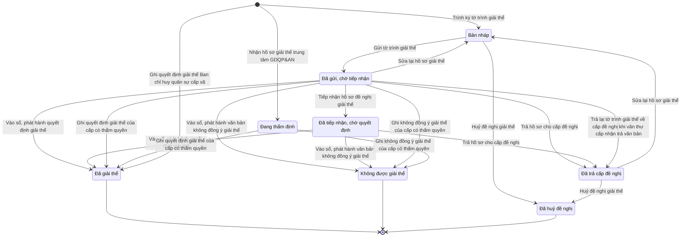

# qt-31 · Giải thể tổ chức

<!-- máy sinh: tom-tat -->
> **Hồ sơ:** Hồ sơ giải thể tổ chức (`DissolutionDossier`)
>
> **Trong sổ phạm vi:** 31 · Giải thể tổ chức (tầng 1)
>
> 25 bước · 8 chặng · 5 vai · 18 bảng quyết định · 3 hạn · 26 khớp nối.
>
> **Nguồn:** sổ nghiệp vụ `qt-31` · khai báo của app: `dqtv-app/core/processes/unit-organisation/workflow/dissolution.yaml`. Các bảng do máy sinh từ nguồn này.
<!-- hết: tom-tat -->

<!-- viết tay: dien-giai -->
## Diễn giải

*Phần này viết tay, diễn giải lại điều các bảng bên dưới ghi.*

### Quy trình này để làm gì

Quy trình đưa một **đơn vị dân quân tự vệ** tới chỗ có quyết định giải thể: lập tờ trình, ký, gửi, lấy ý kiến, ghi quyết định, rồi khoá tài khoản và thu hồi con dấu.

Hồ sơ đi qua tám chặng: `SIGNING` → `SIGNED` → `SUBMITTED` → *Đã giải thể*, kèm một nhánh qua Cục Dân quân tự vệ (`DOSSIER_RECEIVED` → `DOSSIER_COMPLETE` → `APPRAISED` → `APPRAISAL_NOTIFIED`) trước khi tới *Đã giải thể*.

### Khi nào bắt đầu

Trợ lý Quân lực bấm **Trình ký tờ trình giải thể đơn vị**: bắt buộc đính tờ trình (PDF) và ghi căn cứ giải thể. Bước này mở hồ sơ, đưa nó vào chặng `SIGNING`, tạo một hồ sơ con *Văn bản đi*, và ghi luôn số chiến sĩ còn đang biên chế (`servingMemberCount`) — hệ cảnh báo số người còn lại ngay khi lập tờ trình giải thể. Tờ trình trước còn chờ ký thì không trình lần nữa được: "tờ trình giải thể đã trình ký — chờ Chỉ huy trưởng ký hoặc trả lại".

### Diễn ra thế nào

1. **`SIGNING`.** Chỉ huy trưởng Ban CHQS xã **Ký tờ trình giải thể** (sang `SIGNED`) hoặc **Trả lại tờ trình giải thể**, phải ghi cần sửa gì.
2. **`SIGNED`.** Vẫn trả lại được. Nhân viên văn thư **Gửi tờ trình giải thể đơn vị**, bắt buộc có tờ trình đã ký, đã ghi số; hồ sơ sang `SUBMITTED`. Nơi nhận tờ trình: `commune_chairman`, `province_military_command`.
3. **`SUBMITTED`.** Trợ lý Quân lực **Ghi nhận ý kiến một bên về giải thể** (lặp được): bắt buộc chọn bên cho ý kiến và ý kiến, kèm văn bản ý kiến (`chairmanConsentDocument`); mỗi lần tạo một hồ sơ con *Ý kiến về việc thành lập, giải thể đơn vị*. Từ đây có hai lối:
   - **Ký quyết định giải thể đơn vị** — hồ sơ sang *Đã giải thể*.
   - Cục Dân quân tự vệ làm bước `receiveOrganizationDossier`, hồ sơ sang `DOSSIER_RECEIVED`.
4. **Nhánh qua Cục** — bốn bước do Cục Dân quân tự vệ làm, người làm phải thuộc cấp trên của chủ hồ sơ: `receiveOrganizationDossier` → `checkOrganizationDossier` (ghi `dossierCompleteAt`, sang `DOSSIER_COMPLETE`) → `appraiseOrganizationProposal` (phải có `appraisalResult`, sang `APPRAISED`) → `notifyAppraisalResult` (phải có `appraisalNoticeNumber`, sang `APPRAISAL_NOTIFIED`). Từ `APPRAISAL_NOTIFIED` tới bước ký quyết định giải thể.
5. **Ký quyết định giải thể đơn vị.** Người làm là Bộ CHQS cấp tỉnh (vai `approver`), phải thuộc đơn vị chủ hồ sơ. Bắt buộc nhập ngày giải thể và bản chụp quyết định giải thể đã ký; số hiệu quyết định ghi đúng theo bản đã ký. Hai bảng quyết định xét bước này (xem Điều kiện chặn).
6. **Đã giải thể.** Ban Dân quân tự vệ, Bộ CHQS cấp tỉnh làm hai bước, người làm phải thuộc cấp trên của chủ hồ sơ: `lockAccount` (khoá tài khoản, ghi `accountLockedAt`) và `revokeSeal` (thu hồi dấu, phải có `sealRevocationScanPath`).

### Kết thúc và để lại gì

Hồ sơ kết thúc ở *Đã giải thể*; hai bước `lockAccount`, `revokeSeal` làm ở chặng này.

Hồ sơ đơn vị có 20 khớp nối với quy trình khác (mục 10), đều ghi ở bước của các quy trình ấy: 29, 16.enlistment, 2, 11, 15, 23, 30, D2, D11.uniform, D12, 7.campaign-registration.

### Điều kiện chặn

- Sai người, sai chặng, thiếu thứ phải có trước thì bước bị chặn, hồ sơ giữ nguyên; nhiều lỗi cùng lúc báo theo thứ tự quyền → chặng → thông tin.
- Bước 2–6 người làm phải là người của đơn vị chủ hồ sơ; sáu bước của Cục và của Ban Dân quân tự vệ tỉnh người làm phải là người của một đơn vị cấp trên của chủ hồ sơ.
- Thứ tự: có trình ký mới ký hoặc trả lại được; đã ký mới gửi được; đã gửi thì không trả lại được nữa; đã gửi mới ghi ý kiến và ký quyết định giải thể được.
- Bảng `disband-members-remain` (3 dòng): `servingMemberCount` từ 1, hoặc để trống, thì không ký được quyết định giải thể (`members-remain`). Trợ lý phải chuyển người sang đơn vị khác hoặc cho thôi theo căn cứ riêng trước; giải thể không phải căn cứ cho thôi.
- Bảng `unit-disband-authority` (8 dòng): mỗi `organizationType` cho ra một mã (`AC-CUC`, `AC-PDQqk`, `AC-TLQL`, `AC-BDQt`), cả bốn kết quả đều cho hồ sơ sang *Đã giải thể*; `organizationType` để trống thì chặn (`type-unset`).
<!-- hết viết tay -->

## 1. Đường đi ngắn nhất qua các chặng

<!-- máy sinh: luong-chinh -->
Đường ít bước nhất từ lúc mở hồ sơ tới chặng kết thúc xa nhất. Máy chọn theo số chặng, không theo ý nghĩa nghiệp vụ — trình tự công việc thật xem phần Diễn giải và bảng "Việc làm ở từng chặng" ở mục 6.

| # | Ai làm | Làm gì | Hồ sơ sang chặng |
|---|---|---|---|
| 1 | Phòng Kế hoạch tổng hợp, Cục Dân quân tự vệ | Nhận hồ sơ giải thể trung tâm GDQP&AN | Đang thẩm định |
| 2 | Phòng Kế hoạch tổng hợp, Cục Dân quân tự vệ | Ghi không đồng ý giải thể của cấp có thẩm quyền | Không được giải thể |

<!-- hết: luong-chinh -->

## 2. Hồ sơ và việc nó để lại

<!-- máy sinh: muc-tieu -->
**App gọi quy trình này là:** Giải thể tổ chức.

**Khi mở, hồ sơ này ghi mối nối tới:**
- Ban chỉ huy quân sự cơ quan, tổ chức (29) — bước `requestDisbandSignature`, khớp nối `dissolutionOfBoard`
- Ban chỉ huy quân sự cấp xã (29.command-board) — bước `recordBoardDisbandDecision`, khớp nối `dissolutionOfCommandBoard`
- Chỉ tiêu (2) — bước `receiveDissolutionDossier`, khớp nối `dissolutionUnderTarget`
- Chỉ tiêu (2) — bước `requestDisbandSignature`, khớp nối `dissolutionUnderTarget`
- Nhiệm vụ trên giao (1) — bước `receiveDissolutionDossier`, khớp nối `dissolutionDossierServesTasking`
- Nhiệm vụ trên giao (1) — bước `requestDisbandSignature`, khớp nối `dissolutionDossierServesTasking`
- Trung tâm giáo dục quốc phòng và an ninh (29) — bước `receiveDissolutionDossier`, khớp nối `dissolutionOfCentre`
- Văn bản đi (1.outgoing-document) — bước `requestDisbandSignature`, khớp nối `dissolutionDossierSubmittedByDocument`
- Văn bản đến (1.incoming-document) — bước `receiveDissolutionDossier`, khớp nối `receiveDissolutionDossierFromIncomingDocument`
- Văn bản đến (1.incoming-document) — bước `recordBoardDisbandDecision`, khớp nối `dissolutionDecisionDeliveredAs`
- Văn bản đến (1.incoming-document) — bước `recordBoardDisbandDecision`, khớp nối `dissolutionDossierDecidedByIncomingDocument`
- Đơn vị dân quân tự vệ (29) — bước `requestDisbandSignature`, khớp nối `dissolutionOfUnit`

**Hồ sơ này để lại cho quy trình khác** (bước tạo hồ sơ của quy trình kia ghi mối nối về đây):
- Hồ sơ thẩm định dùng chung (nhận, kiểm đủ, thẩm định, thông báo) (29.appraisal) — bước `openAppraisalOfDissolution`, khớp nối `appraisalOfDissolution`
<!-- hết: muc-tieu -->

## 3. Khởi phát và kết thúc

<!-- máy sinh: khoi-phat -->
**3 cửa vào** — bước mở hồ sơ:

| Bước mở | Ai mở | Hồ sơ vào chặng | App bắt buộc nhập |
|---|---|---|---|
| Trình ký tờ trình giải thể | Trợ lý Quân lực | Bản nháp | tên tổ chức, `draftFilePath` |
| Nhận hồ sơ giải thể trung tâm GDQP&AN | Phòng Kế hoạch tổng hợp, Cục Dân quân tự vệ | Đang thẩm định | `centreId`, loại tổ chức, nhà trường chủ quản đề nghị, phương án xử lý khi giải thể trung tâm (tệp), tóm tắt phương án xử lý, `incomingDocumentId` |
| Ghi quyết định giải thể Ban chỉ huy quân sự cấp xã | Ban Dân quân tự vệ, Bộ CHQS cấp tỉnh | Đã giải thể | `commandBoardIds`, `incomingDocumentId` |

**Kết thúc:** *Đã giải thể* (`DISBANDED`), *Không được giải thể* (`DISBAND_REFUSED`), *Đã huỷ đề nghị* (`CANCELLED`)
<!-- hết: khoi-phat -->

## 4. Vai trò

<!-- máy sinh: vai-tro -->
| Vai trong sổ | Tên trong app | Điều kiện | Làm những bước |
|---|---|---|---|
| `personnel` | Trợ lý Quân lực |  | Trình ký tờ trình giải thể · Sửa lại hồ sơ giải thể · Huỷ đề nghị giải thể · Ghi nhận ý kiến Chủ tịch UBND xã về giải thể · Tiếp nhận hồ sơ đề nghị giải thể · Trình ký văn bản trả hồ sơ cho cấp đề nghị · Trình ký quyết định giải thể (`requestDisbandDecisionSignatureForCommune`) · Trình ký quyết định giải thể (`requestDisbandDecisionSignatureForProvince`) · Trình ký quyết định giải thể (`requestDisbandDecisionSignatureForMilitaryRegion`) · Trình ký văn bản không đồng ý giải thể (`requestDisbandRefusalSignatureForCommune`) · Trình ký văn bản không đồng ý giải thể (`requestDisbandRefusalSignatureForProvince`) · Trình ký văn bản không đồng ý giải thể (`requestDisbandRefusalSignatureForMilitaryRegion`) |
| `clerk` | Nhân viên văn thư |  | Gửi tờ trình giải thể · Vào sổ, phát hành quyết định giải thể · Vào sổ, phát hành văn bản không đồng ý giải thể |
| `AC-BDQt` | Ban Dân quân tự vệ, Bộ CHQS cấp tỉnh | thuộc cấp trên của chủ hồ sơ (`actorInSuperiorUnit`, công thức ở mục 7) | Ghi ý kiến của Bộ CHQS tỉnh về giải thể |
| `system` | Hệ thống tự làm |  | Trả hồ sơ cho cấp đề nghị · Trả lại tờ trình giải thể về cấp đề nghị khi văn thư cấp nhận trả văn bản · Đánh dấu hồ sơ giải thể quá hạn |
| `AC-PKH` | Phòng Kế hoạch tổng hợp, Cục Dân quân tự vệ |  | Nhận hồ sơ giải thể trung tâm GDQP&AN · Ghi quyết định giải thể của cấp có thẩm quyền · Ghi không đồng ý giải thể của cấp có thẩm quyền |
| `AC-BDQt` | Ban Dân quân tự vệ, Bộ CHQS cấp tỉnh |  | Ghi quyết định giải thể Ban chỉ huy quân sự cấp xã · Ghi thu hồi con dấu · Khoá tài khoản nhẹ của Ban CHQS |

*"Tên trong app" là tên app đặt cho mã chủ thể của vai. Hồ sơ thuộc đơn vị cấp khác thì người làm là người giữ vai ấy ở đơn vị nêu trong cột "Điều kiện" (nếu sổ có ghi) và ở cột "Người làm phải thuộc" của bảng "Theo khai báo của app" (mục 7).*
<!-- hết: vai-tro -->

## 5. Nhánh phụ

<!-- máy sinh: nhanh-phu -->
**Bước khác đưa hồ sơ sang chặng mới** — đường song song, rẽ nhánh hoặc kết thúc sớm:

| Bước | Ai làm | Từ chặng | Sang chặng |
|---|---|---|---|
| Gửi tờ trình giải thể | Nhân viên văn thư | Bản nháp | Đã gửi, chờ tiếp nhận |
| Huỷ đề nghị giải thể | Trợ lý Quân lực | Bản nháp, Đã trả cấp đề nghị | Đã huỷ đề nghị |
| Tiếp nhận hồ sơ đề nghị giải thể | Trợ lý Quân lực | Đã gửi, chờ tiếp nhận | Đã tiếp nhận, chờ quyết định |
| Trả hồ sơ cho cấp đề nghị | Hệ thống tự làm | Đã gửi, chờ tiếp nhận, Đã tiếp nhận, chờ quyết định | Đã trả cấp đề nghị |
| Trả lại tờ trình giải thể về cấp đề nghị khi văn thư cấp nhận trả văn bản | Hệ thống tự làm | Đã gửi, chờ tiếp nhận | Đã trả cấp đề nghị |
| Vào sổ, phát hành quyết định giải thể | Nhân viên văn thư | Đã gửi, chờ tiếp nhận, Đã tiếp nhận, chờ quyết định | Đã giải thể |
| Ghi quyết định giải thể của cấp có thẩm quyền | Phòng Kế hoạch tổng hợp, Cục Dân quân tự vệ | Đã gửi, chờ tiếp nhận, Đang thẩm định | Đã giải thể |
| Vào sổ, phát hành văn bản không đồng ý giải thể | Nhân viên văn thư | Đã gửi, chờ tiếp nhận, Đã tiếp nhận, chờ quyết định | Không được giải thể |

**Quay lại một chặng hồ sơ đã đi qua** (tính theo đường ngắn nhất từ lúc mở):

| Bước | Ai làm | Từ chặng | Về chặng |
|---|---|---|---|
| Sửa lại hồ sơ giải thể | Trợ lý Quân lực | Đã gửi, chờ tiếp nhận, Đã trả cấp đề nghị | Bản nháp |

**Làm trong lúc hồ sơ đứng yên ở một chặng** — ghi nhận, bổ sung:

| Bước | Ai làm | Ở chặng |
|---|---|---|
| Ghi nhận ý kiến Chủ tịch UBND xã về giải thể *(lặp được)* | Trợ lý Quân lực | Đã gửi, chờ tiếp nhận |
| Ghi ý kiến của Bộ CHQS tỉnh về giải thể *(lặp được)* | Ban Dân quân tự vệ, Bộ CHQS cấp tỉnh (thuộc cấp trên của chủ hồ sơ) | Đã gửi, chờ tiếp nhận |
| Trình ký văn bản trả hồ sơ cho cấp đề nghị | Trợ lý Quân lực | Đã gửi, chờ tiếp nhận, Đã tiếp nhận, chờ quyết định |
| Trình ký quyết định giải thể (`requestDisbandDecisionSignatureForCommune`) | Trợ lý Quân lực | Đã gửi, chờ tiếp nhận |
| Trình ký quyết định giải thể (`requestDisbandDecisionSignatureForProvince`) | Trợ lý Quân lực | Đã gửi, chờ tiếp nhận, Đã tiếp nhận, chờ quyết định |
| Trình ký quyết định giải thể (`requestDisbandDecisionSignatureForMilitaryRegion`) | Trợ lý Quân lực | Đã gửi, chờ tiếp nhận, Đã tiếp nhận, chờ quyết định |
| Trình ký văn bản không đồng ý giải thể (`requestDisbandRefusalSignatureForCommune`) | Trợ lý Quân lực | Đã gửi, chờ tiếp nhận |
| Trình ký văn bản không đồng ý giải thể (`requestDisbandRefusalSignatureForProvince`) | Trợ lý Quân lực | Đã gửi, chờ tiếp nhận, Đã tiếp nhận, chờ quyết định |
| Trình ký văn bản không đồng ý giải thể (`requestDisbandRefusalSignatureForMilitaryRegion`) | Trợ lý Quân lực | Đã gửi, chờ tiếp nhận, Đã tiếp nhận, chờ quyết định |
| Ghi thu hồi con dấu | Ban Dân quân tự vệ, Bộ CHQS cấp tỉnh | Đã giải thể |
| Khoá tài khoản nhẹ của Ban CHQS | Ban Dân quân tự vệ, Bộ CHQS cấp tỉnh | Đã giải thể |
| Đánh dấu hồ sơ giải thể quá hạn | Hệ thống tự làm | Đã gửi, chờ tiếp nhận, Đã tiếp nhận, chờ quyết định |

**Cửa vào khác:** 3 bước cùng mở hồ sơ — xem mục 3.

<!-- hết: nhanh-phu -->

## 6. Các chặng và việc làm ở từng chặng

<!-- máy sinh: chang -->
| Chặng | Tên hiển thị | Vào bằng bước | Kết thúc? |
|---|---|---|---|
| `DRAFT` | Bản nháp | Trình ký tờ trình giải thể · Sửa lại hồ sơ giải thể |  |
| `SUBMITTED` | Đã gửi, chờ tiếp nhận | Gửi tờ trình giải thể |  |
| `ACCEPTED` | Đã tiếp nhận, chờ quyết định | Tiếp nhận hồ sơ đề nghị giải thể |  |
| `RETURNED` | Đã trả cấp đề nghị | Trả hồ sơ cho cấp đề nghị · Trả lại tờ trình giải thể về cấp đề nghị khi văn thư cấp nhận trả văn bản |  |
| `UNDER_APPRAISAL` | Đang thẩm định | Nhận hồ sơ giải thể trung tâm GDQP&AN |  |
| `DISBANDED` | Đã giải thể | Vào sổ, phát hành quyết định giải thể · Ghi quyết định giải thể của cấp có thẩm quyền · Ghi quyết định giải thể Ban chỉ huy quân sự cấp xã | **kết thúc** — vẫn còn bước làm được |
| `DISBAND_REFUSED` | Không được giải thể | Vào sổ, phát hành văn bản không đồng ý giải thể · Ghi không đồng ý giải thể của cấp có thẩm quyền | **kết thúc** |
| `CANCELLED` | Đã huỷ đề nghị | Huỷ đề nghị giải thể | **kết thúc** |

### Việc làm ở từng chặng

Hồ sơ đang ở chặng nào thì làm được những bước nào.

| Hồ sơ đang ở chặng | Bước làm tại chặng (hồ sơ đứng yên) | Bước đưa hồ sơ sang chặng khác |
|---|---|---|
| **Bản nháp** | — | Gửi tờ trình giải thể — Nhân viên văn thư → *Đã gửi, chờ tiếp nhận* Huỷ đề nghị giải thể — Trợ lý Quân lực → *Đã huỷ đề nghị* |
| **Đã gửi, chờ tiếp nhận** | Ghi nhận ý kiến Chủ tịch UBND xã về giải thể (lặp được) — Trợ lý Quân lực Ghi ý kiến của Bộ CHQS tỉnh về giải thể (lặp được) — Ban Dân quân tự vệ, Bộ CHQS cấp tỉnh (thuộc cấp trên của chủ hồ sơ) Trình ký văn bản trả hồ sơ cho cấp đề nghị — Trợ lý Quân lực Trình ký quyết định giải thể (`requestDisbandDecisionSignatureForCommune`) — Trợ lý Quân lực Trình ký quyết định giải thể (`requestDisbandDecisionSignatureForProvince`) — Trợ lý Quân lực Trình ký quyết định giải thể (`requestDisbandDecisionSignatureForMilitaryRegion`) — Trợ lý Quân lực Trình ký văn bản không đồng ý giải thể (`requestDisbandRefusalSignatureForCommune`) — Trợ lý Quân lực Trình ký văn bản không đồng ý giải thể (`requestDisbandRefusalSignatureForProvince`) — Trợ lý Quân lực Trình ký văn bản không đồng ý giải thể (`requestDisbandRefusalSignatureForMilitaryRegion`) — Trợ lý Quân lực Đánh dấu hồ sơ giải thể quá hạn — Hệ thống tự làm | Sửa lại hồ sơ giải thể — Trợ lý Quân lực → *Bản nháp* Tiếp nhận hồ sơ đề nghị giải thể — Trợ lý Quân lực → *Đã tiếp nhận, chờ quyết định* Trả hồ sơ cho cấp đề nghị — Hệ thống tự làm → *Đã trả cấp đề nghị* Trả lại tờ trình giải thể về cấp đề nghị khi văn thư cấp nhận trả văn bản — Hệ thống tự làm → *Đã trả cấp đề nghị* Vào sổ, phát hành quyết định giải thể — Nhân viên văn thư → *Đã giải thể* Ghi quyết định giải thể của cấp có thẩm quyền — Phòng Kế hoạch tổng hợp, Cục Dân quân tự vệ → *Đã giải thể* Vào sổ, phát hành văn bản không đồng ý giải thể — Nhân viên văn thư → *Không được giải thể* Ghi không đồng ý giải thể của cấp có thẩm quyền — Phòng Kế hoạch tổng hợp, Cục Dân quân tự vệ → *Không được giải thể* |
| **Đã tiếp nhận, chờ quyết định** | Trình ký văn bản trả hồ sơ cho cấp đề nghị — Trợ lý Quân lực Trình ký quyết định giải thể (`requestDisbandDecisionSignatureForProvince`) — Trợ lý Quân lực Trình ký quyết định giải thể (`requestDisbandDecisionSignatureForMilitaryRegion`) — Trợ lý Quân lực Trình ký văn bản không đồng ý giải thể (`requestDisbandRefusalSignatureForProvince`) — Trợ lý Quân lực Trình ký văn bản không đồng ý giải thể (`requestDisbandRefusalSignatureForMilitaryRegion`) — Trợ lý Quân lực Đánh dấu hồ sơ giải thể quá hạn — Hệ thống tự làm | Trả hồ sơ cho cấp đề nghị — Hệ thống tự làm → *Đã trả cấp đề nghị* Vào sổ, phát hành quyết định giải thể — Nhân viên văn thư → *Đã giải thể* Vào sổ, phát hành văn bản không đồng ý giải thể — Nhân viên văn thư → *Không được giải thể* |
| **Đã trả cấp đề nghị** | — | Sửa lại hồ sơ giải thể — Trợ lý Quân lực → *Bản nháp* Huỷ đề nghị giải thể — Trợ lý Quân lực → *Đã huỷ đề nghị* |
| **Đang thẩm định** | — | Ghi quyết định giải thể của cấp có thẩm quyền — Phòng Kế hoạch tổng hợp, Cục Dân quân tự vệ → *Đã giải thể* Ghi không đồng ý giải thể của cấp có thẩm quyền — Phòng Kế hoạch tổng hợp, Cục Dân quân tự vệ → *Không được giải thể* |
| **Đã giải thể** | Ghi thu hồi con dấu — Ban Dân quân tự vệ, Bộ CHQS cấp tỉnh Khoá tài khoản nhẹ của Ban CHQS — Ban Dân quân tự vệ, Bộ CHQS cấp tỉnh | — (kết thúc) |
| **Không được giải thể** | — | — (kết thúc) |
| **Đã huỷ đề nghị** | — | — (kết thúc) |
<!-- hết: chang -->

## 7. Bảng bước

<!-- máy sinh: buoc -->
| # | Bước | Mã bước | Ai thực hiện | Từ chặng | Sang chặng | Phải có trước | Ghi lại |
|---|---|---|---|---|---|---|---|
| 1 | Trình ký tờ trình giải thể | `requestDisbandSignature` | Trợ lý Quân lực | — (mở hồ sơ) | `DRAFT` | `originWorkChosen`, `noDissolutionDossierSubmittedDocumentOpen` | loại tổ chức, cấp, ngày lập đề nghị, đơn vị chủ hồ sơ, cấp trên của chủ hồ sơ, `appraisalDone`, `communeUnit`, đơn vị có thẩm quyền quyết định, cấp quyết tự lập hồ sơ, cấp lập hồ sơ, nối tới Văn bản đi, nối tới Chỉ tiêu, nối tới Nhiệm vụ trên giao, nối tới Đơn vị dân quân tự vệ, nối tới Ban chỉ huy quân sự cơ quan, tổ chức, bảng xử lý việc còn gắn với tổ chức |
| 2 | Gửi tờ trình giải thể | `submitDisbandProposal` | Nhân viên văn thư | `DRAFT` | `SUBMITTED` | người làm thuộc đơn vị chủ hồ sơ, `dissolutionDossierSubmittedDocumentIssued` | hạn xử lý, hạn đang chạy, nối `submissionDeliveredAs`; **xoá:** ngày cấp quyết trả lại hồ sơ, lý do trả lại hồ sơ, quá hạn từ |
| 3 | Sửa lại hồ sơ giải thể | `reviseDisbandProposal` | Trợ lý Quân lực | `SUBMITTED`, `RETURNED` | `DRAFT` | người làm thuộc đơn vị chủ hồ sơ, `noReturnDisbandDossierDocumentOpen`, `noDissolutionDossierSubmittedDocumentOpen` | nối tới Văn bản đi, bảng xử lý việc còn gắn với tổ chức; **xoá:** ngày cấp quyết tiếp nhận hồ sơ, hạn xử lý, hạn đang chạy, quá hạn từ |
| 4 | Huỷ đề nghị giải thể | `cancelDisbandProposal` | Trợ lý Quân lực | `DRAFT`, `RETURNED` | `CANCELLED` | người làm thuộc đơn vị chủ hồ sơ | vì sao huỷ đề nghị, ngày huỷ đề nghị |
| 5 | Ghi nhận ý kiến Chủ tịch UBND xã về giải thể | `recordDisbandConsent` | Trợ lý Quân lực | `SUBMITTED` | giữ nguyên | văn bản ý kiến của Chủ tịch xã, người làm thuộc đơn vị chủ hồ sơ, `unitDecidedByCommune` | ý kiến Chủ tịch xã, văn bản ý kiến của Chủ tịch xã, ngày Chủ tịch xã cho ý kiến, nối tới Ý kiến về việc thành lập, giải thể đơn vị |
| 6 | Ghi ý kiến của Bộ CHQS tỉnh về giải thể | `recordProvinceDisbandConsent` | Ban Dân quân tự vệ, Bộ CHQS cấp tỉnh (thuộc cấp trên của chủ hồ sơ) | `SUBMITTED` | giữ nguyên | người làm thuộc cấp trên của chủ hồ sơ, `submissionDistributedAtReceiver`, `unitDecidedByCommune` | ý kiến Bộ CHQS tỉnh, ngày tỉnh cho ý kiến, nối tới Ý kiến về việc thành lập, giải thể đơn vị |
| 7 | Tiếp nhận hồ sơ đề nghị giải thể | `receiveDisbandDossier` | Trợ lý Quân lực | `SUBMITTED` | `ACCEPTED` | `actorInDecidingUnit`, `disbandDossierFromProposingLevel`, `submissionDistributedAtReceiver` | ngày cấp quyết tiếp nhận hồ sơ, bảng xử lý việc còn gắn với tổ chức |
| 8 | Trình ký văn bản trả hồ sơ cho cấp đề nghị | `requestReturnDisbandDossierSignature` | Trợ lý Quân lực | `SUBMITTED`, `ACCEPTED` | giữ nguyên | `disbandDossierFromProposingLevel`, lý do trả hồ sơ — cấp đề nghị cần bổ sung gì, `submissionDistributedAtReceiver`, `noReturnDisbandDossierDocumentOpen`, `actorInDecidingUnit` | lý do trả hồ sơ — cấp đề nghị cần bổ sung gì, nối tới Văn bản đi |
| 9 | Trả hồ sơ cho cấp đề nghị | `returnDisbandDossier` | Hệ thống tự làm | `SUBMITTED`, `ACCEPTED` | `RETURNED` | `returnDisbandDossierDocumentIssued` | ngày cấp quyết trả lại hồ sơ, nối `returnDeliveredAs`; **xoá:** ngày cấp quyết tiếp nhận hồ sơ, hạn xử lý, hạn đang chạy, quá hạn từ |
| 10 | Trả lại tờ trình giải thể về cấp đề nghị khi văn thư cấp nhận trả văn bản | `returnDisbandProposalByReceiver` | Hệ thống tự làm | `SUBMITTED` | `RETURNED` | `disbandDossierFromProposingLevel` | ngày cấp quyết trả lại hồ sơ, lý do trả lại hồ sơ; **xoá:** hạn xử lý, hạn đang chạy, quá hạn từ |
| 11 | Trình ký quyết định giải thể (`requestDisbandDecisionSignatureForCommune`) | `requestDisbandDecisionSignatureForCommune` | Trợ lý Quân lực | `SUBMITTED` | giữ nguyên | `actorInDecidingUnit`, `disbandDossierCheckedOrOwn`, `disbandConsentsSatisfied`, `originWorkChosen`, `pendingItemsHandled`, `noDissolutionDossierDecidedDocumentOpen`, `unitDecidedByCommune` | nối tới Văn bản đi, số chiến sĩ còn đang phục vụ (0 nếu không còn ai), bảng xử lý việc còn gắn với tổ chức; **xoá:** quá hạn từ |
| 12 | Trình ký quyết định giải thể (`requestDisbandDecisionSignatureForProvince`) | `requestDisbandDecisionSignatureForProvince` | Trợ lý Quân lực | `SUBMITTED`, `ACCEPTED` | giữ nguyên | `actorInDecidingUnit`, `disbandDossierCheckedOrOwn`, `disbandConsentsSatisfied`, `originWorkChosen`, `pendingItemsHandled`, `noDissolutionDossierDecidedDocumentOpen`, `unitDecidedByProvince` | nối tới Văn bản đi, số chiến sĩ còn đang phục vụ (0 nếu không còn ai), bảng xử lý việc còn gắn với tổ chức; **xoá:** quá hạn từ |
| 13 | Trình ký quyết định giải thể (`requestDisbandDecisionSignatureForMilitaryRegion`) | `requestDisbandDecisionSignatureForMilitaryRegion` | Trợ lý Quân lực | `SUBMITTED`, `ACCEPTED` | giữ nguyên | `actorInDecidingUnit`, `disbandDossierCheckedOrOwn`, `disbandConsentsSatisfied`, `originWorkChosen`, `pendingItemsHandled`, `noDissolutionDossierDecidedDocumentOpen`, `unitDecidedByMilitaryRegion` | nối tới Văn bản đi, số chiến sĩ còn đang phục vụ (0 nếu không còn ai), bảng xử lý việc còn gắn với tổ chức; **xoá:** quá hạn từ |
| 14 | Vào sổ, phát hành quyết định giải thể | `publishDisbandDecision` | Nhân viên văn thư | `SUBMITTED`, `ACCEPTED` | `DISBANDED` | `actorInDecidingUnit`, `dissolutionDossierDecidedDocumentIssued` | ngày giải thể, nối `decisionDeliveredAs`, số việc còn gắn sinh mới |
| 15 | Nhận hồ sơ giải thể trung tâm GDQP&AN | `receiveDissolutionDossier` | Phòng Kế hoạch tổng hợp, Cục Dân quân tự vệ | — (mở hồ sơ) | `UNDER_APPRAISAL` | `originWorkChosen`, `receiveDissolutionDossierFromIncomingDocumentUsable`, `dissolutionIntakeTaskingAssignedToReceiver` | loại tổ chức, cấp, đơn vị chủ hồ sơ, cấp trên của chủ hồ sơ, nhà trường chủ quản đề nghị, `appraisalDone`, `communeUnit`, nối tới Chỉ tiêu, nối tới Nhiệm vụ trên giao, nối tới Trung tâm giáo dục quốc phòng và an ninh, phương án xử lý khi giải thể trung tâm (tệp), tóm tắt phương án xử lý — học viên, cán bộ, tài sản đi đâu, nối tới Văn bản đến, `id`, đơn vị xử lý trong hệ (Cục Dân quân tự vệ) |
| 16 | Ghi quyết định giải thể của cấp có thẩm quyền | `disbandUnit` | Phòng Kế hoạch tổng hợp, Cục Dân quân tự vệ | `SUBMITTED`, `UNDER_APPRAISAL` | `DISBANDED` | `disbandConsentsSatisfied`, nối tới Văn bản đến, `dissolutionDossierDecidedByIncomingDocumentUsable`, `pendingItemsHandled`, `appraisalSettled` | ngày giải thể, số chiến sĩ còn đang phục vụ (0 nếu không còn ai), nối tới Văn bản đến, số việc còn gắn sinh mới sau lúc chụp bảng (hệ đếm) |
| 17 | Ghi quyết định giải thể Ban chỉ huy quân sự cấp xã | `recordBoardDisbandDecision` | Ban Dân quân tự vệ, Bộ CHQS cấp tỉnh | — (mở hồ sơ) | `DISBANDED` | nối tới Văn bản đến, `dissolutionDossierDecidedByIncomingDocumentUsable` | loại tổ chức, cấp, cấp lập hồ sơ, đơn vị chủ hồ sơ, cấp trên của chủ hồ sơ, ngày giải thể, bảng xử lý trang bị Ban đang giữ, nối tới Ban chỉ huy quân sự cấp xã, nối tới Văn bản đến, nối `decisionDeliveredAs` |
| 18 | Trình ký văn bản không đồng ý giải thể (`requestDisbandRefusalSignatureForCommune`) | `requestDisbandRefusalSignatureForCommune` | Trợ lý Quân lực | `SUBMITTED` | giữ nguyên | `actorInDecidingUnit`, `disbandDossierCheckedOrOwn`, lý do không đồng ý giải thể, `noDissolutionDossierEndedDocumentOpen`, `unitDecidedByCommune` | nối tới Văn bản đi, lý do không đồng ý giải thể; **xoá:** quá hạn từ |
| 19 | Trình ký văn bản không đồng ý giải thể (`requestDisbandRefusalSignatureForProvince`) | `requestDisbandRefusalSignatureForProvince` | Trợ lý Quân lực | `SUBMITTED`, `ACCEPTED` | giữ nguyên | `actorInDecidingUnit`, `disbandDossierCheckedOrOwn`, lý do không đồng ý giải thể, `noDissolutionDossierEndedDocumentOpen`, `unitDecidedByProvince` | nối tới Văn bản đi, lý do không đồng ý giải thể; **xoá:** quá hạn từ |
| 20 | Trình ký văn bản không đồng ý giải thể (`requestDisbandRefusalSignatureForMilitaryRegion`) | `requestDisbandRefusalSignatureForMilitaryRegion` | Trợ lý Quân lực | `SUBMITTED`, `ACCEPTED` | giữ nguyên | `actorInDecidingUnit`, `disbandDossierCheckedOrOwn`, lý do không đồng ý giải thể, `noDissolutionDossierEndedDocumentOpen`, `unitDecidedByMilitaryRegion` | nối tới Văn bản đi, lý do không đồng ý giải thể; **xoá:** quá hạn từ |
| 21 | Vào sổ, phát hành văn bản không đồng ý giải thể | `publishDisbandRefusal` | Nhân viên văn thư | `SUBMITTED`, `ACCEPTED` | `DISBAND_REFUSED` | `actorInDecidingUnit`, `dissolutionDossierEndedDocumentIssued` | ngày không đồng ý giải thể, nối `decisionDeliveredAs` |
| 22 | Ghi không đồng ý giải thể của cấp có thẩm quyền | `refuseDisband` | Phòng Kế hoạch tổng hợp, Cục Dân quân tự vệ | `SUBMITTED`, `UNDER_APPRAISAL` | `DISBAND_REFUSED` | nối tới Văn bản đến, `dissolutionDossierRefusedByIncomingDocumentUsable`, `appraisalSettled` | ngày không đồng ý giải thể, nối tới Văn bản đến |
| 23 | Ghi thu hồi con dấu | `revokeSeal` | Ban Dân quân tự vệ, Bộ CHQS cấp tỉnh | `DISBANDED` | giữ nguyên | giấy tờ thu hồi con dấu (ảnh/bản quét), `actorInOwnerOrSuperiorUnit`, `organizationHoldsSealAndAccount` | giấy tờ thu hồi con dấu (ảnh/bản quét), ngày thu hồi con dấu |
| 24 | Khoá tài khoản nhẹ của Ban CHQS | `lockAccount` | Ban Dân quân tự vệ, Bộ CHQS cấp tỉnh | `DISBANDED` | giữ nguyên | `actorInOwnerOrSuperiorUnit`, `organizationHoldsSealAndAccount` | ngày khoá tài khoản |
| 25 | Đánh dấu hồ sơ giải thể quá hạn | `flagDisbandOverdue` | Hệ thống tự làm | `SUBMITTED`, `ACCEPTED` | giữ nguyên | `deadlineRunningAndNotFlagged` | quá hạn từ |

### Khi không đạt điều kiện

Mặc định: không đúng người, hồ sơ không ở đúng chặng, hoặc thiếu thứ "phải có trước" thì bước bị chặn, hồ sơ giữ nguyên. Bảng dưới chỉ kê những bước có kết quả riêng.

| # | Bước | Kết quả riêng |
|---|---|---|
| 1 | Trình ký tờ trình giải thể | bước dừng lại, hồ sơ giữ nguyên khi kết quả xét là: `refuse` |
| 9 | Trả hồ sơ cho cấp đề nghị | bước này không do người nào bấm |
| 10 | Trả lại tờ trình giải thể về cấp đề nghị khi văn thư cấp nhận trả văn bản | bước này không do người nào bấm |
| 11 | Trình ký quyết định giải thể (`requestDisbandDecisionSignatureForCommune`) | bước dừng lại, hồ sơ giữ nguyên khi kết quả xét là: `members-remain` |
| 12 | Trình ký quyết định giải thể (`requestDisbandDecisionSignatureForProvince`) | bước dừng lại, hồ sơ giữ nguyên khi kết quả xét là: `members-remain` |
| 13 | Trình ký quyết định giải thể (`requestDisbandDecisionSignatureForMilitaryRegion`) | bước dừng lại, hồ sơ giữ nguyên khi kết quả xét là: `members-remain` |
| 15 | Nhận hồ sơ giải thể trung tâm GDQP&AN | bước dừng lại, hồ sơ giữ nguyên khi kết quả xét là: `use-signature` |
| 16 | Ghi quyết định giải thể của cấp có thẩm quyền | bước dừng lại, hồ sơ giữ nguyên khi kết quả xét là: `use-three-roles`, `appraisal-missing`, `type-unset`, `members-remain` |
| 22 | Ghi không đồng ý giải thể của cấp có thẩm quyền | bước dừng lại, hồ sơ giữ nguyên khi kết quả xét là: `use-three-roles` |
| 25 | Đánh dấu hồ sơ giải thể quá hạn | bước này không do người nào bấm |

### Điều kiện "phải có trước" bằng lời

Cột "Phải có trước" ở bảng bước có hai loại: ô dữ liệu thường (bước chỉ đòi ô ấy đã có giá trị) và điều kiện hệ tự xét. Bảng này diễn các điều kiện hệ tự xét theo đúng công thức sổ ghi; số ở cột cuối là số thứ tự bước.

| Điều kiện | Đúng khi | Bước đòi |
|---|---|---|
| `originWorkChosen` | đã có nối tới Chỉ tiêu HOẶC đã có nối tới Nhiệm vụ trên giao | 1, 11, 12, 13, 15 |
| `noDissolutionDossierSubmittedDocumentOpen` | KHÔNG (có hồ sơ Việc luật giao kèm văn bản đến, đi — Văn bản đi (qt-1.outgoing-document) chính là hồ sơ ghi ở ô nối `dissolutionDossierSubmittedByDocument` của hồ sơ đang làm mà hồ sơ ấy đang ở chặng `DRAFT` hoặc `PENDING_SIGNATURE` hoặc `SIGNED`) | 1, 3 |
| `actorInOwnerUnit` | người đang làm là người của đơn vị ghi ở ô đơn vị chủ hồ sơ của hồ sơ này (theo danh mục người của đơn vị, `dm.unit-staff`) | 2, 3, 4, 5 |
| `dissolutionDossierSubmittedDocumentIssued` | có hồ sơ Việc luật giao kèm văn bản đến, đi — Văn bản đi (qt-1.outgoing-document) chính là hồ sơ ghi ở ô nối `dissolutionDossierSubmittedByDocument` của hồ sơ đang làm mà hồ sơ ấy đang ở chặng `ISSUED` | 2 |
| `noReturnDisbandDossierDocumentOpen` | KHÔNG (có hồ sơ Việc luật giao kèm văn bản đến, đi — Văn bản đi (qt-1.outgoing-document) chính là hồ sơ ghi ở ô nối `returnDisbandDossierByDocument` của hồ sơ đang làm mà hồ sơ ấy đang ở chặng `DRAFT` hoặc `PENDING_SIGNATURE` hoặc `SIGNED`) | 3, 8 |
| `unitDecidedByCommune` | loại tổ chức là Đơn vị DQTV do Chỉ huy trưởng Ban CHQS xã quyết định (`commune-level-unit`) | 5, 6, 11, 18 |
| `actorInSuperiorUnit` | người đang làm là người của một đơn vị nằm trong ô cấp trên của chủ hồ sơ của hồ sơ này (theo danh mục người của đơn vị, `dm.unit-staff`) | 6 |
| `submissionDistributedAtReceiver` | có hồ sơ Việc luật giao kèm văn bản đến, đi — Văn bản đến (qt-1.incoming-document) chính là hồ sơ ghi ở ô nối `submissionDeliveredAs` của hồ sơ đang làm mà hồ sơ ấy đang ở chặng `DISTRIBUTED` | 6, 7, 8 |
| `actorInDecidingUnit` | người đang làm là người của đơn vị ghi ở ô đơn vị có thẩm quyền quyết định của hồ sơ này (theo danh mục người của đơn vị, `dm.unit-staff`) | 7, 8, 11, 12, 13, 14, 18, 19, 20, 21 |
| `disbandDossierFromProposingLevel` | cấp quyết tự lập hồ sơ là Cấp đề nghị lập (`no`) VÀ KHÔNG (loại tổ chức là Đơn vị DQTV do Chỉ huy trưởng Ban CHQS xã quyết định (`commune-level-unit`) hoặc Đại đội DQTV pháo binh, pháo phòng không (`aa-artillery-company`) hoặc Ban chỉ huy quân sự bộ (`ministry_military_board`) hoặc Trung tâm GDQP&AN của nhà trường Quân đội (`gdqp_centre_military_school`)) | 7, 8, 10 |
| `returnDisbandDossierDocumentIssued` | có hồ sơ Việc luật giao kèm văn bản đến, đi — Văn bản đi (qt-1.outgoing-document) chính là hồ sơ ghi ở ô nối `returnDisbandDossierByDocument` của hồ sơ đang làm mà hồ sơ ấy đang ở chặng `ISSUED` | 9 |
| `disbandDossierCheckedOrOwn` | cấp quyết tự lập hồ sơ là Cấp quyết tự lập (`yes`) HOẶC hồ sơ đang ở chặng `ACCEPTED` | 11, 12, 13, 18, 19, 20 |
| `disbandConsentsSatisfied` | `communeUnit` là `no` HOẶC (ý kiến Chủ tịch xã là Nhất trí (`agreed`) hoặc Nhất trí có điều kiện (`conditional`) VÀ ý kiến Bộ CHQS tỉnh là Nhất trí (`agreed`) hoặc Nhất trí có điều kiện (`conditional`)) HOẶC loại tổ chức là Ban chỉ huy quân sự cấp xã (`commune-command-board`) | 11, 12, 13, 16 |
| `pendingItemsHandled` | (loại tổ chức là Trung tâm GDQP&AN của nhà trường Quân đội (`gdqp_centre_military_school`) VÀ đã có phương án xử lý khi giải thể trung tâm (tệp) VÀ đã có tóm tắt phương án xử lý) HOẶC (KHÔNG (loại tổ chức là Trung tâm GDQP&AN của nhà trường Quân đội (`gdqp_centre_military_school`)) VÀ đã có bảng xử lý việc còn gắn với tổ chức) | 11, 12, 13, 16 |
| `noDissolutionDossierDecidedDocumentOpen` | KHÔNG (có hồ sơ Việc luật giao kèm văn bản đến, đi — Văn bản đi (qt-1.outgoing-document) chính là hồ sơ ghi ở ô nối `dissolutionDossierDecidedByDocument` của hồ sơ đang làm mà hồ sơ ấy đang ở chặng `DRAFT` hoặc `PENDING_SIGNATURE` hoặc `SIGNED`) | 11, 12, 13 |
| `unitDecidedByProvince` | loại tổ chức là Đại đội dân quân cơ động (`mobile-militia-company`) hoặc Ban chỉ huy quân sự cơ quan, tổ chức (`org-military-board`) hoặc Đơn vị DQTV do Bộ CHQS tỉnh quyết định (`province-level-unit`) | 12, 19 |
| `unitDecidedByMilitaryRegion` | loại tổ chức là Tiểu đoàn tự vệ, hải đội, hải đoàn (`battalion-or-naval-squadron`) | 13, 20 |
| `dissolutionDossierDecidedDocumentIssued` | có hồ sơ Việc luật giao kèm văn bản đến, đi — Văn bản đi (qt-1.outgoing-document) chính là hồ sơ ghi ở ô nối `dissolutionDossierDecidedByDocument` của hồ sơ đang làm mà hồ sơ ấy đang ở chặng `ISSUED` | 14 |
| `receiveDissolutionDossierFromIncomingDocumentUsable` | có hồ sơ Việc luật giao kèm văn bản đến, đi — Văn bản đến (qt-1.incoming-document) chính là hồ sơ ghi ở ô nối `receiveDissolutionDossierFromIncomingDocument` của hồ sơ đang làm mà hồ sơ ấy đang ở chặng `RECEIVED` hoặc `DISTRIBUTED` | 15 |
| `dissolutionIntakeTaskingAssignedToReceiver` | có hồ sơ Việc luật giao kèm văn bản đến, đi (qt-1) (gọi là r) chính là hồ sơ ghi ở ô nối `dissolutionDossierServesTasking` của hồ sơ đang làm mà hồ sơ ấy đang ở chặng `ASSIGNED` hoặc `BROKEN_DOWN` VÀ đã có nối `raisesTasking` VÀ `handlerRole` của hồ sơ r ấy bằng `AC-PKH` VÀ người đang làm là người của đơn vị ghi ở ô đơn vị chủ hồ sơ của hồ sơ r ấy (theo danh mục người của đơn vị, `dm.unit-staff`) | 15 |
| `dissolutionDossierDecidedByIncomingDocumentUsable` | có hồ sơ Việc luật giao kèm văn bản đến, đi — Văn bản đến (qt-1.incoming-document) chính là hồ sơ ghi ở ô nối `dissolutionDossierDecidedByIncomingDocument` của hồ sơ đang làm mà hồ sơ ấy đang ở chặng `RECEIVED` hoặc `DISTRIBUTED` | 16, 17 |
| `appraisalSettled` | KHÔNG (hồ sơ đang ở chặng `UNDER_APPRAISAL`) HOẶC có hồ sơ Thẩm định hồ sơ ở một cấp (tỉnh, quân khu, Cục) — Hồ sơ thẩm định dùng chung (nhận, kiểm đủ, thẩm định, thông báo) (qt-29.appraisal) có ô nối `appraisalOfDissolution` trỏ về chính hồ sơ đang làm mà hồ sơ ấy đang ở chặng `APPRAISAL_NOTIFIED` | 16, 22 |
| `noDissolutionDossierEndedDocumentOpen` | KHÔNG (có hồ sơ Việc luật giao kèm văn bản đến, đi — Văn bản đi (qt-1.outgoing-document) chính là hồ sơ ghi ở ô nối `dissolutionDossierEndedByDocument` của hồ sơ đang làm mà hồ sơ ấy đang ở chặng `DRAFT` hoặc `PENDING_SIGNATURE` hoặc `SIGNED`) | 18, 19, 20 |
| `dissolutionDossierEndedDocumentIssued` | có hồ sơ Việc luật giao kèm văn bản đến, đi — Văn bản đi (qt-1.outgoing-document) chính là hồ sơ ghi ở ô nối `dissolutionDossierEndedByDocument` của hồ sơ đang làm mà hồ sơ ấy đang ở chặng `ISSUED` | 21 |
| `dissolutionDossierRefusedByIncomingDocumentUsable` | có hồ sơ Việc luật giao kèm văn bản đến, đi — Văn bản đến (qt-1.incoming-document) chính là hồ sơ ghi ở ô nối `dissolutionDossierRefusedByIncomingDocument` của hồ sơ đang làm mà hồ sơ ấy đang ở chặng `RECEIVED` hoặc `DISTRIBUTED` | 22 |
| `actorInOwnerOrSuperiorUnit` | người đang làm là người của đơn vị ghi ở ô đơn vị chủ hồ sơ của hồ sơ này HOẶC là người của một đơn vị nằm trong ô cấp trên của chủ hồ sơ của hồ sơ này (theo danh mục người của đơn vị, `dm.unit-staff`) | 23, 24 |
| `organizationHoldsSealAndAccount` | loại tổ chức là Ban chỉ huy quân sự cơ quan, tổ chức (`org-military-board`) hoặc Ban chỉ huy quân sự cấp xã (`commune-command-board`) | 23, 24 |
| `deadlineRunningAndNotFlagged` | đã có hạn xử lý VÀ KHÔNG (đã có quá hạn từ) | 25 |
| `communeLevelType` | loại tổ chức là Đơn vị DQTV do Chỉ huy trưởng Ban CHQS xã quyết định (`commune-level-unit`) | đầu vào bảng quyết định (mục 8) |
| `appraisalNotifiedOnRecord` | có hồ sơ Thẩm định hồ sơ ở một cấp (tỉnh, quân khu, Cục) — Hồ sơ thẩm định dùng chung (nhận, kiểm đủ, thẩm định, thông báo) (qt-29.appraisal) có ô nối `appraisalOfDissolution` trỏ về chính hồ sơ đang làm mà hồ sơ ấy đang ở chặng `APPRAISAL_NOTIFIED` | đầu vào bảng quyết định (mục 8) |

### Theo khai báo của app

Người làm phải thuộc đơn vị nào, ô người dùng phải nhập, bước có lặp được không, và căn cứ pháp lý — lấy từ khai báo quy trình trong app.

| # | Bước | Người làm phải thuộc | Bắt buộc nhập | Nhập nếu có | Lặp được | Căn cứ |
|---|---|---|---|---|---|---|
| 1 | Trình ký tờ trình giải thể |  | tên tổ chức, tờ trình (PDF) | `taskingId`, `planTargetIds`, loại tổ chức, cấp, `unitId`, `boardId`, `centreId`, `unitIds`, `boardIds`, `commandBoardIds`, số chiến sĩ đang phục vụ, ngày lập đề nghị, bảng xử lý việc còn gắn với tổ chức |  | L48/2019/QH14 Đ.22 k2; QĐ2910/2020 thủ tục số 3; NĐ30/2020/NĐ-CP Đ.10, Đ.13 |
| 2 | Gửi tờ trình giải thể | đơn vị chủ hồ sơ | — | — |  | L48/2019/QH14 Đ.22 k2; QĐ2910/2020 thủ tục số 3; NĐ30/2020/NĐ-CP Đ.18, Đ.19 |
| 3 | Sửa lại hồ sơ giải thể | đơn vị chủ hồ sơ | tờ trình đã sửa (PDF) | bảng xử lý việc còn gắn với tổ chức |  | QĐ2910/2020 thủ tục số 3, bước 2; NĐ30/2020/NĐ-CP Đ.10, Đ.13 |
| 4 | Huỷ đề nghị giải thể | đơn vị chủ hồ sơ | vì sao huỷ đề nghị | — |  | QĐ2910/2020 thủ tục số 3; NĐ30/2020/NĐ-CP Đ.13 |
| 5 | Ghi nhận ý kiến Chủ tịch UBND xã về giải thể | đơn vị chủ hồ sơ | ý kiến, ngày Chủ tịch xã cho ý kiến, văn bản ý kiến của Chủ tịch xã | điều kiện kèm theo | có | L48/2019/QH14 Đ.22 k1 d, k2; QĐ2910/2020 thủ tục số 3 |
| 6 | Ghi ý kiến của Bộ CHQS tỉnh về giải thể | cấp trên của chủ hồ sơ | ý kiến | điều kiện kèm theo | có | L48/2019/QH14 Đ.22 k1 d, k2 (sửa khoản 10 Điều 10 L98/2025); QĐ2910/2020 thủ tục số 3 |
| 7 | Tiếp nhận hồ sơ đề nghị giải thể | `decidingUnit` | — | bảng xử lý việc còn gắn với tổ chức |  | QĐ2910/2020 thủ tục số 3, bước 2; L48/2019/QH14 Đ.22 k2 |
| 8 | Trình ký văn bản trả hồ sơ cho cấp đề nghị | `decidingUnit` | lý do trả hồ sơ — cấp đề nghị cần bổ sung gì, dự thảo văn bản trả hồ sơ (PDF) | — |  | QĐ2910/2020 thủ tục số 3, bước 2 · NĐ30/2020/NĐ-CP Đ.13 |
| 9 | Trả hồ sơ cho cấp đề nghị |  | — | — |  | QĐ2910/2020 thủ tục số 3, bước 2 · NĐ30/2020/NĐ-CP Đ.18 |
| 10 | Trả lại tờ trình giải thể về cấp đề nghị khi văn thư cấp nhận trả văn bản |  | — | lý do trả lại hồ sơ, `incomingId` |  | NĐ30/2020/NĐ-CP Đ.21 k2 b |
| 11 | Trình ký quyết định giải thể (`requestDisbandDecisionSignatureForCommune`) | `decidingUnit` | dự thảo quyết định giải thể (PDF) | số chiến sĩ còn đang phục vụ (0 nếu không còn ai), bảng xử lý việc còn gắn với tổ chức |  | L48/2019/QH14 Đ.22 k1, k2; QĐ2910/2020 thủ tục số 3, bước 3; NĐ30/2020/NĐ-CP Đ.10, Đ.13 |
| 12 | Trình ký quyết định giải thể (`requestDisbandDecisionSignatureForProvince`) | `decidingUnit` | dự thảo quyết định giải thể (PDF) | số chiến sĩ còn đang phục vụ (0 nếu không còn ai), bảng xử lý việc còn gắn với tổ chức |  | L48/2019/QH14 Đ.22 k1, k2; QĐ2910/2020 thủ tục số 3, bước 3; NĐ30/2020/NĐ-CP Đ.10, Đ.13 |
| 13 | Trình ký quyết định giải thể (`requestDisbandDecisionSignatureForMilitaryRegion`) | `decidingUnit` | dự thảo quyết định giải thể (PDF) | số chiến sĩ còn đang phục vụ (0 nếu không còn ai), bảng xử lý việc còn gắn với tổ chức |  | L48/2019/QH14 Đ.22 k1, k2; QĐ2910/2020 thủ tục số 3, bước 3; NĐ30/2020/NĐ-CP Đ.10, Đ.13 |
| 14 | Vào sổ, phát hành quyết định giải thể | `decidingUnit` | — | ngày giải thể, số việc còn gắn sinh mới |  | L48/2019/QH14 Đ.22 k1, k2; NĐ30/2020/NĐ-CP Đ.15, Đ.16 k2 a, Đ.18 k1 |
| 15 | Nhận hồ sơ giải thể trung tâm GDQP&AN |  | `centreId`, loại tổ chức, nhà trường chủ quản đề nghị, phương án xử lý khi giải thể trung tâm (tệp), tóm tắt phương án xử lý — học viên, cán bộ, tài sản đi đâu, văn bản đến là hồ sơ đề nghị giải thể nhà trường gửi | `taskingId`, `planTargetIds`, đơn vị xử lý trong hệ (Cục Dân quân tự vệ) |  | QĐ10/2025/QĐ-TTg Đ.8 k2, k3 |
| 16 | Ghi quyết định giải thể của cấp có thẩm quyền |  | quyết định giải thể trong sổ văn bản đến | ngày giải thể, số chiến sĩ còn đang phục vụ (0 nếu không còn ai), người quyết ngoài hệ (BQP — Bộ Quốc phòng, TTMT — Tổng Tham mưu trưởng), số việc còn gắn sinh mới sau lúc chụp bảng (hệ đếm) |  | L48/2019/QH14 Đ.22 k1 a, k2; QĐ10/2025/QĐ-TTg Đ.8, Đ.9; NĐ30/2020/NĐ-CP Đ.3 k6 |
| 17 | Ghi quyết định giải thể Ban chỉ huy quân sự cấp xã |  | `commandBoardIds`, quyết định giải thể trong sổ văn bản đến | ngày giải thể, bảng xử lý trang bị Ban đang giữ |  | L14/2026/QH16 Đ.9 k1, k3 · L48/2019/QH14 Đ.20 (sửa bởi L14/2026) · NĐ30/2020/NĐ-CP Đ.21, Đ.22 |
| 18 | Trình ký văn bản không đồng ý giải thể (`requestDisbandRefusalSignatureForCommune`) | `decidingUnit` | dự thảo văn bản không đồng ý giải thể (PDF), lý do không đồng ý giải thể | — |  | L48/2019/QH14 Đ.22 k2; QĐ2910/2020 thủ tục số 3, bước 3; NĐ30/2020/NĐ-CP Đ.10, Đ.13 |
| 19 | Trình ký văn bản không đồng ý giải thể (`requestDisbandRefusalSignatureForProvince`) | `decidingUnit` | dự thảo văn bản không đồng ý giải thể (PDF), lý do không đồng ý giải thể | — |  | L48/2019/QH14 Đ.22 k2; QĐ2910/2020 thủ tục số 3, bước 3; NĐ30/2020/NĐ-CP Đ.10, Đ.13 |
| 20 | Trình ký văn bản không đồng ý giải thể (`requestDisbandRefusalSignatureForMilitaryRegion`) | `decidingUnit` | dự thảo văn bản không đồng ý giải thể (PDF), lý do không đồng ý giải thể | — |  | L48/2019/QH14 Đ.22 k2; QĐ2910/2020 thủ tục số 3, bước 3; NĐ30/2020/NĐ-CP Đ.10, Đ.13 |
| 21 | Vào sổ, phát hành văn bản không đồng ý giải thể | `decidingUnit` | — | ngày không đồng ý giải thể |  | L48/2019/QH14 Đ.22 k2; NĐ30/2020/NĐ-CP Đ.15, Đ.16 k2 a, Đ.18 k1 |
| 22 | Ghi không đồng ý giải thể của cấp có thẩm quyền |  | văn bản không đồng ý giải thể trong sổ văn bản đến | ngày không đồng ý giải thể, người quyết ngoài hệ (BQP — Bộ Quốc phòng, TTMT — Tổng Tham mưu trưởng) |  | L48/2019/QH14 Đ.22 k2; QĐ10/2025/QĐ-TTg Đ.8, Đ.9; NĐ30/2020/NĐ-CP Đ.3 k6 |
| 23 | Ghi thu hồi con dấu | đơn vị chủ hồ sơ · cấp trên của chủ hồ sơ | giấy tờ thu hồi con dấu (ảnh/bản quét) | ngày thu hồi con dấu |  | L48/2019/QH14 Đ.21 k3; NĐ30/2020/NĐ-CP |
| 24 | Khoá tài khoản nhẹ của Ban CHQS | đơn vị chủ hồ sơ · cấp trên của chủ hồ sơ | — | — |  | 69_ lượt 9 B1c — QĐ; khoá tài khoản |
| 25 | Đánh dấu hồ sơ giải thể quá hạn |  | — | — |  | QĐ2910/QĐ-BQP năm 2020, thủ tục số 3 (10 ngày làm việc kiểm hồ sơ, 05 ngày làm việc ra quyết định); QĐ10/2025/QĐ-TTg Đ.8 (03 · 30 · 25 ngày làm việc) |

### Điều kiện và ghi chú app khai cho từng bước

Lấy từ khai báo quy trình trong app. Lời trong ngoặc kép là câu app hiện cho người dùng. Chức danh người ký ngoài hệ app chỉ khai bằng mã.

| # | Bước | Điều kiện, ghi chú |
|---|---|---|
| 1 | Trình ký tờ trình giải thể | · tạo thêm một hồ sơ con: Văn bản đi (`OutgoingDocument`) |
| 2 | Gửi tờ trình giải thể | · hạn: 10 ngày làm việc — Cơ quan tiếp nhận kiểm tính hợp lệ của hồ sơ và trình cấp có thẩm quyền trong 10 ngày làm việc kể từ ngày nhận được hồ sơ — QĐ2910/2020 thủ tục số 3, bước 2 |
| 3 | Sửa lại hồ sơ giải thể | · tạo thêm một hồ sơ con: Văn bản đi (`OutgoingDocument`) |
| 5 | Ghi nhận ý kiến Chủ tịch UBND xã về giải thể | · tạo thêm một hồ sơ con: Ý kiến về việc thành lập, giải thể đơn vị (`UnitConsent`) |
| 6 | Ghi ý kiến của Bộ CHQS tỉnh về giải thể | · tạo thêm một hồ sơ con: Ý kiến về việc thành lập, giải thể đơn vị (`UnitConsent`) |
| 11 | Trình ký quyết định giải thể (`requestDisbandDecisionSignatureForCommune`) | · tạo thêm một hồ sơ con: Văn bản đi (`OutgoingDocument`) · hạn: 5 ngày làm việc — Cấp có thẩm quyền ra quyết định trong 05 ngày làm việc kể từ ngày nhận được hồ sơ — QĐ2910/2020 thủ tục số 3, bước 3 |
| 12 | Trình ký quyết định giải thể (`requestDisbandDecisionSignatureForProvince`) | · tạo thêm một hồ sơ con: Văn bản đi (`OutgoingDocument`) · hạn: 5 ngày làm việc — Cấp có thẩm quyền ra quyết định trong 05 ngày làm việc kể từ ngày nhận được hồ sơ — QĐ2910/2020 thủ tục số 3, bước 3 |
| 13 | Trình ký quyết định giải thể (`requestDisbandDecisionSignatureForMilitaryRegion`) | · tạo thêm một hồ sơ con: Văn bản đi (`OutgoingDocument`) · hạn: 5 ngày làm việc — Cấp có thẩm quyền ra quyết định trong 05 ngày làm việc kể từ ngày nhận được hồ sơ — QĐ2910/2020 thủ tục số 3, bước 3 |
| 18 | Trình ký văn bản không đồng ý giải thể (`requestDisbandRefusalSignatureForCommune`) | · tạo thêm một hồ sơ con: Văn bản đi (`OutgoingDocument`) · hạn: 5 ngày làm việc — Cấp có thẩm quyền ra quyết định (đồng ý hoặc không đồng ý) trong 05 ngày làm việc kể từ ngày nhận được hồ sơ — QĐ2910/2020 thủ tục số 3, bước 3 |
| 19 | Trình ký văn bản không đồng ý giải thể (`requestDisbandRefusalSignatureForProvince`) | · tạo thêm một hồ sơ con: Văn bản đi (`OutgoingDocument`) · hạn: 5 ngày làm việc — Cấp có thẩm quyền ra quyết định (đồng ý hoặc không đồng ý) trong 05 ngày làm việc kể từ ngày nhận được hồ sơ — QĐ2910/2020 thủ tục số 3, bước 3 |
| 20 | Trình ký văn bản không đồng ý giải thể (`requestDisbandRefusalSignatureForMilitaryRegion`) | · tạo thêm một hồ sơ con: Văn bản đi (`OutgoingDocument`) · hạn: 5 ngày làm việc — Cấp có thẩm quyền ra quyết định (đồng ý hoặc không đồng ý) trong 05 ngày làm việc kể từ ngày nhận được hồ sơ — QĐ2910/2020 thủ tục số 3, bước 3 |
| 25 | Đánh dấu hồ sơ giải thể quá hạn | · phải đã có ô "hạn xử lý" — thiếu thì app báo: "hồ sơ không có hạn nào đang chạy" · không làm được khi đã có ô "quá hạn từ" — app báo: "hồ sơ đã được ghi quá hạn cho hạn đang chạy" |
<!-- hết: buoc -->

## 8. Bảng quyết định, hạn, việc ngoài hệ

<!-- máy sinh: quyet-dinh -->
**Bảng `appraisal-done-by-record`** — xét ở bước *—*; đầu vào: `appraisalNotifiedOnRecord`. 2 dòng, dò từ trên xuống, dòng đầu tiên khớp thì dừng.

| Thứ tự dò (số sổ ghi) | Dòng | Khi | Thì |
|---|---|---|---|
| 0 | `yes` | đã có `appraisalNotifiedOnRecord` | `yes` |
| 1 | `no` | mọi trường hợp còn lại | `no` |

**Bảng `centre-appraisal-required`** — xét ở bước *Ghi quyết định giải thể của cấp có thẩm quyền*; đầu vào: loại tổ chức, `appraisalDone`. 6 dòng, dòng đầu tiên khớp thì dừng.

| Thứ tự dò (số sổ ghi) | Dòng | Khi | Thì |
|---|---|---|---|
| — | `centre-appraised` | loại tổ chức là Trung tâm GDQP&AN của nhà trường Quân đội (`gdqp_centre_military_school`) và `appraisalDone` là `yes` | cho qua |
| — | `centre-not-appraised` | loại tổ chức là Trung tâm GDQP&AN của nhà trường Quân đội (`gdqp_centre_military_school`) và `appraisalDone` là `no` | `appraisal-missing` |
| — | `other-appraised` | loại tổ chức là Đại đội DQTV pháo binh, pháo phòng không (`aa-artillery-company`) hoặc Tiểu đoàn tự vệ, hải đội, hải đoàn (`battalion-or-naval-squadron`) hoặc Đơn vị DQTV do Chỉ huy trưởng Ban CHQS xã quyết định (`commune-level-unit`) hoặc Đại đội dân quân cơ động (`mobile-militia-company`) hoặc Ban chỉ huy quân sự bộ (`ministry_military_board`) hoặc Ban chỉ huy quân sự cơ quan, tổ chức (`org-military-board`) hoặc Đơn vị DQTV do Bộ CHQS tỉnh quyết định (`province-level-unit`) hoặc Ban chỉ huy quân sự cấp xã (`commune-command-board`) và `appraisalDone` là `yes` | cho qua |
| — | `other-not-appraised` | loại tổ chức là Đại đội DQTV pháo binh, pháo phòng không (`aa-artillery-company`) hoặc Tiểu đoàn tự vệ, hải đội, hải đoàn (`battalion-or-naval-squadron`) hoặc Đơn vị DQTV do Chỉ huy trưởng Ban CHQS xã quyết định (`commune-level-unit`) hoặc Đại đội dân quân cơ động (`mobile-militia-company`) hoặc Ban chỉ huy quân sự bộ (`ministry_military_board`) hoặc Ban chỉ huy quân sự cơ quan, tổ chức (`org-military-board`) hoặc Đơn vị DQTV do Bộ CHQS tỉnh quyết định (`province-level-unit`) hoặc Ban chỉ huy quân sự cấp xã (`commune-command-board`) và `appraisalDone` là `no` | cho qua |
| — | `type-unset-no` | chưa có loại tổ chức và `appraisalDone` là `no` | `type-unset` |
| — | `type-unset-yes` | chưa có loại tổ chức và `appraisalDone` là `yes` | `type-unset` |

**Bảng `centre-receipt-only`** — xét ở bước *Nhận hồ sơ giải thể trung tâm GDQP&AN*; đầu vào: loại tổ chức. 2 dòng, dòng đầu tiên khớp thì dừng.

| Thứ tự dò (số sổ ghi) | Dòng | Khi | Thì |
|---|---|---|---|
| — | `centres-by-receipt` | loại tổ chức là Trung tâm GDQP&AN của nhà trường Quân đội (`gdqp_centre_military_school`) | cho qua |
| — | `others-by-signature` | loại tổ chức là Đại đội DQTV pháo binh, pháo phòng không (`aa-artillery-company`) hoặc Tiểu đoàn tự vệ, hải đội, hải đoàn (`battalion-or-naval-squadron`) hoặc Đơn vị DQTV do Chỉ huy trưởng Ban CHQS xã quyết định (`commune-level-unit`) hoặc Đại đội dân quân cơ động (`mobile-militia-company`) hoặc Ban chỉ huy quân sự bộ (`ministry_military_board`) hoặc Ban chỉ huy quân sự cơ quan, tổ chức (`org-military-board`) hoặc Đơn vị DQTV do Bộ CHQS tỉnh quyết định (`province-level-unit`) hoặc Ban chỉ huy quân sự cấp xã (`commune-command-board`) | `use-signature` |

**Bảng `commune-unit-by-type`** — xét ở bước *—*; đầu vào: `communeLevelType`. 2 dòng, dò từ trên xuống, dòng đầu tiên khớp thì dừng.

| Thứ tự dò (số sổ ghi) | Dòng | Khi | Thì |
|---|---|---|---|
| 0 | `yes` | đã có `communeLevelType` | `yes` |
| 1 | `no` | mọi trường hợp còn lại | `no` |

**Bảng `deadline-decision-days`** — xét ở bước *—*; đầu vào: loại tổ chức. 4 dòng, dòng đầu tiên khớp thì dừng.

| Thứ tự dò (số sổ ghi) | Dòng | Khi | Thì |
|---|---|---|---|
| — | `days-25` | loại tổ chức là Trung tâm GDQP&AN của nhà trường Quân đội (`gdqp_centre_military_school`) | `25` |
| — | `days-5` | loại tổ chức là Đại đội DQTV pháo binh, pháo phòng không (`aa-artillery-company`) hoặc Tiểu đoàn tự vệ, hải đội, hải đoàn (`battalion-or-naval-squadron`) hoặc Ban chỉ huy quân sự cấp xã (`commune-command-board`) hoặc Đơn vị DQTV do Chỉ huy trưởng Ban CHQS xã quyết định (`commune-level-unit`) hoặc Đại đội dân quân cơ động (`mobile-militia-company`) hoặc Ban chỉ huy quân sự cơ quan, tổ chức (`org-military-board`) hoặc Đơn vị DQTV do Bộ CHQS tỉnh quyết định (`province-level-unit`) | `5` |
| — | `days-none` | loại tổ chức là Ban chỉ huy quân sự bộ (`ministry_military_board`) | `none` |
| — | `type-unset` | chưa có loại tổ chức | `none` |

**Bảng `deadline-dossier-check-days`** — xét ở bước *—*; đầu vào: loại tổ chức. 4 dòng, dòng đầu tiên khớp thì dừng.

| Thứ tự dò (số sổ ghi) | Dòng | Khi | Thì |
|---|---|---|---|
| — | `days-10` | loại tổ chức là Đại đội DQTV pháo binh, pháo phòng không (`aa-artillery-company`) hoặc Tiểu đoàn tự vệ, hải đội, hải đoàn (`battalion-or-naval-squadron`) hoặc Ban chỉ huy quân sự cấp xã (`commune-command-board`) hoặc Đơn vị DQTV do Chỉ huy trưởng Ban CHQS xã quyết định (`commune-level-unit`) hoặc Đại đội dân quân cơ động (`mobile-militia-company`) hoặc Ban chỉ huy quân sự cơ quan, tổ chức (`org-military-board`) hoặc Đơn vị DQTV do Bộ CHQS tỉnh quyết định (`province-level-unit`) | `10` |
| — | `days-15` | loại tổ chức là Ban chỉ huy quân sự bộ (`ministry_military_board`) | `15` |
| — | `days-30` | loại tổ chức là Trung tâm GDQP&AN của nhà trường Quân đội (`gdqp_centre_military_school`) | `30` |
| — | `type-unset` | chưa có loại tổ chức | `none` |

**Bảng `deadline-receipt-days`** — xét ở bước *—*; đầu vào: loại tổ chức. 3 dòng, dòng đầu tiên khớp thì dừng.

| Thứ tự dò (số sổ ghi) | Dòng | Khi | Thì |
|---|---|---|---|
| — | `days-3` | loại tổ chức là Trung tâm GDQP&AN của nhà trường Quân đội (`gdqp_centre_military_school`) | `3` |
| — | `days-none` | loại tổ chức là Đại đội DQTV pháo binh, pháo phòng không (`aa-artillery-company`) hoặc Tiểu đoàn tự vệ, hải đội, hải đoàn (`battalion-or-naval-squadron`) hoặc Ban chỉ huy quân sự cấp xã (`commune-command-board`) hoặc Đơn vị DQTV do Chỉ huy trưởng Ban CHQS xã quyết định (`commune-level-unit`) hoặc Ban chỉ huy quân sự bộ (`ministry_military_board`) hoặc Đại đội dân quân cơ động (`mobile-militia-company`) hoặc Ban chỉ huy quân sự cơ quan, tổ chức (`org-military-board`) hoặc Đơn vị DQTV do Bộ CHQS tỉnh quyết định (`province-level-unit`) | `none` |
| — | `type-unset` | chưa có loại tổ chức | `none` |

**Bảng `deadline-supplement-guidance-days`** — xét ở bước *—*; đầu vào: loại tổ chức. 4 dòng, dòng đầu tiên khớp thì dừng.

| Thứ tự dò (số sổ ghi) | Dòng | Khi | Thì |
|---|---|---|---|
| — | `days-10` | loại tổ chức là Đại đội DQTV pháo binh, pháo phòng không (`aa-artillery-company`) hoặc Tiểu đoàn tự vệ, hải đội, hải đoàn (`battalion-or-naval-squadron`) hoặc Ban chỉ huy quân sự cấp xã (`commune-command-board`) hoặc Đơn vị DQTV do Chỉ huy trưởng Ban CHQS xã quyết định (`commune-level-unit`) hoặc Đại đội dân quân cơ động (`mobile-militia-company`) hoặc Ban chỉ huy quân sự cơ quan, tổ chức (`org-military-board`) hoặc Đơn vị DQTV do Bộ CHQS tỉnh quyết định (`province-level-unit`) | `none` |
| — | `days-30` | loại tổ chức là Trung tâm GDQP&AN của nhà trường Quân đội (`gdqp_centre_military_school`) | `none` |
| — | `days-5` | loại tổ chức là Ban chỉ huy quân sự bộ (`ministry_military_board`) | `5` |
| — | `type-unset` | chưa có loại tổ chức | `none` |

**Bảng `disband-members-remain`** — xét ở bước *Ghi quyết định giải thể của cấp có thẩm quyền*; đầu vào: số chiến sĩ đang phục vụ. 3 dòng, dòng đầu tiên khớp thì dừng.

| Thứ tự dò (số sổ ghi) | Dòng | Khi | Thì |
|---|---|---|---|
| — | `count-unset` | chưa có số chiến sĩ đang phục vụ | `members-remain` |
| — | `members-remain` | số chiến sĩ đang phục vụ từ 1 | `members-remain` |
| — | `no-members` | số chiến sĩ đang phục vụ nhỏ hơn 1 | cho qua |

**Bảng `disband-members-remain-before-signing-commune`** — xét ở bước *Trình ký quyết định giải thể (`requestDisbandDecisionSignatureForCommune`)*; đầu vào: số chiến sĩ đang phục vụ. 2 dòng, dò từ trên xuống, dòng đầu tiên khớp thì dừng.

| Thứ tự dò (số sổ ghi) | Dòng | Khi | Thì |
|---|---|---|---|
| 1 | `members-remain` | số chiến sĩ đang phục vụ từ 1 | `members-remain` |
| 2 | `otherwise` | mọi trường hợp còn lại | cho qua |

**Bảng `disband-members-remain-before-signing-militaryregion`** — xét ở bước *Trình ký quyết định giải thể (`requestDisbandDecisionSignatureForMilitaryRegion`)*; đầu vào: số chiến sĩ đang phục vụ. 2 dòng, dò từ trên xuống, dòng đầu tiên khớp thì dừng.

| Thứ tự dò (số sổ ghi) | Dòng | Khi | Thì |
|---|---|---|---|
| 1 | `members-remain` | số chiến sĩ đang phục vụ từ 1 | `members-remain` |
| 2 | `otherwise` | mọi trường hợp còn lại | cho qua |

**Bảng `disband-members-remain-before-signing-province`** — xét ở bước *Trình ký quyết định giải thể (`requestDisbandDecisionSignatureForProvince`)*; đầu vào: số chiến sĩ đang phục vụ. 2 dòng, dò từ trên xuống, dòng đầu tiên khớp thì dừng.

| Thứ tự dò (số sổ ghi) | Dòng | Khi | Thì |
|---|---|---|---|
| 1 | `members-remain` | số chiến sĩ đang phục vụ từ 1 | `members-remain` |
| 2 | `otherwise` | mọi trường hợp còn lại | cho qua |

**Bảng `level-by-organization-type`** — xét ở bước *—*; đầu vào: loại tổ chức. 4 dòng, dòng đầu tiên khớp thì dừng.

| Thứ tự dò (số sổ ghi) | Dòng | Khi | Thì |
|---|---|---|---|
| — | `central` | loại tổ chức là Trung tâm GDQP&AN của nhà trường Quân đội (`gdqp_centre_military_school`) hoặc Ban chỉ huy quân sự bộ (`ministry_military_board`) | `central` |
| — | `commune` | loại tổ chức là Đơn vị DQTV do Chỉ huy trưởng Ban CHQS xã quyết định (`commune-level-unit`) | `commune` |
| — | `province` | loại tổ chức là Đại đội dân quân cơ động (`mobile-militia-company`) hoặc Đơn vị DQTV do Bộ CHQS tỉnh quyết định (`province-level-unit`) hoặc Ban chỉ huy quân sự cơ quan, tổ chức (`org-military-board`) hoặc Ban chỉ huy quân sự cấp xã (`commune-command-board`) hoặc Đại đội DQTV pháo binh, pháo phòng không (`aa-artillery-company`) | `province` |
| — | `region` | loại tổ chức là Tiểu đoàn tự vệ, hải đội, hải đoàn (`battalion-or-naval-squadron`) | `region` |

**Bảng `pending-items-changed-at-bureau`** — xét ở bước *Ghi quyết định giải thể của cấp có thẩm quyền*; đầu vào: số việc còn gắn sinh mới. 3 dòng, dòng đầu tiên khớp thì dừng.

| Thứ tự dò (số sổ ghi) | Dòng | Khi | Thì |
|---|---|---|---|
| — | `changed` | số việc còn gắn sinh mới từ 1 | cho qua |
| — | `count-unset` | chưa có số việc còn gắn sinh mới | cho qua |
| — | `unchanged` | số việc còn gắn sinh mới nhỏ hơn 1 | cho qua |

**Bảng `pending-items-changed-at-publishing`** — xét ở bước *Vào sổ, phát hành quyết định giải thể*; đầu vào: số việc còn gắn sinh mới. 3 dòng, dòng đầu tiên khớp thì dừng.

| Thứ tự dò (số sổ ghi) | Dòng | Khi | Thì |
|---|---|---|---|
| — | `changed` | số việc còn gắn sinh mới từ 1 | cho qua |
| — | `count-unset` | chưa có số việc còn gắn sinh mới | cho qua |
| — | `unchanged` | số việc còn gắn sinh mới nhỏ hơn 1 | cho qua |

**Bảng `unit-disband-decider`** — xét ở bước *Ghi quyết định giải thể của cấp có thẩm quyền*; đầu vào: loại tổ chức. 4 dòng, dòng đầu tiên khớp thì dừng.

| Thứ tự dò (số sổ ghi) | Dòng | Khi | Thì |
|---|---|---|---|
| — | `aa-artillery-company` | loại tổ chức là Đại đội DQTV pháo binh, pháo phòng không (`aa-artillery-company`) | cho qua |
| — | `gdqp-centre-military-school` | loại tổ chức là Trung tâm GDQP&AN của nhà trường Quân đội (`gdqp_centre_military_school`) | cho qua |
| — | `ministry-military-board` | loại tổ chức là Ban chỉ huy quân sự bộ (`ministry_military_board`) | cho qua |
| — | `recorder-decides` | loại tổ chức là Tiểu đoàn tự vệ, hải đội, hải đoàn (`battalion-or-naval-squadron`) hoặc Đơn vị DQTV do Chỉ huy trưởng Ban CHQS xã quyết định (`commune-level-unit`) hoặc Đại đội dân quân cơ động (`mobile-militia-company`) hoặc Ban chỉ huy quân sự cơ quan, tổ chức (`org-military-board`) hoặc Đơn vị DQTV do Bộ CHQS tỉnh quyết định (`province-level-unit`) hoặc Ban chỉ huy quân sự cấp xã (`commune-command-board`) | `use-three-roles` |

**Bảng `unit-disband-file-preparer`** — xét ở bước *Trình ký tờ trình giải thể*; đầu vào: loại tổ chức, `actorLevel`. 15 dòng, dòng đầu tiên khớp thì dừng.

| Thứ tự dò (số sổ ghi) | Dòng | Khi | Thì |
|---|---|---|---|
| — | `actor-level-unset` | chưa có `actorLevel` | `refuse` |
| — | `central-by-other` | loại tổ chức là Ban chỉ huy quân sự bộ (`ministry_military_board`) và `actorLevel` là `commune` hoặc `province` hoặc `region` | `refuse` |
| — | `central-by-own` | loại tổ chức là Ban chỉ huy quân sự bộ (`ministry_military_board`) và `actorLevel` là `central` | cho qua |
| — | `centre-by-receipt` | loại tổ chức là Trung tâm GDQP&AN của nhà trường Quân đội (`gdqp_centre_military_school`) và `actorLevel` là `commune` hoặc `province` hoặc `region` hoặc `central` | `refuse` |
| — | `commune-board-by-commune` | loại tổ chức là Ban chỉ huy quân sự cấp xã (`commune-command-board`) và `actorLevel` là `commune` | `refuse` |
| — | `commune-board-by-other` | loại tổ chức là Ban chỉ huy quân sự cấp xã (`commune-command-board`) và `actorLevel` là `region` hoặc `central` | `refuse` |
| — | `commune-board-by-province` | loại tổ chức là Ban chỉ huy quân sự cấp xã (`commune-command-board`) và `actorLevel` là `province` | `refuse` |
| — | `commune-by-other` | loại tổ chức là Đơn vị DQTV do Chỉ huy trưởng Ban CHQS xã quyết định (`commune-level-unit`) và `actorLevel` là `province` hoặc `region` hoặc `central` | `refuse` |
| — | `commune-by-own` | loại tổ chức là Đơn vị DQTV do Chỉ huy trưởng Ban CHQS xã quyết định (`commune-level-unit`) và `actorLevel` là `commune` | cho qua |
| — | `province-by-other` | loại tổ chức là Đại đội dân quân cơ động (`mobile-militia-company`) hoặc Đơn vị DQTV do Bộ CHQS tỉnh quyết định (`province-level-unit`) hoặc Ban chỉ huy quân sự cơ quan, tổ chức (`org-military-board`) hoặc Đại đội DQTV pháo binh, pháo phòng không (`aa-artillery-company`) và `actorLevel` là `region` hoặc `central` | `refuse` |
| — | `province-by-own` | loại tổ chức là Đại đội dân quân cơ động (`mobile-militia-company`) hoặc Đơn vị DQTV do Bộ CHQS tỉnh quyết định (`province-level-unit`) hoặc Ban chỉ huy quân sự cơ quan, tổ chức (`org-military-board`) hoặc Đại đội DQTV pháo binh, pháo phòng không (`aa-artillery-company`) và `actorLevel` là `province` | cho qua |
| — | `province-by-proposer` | loại tổ chức là Đại đội dân quân cơ động (`mobile-militia-company`) hoặc Đơn vị DQTV do Bộ CHQS tỉnh quyết định (`province-level-unit`) hoặc Ban chỉ huy quân sự cơ quan, tổ chức (`org-military-board`) hoặc Đại đội DQTV pháo binh, pháo phòng không (`aa-artillery-company`) và `actorLevel` là `commune` | cho qua |
| — | `region-by-other` | loại tổ chức là Tiểu đoàn tự vệ, hải đội, hải đoàn (`battalion-or-naval-squadron`) và `actorLevel` là `commune` hoặc `central` | `refuse` |
| — | `region-by-own` | loại tổ chức là Tiểu đoàn tự vệ, hải đội, hải đoàn (`battalion-or-naval-squadron`) và `actorLevel` là `region` | cho qua |
| — | `region-by-proposer` | loại tổ chức là Tiểu đoàn tự vệ, hải đội, hải đoàn (`battalion-or-naval-squadron`) và `actorLevel` là `province` | cho qua |

**Bảng `unit-disband-refusal-decider`** — xét ở bước *Ghi không đồng ý giải thể của cấp có thẩm quyền*; đầu vào: loại tổ chức. 4 dòng, dòng đầu tiên khớp thì dừng.

| Thứ tự dò (số sổ ghi) | Dòng | Khi | Thì |
|---|---|---|---|
| — | `aa-artillery-company` | loại tổ chức là Đại đội DQTV pháo binh, pháo phòng không (`aa-artillery-company`) | cho qua |
| — | `gdqp-centre-military-school` | loại tổ chức là Trung tâm GDQP&AN của nhà trường Quân đội (`gdqp_centre_military_school`) | cho qua |
| — | `ministry-military-board` | loại tổ chức là Ban chỉ huy quân sự bộ (`ministry_military_board`) | cho qua |
| — | `use-three-roles` | loại tổ chức là Tiểu đoàn tự vệ, hải đội, hải đoàn (`battalion-or-naval-squadron`) hoặc Đơn vị DQTV do Chỉ huy trưởng Ban CHQS xã quyết định (`commune-level-unit`) hoặc Đại đội dân quân cơ động (`mobile-militia-company`) hoặc Ban chỉ huy quân sự cơ quan, tổ chức (`org-military-board`) hoặc Đơn vị DQTV do Bộ CHQS tỉnh quyết định (`province-level-unit`) hoặc Ban chỉ huy quân sự cấp xã (`commune-command-board`) | `use-three-roles` |

| Hạn | Tính từ | Thời hạn | Quá hạn thì |
|---|---|---|---|
| `decision.deadline.accepted` | khi làm bước Tiếp nhận hồ sơ đề nghị giải thể | {'fact': 'decisionDays'} ngày làm việc | hệ làm bước Đánh dấu hồ sơ giải thể quá hạn |
| `submitDisbandProposal.deadline` | khi làm bước Gửi tờ trình giải thể | {'fact': 'dossierCheckDays'} ngày làm việc | hệ làm bước Đánh dấu hồ sơ giải thể quá hạn |
| `supplementGuidance.deadline` | khi hồ sơ vào chặng Đã gửi, chờ tiếp nhận | {'fact': 'supplementGuidanceDays'} ngày làm việc | hệ làm bước Đánh dấu hồ sơ giải thể quá hạn |

<!-- hết: quyet-dinh -->

## 9. Dữ liệu của hồ sơ

<!-- máy sinh: du-lieu -->
Các ô mà bước trong sổ ghi hoặc đòi. Số trong hai cột cuối là số thứ tự bước ở bảng bước (mục 7).

| Ô dữ liệu | Mã | Kiểu (app) | Giá trị cho phép | Loại ô (sổ) | Bước ghi | Bước đòi | Mô tả trong app |
|---|---|---|---|---|---|---|---|
| loại tổ chức | `organizationType` | chọn một | Đại đội DQTV pháo binh, pháo phòng không (`aa-artillery-company`), Tiểu đoàn tự vệ, hải đội, hải đoàn (`battalion-or-naval-squadron`), Đơn vị DQTV do Chỉ huy trưởng Ban CHQS xã quyết định (`commune-level-unit`), Trung tâm GDQP&AN của nhà trường Quân đội (`gdqp_centre_military_school`), Đại đội dân quân cơ động (`mobile-militia-company`), Ban chỉ huy quân sự bộ (`ministry_military_board`), Ban chỉ huy quân sự cơ quan, tổ chức (`org-military-board`), Đơn vị DQTV do Bộ CHQS tỉnh quyết định (`province-level-unit`), Ban chỉ huy quân sự cấp xã (`commune-command-board`) | đưa vào ở bước (`input`) | 1, 15, 17 | — | Loại tổ chức bị giải thể — quyết định ai ghi, ai quyết (L48/2019 Đ.22 k1, k2; QĐ10/2025/QĐ-TTg Đ.9 k1 — chỉ trung tâm của nhà trường Quân đội; Ban CHQS cấp xã: L48 Đ.20 k2 sửa bởi L14/2026 Đ.9 k1) |
| cấp | `level` | chọn một | Cấp xã (`commune`), Cấp tỉnh (`province`), Quân khu (`region`), Trung ương (`central`) | hệ suy ra (`derived`) | 1, 15, 17 | — | Cấp của tổ chức bị giải thể |
| ngày lập đề nghị | `proposedAt` | ngày |  | lưu trên hồ sơ (`stored`) | 1 | — | Ngày lập đề nghị giải thể |
| đơn vị chủ hồ sơ | `ownerUnit` |  |  | lưu trên hồ sơ (`stored`) | 1, 15, 17 | — |  |
| cấp trên của chủ hồ sơ | `superiorUnits` |  |  | hệ suy ra (`derived`) | 1, 15, 17 | — |  |
| — | `appraisalDone` |  | `yes`, `no` | hệ suy ra (`derived`) | 1, 15 | — |  |
| — | `communeUnit` |  | `yes`, `no` | hệ suy ra (`derived`) | 1, 15 | — |  |
| đơn vị có thẩm quyền quyết định | `decidingUnit` | chữ |  | lưu trên hồ sơ (`stored`) | 1, 15 | — | Đơn vị có thẩm quyền quyết định giải thể — id trong danh mục đơn vị (OrgUnit); trống khi người quyết ở ngoài hệ |
| cấp quyết tự lập hồ sơ | `preparedByDecidingLevel` | chọn một | Cấp quyết tự lập (`yes`), Cấp đề nghị lập (`no`) | đưa vào ở bước (`input`) | 1 | — | Hồ sơ do chính cấp có thẩm quyền quyết lập (yes) hay do cấp đề nghị lập (no) — cấp đề nghị lập thì cấp quyết phải tiếp nhận hồ sơ rồi mới trình ký quyết định |
| cấp lập hồ sơ | `ownerLevel` | chọn một | Cấp xã (`commune`), Cấp tỉnh (`province`), Quân khu (`region`), Trung ương (`central`) | lưu trên hồ sơ (`stored`) | 1, 17 | — | Cấp của đơn vị lập hồ sơ giải thể — bước ký, gửi tờ trình giải theo cấp này, không theo cấp của tổ chức |
| bảng xử lý việc còn gắn với tổ chức | `pendingItemPlan` | bảng |  | đưa vào ở bước (`input`) | 1, 3, 7, 11, 12, 13, 17 | — | Bảng xử lý việc còn gắn với tổ chức: đơn vị con giải thể cùng hay chuyển về đâu, trang bị giao về đơn vị nào, chỉ huy miễn nhiệm theo quyết định — sổ qt-31 pendingItemPlan |
| hạn xử lý | `dueDate` | ngày |  | lưu trên hồ sơ (`stored`) | 2 | — | Hạn của việc đang chạy — tính theo ngày làm việc; trống khi không có hạn nào đang chạy (Ban CHQS bộ, ngành chưa có hạn) |
| hạn đang chạy | `dueKind` | chọn một | Kiểm hồ sơ và trình (10 ngày làm việc) (`dossier_check`), Ra quyết định (05 ngày làm việc) (`decision`), Ký văn bản không đồng ý (05 ngày làm việc) (`refusal`), Kiểm hồ sơ trung tâm đủ thành phần (03 ngày làm việc) (`centre_receipt`), Thẩm định hồ sơ trung tâm (30 ngày làm việc) (`centre_appraisal`), Quyết định giải thể trung tâm (25 ngày làm việc) (`centre_decision`), Nhà trường bổ sung hồ sơ giải thể trung tâm (15 ngày làm việc) (`centre_supplement`), Nhà trường hoàn thiện hồ sơ sau thẩm định (15 ngày làm việc) (`centre_revision`), Thẩm định lại hồ sơ giải thể trung tâm (15 ngày làm việc) (`centre_reappraisal`) | lưu trên hồ sơ (`stored`) | 2 | — | Hạn đang chạy là hạn nào — kiểm hồ sơ và trình (10 ngày làm việc) · ra quyết định (05) · ký văn bản không đồng ý (05) · trung tâm GDQP&AN: kiểm đủ (03), thẩm định (30), quyết định (25), nhà trường bổ… |
| lý do huỷ đề nghị | `cancelReason` | chữ |  | lưu trên hồ sơ (`stored`) | 4 | — | Đơn vị lập huỷ đề nghị giải thể vì sao |
| ngày huỷ đề nghị | `cancelledAt` | ngày |  | lưu trên hồ sơ (`stored`) | 4 | — | Ngày đơn vị lập huỷ đề nghị giải thể |
| ý kiến Chủ tịch xã | `chairmanConsent` | chọn một | Nhất trí (`agreed`), Nhất trí có điều kiện (`conditional`), Không nhất trí (`refused`) | đưa vào ở bước (`input`) | 5 | — | Ý kiến Chủ tịch UBND cấp xã về việc giải thể — Đ.22 k1 d, k2 |
| văn bản ý kiến của Chủ tịch xã | `chairmanConsentDocument` | tệp |  | đưa vào ở bước (`input`) | 5 | 5 | Văn bản ý kiến của Chủ tịch UBND cấp xã (ảnh/bản quét) |
| ngày Chủ tịch xã cho ý kiến | `chairmanConsentAt` | ngày |  | lưu trên hồ sơ (`stored`) | 5 | — | Ngày Chủ tịch UBND cấp xã cho ý kiến |
| ý kiến Bộ CHQS tỉnh | `provinceConsent` | chọn một | Nhất trí (`agreed`), Nhất trí có điều kiện (`conditional`), Không nhất trí (`refused`) | đưa vào ở bước (`input`) | 6 | — | Ý kiến Chỉ huy trưởng Bộ CHQS cấp tỉnh về việc giải thể — Đ.22 k1 d, k2 |
| ngày tỉnh cho ý kiến | `provinceConsentAt` | ngày |  | lưu trên hồ sơ (`stored`) | 6 | — | Ngày Bộ CHQS tỉnh cho ý kiến |
| ngày cấp quyết tiếp nhận hồ sơ | `disbandDossierAcceptedAt` | ngày |  | lưu trên hồ sơ (`stored`) | 7 | — | Ngày cơ quan dân quân của cấp quyết tiếp nhận hồ sơ do cấp đề nghị lập |
| lý do trả lại hồ sơ | `disbandDossierReturnReason` | chữ |  | đưa vào ở bước (`input`) | 8, 10 | 8 | Cấp quyết trả lại hồ sơ vì sao, cần bổ sung gì — lần gần nhất |
| ngày cấp quyết trả lại hồ sơ | `disbandDossierReturnedAt` | ngày |  | lưu trên hồ sơ (`stored`) | 9, 10 | — | Ngày cấp quyết trả lại hồ sơ cho cấp đề nghị để bổ sung — lần gần nhất |
| số chiến sĩ đang phục vụ | `servingMemberCount` | số |  | đưa vào ở bước (`input`) | 11, 12, 13, 16 | — | Số chiến sĩ còn đang phục vụ ở tổ chức lúc trình ký hoặc ghi quyết định giải thể — còn người thì chặn (sổ qt-31 `disband-members-remain`, `disband-members-remain-before-signing`) |
| ngày giải thể | `disbandedAt` | ngày |  | lưu trên hồ sơ (`stored`) | 14, 16, 17 | — | Ngày quyết định giải thể có hiệu lực |
| số việc còn gắn sinh mới | `newPendingItemCount` | số |  | đưa vào ở bước (`input`) | 14, 16 | — | Số việc còn gắn với tổ chức sinh mới sau lúc chụp bảng (đơn vị con, trang bị, người giữ chức) — hệ đếm lúc phát hành hoặc Cục ghi quyết định (sổ qt-31, câu 14a 4/11/2026) |
| nhà trường chủ quản đề nghị | `hostSchool` | chữ |  | đưa vào ở bước (`input`) | 15 | — | Nhà trường chủ quản đề nghị giải thể trung tâm (ngoài hệ) |
| phương án xử lý khi giải thể trung tâm (tệp) | `centreHandlingPlanPath` | tệp |  | đưa vào ở bước (`input`) | 15 | — | Phương án xử lý khi giải thể trung tâm GDQP&AN — tệp nhà trường chủ quản gửi kèm hồ sơ (QĐ10/2025/QĐ-TTg Đ.8) |
| tóm tắt phương án xử lý | `centreHandlingSummary` | chữ |  | đưa vào ở bước (`input`) | 15 | — | Tóm tắt phương án xử lý khi giải thể trung tâm GDQP&AN — học viên, cán bộ, tài sản đi đâu |
| — | `id` |  |  | lưu trên hồ sơ (`stored`) | 15 | — |  |
| lý do không đồng ý giải thể | `disbandRefusalReason` | chữ |  | đưa vào ở bước (`input`) | 18, 19, 20 | 18, 19, 20 | Lý do không đồng ý giải thể — trợ lý của cấp quyết ghi lúc trình dự thảo văn bản không đồng ý |
| ngày không đồng ý giải thể | `refusedAt` | ngày |  | lưu trên hồ sơ (`stored`) | 21, 22 | — | Ngày văn bản không đồng ý giải thể |
| giấy tờ thu hồi con dấu (ảnh/bản quét) | `sealRevocationScanPath` | tệp |  | đưa vào ở bước (`input`) | 23 | 23 | Biên bản, giấy tờ thu hồi con dấu (ảnh/bản quét) |
| ngày thu hồi con dấu | `sealRevokedAt` | ngày |  | lưu trên hồ sơ (`stored`) | 23 | — | Ngày thu hồi con dấu |
| ngày khoá tài khoản | `accountLockedAt` | ngày |  | lưu trên hồ sơ (`stored`) | 24 | — | Ngày khoá tài khoản nhẹ của Ban CHQS cơ quan, tổ chức |
| quá hạn từ | `overdueAt` | ngày |  | lưu trên hồ sơ (`stored`) | 25 | — | Ngày hệ ghi hồ sơ giải thể quá hạn của hạn đang chạy — trống khi hạn chưa quá; bước mở hạn mới xoá mốc này |
| — | `originWorkChosen` |  | có hay chưa | hệ suy ra (`derived`) | — | 1, 11, 12, 13, 15 |  |
| — | `noDissolutionDossierSubmittedDocumentOpen` |  | có hay chưa | hệ suy ra (`derived`) | — | 1, 3 |  |
| người làm thuộc đơn vị chủ hồ sơ | `actorInOwnerUnit` |  | có hay chưa | hệ suy ra (`derived`) | — | 2, 3, 4, 5 |  |
| — | `dissolutionDossierSubmittedDocumentIssued` |  | có hay chưa | hệ suy ra (`derived`) | — | 2 |  |
| — | `noReturnDisbandDossierDocumentOpen` |  | có hay chưa | hệ suy ra (`derived`) | — | 3, 8 |  |
| — | `unitDecidedByCommune` |  | có hay chưa | hệ suy ra (`derived`) | — | 5, 6, 11, 18 |  |
| người làm thuộc cấp trên của chủ hồ sơ | `actorInSuperiorUnit` |  | có hay chưa | hệ suy ra (`derived`) | — | 6 |  |
| — | `submissionDistributedAtReceiver` |  | có hay chưa | hệ suy ra (`derived`) | — | 6, 7, 8 |  |
| — | `actorInDecidingUnit` |  | có hay chưa | hệ suy ra (`derived`) | — | 7, 8, 11, 12, 13, 14, 18, 19, 20, 21 |  |
| — | `disbandDossierFromProposingLevel` |  | có hay chưa | hệ suy ra (`derived`) | — | 7, 8, 10 |  |
| — | `returnDisbandDossierDocumentIssued` |  | có hay chưa | hệ suy ra (`derived`) | — | 9 |  |
| — | `disbandDossierCheckedOrOwn` |  | có hay chưa | hệ suy ra (`derived`) | — | 11, 12, 13, 18, 19, 20 |  |
| — | `disbandConsentsSatisfied` |  | có hay chưa | hệ suy ra (`derived`) | — | 11, 12, 13, 16 |  |
| — | `pendingItemsHandled` |  | có hay chưa | hệ suy ra (`derived`) | — | 11, 12, 13, 16 |  |
| — | `noDissolutionDossierDecidedDocumentOpen` |  | có hay chưa | hệ suy ra (`derived`) | — | 11, 12, 13 |  |
| — | `unitDecidedByProvince` |  | có hay chưa | hệ suy ra (`derived`) | — | 12, 19 |  |
| — | `unitDecidedByMilitaryRegion` |  | có hay chưa | hệ suy ra (`derived`) | — | 13, 20 |  |
| — | `dissolutionDossierDecidedDocumentIssued` |  | có hay chưa | hệ suy ra (`derived`) | — | 14 |  |
| — | `receiveDissolutionDossierFromIncomingDocumentUsable` |  | có hay chưa | hệ suy ra (`derived`) | — | 15 |  |
| — | `dissolutionIntakeTaskingAssignedToReceiver` |  | có hay chưa | hệ suy ra (`derived`) | — | 15 |  |
| — | `dissolutionDossierDecidedByIncomingDocumentUsable` |  | có hay chưa | hệ suy ra (`derived`) | — | 16, 17 |  |
| — | `appraisalSettled` |  | có hay chưa | hệ suy ra (`derived`) | — | 16, 22 |  |
| — | `noDissolutionDossierEndedDocumentOpen` |  | có hay chưa | hệ suy ra (`derived`) | — | 18, 19, 20 |  |
| — | `dissolutionDossierEndedDocumentIssued` |  | có hay chưa | hệ suy ra (`derived`) | — | 21 |  |
| — | `dissolutionDossierRefusedByIncomingDocumentUsable` |  | có hay chưa | hệ suy ra (`derived`) | — | 22 |  |
| — | `actorInOwnerOrSuperiorUnit` |  | có hay chưa | hệ suy ra (`derived`) | — | 23, 24 |  |
| — | `organizationHoldsSealAndAccount` |  | có hay chưa | hệ suy ra (`derived`) | — | 23, 24 |  |
| — | `deadlineRunningAndNotFlagged` |  |  | hệ suy ra (`derived`) | — | 25 |  |
| — | `actorLevel` |  | `commune`, `province`, `region`, `central` | đưa vào ở bước (`input`) | — | — |  |
| — | `communeLevelType` |  | có hay chưa | hệ suy ra (`derived`) | — | — |  |
| — | `appraisalNotifiedOnRecord` |  | có hay chưa | hệ suy ra (`derived`) | — | — |  |

67 ô. Cột "Loại ô" là cách sổ phân loại ô, in kèm đúng chữ của sổ; ô nào người dùng phải nhập xem bảng "Theo khai báo của app" ở mục 7.
<!-- hết: du-lieu -->

## 10. Khớp nối với quy trình khác

<!-- máy sinh: khop-noi -->
| Quy trình kia | Hồ sơ kia | Quan hệ | Nội dung (mô tả trong app) | Bước ghi mối nối | Tên ô nối |
|---|---|---|---|---|---|
| 1 | Nhiệm vụ trên giao | hồ sơ này **mở ra có nối tới** hồ sơ kia | Việc gốc mà hồ sơ giải thể này thực hiện — mọi văn bản đi sinh từ hồ sơ kế thừa việc này (docs/123 §T) | 31·receiveDissolutionDossier ⊕, 31·requestDisbandSignature ⊕ | `dissolutionDossierServesTasking` |
| 1.incoming-document | Văn bản đến | hồ sơ này **mở ra có nối tới** hồ sơ kia | Quyết định giải thể Ban CHQS cấp xã đã chuyển vào Sổ văn bản đến của xã liên quan (N4; NĐ30/2020/NĐ-CP Đ.20–2… | 31·publishDisbandDecision, 31·publishDisbandRefusal, 31·recordBoardDisbandDecision ⊕ | `dissolutionDecisionDeliveredAs` |
| 1.incoming-document | Văn bản đến | hồ sơ này **mở ra có nối tới** hồ sơ kia | Quyết định giải thể của cấp ngoài hệ gửi về — dòng trong Sổ văn bản đến của Cục (NĐ30/2020/NĐ-CP Đ.3 k6) | 31·disbandUnit, 31·recordBoardDisbandDecision ⊕ · đòi: 31·disbandUnit, 31·recordBoardDisbandDecision | `dissolutionDossierDecidedByIncomingDocument` |
| 1.incoming-document | Văn bản đến | gắn với nhau ở một bước giữa chừng | Văn bản không đồng ý giải thể của cấp ngoài hệ gửi về — dòng trong Sổ văn bản đến của Cục (NĐ30/2020/NĐ-CP Đ.… | 31·refuseDisband · đòi: 31·refuseDisband | `dissolutionDossierRefusedByIncomingDocument` |
| 1.incoming-document | Văn bản đến | có nối | Văn bản trả hồ sơ giải thể đã vào Sổ văn bản đến của cấp đề nghị trong hệ (NĐ30/2020/NĐ-CP Đ.20–22) | — | `dissolutionReturnDeliveredAs` |
| 1.incoming-document | Văn bản đến | có nối | Tờ trình giải thể ở Sổ văn bản đến của cấp nhận trong hệ (N2; NĐ30/2020/NĐ-CP Đ.20–22) | — | `dissolutionSubmissionDeliveredAs` |
| 1.incoming-document | Văn bản đến | hồ sơ này **mở ra có nối tới** hồ sơ kia | Hồ sơ đề nghị giải thể trung tâm GDQP&AN nhà trường gửi — văn bản đến đã vào sổ (QĐ10/2025/QĐ-TTg Đ.8 k2; QC2… | 31·receiveDissolutionDossier ⊕ | `receiveDissolutionDossierFromIncomingDocument` |
| 1.incoming-document | Văn bản đến | có nối | Hồ sơ giải thể hoàn thiện sau thẩm định nhà trường gửi lại — văn bản đến đã vào sổ (QĐ10/2025/QĐ-TTg Đ.8 k4) | — | `receiveRevisedDissolutionFromIncomingDocument` |
| 1.incoming-document | Văn bản đến | có nối | Hồ sơ giải thể bổ sung nhà trường gửi lại — văn bản đến đã vào sổ (QĐ10/2025/QĐ-TTg Đ.8 k3) | — | `receiveSupplementedDissolutionFromIncomingDocument` |
| 1.outgoing-document | Văn bản đi | gắn với nhau ở một bước giữa chừng | Văn bản thông báo kết quả thẩm định giải thể trung tâm ở Sổ văn bản đi — sổ qt-31 link.appraisalNoticeByDocum… | 29.appraisal·requestAppraisalNoticeSignature | `appraisalNoticeByDocument` |
| 1.outgoing-document | Văn bản đi | gắn với nhau ở một bước giữa chừng | Quyết định giải thể — sổ văn bản đi của cơ quan ban hành (cấp có thẩm quyền quyết trong hệ, đi ba vai) | 31·requestDisbandDecisionSignatureForCommune, 31·requestDisbandDecisionSignatureForMilitaryRegion, 31·requestDisbandDecisionSignatureForProvince | `dissolutionDossierDecidedByDocument` |
| 1.outgoing-document | Văn bản đi | gắn với nhau ở một bước giữa chừng | Văn bản không đồng ý giải thể — sổ văn bản đi của cơ quan ban hành (cấp có thẩm quyền quyết trong hệ, đi ba v… | 31·requestDisbandRefusalSignatureForCommune, 31·requestDisbandRefusalSignatureForMilitaryRegion, 31·requestDisbandRefusalSignatureForProvince | `dissolutionDossierEndedByDocument` |
| 1.outgoing-document | Văn bản đi | hồ sơ này **mở ra có nối tới** hồ sơ kia | Tờ trình đề nghị giải thể — sổ văn bản đi của cấp đề nghị, mỗi lượt trình một tờ | 31·requestDisbandSignature ⊕, 31·reviseDisbandProposal | `dissolutionDossierSubmittedByDocument` |
| 1.outgoing-document | Văn bản đi | có nối | Văn bản Cục yêu cầu nhà trường hoàn thiện hồ sơ giải thể trung tâm sau thẩm định chưa đạt — sổ văn bản đi của… | — | `dissolutionRevisionByDocument` |
| 1.outgoing-document | Văn bản đi | có nối | Văn bản Cục yêu cầu nhà trường bổ sung hồ sơ giải thể trung tâm GDQP&AN — sổ văn bản đi của Cục | — | `dissolutionSupplementByDocument` |
| 1.outgoing-document | Văn bản đi | gắn với nhau ở một bước giữa chừng | Văn bản trả hồ sơ giải thể cho cấp đề nghị bổ sung — sổ văn bản đi của cấp quyết, mỗi lượt trình một tờ | 31·requestReturnDisbandDossierSignature | `returnDisbandDossierByDocument` |
| 2 | Chỉ tiêu | hồ sơ này **mở ra có nối tới** hồ sơ kia | Dòng chỉ tiêu mà hồ sơ giải thể thực hiện — việc gốc của hồ sơ lấy theo dòng | 31·receiveDissolutionDossier ⊕, 31·requestDisbandSignature ⊕ | `dissolutionUnderTarget` |
| 29 | Ý kiến về việc thành lập, giải thể đơn vị | gắn với nhau ở một bước giữa chừng | Ý kiến của một bên về việc giải thể — Đ.22 k1 d, k2 | 31·recordDisbandConsent, 31·recordProvinceDisbandConsent | `consentOfDissolution` |
| 29 | Ban chỉ huy quân sự cơ quan, tổ chức | hồ sơ này **mở ra có nối tới** hồ sơ kia | Ban CHQS cơ quan, tổ chức mà hồ sơ đề nghị giải thể — một quyết định có thể giải thể nhiều Ban | 31·requestDisbandSignature ⊕ | `dissolutionOfBoard` |
| 29 | Trung tâm giáo dục quốc phòng và an ninh | hồ sơ này **mở ra có nối tới** hồ sơ kia | Trung tâm GDQP&AN mà hồ sơ đề nghị giải thể | 31·receiveDissolutionDossier ⊕ | `dissolutionOfCentre` |
| 29 | Đơn vị dân quân tự vệ | hồ sơ này **mở ra có nối tới** hồ sơ kia | Đơn vị DQTV mà hồ sơ đề nghị giải thể — một quyết định có thể giải thể nhiều đơn vị; quyết định đặt từng đơn… | 31·requestDisbandSignature ⊕ | `dissolutionOfUnit` |
| 29 | Đơn vị dân quân tự vệ | gắn với nhau ở một bước giữa chừng | Hồ sơ giải thể đơn vị cấp trên đã chuyển đơn vị con này sang đơn vị khác — L48/2019/QH14 Đ.15, Đ.22 k2 | 29·moveSubUnitOnDisband | `subUnitMovedByDisband` |
| 29.appraisal | Hồ sơ thẩm định dùng chung (nhận, kiểm đủ, thẩm định, thông báo) | hồ sơ kia **mở ra từ** hồ sơ này | Hồ sơ giải thể tổ chức mà hồ sơ thẩm định này thuộc về (QĐ10/2025/QĐ-TTg Đ.8) | 29.appraisal·openAppraisalOfDissolution ⊕ | `appraisalOfDissolution` |
| 29.command-board | Ban chỉ huy quân sự cấp xã | hồ sơ này **mở ra có nối tới** hồ sơ kia | Ban chỉ huy quân sự cấp xã mà hồ sơ đề nghị giải thể — quyết định phát hành thì hệ đóng Ban (closeBoardOnDisb… | 31·recordBoardDisbandDecision ⊕ | `dissolutionOfCommandBoard` |
| 30 | Chức vụ chỉ huy dân quân tự vệ | gắn với nhau ở một bước giữa chừng | Hồ sơ giải thể mà quyết định của nó làm người giữ chức thôi giữ chức — căn cứ thay đổi tổ chức (L48/2019 Đ.23… | 30·endTenureOnDisband | `commandTenureEndedByDisband` |
| D12 | Trang bị, phương tiện | gắn với nhau ở một bước giữa chừng | Hồ sơ giải thể đơn vị giữ cũ đã giao trang bị này về đơn vị nhận — Luật 42/2024 Đ.9 | D12·transferHolderOnDisband | `equipmentHandedOverByDisband` |

26 khớp nối. ⊕ là bước tạo hồ sơ.
<!-- hết: khop-noi -->

## 11. Thông tin chung

<!-- máy sinh: thong-tin -->
| | |
|---|---|
| **Mã trong sổ** | `qt-31` |
| **Quy trình trong app** | `unit-organisation` (`workflow/dissolution.yaml`) — mặt công tác: `personnel` |
| **Hồ sơ** | Hồ sơ giải thể tổ chức (`DissolutionDossier`) |
| **Căn cứ pháp lý từng bước** | cột "Căn cứ" ở bảng "Theo khai báo của app", mục 7 |
<!-- hết: thong-tin -->
