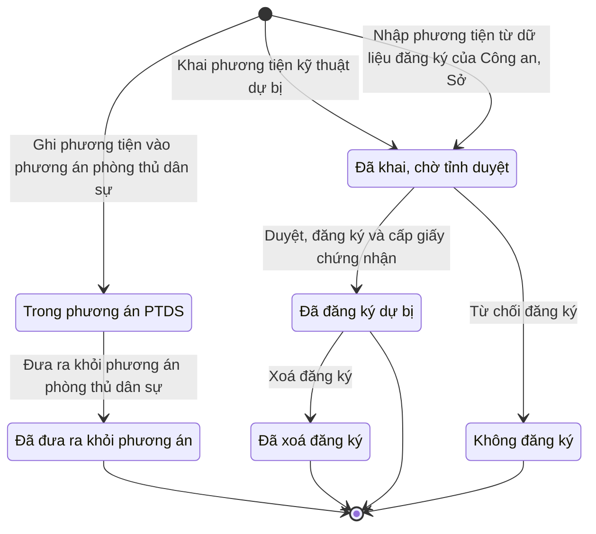

# qt-33 · Sổ phương tiện chung

<!-- máy sinh: tom-tat -->
> **Hồ sơ:** Phương tiện trong sổ (`Vehicle`)
>
> **Trong sổ phạm vi:** 33 · Sổ phương tiện chung — PTKT dự bị (L53 Đ.13 sửa bởi L98/2025, tỉnh đăng ký) + phương tiện chỉ trong phương án PTDS của xã (L18/2023 Đ.19, không cấp giấy, không duyệt; chốt 30/9)
>
> 10 bước · 6 chặng · 2 vai · 1 bảng quyết định · 0 hạn · 4 khớp nối.
>
> **Nguồn:** sổ nghiệp vụ `qt-33` · khai báo của app: `dqtv-app/core/processes/vehicle-register/workflow/vehicle-register.yaml`. Các bảng do máy sinh từ nguồn này.
<!-- hết: tom-tat -->

<!-- viết tay: dien-giai -->
## Diễn giải

*Phần này viết tay, diễn giải lại điều các bảng bên dưới ghi.*

### Quy trình này để làm gì

Đây là **sổ phương tiện chung**, mỗi hồ sơ là một phương tiện. Sổ giữ hai loại, mỗi loại đi một dãy chặng riêng, không bước nào chuyển hồ sơ từ dãy này sang dãy kia:

- **Phương tiện kỹ thuật dự bị** — xã khai hoặc tỉnh nhập, Bộ CHQS cấp tỉnh duyệt, đăng ký và cấp giấy chứng nhận. Chặng: *Đã khai, chờ tỉnh duyệt* → *Đã đăng ký dự bị* (hoặc *Không đăng ký*) → *Đã xoá đăng ký*.
- **Phương tiện chỉ nằm trong phương án phòng thủ dân sự của xã** — xã tự ghi, không duyệt, không cấp giấy. Chặng: *Trong phương án PTDS* → *Đã đưa ra khỏi phương án*.

Tài khoản ở tỉnh là Bộ CHQS tỉnh, ở xã là Trợ lý Quân lực.

### Khi nào bắt đầu

Có bốn cửa vào. Cả bốn đều bắt nhập biển số (số đăng ký), loại phương tiện, chủ phương tiện:

- **Ghi phương tiện vào phương án phòng thủ dân sự** (Trợ lý Quân lực) — thêm ngày ghi vào phương án; hồ sơ vào *Trong phương án PTDS*.
- **Khai phương tiện kỹ thuật dự bị** (Trợ lý Quân lực) — thêm năm khai; có thể chỉ ra phương tiện đang nằm trong phương án phòng thủ dân sự nếu khai từ đó.
- **Khai phương tiện của cơ quan, tổ chức** (Trợ lý Quân lực) — thêm năm khai. Trợ lý Quân lực khai giúp vì cơ quan, tổ chức không có tài khoản trong hệ.
- **Nhập phương tiện từ dữ liệu đăng ký của Công an, Sở** (Bộ CHQS cấp tỉnh) — thêm mã xã, nguồn vào sổ, năm khai; văn bản, tệp nguồn là ô nhập nếu có.

Ba cửa sau đưa hồ sơ vào *Đã khai, chờ tỉnh duyệt*.

### Diễn ra thế nào

**Đường phương án phòng thủ dân sự — chặng "Trong phương án PTDS".** Trợ lý Quân lực (thuộc đơn vị chủ hồ sơ) làm được **Sửa thông tin phương tiện trong phương án** (lặp được) và **Đưa ra khỏi phương án phòng thủ dân sự** — bắt buộc ghi lý do; hồ sơ sang *Đã đưa ra khỏi phương án* và kết thúc.

**Đường dự bị — chặng "Đã khai, chờ tỉnh duyệt".** Bộ CHQS cấp tỉnh chọn một trong hai:

- **Duyệt, đăng ký và cấp giấy chứng nhận** — nhập số giấy chứng nhận, ngày đăng ký, bản quét giấy chứng nhận; nếu là đăng ký lại thì chỉ ra đăng ký cũ của cùng phương tiện. Hồ sơ sang *Đã đăng ký dự bị*.
- **Từ chối đăng ký** — bắt buộc ghi lý do; hồ sơ sang *Không đăng ký* và kết thúc.

**Đường dự bị — chặng "Đã đăng ký dự bị".** Ba việc:

- **Sửa thông tin phương tiện** (Bộ CHQS cấp tỉnh) — sửa loại, chủ, số định danh, địa chỉ, tình trạng kỹ thuật, năng lực; lặp được.
- **Báo thay đổi của phương tiện** (Trợ lý Quân lực) — xã báo bán, hỏng, chuyển đi…; lặp được. Người báo phải là người của đơn vị ghi ở ô `declaringUnit` (`actorInDeclaringUnit`), là ô hai bước khai của xã ghi.
- **Xoá đăng ký** (Bộ CHQS cấp tỉnh) — chọn lý do (năm mã: `transferred_out`, `scrapped`, `lost`, `not_in_catalogue`, `other`) và ngày xoá; hồ sơ sang *Đã xoá đăng ký*.

### Kết thúc và để lại gì

Hồ sơ kết thúc ở một trong bốn chặng: *Đã đăng ký dự bị*, *Không đăng ký*, *Đã xoá đăng ký*, *Đã đưa ra khỏi phương án*. Khớp nối duy nhất: **Dòng sắp xếp** của quy trình 34 chỉ tới phương tiện kỹ thuật dự bị được xếp vào đơn vị.

### Điều kiện chặn

- Bốn bước mở hồ sơ không đòi gì; các bước sau: người làm phải là người của đơn vị chủ hồ sơ; riêng bước báo thay đổi đòi người làm là người của đơn vị ghi ở ô `declaringUnit`.
- Duyệt phải nhập số giấy chứng nhận, ngày đăng ký, bản quét giấy chứng nhận; từ chối, đưa ra khỏi phương án, xoá đăng ký phải ghi lý do.
- **Việc ngoài hệ** (`vehicle-registry-workbook`): bên làm là `provincePublicSecurity` (công an tỉnh). Hệ đọc từ tệp Excel và chỉ nhập những dòng tốt; hệ nhận về `vehicleRows`, không gửi ra gì.
<!-- hết viết tay -->

## 1. Đường đi ngắn nhất qua các chặng

<!-- máy sinh: luong-chinh -->
Đường ít bước nhất từ lúc mở hồ sơ tới chặng kết thúc xa nhất. Máy chọn theo số chặng, không theo ý nghĩa nghiệp vụ — trình tự công việc thật xem phần Diễn giải và bảng "Việc làm ở từng chặng" ở mục 6.

| # | Ai làm | Làm gì | Hồ sơ sang chặng |
|---|---|---|---|
| 1 | Trợ lý Quân lực | Khai phương tiện kỹ thuật dự bị | Đã khai, chờ tỉnh duyệt |
| 2 | Bộ CHQS cấp tỉnh | Duyệt, đăng ký và cấp giấy chứng nhận | Đã đăng ký dự bị |
| 3 | Bộ CHQS cấp tỉnh | Xoá đăng ký | Đã xoá đăng ký |

<!-- hết: luong-chinh -->

## 2. Hồ sơ và việc nó để lại

<!-- máy sinh: muc-tieu -->
**App gọi quy trình này là:** Sổ phương tiện.

**Hồ sơ này để lại cho quy trình khác** (bước tạo hồ sơ của quy trình kia ghi mối nối về đây):
- Vụ việc vi phạm hành chính (10) — bước `openViolationFromSource`, khớp nối `violationFromMobilizedVehicle`
<!-- hết: muc-tieu -->

## 3. Khởi phát và kết thúc

<!-- máy sinh: khoi-phat -->
**3 cửa vào** — bước mở hồ sơ:

| Bước mở | Ai mở | Hồ sơ vào chặng | App bắt buộc nhập |
|---|---|---|---|
| Ghi phương tiện vào phương án phòng thủ dân sự | Trợ lý Quân lực | Trong phương án PTDS | biển số, số đăng ký, loại phương tiện, chủ phương tiện, ghi vào phương án ngày |
| Khai phương tiện kỹ thuật dự bị | Trợ lý Quân lực | Đã khai, chờ tỉnh duyệt | biển số, số đăng ký, loại phương tiện, chủ phương tiện, năm khai |
| Nhập phương tiện từ dữ liệu đăng ký của Công an, Sở | Bộ CHQS cấp tỉnh | Đã khai, chờ tỉnh duyệt | biển số, số đăng ký, loại phương tiện, chủ phương tiện, mã xã, nguồn vào sổ, năm khai |

**Kết thúc:** *Đã đăng ký dự bị* (`REGISTERED`), *Không đăng ký* (`REJECTED`), *Đã xoá đăng ký* (`DEREGISTERED`), *Đã đưa ra khỏi phương án* (`DELISTED`)
<!-- hết: khoi-phat -->

## 4. Vai trò

<!-- máy sinh: vai-tro -->
| Vai trong sổ | Tên trong app | Điều kiện | Làm những bước |
|---|---|---|---|
| `AC-TLQL` | Trợ lý Quân lực |  | Ghi phương tiện vào phương án phòng thủ dân sự · Sửa thông tin phương tiện trong phương án · Đưa ra khỏi phương án phòng thủ dân sự · Khai phương tiện kỹ thuật dự bị · Báo thay đổi của phương tiện |
| `AC-BCHt` | Bộ CHQS cấp tỉnh |  | Nhập phương tiện từ dữ liệu đăng ký của Công an, Sở · Duyệt, đăng ký và cấp giấy chứng nhận · Từ chối đăng ký · Sửa thông tin phương tiện · Xoá đăng ký |

*"Tên trong app" là tên app đặt cho mã chủ thể của vai. Hồ sơ thuộc đơn vị cấp khác thì người làm là người giữ vai ấy ở đơn vị nêu trong cột "Điều kiện" (nếu sổ có ghi) và ở cột "Người làm phải thuộc" của bảng "Theo khai báo của app" (mục 7).*

**Ngoài hệ** (hệ chỉ ghi kết quả, xem mục 8): `provincePublicSecurity`.
<!-- hết: vai-tro -->

## 5. Nhánh phụ

<!-- máy sinh: nhanh-phu -->
**Bước khác đưa hồ sơ sang chặng mới** — đường song song, rẽ nhánh hoặc kết thúc sớm:

| Bước | Ai làm | Từ chặng | Sang chặng |
|---|---|---|---|
| Đưa ra khỏi phương án phòng thủ dân sự | Trợ lý Quân lực | Trong phương án PTDS | Đã đưa ra khỏi phương án |
| Từ chối đăng ký | Bộ CHQS cấp tỉnh | Đã khai, chờ tỉnh duyệt | Không đăng ký |

**Làm trong lúc hồ sơ đứng yên ở một chặng** — ghi nhận, bổ sung:

| Bước | Ai làm | Ở chặng |
|---|---|---|
| Sửa thông tin phương tiện trong phương án *(lặp được)* | Trợ lý Quân lực | Trong phương án PTDS |
| Sửa thông tin phương tiện *(lặp được)* | Bộ CHQS cấp tỉnh | Đã đăng ký dự bị |
| Báo thay đổi của phương tiện *(lặp được)* | Trợ lý Quân lực | Đã đăng ký dự bị |

**Cửa vào khác:** 3 bước cùng mở hồ sơ — xem mục 3.

<!-- hết: nhanh-phu -->

## 6. Các chặng và việc làm ở từng chặng

<!-- máy sinh: chang -->
| Chặng | Tên hiển thị | Vào bằng bước | Kết thúc? |
|---|---|---|---|
| `DECLARED` | Đã khai, chờ tỉnh duyệt | Khai phương tiện kỹ thuật dự bị · Nhập phương tiện từ dữ liệu đăng ký của Công an, Sở |  |
| `REGISTERED` | Đã đăng ký dự bị | Duyệt, đăng ký và cấp giấy chứng nhận | **kết thúc** — vẫn còn bước làm được |
| `REJECTED` | Không đăng ký | Từ chối đăng ký | **kết thúc** |
| `DEREGISTERED` | Đã xoá đăng ký | Xoá đăng ký | **kết thúc** |
| `CIVIL_DEFENCE_LISTED` | Trong phương án PTDS | Ghi phương tiện vào phương án phòng thủ dân sự |  |
| `DELISTED` | Đã đưa ra khỏi phương án | Đưa ra khỏi phương án phòng thủ dân sự | **kết thúc** |

### Việc làm ở từng chặng

Hồ sơ đang ở chặng nào thì làm được những bước nào.

| Hồ sơ đang ở chặng | Bước làm tại chặng (hồ sơ đứng yên) | Bước đưa hồ sơ sang chặng khác |
|---|---|---|
| **Đã khai, chờ tỉnh duyệt** | — | Duyệt, đăng ký và cấp giấy chứng nhận — Bộ CHQS cấp tỉnh → *Đã đăng ký dự bị* Từ chối đăng ký — Bộ CHQS cấp tỉnh → *Không đăng ký* |
| **Đã đăng ký dự bị** | Sửa thông tin phương tiện (lặp được) — Bộ CHQS cấp tỉnh Báo thay đổi của phương tiện (lặp được) — Trợ lý Quân lực | Xoá đăng ký — Bộ CHQS cấp tỉnh → *Đã xoá đăng ký* |
| **Không đăng ký** | — | — (kết thúc) |
| **Đã xoá đăng ký** | — | — (kết thúc) |
| **Trong phương án PTDS** | Sửa thông tin phương tiện trong phương án (lặp được) — Trợ lý Quân lực | Đưa ra khỏi phương án phòng thủ dân sự — Trợ lý Quân lực → *Đã đưa ra khỏi phương án* |
| **Đã đưa ra khỏi phương án** | — | — (kết thúc) |
<!-- hết: chang -->

## 7. Bảng bước

<!-- máy sinh: buoc -->
| # | Bước | Mã bước | Ai thực hiện | Từ chặng | Sang chặng | Phải có trước | Ghi lại |
|---|---|---|---|---|---|---|---|
| 1 | Ghi phương tiện vào phương án phòng thủ dân sự | `listCivilDefenceVehicle` | Trợ lý Quân lực | — (mở hồ sơ) | `CIVIL_DEFENCE_LISTED` | — | `id`, đơn vị chủ hồ sơ, loại sổ, ghi vào phương án ngày, loại phương tiện, biển số, số đăng ký, chủ phương tiện, số định danh của chủ, địa chỉ của chủ, mã xã, tình trạng kỹ thuật, năng lực |
| 2 | Sửa thông tin phương tiện trong phương án | `updateCivilDefenceVehicle` | Trợ lý Quân lực | `CIVIL_DEFENCE_LISTED` | giữ nguyên | người làm thuộc đơn vị chủ hồ sơ | `correctedFields`, `updatedAt` |
| 3 | Đưa ra khỏi phương án phòng thủ dân sự | `delistCivilDefenceVehicle` | Trợ lý Quân lực | `CIVIL_DEFENCE_LISTED` | `DELISTED` | người làm thuộc đơn vị chủ hồ sơ | lý do đưa ra khỏi phương án, đưa ra khỏi phương án ngày |
| 4 | Khai phương tiện kỹ thuật dự bị | `declareVehicle` | Trợ lý Quân lực | — (mở hồ sơ) | `DECLARED` | — | `id`, đơn vị chủ hồ sơ, `declaringUnit`, loại sổ, nguồn vào sổ, năm khai, khai lúc, nối `fromCivilDefenceListing`, loại phương tiện, biển số, số đăng ký, chủ phương tiện, số định danh của chủ, địa chỉ của chủ, mã xã, tình trạng kỹ thuật, năng lực |
| 5 | Nhập phương tiện từ dữ liệu đăng ký của Công an, Sở | `importRegistryVehicle` | Bộ CHQS cấp tỉnh | — (mở hồ sơ) | `DECLARED` | — | `id`, đơn vị chủ hồ sơ, loại sổ, nguồn vào sổ, năm khai, khai lúc, loại phương tiện, biển số, số đăng ký, chủ phương tiện, số định danh của chủ, địa chỉ của chủ, mã xã, tình trạng kỹ thuật, năng lực |
| 6 | Duyệt, đăng ký và cấp giấy chứng nhận | `approveVehicle` | Bộ CHQS cấp tỉnh | `DECLARED` | `REGISTERED` | `actorInOwnerOrSuperiorUnit` | số giấy chứng nhận, ngày đăng ký, nối `supersedesVehicle` |
| 7 | Từ chối đăng ký | `rejectVehicle` | Bộ CHQS cấp tỉnh | `DECLARED` | `REJECTED` | `actorInOwnerOrSuperiorUnit` | lý do không đăng ký |
| 8 | Sửa thông tin phương tiện | `updateVehicle` | Bộ CHQS cấp tỉnh | `REGISTERED` | giữ nguyên | `actorInOwnerOrSuperiorUnit` | `correctedFields`, `updatedAt` |
| 9 | Báo thay đổi của phương tiện | `reportVehicleChange` | Trợ lý Quân lực | `REGISTERED` | giữ nguyên | `actorInDeclaringUnit` | thay đổi xã báo, báo thay đổi lúc |
| 10 | Xoá đăng ký | `deregisterVehicle` | Bộ CHQS cấp tỉnh | `REGISTERED` | `DEREGISTERED` | `actorInOwnerOrSuperiorUnit` | lý do xoá đăng ký, ghi chú lý do xoá đăng ký, ngày xoá đăng ký |

### Khi không đạt điều kiện

Mặc định: không đúng người, hồ sơ không ở đúng chặng, hoặc thiếu thứ "phải có trước" thì bước bị chặn, hồ sơ giữ nguyên. Bảng dưới chỉ kê những bước có kết quả riêng.

| # | Bước | Kết quả riêng |
|---|---|---|
| 5 | Nhập phương tiện từ dữ liệu đăng ký của Công an, Sở | bên ngoài hệ không trả về `vehicleRows` → hồ sơ sang *Đã khai, chờ tỉnh duyệt* |
| 10 | Xoá đăng ký | bước dừng lại, hồ sơ giữ nguyên khi kết quả xét là: `note-missing`, `reason-missing` |

### Điều kiện "phải có trước" bằng lời

Cột "Phải có trước" ở bảng bước có hai loại: ô dữ liệu thường (bước chỉ đòi ô ấy đã có giá trị) và điều kiện hệ tự xét. Bảng này diễn các điều kiện hệ tự xét theo đúng công thức sổ ghi; số ở cột cuối là số thứ tự bước.

| Điều kiện | Đúng khi | Bước đòi |
|---|---|---|
| `actorInOwnerUnit` | người đang làm là người của đơn vị ghi ở ô đơn vị chủ hồ sơ của hồ sơ này (theo danh mục người của đơn vị, `dm.unit-staff`) | 2, 3 |
| `actorInOwnerOrSuperiorUnit` | người đang làm là người của đơn vị ghi ở ô đơn vị chủ hồ sơ của hồ sơ này HOẶC là người của một đơn vị nằm trong ô cấp trên của chủ hồ sơ của hồ sơ này (theo danh mục người của đơn vị, `dm.unit-staff`) | 6, 7, 8, 10 |
| `actorInDeclaringUnit` | người đang làm là người của đơn vị ghi ở ô `declaringUnit` của hồ sơ này (theo danh mục người của đơn vị, `dm.unit-staff`) | 9 |

### Theo khai báo của app

Người làm phải thuộc đơn vị nào, ô người dùng phải nhập, bước có lặp được không, và căn cứ pháp lý — lấy từ khai báo quy trình trong app.

| # | Bước | Người làm phải thuộc | Bắt buộc nhập | Nhập nếu có | Lặp được | Căn cứ |
|---|---|---|---|---|---|---|
| 1 | Ghi phương tiện vào phương án phòng thủ dân sự |  | biển số, số đăng ký, loại phương tiện, chủ phương tiện, ghi vào phương án ngày | số định danh của chủ, địa chỉ của chủ, tình trạng kỹ thuật, năng lực |  | sổ tri thức qt-33 |
| 2 | Sửa thông tin phương tiện trong phương án |  | — | loại phương tiện, chủ phương tiện, số định danh của chủ, địa chỉ của chủ, tình trạng kỹ thuật, năng lực | có | sổ tri thức qt-33 |
| 3 | Đưa ra khỏi phương án phòng thủ dân sự |  | lý do đưa ra khỏi phương án | — |  | sổ tri thức qt-33 |
| 4 | Khai phương tiện kỹ thuật dự bị |  | biển số, số đăng ký, loại phương tiện, chủ phương tiện, năm khai | số định danh của chủ, địa chỉ của chủ, tình trạng kỹ thuật, năng lực, phương tiện trong phương án PTDS (nếu khai từ đó) |  | L98/2025/QH15 |
| 5 | Nhập phương tiện từ dữ liệu đăng ký của Công an, Sở |  | biển số, số đăng ký, loại phương tiện, chủ phương tiện, mã xã, nguồn vào sổ, năm khai | số định danh của chủ, địa chỉ của chủ, tình trạng kỹ thuật, năng lực, văn bản, tệp nguồn |  | L98/2025/QH15 |
| 6 | Duyệt, đăng ký và cấp giấy chứng nhận | đơn vị chủ hồ sơ · cấp trên của chủ hồ sơ | số giấy chứng nhận, ngày đăng ký, bản quét giấy chứng nhận | đăng ký cũ của cùng phương tiện (nếu đăng ký lại) |  | L98/2025/QH15 |
| 7 | Từ chối đăng ký | đơn vị chủ hồ sơ · cấp trên của chủ hồ sơ | lý do không đăng ký | — |  | L98/2025/QH15 |
| 8 | Sửa thông tin phương tiện | đơn vị chủ hồ sơ · cấp trên của chủ hồ sơ | — | loại phương tiện, chủ phương tiện, số định danh của chủ, địa chỉ của chủ, tình trạng kỹ thuật, năng lực | có | L98/2025/QH15 |
| 9 | Báo thay đổi của phương tiện |  | thay đổi xã báo | — | có | L98/2025/QH15 |
| 10 | Xoá đăng ký | đơn vị chủ hồ sơ · cấp trên của chủ hồ sơ | ngày xoá đăng ký | lý do xoá đăng ký, ghi chú lý do xoá đăng ký |  | L98/2025/QH15 |
| — | Khai phương tiện của cơ quan, tổ chức (`declareAgencyVehicle`) |  | biển số, số đăng ký, loại phương tiện, chủ phương tiện, năm khai | số định danh của chủ, địa chỉ của chủ, tình trạng kỹ thuật, năng lực |  | L98/2025/QH15 |
<!-- hết: buoc -->

## 8. Bảng quyết định, hạn, việc ngoài hệ

<!-- máy sinh: quyet-dinh -->
**Bảng `deregister-reason-note`** — xét ở bước *Xoá đăng ký*; đầu vào: lý do xoá đăng ký, ghi chú lý do xoá đăng ký. 6 dòng, dòng đầu tiên khớp thì dừng.

| Thứ tự dò (số sổ ghi) | Dòng | Khi | Thì |
|---|---|---|---|
| — | `listed-no-note` | lý do xoá đăng ký là Chuyển đi nơi khác (`transferred_out`) hoặc Thanh lý, huỷ (`scrapped`) hoặc Mất (`lost`) hoặc Không còn thuộc danh mục phương tiện kỹ thuật dự bị (`not_in_catalogue`) và chưa có ghi chú lý do xoá đăng ký | cho qua |
| — | `listed-with-note` | lý do xoá đăng ký là Chuyển đi nơi khác (`transferred_out`) hoặc Thanh lý, huỷ (`scrapped`) hoặc Mất (`lost`) hoặc Không còn thuộc danh mục phương tiện kỹ thuật dự bị (`not_in_catalogue`) và đã có ghi chú lý do xoá đăng ký | cho qua |
| — | `other-no-note` | lý do xoá đăng ký là Khác (ghi rõ) (`other`) và chưa có ghi chú lý do xoá đăng ký | `note-missing` |
| — | `other-with-note` | lý do xoá đăng ký là Khác (ghi rõ) (`other`) và đã có ghi chú lý do xoá đăng ký | cho qua |
| — | `reason-unset` | chưa có lý do xoá đăng ký và chưa có ghi chú lý do xoá đăng ký | `reason-missing` |
| — | `reason-unset-with-note` | chưa có lý do xoá đăng ký và đã có ghi chú lý do xoá đăng ký | `reason-missing` |

**Việc làm ngoài hệ, hệ chỉ ghi kết quả:**

| Ranh giới | Ai làm | Hệ gửi ra | Hệ nhận về | Không được thì |
|---|---|---|---|---|
| `vehicle-registry-workbook` | `provincePublicSecurity` | — | `vehicleRows` | chặn, hồ sơ giữ nguyên |
<!-- hết: quyet-dinh -->

## 9. Dữ liệu của hồ sơ

<!-- máy sinh: du-lieu -->
Các ô mà bước trong sổ ghi hoặc đòi. Số trong hai cột cuối là số thứ tự bước ở bảng bước (mục 7).

| Ô dữ liệu | Mã | Kiểu (app) | Giá trị cho phép | Loại ô (sổ) | Bước ghi | Bước đòi | Mô tả trong app |
|---|---|---|---|---|---|---|---|
| — | `id` |  |  | lưu trên hồ sơ (`stored`) | 1, 4, 5 | — |  |
| đơn vị chủ hồ sơ | `ownerUnit` |  |  | lưu trên hồ sơ (`stored`) | 1, 4, 5 | — |  |
| loại sổ | `registerKind` | chọn một | Phương tiện kỹ thuật dự bị (`reserve`), Chỉ trong phương án phòng thủ dân sự (`civil_defence_only`) | lưu trên hồ sơ (`stored`) | 1, 4, 5 | — | Phương tiện kỹ thuật dự bị, hay chỉ nằm trong phương án phòng thủ dân sự |
| ghi vào phương án ngày | `listedAt` | ngày |  | lưu trên hồ sơ (`stored`) | 1 | — | Ngày xã ghi vào phương án phòng thủ dân sự |
| loại phương tiện | `vehicleCategoryCode` | chữ |  | đưa vào ở bước (`input`) | 1, 4, 5 | — | Loại phương tiện — tạm ghi chữ, chưa có danh mục |
| biển số, số đăng ký | `registrationNumber` | chữ |  | đưa vào ở bước (`input`) | 1, 4, 5 | — | Biển số, số đăng ký của phương tiện |
| chủ phương tiện | `ownerName` | chữ |  | đưa vào ở bước (`input`) | 1, 4, 5 | — | Chủ phương tiện — cá nhân, doanh nghiệp, cơ quan |
| số định danh của chủ | `ownerIdNumber` | chữ |  | đưa vào ở bước (`input`) | 1, 4, 5 | — | Số định danh của chủ — căn cước hoặc mã số doanh nghiệp |
| địa chỉ của chủ | `ownerAddress` | chữ |  | đưa vào ở bước (`input`) | 1, 4, 5 | — | Địa chỉ của chủ |
| mã xã | `communeCode` | chữ |  | hệ suy ra (`derived`) | 1, 4, 5 | — | Mã xã nơi phương tiện được quản lý |
| tình trạng kỹ thuật | `technicalCondition` | chữ |  | đưa vào ở bước (`input`) | 1, 4, 5 | — | Tình trạng kỹ thuật — tạm ghi chữ, chưa có danh mục |
| năng lực | `capacityNote` | chữ |  | đưa vào ở bước (`input`) | 1, 4, 5 | — | Năng lực: trọng tải, số chỗ, công suất… |
| — | `correctedFields` |  |  | đưa vào ở bước (`input`) | 2, 8 | — |  |
| — | `updatedAt` |  |  | lưu trên hồ sơ (`stored`) | 2, 8 | — |  |
| lý do đưa ra khỏi phương án | `delistReason` | chữ |  | đưa vào ở bước (`input`) | 3 | — | Vì sao đưa ra khỏi phương án phòng thủ dân sự |
| đưa ra khỏi phương án ngày | `delistedAt` | ngày |  | lưu trên hồ sơ (`stored`) | 3 | — | Ngày đưa ra khỏi phương án |
| — | `declaringUnit` |  |  | lưu trên hồ sơ (`stored`) | 4 | — |  |
| nguồn vào sổ | `source` | chọn một | Dữ liệu đăng ký của Công an (`central_registry`), Dữ liệu đăng ký của Sở, ngành (`local_registry`), Xã khai (`commune_report`), Cơ quan, tổ chức khai (xã khai thay) (`agency_report`) | đưa vào ở bước (`input`) | 4, 5 | — | Phương tiện vào sổ dự bị từ đâu — dữ liệu Công an, dữ liệu Sở, hay xã khai |
| năm khai | `declaredYear` | số |  | đưa vào ở bước (`input`) | 4, 5 | — | Năm khai, nhập vào sổ dự bị |
| khai lúc | `declaredAt` | ngày giờ |  | lưu trên hồ sơ (`stored`) | 4, 5 | — | Thời điểm khai, nhập |
| số giấy chứng nhận | `certificateNumber` | chữ |  | đưa vào ở bước (`input`) | 6 | — | Số giấy chứng nhận đăng ký phương tiện kỹ thuật dự bị do tỉnh cấp |
| ngày đăng ký | `registeredAt` | ngày |  | lưu trên hồ sơ (`stored`) | 6 | — | Ngày tỉnh duyệt, đăng ký |
| lý do không đăng ký | `rejectReason` | chữ |  | đưa vào ở bước (`input`) | 7 | — | Vì sao tỉnh không đăng ký |
| thay đổi xã báo | `changeNote` | chữ |  | đưa vào ở bước (`input`) | 9 | — | Xã báo thay đổi: bán, hỏng, chuyển đi… |
| báo thay đổi lúc | `changeReportedAt` | ngày giờ |  | lưu trên hồ sơ (`stored`) | 9 | — | Lúc xã báo thay đổi gần nhất |
| lý do xoá đăng ký | `deregisterReason` | chọn một | Chuyển đi nơi khác (`transferred_out`), Thanh lý, huỷ (`scrapped`), Mất (`lost`), Không còn thuộc danh mục phương tiện kỹ thuật dự bị (`not_in_catalogue`), Khác (ghi rõ) (`other`) | đưa vào ở bước (`input`) | 10 | — | Vì sao xoá đăng ký — một trong năm lý do của danh mục |
| ghi chú lý do xoá đăng ký | `deregisterNote` | chữ |  | đưa vào ở bước (`input`) | 10 | — | Ghi chú lý do xoá đăng ký — bắt buộc khi lý do là "Khác" |
| ngày xoá đăng ký | `deregisteredAt` | ngày |  | lưu trên hồ sơ (`stored`) | 10 | — | Ngày xoá đăng ký |
| người làm thuộc đơn vị chủ hồ sơ | `actorInOwnerUnit` |  | có hay chưa | hệ suy ra (`derived`) | — | 2, 3 |  |
| — | `actorInOwnerOrSuperiorUnit` |  | có hay chưa | hệ suy ra (`derived`) | — | 6, 7, 8, 10 |  |
| — | `actorInDeclaringUnit` |  | có hay chưa | hệ suy ra (`derived`) | — | 9 |  |

31 ô. Cột "Loại ô" là cách sổ phân loại ô, in kèm đúng chữ của sổ; ô nào người dùng phải nhập xem bảng "Theo khai báo của app" ở mục 7.
<!-- hết: du-lieu -->

## 10. Khớp nối với quy trình khác

<!-- máy sinh: khop-noi -->
| Quy trình kia | Hồ sơ kia | Quan hệ | Nội dung (mô tả trong app) | Bước ghi mối nối | Tên ô nối |
|---|---|---|---|---|---|
| 10 | Vụ việc vi phạm hành chính | hồ sơ kia **mở ra từ** hồ sơ này | Vụ vi phạm mở từ phương tiện không đưa đến tập trung khi huy động (qt-22) — NĐ218 Đ.15 | 10·openViolationFromSource ⊕ | `violationFromMobilizedVehicle` |
| 22 | Đợt huy động lực lượng dự bị động viên | có nối | Phương tiện đã bàn giao cho đơn vị nhận quân — sổ qt-22 `handedOverVehicles` | — | `handedOverVehicle` |
| 22 | Đợt huy động lực lượng dự bị động viên | gắn với nhau ở một bước giữa chừng | Bộ lệnh huy động có những phương tiện kỹ thuật dự bị nào — sổ qt-22 `link.orderCoversVehicle` | 22·revisePreparedOrders | `orderCoversVehicle` |
| 34 | Dòng sắp xếp | gắn với nhau ở một bước giữa chừng | Dòng này xếp phương tiện kỹ thuật dự bị nào | 34·addArrangementLine | `reserveVehicle` |

4 khớp nối. ⊕ là bước tạo hồ sơ.

**Ô nối giữa các hồ sơ cùng mã quy trình, hoặc tới danh mục nền:** `vehicleFromCivilDefenceListing` (Phương tiện trong sổ → Phương tiện trong sổ) — bước Khai phương tiện kỹ thuật dự bị; `vehicleSupersedes` (Phương tiện trong sổ → Phương tiện trong sổ) — bước Duyệt, đăng ký và cấp giấy chứng nhận.
<!-- hết: khop-noi -->

## 11. Thông tin chung

<!-- máy sinh: thong-tin -->
| | |
|---|---|
| **Mã trong sổ** | `qt-33` |
| **Quy trình trong app** | `vehicle-register` (`workflow/vehicle-register.yaml`) — mặt công tác: `operations` |
| **Hồ sơ** | Phương tiện trong sổ (`Vehicle`) |
| **Căn cứ pháp lý từng bước** | cột "Căn cứ" ở bảng "Theo khai báo của app", mục 7 |
<!-- hết: thong-tin -->
