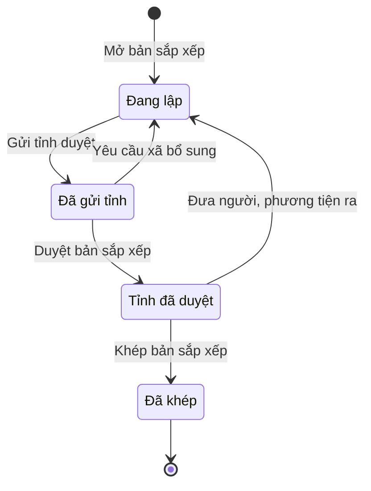

# qt-34 · Sắp xếp QNDB, PTKT dự bị vào đơn vị DBĐV

<!-- máy sinh: tom-tat -->
> **Hồ sơ:** Bản sắp xếp đơn vị dự bị động viên (`ReserveArrangement`)
>
> **Trong sổ phạm vi:** 34 · Sắp xếp QNDB, PTKT dự bị vào đơn vị DBĐV — bản sắp xếp năm của xã theo đơn vị nhận nguồn, mở từ chỉ tiêu tỉnh giao, tỉnh duyệt trên hệ; chặn tuổi theo L53 Đ.17 (Đ.14, Đ.19 sửa bởi L98/2025; chốt 30/9)
>
> 12 bước · 4 chặng · 3 vai · 1 bảng quyết định · 0 hạn · 7 khớp nối.
>
> **Nguồn:** sổ nghiệp vụ `qt-34` · khai báo của app: `dqtv-app/core/processes/reserve-arrangement/workflow/reserve-arrangement.yaml`. Các bảng do máy sinh từ nguồn này.
<!-- hết: tom-tat -->

<!-- viết tay: dien-giai -->
## Diễn giải

*Phần này viết tay, diễn giải lại điều các bảng bên dưới ghi.*

### Quy trình này để làm gì

Xã lập **bản sắp xếp đơn vị dự bị động viên** của một năm, cho một đơn vị nhận nguồn: xếp từng quân nhân dự bị và từng phương tiện kỹ thuật dự bị vào chức danh của đơn vị ấy. Bộ CHQS cấp tỉnh duyệt trên hệ. Sau khi duyệt, xã báo cho người được xếp, ghi biên bản giao nhận với đơn vị nhận nguồn, rồi khép.

Hồ sơ đi qua bốn chặng: *Đang lập* → *Đã gửi tỉnh* → *Tỉnh đã duyệt* → *Đã khép*.

### Khi nào bắt đầu

Trợ lý Quân lực bấm **Mở bản sắp xếp**. Phải nhập năm, đơn vị nhận nguồn và chỉ tiêu mà bản này thực hiện; phiên hiệu đơn vị nhận nguồn là ô nhập nếu có. Bản sắp xếp mở ra có nối tới một **Chỉ tiêu** của quy trình 2 — chỉ tiêu xây dựng lực lượng dự bị động viên tỉnh giao cho xã.

### Diễn ra thế nào

**Chặng "Đang lập"** — Trợ lý Quân lực (thuộc đơn vị chủ hồ sơ):

- **Thêm người, phương tiện** — mỗi lần tạo một hồ sơ con *Dòng sắp xếp*. Phải nhập dòng là người hay phương tiện (`lineKind`) và chức danh (`positionTitle`); nhập nếu có: quân nhân dự bị hoặc phương tiện kỹ thuật dự bị tương ứng, loại đơn vị (`unitRole`), ngạch (`reserveRank`), hạng (`reserveClass`), mức đúng chuyên nghiệp (`specialtyMatch`), giới tính, tuổi. Lặp được. Bước này xét bảng tuổi (xem "Điều kiện chặn").
- **Bỏ dòng** — chọn dòng cần bỏ; lặp được.
- **Gửi tỉnh duyệt** — hồ sơ sang *Đã gửi tỉnh*. Bước đòi thêm điều kiện hệ tự xét `allLinesAreReserveSoldiers`: mọi hồ sơ đăng ký (qt-16) ghi ở nối `reserveMember` của các dòng người đều đã có `reserveSoldier`.

**Chặng "Đã gửi tỉnh"** — cán bộ Bộ CHQS cấp tỉnh, phải thuộc cấp trên của xã chủ hồ sơ:

- **Duyệt bản sắp xếp** — hồ sơ sang *Tỉnh đã duyệt*; bước ghi lại ngày duyệt.
- **Yêu cầu xã bổ sung** — ghi tỉnh yêu cầu bổ sung gì; hồ sơ quay về *Đang lập*.

**Chặng "Tỉnh đã duyệt"** — Trợ lý Quân lực:

- **Ghi đã báo cho người được xếp** — chọn dòng, ghi ngày báo và cách báo (bốn mã: `paper_notice`, `in_person`, `phone`, `other`); lặp được.
- **Ghi biên bản giao nhận** — gắn biên bản giao nhận đã ký với đơn vị nhận nguồn và ngày giao nhận; lặp được.
- **Đưa người, phương tiện ra** — chọn dòng và ghi lý do (sáu mã: `moved_away`, `over_age`, `health`, `vehicle_sold`, `vehicle_deregistered`, `other`). Bước này đưa cả bản sắp xếp **quay về *Đang lập***; muốn về lại *Tỉnh đã duyệt* thì phải gửi tỉnh duyệt lại. Thay người thì đưa dòng ra.
- **Khép bản sắp xếp** — hồ sơ sang *Đã khép*.

Lý do đưa ra và cách thông báo chỉ để tra cứu.

### Kết thúc và để lại gì

Hồ sơ kết thúc ở *Đã khép*. Bản sắp xếp gắn với ba hồ sơ của quy trình khác:

- **Chỉ tiêu** (2) — ghi lúc mở.
- **Đăng ký quân nhân dự bị** (16.reserve-registration) — mỗi dòng người chỉ tới dòng đăng ký ngạch dự bị của người ấy.
- **Phương tiện trong sổ** (33) — mỗi dòng phương tiện chỉ tới một phương tiện kỹ thuật dự bị.

Hai khớp nối sau là của hồ sơ con *Dòng sắp xếp*, ghi ở bước thêm dòng.

### Điều kiện chặn

- Các bước của xã (trừ bước mở): người làm phải là người của đơn vị chủ hồ sơ; hai bước của tỉnh: người làm phải là người của một đơn vị cấp trên của chủ hồ sơ.
- Gửi tỉnh bị chặn khi còn dòng người mà hồ sơ đăng ký (qt-16) chưa có `reserveSoldier`.
- **Bảng tuổi** (`reserve-age-limit`, 7 dòng), xét khi thêm dòng, dò từ trên xuống:
  - `lineKind` là `vehicle`: cho qua;
  - `reserveRank` là `officer`: cho qua;
  - `unitRole` là `combat`, `male`, `reserveRank` là `nco_soldier`: tuổi đến 35;
  - `unitRole` là `combat`, `male`, `reserveRank` là `professional`: tuổi đến 40;
  - `unitRole` là `combat_support`: `male` đến 45, `female` đến 40;
  - mọi trường hợp còn lại: chặn với kết quả `over_age`.
<!-- hết viết tay -->

## 1. Đường đi ngắn nhất qua các chặng

<!-- máy sinh: luong-chinh -->
Đường ít bước nhất từ lúc mở hồ sơ tới chặng kết thúc xa nhất. Máy chọn theo số chặng, không theo ý nghĩa nghiệp vụ — trình tự công việc thật xem phần Diễn giải và bảng "Việc làm ở từng chặng" ở mục 6.

| # | Ai làm | Làm gì | Hồ sơ sang chặng |
|---|---|---|---|
| 1 | Trợ lý Quân lực | Mở bản sắp xếp | Đang lập |
| 2 | Hệ thống tự làm | Gửi tỉnh duyệt | Đã gửi tỉnh |
| 3 | Bộ CHQS cấp tỉnh (thuộc cấp trên của chủ hồ sơ) | Duyệt bản sắp xếp | Tỉnh đã duyệt |
| 4 | Trợ lý Quân lực | Khép bản sắp xếp | Đã khép |

<!-- hết: luong-chinh -->

## 2. Hồ sơ và việc nó để lại

<!-- máy sinh: muc-tieu -->
**App gọi quy trình này là:** Sắp xếp đơn vị dự bị động viên.

**Khi mở, hồ sơ này ghi mối nối tới:**
- Chỉ tiêu (2) — bước `openArrangementFromTarget`, khớp nối `arrangementServesTarget`
<!-- hết: muc-tieu -->

## 3. Khởi phát và kết thúc

<!-- máy sinh: khoi-phat -->
**1 cửa vào** — bước mở hồ sơ:

| Bước mở | Ai mở | Hồ sơ vào chặng | App bắt buộc nhập |
|---|---|---|---|
| Mở bản sắp xếp | Trợ lý Quân lực | Đang lập | năm, đơn vị nhận nguồn, `planTargetIds` |

**Kết thúc:** *Đã khép* (`CLOSED`)
<!-- hết: khoi-phat -->

## 4. Vai trò

<!-- máy sinh: vai-tro -->
| Vai trong sổ | Tên trong app | Điều kiện | Làm những bước |
|---|---|---|---|
| `communeOperator` | Trợ lý Quân lực |  | Mở bản sắp xếp · Thêm người, phương tiện · Bỏ dòng · Trình ký văn bản gửi bản sắp xếp lên tỉnh · Ghi đã báo cho người được xếp · Ghi biên bản giao nhận · Đưa người, phương tiện ra · Khép bản sắp xếp |
| `system` | Hệ thống tự làm |  | Gửi tỉnh duyệt · Yêu cầu xã bổ sung |
| `provinceOperator` | Bộ CHQS cấp tỉnh | thuộc cấp trên của chủ hồ sơ (`actorInSuperiorUnit`, công thức ở mục 7) | Duyệt bản sắp xếp · Trình ký văn bản yêu cầu xã bổ sung bản sắp xếp |

*"Tên trong app" là tên app đặt cho mã chủ thể của vai. Hồ sơ thuộc đơn vị cấp khác thì người làm là người giữ vai ấy ở đơn vị nêu trong cột "Điều kiện" (nếu sổ có ghi) và ở cột "Người làm phải thuộc" của bảng "Theo khai báo của app" (mục 7).*
<!-- hết: vai-tro -->

## 5. Nhánh phụ

<!-- máy sinh: nhanh-phu -->
**Quay lại một chặng hồ sơ đã đi qua** (tính theo đường ngắn nhất từ lúc mở):

| Bước | Ai làm | Từ chặng | Về chặng |
|---|---|---|---|
| Yêu cầu xã bổ sung | Hệ thống tự làm | Đã gửi tỉnh | Đang lập |
| Đưa người, phương tiện ra | Trợ lý Quân lực | Tỉnh đã duyệt | Đang lập |

**Làm trong lúc hồ sơ đứng yên ở một chặng** — ghi nhận, bổ sung:

| Bước | Ai làm | Ở chặng |
|---|---|---|
| Thêm người, phương tiện *(lặp được)* | Trợ lý Quân lực | Đang lập |
| Bỏ dòng *(lặp được)* | Trợ lý Quân lực | Đang lập |
| Trình ký văn bản gửi bản sắp xếp lên tỉnh | Trợ lý Quân lực | Đang lập |
| Trình ký văn bản yêu cầu xã bổ sung bản sắp xếp | Bộ CHQS cấp tỉnh (thuộc cấp trên của chủ hồ sơ) | Đã gửi tỉnh |
| Ghi đã báo cho người được xếp *(lặp được)* | Trợ lý Quân lực | Tỉnh đã duyệt |
| Ghi biên bản giao nhận *(lặp được)* | Trợ lý Quân lực | Tỉnh đã duyệt |

<!-- hết: nhanh-phu -->

## 6. Các chặng và việc làm ở từng chặng

<!-- máy sinh: chang -->
| Chặng | Tên hiển thị | Vào bằng bước | Kết thúc? |
|---|---|---|---|
| `DRAFT` | Đang lập | Mở bản sắp xếp · Yêu cầu xã bổ sung · Đưa người, phương tiện ra |  |
| `SUBMITTED` | Đã gửi tỉnh | Gửi tỉnh duyệt |  |
| `APPROVED` | Tỉnh đã duyệt | Duyệt bản sắp xếp |  |
| `CLOSED` | Đã khép | Khép bản sắp xếp | **kết thúc** |

### Việc làm ở từng chặng

Hồ sơ đang ở chặng nào thì làm được những bước nào.

| Hồ sơ đang ở chặng | Bước làm tại chặng (hồ sơ đứng yên) | Bước đưa hồ sơ sang chặng khác |
|---|---|---|
| **Đang lập** | Thêm người, phương tiện (lặp được) — Trợ lý Quân lực Bỏ dòng (lặp được) — Trợ lý Quân lực Trình ký văn bản gửi bản sắp xếp lên tỉnh — Trợ lý Quân lực | Gửi tỉnh duyệt — Hệ thống tự làm → *Đã gửi tỉnh* |
| **Đã gửi tỉnh** | Trình ký văn bản yêu cầu xã bổ sung bản sắp xếp — Bộ CHQS cấp tỉnh (thuộc cấp trên của chủ hồ sơ) | Duyệt bản sắp xếp — Bộ CHQS cấp tỉnh (thuộc cấp trên của chủ hồ sơ) → *Tỉnh đã duyệt* Yêu cầu xã bổ sung — Hệ thống tự làm → *Đang lập* |
| **Tỉnh đã duyệt** | Ghi đã báo cho người được xếp (lặp được) — Trợ lý Quân lực Ghi biên bản giao nhận (lặp được) — Trợ lý Quân lực | Đưa người, phương tiện ra — Trợ lý Quân lực → *Đang lập* Khép bản sắp xếp — Trợ lý Quân lực → *Đã khép* |
| **Đã khép** | — | — (kết thúc) |
<!-- hết: chang -->

## 7. Bảng bước

<!-- máy sinh: buoc -->
| # | Bước | Mã bước | Ai thực hiện | Từ chặng | Sang chặng | Phải có trước | Ghi lại |
|---|---|---|---|---|---|---|---|
| 1 | Mở bản sắp xếp | `openArrangementFromTarget` | Trợ lý Quân lực | — (mở hồ sơ) | `DRAFT` | — | đơn vị chủ hồ sơ, cấp trên của chủ hồ sơ, nối tới Chỉ tiêu, đơn vị nhận nguồn, phiên hiệu đơn vị nhận nguồn, năm, ngày mở |
| 2 | Thêm người, phương tiện | `addArrangementLine` | Trợ lý Quân lực | `DRAFT` | giữ nguyên | người làm thuộc đơn vị chủ hồ sơ, `vehiclesRegisteredReserve`, `vehiclesInOwnerCommune`, `vehiclesNotArrangedElsewhere`, `vehicleMatchStated`, `vehicleNearMatchReasoned`, `personMatchStated`, `personNearMatchReasoned`, `soldierClassStated`, `classTwoReasoned` | `lineKind`, `unitRole`, `reserveRank`, `gender`, `memberAge`, nối `reserveMember` (Dòng sắp xếp → Đăng ký quân nhân dự bị), nối `reserveVehicle` (Dòng sắp xếp → Phương tiện trong sổ), `positionTitle`, `reserveClass`, `specialtyMatch`, `matchNote`, `classTwoNote` |
| 3 | Bỏ dòng | `removeArrangementLine` | Trợ lý Quân lực | `DRAFT` | giữ nguyên | người làm thuộc đơn vị chủ hồ sơ | nối `lineToRemove` |
| 4 | Trình ký văn bản gửi bản sắp xếp lên tỉnh | `requestSubmitArrangementSignature` | Trợ lý Quân lực | `DRAFT` | giữ nguyên | `allLinesAreReserveSoldiers`, `allVehicleLinesAreRegistered`, `noSubmitArrangementDocumentOpen`, người làm thuộc đơn vị chủ hồ sơ, `arrangementHasLine` | nối tới Văn bản đi |
| 5 | Gửi tỉnh duyệt | `submitArrangement` | Hệ thống tự làm | `DRAFT` | `SUBMITTED` | người làm thuộc đơn vị chủ hồ sơ, `allLinesAreReserveSoldiers`, `vehiclesRegisteredReserve`, `submitArrangementDocumentIssued` | ngày gửi tỉnh, nối `submissionDeliveredAs` |
| 6 | Duyệt bản sắp xếp | `approveArrangement` | Bộ CHQS cấp tỉnh (thuộc cấp trên của chủ hồ sơ) | `SUBMITTED` | `APPROVED` | người làm thuộc cấp trên của chủ hồ sơ, `submissionDistributedAtReceiver` | ngày tỉnh duyệt, `countedTowardTargetQty`, `approvedMembers`, `approvedVehicles`; **xoá:** `releasedMembers`, `releasedVehicles` |
| 7 | Trình ký văn bản yêu cầu xã bổ sung bản sắp xếp | `requestRequestArrangementSupplementSignature` | Bộ CHQS cấp tỉnh (thuộc cấp trên của chủ hồ sơ) | `SUBMITTED` | giữ nguyên | `noRequestArrangementSupplementDocumentOpen`, người làm thuộc cấp trên của chủ hồ sơ | cần xã bổ sung gì, nối tới Văn bản đi |
| 8 | Yêu cầu xã bổ sung | `requestArrangementSupplement` | Hệ thống tự làm | `SUBMITTED` | `DRAFT` | `requestArrangementSupplementDocumentIssued` | nối `returnDeliveredAs` |
| 9 | Ghi đã báo cho người được xếp | `notifyArrangedMember` | Trợ lý Quân lực | `APPROVED` | giữ nguyên | người làm thuộc đơn vị chủ hồ sơ | nối `notifiedLine`, ngày báo, cách báo, `receiptSignedBy`, `receiptSignedAt`, `receiptMode` |
| 10 | Ghi biên bản giao nhận | `recordHandoverMinutes` | Trợ lý Quân lực | `APPROVED` | giữ nguyên | người làm thuộc đơn vị chủ hồ sơ | biên bản giao nhận với đơn vị nhận nguồn, ngày giao nhận |
| 11 | Đưa người, phương tiện ra | `releaseArrangementLine` | Trợ lý Quân lực | `APPROVED` | `DRAFT` | người làm thuộc đơn vị chủ hồ sơ | nối `releasedLine`, lý do đưa ra, `releasedAt`, `releasedMembers`, `releasedVehicles` |
| 12 | Khép bản sắp xếp | `closeArrangement` | Trợ lý Quân lực | `APPROVED` | `CLOSED` | người làm thuộc đơn vị chủ hồ sơ | ngày khép |

### Khi không đạt điều kiện

Mặc định: không đúng người, hồ sơ không ở đúng chặng, hoặc thiếu thứ "phải có trước" thì bước bị chặn, hồ sơ giữ nguyên. Bảng dưới chỉ kê những bước có kết quả riêng.

| # | Bước | Kết quả riêng |
|---|---|---|
| 2 | Thêm người, phương tiện | bước dừng lại, hồ sơ giữ nguyên khi kết quả xét là: `over_age` |
| 8 | Yêu cầu xã bổ sung | bước này không do người nào bấm |

### Điều kiện "phải có trước" bằng lời

Cột "Phải có trước" ở bảng bước có hai loại: ô dữ liệu thường (bước chỉ đòi ô ấy đã có giá trị) và điều kiện hệ tự xét. Bảng này diễn các điều kiện hệ tự xét theo đúng công thức sổ ghi; số ở cột cuối là số thứ tự bước.

| Điều kiện | Đúng khi | Bước đòi |
|---|---|---|
| `actorInOwnerUnit` | người đang làm là người của đơn vị ghi ở ô đơn vị chủ hồ sơ của hồ sơ này (theo danh mục người của đơn vị, `dm.unit-staff`) | 2, 3, 4, 5, 9, 10, 11, 12 |
| `vehiclesRegisteredReserve` | mọi hồ sơ Sổ phương tiện chung (qt-33) chính là hồ sơ ghi ở ô nối `reserveVehicle` của hồ sơ đang làm đều thoả: hồ sơ ấy đang ở chặng `REGISTERED` VÀ `registerKind` là `reserve` | 2, 5 |
| `vehiclesInOwnerCommune` | mọi hồ sơ Sổ phương tiện chung (qt-33) chính là hồ sơ ghi ở ô nối `reserveVehicle` của hồ sơ đang làm đều thoả: mã xã của hồ sơ đang xét bằng đơn vị chủ hồ sơ của hồ sơ này | 2 |
| `vehiclesNotArrangedElsewhere` | không có hồ sơ Sắp xếp QNDB, PTKT dự bị vào đơn vị DBĐV (qt-34) (gọi là o) có ô nối `reserveVehicle` trùng với ô nối `reserveVehicle` của hồ sơ đang làm mà năm của hồ sơ o ấy bằng năm của hồ sơ này VÀ KHÔNG (hồ sơ ấy đang ở chặng `CLOSED`) VÀ KHÔNG (nối `reserveVehicle` (Dòng sắp xếp → Phương tiện trong sổ) của hồ sơ này nằm trong `releasedVehicles` của hồ sơ o ấy) | 2 |
| `vehicleMatchStated` | KHÔNG (`lineKind` là `vehicle`) HOẶC đã có `specialtyMatch` | 2 |
| `vehicleNearMatchReasoned` | KHÔNG (`lineKind` là `vehicle`) HOẶC KHÔNG (`specialtyMatch` là `near`) HOẶC đã có `matchNote` | 2 |
| `personMatchStated` | KHÔNG (`lineKind` là `person`) HOẶC đã có `specialtyMatch` | 2 |
| `personNearMatchReasoned` | KHÔNG (`lineKind` là `person`) HOẶC KHÔNG (`specialtyMatch` là `near`) HOẶC đã có `matchNote` | 2 |
| `soldierClassStated` | KHÔNG (`lineKind` là `person`) HOẶC KHÔNG (`reserveRank` là `nco_soldier`) HOẶC đã có `reserveClass` | 2 |
| `classTwoReasoned` | KHÔNG (`lineKind` là `person`) HOẶC KHÔNG (`reserveClass` là `class_two`) HOẶC đã có `classTwoNote` | 2 |
| `allLinesAreReserveSoldiers` | mọi hồ sơ Sổ đăng ký người theo diện (qt-16) chính là hồ sơ ghi ở ô nối `reserveMember` của hồ sơ đang làm đều thoả: đã có `reserveSoldier` | 4, 5 |
| `allVehicleLinesAreRegistered` | mọi hồ sơ Sổ phương tiện chung (qt-33) chính là hồ sơ ghi ở ô nối `reserveVehicle` của hồ sơ đang làm đều thoả: hồ sơ ấy đang ở chặng `REGISTERED` VÀ `registerKind` là `reserve` | 4 |
| `noSubmitArrangementDocumentOpen` | KHÔNG (có hồ sơ Việc luật giao kèm văn bản đến, đi — Văn bản đi (qt-1.outgoing-document) chính là hồ sơ ghi ở ô nối `submitArrangementByDocument` của hồ sơ đang làm mà hồ sơ ấy đang ở chặng `DRAFT` hoặc `PENDING_SIGNATURE` hoặc `SIGNED`) | 4 |
| `arrangementHasLine` | đã có `lineKind` | 4 |
| `submitArrangementDocumentIssued` | có hồ sơ Việc luật giao kèm văn bản đến, đi — Văn bản đi (qt-1.outgoing-document) chính là hồ sơ ghi ở ô nối `submitArrangementByDocument` của hồ sơ đang làm mà hồ sơ ấy đang ở chặng `ISSUED` | 5 |
| `actorInSuperiorUnit` | người đang làm là người của một đơn vị nằm trong ô cấp trên của chủ hồ sơ của hồ sơ này (theo danh mục người của đơn vị, `dm.unit-staff`) | 6, 7 |
| `submissionDistributedAtReceiver` | có hồ sơ Việc luật giao kèm văn bản đến, đi — Văn bản đến (qt-1.incoming-document) chính là hồ sơ ghi ở ô nối `submissionDeliveredAs` của hồ sơ đang làm mà hồ sơ ấy đang ở chặng `DISTRIBUTED` | 6 |
| `noRequestArrangementSupplementDocumentOpen` | KHÔNG (có hồ sơ Việc luật giao kèm văn bản đến, đi — Văn bản đi (qt-1.outgoing-document) chính là hồ sơ ghi ở ô nối `requestArrangementSupplementByDocument` của hồ sơ đang làm mà hồ sơ ấy đang ở chặng `DRAFT` hoặc `PENDING_SIGNATURE` hoặc `SIGNED`) | 7 |
| `requestArrangementSupplementDocumentIssued` | có hồ sơ Việc luật giao kèm văn bản đến, đi — Văn bản đi (qt-1.outgoing-document) chính là hồ sơ ghi ở ô nối `requestArrangementSupplementByDocument` của hồ sơ đang làm mà hồ sơ ấy đang ở chặng `ISSUED` | 8 |

### Theo khai báo của app

Người làm phải thuộc đơn vị nào, ô người dùng phải nhập, bước có lặp được không, và căn cứ pháp lý — lấy từ khai báo quy trình trong app.

| # | Bước | Người làm phải thuộc | Bắt buộc nhập | Nhập nếu có | Lặp được | Căn cứ |
|---|---|---|---|---|---|---|
| 1 | Mở bản sắp xếp |  | năm, đơn vị nhận nguồn, `planTargetIds` | phiên hiệu đơn vị nhận nguồn |  | L53/2019/QH14 Đ.14 k2 c, Đ.19 (sửa bởi L98/2025/QH15) |
| 2 | Thêm người, phương tiện | đơn vị chủ hồ sơ | `lineKind`, `positionTitle` | quân nhân dự bị, phương tiện kỹ thuật dự bị, `unitRole`, `reserveRank`, `reserveClass`, `specialtyMatch`, `matchNote`, `classTwoNote`, `gender`, `memberAge`, `lineLabel` | có | L53/2019/QH14 Đ.16, Đ.17, Đ.18 |
| 3 | Bỏ dòng | đơn vị chủ hồ sơ | dòng cần bỏ | — | có | sổ tri thức qt-34 |
| 4 | Trình ký văn bản gửi bản sắp xếp lên tỉnh | đơn vị chủ hồ sơ | — | dự thảo văn bản (PDF) |  | L53/2019/QH14 Đ.19 (sửa bởi L98/2025/QH15) · NĐ30/2020/NĐ-CP Đ.13 |
| 5 | Gửi tỉnh duyệt |  | — | — |  | L53/2019/QH14 Đ.19 (sửa bởi L98/2025/QH15) |
| 6 | Duyệt bản sắp xếp | cấp trên của chủ hồ sơ | — | dòng còn hiệu lực lúc duyệt (máy tra) |  | L53/2019/QH14 Đ.19 (sửa bởi L98/2025/QH15) |
| 7 | Trình ký văn bản yêu cầu xã bổ sung bản sắp xếp | cấp trên của chủ hồ sơ | cần xã bổ sung gì | dự thảo văn bản (PDF) |  | L53/2019/QH14 Đ.19 (sửa bởi L98/2025/QH15) · NĐ30/2020/NĐ-CP Đ.13 |
| 8 | Yêu cầu xã bổ sung |  | — | — |  | L53/2019/QH14 Đ.19 (sửa bởi L98/2025/QH15) |
| 9 | Ghi đã báo cho người được xếp | đơn vị chủ hồ sơ | người được xếp, ngày báo, cách báo | — | có | sổ tri thức qt-34 · L53/2019/QH14 Đ.19 |
| 10 | Ghi biên bản giao nhận | đơn vị chủ hồ sơ | biên bản giao nhận với đơn vị nhận nguồn, ngày giao nhận | — | có | L53/2019/QH14 Đ.19 (sửa bởi L98/2025/QH15) |
| 11 | Đưa người, phương tiện ra | đơn vị chủ hồ sơ | dòng đưa ra, lý do đưa ra | — |  | sổ tri thức qt-34 · L53/2019/QH14 Đ.17 |
| 12 | Khép bản sắp xếp | đơn vị chủ hồ sơ | — | — |  | sổ tri thức qt-34 |

### Điều kiện và ghi chú app khai cho từng bước

Lấy từ khai báo quy trình trong app. Lời trong ngoặc kép là câu app hiện cho người dùng. Chức danh người ký ngoài hệ app chỉ khai bằng mã.

| # | Bước | Điều kiện, ghi chú |
|---|---|---|
| 2 | Thêm người, phương tiện | · tạo thêm một hồ sơ con: Dòng sắp xếp (`ReserveArrangementLine`) |
<!-- hết: buoc -->

## 8. Bảng quyết định, hạn, việc ngoài hệ

<!-- máy sinh: quyet-dinh -->
**Bảng `reserve-age-limit`** — xét ở bước *Thêm người, phương tiện*; đầu vào: `lineKind`, `reserveRank`, `unitRole`, `gender`, `memberAge`. 7 dòng, dò từ trên xuống, dòng đầu tiên khớp thì dừng.

| Thứ tự dò (số sổ ghi) | Dòng | Khi | Thì |
|---|---|---|---|
| 1 | `vehicle` | `lineKind` là `vehicle` | cho qua |
| 2 | `officer-by-officer-law` | `reserveRank` là `officer` | cho qua |
| 3 | `combat-soldier` | `unitRole` là `combat` và `gender` là `male` và `reserveRank` là `nco_soldier` và `memberAge` đến 35 | cho qua |
| 4 | `combat-professional` | `unitRole` là `combat` và `gender` là `male` và `reserveRank` là `professional` và `memberAge` đến 40 | cho qua |
| 5 | `support-male` | `unitRole` là `combat_support` và `gender` là `male` và `memberAge` đến 45 | cho qua |
| 6 | `support-female` | `unitRole` là `combat_support` và `gender` là `female` và `memberAge` đến 40 | cho qua |
| 7 | `otherwise` | mọi trường hợp còn lại | `over_age` |

<!-- hết: quyet-dinh -->

## 9. Dữ liệu của hồ sơ

<!-- máy sinh: du-lieu -->
Các ô mà bước trong sổ ghi hoặc đòi. Số trong hai cột cuối là số thứ tự bước ở bảng bước (mục 7).

| Ô dữ liệu | Mã | Kiểu (app) | Giá trị cho phép | Loại ô (sổ) | Bước ghi | Bước đòi | Mô tả trong app |
|---|---|---|---|---|---|---|---|
| đơn vị chủ hồ sơ | `ownerUnit` |  |  | lưu trên hồ sơ (`stored`) | 1 | — |  |
| cấp trên của chủ hồ sơ | `superiorUnits` |  |  | hệ suy ra (`derived`) | 1 | — |  |
| đơn vị nhận nguồn | `receivingUnitName` | chữ |  | đưa vào ở bước (`input`) | 1 | — | Đơn vị thường trực của Quân đội có chỉ tiêu tiếp nhận — L53/2019 Đ.19 |
| phiên hiệu đơn vị nhận nguồn | `receivingUnitCode` | chữ |  | đưa vào ở bước (`input`) | 1 | — | Phiên hiệu của đơn vị nhận nguồn, nếu có |
| năm | `arrangementYear` | số |  | đưa vào ở bước (`input`) | 1 | — | Năm của bản sắp xếp |
| ngày mở | `openedAt` | ngày |  | lưu trên hồ sơ (`stored`) | 1 | — | Ngày mở bản sắp xếp |
| — | `lineKind` | chọn một — ở hồ sơ con Dòng sắp xếp | `person`, `vehicle` | đưa vào ở bước (`input`) | 2 | — | Dòng này xếp một người hay một phương tiện |
| — | `unitRole` | chọn một — ở hồ sơ con Dòng sắp xếp | `combat`, `combat_support` | đưa vào ở bước (`input`) | 2 | — | Đơn vị chiến đấu hay bảo đảm chiến đấu — L53/2019 Đ.17 k2 |
| — | `reserveRank` | chọn một — ở hồ sơ con Dòng sắp xếp | `officer`, `professional`, `nco_soldier` | đưa vào ở bước (`input`) | 2 | — | Ngạch dự bị của người được xếp — L53/2019 Đ.17 |
| — | `gender` | chọn một — ở hồ sơ con Dòng sắp xếp | `male`, `female` | đưa vào ở bước (`input`) | 2 | — | Giới tính — máy chép từ hồ sơ công dân |
| — | `memberAge` | số — ở hồ sơ con Dòng sắp xếp |  | đưa vào ở bước (`input`) | 2 | — | Tuổi tròn năm vào ngày thêm dòng — máy tính từ ngày sinh |
| — | `positionTitle` | chữ — ở hồ sơ con Dòng sắp xếp |  | đưa vào ở bước (`input`) | 2 | — | Chức danh trong biên chế đơn vị dự bị động viên |
| — | `reserveClass` | chọn một — ở hồ sơ con Dòng sắp xếp | `class_one`, `class_two` | đưa vào ở bước (`input`) | 2 | — | Binh sĩ dự bị hạng một hay hạng hai — L53/2019 Đ.16 k2 |
| — | `specialtyMatch` | chọn một — ở hồ sơ con Dòng sắp xếp | `exact`, `near` | đưa vào ở bước (`input`) | 2 | — | Chuyên nghiệp quân sự đúng hay gần đúng chức danh (Đ.16 k1); phương tiện đúng tính năng hay tương tự (Đ.18) |
| — | `matchNote` | chữ — ở hồ sơ con Dòng sắp xếp |  | đưa vào ở bước (`input`) | 2 | — | Lý do xếp gần đúng — xã không có người đúng chuyên nghiệp quân sự, hoặc phương tiện đúng tính năng |
| — | `classTwoNote` | chữ — ở hồ sơ con Dòng sắp xếp |  | đưa vào ở bước (`input`) | 2 | — | Lý do xếp hạng hai — xã không đủ quân nhân dự bị hạng một |
| ngày gửi tỉnh | `submittedAt` | ngày |  | lưu trên hồ sơ (`stored`) | 5 | — | Ngày xã gửi Bộ CHQS tỉnh |
| ngày tỉnh duyệt | `approvedAt` | ngày |  | lưu trên hồ sơ (`stored`) | 6 | — | Ngày Bộ CHQS tỉnh duyệt trên hệ |
| — | `countedTowardTargetQty` |  |  | lưu trên hồ sơ (`stored`) | 6 | — |  |
| — | `approvedMembers` |  |  | lưu trên hồ sơ (`stored`) | 6 | — |  |
| — | `approvedVehicles` |  |  | lưu trên hồ sơ (`stored`) | 6 | — |  |
| tỉnh yêu cầu bổ sung | `supplementNote` | chữ |  | đưa vào ở bước (`input`) | 7 | — | Bộ CHQS tỉnh yêu cầu xã bổ sung gì |
| ngày báo | `notifiedAt` |  |  | đưa vào ở bước (`input`) | 9 | — |  |
| cách báo | `notificationMethod` |  | `paper_notice`, `in_person`, `phone`, `other` | đưa vào ở bước (`input`) | 9 | — |  |
| — | `receiptSignedBy` |  | `self`, `on_behalf` | đưa vào ở bước (`input`) | 9 | — |  |
| — | `receiptSignedAt` |  |  | đưa vào ở bước (`input`) | 9 | — |  |
| — | `receiptMode` |  | `in_person`, `via_commune`, `via_agency`, `public_service_account` | đưa vào ở bước (`input`) | 9 | — |  |
| biên bản giao nhận với đơn vị nhận nguồn | `handoverMinutesScan` | tệp |  | đưa vào ở bước (`input`) | 10 | — | Biên bản giao nhận với đơn vị nhận nguồn, đã ký |
| ngày giao nhận | `handoverDate` | ngày |  | đưa vào ở bước (`input`) | 10 | — | Ngày giao nhận với đơn vị nhận nguồn |
| lý do đưa ra | `releaseReason` |  | `moved_away`, `over_age`, `health`, `vehicle_sold`, `vehicle_deregistered`, `other` | đưa vào ở bước (`input`) | 11 | — |  |
| — | `releasedAt` |  |  | lưu trên hồ sơ (`stored`) | 11 | — |  |
| — | `releasedMembers` |  |  | lưu trên hồ sơ (`stored`) | 11 | — |  |
| — | `releasedVehicles` |  |  | lưu trên hồ sơ (`stored`) | 11 | — |  |
| ngày khép | `closedAt` | ngày |  | lưu trên hồ sơ (`stored`) | 12 | — | Ngày khép bản sắp xếp |
| người làm thuộc đơn vị chủ hồ sơ | `actorInOwnerUnit` |  | có hay chưa | hệ suy ra (`derived`) | — | 2, 3, 4, 5, 9, 10, 11, 12 |  |
| — | `vehiclesRegisteredReserve` |  | có hay chưa | hệ suy ra (`derived`) | — | 2, 5 |  |
| — | `vehiclesInOwnerCommune` |  | có hay chưa | hệ suy ra (`derived`) | — | 2 |  |
| — | `vehiclesNotArrangedElsewhere` |  | có hay chưa | hệ suy ra (`derived`) | — | 2 |  |
| — | `vehicleMatchStated` |  | có hay chưa | hệ suy ra (`derived`) | — | 2 |  |
| — | `vehicleNearMatchReasoned` |  | có hay chưa | hệ suy ra (`derived`) | — | 2 |  |
| — | `personMatchStated` |  | có hay chưa | hệ suy ra (`derived`) | — | 2 |  |
| — | `personNearMatchReasoned` |  | có hay chưa | hệ suy ra (`derived`) | — | 2 |  |
| — | `soldierClassStated` |  | có hay chưa | hệ suy ra (`derived`) | — | 2 |  |
| — | `classTwoReasoned` |  | có hay chưa | hệ suy ra (`derived`) | — | 2 |  |
| — | `allLinesAreReserveSoldiers` |  | có hay chưa | hệ suy ra (`derived`) | — | 4, 5 |  |
| — | `allVehicleLinesAreRegistered` |  | có hay chưa | hệ suy ra (`derived`) | — | 4 |  |
| — | `noSubmitArrangementDocumentOpen` |  | có hay chưa | hệ suy ra (`derived`) | — | 4 |  |
| — | `arrangementHasLine` |  | có hay chưa | hệ suy ra (`derived`) | — | 4 |  |
| — | `submitArrangementDocumentIssued` |  | có hay chưa | hệ suy ra (`derived`) | — | 5 |  |
| người làm thuộc cấp trên của chủ hồ sơ | `actorInSuperiorUnit` |  | có hay chưa | hệ suy ra (`derived`) | — | 6, 7 |  |
| — | `submissionDistributedAtReceiver` |  | có hay chưa | hệ suy ra (`derived`) | — | 6 |  |
| — | `noRequestArrangementSupplementDocumentOpen` |  | có hay chưa | hệ suy ra (`derived`) | — | 7 |  |
| — | `requestArrangementSupplementDocumentIssued` |  | có hay chưa | hệ suy ra (`derived`) | — | 8 |  |

53 ô. Cột "Loại ô" là cách sổ phân loại ô, in kèm đúng chữ của sổ; ô nào người dùng phải nhập xem bảng "Theo khai báo của app" ở mục 7.
<!-- hết: du-lieu -->

## 10. Khớp nối với quy trình khác

<!-- máy sinh: khop-noi -->
| Quy trình kia | Hồ sơ kia | Quan hệ | Nội dung (mô tả trong app) | Bước ghi mối nối | Tên ô nối |
|---|---|---|---|---|---|
| 1.incoming-document | Văn bản đến | có nối | Văn bản yêu cầu bổ sung ở sổ văn bản đến của Ban CHQS xã — sổ qt-34 link.returnDeliveredAs | — | `reserveArrangementReturnDeliveredAs` |
| 1.incoming-document | Văn bản đến | có nối | Văn bản gửi bản sắp xếp ở sổ văn bản đến của Bộ CHQS tỉnh — sổ qt-34 link.submissionDeliveredAs | — | `reserveArrangementSubmissionDeliveredAs` |
| 1.outgoing-document | Văn bản đi | gắn với nhau ở một bước giữa chừng | Văn bản yêu cầu xã bổ sung bản sắp xếp — văn bản đi của Bộ CHQS tỉnh | 34·requestRequestArrangementSupplementSignature | `requestArrangementSupplementByDocument` |
| 1.outgoing-document | Văn bản đi | gắn với nhau ở một bước giữa chừng | Văn bản gửi bản sắp xếp lên Bộ CHQS tỉnh — văn bản đi của Ban CHQS xã (L53/2019 Đ.19) | 34·requestSubmitArrangementSignature | `submitArrangementByDocument` |
| 16.reserve-registration | Đăng ký quân nhân dự bị | gắn với nhau ở một bước giữa chừng | Dòng này xếp quân nhân dự bị nào — dòng đăng ký ngạch dự bị của người ấy | 34·addArrangementLine | `reserveMember` |
| 2 | Chỉ tiêu | hồ sơ này **mở ra có nối tới** hồ sơ kia | Bản sắp xếp thực hiện chỉ tiêu xây dựng lực lượng dự bị động viên tỉnh giao cho xã — L53/2019 Đ.14 k2 c | 34·openArrangementFromTarget ⊕ | `arrangementServesTarget` |
| 33 | Phương tiện trong sổ | gắn với nhau ở một bước giữa chừng | Dòng này xếp phương tiện kỹ thuật dự bị nào | 34·addArrangementLine | `reserveVehicle` |

7 khớp nối. ⊕ là bước tạo hồ sơ.
<!-- hết: khop-noi -->

## 11. Thông tin chung

<!-- máy sinh: thong-tin -->
| | |
|---|---|
| **Mã trong sổ** | `qt-34` |
| **Quy trình trong app** | `reserve-arrangement` (`workflow/reserve-arrangement.yaml`) — mặt công tác: `personnel` |
| **Hồ sơ** | Bản sắp xếp đơn vị dự bị động viên (`ReserveArrangement`) |
| **Căn cứ pháp lý từng bước** | cột "Căn cứ" ở bảng "Theo khai báo của app", mục 7 |
<!-- hết: thong-tin -->
