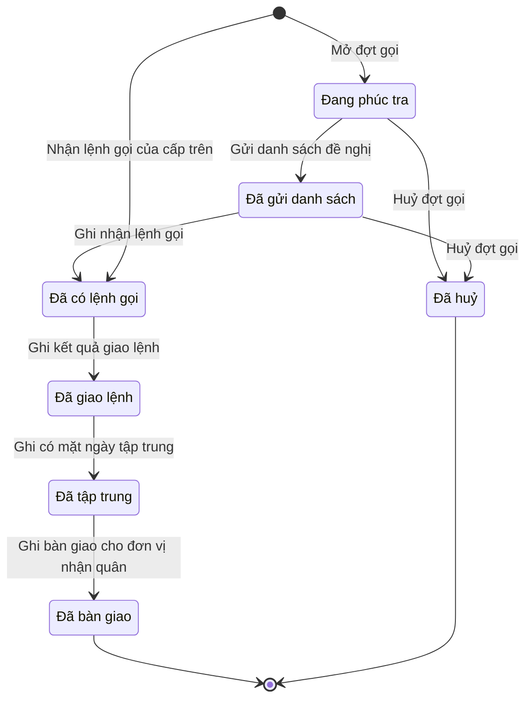

# qt-35 · Gọi QNDB huấn luyện, xét hoãn

<!-- máy sinh: tom-tat -->
> **Hồ sơ:** Đợt gọi quân nhân dự bị (`ReserveCall`)
>
> **Trong sổ phạm vi:** 35 · Gọi QNDB huấn luyện, xét hoãn (tầng 3)
>
> 13 bước · 7 chặng · 3 vai · 7 bảng quyết định · 0 hạn · 9 khớp nối.
>
> **Nguồn:** sổ nghiệp vụ `qt-35` · khai báo của app: `dqtv-app/core/processes/reserve-call/workflow/reserve-call.yaml`. Các bảng do máy sinh từ nguồn này.
<!-- hết: tom-tat -->

<!-- viết tay: dien-giai -->
## Diễn giải

*Phần này viết tay, diễn giải lại điều các bảng bên dưới ghi.*

### Quy trình này để làm gì

Xã theo dõi một **đợt gọi quân nhân dự bị** — gọi để huấn luyện, diễn tập, hoặc kiểm tra sẵn sàng động viên, sẵn sàng chiến đấu. Xã không ra lệnh gọi: xã phúc tra từng người, gửi danh sách đề nghị lên cấp trên, nhận lệnh gọi, giao lệnh tới từng người, ghi ai có mặt ngày tập trung rồi bàn giao cho đơn vị nhận quân.

Hồ sơ đi qua các chặng: *Đang phúc tra* → *Đã gửi danh sách* → *Đã có lệnh gọi* → *Đã giao lệnh* → *Đã tập trung* → *Đã bàn giao*; ngoài ra có chặng *Đã huỷ*.

### Khi nào bắt đầu

Có hai cửa vào, đều do Trợ lý Quân lực làm:

- **Mở đợt gọi** — xã tự đề xuất danh sách. Phải nhập mục đích gọi và chỉ tiêu mà đợt thực hiện; đợt nối tới một **Chỉ tiêu** của quy trình 2 và vào chặng *Đang phúc tra*.
- **Nhận lệnh gọi của cấp trên** — cấp trên đã có lệnh kèm danh sách. Phải nhập mục đích gọi, lệnh gọi trong sổ văn bản đến, người ký, số lệnh và những quân nhân dự bị có tên trong lệnh. Đợt nối tới **Văn bản đến** (1.incoming-document) và **Đăng ký quân nhân dự bị** (16.reserve-registration), vào thẳng chặng *Đã có lệnh gọi*. Bước này không đòi bản chụp lệnh vì lệnh đã nằm trong sổ văn bản đến.

### Diễn ra thế nào

**Chặng "Đang phúc tra".** Trợ lý Quân lực bấm **Ghi kết quả phúc tra** cho từng quân nhân dự bị, mỗi người một hồ sơ con *Người trong đợt gọi*: kết quả phúc tra là một trong ba mã `selected`, `deferred`, `unfit` (chỉ người được chọn mới vào danh sách đề nghị); kèm lý do hoãn và giấy xác nhận, kết luận sức khoẻ, kết luận chính trị nếu có. Lặp được. Xong thì bấm **Gửi danh sách đề nghị** — chọn những người đề nghị gọi, có thể gắn văn bản đề nghị nếu đã vào sổ văn bản đi; đợt sang *Đã gửi danh sách*.

**Chặng "Đã gửi danh sách"** — chờ lệnh gọi của cấp trên. Trợ lý Quân lực bấm **Ghi nhận lệnh gọi**: chọn lệnh gọi trong sổ văn bản đến, ghi người ký, số lệnh và những người có tên trong lệnh; đợt sang *Đã có lệnh gọi*.

**Chặng "Đã có lệnh gọi".** Trợ lý Quân lực bấm **Ghi kết quả giao lệnh** cho từng người — một trong ba mã `delivered`, `unreachable`, `deferred` (kèm lý do hoãn, giấy xác nhận). Đợt sang *Đã giao lệnh*.

**Chặng "Đã giao lệnh"** — chờ ngày tập trung. Trợ lý Quân lực bấm **Ghi có mặt ngày tập trung** cho từng người — một trong bốn mã `present`, `deferred`, `absent_with_reason`, `absent_without_reason`. Đợt sang *Đã tập trung*.

**Chặng "Đã tập trung".** Hai bước về người vắng không lý do, làm tại chặng:

- `openAbsenteeViolation` (Trợ lý Quân lực) — lập biên bản người vắng không lý do; ghi ô `absenteeMinutesDraftedAt`; bị bảng `absentee-violation-ground` xét.
- `signAbsenteeViolation` (Chỉ huy trưởng Ban CHQS xã) — ký biên bản.

Người dùng đã chốt: Trợ lý Quân lực lập, Chỉ huy trưởng ký, và chỉ lập, ký được sau khi đã ghi tập trung.

Sau đó Trợ lý Quân lực bấm **Ghi bàn giao cho đơn vị nhận quân**: đơn vị nhận quân, số và bản chụp biên bản giao nhận; đợt sang *Đã bàn giao*.

**Kết thúc sớm.** Chỉ huy trưởng Ban CHQS xã bấm **Huỷ đợt gọi** được khi đợt ở *Đang phúc tra* hoặc *Đã gửi danh sách* — tức trước khi có lệnh gọi; bắt buộc ghi lý do.

### Kết thúc và để lại gì

Đợt gọi kết thúc ở *Đã bàn giao* hoặc *Đã huỷ*. Mối nối với quy trình khác:

- **Chỉ tiêu** (2) — lúc mở đợt.
- **Đăng ký quân nhân dự bị** (16.reserve-registration) — người trong đợt gọi (bước phúc tra) và người có tên trong lệnh gọi (hai bước nhận lệnh).
- **Văn bản đi** (1.outgoing-document) — văn bản mang danh sách đề nghị, ở bước gửi danh sách.
- **Văn bản đến** (1.incoming-document) — lệnh gọi của cấp trên, ở hai bước nhận lệnh.
- **Vụ việc vi phạm hành chính** (10) — vụ vi phạm lập cho người vắng không lý do ngày tập trung.

### Điều kiện chặn

- Mọi bước trừ hai bước mở: người làm phải là người của đơn vị chủ hồ sơ.
- **Gửi danh sách đề nghị** (bảng `nomination-only-selected`): `candidateStatus` là `selected` thì cho qua; mọi trường hợp còn lại bị chặn (`candidate_not_selected`).
- **`openAbsenteeViolation`** (bảng `absentee-violation-ground`): `assemblyStatus` là `absent_without_reason` thì cho qua; mọi trường hợp còn lại bị chặn (`absence_not_unexcused`).
- Huỷ đợt gọi chỉ làm được ở *Đang phúc tra* và *Đã gửi danh sách*, phải ghi lý do.
- Lý do hoãn, kết quả giao lệnh, mục đích gọi, chức danh người ký lệnh chỉ để tra cứu.
- Quy trình không đặt hạn.
<!-- hết viết tay -->

## 1. Đường đi ngắn nhất qua các chặng

<!-- máy sinh: luong-chinh -->
Đường ít bước nhất từ lúc mở hồ sơ tới chặng kết thúc xa nhất. Máy chọn theo số chặng, không theo ý nghĩa nghiệp vụ — trình tự công việc thật xem phần Diễn giải và bảng "Việc làm ở từng chặng" ở mục 6.

| # | Ai làm | Làm gì | Hồ sơ sang chặng |
|---|---|---|---|
| 1 | Trợ lý Quân lực | Nhận lệnh gọi của cấp trên | Đã có lệnh gọi |
| 2 | Trợ lý Quân lực | Ghi kết quả giao lệnh | Đã giao lệnh |
| 3 | Trợ lý Quân lực | Ghi có mặt ngày tập trung | Đã tập trung |
| 4 | Trợ lý Quân lực | Ghi bàn giao cho đơn vị nhận quân | Đã bàn giao |

<!-- hết: luong-chinh -->

## 2. Hồ sơ và việc nó để lại

<!-- máy sinh: muc-tieu -->
**App gọi quy trình này là:** Gọi quân nhân dự bị huấn luyện.

**Khi mở, hồ sơ này ghi mối nối tới:**
- Chỉ tiêu (2) — bước `openReserveCallFromTarget`, khớp nối `reserveCallUnderTarget`
- Văn bản đến (1.incoming-document) — bước `receiveUpperReserveCall`, khớp nối `callFromIncomingDocument`
- Đăng ký quân nhân dự bị (16.reserve-registration) — bước `receiveUpperReserveCall`, khớp nối `callCoversReservist`

**Hồ sơ này để lại cho quy trình khác** (bước tạo hồ sơ của quy trình kia ghi mối nối về đây):
- Vụ việc vi phạm hành chính (10) — bước `openViolationFromSource`, khớp nối `violationFromReserveCall`
<!-- hết: muc-tieu -->

## 3. Khởi phát và kết thúc

<!-- máy sinh: khoi-phat -->
**2 cửa vào** — bước mở hồ sơ:

| Bước mở | Ai mở | Hồ sơ vào chặng | App bắt buộc nhập |
|---|---|---|---|
| Mở đợt gọi | Trợ lý Quân lực | Đang phúc tra | gọi để, `planTargetIds` |
| Nhận lệnh gọi của cấp trên | Trợ lý Quân lực | Đã có lệnh gọi | gọi để, lệnh gọi trong sổ văn bản đến, người ký lệnh gọi, số lệnh gọi, quân nhân dự bị có tên trong lệnh gọi, tập trung từ ngày, tập trung đến ngày |

**Kết thúc:** *Đã bàn giao* (`HANDED_OVER`), *Đã huỷ* (`CANCELLED`)
<!-- hết: khoi-phat -->

## 4. Vai trò

<!-- máy sinh: vai-tro -->
| Vai trong sổ | Tên trong app | Điều kiện | Làm những bước |
|---|---|---|---|
| `operator` | Trợ lý Quân lực |  | Mở đợt gọi · Ghi kết quả phúc tra · Chọn người đề nghị gọi · Trình ký văn bản gửi danh sách đề nghị · Ghi nhận lệnh gọi · Nhận lệnh gọi của cấp trên · Ghi kết quả giao lệnh · Ghi có mặt ngày tập trung · Ghi đã báo cấp trên người không chuyển được lệnh · Ghi bàn giao cho đơn vị nhận quân · `openAbsenteeViolation` |
| `system` | Hệ thống tự làm |  | Gửi danh sách đề nghị |
| `commander` | Chỉ huy trưởng Ban CHQS xã |  | Huỷ đợt gọi |

*"Tên trong app" là tên app đặt cho mã chủ thể của vai. Hồ sơ thuộc đơn vị cấp khác thì người làm là người giữ vai ấy ở đơn vị nêu trong cột "Điều kiện" (nếu sổ có ghi) và ở cột "Người làm phải thuộc" của bảng "Theo khai báo của app" (mục 7).*
<!-- hết: vai-tro -->

## 5. Nhánh phụ

<!-- máy sinh: nhanh-phu -->
**Bước khác đưa hồ sơ sang chặng mới** — đường song song, rẽ nhánh hoặc kết thúc sớm:

| Bước | Ai làm | Từ chặng | Sang chặng |
|---|---|---|---|
| Gửi danh sách đề nghị | Hệ thống tự làm | Đang phúc tra | Đã gửi danh sách |
| Ghi nhận lệnh gọi | Trợ lý Quân lực | Đã gửi danh sách | Đã có lệnh gọi |
| Huỷ đợt gọi | Chỉ huy trưởng Ban CHQS xã | Đang phúc tra, Đã gửi danh sách | Đã huỷ |

**Làm trong lúc hồ sơ đứng yên ở một chặng** — ghi nhận, bổ sung:

| Bước | Ai làm | Ở chặng |
|---|---|---|
| Ghi kết quả phúc tra *(lặp được)* | Trợ lý Quân lực | Đang phúc tra |
| Chọn người đề nghị gọi *(lặp được)* | Trợ lý Quân lực | Đang phúc tra |
| Trình ký văn bản gửi danh sách đề nghị | Trợ lý Quân lực | Đang phúc tra |
| Ghi đã báo cấp trên người không chuyển được lệnh *(lặp được)* | Trợ lý Quân lực | Đã có lệnh gọi, Đã giao lệnh, Đã tập trung, Đã bàn giao |
| `openAbsenteeViolation` | Trợ lý Quân lực | Đã tập trung |

**Cửa vào khác:** 2 bước cùng mở hồ sơ — xem mục 3.

<!-- hết: nhanh-phu -->

## 6. Các chặng và việc làm ở từng chặng

<!-- máy sinh: chang -->
| Chặng | Tên hiển thị | Vào bằng bước | Kết thúc? |
|---|---|---|---|
| `NOMINATING` | Đang phúc tra | Mở đợt gọi |  |
| `PROPOSED` | Đã gửi danh sách | Gửi danh sách đề nghị |  |
| `CALLED` | Đã có lệnh gọi | Ghi nhận lệnh gọi · Nhận lệnh gọi của cấp trên |  |
| `DELIVERED` | Đã giao lệnh | Ghi kết quả giao lệnh |  |
| `ASSEMBLED` | Đã tập trung | Ghi có mặt ngày tập trung |  |
| `HANDED_OVER` | Đã bàn giao | Ghi bàn giao cho đơn vị nhận quân | **kết thúc** — vẫn còn bước làm được |
| `CANCELLED` | Đã huỷ | Huỷ đợt gọi | **kết thúc** |

### Việc làm ở từng chặng

Hồ sơ đang ở chặng nào thì làm được những bước nào.

| Hồ sơ đang ở chặng | Bước làm tại chặng (hồ sơ đứng yên) | Bước đưa hồ sơ sang chặng khác |
|---|---|---|
| **Đang phúc tra** | Ghi kết quả phúc tra (lặp được) — Trợ lý Quân lực Chọn người đề nghị gọi (lặp được) — Trợ lý Quân lực Trình ký văn bản gửi danh sách đề nghị — Trợ lý Quân lực | Gửi danh sách đề nghị — Hệ thống tự làm → *Đã gửi danh sách* Huỷ đợt gọi — Chỉ huy trưởng Ban CHQS xã → *Đã huỷ* |
| **Đã gửi danh sách** | — | Ghi nhận lệnh gọi — Trợ lý Quân lực → *Đã có lệnh gọi* Huỷ đợt gọi — Chỉ huy trưởng Ban CHQS xã → *Đã huỷ* |
| **Đã có lệnh gọi** | Ghi đã báo cấp trên người không chuyển được lệnh (lặp được) — Trợ lý Quân lực | Ghi kết quả giao lệnh — Trợ lý Quân lực → *Đã giao lệnh* |
| **Đã giao lệnh** | Ghi đã báo cấp trên người không chuyển được lệnh (lặp được) — Trợ lý Quân lực | Ghi có mặt ngày tập trung — Trợ lý Quân lực → *Đã tập trung* |
| **Đã tập trung** | Ghi đã báo cấp trên người không chuyển được lệnh (lặp được) — Trợ lý Quân lực `openAbsenteeViolation` — Trợ lý Quân lực | Ghi bàn giao cho đơn vị nhận quân — Trợ lý Quân lực → *Đã bàn giao* |
| **Đã bàn giao** | Ghi đã báo cấp trên người không chuyển được lệnh (lặp được) — Trợ lý Quân lực | — (kết thúc) |
| **Đã huỷ** | — | — (kết thúc) |
<!-- hết: chang -->

## 7. Bảng bước

<!-- máy sinh: buoc -->
| # | Bước | Mã bước | Ai thực hiện | Từ chặng | Sang chặng | Phải có trước | Ghi lại |
|---|---|---|---|---|---|---|---|
| 1 | Mở đợt gọi | `openReserveCallFromTarget` | Trợ lý Quân lực | — (mở hồ sơ) | `NOMINATING` | — | đơn vị chủ hồ sơ, nối tới Chỉ tiêu, gọi để |
| 2 | Ghi kết quả phúc tra | `screenReserveCandidates` | Trợ lý Quân lực | `NOMINATING` | giữ nguyên | người làm thuộc đơn vị chủ hồ sơ, `candidatesStillRegistered`, `candidatesInOwnerCommune`, `candidateNotInOtherRunningCall`, `candidateNotInRunningMobilization` | nối `candidateReservist` (Người trong đợt gọi → Đăng ký quân nhân dự bị), `candidateStatus`, `deferralReason`, `deferralProofScan`, `healthConclusion`, `healthConclusionNote`, `politicalConclusion`, `candidateTrainedDays`, `unarrangedCandidateKind` |
| 3 | Chọn người đề nghị gọi | `selectNominees` | Trợ lý Quân lực | `NOMINATING` | giữ nguyên | người làm thuộc đơn vị chủ hồ sơ, `noSendNominationListDocumentOpen` | `nominated` |
| 4 | Trình ký văn bản gửi danh sách đề nghị | `requestSendNominationListSignature` | Trợ lý Quân lực | `NOMINATING` | giữ nguyên | `noSendNominationListDocumentOpen`, người làm thuộc đơn vị chủ hồ sơ, `nomineesSelected` | nối tới Văn bản đi |
| 5 | Gửi danh sách đề nghị | `sendNominationList` | Hệ thống tự làm | `NOMINATING` | `PROPOSED` | `sendNominationListDocumentIssued` | ngày gửi danh sách đề nghị, nối `submissionDeliveredAs` |
| 6 | Ghi nhận lệnh gọi | `receiveCallForNomination` | Trợ lý Quân lực | `PROPOSED` | `CALLED` | người làm thuộc đơn vị chủ hồ sơ, `callFromIncomingDocumentUsable` | nối tới Văn bản đến, nối tới Đăng ký quân nhân dự bị, ngày nhận lệnh gọi, nối `undeliverableReservist`, tập trung từ ngày, tập trung đến ngày, số ngày tập trung |
| 7 | Nhận lệnh gọi của cấp trên | `receiveUpperReserveCall` | Trợ lý Quân lực | — (mở hồ sơ) | `CALLED` | `callFromIncomingDocumentUsable`, `calledNotInOtherRunningCall`, `calledNotInRunningMobilization` | đơn vị chủ hồ sơ, gọi để, nối tới Văn bản đến, nối tới Đăng ký quân nhân dự bị, ngày nhận lệnh gọi, nối `undeliverableReservist`, tập trung từ ngày, tập trung đến ngày, số ngày tập trung |
| 8 | Ghi kết quả giao lệnh | `deliverCallToPerson` | Trợ lý Quân lực | `CALLED` | `DELIVERED` | người làm thuộc đơn vị chủ hồ sơ | `deliveryStatus`, `deferralReason`, `deferralProofScan`, `healthConclusion`, `healthConclusionNote`, `receiptSignedBy`, `receiptSignedAt`, `receiptMode` |
| 9 | Ghi có mặt ngày tập trung | `recordReserveAssembly` | Trợ lý Quân lực | `DELIVERED` | `ASSEMBLED` | người làm thuộc đơn vị chủ hồ sơ | `assemblyStatus`, `absenceProof`, `deferralReason`, `deferralProofScan`, `healthConclusion`, `healthConclusionNote` |
| 10 | Ghi đã báo cấp trên người không chuyển được lệnh | `recordUndeliverableReport` | Trợ lý Quân lực | `CALLED`, `DELIVERED`, `ASSEMBLED`, `HANDED_OVER` | giữ nguyên | người làm thuộc đơn vị chủ hồ sơ, `hasUndeliverableReservist` | ngày báo lại cấp trên, hình thức báo lại, ghi chú báo lại |
| 11 | Ghi bàn giao cho đơn vị nhận quân | `handOverReserves` | Trợ lý Quân lực | `ASSEMBLED` | `HANDED_OVER` | người làm thuộc đơn vị chủ hồ sơ | đơn vị nhận quân, số biên bản giao nhận, biên bản giao nhận, ngày bàn giao, số người tính vào chỉ tiêu |
| 12 | Huỷ đợt gọi | `cancelReserveCall` | Chỉ huy trưởng Ban CHQS xã | `NOMINATING`, `PROPOSED` | `CANCELLED` | người làm thuộc đơn vị chủ hồ sơ | lý do huỷ |
| 13 | `openAbsenteeViolation` | `openAbsenteeViolation` | Trợ lý Quân lực | `ASSEMBLED` | giữ nguyên | người làm thuộc đơn vị chủ hồ sơ | nối `absenteeViolationCase` |

### Khi không đạt điều kiện

Mặc định: không đúng người, hồ sơ không ở đúng chặng, hoặc thiếu thứ "phải có trước" thì bước bị chặn, hồ sơ giữ nguyên. Bảng dưới chỉ kê những bước có kết quả riêng.

| # | Bước | Kết quả riêng |
|---|---|---|
| 2 | Ghi kết quả phúc tra | bước dừng lại, hồ sơ giữ nguyên khi kết quả xét là: `candidate_not_arranged`, `officer_called_by_upper`, `over_reserve_age`, `deferral_proof_missing`, `health_not_fit`, `training_cap_reached` |
| 3 | Chọn người đề nghị gọi | bước dừng lại, hồ sơ giữ nguyên khi kết quả xét là: `candidate_not_selected` |
| 5 | Gửi danh sách đề nghị | bước dừng lại, hồ sơ giữ nguyên khi kết quả xét là: `candidate_not_selected`; bước này không do người nào bấm |
| 6 | Ghi nhận lệnh gọi | bước dừng lại, hồ sơ giữ nguyên khi kết quả xét là: `call_period_missing`, `readiness_too_long` |
| 7 | Nhận lệnh gọi của cấp trên | bước dừng lại, hồ sơ giữ nguyên khi kết quả xét là: `call_period_missing`, `readiness_too_long` |
| 8 | Ghi kết quả giao lệnh | bước dừng lại, hồ sơ giữ nguyên khi kết quả xét là: `deferral_proof_missing` |
| 9 | Ghi có mặt ngày tập trung | bước dừng lại, hồ sơ giữ nguyên khi kết quả xét là: `deferral_proof_missing`, `health_not_checked` |
| 13 | `openAbsenteeViolation` | bước dừng lại, hồ sơ giữ nguyên khi kết quả xét là: `absence_not_unexcused` |

### Điều kiện "phải có trước" bằng lời

Cột "Phải có trước" ở bảng bước có hai loại: ô dữ liệu thường (bước chỉ đòi ô ấy đã có giá trị) và điều kiện hệ tự xét. Bảng này diễn các điều kiện hệ tự xét theo đúng công thức sổ ghi; số ở cột cuối là số thứ tự bước.

| Điều kiện | Đúng khi | Bước đòi |
|---|---|---|
| `actorInOwnerUnit` | người đang làm là người của đơn vị ghi ở ô đơn vị chủ hồ sơ của hồ sơ này (theo danh mục người của đơn vị, `dm.unit-staff`) | 2, 3, 4, 6, 8, 9, 10, 11, 12, 13 |
| `candidatesStillRegistered` | mọi hồ sơ Sổ đăng ký người theo diện (qt-16) chính là hồ sơ ghi ở ô nối `candidateReservist` của hồ sơ đang làm đều thoả: đã có `reserveSoldier` | 2 |
| `candidatesInOwnerCommune` | mọi hồ sơ Sổ đăng ký người theo diện (qt-16) chính là hồ sơ ghi ở ô nối `candidateReservist` của hồ sơ đang làm đều thoả: đơn vị chủ hồ sơ của hồ sơ đang xét bằng đơn vị chủ hồ sơ của hồ sơ này | 2 |
| `candidateNotInOtherRunningCall` | không có hồ sơ Gọi QNDB huấn luyện, xét hoãn (qt-35) (gọi là o) có ô nối `candidateReservist` trùng với ô nối `candidateReservist` của hồ sơ đang làm mà hồ sơ ấy đang ở chặng `NOMINATING` hoặc `PROPOSED` hoặc `CALLED` hoặc `DELIVERED` hoặc `ASSEMBLED` VÀ không có hồ sơ Gọi QNDB huấn luyện, xét hoãn (qt-35) (gọi là o) có ô nối `callCoversReservist` trùng với ô nối `candidateReservist` của hồ sơ đang làm mà hồ sơ ấy đang ở chặng `NOMINATING` hoặc `PROPOSED` hoặc `CALLED` hoặc `DELIVERED` hoặc `ASSEMBLED` | 2 |
| `candidateNotInRunningMobilization` | không có hồ sơ Vụ huy động (qt-22) (gọi là m) có ô nối `orderCoversReservist` trùng với ô nối `candidateReservist` của hồ sơ đang làm mà hồ sơ ấy đang ở chặng `ISSUED` hoặc `DELIVERED` hoặc `ASSEMBLED` hoặc `HANDED_OVER` | 2 |
| `noSendNominationListDocumentOpen` | KHÔNG (có hồ sơ Việc luật giao kèm văn bản đến, đi — Văn bản đi (qt-1.outgoing-document) chính là hồ sơ ghi ở ô nối `sendNominationListByDocument` của hồ sơ đang làm mà hồ sơ ấy đang ở chặng `DRAFT` hoặc `PENDING_SIGNATURE` hoặc `SIGNED`) | 3, 4 |
| `nomineesSelected` | đã có `nominated` | 4 |
| `sendNominationListDocumentIssued` | có hồ sơ Việc luật giao kèm văn bản đến, đi — Văn bản đi (qt-1.outgoing-document) chính là hồ sơ ghi ở ô nối `sendNominationListByDocument` của hồ sơ đang làm mà hồ sơ ấy đang ở chặng `ISSUED` | 5 |
| `callFromIncomingDocumentUsable` | có hồ sơ Việc luật giao kèm văn bản đến, đi — Văn bản đến (qt-1.incoming-document) chính là hồ sơ ghi ở ô nối `callFromIncomingDocument` của hồ sơ đang làm mà hồ sơ ấy đang ở chặng `RECEIVED` hoặc `DISTRIBUTED` | 6, 7 |
| `calledNotInOtherRunningCall` | không có hồ sơ Gọi QNDB huấn luyện, xét hoãn (qt-35) (gọi là o) có ô nối `candidateReservist` trùng với ô nối `callCoversReservist` của hồ sơ đang làm mà hồ sơ ấy đang ở chặng `NOMINATING` hoặc `PROPOSED` hoặc `CALLED` hoặc `DELIVERED` hoặc `ASSEMBLED` VÀ không có hồ sơ Gọi QNDB huấn luyện, xét hoãn (qt-35) (gọi là o) có ô nối `callCoversReservist` trùng với ô nối `callCoversReservist` của hồ sơ đang làm mà hồ sơ ấy đang ở chặng `NOMINATING` hoặc `PROPOSED` hoặc `CALLED` hoặc `DELIVERED` hoặc `ASSEMBLED` | 7 |
| `calledNotInRunningMobilization` | không có hồ sơ Vụ huy động (qt-22) (gọi là m) có ô nối `orderCoversReservist` trùng với ô nối `callCoversReservist` của hồ sơ đang làm mà hồ sơ ấy đang ở chặng `ISSUED` hoặc `DELIVERED` hoặc `ASSEMBLED` hoặc `HANDED_OVER` | 7 |
| `hasUndeliverableReservist` | đã có nối `undeliverableReservist` | 10 |
| `candidatesArranged` | mọi hồ sơ Sổ đăng ký người theo diện (qt-16) chính là hồ sơ ghi ở ô nối `candidateReservist` của hồ sơ đang làm đều thoả: đã có `reserveArranged` | đầu vào bảng quyết định (mục 8) |

### Theo khai báo của app

Người làm phải thuộc đơn vị nào, ô người dùng phải nhập, bước có lặp được không, và căn cứ pháp lý — lấy từ khai báo quy trình trong app.

| # | Bước | Người làm phải thuộc | Bắt buộc nhập | Nhập nếu có | Lặp được | Căn cứ |
|---|---|---|---|---|---|---|
| 1 | Mở đợt gọi |  | gọi để, `planTargetIds` | — |  | L53/2019/QH14 Đ.22 k2 |
| 2 | Ghi kết quả phúc tra | đơn vị chủ hồ sơ | quân nhân dự bị, `candidateStatus` | `deferralReason`, `deferralProofScan`, `healthFitness`, `healthConclusion`, `politicalConclusion`, `memberId`, `memberLabel`, `candidateTrainedDays`, `unarrangedCandidateKind`, quá tuổi ngạch dự bị (máy tính) | có | L53/2019/QH14 Đ.22 k3, k4 |
| 3 | Chọn người đề nghị gọi | đơn vị chủ hồ sơ | người đề nghị gọi | — | có | L53/2019/QH14 Đ.22 k3 |
| 4 | Trình ký văn bản gửi danh sách đề nghị | đơn vị chủ hồ sơ | — | dự thảo văn bản (PDF) |  | L53/2019/QH14 Đ.22 k3 · NĐ30/2020/NĐ-CP Đ.13 |
| 5 | Gửi danh sách đề nghị |  | — | — |  | L53/2019/QH14 Đ.22 k3 |
| 6 | Ghi nhận lệnh gọi | đơn vị chủ hồ sơ | lệnh gọi trong sổ văn bản đến, người ký lệnh gọi, số lệnh gọi, người có tên trong lệnh gọi, tập trung từ ngày, tập trung đến ngày | người có tên trong lệnh gọi (máy tra), số ngày tập trung |  | L53/2019/QH14 Đ.22 k3 |
| 7 | Nhận lệnh gọi của cấp trên |  | gọi để, lệnh gọi trong sổ văn bản đến, người ký lệnh gọi, số lệnh gọi, quân nhân dự bị có tên trong lệnh gọi, tập trung từ ngày, tập trung đến ngày | người có tên trong lệnh gọi (máy tra), số ngày tập trung |  | L53/2019/QH14 Đ.22 k3 |
| 8 | Ghi kết quả giao lệnh | đơn vị chủ hồ sơ | kết quả giao lệnh của từng người | — |  | L53/2019/QH14 Đ.22 k3, k4 |
| 9 | Ghi có mặt ngày tập trung | đơn vị chủ hồ sơ | có mặt, hoãn, vắng của từng người | — |  | L53/2019/QH14 Đ.22 k4 |
| 10 | Ghi đã báo cấp trên người không chuyển được lệnh |  | ngày báo lại cấp trên, hình thức báo lại | ghi chú báo lại | có | L53/2019/QH14 Đ.27 k1, k2 đ |
| 11 | Ghi bàn giao cho đơn vị nhận quân | đơn vị chủ hồ sơ | đơn vị nhận quân, số biên bản giao nhận, biên bản giao nhận | — |  | L53/2019/QH14 Đ.22 |
| 12 | Huỷ đợt gọi | đơn vị chủ hồ sơ | lý do huỷ | — |  | sổ tri thức qt-35 |
| — | Lập biên bản người vắng không lý do (`openReserveAbsenteeViolation`) |  | người vắng không lý do | — | có | NĐ218/2025/NĐ-CP Đ.14 k2 |
| — | Ký biên bản, lập vụ vi phạm (`signReserveAbsenteeViolation`) |  | biên bản chờ ký | — | có | NĐ218/2025/NĐ-CP Đ.14 k2, Đ.51 |

### Điều kiện và ghi chú app khai cho từng bước

Lấy từ khai báo quy trình trong app. Lời trong ngoặc kép là câu app hiện cho người dùng. Chức danh người ký ngoài hệ app chỉ khai bằng mã.

| # | Bước | Điều kiện, ghi chú |
|---|---|---|
| 2 | Ghi kết quả phúc tra | · tạo thêm một hồ sơ con: Người trong đợt gọi (`ReserveCallMember`) |
| 6 | Ghi nhận lệnh gọi | · không đòi bản chụp — app ghi: "Lệnh gọi của cấp trên đã nằm trong sổ văn bản đến (kèm bản chụp) — bước này nối đợt gọi vào dòng sổ ấy" |
| 7 | Nhận lệnh gọi của cấp trên | · không đòi bản chụp — app ghi: "Lệnh gọi của cấp trên đã nằm trong sổ văn bản đến (kèm bản chụp) — bước này nối đợt gọi vào dòng sổ ấy" |
<!-- hết: buoc -->

## 8. Bảng quyết định, hạn, việc ngoài hệ

<!-- máy sinh: quyet-dinh -->
**Bảng `absentee-violation-ground`** — xét ở bước *`openAbsenteeViolation`*; đầu vào: `assemblyStatus`. 2 dòng, dò từ trên xuống, dòng đầu tiên khớp thì dừng.

| Thứ tự dò (số sổ ghi) | Dòng | Khi | Thì |
|---|---|---|---|
| 1 | `unexcused` | `assemblyStatus` là `absent_without_reason` | cho qua |
| 2 | `otherwise` | mọi trường hợp còn lại | `absence_not_unexcused` |

**Bảng `deferral-proof-assembly`** — xét ở bước *Ghi có mặt ngày tập trung*; đầu vào: `deferralReason`, `deferralProofScan`, `assemblyStatus`, `healthConclusion`. 5 dòng, dò từ trên xuống, dòng đầu tiên khớp thì dừng.

| Thứ tự dò (số sổ ghi) | Dòng | Khi | Thì |
|---|---|---|---|
| 1 | `reason-missing` | `assemblyStatus` là `deferred` và chưa có `deferralReason` | `deferral_proof_missing` |
| 2 | `proof-missing` | `assemblyStatus` là `deferred` và chưa có `deferralProofScan` | `deferral_proof_missing` |
| 3 | `not-present` | `assemblyStatus` là `deferred` hoặc `absent_with_reason` hoặc `absent_without_reason` | cho qua |
| 4 | `health-fit` | `healthConclusion` là `fit` | cho qua |
| 5 | `otherwise` | mọi trường hợp còn lại | `health_not_checked` |

**Bảng `deferral-proof-deliver`** — xét ở bước *Ghi kết quả giao lệnh*; đầu vào: `deliveryStatus`, `deferralReason`, `deferralProofScan`. 3 dòng, dò từ trên xuống, dòng đầu tiên khớp thì dừng.

| Thứ tự dò (số sổ ghi) | Dòng | Khi | Thì |
|---|---|---|---|
| 1 | `reason-missing` | `deliveryStatus` là `deferred` và chưa có `deferralReason` | `deferral_proof_missing` |
| 2 | `proof-missing` | `deliveryStatus` là `deferred` và chưa có `deferralProofScan` | `deferral_proof_missing` |
| 3 | `otherwise` | mọi trường hợp còn lại | cho qua |

**Bảng `deferral-proof-screen`** — xét ở bước *Ghi kết quả phúc tra*; đầu vào: `deferralReason`, `deferralProofScan`, `candidateStatus`, `healthConclusion`, `candidateTrainedDays`, `candidatesArranged`, `unarrangedCandidateKind`, quá tuổi ngạch dự bị (máy tính). 10 dòng, dò từ trên xuống, dòng đầu tiên khớp thì dừng.

| Thứ tự dò (số sổ ghi) | Dòng | Khi | Thì |
|---|---|---|---|
| 1 | `officer-called-by-upper` | chưa có `candidatesArranged` và `unarrangedCandidateKind` là `officer` | `officer_called_by_upper` |
| 2 | `class-one-not-arranged` | chưa có `candidatesArranged` và `unarrangedCandidateKind` là `class_one` | `candidate_not_arranged` |
| 3 | `kind-not-stated` | chưa có `candidatesArranged` và chưa có `unarrangedCandidateKind` | `candidate_not_arranged` |
| 4 | `over-reserve-age` | quá tuổi ngạch dự bị (máy tính) là `yes` | `over_reserve_age` |
| 5 | `reason-missing` | `candidateStatus` là `deferred` và chưa có `deferralReason` | `deferral_proof_missing` |
| 6 | `proof-missing` | `candidateStatus` là `deferred` và chưa có `deferralProofScan` | `deferral_proof_missing` |
| 7 | `not-selected` | `candidateStatus` là `deferred` hoặc `unfit` | cho qua |
| 8 | `training-cap-reached` | `candidateTrainedDays` từ 365 | `training_cap_reached` |
| 9 | `health-fit` | `healthConclusion` là `fit` | cho qua |
| 10 | `otherwise` | mọi trường hợp còn lại | `health_not_fit` |

**Bảng `nomination-only-selected`** — xét ở bước *Chọn người đề nghị gọi*; đầu vào: `candidateStatus`. 2 dòng, dò từ trên xuống, dòng đầu tiên khớp thì dừng.

| Thứ tự dò (số sổ ghi) | Dòng | Khi | Thì |
|---|---|---|---|
| 1 | `selected` | `candidateStatus` là `selected` | cho qua |
| 2 | `otherwise` | mọi trường hợp còn lại | `candidate_not_selected` |

**Bảng `readiness-length-nominated`** — xét ở bước *Ghi nhận lệnh gọi*; đầu vào: gọi để, số ngày tập trung. 4 dòng, dò từ trên xuống, dòng đầu tiên khớp thì dừng.

| Thứ tự dò (số sổ ghi) | Dòng | Khi | Thì |
|---|---|---|---|
| 1 | `period-missing` | chưa có số ngày tập trung | `call_period_missing` |
| 2 | `within-7-days` | gọi để là Kiểm tra sẵn sàng động viên, sẵn sàng chiến đấu (`readiness_check`) và số ngày tập trung đến 7 | cho qua |
| 3 | `too-long` | gọi để là Kiểm tra sẵn sàng động viên, sẵn sàng chiến đấu (`readiness_check`) | `readiness_too_long` |
| 4 | `otherwise` | mọi trường hợp còn lại | cho qua |

**Bảng `readiness-length-upper`** — xét ở bước *Nhận lệnh gọi của cấp trên*; đầu vào: gọi để, số ngày tập trung. 4 dòng, dò từ trên xuống, dòng đầu tiên khớp thì dừng.

| Thứ tự dò (số sổ ghi) | Dòng | Khi | Thì |
|---|---|---|---|
| 1 | `period-missing` | chưa có số ngày tập trung | `call_period_missing` |
| 2 | `within-7-days` | gọi để là Kiểm tra sẵn sàng động viên, sẵn sàng chiến đấu (`readiness_check`) và số ngày tập trung đến 7 | cho qua |
| 3 | `too-long` | gọi để là Kiểm tra sẵn sàng động viên, sẵn sàng chiến đấu (`readiness_check`) | `readiness_too_long` |
| 4 | `otherwise` | mọi trường hợp còn lại | cho qua |

<!-- hết: quyet-dinh -->

## 9. Dữ liệu của hồ sơ

<!-- máy sinh: du-lieu -->
Các ô mà bước trong sổ ghi hoặc đòi. Số trong hai cột cuối là số thứ tự bước ở bảng bước (mục 7).

| Ô dữ liệu | Mã | Kiểu (app) | Giá trị cho phép | Loại ô (sổ) | Bước ghi | Bước đòi | Mô tả trong app |
|---|---|---|---|---|---|---|---|
| đơn vị chủ hồ sơ | `ownerUnit` |  |  | lưu trên hồ sơ (`stored`) | 1, 7 | — |  |
| gọi để | `callPurpose` | chọn một | Huấn luyện (`training`), Diễn tập (`exercise`), Kiểm tra sẵn sàng động viên, sẵn sàng chiến đấu (`readiness_check`) | đưa vào ở bước (`input`) | 1, 7 | — | Gọi để huấn luyện, diễn tập hay kiểm tra sẵn sàng động viên, sẵn sàng chiến đấu — L53/2019 Đ.22 |
| — | `candidateStatus` | chọn một — ở hồ sơ con Người trong đợt gọi | `selected`, `deferred`, `unfit` | đưa vào ở bước (`input`) | 2 | — | Kết quả phúc tra — chỉ người được chọn mới vào danh sách đề nghị |
| — | `deferralReason` | chọn một — ở hồ sơ con Người trong đợt gọi | `exam_conflict`, `illness_or_hardship` | đưa vào ở bước (`input`) | 2, 8, 9 | — | Lý do hoãn — L53/2019 Đ.22 k4 |
| — | `deferralProofScan` | tệp — ở hồ sơ con Người trong đợt gọi |  | đưa vào ở bước (`input`) | 2, 8, 9 | — | Giấy xác nhận lý do hoãn của UBND xã hoặc cơ quan, tổ chức nơi người ấy làm việc, học tập |
| — | `healthConclusion` | chữ — ở hồ sơ con Người trong đợt gọi | `fit`, `unfit` | đưa vào ở bước (`input`) | 2, 8, 9 | — | Ghi chú kết luận sức khoẻ — cơ sở y tế kết luận, phân loại nếu có |
| — | `healthConclusionNote` |  |  | đưa vào ở bước (`input`) | 2, 8, 9 | — |  |
| — | `politicalConclusion` | chữ — ở hồ sơ con Người trong đợt gọi |  | đưa vào ở bước (`input`) | 2 | — | Kết luận chính trị khi phúc tra |
| — | `candidateTrainedDays` | số — ở hồ sơ con Người trong đợt gọi |  | đưa vào ở bước (`input`) | 2 | — | Số ngày đã huấn luyện hệ đếm được lúc phúc tra (chưa gồm thời gian trước khi có hệ) |
| — | `unarrangedCandidateKind` | chọn một — ở hồ sơ con Người trong đợt gọi | `class_one`, `class_two`, `officer` | đưa vào ở bước (`input`) | 2 | — | Người chưa xếp đơn vị là hạng một, hạng hai hay sĩ quan dự bị — cán bộ khai khi phúc tra |
| — | `nominated` | chọn một — ở hồ sơ con Người trong đợt gọi | `yes`, `no` | đưa vào ở bước (`input`) | 3 | — | Xã đã đưa người này vào danh sách đề nghị gửi lên |
| ngày gửi danh sách đề nghị | `nominatedAt` | ngày |  | lưu trên hồ sơ (`stored`) | 5 | — | Ngày xã gửi danh sách đề nghị lên cấp trên |
| ngày nhận lệnh gọi | `callReceivedAt` | ngày |  | lưu trên hồ sơ (`stored`) | 6, 7 | — | Ngày xã ghi nhận lệnh gọi |
| tập trung từ ngày | `callStartDate` | ngày |  | đưa vào ở bước (`input`) | 6, 7 | — | Tập trung từ ngày — chép từ lệnh gọi |
| tập trung đến ngày | `callEndDate` | ngày |  | đưa vào ở bước (`input`) | 6, 7 | — | Tập trung đến ngày — chép từ lệnh gọi |
| số ngày tập trung | `callDays` | số |  | đưa vào ở bước (`input`) | 6, 7 | — | Số ngày tập trung theo lệnh — máy tính từ hai ngày |
| — | `deliveryStatus` | chọn một — ở hồ sơ con Người trong đợt gọi | `delivered`, `unreachable`, `deferred` | đưa vào ở bước (`input`) | 8 | — | Kết quả giao lệnh gọi tới người này |
| — | `receiptSignedBy` | chọn một — ở hồ sơ con Người trong đợt gọi | `self`, `on_behalf` | đưa vào ở bước (`input`) | 8 | — | Người ký nhận lệnh gọi — chính người được gọi hay người nhận thay |
| — | `receiptSignedAt` | ngày — ở hồ sơ con Người trong đợt gọi |  | đưa vào ở bước (`input`) | 8 | — | Ngày ký nhận lệnh gọi |
| — | `receiptMode` | chọn một — ở hồ sơ con Người trong đợt gọi | `in_person`, `via_commune`, `via_agency`, `public_service_account` | đưa vào ở bước (`input`) | 8 | — | Lệnh gọi tới tay người này bằng cách nào |
| — | `assemblyStatus` | chọn một — ở hồ sơ con Người trong đợt gọi | `present`, `deferred`, `absent_with_reason`, `absent_without_reason` | đưa vào ở bước (`input`) | 9 | — | Có mặt, được hoãn hay vắng ngày tập trung |
| — | `absenceProof` | chữ — ở hồ sơ con Người trong đợt gọi |  | đưa vào ở bước (`input`) | 9 | — | Xác nhận lý do vắng — ai xác nhận, số giấy |
| ngày báo lại cấp trên | `undeliverableReportedAt` | ngày |  | đưa vào ở bước (`input`) | 10 | — | Ngày xã báo lại cấp trên người không chuyển được lệnh |
| hình thức báo lại | `undeliverableReportMethod` | chọn một | Công văn (`official_letter`), Điện thoại (`phone`), Hình thức khác (`other`) | đưa vào ở bước (`input`) | 10 | — | Báo lại bằng công văn, điện thoại hay hình thức khác |
| ghi chú báo lại | `undeliverableReportNote` | chữ |  | đưa vào ở bước (`input`) | 10 | — | Ghi chú khi báo lại — báo ai, số công văn nếu có |
| đơn vị nhận quân | `receivingUnit` | chữ |  | đưa vào ở bước (`input`) | 11 | — | Đơn vị nhận quân nhân dự bị về huấn luyện |
| số biên bản giao nhận | `handoverRecordNumber` | chữ |  | đưa vào ở bước (`input`) | 11 | — | Số biên bản giao nhận với đơn vị nhận quân |
| biên bản giao nhận | `handoverScan` | tệp |  | đưa vào ở bước (`input`) | 11 | — | Biên bản giao nhận với đơn vị nhận quân, đã ký |
| ngày bàn giao | `handedOverAt` | ngày |  | lưu trên hồ sơ (`stored`) | 11 | — | Ngày bàn giao cho đơn vị nhận quân |
| số người tính vào chỉ tiêu | `countedTowardTargetQty` | số |  | lưu trên hồ sơ (`stored`) | 11 | — | Số quân nhân dự bị của đợt tính vào chỉ tiêu — số người có mặt được bàn giao cho đơn vị nhận quân, đếm khi bàn giao |
| lý do huỷ | `cancelReason` | chữ |  | đưa vào ở bước (`input`) | 12 | — | Vì sao huỷ đợt gọi |
| người làm thuộc đơn vị chủ hồ sơ | `actorInOwnerUnit` |  | có hay chưa | hệ suy ra (`derived`) | — | 2, 3, 4, 6, 8, 9, 10, 11, 12, 13 |  |
| — | `candidatesStillRegistered` |  | có hay chưa | hệ suy ra (`derived`) | — | 2 |  |
| — | `candidatesInOwnerCommune` |  | có hay chưa | hệ suy ra (`derived`) | — | 2 |  |
| — | `candidateNotInOtherRunningCall` |  | có hay chưa | hệ suy ra (`derived`) | — | 2 |  |
| — | `candidateNotInRunningMobilization` |  | có hay chưa | hệ suy ra (`derived`) | — | 2 |  |
| — | `noSendNominationListDocumentOpen` |  | có hay chưa | hệ suy ra (`derived`) | — | 3, 4 |  |
| — | `nomineesSelected` |  | có hay chưa | hệ suy ra (`derived`) | — | 4 |  |
| — | `sendNominationListDocumentIssued` |  | có hay chưa | hệ suy ra (`derived`) | — | 5 |  |
| — | `callFromIncomingDocumentUsable` |  | có hay chưa | hệ suy ra (`derived`) | — | 6, 7 |  |
| — | `calledNotInOtherRunningCall` |  | có hay chưa | hệ suy ra (`derived`) | — | 7 |  |
| — | `calledNotInRunningMobilization` |  | có hay chưa | hệ suy ra (`derived`) | — | 7 |  |
| — | `hasUndeliverableReservist` |  | có hay chưa | hệ suy ra (`derived`) | — | 10 |  |
| — | `candidatesArranged` |  | có hay chưa | hệ suy ra (`derived`) | — | — |  |
| quá tuổi ngạch dự bị (máy tính) | `candidateOverReserveAge` |  | `yes`, `no` | đưa vào ở bước (`input`) | — | — |  |

45 ô. Cột "Loại ô" là cách sổ phân loại ô, in kèm đúng chữ của sổ; ô nào người dùng phải nhập xem bảng "Theo khai báo của app" ở mục 7.
<!-- hết: du-lieu -->

## 10. Khớp nối với quy trình khác

<!-- máy sinh: khop-noi -->
| Quy trình kia | Hồ sơ kia | Quan hệ | Nội dung (mô tả trong app) | Bước ghi mối nối | Tên ô nối |
|---|---|---|---|---|---|
| 1.incoming-document | Văn bản đến | hồ sơ này **mở ra có nối tới** hồ sơ kia | Lệnh gọi của cấp trên trong sổ văn bản đến của xã | 35·receiveCallForNomination, 35·receiveUpperReserveCall ⊕ | `callFromIncomingDocument` |
| 1.incoming-document | Văn bản đến | có nối | Văn bản gửi danh sách đề nghị ở sổ văn bản đến của Bộ CHQS tỉnh — sổ qt-35 link.submissionDeliveredAs | — | `reserveCallSubmissionDeliveredAs` |
| 1.outgoing-document | Văn bản đi | có nối | Văn bản đi mang danh sách đề nghị gọi của xã (gắn tay, trước 20/10/2026) — hết dùng từ khuôn trình ký N9, chỉ… | — | `nominationOutgoingDocument` |
| 1.outgoing-document | Văn bản đi | gắn với nhau ở một bước giữa chừng | Văn bản gửi danh sách đề nghị gọi quân nhân dự bị — văn bản đi của Ban CHQS xã (L53/2019 Đ.22 k3) | 35·requestSendNominationListSignature | `sendNominationListByDocument` |
| 10 | Vụ việc vi phạm hành chính | có nối | Vụ vi phạm lập cho người vắng không lý do ngày tập trung | — | `reserveAbsenteeViolationCase` |
| 10 | Vụ việc vi phạm hành chính | hồ sơ kia **mở ra từ** hồ sơ này | Vụ vi phạm mở từ quân nhân dự bị vắng khi gọi huấn luyện (qt-35) | 10·openViolationFromSource ⊕ | `violationFromReserveCall` |
| 16.reserve-registration | Đăng ký quân nhân dự bị | hồ sơ này **mở ra có nối tới** hồ sơ kia | Lệnh gọi của cấp trên có tên những quân nhân dự bị nào | 35·receiveCallForNomination, 35·receiveUpperReserveCall ⊕ | `callCoversReservist` |
| 16.reserve-registration | Đăng ký quân nhân dự bị | gắn với nhau ở một bước giữa chừng | Người trong đợt gọi là quân nhân dự bị nào — dòng đăng ký ngạch dự bị của người ấy | 35·screenReserveCandidates | `candidateReservist` |
| 2 | Chỉ tiêu | hồ sơ này **mở ra có nối tới** hồ sơ kia | Đợt gọi thực hiện chỉ tiêu huấn luyện, diễn tập, kiểm tra quân nhân dự bị giao cho xã — L53/2019 Đ.22 k2 | 35·openReserveCallFromTarget ⊕ | `reserveCallUnderTarget` |

9 khớp nối. ⊕ là bước tạo hồ sơ.

**Ô nối giữa các hồ sơ cùng mã quy trình, hoặc tới danh mục nền:** `memberOfReserveCall` (Người trong đợt gọi → Đợt gọi quân nhân dự bị) — bước Nhận lệnh gọi của cấp trên.
<!-- hết: khop-noi -->

## 11. Thông tin chung

<!-- máy sinh: thong-tin -->
| | |
|---|---|
| **Mã trong sổ** | `qt-35` |
| **Quy trình trong app** | `reserve-call` (`workflow/reserve-call.yaml`) — mặt công tác: `personnel` |
| **Hồ sơ** | Đợt gọi quân nhân dự bị (`ReserveCall`) |
| **Căn cứ pháp lý từng bước** | cột "Căn cứ" ở bảng "Theo khai báo của app", mục 7 |
<!-- hết: thong-tin -->
