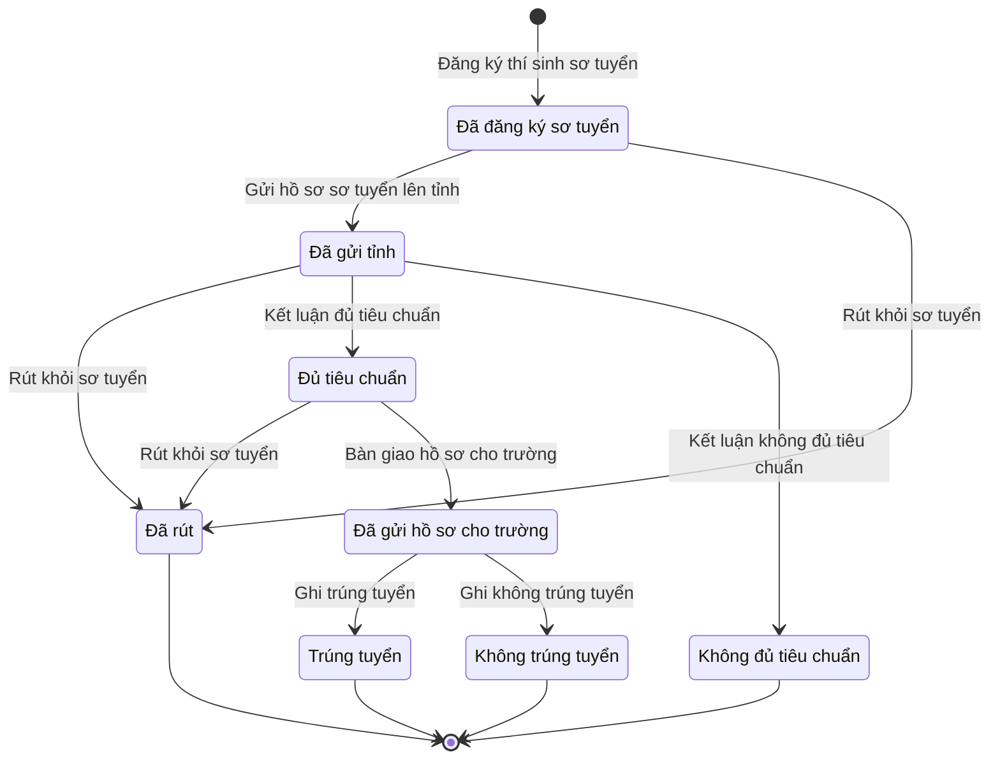

# qt-36 · Sơ tuyển tuyển sinh quân sự tại xã

<!-- máy sinh: tom-tat -->
> **Hồ sơ:** Thí sinh sơ tuyển vào trường Quân đội (`MilitaryCandidate`)
>
> **Trong sổ phạm vi:** 36 · Sơ tuyển tuyển sinh quân sự tại xã — mỗi thí sinh một hồ sơ: đăng ký NV1, khám sức khoẻ, xác minh chính trị, kết luận đủ tiêu chuẩn, danh sách lên bản giao tỉnh xác nhận trên hệ, nộp trường ngoài hệ, ghi kết quả + đánh dấu sổ NVQS (TT41/2025/TT-BQP; dự thảo sửa 3/2026; chốt 30/9)
>
> 12 bước · 8 chặng · 3 vai · 2 bảng quyết định · 0 hạn · 7 khớp nối.
>
> **Nguồn:** sổ nghiệp vụ `qt-36` · khai báo của app: `dqtv-app/core/processes/military-admission/workflow/military-candidate.yaml`. Các bảng do máy sinh từ nguồn này.
<!-- hết: tom-tat -->

<!-- viết tay: dien-giai -->
## Diễn giải

*Phần này viết tay, diễn giải lại điều các bảng bên dưới ghi.*

### Quy trình này để làm gì

Xã và Bộ CHQS cấp tỉnh theo dõi **một thí sinh sơ tuyển vào trường Quân đội** — mỗi thí sinh một hồ sơ. Xã đăng ký thí sinh, ghi kết quả khám sức khoẻ và xác minh chính trị rồi gửi lên tỉnh; tỉnh kết luận đủ hay không đủ tiêu chuẩn và bàn giao hồ sơ cho trường; cuối cùng xã ghi trúng tuyển hay không.

Hồ sơ đi qua các chặng: *Đã đăng ký sơ tuyển* → *Đã gửi tỉnh* → *Đủ tiêu chuẩn* → *Đã gửi hồ sơ cho trường* → *Trúng tuyển*; các lối ra khác là *Không đủ tiêu chuẩn*, *Không trúng tuyển*, *Đã rút*.

### Khi nào bắt đầu

Trợ lý Quân lực bấm **Đăng ký thí sinh sơ tuyển**. Phải chọn công dân và nhập năm tuyển sinh, trường nguyện vọng 1, hệ đào tạo (hệ quân sự hay hệ dân sự); ngành là ô nhập nếu có. Hồ sơ mở ra có nối tới **Công dân trong độ tuổi** (quy trình 16).

### Diễn ra thế nào

**Chặng "Đã đăng ký sơ tuyển"** — việc của Trợ lý Quân lực:

- **Ghi kết quả khám sơ tuyển sức khoẻ** — ghi kết luận (đạt, không đạt, hoặc miễn khám theo diện phi công như mã `exempt_pilot_exam` ghi) và phiếu khám; lặp được.
- **Ghi kết quả xác minh chính trị** — ghi kết luận (đạt, không đạt) và bản xác minh; lặp được.
- **Gửi hồ sơ sơ tuyển lên tỉnh** — bắt buộc kèm báo cáo xét duyệt của xã đã ký; có thể gắn bản kết quả giao việc nếu có. Hồ sơ sang *Đã gửi tỉnh*.

Mỗi lần khám và xác minh được giữ đủ từng lần: mỗi lần tạo một hồ sơ con *Lần khám sức khoẻ, xác minh chính trị của thí sinh*, ô trên hồ sơ là kết luận của lần mới nhất.

**Chặng "Đã gửi tỉnh"** — cán bộ Bộ CHQS cấp tỉnh, phải là người của một đơn vị nằm trong ô cấp trên của chủ hồ sơ:

- **Kết luận đủ tiêu chuẩn** — hồ sơ sang *Đủ tiêu chuẩn*; bước ghi ngày kết luận, không phải nhập ô nào.
- **Kết luận không đủ tiêu chuẩn** — bắt buộc ghi lý do; hồ sơ sang *Không đủ tiêu chuẩn* và kết thúc.

**Chặng "Đủ tiêu chuẩn".** Bộ CHQS cấp tỉnh bấm **Bàn giao hồ sơ cho trường**, nhập ngày gửi; hồ sơ sang *Đã gửi hồ sơ cho trường*.

**Chặng "Đã gửi hồ sơ cho trường"** — chờ kết quả xét tuyển của trường. Trợ lý Quân lực ghi một trong hai:

- **Ghi trúng tuyển** — bắt buộc có giấy báo nhập học và ngày giao giấy báo; số, ngày ký và bản quét quyết định gọi nhập ngũ là ô nhập nếu có. Hồ sơ sang *Trúng tuyển*.
- **Ghi không trúng tuyển** — bắt buộc có ghi chú kết quả. Hồ sơ sang *Không trúng tuyển*.

**Việc làm tại chặng.** **Thông báo kết quả sơ tuyển cho thí sinh** (Trợ lý Quân lực) làm được khi hồ sơ ở *Đủ tiêu chuẩn*, *Không đủ tiêu chuẩn* hoặc *Đã gửi hồ sơ cho trường*; bước ghi ngày báo, không phải nhập ô nào; lặp được.

**Kết thúc sớm.** **Rút khỏi sơ tuyển** (Trợ lý Quân lực) bấm được ở ba chặng *Đã đăng ký sơ tuyển*, *Đã gửi tỉnh*, *Đủ tiêu chuẩn*; bắt buộc ghi lý do rút.

### Kết thúc và để lại gì

Bốn chặng kết thúc: *Trúng tuyển*, *Không trúng tuyển*, *Không đủ tiêu chuẩn*, *Đã rút*; ở *Không đủ tiêu chuẩn* vẫn còn làm được bước thông báo kết quả. Ba khớp nối với quy trình khác:

- **Công dân trong độ tuổi** (16) — thí sinh là công dân nào; ghi lúc đăng ký.
- **Kết quả trả lên cấp trên** (3.assignment-result) — hồ sơ lên tỉnh đi kèm bản kết quả giao việc nào; ghi ở bước gửi hồ sơ lên tỉnh.
- **Quyết định gọi nhập ngũ** (17.conscription-call) — người trúng tuyển hệ quân sự được gọi nhập ngũ theo quyết định nào; ghi ở bước ghi trúng tuyển.

### Điều kiện chặn

- Các bước của xã (trừ bước đăng ký): người làm phải là người của đơn vị chủ hồ sơ; ba bước của tỉnh: người làm phải là người của một đơn vị cấp trên của chủ hồ sơ.
- **Kết luận đủ tiêu chuẩn** (bảng `qualification-standard`): chỉ cho qua khi sức khoẻ là Đạt hoặc Miễn khám (diện phi công) **và** chính trị là Đạt. Một trong hai không đạt, hoặc chưa có kết luận, thì bị chặn (`not_met`).
- **Ghi trúng tuyển** (bảng `admission-call-required`): hệ dân sự thì cho qua; hệ quân sự thì ô `callDecisionOnFile` phải là `yes`, là `no` hoặc chưa có thì chặn (`call_missing`); chưa ghi hệ đào tạo thì chặn (`track_unknown`).
<!-- hết viết tay -->

## 1. Đường đi ngắn nhất qua các chặng

<!-- máy sinh: luong-chinh -->
Đường ít bước nhất từ lúc mở hồ sơ tới chặng kết thúc xa nhất. Máy chọn theo số chặng, không theo ý nghĩa nghiệp vụ — trình tự công việc thật xem phần Diễn giải và bảng "Việc làm ở từng chặng" ở mục 6.

| # | Ai làm | Làm gì | Hồ sơ sang chặng |
|---|---|---|---|
| 1 | Trợ lý Quân lực | Đăng ký thí sinh sơ tuyển | Đã đăng ký sơ tuyển |
| 2 | Hệ thống tự làm | Gửi hồ sơ sơ tuyển lên tỉnh | Đã gửi tỉnh |
| 3 | Bộ CHQS cấp tỉnh (thuộc cấp trên của chủ hồ sơ) | Kết luận đủ tiêu chuẩn | Đủ tiêu chuẩn |
| 4 | Bộ CHQS cấp tỉnh (thuộc cấp trên của chủ hồ sơ) | Bàn giao hồ sơ cho trường | Đã gửi hồ sơ cho trường |
| 5 | Trợ lý Quân lực | Ghi trúng tuyển | Trúng tuyển |

```mermaid
flowchart LR
    S0(["Mở hồ sơ"])
    S1["Đã đăng ký sơ tuyển"]
    S0 -->|"Đăng ký thí sinh sơ tuyển"| S1
    S2["Đã gửi tỉnh"]
    S1 -->|"Gửi hồ sơ sơ tuyển lên tỉnh"| S2
    S3["Đủ tiêu chuẩn"]
    S2 -->|"Kết luận đủ tiêu chuẩn"| S3
    S4["Đã gửi hồ sơ cho trường"]
    S3 -->|"Bàn giao hồ sơ cho trường"| S4
    S5["Trúng tuyển"]
    S4 -->|"Ghi trúng tuyển"| S5
```

<!-- hết: luong-chinh -->

## 2. Hồ sơ và việc nó để lại

<!-- máy sinh: muc-tieu -->
**App gọi quy trình này là:** Thí sinh sơ tuyển vào trường Quân đội.

**Khi mở, hồ sơ này ghi mối nối tới:**
- Công dân trong độ tuổi (16) — bước `registerCandidate`, khớp nối `candidateCitizen`
<!-- hết: muc-tieu -->

## 3. Khởi phát và kết thúc

<!-- máy sinh: khoi-phat -->
**1 cửa vào** — bước mở hồ sơ:

| Bước mở | Ai mở | Hồ sơ vào chặng | App bắt buộc nhập |
|---|---|---|---|
| Đăng ký thí sinh sơ tuyển | Trợ lý Quân lực | Đã đăng ký sơ tuyển | công dân, năm tuyển sinh, trường nguyện vọng 1, hệ đào tạo |

**Kết thúc:** *Không đủ tiêu chuẩn* (`NOT_QUALIFIED`), *Trúng tuyển* (`ADMITTED`), *Không trúng tuyển* (`NOT_ADMITTED`), *Đã rút* (`WITHDRAWN`)
<!-- hết: khoi-phat -->

## 4. Vai trò

<!-- máy sinh: vai-tro -->
| Vai trong sổ | Tên trong app | Điều kiện | Làm những bước |
|---|---|---|---|
| `personnel` | Trợ lý Quân lực |  | Đăng ký thí sinh sơ tuyển · Ghi kết quả khám sơ tuyển sức khoẻ · Ghi kết quả xác minh chính trị · Trình ký văn bản gửi hồ sơ sơ tuyển lên tỉnh · Thông báo kết quả sơ tuyển cho thí sinh · Ghi trúng tuyển · Ghi không trúng tuyển · Rút khỏi sơ tuyển |
| `system` | Hệ thống tự làm |  | Gửi hồ sơ sơ tuyển lên tỉnh |
| `provinceOperator` | Bộ CHQS cấp tỉnh | thuộc cấp trên của chủ hồ sơ (`actorInSuperiorUnit`, công thức ở mục 7) | Kết luận đủ tiêu chuẩn · Kết luận không đủ tiêu chuẩn · Bàn giao hồ sơ cho trường |

*"Tên trong app" là tên app đặt cho mã chủ thể của vai. Hồ sơ thuộc đơn vị cấp khác thì người làm là người giữ vai ấy ở đơn vị nêu trong cột "Điều kiện" (nếu sổ có ghi) và ở cột "Người làm phải thuộc" của bảng "Theo khai báo của app" (mục 7).*
<!-- hết: vai-tro -->

## 5. Nhánh phụ

<!-- máy sinh: nhanh-phu -->
**Bước khác đưa hồ sơ sang chặng mới** — đường song song, rẽ nhánh hoặc kết thúc sớm:

| Bước | Ai làm | Từ chặng | Sang chặng |
|---|---|---|---|
| Ghi không trúng tuyển | Trợ lý Quân lực | Đã gửi hồ sơ cho trường | Không trúng tuyển |
| Rút khỏi sơ tuyển | Trợ lý Quân lực | Đã đăng ký sơ tuyển, Đã gửi tỉnh, Đủ tiêu chuẩn | Đã rút |
| Kết luận không đủ tiêu chuẩn | Bộ CHQS cấp tỉnh (thuộc cấp trên của chủ hồ sơ) | Đã gửi tỉnh | Không đủ tiêu chuẩn |

**Làm trong lúc hồ sơ đứng yên ở một chặng** — ghi nhận, bổ sung:

| Bước | Ai làm | Ở chặng |
|---|---|---|
| Ghi kết quả khám sơ tuyển sức khoẻ *(lặp được)* | Trợ lý Quân lực | Đã đăng ký sơ tuyển |
| Ghi kết quả xác minh chính trị *(lặp được)* | Trợ lý Quân lực | Đã đăng ký sơ tuyển |
| Trình ký văn bản gửi hồ sơ sơ tuyển lên tỉnh | Trợ lý Quân lực | Đã đăng ký sơ tuyển |
| Thông báo kết quả sơ tuyển cho thí sinh *(lặp được)* | Trợ lý Quân lực | Đủ tiêu chuẩn, Đã gửi hồ sơ cho trường, Không đủ tiêu chuẩn |

<!-- hết: nhanh-phu -->

## 6. Các chặng và việc làm ở từng chặng

<!-- máy sinh: chang -->
| Chặng | Tên hiển thị | Vào bằng bước | Kết thúc? |
|---|---|---|---|
| `REGISTERED` | Đã đăng ký sơ tuyển | Đăng ký thí sinh sơ tuyển |  |
| `SENT_TO_PROVINCE` | Đã gửi tỉnh | Gửi hồ sơ sơ tuyển lên tỉnh |  |
| `QUALIFIED` | Đủ tiêu chuẩn | Kết luận đủ tiêu chuẩn |  |
| `NOT_QUALIFIED` | Không đủ tiêu chuẩn | Kết luận không đủ tiêu chuẩn | **kết thúc** — vẫn còn bước làm được |
| `SUBMITTED` | Đã gửi hồ sơ cho trường | Bàn giao hồ sơ cho trường |  |
| `ADMITTED` | Trúng tuyển | Ghi trúng tuyển | **kết thúc** |
| `NOT_ADMITTED` | Không trúng tuyển | Ghi không trúng tuyển | **kết thúc** |
| `WITHDRAWN` | Đã rút | Rút khỏi sơ tuyển | **kết thúc** |

### Việc làm ở từng chặng

Hồ sơ đang ở chặng nào thì làm được những bước nào.

| Hồ sơ đang ở chặng | Bước làm tại chặng (hồ sơ đứng yên) | Bước đưa hồ sơ sang chặng khác |
|---|---|---|
| **Đã đăng ký sơ tuyển** | Ghi kết quả khám sơ tuyển sức khoẻ (lặp được) — Trợ lý Quân lực Ghi kết quả xác minh chính trị (lặp được) — Trợ lý Quân lực Trình ký văn bản gửi hồ sơ sơ tuyển lên tỉnh — Trợ lý Quân lực | Gửi hồ sơ sơ tuyển lên tỉnh — Hệ thống tự làm → *Đã gửi tỉnh* Rút khỏi sơ tuyển — Trợ lý Quân lực → *Đã rút* |
| **Đã gửi tỉnh** | — | Rút khỏi sơ tuyển — Trợ lý Quân lực → *Đã rút* Kết luận đủ tiêu chuẩn — Bộ CHQS cấp tỉnh (thuộc cấp trên của chủ hồ sơ) → *Đủ tiêu chuẩn* Kết luận không đủ tiêu chuẩn — Bộ CHQS cấp tỉnh (thuộc cấp trên của chủ hồ sơ) → *Không đủ tiêu chuẩn* |
| **Đủ tiêu chuẩn** | Thông báo kết quả sơ tuyển cho thí sinh (lặp được) — Trợ lý Quân lực | Rút khỏi sơ tuyển — Trợ lý Quân lực → *Đã rút* Bàn giao hồ sơ cho trường — Bộ CHQS cấp tỉnh (thuộc cấp trên của chủ hồ sơ) → *Đã gửi hồ sơ cho trường* |
| **Không đủ tiêu chuẩn** | Thông báo kết quả sơ tuyển cho thí sinh (lặp được) — Trợ lý Quân lực | — (kết thúc) |
| **Đã gửi hồ sơ cho trường** | Thông báo kết quả sơ tuyển cho thí sinh (lặp được) — Trợ lý Quân lực | Ghi trúng tuyển — Trợ lý Quân lực → *Trúng tuyển* Ghi không trúng tuyển — Trợ lý Quân lực → *Không trúng tuyển* |
| **Trúng tuyển** | — | — (kết thúc) |
| **Không trúng tuyển** | — | — (kết thúc) |
| **Đã rút** | — | — (kết thúc) |
<!-- hết: chang -->

## 7. Bảng bước

<!-- máy sinh: buoc -->
| # | Bước | Mã bước | Ai thực hiện | Từ chặng | Sang chặng | Phải có trước | Ghi lại |
|---|---|---|---|---|---|---|---|
| 1 | Đăng ký thí sinh sơ tuyển | `registerCandidate` | Trợ lý Quân lực | — (mở hồ sơ) | `REGISTERED` | — | `id`, đơn vị chủ hồ sơ, cấp trên của chủ hồ sơ, nối tới Công dân trong độ tuổi, năm tuyển sinh, trường nguyện vọng 1, ngành, ngày đăng ký, hệ đào tạo |
| 2 | Ghi kết quả khám sơ tuyển sức khoẻ | `recordCandidateHealthExam` | Trợ lý Quân lực | `REGISTERED` | giữ nguyên | người làm thuộc đơn vị chủ hồ sơ | sức khoẻ, phiếu khám sức khoẻ |
| 3 | Ghi kết quả xác minh chính trị | `recordPoliticalVerification` | Trợ lý Quân lực | `REGISTERED` | giữ nguyên | người làm thuộc đơn vị chủ hồ sơ | chính trị, bản xác minh chính trị |
| 4 | Trình ký văn bản gửi hồ sơ sơ tuyển lên tỉnh | `requestSendDossierToProvinceSignature` | Trợ lý Quân lực | `REGISTERED` | giữ nguyên | `noSendDossierToProvinceDocumentOpen`, người làm thuộc đơn vị chủ hồ sơ | nối `assignmentResult`, báo cáo xét duyệt của xã, nối tới Văn bản đi |
| 5 | Gửi hồ sơ sơ tuyển lên tỉnh | `sendDossierToProvince` | Hệ thống tự làm | `REGISTERED` | `SENT_TO_PROVINCE` | `sendDossierToProvinceDocumentIssued` | ngày gửi tỉnh, nối `submissionDeliveredAs` |
| 6 | Thông báo kết quả sơ tuyển cho thí sinh | `notifyCandidateResult` | Trợ lý Quân lực | `QUALIFIED`, `SUBMITTED`, `NOT_QUALIFIED` | giữ nguyên | người làm thuộc đơn vị chủ hồ sơ | ngày báo kết quả cho thí sinh |
| 7 | Ghi trúng tuyển | `recordAdmission` | Trợ lý Quân lực | `SUBMITTED` | `ADMITTED` | người làm thuộc đơn vị chủ hồ sơ | giấy báo nhập học, ngày giao giấy báo |
| 8 | Ghi không trúng tuyển | `recordNotAdmitted` | Trợ lý Quân lực | `SUBMITTED` | `NOT_ADMITTED` | người làm thuộc đơn vị chủ hồ sơ | ghi chú kết quả |
| 9 | Rút khỏi sơ tuyển | `withdrawCandidate` | Trợ lý Quân lực | `REGISTERED`, `SENT_TO_PROVINCE`, `QUALIFIED` | `WITHDRAWN` | người làm thuộc đơn vị chủ hồ sơ | lý do rút |
| 10 | Kết luận đủ tiêu chuẩn | `markCandidateQualified` | Bộ CHQS cấp tỉnh (thuộc cấp trên của chủ hồ sơ) | `SENT_TO_PROVINCE` | `QUALIFIED` | người làm thuộc cấp trên của chủ hồ sơ | ngày kết luận đủ tiêu chuẩn |
| 11 | Kết luận không đủ tiêu chuẩn | `markCandidateNotQualified` | Bộ CHQS cấp tỉnh (thuộc cấp trên của chủ hồ sơ) | `SENT_TO_PROVINCE` | `NOT_QUALIFIED` | người làm thuộc cấp trên của chủ hồ sơ | lý do không đủ tiêu chuẩn |
| 12 | Bàn giao hồ sơ cho trường | `recordDossierSentToSchool` | Bộ CHQS cấp tỉnh (thuộc cấp trên của chủ hồ sơ) | `QUALIFIED` | `SUBMITTED` | người làm thuộc cấp trên của chủ hồ sơ | ngày gửi hồ sơ cho trường |

### Khi không đạt điều kiện

Mặc định: không đúng người, hồ sơ không ở đúng chặng, hoặc thiếu thứ "phải có trước" thì bước bị chặn, hồ sơ giữ nguyên. Bảng dưới chỉ kê những bước có kết quả riêng.

| # | Bước | Kết quả riêng |
|---|---|---|
| 5 | Gửi hồ sơ sơ tuyển lên tỉnh | bước này không do người nào bấm |
| 7 | Ghi trúng tuyển | bước dừng lại, hồ sơ giữ nguyên khi kết quả xét là: `call_missing`, `missing_input` |
| 10 | Kết luận đủ tiêu chuẩn | bước dừng lại, hồ sơ giữ nguyên khi kết quả xét là: `not_met` |

### Điều kiện "phải có trước" bằng lời

Cột "Phải có trước" ở bảng bước có hai loại: ô dữ liệu thường (bước chỉ đòi ô ấy đã có giá trị) và điều kiện hệ tự xét. Bảng này diễn các điều kiện hệ tự xét theo đúng công thức sổ ghi; số ở cột cuối là số thứ tự bước.

| Điều kiện | Đúng khi | Bước đòi |
|---|---|---|
| `actorInOwnerUnit` | người đang làm là người của đơn vị ghi ở ô đơn vị chủ hồ sơ của hồ sơ này (theo danh mục người của đơn vị, `dm.unit-staff`) | 2, 3, 4, 6, 7, 8, 9 |
| `noSendDossierToProvinceDocumentOpen` | KHÔNG (có hồ sơ Việc luật giao kèm văn bản đến, đi — Văn bản đi (qt-1.outgoing-document) chính là hồ sơ ghi ở ô nối `sendDossierToProvinceByDocument` của hồ sơ đang làm mà hồ sơ ấy đang ở chặng `DRAFT` hoặc `PENDING_SIGNATURE` hoặc `SIGNED`) | 4 |
| `sendDossierToProvinceDocumentIssued` | có hồ sơ Việc luật giao kèm văn bản đến, đi — Văn bản đi (qt-1.outgoing-document) chính là hồ sơ ghi ở ô nối `sendDossierToProvinceByDocument` của hồ sơ đang làm mà hồ sơ ấy đang ở chặng `ISSUED` | 5 |
| `actorInSuperiorUnit` | người đang làm là người của một đơn vị nằm trong ô cấp trên của chủ hồ sơ của hồ sơ này (theo danh mục người của đơn vị, `dm.unit-staff`) | 10, 11, 12 |

### Theo khai báo của app

Người làm phải thuộc đơn vị nào, ô người dùng phải nhập, bước có lặp được không, và căn cứ pháp lý — lấy từ khai báo quy trình trong app.

| # | Bước | Người làm phải thuộc | Bắt buộc nhập | Nhập nếu có | Lặp được | Căn cứ |
|---|---|---|---|---|---|---|
| 1 | Đăng ký thí sinh sơ tuyển |  | công dân, năm tuyển sinh, trường nguyện vọng 1, hệ đào tạo | ngành |  | QĐ5519/QĐ-BQP |
| 2 | Ghi kết quả khám sơ tuyển sức khoẻ | đơn vị chủ hồ sơ | sức khoẻ | phiếu khám sức khoẻ | có | QĐ5519/QĐ-BQP |
| 3 | Ghi kết quả xác minh chính trị | đơn vị chủ hồ sơ | chính trị | bản xác minh chính trị | có | QĐ5519/QĐ-BQP |
| 4 | Trình ký văn bản gửi hồ sơ sơ tuyển lên tỉnh | đơn vị chủ hồ sơ | báo cáo xét duyệt của xã | bản kết quả giao việc (nếu có), dự thảo văn bản (PDF) |  | QĐ5519/QĐ-BQP · NĐ30/2020/NĐ-CP Đ.13 |
| 5 | Gửi hồ sơ sơ tuyển lên tỉnh |  | — | — |  | QĐ5519/QĐ-BQP |
| 6 | Thông báo kết quả sơ tuyển cho thí sinh | đơn vị chủ hồ sơ | — | — | có | QĐ5519/QĐ-BQP |
| 7 | Ghi trúng tuyển | đơn vị chủ hồ sơ | giấy báo nhập học, ngày giao giấy báo | số quyết định gọi nhập ngũ, ngày ký quyết định gọi nhập ngũ, quyết định gọi nhập ngũ, quyết định gọi nhập ngũ (qt-17) |  | L78/2015/QH13 Đ.34 k6 (sửa bởi L98/2025/QH15 Đ.4 k11 c) |
| 8 | Ghi không trúng tuyển | đơn vị chủ hồ sơ | ghi chú kết quả | — |  | sổ tri thức qt-36 |
| 9 | Rút khỏi sơ tuyển | đơn vị chủ hồ sơ | lý do rút | — |  | sổ tri thức qt-36 |
| 10 | Kết luận đủ tiêu chuẩn | cấp trên của chủ hồ sơ | — | — |  | QĐ5519/QĐ-BQP |
| 11 | Kết luận không đủ tiêu chuẩn | cấp trên của chủ hồ sơ | lý do không đủ tiêu chuẩn | — |  | QĐ5519/QĐ-BQP |
| 12 | Bàn giao hồ sơ cho trường | cấp trên của chủ hồ sơ | ngày gửi hồ sơ cho trường | — |  | QĐ5519/QĐ-BQP |

### Điều kiện và ghi chú app khai cho từng bước

Lấy từ khai báo quy trình trong app. Lời trong ngoặc kép là câu app hiện cho người dùng. Chức danh người ký ngoài hệ app chỉ khai bằng mã.

| # | Bước | Điều kiện, ghi chú |
|---|---|---|
| 2 | Ghi kết quả khám sơ tuyển sức khoẻ | · tạo thêm một hồ sơ con: Lần khám sức khoẻ, xác minh chính trị của thí sinh (`CandidateCheck`) |
| 3 | Ghi kết quả xác minh chính trị | · tạo thêm một hồ sơ con: Lần khám sức khoẻ, xác minh chính trị của thí sinh (`CandidateCheck`) |
<!-- hết: buoc -->

## 8. Bảng quyết định, hạn, việc ngoài hệ

<!-- máy sinh: quyet-dinh -->
**Bảng `admission-call-required`** — xét ở bước *Ghi trúng tuyển*; đầu vào: hệ đào tạo, `callDecisionOnFile`. 5 dòng, dò từ trên xuống, dòng đầu tiên khớp thì dừng.

| Thứ tự dò (số sổ ghi) | Dòng | Khi | Thì |
|---|---|---|---|
| 0 | `track-unset` | chưa có hệ đào tạo | `missing_input` |
| 1 | `civilian` | hệ đào tạo là Hệ dân sự (đóng học phí) (`civilian`) | cho qua |
| 2 | `military-called` | hệ đào tạo là Hệ quân sự (`military`) và `callDecisionOnFile` là `yes` | cho qua |
| 3 | `military-no-call` | hệ đào tạo là Hệ quân sự (`military`) và `callDecisionOnFile` là `no` | `call_missing` |
| 4 | `military-call-unset` | hệ đào tạo là Hệ quân sự (`military`) và chưa có `callDecisionOnFile` | `call_missing` |

**Bảng `qualification-standard`** — xét ở bước *Kết luận đủ tiêu chuẩn*; đầu vào: sức khoẻ, chính trị. 5 dòng, dò từ trên xuống, dòng đầu tiên khớp thì dừng.

| Thứ tự dò (số sổ ghi) | Dòng | Khi | Thì |
|---|---|---|---|
| 1 | `meets` | sức khoẻ là Đạt (`meets_standard`) hoặc Miễn khám (diện phi công) (`exempt_pilot_exam`) và chính trị là Đạt (`meets_standard`) | cho qua |
| 2 | `health-fails` | sức khoẻ là Không đạt (`fails_standard`) | `not_met` |
| 3 | `political-fails` | chính trị là Không đạt (`fails_standard`) | `not_met` |
| 4 | `health-unset` | chưa có sức khoẻ | `not_met` |
| 5 | `political-unset` | chưa có chính trị | `not_met` |

<!-- hết: quyet-dinh -->

## 9. Dữ liệu của hồ sơ

<!-- máy sinh: du-lieu -->
Các ô mà bước trong sổ ghi hoặc đòi. Số trong hai cột cuối là số thứ tự bước ở bảng bước (mục 7).

| Ô dữ liệu | Mã | Kiểu (app) | Giá trị cho phép | Loại ô (sổ) | Bước ghi | Bước đòi | Mô tả trong app |
|---|---|---|---|---|---|---|---|
| — | `id` |  |  | lưu trên hồ sơ (`stored`) | 1 | — |  |
| đơn vị chủ hồ sơ | `ownerUnit` |  |  | lưu trên hồ sơ (`stored`) | 1 | — |  |
| cấp trên của chủ hồ sơ | `superiorUnits` |  |  | hệ suy ra (`derived`) | 1 | — |  |
| năm tuyển sinh | `admissionYear` | số |  | đưa vào ở bước (`input`) | 1 | — | Năm tuyển sinh |
| trường nguyện vọng 1 | `firstChoiceSchool` | chữ |  | đưa vào ở bước (`input`) | 1 | — | Trường nguyện vọng 1 |
| ngành | `major` | chữ |  | đưa vào ở bước (`input`) | 1 | — | Ngành đăng ký |
| ngày đăng ký | `registeredAt` | ngày |  | lưu trên hồ sơ (`stored`) | 1 | — | Ngày đăng ký sơ tuyển |
| hệ đào tạo | `trainingTrack` | chọn một | Hệ quân sự (`military`), Hệ dân sự (đóng học phí) (`civilian`) | đưa vào ở bước (`input`) | 1 | — | Hệ đào tạo — hệ quân sự (trúng tuyển là nhập ngũ) hay hệ dân sự, đóng học phí (vẫn thực hiện nghĩa vụ quân sự như sinh viên thường) |
| sức khoẻ | `healthConclusion` | chọn một | Đạt (`meets_standard`), Không đạt (`fails_standard`), Miễn khám (diện phi công) (`exempt_pilot_exam`) | đưa vào ở bước (`input`) | 2 | — | Kết luận khám sơ tuyển sức khoẻ — lần mới nhất |
| phiếu khám sức khoẻ | `healthExamScan` | tệp |  | đưa vào ở bước (`input`) | 2 | — | Phiếu khám sức khoẻ — lần mới nhất |
| chính trị | `politicalConclusion` | chọn một | Đạt (`meets_standard`), Không đạt (`fails_standard`) | đưa vào ở bước (`input`) | 3 | — | Kết luận thẩm tra, xác minh chính trị — lần mới nhất |
| bản xác minh chính trị | `verificationScan` | tệp |  | đưa vào ở bước (`input`) | 3 | — | Bản thẩm tra, xác minh chính trị — lần mới nhất |
| báo cáo xét duyệt của xã | `signedReviewReportScan` | tệp |  | đưa vào ở bước (`input`) | 4 | — | Báo cáo kết quả xét duyệt hồ sơ sơ tuyển của xã, đã ký |
| ngày gửi tỉnh | `sentToProvinceAt` | ngày |  | lưu trên hồ sơ (`stored`) | 5 | — | Ngày xã gửi hồ sơ lên Ban TSQS tỉnh |
| ngày báo kết quả cho thí sinh | `candidateNotifiedAt` | ngày |  | lưu trên hồ sơ (`stored`) | 6 | — | Ngày xã thông báo kết quả sơ tuyển cho thí sinh |
| giấy báo nhập học | `admissionNoticeScan` | tệp |  | đưa vào ở bước (`input`) | 7 | — | Giấy báo nhập học của trường |
| ngày giao giấy báo | `noticeDeliveredAt` | ngày |  | đưa vào ở bước (`input`) | 7 | — | Ngày giao giấy báo nhập học cho thí sinh |
| ghi chú kết quả | `resultNote` | chữ |  | đưa vào ở bước (`input`) | 8 | — | Ghi chú kết quả không trúng tuyển |
| lý do rút | `withdrawNote` | chữ |  | đưa vào ở bước (`input`) | 9 | — | Vì sao thí sinh rút |
| ngày kết luận đủ tiêu chuẩn | `qualifiedAt` | ngày |  | lưu trên hồ sơ (`stored`) | 10 | — | Ngày tỉnh kết luận đủ tiêu chuẩn |
| lý do không đủ tiêu chuẩn | `notQualifiedReason` | chữ |  | đưa vào ở bước (`input`) | 11 | — | Vì sao tỉnh kết luận không đủ tiêu chuẩn |
| ngày gửi hồ sơ cho trường | `dossierSentAt` | ngày |  | đưa vào ở bước (`input`) | 12 | — | Ngày tỉnh bàn giao hồ sơ cho trường |
| người làm thuộc đơn vị chủ hồ sơ | `actorInOwnerUnit` |  | có hay chưa | hệ suy ra (`derived`) | — | 2, 3, 4, 6, 7, 8, 9 |  |
| — | `noSendDossierToProvinceDocumentOpen` |  | có hay chưa | hệ suy ra (`derived`) | — | 4 |  |
| — | `sendDossierToProvinceDocumentIssued` |  | có hay chưa | hệ suy ra (`derived`) | — | 5 |  |
| người làm thuộc cấp trên của chủ hồ sơ | `actorInSuperiorUnit` |  | có hay chưa | hệ suy ra (`derived`) | — | 10, 11, 12 |  |
| — | `callDecisionOnFile` |  | `yes`, `no` | đưa vào ở bước (`input`) | — | — |  |

27 ô. Cột "Loại ô" là cách sổ phân loại ô, in kèm đúng chữ của sổ; ô nào người dùng phải nhập xem bảng "Theo khai báo của app" ở mục 7.
<!-- hết: du-lieu -->

## 10. Khớp nối với quy trình khác

<!-- máy sinh: khop-noi -->
| Quy trình kia | Hồ sơ kia | Quan hệ | Nội dung (mô tả trong app) | Bước ghi mối nối | Tên ô nối |
|---|---|---|---|---|---|
| 1.incoming-document | Văn bản đến | có nối | Văn bản gửi hồ sơ sơ tuyển ở sổ văn bản đến của Bộ CHQS tỉnh — sổ qt-36 link.submissionDeliveredAs | — | `militaryCandidateSubmissionDeliveredAs` |
| 1.outgoing-document | Văn bản đi | gắn với nhau ở một bước giữa chừng | Văn bản gửi hồ sơ sơ tuyển lên Ban TSQS tỉnh — văn bản đi của Ban CHQS xã (QĐ5519/QĐ-BQP) | 36·requestSendDossierToProvinceSignature | `sendDossierToProvinceByDocument` |
| 16 | Công dân trong độ tuổi | hồ sơ này **mở ra có nối tới** hồ sơ kia | Thí sinh là công dân nào | 36·registerCandidate ⊕ | `candidateCitizen` |
| 16.enlistment | Chiến sĩ dân quân tự vệ | có nối | Cờ chờ quyết định cho thôi — hồ sơ trúng tuyển trường Quân đội hệ quân sự (Luật Đ.12 k1 đ) | — | `exitDueSourceAdmission` |
| 16.service-exit-decision | Dòng quyết định cho thôi, đưa ra khỏi danh sách | có nối | Cho thôi vì vào học — chứng cứ là hồ sơ trúng tuyển trường Quân đội trên hệ (Luật Đ.12 k1 đ) | — | `exitCausedByAdmission` |
| 17.conscription-call | Quyết định gọi nhập ngũ | có nối | Người trúng tuyển hệ quân sự được gọi nhập ngũ theo quyết định nào (qt-17) — "đánh dấu sổ NVQS" của sổ qt-36 | — | `candidateCalledBy` |
| 3.assignment-result | Kết quả trả lên cấp trên | gắn với nhau ở một bước giữa chừng | Hồ sơ lên tỉnh đi kèm bản kết quả giao việc nào (qt-3) | 36·requestSendDossierToProvinceSignature | `candidateReportedBy` |

7 khớp nối. ⊕ là bước tạo hồ sơ.
<!-- hết: khop-noi -->

## 11. Thông tin chung

<!-- máy sinh: thong-tin -->
| | |
|---|---|
| **Mã trong sổ** | `qt-36` |
| **Quy trình trong app** | `military-admission` (`workflow/military-candidate.yaml`) — mặt công tác: `personnel` |
| **Hồ sơ** | Thí sinh sơ tuyển vào trường Quân đội (`MilitaryCandidate`) |
| **Căn cứ pháp lý từng bước** | cột "Căn cứ" ở bảng "Theo khai báo của app", mục 7 |
<!-- hết: thong-tin -->
