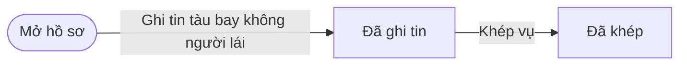
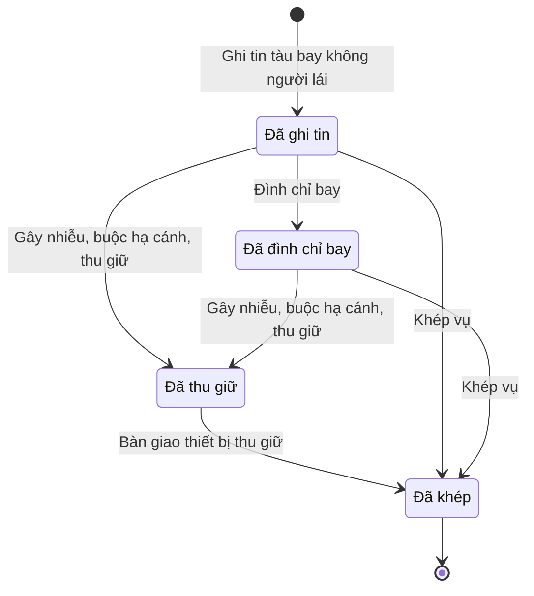

# qt-38 · Vụ việc tàu bay không người lái

<!-- máy sinh: tom-tat -->
> **Hồ sơ:** Vụ tàu bay không người lái (`DroneCase`)
>
> **Trong sổ phạm vi:** 38 · Vụ việc tàu bay không người lái — đối chiếu phép bay, đình chỉ bay (CHT xã), chế áp tạm giữ (CHT xã hoặc tổ trưởng tổ chế áp, hậu kiểm), bàn giao Công an (L49/2024 Đ.33–34 sửa bởi L14/2026; NĐ288/2025 Đ.25 k7; chốt 30/9)
>
> 6 bước · 4 chặng · 1 vai · 3 bảng quyết định · 0 hạn · 0 khớp nối.
>
> **Nguồn:** sổ nghiệp vụ `qt-38` · khai báo của app: `dqtv-app/core/processes/drone-incident/workflow/drone-case.yaml`. Các bảng do máy sinh từ nguồn này.
<!-- hết: tom-tat -->

<!-- viết tay: dien-giai -->
## Diễn giải

*Phần này viết tay, diễn giải lại điều các bảng bên dưới ghi.*

### Quy trình này để làm gì

Trợ lý Tác huấn ghi lại một **vụ tàu bay không người lái** từ lúc có tin tới lúc khép: kiểm tra phép bay, đình chỉ bay, gây nhiễu – buộc hạ cánh – thu giữ, rồi bàn giao thiết bị.

Hồ sơ có bốn chặng: *Đã ghi tin* → *Đã đình chỉ bay* → *Đã thu giữ* → *Đã khép*. Không buộc đi đủ cả bốn: có thể thu giữ ngay không qua đình chỉ, hoặc khép vụ mà không thu giữ. Cả sáu bước đều do Trợ lý Tác huấn ghi vào hệ; người ra lệnh đình chỉ hay thu giữ là một ô chọn trên hồ sơ.

### Khi nào bắt đầu

Trợ lý Tác huấn bấm **Ghi tin tàu bay không người lái**. Bắt buộc nhập nguồn tin (dân quân tuần tra; chốt, trạm quan sát; người dân báo; công an báo; nguồn khác), thời điểm phát hiện, vị trí phát hiện và mô tả (loại thiết bị, độ cao, hướng bay, người điều khiển). Hồ sơ vào chặng *Đã ghi tin*. Hồ sơ không mở ra từ hồ sơ của quy trình nào khác.

### Diễn ra thế nào

**Chặng "Đã ghi tin"** — bốn việc làm được:

- **Kiểm tra phép bay** — ghi kết quả: có phép bay hợp lệ, thuộc diện không phải cấp phép, không có phép bay, bay sai nội dung phép, hoặc "Chưa xác định được"; số giấy phép nhập nếu có. Lặp được, hệ giữ kết quả lần gần nhất. Hồ sơ đứng yên.
- **Đình chỉ bay** — bắt buộc nhập căn cứ đình chỉ, ghi người ra lệnh đình chỉ; lệnh đình chỉ ra tại chỗ. Hồ sơ sang *Đã đình chỉ bay*.
- **Gây nhiễu, buộc hạ cánh, thu giữ** — làm được ngay từ chặng này, hồ sơ sang thẳng *Đã thu giữ*.
- **Khép vụ** — hồ sơ sang *Đã khép*.

**Chặng "Đã đình chỉ bay"** — dừng bay thì **Khép vụ**; không chấp hành thì **Gây nhiễu, buộc hạ cánh, thu giữ**. Bước thu giữ bắt buộc nhập căn cứ áp dụng biện pháp, biện pháp (buộc hạ cánh hoặc vô hiệu hoá), người điều khiển (giữ được, không giữ, không tìm thấy), bản chụp biên bản thu giữ, và đã báo công an hay không có công an tại khu vực.

**Chặng "Đã thu giữ"** — chỉ còn một lối: **Bàn giao thiết bị thu giữ**, bắt buộc nhập cơ quan nhận bàn giao (công an hoặc cơ quan có thẩm quyền khác) và bản chụp biên bản bàn giao. Hồ sơ sang *Đã khép*. Đã thu giữ thì không khép bằng bước Khép vụ được.

### Kết thúc và để lại gì

Hồ sơ kết thúc ở chặng *Đã khép*, vào bằng một trong hai bước: bàn giao thiết bị, hoặc khép vụ với kết quả bay hợp pháp · đã dừng sau khi đình chỉ · mất dấu. Hồ sơ này không có mối nối với hồ sơ của quy trình khác.

### Điều kiện chặn

- **Ai được ra lệnh đình chỉ** (bảng `drone-suspension-authority`): chỉ Chỉ huy trưởng Ban CHQS xã (`communeCommander`). Mọi trường hợp còn lại thì bị chặn (`wrong_authority`).
- **Ai được ra lệnh gây nhiễu, thu giữ** (bảng `drone-order-authority`): Chỉ huy trưởng Ban CHQS xã (`communeCommander`) hoặc Tổ trưởng tổ gây nhiễu (`jammingTeamLeader`). Mọi trường hợp còn lại thì bị chặn (`wrong_authority`).
- **Khép vụ** (bảng `drone-close-lawful`, dò từ trên xuống): thiếu kết quả thì chặn (`outcome_unknown`). Kết quả là "đã dừng bay sau đình chỉ" hoặc "mất dấu" thì cho khép, kể cả khi ô phép bay còn trống. Kết quả là "bay hợp pháp" thì phải đã kiểm tra phép bay (thiếu thì `permit_unchecked`) và phép bay phải là "có phép bay hợp lệ" hoặc "thuộc diện không phải cấp phép" (không thì `permit_not_lawful`).
- Năm bước sau bước mở: người làm phải thuộc đơn vị chủ hồ sơ (theo danh mục người của đơn vị, `dm.unit-staff`). Sai người, sai chặng thì bước bị chặn, hồ sơ giữ nguyên.
- Ba bước không đòi bản chụp: ghi tin, đình chỉ bay ("Lệnh đình chỉ ra tại chỗ — ghi người ra lệnh và căn cứ") và khép vụ. Hai bước thu giữ và bàn giao thì bắt buộc nhập bản chụp biên bản.
<!-- hết viết tay -->

## 1. Đường đi ngắn nhất qua các chặng

<!-- máy sinh: luong-chinh -->
Đường ít bước nhất từ lúc mở hồ sơ tới chặng kết thúc xa nhất. Máy chọn theo số chặng, không theo ý nghĩa nghiệp vụ — trình tự công việc thật xem phần Diễn giải và bảng "Việc làm ở từng chặng" ở mục 6.

| # | Ai làm | Làm gì | Hồ sơ sang chặng |
|---|---|---|---|
| 1 | Trợ lý Tác huấn | Ghi tin tàu bay không người lái | Đã ghi tin |
| 2 | Trợ lý Tác huấn | Khép vụ | Đã khép |

<!-- hết: luong-chinh -->

## 2. Hồ sơ và việc nó để lại

<!-- máy sinh: muc-tieu -->
**App gọi quy trình này là:** Xử lý tàu bay không người lái.
<!-- hết: muc-tieu -->

## 3. Khởi phát và kết thúc

<!-- máy sinh: khoi-phat -->
**1 cửa vào** — bước mở hồ sơ:

| Bước mở | Ai mở | Hồ sơ vào chặng | App bắt buộc nhập |
|---|---|---|---|
| Ghi tin tàu bay không người lái | Trợ lý Tác huấn | Đã ghi tin | nguồn tin, phát hiện lúc, vị trí phát hiện, mô tả |

**Kết thúc:** *Đã khép* (`CLOSED`)
<!-- hết: khoi-phat -->

## 4. Vai trò

<!-- máy sinh: vai-tro -->
| Vai trong sổ | Tên trong app | Điều kiện | Làm những bước |
|---|---|---|---|
| `communeOperator` | Trợ lý Tác huấn |  | Ghi tin tàu bay không người lái · Kiểm tra phép bay · Đình chỉ bay · Gây nhiễu, buộc hạ cánh, thu giữ · Bàn giao thiết bị thu giữ · Khép vụ |

*"Tên trong app" là tên app đặt cho mã chủ thể của vai. Hồ sơ thuộc đơn vị cấp khác thì người làm là người giữ vai ấy ở đơn vị nêu trong cột "Điều kiện" (nếu sổ có ghi) và ở cột "Người làm phải thuộc" của bảng "Theo khai báo của app" (mục 7).*
<!-- hết: vai-tro -->

## 5. Nhánh phụ

<!-- máy sinh: nhanh-phu -->
**Bước khác đưa hồ sơ sang chặng mới** — đường song song, rẽ nhánh hoặc kết thúc sớm:

| Bước | Ai làm | Từ chặng | Sang chặng |
|---|---|---|---|
| Đình chỉ bay | Trợ lý Tác huấn | Đã ghi tin | Đã đình chỉ bay |
| Gây nhiễu, buộc hạ cánh, thu giữ | Trợ lý Tác huấn | Đã ghi tin, Đã đình chỉ bay | Đã thu giữ |
| Bàn giao thiết bị thu giữ | Trợ lý Tác huấn | Đã thu giữ | Đã khép |

**Làm trong lúc hồ sơ đứng yên ở một chặng** — ghi nhận, bổ sung:

| Bước | Ai làm | Ở chặng |
|---|---|---|
| Kiểm tra phép bay *(lặp được)* | Trợ lý Tác huấn | Đã ghi tin |

<!-- hết: nhanh-phu -->

## 6. Các chặng và việc làm ở từng chặng

<!-- máy sinh: chang -->
| Chặng | Tên hiển thị | Vào bằng bước | Kết thúc? |
|---|---|---|---|
| `REPORTED` | Đã ghi tin | Ghi tin tàu bay không người lái |  |
| `SUSPENDED` | Đã đình chỉ bay | Đình chỉ bay |  |
| `SEIZED` | Đã thu giữ | Gây nhiễu, buộc hạ cánh, thu giữ |  |
| `CLOSED` | Đã khép | Bàn giao thiết bị thu giữ · Khép vụ | **kết thúc** |

### Việc làm ở từng chặng

Hồ sơ đang ở chặng nào thì làm được những bước nào.

| Hồ sơ đang ở chặng | Bước làm tại chặng (hồ sơ đứng yên) | Bước đưa hồ sơ sang chặng khác |
|---|---|---|
| **Đã ghi tin** | Kiểm tra phép bay (lặp được) — Trợ lý Tác huấn | Đình chỉ bay — Trợ lý Tác huấn → *Đã đình chỉ bay* Gây nhiễu, buộc hạ cánh, thu giữ — Trợ lý Tác huấn → *Đã thu giữ* Khép vụ — Trợ lý Tác huấn → *Đã khép* |
| **Đã đình chỉ bay** | — | Gây nhiễu, buộc hạ cánh, thu giữ — Trợ lý Tác huấn → *Đã thu giữ* Khép vụ — Trợ lý Tác huấn → *Đã khép* |
| **Đã thu giữ** | — | Bàn giao thiết bị thu giữ — Trợ lý Tác huấn → *Đã khép* |
| **Đã khép** | — | — (kết thúc) |
<!-- hết: chang -->

## 7. Bảng bước

<!-- máy sinh: buoc -->
| # | Bước | Mã bước | Ai thực hiện | Từ chặng | Sang chặng | Phải có trước | Ghi lại |
|---|---|---|---|---|---|---|---|
| 1 | Ghi tin tàu bay không người lái | `reportDroneSighting` | Trợ lý Tác huấn | — (mở hồ sơ) | `REPORTED` | — | đơn vị chủ hồ sơ, cấp trên của chủ hồ sơ, nguồn tin, phát hiện lúc, vị trí phát hiện, mô tả |
| 2 | Kiểm tra phép bay | `checkFlightPermit` | Trợ lý Tác huấn | `REPORTED` | giữ nguyên | người làm thuộc đơn vị chủ hồ sơ | phép bay, số giấy phép bay |
| 3 | Đình chỉ bay | `suspendDroneFlight` | Trợ lý Tác huấn | `REPORTED` | `SUSPENDED` | người làm thuộc đơn vị chủ hồ sơ | căn cứ đình chỉ, người ra lệnh đình chỉ, đình chỉ lúc |
| 4 | Gây nhiễu, buộc hạ cánh, thu giữ | `jamAndSeizeDrone` | Trợ lý Tác huấn | `REPORTED`, `SUSPENDED` | `SEIZED` | người làm thuộc đơn vị chủ hồ sơ | người ra lệnh gây nhiễu, thu giữ, căn cứ áp dụng biện pháp, biện pháp, thu giữ lúc, người điều khiển, biên bản thu giữ, báo công an |
| 5 | Bàn giao thiết bị thu giữ | `handOverSeizedDrone` | Trợ lý Tác huấn | `SEIZED` | `CLOSED` | người làm thuộc đơn vị chủ hồ sơ | cơ quan nhận bàn giao, biên bản bàn giao, bàn giao lúc |
| 6 | Khép vụ | `closeDroneCase` | Trợ lý Tác huấn | `REPORTED`, `SUSPENDED` | `CLOSED` | người làm thuộc đơn vị chủ hồ sơ | kết quả, ghi chú khi khép, khép lúc |

### Khi không đạt điều kiện

Mặc định: không đúng người, hồ sơ không ở đúng chặng, hoặc thiếu thứ "phải có trước" thì bước bị chặn, hồ sơ giữ nguyên. Bảng dưới chỉ kê những bước có kết quả riêng.

| # | Bước | Kết quả riêng |
|---|---|---|
| 3 | Đình chỉ bay | bước dừng lại, hồ sơ giữ nguyên khi kết quả xét là: `wrong_authority` |
| 4 | Gây nhiễu, buộc hạ cánh, thu giữ | bước dừng lại, hồ sơ giữ nguyên khi kết quả xét là: `wrong_authority` |
| 6 | Khép vụ | bước dừng lại, hồ sơ giữ nguyên khi kết quả xét là: `outcome_unknown`, `permit_unchecked`, `permit_not_lawful` |

### Điều kiện "phải có trước" bằng lời

Cột "Phải có trước" ở bảng bước có hai loại: ô dữ liệu thường (bước chỉ đòi ô ấy đã có giá trị) và điều kiện hệ tự xét. Bảng này diễn các điều kiện hệ tự xét theo đúng công thức sổ ghi; số ở cột cuối là số thứ tự bước.

| Điều kiện | Đúng khi | Bước đòi |
|---|---|---|
| `actorInOwnerUnit` | người đang làm là người của đơn vị ghi ở ô đơn vị chủ hồ sơ của hồ sơ này (theo danh mục người của đơn vị, `dm.unit-staff`) | 2, 3, 4, 5, 6 |

### Theo khai báo của app

Người làm phải thuộc đơn vị nào, ô người dùng phải nhập, bước có lặp được không, và căn cứ pháp lý — lấy từ khai báo quy trình trong app.

| # | Bước | Người làm phải thuộc | Bắt buộc nhập | Nhập nếu có | Lặp được | Căn cứ |
|---|---|---|---|---|---|---|
| 1 | Ghi tin tàu bay không người lái |  | nguồn tin, phát hiện lúc, vị trí phát hiện, mô tả | — |  | L49/2024/QH15 Đ.33 |
| 2 | Kiểm tra phép bay | đơn vị chủ hồ sơ | phép bay | số giấy phép bay | có | L49/2024/QH15 Đ.33 k1 |
| 3 | Đình chỉ bay | đơn vị chủ hồ sơ | căn cứ đình chỉ | người ra lệnh đình chỉ |  | L49/2024/QH15 Đ.33 k2 đ (sửa bởi L98/2025/QH15 Đ.6 k8) |
| 4 | Gây nhiễu, buộc hạ cánh, thu giữ | đơn vị chủ hồ sơ | căn cứ áp dụng biện pháp, biện pháp, người điều khiển, biên bản thu giữ, báo công an | người ra lệnh gây nhiễu, thu giữ |  | L49/2024/QH15 Đ.34 k1, k2 b, k2 đ (sửa bởi L98/2025/QH15 Đ.6 k9); NĐ288/2025/NĐ-CP Đ.25 k7 |
| 5 | Bàn giao thiết bị thu giữ | đơn vị chủ hồ sơ | cơ quan nhận bàn giao, biên bản bàn giao | — |  | L49/2024/QH15 Đ.34 k3; NĐ288/2025/NĐ-CP Đ.25 k7 |
| 6 | Khép vụ | đơn vị chủ hồ sơ | — | kết quả, ghi chú khi khép |  | L49/2024/QH15 Đ.33 |

### Điều kiện và ghi chú app khai cho từng bước

Lấy từ khai báo quy trình trong app. Lời trong ngoặc kép là câu app hiện cho người dùng. Chức danh người ký ngoài hệ app chỉ khai bằng mã.

| # | Bước | Điều kiện, ghi chú |
|---|---|---|
| 1 | Ghi tin tàu bay không người lái | · không đòi bản chụp — app ghi: "Ghi tin phát hiện — chưa có văn bản nào" |
| 3 | Đình chỉ bay | · không đòi bản chụp — app ghi: "Lệnh đình chỉ ra tại chỗ — ghi người ra lệnh và căn cứ" |
| 6 | Khép vụ | · không đòi bản chụp — app ghi: "Khép khi bay hợp pháp, đã dừng sau đình chỉ hoặc mất dấu — không có biên bản" |
<!-- hết: buoc -->

## 8. Bảng quyết định, hạn, việc ngoài hệ

<!-- máy sinh: quyet-dinh -->
**Bảng `drone-close-lawful`** — xét ở bước *Khép vụ*; đầu vào: kết quả, phép bay. 6 dòng, dò từ trên xuống, dòng đầu tiên khớp thì dừng.

| Thứ tự dò (số sổ ghi) | Dòng | Khi | Thì |
|---|---|---|---|
| 1 | `outcome-unset` | chưa có kết quả | `outcome_unknown` |
| 2 | `not-lawful-permit-unchecked` | kết quả là Đã dừng bay sau đình chỉ (`stopped_after_suspension`) hoặc Mất dấu (`lost_track`) và chưa có phép bay | cho qua |
| 3 | `not-lawful-outcome` | kết quả là Đã dừng bay sau đình chỉ (`stopped_after_suspension`) hoặc Mất dấu (`lost_track`) | cho qua |
| 4 | `lawful-permit-unchecked` | kết quả là Bay hợp pháp (`lawful_flight`) và chưa có phép bay | `permit_unchecked` |
| 5 | `lawful-with-permit` | kết quả là Bay hợp pháp (`lawful_flight`) và phép bay là Có phép bay hợp lệ (`valid_permit`) hoặc Thuộc diện không phải cấp phép (`exempt`) | cho qua |
| 6 | `otherwise` | mọi trường hợp còn lại | `permit_not_lawful` |

**Bảng `drone-order-authority`** — xét ở bước *Gây nhiễu, buộc hạ cánh, thu giữ*; đầu vào: người ra lệnh gây nhiễu, thu giữ. 2 dòng, dò từ trên xuống, dòng đầu tiên khớp thì dừng.

| Thứ tự dò (số sổ ghi) | Dòng | Khi | Thì |
|---|---|---|---|
| 1 | `lawful` | người ra lệnh gây nhiễu, thu giữ là Chỉ huy trưởng Ban CHQS xã (`communeCommander`) hoặc Tổ trưởng tổ gây nhiễu (`jammingTeamLeader`) | cho qua |
| 2 | `otherwise` | mọi trường hợp còn lại | `wrong_authority` |

**Bảng `drone-suspension-authority`** — xét ở bước *Đình chỉ bay*; đầu vào: người ra lệnh đình chỉ. 2 dòng, dò từ trên xuống, dòng đầu tiên khớp thì dừng.

| Thứ tự dò (số sổ ghi) | Dòng | Khi | Thì |
|---|---|---|---|
| 1 | `lawful` | người ra lệnh đình chỉ là Chỉ huy trưởng Ban CHQS xã (`communeCommander`) | cho qua |
| 2 | `otherwise` | mọi trường hợp còn lại | `wrong_authority` |

<!-- hết: quyet-dinh -->

## 9. Dữ liệu của hồ sơ

<!-- máy sinh: du-lieu -->
Các ô mà bước trong sổ ghi hoặc đòi. Số trong hai cột cuối là số thứ tự bước ở bảng bước (mục 7).

| Ô dữ liệu | Mã | Kiểu (app) | Giá trị cho phép | Loại ô (sổ) | Bước ghi | Bước đòi | Mô tả trong app |
|---|---|---|---|---|---|---|---|
| đơn vị chủ hồ sơ | `ownerUnit` |  |  | lưu trên hồ sơ (`stored`) | 1 | — |  |
| cấp trên của chủ hồ sơ | `superiorUnits` |  |  | lưu trên hồ sơ (`stored`) | 1 | — |  |
| nguồn tin | `reportSource` | chọn một | Dân quân tuần tra (`militia_patrol`), Chốt, trạm quan sát (`observation_post`), Người dân báo (`citizen`), Công an báo (`police`), Nguồn khác (`other`) | đưa vào ở bước (`input`) | 1 | — | Nguồn tin |
| phát hiện lúc | `sightedAt` | ngày giờ |  | đưa vào ở bước (`input`) | 1 | — | Thời điểm phát hiện |
| vị trí phát hiện | `sightingLocation` | chữ |  | đưa vào ở bước (`input`) | 1 | — | Vị trí phát hiện |
| mô tả | `sightingDescription` | chữ |  | đưa vào ở bước (`input`) | 1 | — | Mô tả: loại thiết bị, độ cao, hướng bay, người điều khiển |
| phép bay | `permitStatus` | chọn một | Có phép bay hợp lệ (`valid_permit`), Thuộc diện không phải cấp phép (`exempt`), Không có phép bay (`no_permit`), Bay sai nội dung phép (`off_permit`), Chưa xác định được (`unknown`) | lưu trên hồ sơ (`stored`) | 2 | — | Kết quả kiểm tra phép bay — L49/2024 Đ.33 (giữ lần gần nhất) |
| số giấy phép bay | `permitRef` | chữ |  | đưa vào ở bước (`input`) | 2 | — | Số giấy phép bay, cơ quan cấp |
| căn cứ đình chỉ | `suspensionGround` | chọn một | Bay sai nội dung giấy phép (`off_permit`), Vì quốc phòng, an ninh, an toàn (`defence_security_safety`), Người điều khiển không đủ điều kiện (`unqualified_operator`), Thiết bị chưa đăng ký (`unregistered`), Vi phạm điều ước quốc tế (`treaty_violation`) | đưa vào ở bước (`input`) | 3 | — | Căn cứ đình chỉ bay |
| người ra lệnh đình chỉ | `suspensionOrderedByTitle` | chọn một | Chỉ huy trưởng Ban CHQS xã (`communeCommander`), Tổ trưởng tổ gây nhiễu (`jammingTeamLeader`), Người khác (`other`) | đưa vào ở bước (`input`) | 3 | — | Người ra lệnh đình chỉ bay |
| đình chỉ lúc | `suspendedAt` | ngày giờ |  | lưu trên hồ sơ (`stored`) | 3 | — | Thời điểm đình chỉ bay |
| người ra lệnh gây nhiễu, thu giữ | `orderedByTitle` | chọn một | Chỉ huy trưởng Ban CHQS xã (`communeCommander`), Tổ trưởng tổ gây nhiễu (`jammingTeamLeader`), Người khác (`other`) | đưa vào ở bước (`input`) | 4 | — | Người ra lệnh gây nhiễu, buộc hạ cánh, vô hiệu hoá |
| căn cứ áp dụng biện pháp | `seizureGround` | chọn một | Không phép, bay vào khu vực cấm hoặc không chấp hành đình chỉ (`no_permit_or_restricted_area_or_ignored_suspension`), Xâm nhập khu vực cảng hàng không (`airport_intrusion`), Sử dụng trái pháp luật (`unlawful_use`), Mang vật nguy hiểm (`dangerous_payload`), Theo lệnh đặc biệt của cấp có thẩm quyền (`special_order`) | đưa vào ở bước (`input`) | 4 | — | Căn cứ áp dụng biện pháp |
| biện pháp | `seizureMeasure` | chọn một | Buộc hạ cánh (`forced_landing`), Vô hiệu hoá (`disabled`) | đưa vào ở bước (`input`) | 4 | — | Biện pháp — buộc hạ cánh hoặc vô hiệu hoá |
| thu giữ lúc | `seizedAt` | ngày giờ |  | lưu trên hồ sơ (`stored`) | 4 | — | Thời điểm thu giữ |
| người điều khiển | `operatorDetained` | chọn một | Giữ được người điều khiển (`yes`), Không giữ người điều khiển (`no`), Không tìm thấy người điều khiển (`not_found`) | đưa vào ở bước (`input`) | 4 | — | Người điều khiển — giữ được, không giữ, không tìm thấy |
| biên bản thu giữ | `seizureMinutesScan` | tệp |  | lưu trên hồ sơ (`stored`) | 4 | — | Bản chụp biên bản thu giữ |
| báo công an | `policeNotified` | chọn một | Đã báo công an (`yes`), Không có công an tại khu vực (`no_police_in_area`) | đưa vào ở bước (`input`) | 4 | — | Đã báo công an — hoặc không có công an tại khu vực |
| cơ quan nhận bàn giao | `receivingAgency` | chọn một | Công an (`police`), Cơ quan có thẩm quyền khác (`other_competent_agency`) | đưa vào ở bước (`input`) | 5 | — | Cơ quan nhận bàn giao |
| biên bản bàn giao | `handoverMinutesScan` | tệp |  | đưa vào ở bước (`input`) | 5 | — | Bản chụp biên bản bàn giao |
| bàn giao lúc | `handedOverAt` | ngày giờ |  | đưa vào ở bước (`input`) | 5 | — | Thời điểm bàn giao |
| kết quả | `closeOutcome` | chọn một | Bay hợp pháp (`lawful_flight`), Đã dừng bay sau đình chỉ (`stopped_after_suspension`), Mất dấu (`lost_track`) | đưa vào ở bước (`input`) | 6 | — | Kết quả khi khép |
| ghi chú khi khép | `closeNote` | chữ |  | đưa vào ở bước (`input`) | 6 | — | Ghi chú khi khép |
| khép lúc | `closedAt` | ngày giờ |  | lưu trên hồ sơ (`stored`) | 6 | — | Thời điểm khép |
| người làm thuộc đơn vị chủ hồ sơ | `actorInOwnerUnit` |  | có hay chưa | hệ suy ra (`derived`) | — | 2, 3, 4, 5, 6 |  |

25 ô. Cột "Loại ô" là cách sổ phân loại ô, in kèm đúng chữ của sổ; ô nào người dùng phải nhập xem bảng "Theo khai báo của app" ở mục 7.
<!-- hết: du-lieu -->

## 10. Khớp nối với quy trình khác

<!-- máy sinh: khop-noi -->
Hồ sơ này không có mối nối với hồ sơ của quy trình khác.
<!-- hết: khop-noi -->

## 11. Thông tin chung

<!-- máy sinh: thong-tin -->
| | |
|---|---|
| **Mã trong sổ** | `qt-38` |
| **Quy trình trong app** | `drone-incident` (`workflow/drone-case.yaml`) — mặt công tác: `operations` |
| **Hồ sơ** | Vụ tàu bay không người lái (`DroneCase`) |
| **Căn cứ pháp lý từng bước** | cột "Căn cứ" ở bảng "Theo khai báo của app", mục 7 |
<!-- hết: thong-tin -->
