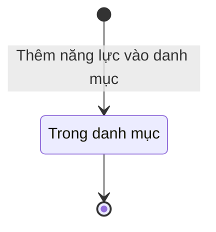

# qt-39.capacity-catalogue · Sổ cơ sở động viên công nghiệp — Năng lực trong danh mục

<!-- máy sinh: tom-tat -->
> **Hồ sơ:** Năng lực trong danh mục (`CapacityEntry`)
>
> **Trong sổ phạm vi:** 39 · Sổ cơ sở động viên công nghiệp — hồ sơ phụ capacity-catalogue: danh mục năng lực dùng chung toàn quốc, Ban DQTV tỉnh thêm mục, cơ sở chọn (L38/2024 Đ.46 k2, Đ.47; thêm 30/10)
>
> 1 bước · 1 chặng · 1 vai · 0 bảng quyết định · 0 hạn · 0 khớp nối.
>
> **Nguồn:** sổ nghiệp vụ `qt-39.capacity-catalogue` · khai báo của app: `dqtv-app/core/processes/industrial-mobilization/workflow/capacity-entry.yaml`. Các bảng do máy sinh từ nguồn này.
<!-- hết: tom-tat -->

## 1. Đường đi ngắn nhất qua các chặng

<!-- máy sinh: luong-chinh -->
Đường ít bước nhất từ lúc mở hồ sơ tới chặng kết thúc xa nhất. Máy chọn theo số chặng, không theo ý nghĩa nghiệp vụ — trình tự công việc thật xem phần Diễn giải và bảng "Việc làm ở từng chặng" ở mục 6.

| # | Ai làm | Làm gì | Hồ sơ sang chặng |
|---|---|---|---|
| 1 | Ban Dân quân tự vệ, Bộ CHQS cấp tỉnh | Thêm năng lực vào danh mục | Trong danh mục |

<!-- hết: luong-chinh -->

## 2. Hồ sơ và việc nó để lại

<!-- máy sinh: muc-tieu -->
**App gọi quy trình này là:** Danh mục năng lực của cơ sở động viên công nghiệp.
<!-- hết: muc-tieu -->

## 3. Khởi phát và kết thúc

<!-- máy sinh: khoi-phat -->
**1 cửa vào** — bước mở hồ sơ:

| Bước mở | Ai mở | Hồ sơ vào chặng | App bắt buộc nhập |
|---|---|---|---|
| Thêm năng lực vào danh mục | Ban Dân quân tự vệ, Bộ CHQS cấp tỉnh | Trong danh mục | tên năng lực |

**Kết thúc:** *Trong danh mục* (`LISTED`)
<!-- hết: khoi-phat -->

## 4. Vai trò

<!-- máy sinh: vai-tro -->
| Vai trong sổ | Tên trong app | Điều kiện | Làm những bước |
|---|---|---|---|
| `facilityManager` | Ban Dân quân tự vệ, Bộ CHQS cấp tỉnh |  | Thêm năng lực vào danh mục |

*"Tên trong app" là tên app đặt cho mã chủ thể của vai. Hồ sơ thuộc đơn vị cấp khác thì người làm là người giữ vai ấy ở đơn vị nêu trong cột "Điều kiện" (nếu sổ có ghi) và ở cột "Người làm phải thuộc" của bảng "Theo khai báo của app" (mục 7).*
<!-- hết: vai-tro -->

## 5. Nhánh phụ

<!-- máy sinh: nhanh-phu -->
Không có bước nào ngoài luồng chính.
<!-- hết: nhanh-phu -->

## 6. Các chặng và việc làm ở từng chặng

<!-- máy sinh: chang -->
| Chặng | Tên hiển thị | Vào bằng bước | Kết thúc? |
|---|---|---|---|
| `LISTED` | Trong danh mục | Thêm năng lực vào danh mục | **kết thúc** |

### Việc làm ở từng chặng

Hồ sơ đang ở chặng nào thì làm được những bước nào.

| Hồ sơ đang ở chặng | Bước làm tại chặng (hồ sơ đứng yên) | Bước đưa hồ sơ sang chặng khác |
|---|---|---|
| **Trong danh mục** | — | — (kết thúc) |
<!-- hết: chang -->

## 7. Bảng bước

<!-- máy sinh: buoc -->
| # | Bước | Mã bước | Ai thực hiện | Từ chặng | Sang chặng | Phải có trước | Ghi lại |
|---|---|---|---|---|---|---|---|
| 1 | Thêm năng lực vào danh mục | `addCapacityEntry` | Ban Dân quân tự vệ, Bộ CHQS cấp tỉnh | — (mở hồ sơ) | `LISTED` | `noCapacityEntryWithSameName` | `id`, tên năng lực, nguồn mục |

### Khi không đạt điều kiện

Mặc định: không đúng người, hồ sơ không ở đúng chặng, hoặc thiếu thứ "phải có trước" thì bước bị chặn, hồ sơ giữ nguyên. Bảng dưới chỉ kê những bước có kết quả riêng.

Không bước nào có kết quả riêng — tất cả theo mặc định.

### Điều kiện "phải có trước" bằng lời

Cột "Phải có trước" ở bảng bước có hai loại: ô dữ liệu thường (bước chỉ đòi ô ấy đã có giá trị) và điều kiện hệ tự xét. Bảng này diễn các điều kiện hệ tự xét theo đúng công thức sổ ghi; số ở cột cuối là số thứ tự bước.

| Điều kiện | Đúng khi | Bước đòi |
|---|---|---|
| `noCapacityEntryWithSameName` | không có hồ sơ Sổ cơ sở động viên công nghiệp — Năng lực trong danh mục (qt-39.capacity-catalogue) có tên năng lực trùng với tên năng lực của hồ sơ đang làm mà hồ sơ ấy đang ở chặng `LISTED` | 1 |

### Theo khai báo của app

Người làm phải thuộc đơn vị nào, ô người dùng phải nhập, bước có lặp được không, và căn cứ pháp lý — lấy từ khai báo quy trình trong app.

| # | Bước | Người làm phải thuộc | Bắt buộc nhập | Nhập nếu có | Lặp được | Căn cứ |
|---|---|---|---|---|---|---|
| 1 | Thêm năng lực vào danh mục |  | tên năng lực | nguồn mục |  | sổ nghiệp vụ qt-39.capacity-catalogue · step:addCapacityEntry |
<!-- hết: buoc -->

## 8. Bảng quyết định, hạn, việc ngoài hệ

<!-- máy sinh: quyet-dinh -->

<!-- hết: quyet-dinh -->

## 9. Dữ liệu của hồ sơ

<!-- máy sinh: du-lieu -->
Các ô mà bước trong sổ ghi hoặc đòi. Số trong hai cột cuối là số thứ tự bước ở bảng bước (mục 7).

| Ô dữ liệu | Mã | Kiểu (app) | Giá trị cho phép | Loại ô (sổ) | Bước ghi | Bước đòi | Mô tả trong app |
|---|---|---|---|---|---|---|---|
| — | `id` |  |  | lưu trên hồ sơ (`stored`) | 1 | — |  |
| tên năng lực | `capacityName` | chữ |  | đưa vào ở bước (`input`) | 1 | — | Tên năng lực — thẻ chọn cho cơ sở (ít nhất 1 ký tự) |
| nguồn mục | `capacitySource` | chọn một | Nhà nước ban hành (`state`), Ban DQTV tỉnh thêm (`self_added`) | đưa vào ở bước (`input`) | 1 | — | Nguồn mục: nhà nước ban hành, hay Ban DQTV tỉnh tự thêm |
| — | `noCapacityEntryWithSameName` |  | có hay chưa | hệ suy ra (`derived`) | — | 1 |  |

4 ô. Cột "Loại ô" là cách sổ phân loại ô, in kèm đúng chữ của sổ; ô nào người dùng phải nhập xem bảng "Theo khai báo của app" ở mục 7.
<!-- hết: du-lieu -->

## 10. Khớp nối với quy trình khác

<!-- máy sinh: khop-noi -->
Hồ sơ này không có mối nối với hồ sơ của quy trình khác.
<!-- hết: khop-noi -->

## 11. Thông tin chung

<!-- máy sinh: thong-tin -->
| | |
|---|---|
| **Mã trong sổ** | `qt-39.capacity-catalogue` |
| **Quy trình trong app** | `industrial-mobilization` (`workflow/capacity-entry.yaml`) — mặt công tác: `logistics-technical` |
| **Hồ sơ** | Năng lực trong danh mục (`CapacityEntry`) |
| **Cùng mã quy trình** | [qt-39](qt-39.html), [qt-39.mobilization-line](qt-39.mobilization-line.html) |
| **Căn cứ pháp lý từng bước** | cột "Căn cứ" ở bảng "Theo khai báo của app", mục 7 |
<!-- hết: thong-tin -->
