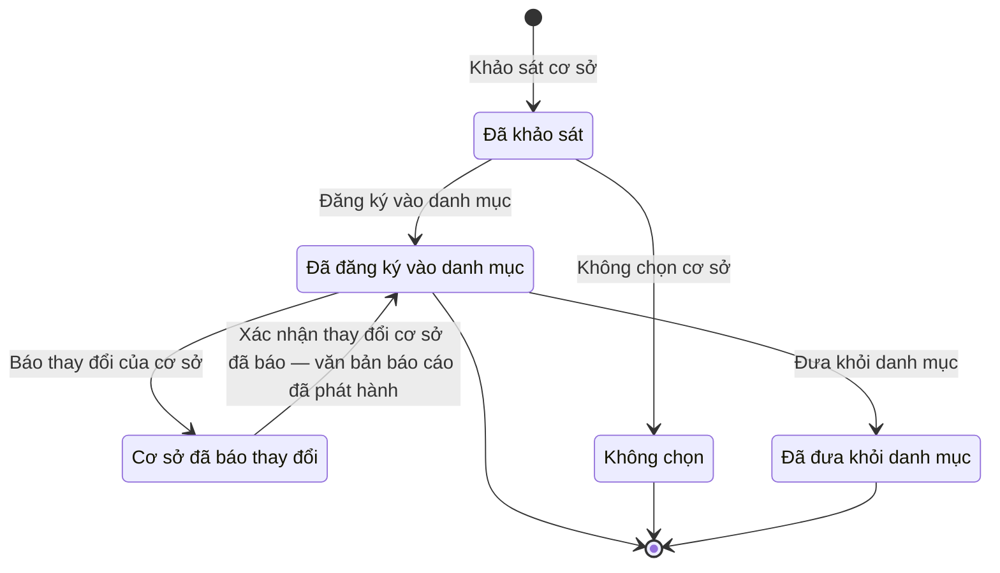

# qt-39 · Sổ cơ sở động viên công nghiệp

<!-- máy sinh: tom-tat -->
> **Hồ sơ:** Cơ sở động viên công nghiệp (`IndustrialFacility`)
>
> **Trong sổ phạm vi:** 39 · Sổ cơ sở động viên công nghiệp (tầng 3)
>
> 8 bước · 5 chặng · 3 vai · 0 bảng quyết định · 0 hạn · 6 khớp nối.
>
> **Nguồn:** sổ nghiệp vụ `qt-39` · khai báo của app: `dqtv-app/core/processes/industrial-mobilization/workflow/industrial-facility.yaml`. Các bảng do máy sinh từ nguồn này.
<!-- hết: tom-tat -->

<!-- viết tay: dien-giai -->
## Diễn giải

*Phần này viết tay, diễn giải lại điều các bảng bên dưới ghi.*

### Quy trình này để làm gì

Đây là **sổ cơ sở động viên công nghiệp**, mỗi hồ sơ là một doanh nghiệp. Doanh nghiệp được khảo sát, rồi hoặc đăng ký vào danh mục, hoặc không chọn. Cơ sở đã vào danh mục thì được theo dõi: thay đổi (năng lực; chủ sở hữu, địa chỉ; thiết bị; khác) được ghi lại, và có thể bị đưa khỏi danh mục.

Hồ sơ có năm chặng: *Đã khảo sát* → *Đã đăng ký vào danh mục* ⇄ *Cơ sở đã báo thay đổi*; hai lối ra là *Không chọn* và *Đã đưa khỏi danh mục*.

Có hai vai: vai `facilityManager` làm sáu trên bảy bước — dưới đây gọi là "cơ quan quản lý"; vai thứ hai là **Người của cơ sở động viên công nghiệp**.

### Khi nào bắt đầu

Cơ quan quản lý bấm **Khảo sát cơ sở**. Bắt buộc nhập đơn vị chủ hồ sơ và mã số thuế; tỉnh đặt trụ sở, cơ quan được giao quản lý (UBND tỉnh hoặc bộ, ngành), tên doanh nghiệp, địa chỉ, ngành nghề, năng lực là ô nhập nếu có. Hệ tự chép mã cơ sở từ mã số thuế và tự điền Bộ CHQS tỉnh quản lý hồ sơ theo tỉnh đặt trụ sở: đơn vị quản lý là Bộ CHQS tỉnh nơi doanh nghiệp đặt trụ sở, không cho chọn quân khu. Ô "cơ quan được giao quản lý" chỉ để biết ai duyệt kế hoạch động viên công nghiệp của doanh nghiệp.

Người khảo sát phải là người của đơn vị ghi ở ô tỉnh đặt trụ sở của hồ sơ (`actorInEnterpriseProvinceCommand`).

### Diễn ra thế nào

**Chặng "Đã khảo sát"** — cơ quan quản lý chọn một trong hai:

- **Đăng ký vào danh mục** — số quyết định đưa vào danh mục là ô nhập nếu có; hồ sơ sang *Đã đăng ký vào danh mục*.
- **Không chọn cơ sở** — lý do không chọn là ô nhập nếu có; hồ sơ sang *Không chọn* và kết thúc.

**Chặng "Đã đăng ký vào danh mục"** — đang theo dõi, cập nhật thay đổi. Có hai đường ghi thay đổi:

- **Báo thay đổi của cơ sở** (Người của cơ sở động viên công nghiệp) — cơ sở tự báo loại thay đổi, nội dung, giấy tờ chứng minh; hồ sơ sang *Cơ sở đã báo thay đổi*, chờ xác nhận.
- **Ghi thay đổi của cơ sở** (cơ quan quản lý) — cơ quan quản lý ghi cùng những ô ấy; hồ sơ đứng yên. Bước này ghi luôn mốc xác nhận (`confirmedAt`), giống bước xác nhận.

Cũng từ chặng này, cơ quan quản lý bấm **Đưa khỏi danh mục**; hồ sơ sang *Đã đưa khỏi danh mục* và kết thúc.

**Chặng "Cơ sở đã báo thay đổi".** Cơ quan quản lý bấm **Xác nhận thay đổi cơ sở đã báo**; hồ sơ quay về *Đã đăng ký vào danh mục*.

### Kết thúc và để lại gì

Có ba chặng kết thúc: *Đã đăng ký vào danh mục*, *Không chọn*, *Đã đưa khỏi danh mục*; cơ sở đang ở *Đã đăng ký vào danh mục* vẫn được ghi thay đổi và đưa khỏi danh mục. Hồ sơ để lại ba văn bản đi kèm: quyết định đưa vào danh mục (`catalogueDecisionDocument`, bước đăng ký), quyết định đưa khỏi danh mục (`removalDecisionDocument`, bước đưa khỏi danh mục), và văn bản báo cáo Bộ (`reportToMinistryDocument`, bước xác nhận và bước ghi thay đổi).

### Điều kiện chặn

- Sai người, sai chặng thì bước bị chặn, hồ sơ giữ nguyên.
- Mỗi bước đòi một điều kiện về người làm, hệ tự xét theo danh mục người của đơn vị (`dm.unit-staff`):
  - bước khảo sát (`actorInEnterpriseProvinceCommand`): là người của đơn vị ghi ở ô tỉnh đặt trụ sở;
  - năm bước còn lại của cơ quan quản lý (`actorManagesFacility`): là người của đơn vị ghi ở ô đơn vị chủ hồ sơ;
  - bước Báo thay đổi của cơ sở (`actorInFacility`): là người của đơn vị ghi ở ô mã cơ sở.
<!-- hết viết tay -->

## 1. Đường đi ngắn nhất qua các chặng

<!-- máy sinh: luong-chinh -->
Đường ít bước nhất từ lúc mở hồ sơ tới chặng kết thúc xa nhất. Máy chọn theo số chặng, không theo ý nghĩa nghiệp vụ — trình tự công việc thật xem phần Diễn giải và bảng "Việc làm ở từng chặng" ở mục 6.

| # | Ai làm | Làm gì | Hồ sơ sang chặng |
|---|---|---|---|
| 1 | `facilityManager` | Khảo sát cơ sở | Đã khảo sát |
| 2 | `facilityManager` | Đăng ký vào danh mục | Đã đăng ký vào danh mục |
| 3 | `facilityManager` | Đưa khỏi danh mục | Đã đưa khỏi danh mục |

<!-- hết: luong-chinh -->

## 2. Hồ sơ và việc nó để lại

<!-- máy sinh: muc-tieu -->
**App gọi quy trình này là:** Sổ cơ sở động viên công nghiệp.

**Khi mở, hồ sơ này ghi mối nối tới:**
- Nhiệm vụ trên giao (1) — bước `surveyFacility`, khớp nối `facilityServesTasking`
<!-- hết: muc-tieu -->

## 3. Khởi phát và kết thúc

<!-- máy sinh: khoi-phat -->
**1 cửa vào** — bước mở hồ sơ:

| Bước mở | Ai mở | Hồ sơ vào chặng | App bắt buộc nhập |
|---|---|---|---|
| Khảo sát cơ sở | `facilityManager` | Đã khảo sát | đơn vị chủ hồ sơ, mã số thuế, việc gốc, năng lực của cơ sở (chọn từ danh mục) |

**Kết thúc:** *Đã đăng ký vào danh mục* (`REGISTERED`), *Không chọn* (`NOT_SELECTED`), *Đã đưa khỏi danh mục* (`REMOVED`)
<!-- hết: khoi-phat -->

## 4. Vai trò

<!-- máy sinh: vai-tro -->
| Vai trong sổ | Tên trong app | Điều kiện | Làm những bước |
|---|---|---|---|
| `facilityManager` | `facilityManager` |  | Khảo sát cơ sở · Không chọn cơ sở · Đăng ký vào danh mục · Trình ký văn bản báo cáo thay đổi cơ sở · Ghi thay đổi của cơ sở · Đưa khỏi danh mục |
| `facilityReporter` | Người của cơ sở động viên công nghiệp |  | Báo thay đổi của cơ sở |
| `system` | Hệ thống tự làm |  | Xác nhận thay đổi cơ sở đã báo — văn bản báo cáo đã phát hành |

*"Tên trong app" là tên app đặt cho mã chủ thể của vai. Hồ sơ thuộc đơn vị cấp khác thì người làm là người giữ vai ấy ở đơn vị nêu trong cột "Điều kiện" (nếu sổ có ghi) và ở cột "Người làm phải thuộc" của bảng "Theo khai báo của app" (mục 7).*
<!-- hết: vai-tro -->

## 5. Nhánh phụ

<!-- máy sinh: nhanh-phu -->
**Bước khác đưa hồ sơ sang chặng mới** — đường song song, rẽ nhánh hoặc kết thúc sớm:

| Bước | Ai làm | Từ chặng | Sang chặng |
|---|---|---|---|
| Không chọn cơ sở | `facilityManager` | Đã khảo sát | Không chọn |
| Báo thay đổi của cơ sở | Người của cơ sở động viên công nghiệp | Đã đăng ký vào danh mục | Cơ sở đã báo thay đổi |

**Quay lại một chặng hồ sơ đã đi qua** (tính theo đường ngắn nhất từ lúc mở):

| Bước | Ai làm | Từ chặng | Về chặng |
|---|---|---|---|
| Xác nhận thay đổi cơ sở đã báo — văn bản báo cáo đã phát hành | Hệ thống tự làm | Cơ sở đã báo thay đổi | Đã đăng ký vào danh mục |

**Làm trong lúc hồ sơ đứng yên ở một chặng** — ghi nhận, bổ sung:

| Bước | Ai làm | Ở chặng |
|---|---|---|
| Trình ký văn bản báo cáo thay đổi cơ sở | `facilityManager` | Cơ sở đã báo thay đổi |
| Ghi thay đổi của cơ sở | `facilityManager` | Đã đăng ký vào danh mục |

<!-- hết: nhanh-phu -->

## 6. Các chặng và việc làm ở từng chặng

<!-- máy sinh: chang -->
| Chặng | Tên hiển thị | Vào bằng bước | Kết thúc? |
|---|---|---|---|
| `SURVEYED` | Đã khảo sát | Khảo sát cơ sở |  |
| `REGISTERED` | Đã đăng ký vào danh mục | Đăng ký vào danh mục · Xác nhận thay đổi cơ sở đã báo — văn bản báo cáo đã phát hành | **kết thúc** — vẫn còn bước làm được |
| `CHANGE_REPORTED` | Cơ sở đã báo thay đổi | Báo thay đổi của cơ sở |  |
| `NOT_SELECTED` | Không chọn | Không chọn cơ sở | **kết thúc** |
| `REMOVED` | Đã đưa khỏi danh mục | Đưa khỏi danh mục | **kết thúc** |

### Việc làm ở từng chặng

Hồ sơ đang ở chặng nào thì làm được những bước nào.

| Hồ sơ đang ở chặng | Bước làm tại chặng (hồ sơ đứng yên) | Bước đưa hồ sơ sang chặng khác |
|---|---|---|
| **Đã khảo sát** | — | Không chọn cơ sở — `facilityManager` → *Không chọn* Đăng ký vào danh mục — `facilityManager` → *Đã đăng ký vào danh mục* |
| **Đã đăng ký vào danh mục** | Ghi thay đổi của cơ sở — `facilityManager` | Báo thay đổi của cơ sở — Người của cơ sở động viên công nghiệp → *Cơ sở đã báo thay đổi* Đưa khỏi danh mục — `facilityManager` → *Đã đưa khỏi danh mục* |
| **Cơ sở đã báo thay đổi** | Trình ký văn bản báo cáo thay đổi cơ sở — `facilityManager` | Xác nhận thay đổi cơ sở đã báo — văn bản báo cáo đã phát hành — Hệ thống tự làm → *Đã đăng ký vào danh mục* |
| **Không chọn** | — | — (kết thúc) |
| **Đã đưa khỏi danh mục** | — | — (kết thúc) |
<!-- hết: chang -->

## 7. Bảng bước

<!-- máy sinh: buoc -->
| # | Bước | Mã bước | Ai thực hiện | Từ chặng | Sang chặng | Phải có trước | Ghi lại |
|---|---|---|---|---|---|---|---|
| 1 | Khảo sát cơ sở | `surveyFacility` | `facilityManager` | — (mở hồ sơ) | `SURVEYED` | `actorInEnterpriseProvinceCommand`, `taskingAssigned` | `id`, tỉnh đặt trụ sở, bộ CHQS tỉnh quản lý, đơn vị chủ hồ sơ, cơ quan được giao quản lý, bộ, ngành quản lý, mã cơ sở, tên doanh nghiệp, mã số thuế, địa chỉ, ngành nghề, `capacitySummary`, khảo sát lúc, nối tới Nhiệm vụ trên giao |
| 2 | Không chọn cơ sở | `markFacilityNotSelected` | `facilityManager` | `SURVEYED` | `NOT_SELECTED` | `actorManagesFacility` | lý do không chọn |
| 3 | Đăng ký vào danh mục | `registerFacility` | `facilityManager` | `SURVEYED` | `REGISTERED` | `actorManagesFacility`, `catalogueDecisionDocumentUsable` | nối tới Văn bản đến, đăng ký lúc |
| 4 | Báo thay đổi của cơ sở | `submitCapacityChange` | Người của cơ sở động viên công nghiệp | `REGISTERED` | `CHANGE_REPORTED` | `actorInFacility` | loại thay đổi, nội dung thay đổi, giấy tờ chứng minh, cơ sở báo thay đổi lúc |
| 5 | Trình ký văn bản báo cáo thay đổi cơ sở | `requestConfirmCapacityChangeSignature` | `facilityManager` | `CHANGE_REPORTED` | giữ nguyên | `noReportToMinistryDocumentOpen`, `actorManagesFacility` | nối tới Văn bản đi |
| 6 | Xác nhận thay đổi cơ sở đã báo — văn bản báo cáo đã phát hành | `confirmCapacityChange` | Hệ thống tự làm | `CHANGE_REPORTED` | `REGISTERED` | `attachedOutgoingDocumentIssued` | xác nhận thay đổi lúc |
| 7 | Ghi thay đổi của cơ sở | `recordCapacityChangeOnBehalf` | `facilityManager` | `REGISTERED` | giữ nguyên | `actorManagesFacility`, `recordCapacityChangeOnBehalfFromIncomingDocumentUsable` | loại thay đổi, nội dung thay đổi, giấy tờ chứng minh, xác nhận thay đổi lúc, nối tới Văn bản đến |
| 8 | Đưa khỏi danh mục | `removeFacilityFromCatalogue` | `facilityManager` | `REGISTERED` | `REMOVED` | `actorManagesFacility`, `noOpenMobilizationLine`, `removalDecisionDocumentUsable` | nối tới Văn bản đến, đưa khỏi danh mục lúc |

### Khi không đạt điều kiện

Mặc định: không đúng người, hồ sơ không ở đúng chặng, hoặc thiếu thứ "phải có trước" thì bước bị chặn, hồ sơ giữ nguyên. Bảng dưới chỉ kê những bước có kết quả riêng.

| # | Bước | Kết quả riêng |
|---|---|---|
| 6 | Xác nhận thay đổi cơ sở đã báo — văn bản báo cáo đã phát hành | bước này không do người nào bấm |

### Điều kiện "phải có trước" bằng lời

Cột "Phải có trước" ở bảng bước có hai loại: ô dữ liệu thường (bước chỉ đòi ô ấy đã có giá trị) và điều kiện hệ tự xét. Bảng này diễn các điều kiện hệ tự xét theo đúng công thức sổ ghi; số ở cột cuối là số thứ tự bước.

| Điều kiện | Đúng khi | Bước đòi |
|---|---|---|
| `actorInEnterpriseProvinceCommand` | người đang làm là người của đơn vị ghi ở ô bộ CHQS tỉnh quản lý của hồ sơ này (theo danh mục người của đơn vị, `dm.unit-staff`) | 1 |
| `taskingAssigned` | có hồ sơ Việc luật giao kèm văn bản đến, đi (qt-1) chính là hồ sơ ghi ở ô nối `facilityServesTasking` của hồ sơ đang làm mà hồ sơ ấy đang ở chặng `ASSIGNED` hoặc `BROKEN_DOWN` | 1 |
| `actorManagesFacility` | người đang làm là người của đơn vị ghi ở ô đơn vị chủ hồ sơ của hồ sơ này (theo danh mục người của đơn vị, `dm.unit-staff`) | 2, 3, 5, 7, 8 |
| `catalogueDecisionDocumentUsable` | có hồ sơ Việc luật giao kèm văn bản đến, đi — Văn bản đến (qt-1.incoming-document) chính là hồ sơ ghi ở ô nối `catalogueDecisionDocument` của hồ sơ đang làm mà hồ sơ ấy đang ở chặng `RECEIVED` hoặc `DISTRIBUTED` | 3 |
| `actorInFacility` | người đang làm là người của đơn vị ghi ở ô mã cơ sở của hồ sơ này (theo danh mục người của đơn vị, `dm.unit-staff`) | 4 |
| `noReportToMinistryDocumentOpen` | KHÔNG (có hồ sơ Việc luật giao kèm văn bản đến, đi — Văn bản đi (qt-1.outgoing-document) chính là hồ sơ ghi ở ô nối `reportToMinistryDocument` của hồ sơ đang làm mà hồ sơ ấy đang ở chặng `DRAFT` hoặc `PENDING_SIGNATURE` hoặc `SIGNED`) | 5 |
| `attachedOutgoingDocumentIssued` | có hồ sơ Việc luật giao kèm văn bản đến, đi — Văn bản đi (qt-1.outgoing-document) chính là hồ sơ ghi ở ô nối `reportToMinistryDocument` của hồ sơ đang làm mà hồ sơ ấy đang ở chặng `ISSUED` | 6 |
| `recordCapacityChangeOnBehalfFromIncomingDocumentUsable` | có hồ sơ Việc luật giao kèm văn bản đến, đi — Văn bản đến (qt-1.incoming-document) chính là hồ sơ ghi ở ô nối `recordCapacityChangeOnBehalfFromIncomingDocument` của hồ sơ đang làm mà hồ sơ ấy đang ở chặng `RECEIVED` hoặc `DISTRIBUTED` | 7 |
| `noOpenMobilizationLine` | không có hồ sơ Sổ cơ sở động viên công nghiệp — Dây chuyền động viên công nghiệp (qt-39.mobilization-line) có ô nối `lineOfFacility` trỏ về chính hồ sơ đang làm mà hồ sơ ấy đang ở chặng `PREPARING` hoặc `ACTIVE` hoặc `LINE_CHANGE_REPORTED` hoặc `AWAITING_PROVINCE_COMMITTEE` hoặc `WITHDRAWING` hoặc `EQUIPMENT_RETURNED` | 8 |
| `removalDecisionDocumentUsable` | có hồ sơ Việc luật giao kèm văn bản đến, đi — Văn bản đến (qt-1.incoming-document) chính là hồ sơ ghi ở ô nối `removalDecisionDocument` của hồ sơ đang làm mà hồ sơ ấy đang ở chặng `RECEIVED` hoặc `DISTRIBUTED` | 8 |

### Theo khai báo của app

Người làm phải thuộc đơn vị nào, ô người dùng phải nhập, bước có lặp được không, và căn cứ pháp lý — lấy từ khai báo quy trình trong app.

| # | Bước | Người làm phải thuộc | Bắt buộc nhập | Nhập nếu có | Lặp được | Căn cứ |
|---|---|---|---|---|---|---|
| 1 | Khảo sát cơ sở |  | đơn vị chủ hồ sơ, mã số thuế, việc gốc, năng lực của cơ sở (chọn từ danh mục) | tỉnh đặt trụ sở, bộ CHQS tỉnh quản lý, cơ quan được giao quản lý, bộ, ngành quản lý, tên doanh nghiệp, địa chỉ, ngành nghề |  | sổ nghiệp vụ qt-39 · step:surveyFacility; L38/2024/QH15 Đ.46 k3, Đ.47 k1 |
| 2 | Không chọn cơ sở |  | — | lý do không chọn |  | sổ nghiệp vụ qt-39 · step:markFacilityNotSelected |
| 3 | Đăng ký vào danh mục |  | quyết định đưa vào danh mục trong sổ văn bản đến | số quyết định đưa vào danh mục |  | sổ nghiệp vụ qt-39 · step:registerFacility |
| 4 | Báo thay đổi của cơ sở |  | — | loại thay đổi, nội dung thay đổi, giấy tờ chứng minh |  | sổ nghiệp vụ qt-39 · step:submitCapacityChange |
| 5 | Trình ký văn bản báo cáo thay đổi cơ sở |  | — | dự thảo văn bản báo cáo (PDF) |  | NĐ30/2020/NĐ-CP Đ.13; L38/2024/QH15 Đ.47 |
| 6 | Xác nhận thay đổi cơ sở đã báo — văn bản báo cáo đã phát hành |  | — | — |  | sổ nghiệp vụ qt-39 · step:confirmCapacityChange; NĐ30/2020/NĐ-CP Đ.18 |
| 7 | Ghi thay đổi của cơ sở |  | văn bản đến báo thay đổi của cơ sở | loại thay đổi, nội dung thay đổi, giấy tờ chứng minh |  | sổ nghiệp vụ qt-39 · step:recordCapacityChangeOnBehalf |
| 8 | Đưa khỏi danh mục |  | quyết định đưa khỏi danh mục trong sổ văn bản đến | — |  | sổ nghiệp vụ qt-39 · step:removeFacilityFromCatalogue |
<!-- hết: buoc -->

## 8. Bảng quyết định, hạn, việc ngoài hệ

<!-- máy sinh: quyet-dinh -->

<!-- hết: quyet-dinh -->

## 9. Dữ liệu của hồ sơ

<!-- máy sinh: du-lieu -->
Các ô mà bước trong sổ ghi hoặc đòi. Số trong hai cột cuối là số thứ tự bước ở bảng bước (mục 7).

| Ô dữ liệu | Mã | Kiểu (app) | Giá trị cho phép | Loại ô (sổ) | Bước ghi | Bước đòi | Mô tả trong app |
|---|---|---|---|---|---|---|---|
| — | `id` |  |  | lưu trên hồ sơ (`stored`) | 1 | — |  |
| tỉnh đặt trụ sở | `enterpriseProvince` | chữ |  | đưa vào ở bước (`input`) | 1 | — | Tỉnh nơi doanh nghiệp đặt trụ sở — mã tỉnh |
| bộ CHQS tỉnh quản lý | `provinceCommandUnit` | chữ |  | đưa vào ở bước (`input`) | 1 | — | Bộ CHQS tỉnh quản lý hồ sơ — id đơn vị, hệ điền theo tỉnh đặt trụ sở |
| đơn vị chủ hồ sơ | `ownerUnit` | chữ |  | lưu trên hồ sơ (`stored`) | 1 | — | Đơn vị chủ hồ sơ — id đơn vị của người đã khảo sát cơ sở |
| cơ quan được giao quản lý | `managingAuthority` | chọn một | Ủy ban nhân dân cấp tỉnh (`province_peoples_committee`), Bộ, ngành (`ministry`) | đưa vào ở bước (`input`) | 1 | — | Cơ quan được giao quản lý doanh nghiệp — để biết ai duyệt kế hoạch ĐVCN của doanh nghiệp (L38 Đ.49 k2 d, đ) |
| bộ, ngành quản lý | `managingMinistry` | chữ |  | đưa vào ở bước (`input`) | 1 | — | Tên bộ, ngành được giao quản lý doanh nghiệp |
| mã cơ sở | `facilityUnitCode` | chữ |  | lưu trên hồ sơ (`stored`) | 1 | — | Mã cơ sở — chép từ mã số thuế lúc khảo sát |
| tên doanh nghiệp | `enterpriseName` | chữ |  | đưa vào ở bước (`input`) | 1 | — | Tên doanh nghiệp |
| mã số thuế | `taxCode` | chữ |  | đưa vào ở bước (`input`) | 1 | — | Mã số thuế |
| địa chỉ | `enterpriseAddress` | chữ |  | đưa vào ở bước (`input`) | 1 | — | Địa chỉ doanh nghiệp |
| ngành nghề | `industrySector` | chữ |  | đưa vào ở bước (`input`) | 1 | — | Ngành nghề |
| — | `capacitySummary` |  |  | đưa vào ở bước (`input`) | 1 | — |  |
| khảo sát lúc | `surveyedAt` | ngày giờ |  | lưu trên hồ sơ (`stored`) | 1 | — | Thời điểm khảo sát |
| lý do không chọn | `notSelectedNote` | chữ |  | đưa vào ở bước (`input`) | 2 | — | Ghi chú khi không chọn cơ sở |
| đăng ký lúc | `registeredAt` | ngày giờ |  | lưu trên hồ sơ (`stored`) | 3 | — | Thời điểm đăng ký |
| loại thay đổi | `changeKind` | chọn một | Năng lực (`capacity`), Chủ sở hữu, địa chỉ (`ownership_or_address`), Thiết bị (`equipment`), Khác (`other`) | đưa vào ở bước (`input`) | 4, 7 | — | Loại thay đổi |
| nội dung thay đổi | `changeDetail` | chữ |  | đưa vào ở bước (`input`) | 4, 7 | — | Nội dung thay đổi |
| giấy tờ chứng minh | `changeProof` | chữ |  | đưa vào ở bước (`input`) | 4, 7 | — | Giấy tờ chứng minh thay đổi |
| cơ sở báo thay đổi lúc | `reportedAt` | ngày giờ |  | lưu trên hồ sơ (`stored`) | 4 | — | Thời điểm cơ sở báo thay đổi |
| xác nhận thay đổi lúc | `changeConfirmedAt` | ngày giờ |  | lưu trên hồ sơ (`stored`) | 6, 7 | — | Thời điểm xác nhận thay đổi — sổ fact:confirmedAt |
| đưa khỏi danh mục lúc | `removedAt` | ngày giờ |  | lưu trên hồ sơ (`stored`) | 8 | — | Thời điểm đưa khỏi danh mục |
| — | `actorInEnterpriseProvinceCommand` |  | có hay chưa | hệ suy ra (`derived`) | — | 1 |  |
| — | `taskingAssigned` |  |  | hệ suy ra (`derived`) | — | 1 |  |
| — | `actorManagesFacility` |  | có hay chưa | hệ suy ra (`derived`) | — | 2, 3, 5, 7, 8 |  |
| — | `catalogueDecisionDocumentUsable` |  | có hay chưa | hệ suy ra (`derived`) | — | 3 |  |
| — | `actorInFacility` |  | có hay chưa | hệ suy ra (`derived`) | — | 4 |  |
| — | `noReportToMinistryDocumentOpen` |  | có hay chưa | hệ suy ra (`derived`) | — | 5 |  |
| — | `attachedOutgoingDocumentIssued` |  | có hay chưa | hệ suy ra (`derived`) | — | 6 |  |
| — | `recordCapacityChangeOnBehalfFromIncomingDocumentUsable` |  | có hay chưa | hệ suy ra (`derived`) | — | 7 |  |
| — | `noOpenMobilizationLine` |  | có hay chưa | hệ suy ra (`derived`) | — | 8 |  |
| — | `removalDecisionDocumentUsable` |  | có hay chưa | hệ suy ra (`derived`) | — | 8 |  |

31 ô. Cột "Loại ô" là cách sổ phân loại ô, in kèm đúng chữ của sổ; ô nào người dùng phải nhập xem bảng "Theo khai báo của app" ở mục 7.
<!-- hết: du-lieu -->

## 10. Khớp nối với quy trình khác

<!-- máy sinh: khop-noi -->
| Quy trình kia | Hồ sơ kia | Quan hệ | Nội dung (mô tả trong app) | Bước ghi mối nối | Tên ô nối |
|---|---|---|---|---|---|
| 1 | Nhiệm vụ trên giao | hồ sơ này **mở ra có nối tới** hồ sơ kia | Việc gốc mà hồ sơ cơ sở động viên công nghiệp này thực hiện — văn bản đi sinh từ hồ sơ kế thừa việc này (sổ q… | 39·surveyFacility ⊕ | `facilityServesTasking` |
| 1.incoming-document | Văn bản đến | gắn với nhau ở một bước giữa chừng | Văn bản đến là quyết định đưa cơ sở vào danh mục (sổ qt-39, 28/10/2026) | 39·registerFacility | `catalogueDecisionDocument` |
| 1.incoming-document | Văn bản đến | gắn với nhau ở một bước giữa chừng | Văn bản đến báo thay đổi của cơ sở — Ban DQTV tỉnh ghi thay cơ sở (sổ qt-39, N5) | 39·recordCapacityChangeOnBehalf | `recordCapacityChangeOnBehalfFromIncomingDocument` |
| 1.incoming-document | Văn bản đến | gắn với nhau ở một bước giữa chừng | Văn bản đến là quyết định đưa cơ sở khỏi danh mục (sổ qt-39, 28/10/2026) | 39·removeFacilityFromCatalogue | `removalDecisionDocument` |
| 1.outgoing-document | Văn bản đi | gắn với nhau ở một bước giữa chừng | Văn bản báo cáo Bộ về thay đổi của cơ sở động viên công nghiệp — văn bản đi của Bộ CHQS tỉnh (L38/2024 Đ.47) | 39·requestConfirmCapacityChangeSignature | `reportToMinistryDocument` |
| 40 | Thực hiện quyết định động viên công nghiệp | có nối | Quyết định động viên công nghiệp này thực hiện tại cơ sở này — sổ nghiệp vụ qt-40 | — | `executionAtFacility` |

6 khớp nối. ⊕ là bước tạo hồ sơ.

**Ô nối giữa các hồ sơ cùng mã quy trình, hoặc tới danh mục nền:** `facilityCapacity` (Cơ sở động viên công nghiệp → Năng lực trong danh mục) — bước Khảo sát cơ sở.
<!-- hết: khop-noi -->

## 11. Thông tin chung

<!-- máy sinh: thong-tin -->
| | |
|---|---|
| **Mã trong sổ** | `qt-39` |
| **Quy trình trong app** | `industrial-mobilization` (`workflow/industrial-facility.yaml`) — mặt công tác: `logistics-technical` |
| **Hồ sơ** | Cơ sở động viên công nghiệp (`IndustrialFacility`) |
| **Cùng mã quy trình** | [qt-39.capacity-catalogue](qt-39.capacity-catalogue.html), [qt-39.mobilization-line](qt-39.mobilization-line.html) |
| **Căn cứ pháp lý từng bước** | cột "Căn cứ" ở bảng "Theo khai báo của app", mục 7 |
<!-- hết: thong-tin -->
