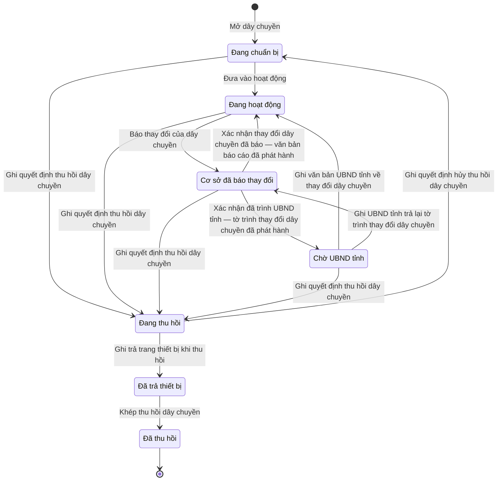

# qt-39.mobilization-line · Sổ cơ sở động viên công nghiệp — Dây chuyền động viên công nghiệp

<!-- máy sinh: tom-tat -->
> **Hồ sơ:** Dây chuyền động viên công nghiệp (`MobilizationLine`)
>
> **Trong sổ phạm vi:** 39 · Sổ cơ sở động viên công nghiệp — hồ sơ phụ mobilization-line: dây chuyền ĐVCN, sản phẩm, trang thiết bị chuyên dùng, chỉ tiêu (L38/2024 Đ.51–52; thêm 30/9)
>
> 16 bước · 7 chặng · 3 vai · 0 bảng quyết định · 0 hạn · 11 khớp nối.
>
> **Nguồn:** sổ nghiệp vụ `qt-39.mobilization-line` · khai báo của app: `dqtv-app/core/processes/industrial-mobilization/workflow/mobilization-line.yaml`. Các bảng do máy sinh từ nguồn này.
<!-- hết: tom-tat -->

<!-- viết tay: dien-giai -->
## Diễn giải

*Phần này viết tay, diễn giải lại điều các bảng bên dưới ghi.*

### Quy trình này để làm gì

Mỗi hồ sơ là **một dây chuyền động viên công nghiệp** đặt tại một cơ sở trong sổ cơ sở (quy trình 39). Hồ sơ theo dõi dây chuyền từ lúc mở, nghiệm thu đưa vào hoạt động, bàn giao trang thiết bị chuyên dùng, ghi chỉ tiêu, ghi các thay đổi, tới lúc thu hồi.

Hồ sơ có bốn chặng: *Đang chuẩn bị* → *Đang hoạt động* ⇄ *Cơ sở đã báo thay đổi*; kết thúc ở *Đã thu hồi*.

Bảy trên tám bước do vai `facilityManager` làm — dưới đây gọi là cơ quan quản lý cơ sở. Vai còn lại là **Người của cơ sở động viên công nghiệp**.

### Khi nào bắt đầu

Cơ quan quản lý cơ sở bấm **Mở dây chuyền**, chọn cơ sở có dây chuyền; tên dây chuyền và hình thức sản xuất (sản xuất, sửa chữa, chuyển đổi, cải tiến, hiện đại hoá, kéo dài tuổi thọ) là ô nhập nếu có. Bước ghi đơn vị chủ hồ sơ, mã cơ sở (chép từ cơ sở lúc mở) và quân khu của cơ sở (hệ ghi lúc mở dây chuyền). Bước này nối dây chuyền tới **Cơ sở động viên công nghiệp** và ghi thêm ô nối `lineProduct`.

### Diễn ra thế nào

**Chặng "Đang chuẩn bị"** — chờ nghiệm thu, đưa vào hoạt động.

- **Đưa vào hoạt động** — cơ quan quản lý cơ sở ghi số và bản chụp biên bản nghiệm thu, quyết định đưa vào hoạt động (ô nối `activationDecisionDocument`) và thời điểm đưa vào hoạt động. Hồ sơ sang *Đang hoạt động*.
- **Ghi bàn giao trang thiết bị** — ghi trang thiết bị chuyên dùng, tài liệu kỹ thuật được bàn giao và ô nối `equipmentDecisionDocument`; hồ sơ đứng yên. Làm được ở cả chặng này và chặng *Đang hoạt động*.

**Chặng "Đang hoạt động"** — ngoài ghi bàn giao trang thiết bị, còn:

- **Ghi chỉ tiêu** — số lượng chỉ tiêu, kỳ chỉ tiêu và ô nối `targetDecisionDocument`; hồ sơ đứng yên.
- **Báo thay đổi của dây chuyền** (Người của cơ sở động viên công nghiệp) — cơ sở tự báo loại thay đổi (thiết bị hỏng, thiết bị mất, năng lực giảm, khác), nội dung, giấy tờ chứng minh; hồ sơ sang *Cơ sở đã báo thay đổi*.
- **Ghi thay đổi của dây chuyền** — cơ quan quản lý ghi cùng những ô ấy, kèm `confirmedAt` và ô nối `reportToMinistryDocument`; hồ sơ đứng yên.

**Chặng "Cơ sở đã báo thay đổi".** Cơ quan quản lý bấm **Xác nhận thay đổi dây chuyền đã báo**, ghi `confirmedAt` và ô nối `reportToMinistryDocument`; hồ sơ quay về *Đang hoạt động*.

**Kết thúc.** **Thu hồi dây chuyền** bấm được từ *Đang chuẩn bị* hoặc *Đang hoạt động*: cơ quan quản lý cơ sở ghi quyết định thu hồi (ô nối `withdrawalDecisionDocument`), biên bản trả trang thiết bị, ghi chú bồi thường mất mát.

### Kết thúc và để lại gì

Hồ sơ kết thúc ở *Đã thu hồi*. Hồ sơ giữ mối nối tới Cơ sở động viên công nghiệp, ô nối `lineProduct` và các văn bản làm căn cứ của từng bước: quyết định đưa vào hoạt động, quyết định về trang thiết bị, quyết định chỉ tiêu, văn bản báo cáo khi có thay đổi, quyết định thu hồi.

### Điều kiện chặn

- Điều kiện về người làm, hệ tự xét theo danh mục người của đơn vị (`dm.unit-staff`), chia ba nhóm:
  - đưa vào hoạt động, ghi chỉ tiêu, thu hồi (`actorManagesFacility`): là người của đơn vị ghi ở ô đơn vị chủ hồ sơ;
  - ghi bàn giao trang thiết bị, xác nhận thay đổi, ghi thay đổi của dây chuyền (`actorManagesOrRegionOfFacility`): là người của đơn vị ghi ở ô đơn vị chủ hồ sơ **hoặc** ở ô quân khu;
  - Báo thay đổi của dây chuyền (`actorInFacility`): là người của đơn vị ghi ở ô mã cơ sở.
- Sai người hay dây chuyền ở chặng không cho phép thì bước bị chặn hẳn, hồ sơ giữ nguyên.
- Đang ở chặng *Cơ sở đã báo thay đổi* thì phải xử lý thay đổi đã báo, đưa hồ sơ về *Đang hoạt động*, rồi mới thu hồi được.
<!-- hết viết tay -->

## 1. Đường đi ngắn nhất qua các chặng

<!-- máy sinh: luong-chinh -->
Đường ít bước nhất từ lúc mở hồ sơ tới chặng kết thúc xa nhất. Máy chọn theo số chặng, không theo ý nghĩa nghiệp vụ — trình tự công việc thật xem phần Diễn giải và bảng "Việc làm ở từng chặng" ở mục 6.

| # | Ai làm | Làm gì | Hồ sơ sang chặng |
|---|---|---|---|
| 1 | Ban Dân quân tự vệ, Bộ CHQS cấp tỉnh | Mở dây chuyền | Đang chuẩn bị |
| 2 | Ban Dân quân tự vệ, Bộ CHQS cấp tỉnh | Ghi quyết định thu hồi dây chuyền | Đang thu hồi |
| 3 | Ban Dân quân tự vệ, Bộ CHQS cấp tỉnh | Ghi trả trang thiết bị khi thu hồi | Đã trả thiết bị |
| 4 | Ban Dân quân tự vệ, Bộ CHQS cấp tỉnh | Khép thu hồi dây chuyền | Đã thu hồi |

<!-- hết: luong-chinh -->

## 2. Hồ sơ và việc nó để lại

<!-- máy sinh: muc-tieu -->
**App gọi quy trình này là:** Dây chuyền động viên công nghiệp.
<!-- hết: muc-tieu -->

## 3. Khởi phát và kết thúc

<!-- máy sinh: khoi-phat -->
**1 cửa vào** — bước mở hồ sơ:

| Bước mở | Ai mở | Hồ sơ vào chặng | App bắt buộc nhập |
|---|---|---|---|
| Mở dây chuyền | Ban Dân quân tự vệ, Bộ CHQS cấp tỉnh | Đang chuẩn bị | chọn cơ sở có dây chuyền, nơi quản lý dây chuyền |

**Kết thúc:** *Đã thu hồi* (`WITHDRAWN`)
<!-- hết: khoi-phat -->

## 4. Vai trò

<!-- máy sinh: vai-tro -->
| Vai trong sổ | Tên trong app | Điều kiện | Làm những bước |
|---|---|---|---|
| `facilityManager` | Ban Dân quân tự vệ, Bộ CHQS cấp tỉnh |  | Mở dây chuyền · Đưa vào hoạt động · Ghi bàn giao trang thiết bị · Ghi chỉ tiêu · Trình ký văn bản báo cáo thay đổi dây chuyền · Ghi văn bản UBND tỉnh về thay đổi dây chuyền · Ghi UBND tỉnh trả lại tờ trình thay đổi dây chuyền · Ghi thay đổi của dây chuyền · Ghi quyết định thu hồi dây chuyền · Ghi quyết định hủy thu hồi dây chuyền · Ghi trả trang thiết bị khi thu hồi · Ghi bồi thường thiết bị mất, hỏng · Khép thu hồi dây chuyền |
| `facilityReporter` | Người của cơ sở động viên công nghiệp |  | Báo thay đổi của dây chuyền |
| `system` | Hệ thống tự làm |  | Xác nhận thay đổi dây chuyền đã báo — văn bản báo cáo đã phát hành · Xác nhận đã trình UBND tỉnh — tờ trình thay đổi dây chuyền đã phát hành |

*"Tên trong app" là tên app đặt cho mã chủ thể của vai. Hồ sơ thuộc đơn vị cấp khác thì người làm là người giữ vai ấy ở đơn vị nêu trong cột "Điều kiện" (nếu sổ có ghi) và ở cột "Người làm phải thuộc" của bảng "Theo khai báo của app" (mục 7).*
<!-- hết: vai-tro -->

## 5. Nhánh phụ

<!-- máy sinh: nhanh-phu -->
**Bước khác đưa hồ sơ sang chặng mới** — đường song song, rẽ nhánh hoặc kết thúc sớm:

| Bước | Ai làm | Từ chặng | Sang chặng |
|---|---|---|---|
| Đưa vào hoạt động | Ban Dân quân tự vệ, Bộ CHQS cấp tỉnh | Đang chuẩn bị | Đang hoạt động |
| Báo thay đổi của dây chuyền | Người của cơ sở động viên công nghiệp | Đang hoạt động | Cơ sở đã báo thay đổi |
| Xác nhận đã trình UBND tỉnh — tờ trình thay đổi dây chuyền đã phát hành | Hệ thống tự làm | Cơ sở đã báo thay đổi | Chờ UBND tỉnh |

**Quay lại một chặng hồ sơ đã đi qua** (tính theo đường ngắn nhất từ lúc mở):

| Bước | Ai làm | Từ chặng | Về chặng |
|---|---|---|---|
| Xác nhận thay đổi dây chuyền đã báo — văn bản báo cáo đã phát hành | Hệ thống tự làm | Cơ sở đã báo thay đổi | Đang hoạt động |
| Ghi văn bản UBND tỉnh về thay đổi dây chuyền | Ban Dân quân tự vệ, Bộ CHQS cấp tỉnh | Chờ UBND tỉnh | Đang hoạt động |
| Ghi UBND tỉnh trả lại tờ trình thay đổi dây chuyền | Ban Dân quân tự vệ, Bộ CHQS cấp tỉnh | Chờ UBND tỉnh | Cơ sở đã báo thay đổi |
| Ghi quyết định hủy thu hồi dây chuyền | Ban Dân quân tự vệ, Bộ CHQS cấp tỉnh | Đang thu hồi | Đang chuẩn bị |

**Làm trong lúc hồ sơ đứng yên ở một chặng** — ghi nhận, bổ sung:

| Bước | Ai làm | Ở chặng |
|---|---|---|
| Ghi bàn giao trang thiết bị | Ban Dân quân tự vệ, Bộ CHQS cấp tỉnh | Đang chuẩn bị, Đang hoạt động |
| Ghi chỉ tiêu | Ban Dân quân tự vệ, Bộ CHQS cấp tỉnh | Đang hoạt động |
| Trình ký văn bản báo cáo thay đổi dây chuyền | Ban Dân quân tự vệ, Bộ CHQS cấp tỉnh | Cơ sở đã báo thay đổi |
| Ghi thay đổi của dây chuyền | Ban Dân quân tự vệ, Bộ CHQS cấp tỉnh | Đang hoạt động |
| Ghi bồi thường thiết bị mất, hỏng | Ban Dân quân tự vệ, Bộ CHQS cấp tỉnh | Đã trả thiết bị |

<!-- hết: nhanh-phu -->

## 6. Các chặng và việc làm ở từng chặng

<!-- máy sinh: chang -->
| Chặng | Tên hiển thị | Vào bằng bước | Kết thúc? |
|---|---|---|---|
| `PREPARING` | Đang chuẩn bị | Mở dây chuyền · Ghi quyết định hủy thu hồi dây chuyền |  |
| `ACTIVE` | Đang hoạt động | Đưa vào hoạt động · Xác nhận thay đổi dây chuyền đã báo — văn bản báo cáo đã phát hành · Ghi văn bản UBND tỉnh về thay đổi dây chuyền |  |
| `LINE_CHANGE_REPORTED` | Cơ sở đã báo thay đổi | Báo thay đổi của dây chuyền · Ghi UBND tỉnh trả lại tờ trình thay đổi dây chuyền |  |
| `AWAITING_PROVINCE_COMMITTEE` | Chờ UBND tỉnh | Xác nhận đã trình UBND tỉnh — tờ trình thay đổi dây chuyền đã phát hành |  |
| `WITHDRAWING` | Đang thu hồi | Ghi quyết định thu hồi dây chuyền |  |
| `EQUIPMENT_RETURNED` | Đã trả thiết bị | Ghi trả trang thiết bị khi thu hồi |  |
| `WITHDRAWN` | Đã thu hồi | Khép thu hồi dây chuyền | **kết thúc** |

### Việc làm ở từng chặng

Hồ sơ đang ở chặng nào thì làm được những bước nào.

| Hồ sơ đang ở chặng | Bước làm tại chặng (hồ sơ đứng yên) | Bước đưa hồ sơ sang chặng khác |
|---|---|---|
| **Đang chuẩn bị** | Ghi bàn giao trang thiết bị — Ban Dân quân tự vệ, Bộ CHQS cấp tỉnh | Đưa vào hoạt động — Ban Dân quân tự vệ, Bộ CHQS cấp tỉnh → *Đang hoạt động* Ghi quyết định thu hồi dây chuyền — Ban Dân quân tự vệ, Bộ CHQS cấp tỉnh → *Đang thu hồi* |
| **Đang hoạt động** | Ghi bàn giao trang thiết bị — Ban Dân quân tự vệ, Bộ CHQS cấp tỉnh Ghi chỉ tiêu — Ban Dân quân tự vệ, Bộ CHQS cấp tỉnh Ghi thay đổi của dây chuyền — Ban Dân quân tự vệ, Bộ CHQS cấp tỉnh | Báo thay đổi của dây chuyền — Người của cơ sở động viên công nghiệp → *Cơ sở đã báo thay đổi* Ghi quyết định thu hồi dây chuyền — Ban Dân quân tự vệ, Bộ CHQS cấp tỉnh → *Đang thu hồi* |
| **Cơ sở đã báo thay đổi** | Trình ký văn bản báo cáo thay đổi dây chuyền — Ban Dân quân tự vệ, Bộ CHQS cấp tỉnh | Xác nhận thay đổi dây chuyền đã báo — văn bản báo cáo đã phát hành — Hệ thống tự làm → *Đang hoạt động* Xác nhận đã trình UBND tỉnh — tờ trình thay đổi dây chuyền đã phát hành — Hệ thống tự làm → *Chờ UBND tỉnh* Ghi quyết định thu hồi dây chuyền — Ban Dân quân tự vệ, Bộ CHQS cấp tỉnh → *Đang thu hồi* |
| **Chờ UBND tỉnh** | — | Ghi văn bản UBND tỉnh về thay đổi dây chuyền — Ban Dân quân tự vệ, Bộ CHQS cấp tỉnh → *Đang hoạt động* Ghi UBND tỉnh trả lại tờ trình thay đổi dây chuyền — Ban Dân quân tự vệ, Bộ CHQS cấp tỉnh → *Cơ sở đã báo thay đổi* Ghi quyết định thu hồi dây chuyền — Ban Dân quân tự vệ, Bộ CHQS cấp tỉnh → *Đang thu hồi* |
| **Đang thu hồi** | — | Ghi quyết định hủy thu hồi dây chuyền — Ban Dân quân tự vệ, Bộ CHQS cấp tỉnh → *Đang chuẩn bị* Ghi trả trang thiết bị khi thu hồi — Ban Dân quân tự vệ, Bộ CHQS cấp tỉnh → *Đã trả thiết bị* |
| **Đã trả thiết bị** | Ghi bồi thường thiết bị mất, hỏng — Ban Dân quân tự vệ, Bộ CHQS cấp tỉnh | Khép thu hồi dây chuyền — Ban Dân quân tự vệ, Bộ CHQS cấp tỉnh → *Đã thu hồi* |
| **Đã thu hồi** | — | — (kết thúc) |
<!-- hết: chang -->

## 7. Bảng bước

<!-- máy sinh: buoc -->
| # | Bước | Mã bước | Ai thực hiện | Từ chặng | Sang chặng | Phải có trước | Ghi lại |
|---|---|---|---|---|---|---|---|
| 1 | Mở dây chuyền | `openMobilizationLine` | Ban Dân quân tự vệ, Bộ CHQS cấp tỉnh | — (mở hồ sơ) | `PREPARING` | `facilityInCatalogue` | `id`, đơn vị chủ hồ sơ, quân khu, mã cơ sở, nối tới Cơ sở động viên công nghiệp, nối `lineProduct`, hình thức sản xuất, tên dây chuyền, thuộc diện di chuyển, địa điểm di chuyển đến, nơi quản lý dây chuyền |
| 2 | Đưa vào hoạt động | `activateMobilizationLine` | Ban Dân quân tự vệ, Bộ CHQS cấp tỉnh | `PREPARING` | `ACTIVE` | `actorManagesFacility`, `facilityInCatalogue`, `activationDecisionDocumentUsable` | số biên bản nghiệm thu, bản chụp biên bản nghiệm thu, nối tới Văn bản đến, đưa vào hoạt động lúc |
| 3 | Ghi bàn giao trang thiết bị | `recordLineEquipmentHandover` | Ban Dân quân tự vệ, Bộ CHQS cấp tỉnh | `PREPARING`, `ACTIVE` | giữ nguyên | `actorManagesOrRegionOfFacility`, `equipmentDecisionDocumentUsable` | nối tới Văn bản đến, trang thiết bị chuyên dùng, tài liệu kỹ thuật |
| 4 | Ghi chỉ tiêu | `recordLineTarget` | Ban Dân quân tự vệ, Bộ CHQS cấp tỉnh | `ACTIVE` | giữ nguyên | `actorManagesFacility`, `targetDecisionDocumentUsable` | nối tới Văn bản đến, số lượng chỉ tiêu, kỳ chỉ tiêu |
| 5 | Báo thay đổi của dây chuyền | `submitLineChange` | Người của cơ sở động viên công nghiệp | `ACTIVE` | `LINE_CHANGE_REPORTED` | `actorInFacility` | loại thay đổi, nội dung thay đổi, giấy tờ chứng minh, cơ sở báo thay đổi lúc |
| 6 | Trình ký văn bản báo cáo thay đổi dây chuyền | `requestConfirmLineChangeSignature` | Ban Dân quân tự vệ, Bộ CHQS cấp tỉnh | `LINE_CHANGE_REPORTED` | giữ nguyên | `noLineReportToMinistryDocumentOpen`, `actorReportsLineChange` | nối tới Văn bản đi |
| 7 | Xác nhận thay đổi dây chuyền đã báo — văn bản báo cáo đã phát hành | `confirmLineChange` | Hệ thống tự làm | `LINE_CHANGE_REPORTED` | `ACTIVE` | `lineManagedByMilitaryRegion` | `confirmedAt` |
| 8 | Xác nhận đã trình UBND tỉnh — tờ trình thay đổi dây chuyền đã phát hành | `issueLineChangeReportToCommittee` | Hệ thống tự làm | `LINE_CHANGE_REPORTED` | `AWAITING_PROVINCE_COMMITTEE` | `attachedOutgoingDocumentIssued`, `lineManagedByProvinceCommittee` | trình UBND tỉnh lúc |
| 9 | Ghi văn bản UBND tỉnh về thay đổi dây chuyền | `recordCommitteeLineChangeReport` | Ban Dân quân tự vệ, Bộ CHQS cấp tỉnh | `AWAITING_PROVINCE_COMMITTEE` | `ACTIVE` | `actorManagesFacility`, `recordCommitteeLineChangeReportFromIncomingDocumentUsable` | nối tới Văn bản đến, `confirmedAt` |
| 10 | Ghi UBND tỉnh trả lại tờ trình thay đổi dây chuyền | `recordCommitteeReturnedLineChangeReport` | Ban Dân quân tự vệ, Bộ CHQS cấp tỉnh | `AWAITING_PROVINCE_COMMITTEE` | `LINE_CHANGE_REPORTED` | `actorManagesFacility`, `committeeReturnedLineChangeReportFromIncomingDocumentUsable` | nối tới Văn bản đến, uBND tỉnh trả lại lúc |
| 11 | Ghi thay đổi của dây chuyền | `recordLineChangeOnBehalf` | Ban Dân quân tự vệ, Bộ CHQS cấp tỉnh | `ACTIVE` | giữ nguyên | `actorManagesOrRegionOfFacility`, `recordLineChangeOnBehalfFromIncomingDocumentUsable` | loại thay đổi, nội dung thay đổi, giấy tờ chứng minh, `confirmedAt`, thuộc diện di chuyển, địa điểm di chuyển đến, nối tới Văn bản đến |
| 12 | Ghi quyết định thu hồi dây chuyền | `recordLineWithdrawalDecision` | Ban Dân quân tự vệ, Bộ CHQS cấp tỉnh | `PREPARING`, `ACTIVE`, `LINE_CHANGE_REPORTED`, `AWAITING_PROVINCE_COMMITTEE` | `WITHDRAWING` | `actorManagesFacility`, `withdrawalDecisionDocumentUsable` | nối tới Văn bản đến, đơn vị nhận lại thiết bị, hạn trả trang thiết bị, ngày quyết định thu hồi |
| 13 | Ghi quyết định hủy thu hồi dây chuyền | `cancelLineWithdrawal` | Ban Dân quân tự vệ, Bộ CHQS cấp tỉnh | `WITHDRAWING` | `PREPARING` | `actorManagesFacility`, `withdrawalCancelDocumentUsable` | nối tới Văn bản đến, ngày hủy thu hồi; **xoá:** nối tới Văn bản đến, đơn vị nhận lại thiết bị, hạn trả thiết bị, ngày quyết định thu hồi, đưa vào hoạt động lúc |
| 14 | Ghi trả trang thiết bị khi thu hồi | `recordLineEquipmentReturn` | Ban Dân quân tự vệ, Bộ CHQS cấp tỉnh | `WITHDRAWING` | `EQUIPMENT_RETURNED` | `actorManagesFacility` | biên bản trả trang thiết bị, thiết bị đã trả, thiết bị mất, hỏng |
| 15 | Ghi bồi thường thiết bị mất, hỏng | `recordLineLossCompensation` | Ban Dân quân tự vệ, Bộ CHQS cấp tỉnh | `EQUIPMENT_RETURNED` | giữ nguyên | `actorManagesFacility`, thiết bị mất, hỏng, `recordLineLossCompensationFromIncomingDocumentUsable` | số tiền bồi thường, ngày đã bồi thường, bồi thường mất mát, nối tới Văn bản đến |
| 16 | Khép thu hồi dây chuyền | `closeLineWithdrawal` | Ban Dân quân tự vệ, Bộ CHQS cấp tỉnh | `EQUIPMENT_RETURNED` | `WITHDRAWN` | `actorManagesFacility`, `withdrawalReturnSettled` | — |

### Khi không đạt điều kiện

Mặc định: không đúng người, hồ sơ không ở đúng chặng, hoặc thiếu thứ "phải có trước" thì bước bị chặn, hồ sơ giữ nguyên. Bảng dưới chỉ kê những bước có kết quả riêng.

Không bước nào có kết quả riêng — tất cả theo mặc định.

### Điều kiện "phải có trước" bằng lời

Cột "Phải có trước" ở bảng bước có hai loại: ô dữ liệu thường (bước chỉ đòi ô ấy đã có giá trị) và điều kiện hệ tự xét. Bảng này diễn các điều kiện hệ tự xét theo đúng công thức sổ ghi; số ở cột cuối là số thứ tự bước.

| Điều kiện | Đúng khi | Bước đòi |
|---|---|---|
| `facilityInCatalogue` | có hồ sơ Sổ cơ sở động viên công nghiệp (qt-39) chính là hồ sơ ghi ở ô nối `lineOfFacility` của hồ sơ đang làm mà hồ sơ ấy đang ở chặng `REGISTERED` hoặc `CHANGE_REPORTED` | 1, 2 |
| `actorManagesFacility` | người đang làm là người của đơn vị ghi ở ô đơn vị chủ hồ sơ của hồ sơ này (theo danh mục người của đơn vị, `dm.unit-staff`) | 2, 4, 9, 10, 12, 13, 14, 15, 16 |
| `activationDecisionDocumentUsable` | có hồ sơ Việc luật giao kèm văn bản đến, đi — Văn bản đến (qt-1.incoming-document) chính là hồ sơ ghi ở ô nối `activationDecisionDocument` của hồ sơ đang làm mà hồ sơ ấy đang ở chặng `RECEIVED` hoặc `DISTRIBUTED` | 2 |
| `actorManagesOrRegionOfFacility` | người đang làm là người của đơn vị ghi ở ô đơn vị chủ hồ sơ của hồ sơ này HOẶC là người của đơn vị ghi ở ô quân khu của hồ sơ này (theo danh mục người của đơn vị, `dm.unit-staff`) | 3, 11 |
| `equipmentDecisionDocumentUsable` | có hồ sơ Việc luật giao kèm văn bản đến, đi — Văn bản đến (qt-1.incoming-document) chính là hồ sơ ghi ở ô nối `equipmentDecisionDocument` của hồ sơ đang làm mà hồ sơ ấy đang ở chặng `RECEIVED` hoặc `DISTRIBUTED` | 3 |
| `targetDecisionDocumentUsable` | có hồ sơ Việc luật giao kèm văn bản đến, đi — Văn bản đến (qt-1.incoming-document) chính là hồ sơ ghi ở ô nối `targetDecisionDocument` của hồ sơ đang làm mà hồ sơ ấy đang ở chặng `RECEIVED` hoặc `DISTRIBUTED` | 4 |
| `actorInFacility` | người đang làm là người của đơn vị ghi ở ô mã cơ sở của hồ sơ này (theo danh mục người của đơn vị, `dm.unit-staff`) | 5 |
| `noLineReportToMinistryDocumentOpen` | KHÔNG (có hồ sơ Việc luật giao kèm văn bản đến, đi — Văn bản đi (qt-1.outgoing-document) chính là hồ sơ ghi ở ô nối `lineReportToMinistryDocument` của hồ sơ đang làm mà hồ sơ ấy đang ở chặng `DRAFT` hoặc `PENDING_SIGNATURE` hoặc `SIGNED`) | 6 |
| `actorReportsLineChange` | (nơi quản lý dây chuyền là Quân khu (`military_region`) VÀ người đang làm là người của đơn vị ghi ở ô quân khu của hồ sơ này (theo danh mục người của đơn vị, `dm.unit-staff`)) HOẶC (nơi quản lý dây chuyền là UBND tỉnh (`province_peoples_committee`) VÀ người đang làm là người của đơn vị ghi ở ô đơn vị chủ hồ sơ của hồ sơ này (theo danh mục người của đơn vị, `dm.unit-staff`)) | 6 |
| `lineManagedByMilitaryRegion` | nơi quản lý dây chuyền là Quân khu (`military_region`) | 7 |
| `attachedOutgoingDocumentIssued` | có hồ sơ Việc luật giao kèm văn bản đến, đi — Văn bản đi (qt-1.outgoing-document) chính là hồ sơ ghi ở ô nối `lineReportToMinistryDocument` của hồ sơ đang làm mà hồ sơ ấy đang ở chặng `ISSUED` | 8 |
| `lineManagedByProvinceCommittee` | nơi quản lý dây chuyền là UBND tỉnh (`province_peoples_committee`) | 8 |
| `recordCommitteeLineChangeReportFromIncomingDocumentUsable` | có hồ sơ Việc luật giao kèm văn bản đến, đi — Văn bản đến (qt-1.incoming-document) chính là hồ sơ ghi ở ô nối `committeeLineChangeReportFromIncomingDocument` của hồ sơ đang làm mà hồ sơ ấy đang ở chặng `RECEIVED` hoặc `DISTRIBUTED` | 9 |
| `committeeReturnedLineChangeReportFromIncomingDocumentUsable` | có hồ sơ Việc luật giao kèm văn bản đến, đi — Văn bản đến (qt-1.incoming-document) chính là hồ sơ ghi ở ô nối `committeeReturnedLineReportFromIncomingDocument` của hồ sơ đang làm mà hồ sơ ấy đang ở chặng `RECEIVED` hoặc `DISTRIBUTED` | 10 |
| `recordLineChangeOnBehalfFromIncomingDocumentUsable` | có hồ sơ Việc luật giao kèm văn bản đến, đi — Văn bản đến (qt-1.incoming-document) chính là hồ sơ ghi ở ô nối `recordLineChangeOnBehalfFromIncomingDocument` của hồ sơ đang làm mà hồ sơ ấy đang ở chặng `RECEIVED` hoặc `DISTRIBUTED` | 11 |
| `withdrawalDecisionDocumentUsable` | có hồ sơ Việc luật giao kèm văn bản đến, đi — Văn bản đến (qt-1.incoming-document) chính là hồ sơ ghi ở ô nối `withdrawalDecisionDocument` của hồ sơ đang làm mà hồ sơ ấy đang ở chặng `RECEIVED` hoặc `DISTRIBUTED` | 12 |
| `withdrawalCancelDocumentUsable` | có hồ sơ Việc luật giao kèm văn bản đến, đi — Văn bản đến (qt-1.incoming-document) chính là hồ sơ ghi ở ô nối `withdrawalCancelDocument` của hồ sơ đang làm mà hồ sơ ấy đang ở chặng `RECEIVED` hoặc `DISTRIBUTED` | 13 |
| `recordLineLossCompensationFromIncomingDocumentUsable` | có hồ sơ Việc luật giao kèm văn bản đến, đi — Văn bản đến (qt-1.incoming-document) chính là hồ sơ ghi ở ô nối `recordLineLossCompensationFromIncomingDocument` của hồ sơ đang làm mà hồ sơ ấy đang ở chặng `RECEIVED` hoặc `DISTRIBUTED` | 15 |
| `withdrawalReturnSettled` | KHÔNG (đã có thiết bị mất, hỏng) HOẶC đã có ngày bồi thường | 16 |

### Theo khai báo của app

Người làm phải thuộc đơn vị nào, ô người dùng phải nhập, bước có lặp được không, và căn cứ pháp lý — lấy từ khai báo quy trình trong app.

| # | Bước | Người làm phải thuộc | Bắt buộc nhập | Nhập nếu có | Lặp được | Căn cứ |
|---|---|---|---|---|---|---|
| 1 | Mở dây chuyền |  | chọn cơ sở có dây chuyền, nơi quản lý dây chuyền | tên dây chuyền, hình thức sản xuất, thuộc diện di chuyển, địa điểm di chuyển đến |  | sổ nghiệp vụ qt-39.mobilization-line · step:openMobilizationLine |
| 2 | Đưa vào hoạt động |  | văn bản đến là quyết định đưa dây chuyền vào hoạt động | số biên bản nghiệm thu, bản chụp biên bản nghiệm thu |  | sổ nghiệp vụ qt-39.mobilization-line · step:activateMobilizationLine |
| 3 | Ghi bàn giao trang thiết bị |  | văn bản đến là quyết định giao trang thiết bị chuyên dùng | trang thiết bị chuyên dùng, tài liệu kỹ thuật |  | sổ nghiệp vụ qt-39.mobilization-line · step:recordLineEquipmentHandover |
| 4 | Ghi chỉ tiêu |  | văn bản đến là quyết định giao chỉ tiêu | số lượng chỉ tiêu, kỳ chỉ tiêu |  | sổ nghiệp vụ qt-39.mobilization-line · step:recordLineTarget |
| 5 | Báo thay đổi của dây chuyền |  | — | loại thay đổi, nội dung thay đổi, giấy tờ chứng minh |  | sổ nghiệp vụ qt-39.mobilization-line · step:submitLineChange |
| 6 | Trình ký văn bản báo cáo thay đổi dây chuyền |  | — | dự thảo văn bản báo cáo (PDF) |  | NĐ30/2020/NĐ-CP Đ.13; L38/2024/QH15 Đ.52 |
| 7 | Xác nhận thay đổi dây chuyền đã báo — văn bản báo cáo đã phát hành |  | — | — |  | sổ nghiệp vụ qt-39.mobilization-line · step:confirmLineChange; NĐ30/2020/NĐ-CP Đ.18 |
| 8 | Xác nhận đã trình UBND tỉnh — tờ trình thay đổi dây chuyền đã phát hành |  | — | — |  | sổ nghiệp vụ qt-39.mobilization-line · step:issueLineChangeReportToCommittee; L38/2024/QH15 Đ.82 k2c |
| 9 | Ghi văn bản UBND tỉnh về thay đổi dây chuyền |  | văn bản đến là văn bản của UBND tỉnh về thay đổi dây chuyền | — |  | sổ nghiệp vụ qt-39.mobilization-line · step:recordCommitteeLineChangeReport; L38/2024/QH15 Đ.82 k2c |
| 10 | Ghi UBND tỉnh trả lại tờ trình thay đổi dây chuyền |  | văn bản đến là văn bản UBND tỉnh trả lại tờ trình | — |  | sổ nghiệp vụ qt-39.mobilization-line · step:recordCommitteeReturnedLineChangeReport |
| 11 | Ghi thay đổi của dây chuyền |  | văn bản đến báo thay đổi của dây chuyền | loại thay đổi, nội dung thay đổi, giấy tờ chứng minh, thuộc diện di chuyển, địa điểm di chuyển đến |  | sổ nghiệp vụ qt-39.mobilization-line · step:recordLineChangeOnBehalf |
| 12 | Ghi quyết định thu hồi dây chuyền |  | văn bản đến là quyết định thu hồi dây chuyền | đơn vị nhận lại thiết bị, hạn trả trang thiết bị |  | sổ nghiệp vụ qt-39.mobilization-line · step:recordLineWithdrawalDecision; L38/2024/QH15 Đ.52 |
| 13 | Ghi quyết định hủy thu hồi dây chuyền |  | văn bản đến là quyết định hủy thu hồi | — |  | sổ nghiệp vụ qt-39.mobilization-line · step:cancelLineWithdrawal |
| 14 | Ghi trả trang thiết bị khi thu hồi |  | biên bản trả trang thiết bị | thiết bị đã trả, thiết bị mất, hỏng |  | sổ nghiệp vụ qt-39.mobilization-line · step:recordLineEquipmentReturn |
| 15 | Ghi bồi thường thiết bị mất, hỏng |  | văn bản đến là quyết định bồi thường thiết bị mất, hỏng | bồi thường mất mát, số tiền bồi thường, ngày đã bồi thường |  | sổ nghiệp vụ qt-39.mobilization-line · step:recordLineLossCompensation |
| 16 | Khép thu hồi dây chuyền |  | — | — |  | sổ nghiệp vụ qt-39.mobilization-line · step:closeLineWithdrawal |

### Điều kiện và ghi chú app khai cho từng bước

Lấy từ khai báo quy trình trong app. Lời trong ngoặc kép là câu app hiện cho người dùng. Chức danh người ký ngoài hệ app chỉ khai bằng mã.

| # | Bước | Điều kiện, ghi chú |
|---|---|---|
| 15 | Ghi bồi thường thiết bị mất, hỏng | · phải đã có ô "thiết bị mất, hỏng" — thiếu thì app báo: "không có thiết bị mất, hỏng — không có gì để bồi thường" |
<!-- hết: buoc -->

## 8. Bảng quyết định, hạn, việc ngoài hệ

<!-- máy sinh: quyet-dinh -->

<!-- hết: quyet-dinh -->

## 9. Dữ liệu của hồ sơ

<!-- máy sinh: du-lieu -->
Các ô mà bước trong sổ ghi hoặc đòi. Số trong hai cột cuối là số thứ tự bước ở bảng bước (mục 7).

| Ô dữ liệu | Mã | Kiểu (app) | Giá trị cho phép | Loại ô (sổ) | Bước ghi | Bước đòi | Mô tả trong app |
|---|---|---|---|---|---|---|---|
| — | `id` |  |  | lưu trên hồ sơ (`stored`) | 1 | — |  |
| đơn vị chủ hồ sơ | `ownerUnit` | chữ |  | lưu trên hồ sơ (`stored`) | 1 | — | Đơn vị chủ hồ sơ — id đơn vị của người đã mở dây chuyền |
| quân khu | `militaryRegionUnit` | chữ |  | lưu trên hồ sơ (`stored`) | 1 | — | Quân khu của cơ sở — id đơn vị, hệ ghi lúc mở dây chuyền |
| mã cơ sở | `facilityUnitCode` | chữ |  | lưu trên hồ sơ (`stored`) | 1 | — | Mã cơ sở có dây chuyền — chép từ cơ sở lúc mở |
| hình thức sản xuất | `productionMode` | chọn một | Sản xuất (`produce`), Sửa chữa (`repair`), Chuyển đổi (`convert`), Cải tiến (`improve`), Hiện đại hoá (`modernize`), Kéo dài tuổi thọ (`extend_life`) | đưa vào ở bước (`input`) | 1 | — | Hình thức sản xuất |
| tên dây chuyền | `lineName` | chữ |  | đưa vào ở bước (`input`) | 1 | — | Tên dây chuyền |
| thuộc diện di chuyển | `relocationRequired` | chọn một | Có (`yes`), Không (`no`) | đưa vào ở bước (`input`) | 1, 11 | — | Thuộc diện di chuyển theo kế hoạch động viên công nghiệp |
| địa điểm di chuyển đến | `relocationSite` | chữ |  | đưa vào ở bước (`input`) | 1, 11 | — | Địa điểm di chuyển đến theo kế hoạch |
| nơi quản lý dây chuyền | `lineManagedBy` | chọn một | Quân khu (`military_region`), UBND tỉnh (`province_peoples_committee`) | đưa vào ở bước (`input`) | 1 | — | Nơi quản lý dây chuyền — quân khu, hay UBND tỉnh (L38/2024 Đ.52 k1, Đ.82 k2c) |
| số biên bản nghiệm thu | `acceptanceRecordNumber` | chữ |  | đưa vào ở bước (`input`) | 2 | — | Số biên bản nghiệm thu |
| bản chụp biên bản nghiệm thu | `acceptanceScan` | chữ |  | đưa vào ở bước (`input`) | 2 | — | Bản chụp biên bản nghiệm thu |
| đưa vào hoạt động lúc | `activatedAt` | ngày giờ |  | lưu trên hồ sơ (`stored`) | 2 | — | Thời điểm đưa vào hoạt động |
| trang thiết bị chuyên dùng | `equipmentItems` | chữ |  | đưa vào ở bước (`input`) | 3 | — | Trang thiết bị chuyên dùng bàn giao |
| tài liệu kỹ thuật | `technicalDocuments` | chữ |  | đưa vào ở bước (`input`) | 3 | — | Tài liệu kỹ thuật bàn giao |
| số lượng chỉ tiêu | `targetQuantity` | chữ |  | đưa vào ở bước (`input`) | 4 | — | Số lượng chỉ tiêu |
| kỳ chỉ tiêu | `targetPeriod` | chữ |  | đưa vào ở bước (`input`) | 4 | — | Kỳ chỉ tiêu |
| loại thay đổi | `lineChangeKind` | chọn một | Thiết bị hỏng (`equipment_damaged`), Thiết bị mất (`equipment_lost`), Năng lực giảm (`capacity_down`), Khác (`other`) | đưa vào ở bước (`input`) | 5, 11 | — | Loại thay đổi của dây chuyền |
| nội dung thay đổi | `changeDetail` | chữ |  | đưa vào ở bước (`input`) | 5, 11 | — | Nội dung thay đổi |
| giấy tờ chứng minh | `changeProof` | chữ |  | đưa vào ở bước (`input`) | 5, 11 | — | Giấy tờ chứng minh thay đổi |
| cơ sở báo thay đổi lúc | `reportedAt` | ngày giờ |  | lưu trên hồ sơ (`stored`) | 5 | — | Thời điểm cơ sở báo thay đổi dây chuyền |
| — | `confirmedAt` |  |  | lưu trên hồ sơ (`stored`) | 7, 9, 11 | — |  |
| trình UBND tỉnh lúc | `committeeSubmittedAt` | ngày giờ |  | lưu trên hồ sơ (`stored`) | 8 | — | Thời điểm văn thư Bộ CHQS tỉnh phát hành tờ trình lên UBND tỉnh về thay đổi dây chuyền |
| uBND tỉnh trả lại lúc | `committeeReturnedAt` | ngày giờ |  | lưu trên hồ sơ (`stored`) | 10 | — | Thời điểm ghi UBND tỉnh trả lại tờ trình thay đổi dây chuyền — Bộ CHQS tỉnh sửa rồi trình lại |
| đơn vị nhận lại thiết bị | `handoverReceivingUnit` | chữ |  | đưa vào ở bước (`input`) | 12 | — | Đơn vị nhận lại trang thiết bị theo quyết định thu hồi |
| hạn trả thiết bị | `handoverDueDate` | ngày |  | đưa vào ở bước (`input`) | 12 | — | Hạn trả trang thiết bị theo quyết định thu hồi |
| ngày quyết định thu hồi | `withdrawalDecidedAt` | ngày |  | lưu trên hồ sơ (`stored`) | 12 | — | Ngày ghi quyết định thu hồi dây chuyền |
| ngày hủy thu hồi | `withdrawalCancelledAt` | ngày |  | lưu trên hồ sơ (`stored`) | 13 | — | Ngày ghi hủy quyết định thu hồi |
| biên bản trả trang thiết bị | `equipmentReturnRecord` | chữ |  | đưa vào ở bước (`input`) | 14 | — | Biên bản trả trang thiết bị |
| thiết bị đã trả | `returnedItems` | chữ |  | đưa vào ở bước (`input`) | 14 | — | Thiết bị đã trả khi thu hồi dây chuyền |
| thiết bị mất, hỏng | `lostOrDamagedItems` | chữ |  | đưa vào ở bước (`input`) | 14 | 15 | Thiết bị mất, hỏng khi thu hồi dây chuyền |
| số tiền bồi thường | `compensationAmount` | số |  | đưa vào ở bước (`input`) | 15 | — | Số tiền bồi thường thiết bị mất, hỏng (đồng) |
| ngày bồi thường | `compensationPaidAt` | ngày |  | đưa vào ở bước (`input`) | 15 | — | Ngày đã bồi thường thiết bị mất, hỏng |
| bồi thường mất mát | `lossCompensationNote` | chữ |  | đưa vào ở bước (`input`) | 15 | — | Ghi chú bồi thường mất mát |
| — | `facilityInCatalogue` |  | có hay chưa | hệ suy ra (`derived`) | — | 1, 2 |  |
| — | `actorManagesFacility` |  | có hay chưa | hệ suy ra (`derived`) | — | 2, 4, 9, 10, 12, 13, 14, 15, 16 |  |
| — | `activationDecisionDocumentUsable` |  | có hay chưa | hệ suy ra (`derived`) | — | 2 |  |
| — | `actorManagesOrRegionOfFacility` |  | có hay chưa | hệ suy ra (`derived`) | — | 3, 11 |  |
| — | `equipmentDecisionDocumentUsable` |  | có hay chưa | hệ suy ra (`derived`) | — | 3 |  |
| — | `targetDecisionDocumentUsable` |  | có hay chưa | hệ suy ra (`derived`) | — | 4 |  |
| — | `actorInFacility` |  | có hay chưa | hệ suy ra (`derived`) | — | 5 |  |
| — | `noLineReportToMinistryDocumentOpen` |  | có hay chưa | hệ suy ra (`derived`) | — | 6 |  |
| — | `actorReportsLineChange` |  | có hay chưa | hệ suy ra (`derived`) | — | 6 |  |
| — | `lineManagedByMilitaryRegion` |  | có hay chưa | hệ suy ra (`derived`) | — | 7 |  |
| — | `attachedOutgoingDocumentIssued` |  | có hay chưa | hệ suy ra (`derived`) | — | 8 |  |
| — | `lineManagedByProvinceCommittee` |  | có hay chưa | hệ suy ra (`derived`) | — | 8 |  |
| — | `recordCommitteeLineChangeReportFromIncomingDocumentUsable` |  | có hay chưa | hệ suy ra (`derived`) | — | 9 |  |
| — | `committeeReturnedLineChangeReportFromIncomingDocumentUsable` |  | có hay chưa | hệ suy ra (`derived`) | — | 10 |  |
| — | `recordLineChangeOnBehalfFromIncomingDocumentUsable` |  | có hay chưa | hệ suy ra (`derived`) | — | 11 |  |
| — | `withdrawalDecisionDocumentUsable` |  | có hay chưa | hệ suy ra (`derived`) | — | 12 |  |
| — | `withdrawalCancelDocumentUsable` |  | có hay chưa | hệ suy ra (`derived`) | — | 13 |  |
| — | `recordLineLossCompensationFromIncomingDocumentUsable` |  | có hay chưa | hệ suy ra (`derived`) | — | 15 |  |
| — | `withdrawalReturnSettled` |  | có hay chưa | hệ suy ra (`derived`) | — | 16 |  |

52 ô. Cột "Loại ô" là cách sổ phân loại ô, in kèm đúng chữ của sổ; ô nào người dùng phải nhập xem bảng "Theo khai báo của app" ở mục 7.
<!-- hết: du-lieu -->

## 10. Khớp nối với quy trình khác

<!-- máy sinh: khop-noi -->
| Quy trình kia | Hồ sơ kia | Quan hệ | Nội dung (mô tả trong app) | Bước ghi mối nối | Tên ô nối |
|---|---|---|---|---|---|
| 1.incoming-document | Văn bản đến | gắn với nhau ở một bước giữa chừng | Văn bản đến là quyết định đưa dây chuyền vào hoạt động — sổ qt-39.mobilization-line (N5) | 39.mobilization-line·activateMobilizationLine | `activationDecisionDocument` |
| 1.incoming-document | Văn bản đến | gắn với nhau ở một bước giữa chừng | Văn bản UBND tỉnh về thay đổi dây chuyền (ký ngoài hệ, vào sổ đến Bộ CHQS tỉnh) — L38/2024 Đ.82 k2c | 39.mobilization-line·recordCommitteeLineChangeReport | `committeeLineChangeReportFromIncomingDocument` |
| 1.incoming-document | Văn bản đến | gắn với nhau ở một bước giữa chừng | Văn bản UBND tỉnh trả lại tờ trình thay đổi dây chuyền — Bộ CHQS tỉnh sửa rồi trình lại | 39.mobilization-line·recordCommitteeReturnedLineChangeReport | `committeeReturnedLineReportFromIncomingDocument` |
| 1.incoming-document | Văn bản đến | gắn với nhau ở một bước giữa chừng | Văn bản đến là quyết định giao trang thiết bị chuyên dùng cho dây chuyền — sổ qt-39.mobilization-line (N5) | 39.mobilization-line·recordLineEquipmentHandover | `equipmentDecisionDocument` |
| 1.incoming-document | Văn bản đến | gắn với nhau ở một bước giữa chừng | Văn bản đến báo thay đổi của dây chuyền — ghi thay cơ sở (sổ qt-39.mobilization-line, N5) | 39.mobilization-line·recordLineChangeOnBehalf | `recordLineChangeOnBehalfFromIncomingDocument` |
| 1.incoming-document | Văn bản đến | gắn với nhau ở một bước giữa chừng | Văn bản đến là quyết định bồi thường thiết bị mất, hỏng của dây chuyền — sổ qt-39.mobilization-line (N5) | 39.mobilization-line·recordLineLossCompensation | `recordLineLossCompensationFromIncomingDocument` |
| 1.incoming-document | Văn bản đến | gắn với nhau ở một bước giữa chừng | Văn bản đến là quyết định giao chỉ tiêu cho dây chuyền — sổ qt-39.mobilization-line (N5) | 39.mobilization-line·recordLineTarget | `targetDecisionDocument` |
| 1.incoming-document | Văn bản đến | gắn với nhau ở một bước giữa chừng | Văn bản đến là quyết định hủy thu hồi dây chuyền — sổ qt-39.mobilization-line (N5) | 39.mobilization-line·cancelLineWithdrawal | `withdrawalCancelDocument` |
| 1.incoming-document | Văn bản đến | gắn với nhau ở một bước giữa chừng | Văn bản đến là quyết định thu hồi dây chuyền — sổ qt-39.mobilization-line (N5) | 39.mobilization-line·recordLineWithdrawalDecision | `withdrawalDecisionDocument` |
| 1.outgoing-document | Văn bản đi | gắn với nhau ở một bước giữa chừng | Văn bản báo cáo Bộ về thay đổi của dây chuyền động viên công nghiệp — văn bản đi của Bộ CHQS tỉnh (L38/2024 Đ… | 39.mobilization-line·requestConfirmLineChangeSignature | `lineReportToMinistryDocument` |
| 40 | Thực hiện quyết định động viên công nghiệp | có nối | Quyết định động viên công nghiệp này động viên dây chuyền này — sổ nghiệp vụ qt-40 | — | `executionOfLine` |

11 khớp nối. ⊕ là bước tạo hồ sơ.
<!-- hết: khop-noi -->

## 11. Thông tin chung

<!-- máy sinh: thong-tin -->
| | |
|---|---|
| **Mã trong sổ** | `qt-39.mobilization-line` |
| **Quy trình trong app** | `industrial-mobilization` (`workflow/mobilization-line.yaml`) — mặt công tác: `logistics-technical` |
| **Hồ sơ** | Dây chuyền động viên công nghiệp (`MobilizationLine`) |
| **Cùng mã quy trình** | [qt-39](qt-39.html), [qt-39.capacity-catalogue](qt-39.capacity-catalogue.html) |
| **Căn cứ pháp lý từng bước** | cột "Căn cứ" ở bảng "Theo khai báo của app", mục 7 |
<!-- hết: thong-tin -->
