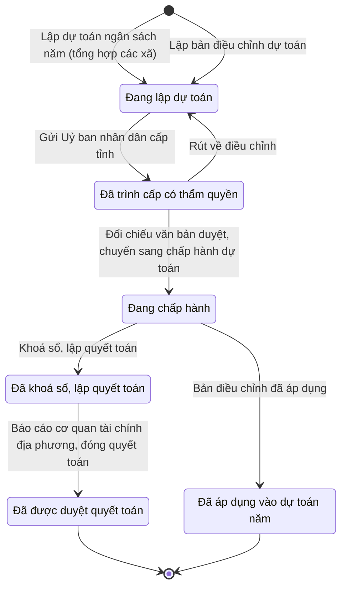

# qt-4.budget-province · Ngân sách dự toán → quyết toán — Dự toán ngân sách năm

<!-- máy sinh: tom-tat -->
> **Hồ sơ:** Dự toán ngân sách năm (`BudgetPlan`)
>
> **Trong sổ phạm vi:** 4 · Ngân sách dự toán → quyết toán — hồ sơ phụ budget-province (tầng 1)
>
> 16 bước · 6 chặng · 4 vai · 1 bảng quyết định · 2 hạn · 9 khớp nối.
>
> **Nguồn:** sổ nghiệp vụ `qt-4.budget-province` · khai báo của app: `dqtv-app/core/processes/budget/workflow/budget-province.yaml`. Các bảng do máy sinh từ nguồn này.
<!-- hết: tom-tat -->

<!-- viết tay: dien-giai -->
## Diễn giải

*Phần này viết tay, diễn giải lại điều các bảng bên dưới ghi.*

### Quy trình này để làm gì

Quy trình theo dõi **dự toán ngân sách năm** của cấp tỉnh từ lúc lập tới lúc quyết toán xong, tên đầy đủ là "E27 — Dự toán, theo dõi ngân sách cấp tỉnh". Hồ sơ cùng loại với dự toán cấp xã (quy trình 4): "cùng công thức, khác ai ký".

Hồ sơ đi qua bảy chặng: *Đang lập dự toán* → *Chờ ký tờ trình* → *Đã ký, chờ gửi Uỷ ban* → *Đã trình cấp có thẩm quyền* → *Đang chấp hành* → *Đã khoá sổ, lập quyết toán* → *Đã được duyệt quyết toán*. Một việc diễn ra ngoài hệ, hệ chỉ ghi kết quả: `provincialPeoplesCommittee` trả về quyết định dự toán (`budget_decision`).

### Khi nào bắt đầu

Cán bộ tài chính Bộ CHQS tỉnh bấm **Lập dự toán ngân sách năm (tổng hợp các xã)**. Phải nhập năm ngân sách, 12 dòng khoản và việc gốc (`taskingId`); dự toán năm trước và việc luật giao là ô nhập nếu có. Bước này nối hồ sơ tới **Nhiệm vụ trên giao** (quy trình 1) và tạo kèm hồ sơ con Khoản dự toán.

### Diễn ra thế nào

**Chặng "Đang lập dự toán"** — Cán bộ tài chính Bộ CHQS tỉnh **Thêm khoản con**, **Sửa khoản con**, **Xoá khoản con**, lặp bao nhiêu lần cũng được. Xong thì bấm **Trình ký tờ trình**, đính tờ trình (PDF); bước này nối hồ sơ với một văn bản đi và đưa hồ sơ sang *Chờ ký tờ trình*.

**Chặng "Chờ ký tờ trình"** — Bộ CHQS cấp tỉnh hoặc **Ký tờ trình** (hồ sơ sang *Đã ký, chờ gửi Uỷ ban*), hoặc **Trả lại tờ trình** kèm ghi cần điều chỉnh gì (hồ sơ về *Đang lập dự toán*).

**Chặng "Đã ký, chờ gửi Uỷ ban"** — Nhân viên văn thư bấm **Gửi Uỷ ban nhân dân cấp tỉnh**; phải có tờ trình đã ký, đã ghi số. Nơi nhận là `province_chairman`. Hồ sơ sang *Đã trình cấp có thẩm quyền*.

**Chặng "Đã trình cấp có thẩm quyền"** — chờ Uỷ ban nhân dân cùng cấp quyết định dự toán (ngoài hệ). Kết quả vào hệ bằng hai bước:

1. **Xác nhận UBND tỉnh đã duyệt dự toán + định mức, đính kèm văn bản** (Cán bộ tài chính Bộ CHQS tỉnh): nhập số và ngày nghị quyết, bản chụp, số tiền được duyệt từng khoản. Nhập nếu có: phân cấp nhiệm vụ chi, phần chưa phân bổ, và — nếu nghị quyết ban hành cùng lúc — mức trợ cấp ngày công (đồng/ngày), mức phụ cấp Thôn đội trưởng (đồng/tháng). Bước này ghi một quyết định ký ngoài hệ (`budgetPlanAuthorizedBy`), người ký `province_chairman`. Hồ sơ đứng yên; đã xác nhận rồi thì không xác nhận lại được, hệ báo đang chờ "Chỉ huy trưởng Bộ CHQS tỉnh" đối chiếu.
2. **Đối chiếu văn bản duyệt, chuyển sang chấp hành dự toán** (Bộ CHQS cấp tỉnh): phải đã có văn bản quyết định đã đính (`decisionScanPath`), tức quyết định ký ngoài hệ `budgetPlanAuthorizedBy` ghi ở bước trên, và phải có người thứ hai kiểm; phải nhập số, ngày nghị quyết và phân cấp nhiệm vụ chi. Hồ sơ sang *Đang chấp hành*.

Ở cả hai chặng *Đã ký, chờ gửi Uỷ ban* và *Đã trình cấp có thẩm quyền*, Bộ CHQS cấp tỉnh có thể **Rút về điều chỉnh** (ghi cần điều chỉnh gì), hồ sơ về *Đang lập dự toán*; văn bản duyệt đang chờ đối chiếu thì hệ tự tìm và huỷ theo.

**Chặng "Đang chấp hành"** — chỉ có một bước: Cán bộ tài chính Bộ CHQS tỉnh bấm **Khoá sổ, lập quyết toán**.

**Chặng "Đã khoá sổ, lập quyết toán"** — Cán bộ tài chính Bộ CHQS tỉnh bấm **Báo cáo cơ quan tài chính địa phương, đóng quyết toán**; phải nhập `decisionNumber` và bản chụp (`scanPath`); bước này ghi một quyết định ký ngoài hệ (`budgetPlanAuthorizedBy`), người ký `province_chairman`. Hồ sơ sang *Đã được duyệt quyết toán*.

### Kết thúc và để lại gì

Hồ sơ kết thúc ở chặng *Đã được duyệt quyết toán*. Ba khớp nối với quy trình khác:

- **Nhiệm vụ trên giao** (1) — nối lúc mở hồ sơ.
- **Văn bản đi** (1.outgoing-document) — tờ trình đề nghị phê duyệt dự toán, gắn ở bước trình ký.
- **Bảng chi trả phụ cấp chức vụ tháng** (30.allowance-sheet) — dự toán năm mà bảng chi trả rút khoản 4.

### Điều kiện chặn

- Người làm phải thuộc đơn vị chủ hồ sơ ở 10 trên 13 bước; ba bước không đòi là lập dự toán, gửi Uỷ ban, xác nhận UBND tỉnh đã duyệt. Sai người, sai chặng, thiếu thứ phải có trước thì bước bị chặn, hồ sơ giữ nguyên; nhiều lỗi cùng lúc thì báo theo thứ tự quyền → chặng → thông tin.
- Bước phải có trước bước: gửi Uỷ ban đòi tờ trình đã ký, đã ghi số; đối chiếu đòi văn bản quyết định đã đính (`decisionScanPath`) và quyết định ký ngoài hệ `budgetPlanAuthorizedBy`.
- Việc ngoài hệ: `provincialPeoplesCommittee` nhận tờ trình đã ký, đã ghi số và trả về `budget_decision`.
<!-- hết viết tay -->

## 1. Đường đi ngắn nhất qua các chặng

<!-- máy sinh: luong-chinh -->
Đường ít bước nhất từ lúc mở hồ sơ tới chặng kết thúc xa nhất. Máy chọn theo số chặng, không theo ý nghĩa nghiệp vụ — trình tự công việc thật xem phần Diễn giải và bảng "Việc làm ở từng chặng" ở mục 6.

| # | Ai làm | Làm gì | Hồ sơ sang chặng |
|---|---|---|---|
| 1 | Cán bộ tài chính Bộ CHQS tỉnh | Lập dự toán ngân sách năm (tổng hợp các xã) | Đang lập dự toán |
| 2 | Văn thư Bộ CHQS cấp tỉnh | Gửi Uỷ ban nhân dân cấp tỉnh | Đã trình cấp có thẩm quyền |
| 3 | Bộ CHQS cấp tỉnh | Đối chiếu văn bản duyệt, chuyển sang chấp hành dự toán | Đang chấp hành |
| 4 | Cán bộ tài chính Bộ CHQS tỉnh | Khoá sổ, lập quyết toán | Đã khoá sổ, lập quyết toán |
| 5 | Cán bộ tài chính Bộ CHQS tỉnh | Báo cáo cơ quan tài chính địa phương, đóng quyết toán | Đã được duyệt quyết toán |

```mermaid
flowchart LR
    S0(["Mở hồ sơ"])
    S1["Đang lập dự toán"]
    S0 -->|"Lập dự toán ngân sách năm (tổng hợp các xã)"| S1
    S2["Đã trình cấp có thẩm quyền"]
    S1 -->|"Gửi Uỷ ban nhân dân cấp tỉnh"| S2
    S3["Đang chấp hành"]
    S2 -->|"Đối chiếu văn bản duyệt, chuyển sang chấp hành dự toán"| S3
    S4["Đã khoá sổ, lập quyết toán"]
    S3 -->|"Khoá sổ, lập quyết toán"| S4
    S5["Đã được duyệt quyết toán"]
    S4 -->|"Báo cáo cơ quan tài chính địa phương, đóng quyết toán"| S5
```

<!-- hết: luong-chinh -->

## 2. Hồ sơ và việc nó để lại

<!-- máy sinh: muc-tieu -->
**App gọi quy trình này là:** E27 — Dự toán, theo dõi ngân sách cấp tỉnh.

**Khi mở, hồ sơ này ghi mối nối tới:**
- Nhiệm vụ trên giao (1) — bước `establishProvinceBudget`, khớp nối `budgetPlanServesTasking`

**Hồ sơ này để lại cho quy trình khác** (bước tạo hồ sơ của quy trình kia ghi mối nối về đây):
- Nhiệm vụ trên giao (1) — bước `establishCommuneBudget`, khớp nối `budgetPlanServesTasking`
- Phiếu chi (12a.payment-voucher) — bước `recordCommunePaymentVoucher`, khớp nối `voucherOfPlan`
- Phiếu chi (12a.payment-voucher) — bước `recordProvincePaymentVoucher`, khớp nối `voucherOfPlan`
<!-- hết: muc-tieu -->

## 3. Khởi phát và kết thúc

<!-- máy sinh: khoi-phat -->
**2 cửa vào** — bước mở hồ sơ:

| Bước mở | Ai mở | Hồ sơ vào chặng | App bắt buộc nhập |
|---|---|---|---|
| Lập dự toán ngân sách năm (tổng hợp các xã) | Cán bộ tài chính Bộ CHQS tỉnh | Đang lập dự toán | năm ngân sách, `lines`, `taskingId` |
| Lập bản điều chỉnh dự toán | Cán bộ tài chính Bộ CHQS tỉnh | Đang lập dự toán | điều chỉnh dự toán, `lines` |

**Kết thúc:** *Đã được duyệt quyết toán* (`D5`), *Đã áp dụng vào dự toán năm* (`APPLIED`)
<!-- hết: khoi-phat -->

## 4. Vai trò

<!-- máy sinh: vai-tro -->
| Vai trong sổ | Tên trong app | Điều kiện | Làm những bước |
|---|---|---|---|
| `operator` | Cán bộ tài chính Bộ CHQS tỉnh |  | Lập dự toán ngân sách năm (tổng hợp các xã) · Thêm khoản con · Sửa khoản con · Xoá khoản con · Trình ký tờ trình · Xác nhận UBND tỉnh đã duyệt dự toán + định mức, đính kèm văn bản · Khoá sổ, lập quyết toán · Báo cáo cơ quan tài chính địa phương, đóng quyết toán · Lập bản điều chỉnh dự toán |
| `clerk` | Văn thư Bộ CHQS cấp tỉnh |  | Gửi Uỷ ban nhân dân cấp tỉnh |
| `verifier` | Bộ CHQS cấp tỉnh |  | Rút về điều chỉnh · Đối chiếu văn bản duyệt, chuyển sang chấp hành dự toán |
| `system` | Hệ thống tự làm |  | Áp các dòng khoản điều chỉnh vào dự toán năm · Bản điều chỉnh đã áp dụng · `closePlanSpending` · `openClosingWindow` |

*"Tên trong app" là tên app đặt cho mã chủ thể của vai. Hồ sơ thuộc đơn vị cấp khác thì người làm là người giữ vai ấy ở đơn vị nêu trong cột "Điều kiện" (nếu sổ có ghi) và ở cột "Người làm phải thuộc" của bảng "Theo khai báo của app" (mục 7).*

**Ngoài hệ** (hệ chỉ ghi kết quả, xem mục 8): `provincialPeoplesCommittee`.
<!-- hết: vai-tro -->

## 5. Nhánh phụ

<!-- máy sinh: nhanh-phu -->
**Bước khác đưa hồ sơ sang chặng mới** — đường song song, rẽ nhánh hoặc kết thúc sớm:

| Bước | Ai làm | Từ chặng | Sang chặng |
|---|---|---|---|
| Bản điều chỉnh đã áp dụng | Hệ thống tự làm | Đang chấp hành | Đã áp dụng vào dự toán năm |

**Quay lại một chặng hồ sơ đã đi qua** (tính theo đường ngắn nhất từ lúc mở):

| Bước | Ai làm | Từ chặng | Về chặng |
|---|---|---|---|
| Rút về điều chỉnh | Bộ CHQS cấp tỉnh | Đã trình cấp có thẩm quyền | Đang lập dự toán |

**Làm trong lúc hồ sơ đứng yên ở một chặng** — ghi nhận, bổ sung:

| Bước | Ai làm | Ở chặng |
|---|---|---|
| Thêm khoản con *(lặp được)* | Cán bộ tài chính Bộ CHQS tỉnh | Đang lập dự toán |
| Sửa khoản con *(lặp được)* | Cán bộ tài chính Bộ CHQS tỉnh | Đang lập dự toán |
| Xoá khoản con *(lặp được)* | Cán bộ tài chính Bộ CHQS tỉnh | Đang lập dự toán |
| Trình ký tờ trình | Cán bộ tài chính Bộ CHQS tỉnh | Đang lập dự toán |
| Xác nhận UBND tỉnh đã duyệt dự toán + định mức, đính kèm văn bản | Cán bộ tài chính Bộ CHQS tỉnh | Đã trình cấp có thẩm quyền |
| Áp các dòng khoản điều chỉnh vào dự toán năm | Hệ thống tự làm | Đang chấp hành |
| `closePlanSpending` | Hệ thống tự làm | Đang chấp hành |
| `openClosingWindow` | Hệ thống tự làm | Đang chấp hành |

**Cửa vào khác:** 2 bước cùng mở hồ sơ — xem mục 3.

<!-- hết: nhanh-phu -->

## 6. Các chặng và việc làm ở từng chặng

<!-- máy sinh: chang -->
| Chặng | Tên hiển thị | Vào bằng bước | Kết thúc? |
|---|---|---|---|
| `D0` | Đang lập dự toán | Lập dự toán ngân sách năm (tổng hợp các xã) · Rút về điều chỉnh · Lập bản điều chỉnh dự toán |  |
| `D1` | Đã trình cấp có thẩm quyền | Gửi Uỷ ban nhân dân cấp tỉnh |  |
| `D3` | Đang chấp hành | Đối chiếu văn bản duyệt, chuyển sang chấp hành dự toán |  |
| `D4` | Đã khoá sổ, lập quyết toán | Khoá sổ, lập quyết toán |  |
| `D5` | Đã được duyệt quyết toán | Báo cáo cơ quan tài chính địa phương, đóng quyết toán | **kết thúc** |
| `APPLIED` | Đã áp dụng vào dự toán năm | Bản điều chỉnh đã áp dụng | **kết thúc** |

### Việc làm ở từng chặng

Hồ sơ đang ở chặng nào thì làm được những bước nào.

| Hồ sơ đang ở chặng | Bước làm tại chặng (hồ sơ đứng yên) | Bước đưa hồ sơ sang chặng khác |
|---|---|---|
| **Đang lập dự toán** | Thêm khoản con (lặp được) — Cán bộ tài chính Bộ CHQS tỉnh Sửa khoản con (lặp được) — Cán bộ tài chính Bộ CHQS tỉnh Xoá khoản con (lặp được) — Cán bộ tài chính Bộ CHQS tỉnh Trình ký tờ trình — Cán bộ tài chính Bộ CHQS tỉnh | Gửi Uỷ ban nhân dân cấp tỉnh — Văn thư Bộ CHQS cấp tỉnh → *Đã trình cấp có thẩm quyền* |
| **Đã trình cấp có thẩm quyền** | Xác nhận UBND tỉnh đã duyệt dự toán + định mức, đính kèm văn bản — Cán bộ tài chính Bộ CHQS tỉnh | Rút về điều chỉnh — Bộ CHQS cấp tỉnh → *Đang lập dự toán* Đối chiếu văn bản duyệt, chuyển sang chấp hành dự toán — Bộ CHQS cấp tỉnh → *Đang chấp hành* |
| **Đang chấp hành** | Áp các dòng khoản điều chỉnh vào dự toán năm — Hệ thống tự làm `closePlanSpending` — Hệ thống tự làm `openClosingWindow` — Hệ thống tự làm | Khoá sổ, lập quyết toán — Cán bộ tài chính Bộ CHQS tỉnh → *Đã khoá sổ, lập quyết toán* Bản điều chỉnh đã áp dụng — Hệ thống tự làm → *Đã áp dụng vào dự toán năm* |
| **Đã khoá sổ, lập quyết toán** | — | Báo cáo cơ quan tài chính địa phương, đóng quyết toán — Cán bộ tài chính Bộ CHQS tỉnh → *Đã được duyệt quyết toán* |
| **Đã được duyệt quyết toán** | — | — (kết thúc) |
| **Đã áp dụng vào dự toán năm** | — | — (kết thúc) |
<!-- hết: chang -->

## 7. Bảng bước

<!-- máy sinh: buoc -->
| # | Bước | Mã bước | Ai thực hiện | Từ chặng | Sang chặng | Phải có trước | Ghi lại |
|---|---|---|---|---|---|---|---|
| 1 | Lập dự toán ngân sách năm (tổng hợp các xã) | `establishProvinceBudget` | Cán bộ tài chính Bộ CHQS tỉnh | — (mở hồ sơ) | `D0` | `taskingAssigned`, `onlyBudgetOfUnitForYear` | `id`, nối tới Nhiệm vụ trên giao, nối tới Khoản dự toán, mã tỉnh, cấp, năm ngân sách, lập xong lúc, đơn vị chủ hồ sơ, ngày cuối năm ngân sách |
| 2 | Thêm khoản con | `addProvinceLineDetail` | Cán bộ tài chính Bộ CHQS tỉnh | `D0` | giữ nguyên | người làm thuộc đơn vị chủ hồ sơ | nối tới Khoản con, tăng, giảm từng khoản, `adjustmentBelowCommitted` |
| 3 | Sửa khoản con | `editProvinceLineDetail` | Cán bộ tài chính Bộ CHQS tỉnh | `D0` | giữ nguyên | người làm thuộc đơn vị chủ hồ sơ | diễn giải, số tiền, ghi chú, tăng, giảm từng khoản, `adjustmentBelowCommitted` |
| 4 | Xoá khoản con | `removeProvinceLineDetail` | Cán bộ tài chính Bộ CHQS tỉnh | `D0` | giữ nguyên | người làm thuộc đơn vị chủ hồ sơ, `detailFreeOfFundingRequest` | tăng, giảm từng khoản, `adjustmentBelowCommitted`; **xoá:** nối tới Khoản con |
| 5 | Trình ký tờ trình | `requestProvinceBudgetSignature` | Cán bộ tài chính Bộ CHQS tỉnh | `D0` | giữ nguyên | người làm thuộc đơn vị chủ hồ sơ, `noBudgetPlanSubmittedDocumentOpen`, `adjustmentWithinCommitted` | nối tới Văn bản đi |
| 6 | Gửi Uỷ ban nhân dân cấp tỉnh | `submitProvinceBudget` | Văn thư Bộ CHQS cấp tỉnh | `D0` | `D1` | `budgetPlanSubmittedDocumentIssued`, nối tới Văn bản đi | trình lúc, `signedScanPath` |
| 7 | Rút về điều chỉnh | `returnProvinceBudget` | Bộ CHQS cấp tỉnh | `D1` | `D0` | người làm thuộc đơn vị chủ hồ sơ | cần điều chỉnh gì |
| 8 | Xác nhận UBND tỉnh đã duyệt dự toán + định mức, đính kèm văn bản | `recordProvinceCouncilDecision` | Cán bộ tài chính Bộ CHQS tỉnh | `D1` | giữ nguyên | `recordProvinceCouncilDecisionFromIncomingDocumentUsable` | phần chưa phân bổ, đã xác nhận văn bản UBND duyệt, chờ đối chiếu lúc, nối tới Văn bản đến |
| 9 | Đối chiếu văn bản duyệt, chuyển sang chấp hành dự toán | `decideProvinceBudget` | Bộ CHQS cấp tỉnh | `D1` | `D3` | người làm thuộc đơn vị chủ hồ sơ, `decideProvinceBudgetFromIncomingDocumentUsable`, đã xác nhận văn bản UBND duyệt, chờ đối chiếu lúc | ngày nghị quyết, phân cấp nhiệm vụ chi, giao dự toán lúc, nối tới Văn bản đến, `provinceRatesInForce`; **xoá:** đã xác nhận văn bản UBND duyệt, chờ đối chiếu lúc |
| 10 | Khoá sổ, lập quyết toán | `closeProvinceBudget` | Cán bộ tài chính Bộ CHQS tỉnh | `D3` | `D4` | người làm thuộc đơn vị chủ hồ sơ, `noOpenFundingRequest`, `spendingNotClosed`, `closingWindowOpen` | khoá sổ lúc |
| 11 | Báo cáo cơ quan tài chính địa phương, đóng quyết toán | `recordProvinceSettlementReport` | Cán bộ tài chính Bộ CHQS tỉnh | `D4` | `D5` | người làm thuộc đơn vị chủ hồ sơ | hoàn tất quyết toán lúc |
| 12 | Lập bản điều chỉnh dự toán | `establishProvinceBudgetAdjustment` | Cán bộ tài chính Bộ CHQS tỉnh | — (mở hồ sơ) | `D0` | `planBeingAdjustedExecuting`, `noOpenAdjustment` | `id`, dự toán năm cần điều chỉnh, năm ngân sách, lập xong lúc, đơn vị chủ hồ sơ, cấp, mã tỉnh, nối tới Khoản dự toán, tăng, giảm từng khoản, `adjustmentBelowCommitted`, ngày cuối năm ngân sách |
| 13 | Áp các dòng khoản điều chỉnh vào dự toán năm | `reviseProvinceBudget` | Hệ thống tự làm | `D3` | giữ nguyên | — | số lần điều chỉnh sau lần này, điều chỉnh gần nhất lúc, bản điều chỉnh gần nhất, nối tới Khoản dự toán, `lineEffectiveFrom`, `lineEffectiveTo` |
| 14 | Bản điều chỉnh đã áp dụng | `applyProvinceBudgetAdjustment` | Hệ thống tự làm | `D3` | `APPLIED` | — | áp dụng lúc, tổng trước, tổng sau, `committedAmountAtApply`, số trước từng khoản, số sau từng khoản, tăng, giảm từng khoản |
| 15 | `closePlanSpending` | `closePlanSpending` | Hệ thống tự làm | `D3` | giữ nguyên | — | đóng ghi chi lúc |
| 16 | `openClosingWindow` | `openClosingWindow` | Hệ thống tự làm | `D3` | giữ nguyên | — | mở khoảng khoá sổ lúc |

### Khi không đạt điều kiện

Mặc định: không đúng người, hồ sơ không ở đúng chặng, hoặc thiếu thứ "phải có trước" thì bước bị chặn, hồ sơ giữ nguyên. Bảng dưới chỉ kê những bước có kết quả riêng.

| # | Bước | Kết quả riêng |
|---|---|---|
| 6 | Gửi Uỷ ban nhân dân cấp tỉnh | bên ngoài hệ không trả về `annual_norm` → hồ sơ sang *Đã trình cấp có thẩm quyền*; bên ngoài hệ không trả về `budget_decision` → hồ sơ sang *Đã trình cấp có thẩm quyền*; bên ngoài hệ không trả về `spend_allocation_decision` → hồ sơ sang *Đã trình cấp có thẩm quyền*; bên ngoài hệ không trả về `spend_task_delegation` → hồ sơ sang *Đã trình cấp có thẩm quyền* |
| 8 | Xác nhận UBND tỉnh đã duyệt dự toán + định mức, đính kèm văn bản | bên ngoài hệ không trả về `annual_norm` → hồ sơ sang *Đã trình cấp có thẩm quyền*; bên ngoài hệ không trả về `budget_decision` → hồ sơ sang *Đã trình cấp có thẩm quyền*; bên ngoài hệ không trả về `spend_allocation_decision` → hồ sơ sang *Đã trình cấp có thẩm quyền*; bên ngoài hệ không trả về `spend_task_delegation` → hồ sơ sang *Đã trình cấp có thẩm quyền* |
| 9 | Đối chiếu văn bản duyệt, chuyển sang chấp hành dự toán | bước dừng lại, hồ sơ giữ nguyên khi kết quả xét là: `rates_missing` |
| 13 | Áp các dòng khoản điều chỉnh vào dự toán năm | bước này không do người nào bấm |
| 14 | Bản điều chỉnh đã áp dụng | bước này không do người nào bấm |
| 15 | `closePlanSpending` | bước này không do người nào bấm |
| 16 | `openClosingWindow` | bước này không do người nào bấm |

### Điều kiện "phải có trước" bằng lời

Cột "Phải có trước" ở bảng bước có hai loại: ô dữ liệu thường (bước chỉ đòi ô ấy đã có giá trị) và điều kiện hệ tự xét. Bảng này diễn các điều kiện hệ tự xét theo đúng công thức sổ ghi; số ở cột cuối là số thứ tự bước.

| Điều kiện | Đúng khi | Bước đòi |
|---|---|---|
| `taskingAssigned` | có hồ sơ Việc luật giao kèm văn bản đến, đi (qt-1) chính là hồ sơ ghi ở ô nối `budgetPlanServesTasking` của hồ sơ đang làm mà hồ sơ ấy đang ở chặng `ASSIGNED` hoặc `BROKEN_DOWN` | 1 |
| `onlyBudgetOfUnitForYear` | đã có điều chỉnh dự toán HOẶC không có hồ sơ Ngân sách dự toán → quyết toán — Dự toán ngân sách năm (qt-4.budget-province) có đơn vị chủ hồ sơ trùng với đơn vị chủ hồ sơ của hồ sơ đang làm và có cấp trùng với cấp của hồ sơ đang làm mà năm ngân sách của hồ sơ đang xét bằng năm ngân sách của hồ sơ này | 1 |
| `actorInOwnerUnit` | người đang làm là người của đơn vị ghi ở ô đơn vị chủ hồ sơ của hồ sơ này (theo danh mục người của đơn vị, `dm.unit-staff`) | 2, 3, 4, 5, 7, 9, 10, 11 |
| `detailFreeOfFundingRequest` | không có hồ sơ Ngân sách dự toán → quyết toán — Đề nghị cấp kinh phí (qt-4.funding-request) có ô nối `requestOfPlan` trùng với điều chỉnh dự toán của hồ sơ đang làm | 4 |
| `noBudgetPlanSubmittedDocumentOpen` | KHÔNG (có hồ sơ Việc luật giao kèm văn bản đến, đi — Văn bản đi (qt-1.outgoing-document) chính là hồ sơ ghi ở ô nối `budgetPlanSubmittedByDocument` của hồ sơ đang làm mà hồ sơ ấy đang ở chặng `DRAFT` hoặc `PENDING_SIGNATURE` hoặc `SIGNED`) | 5 |
| `adjustmentWithinCommitted` | KHÔNG (`adjustmentBelowCommitted` là `yes`) | 5 |
| `budgetPlanSubmittedDocumentIssued` | có hồ sơ Việc luật giao kèm văn bản đến, đi — Văn bản đi (qt-1.outgoing-document) chính là hồ sơ ghi ở ô nối `budgetPlanSubmittedByDocument` của hồ sơ đang làm mà hồ sơ ấy đang ở chặng `ISSUED` | 6 |
| `recordProvinceCouncilDecisionFromIncomingDocumentUsable` | có hồ sơ Việc luật giao kèm văn bản đến, đi — Văn bản đến (qt-1.incoming-document) chính là hồ sơ ghi ở ô nối `recordProvinceCouncilDecisionFromIncomingDocument` của hồ sơ đang làm mà hồ sơ ấy đang ở chặng `RECEIVED` hoặc `DISTRIBUTED` | 8 |
| `decideProvinceBudgetFromIncomingDocumentUsable` | có hồ sơ Việc luật giao kèm văn bản đến, đi — Văn bản đến (qt-1.incoming-document) chính là hồ sơ ghi ở ô nối `decideProvinceBudgetFromIncomingDocument` của hồ sơ đang làm mà hồ sơ ấy đang ở chặng `RECEIVED` hoặc `DISTRIBUTED` | 9 |
| `noOpenFundingRequest` | KHÔNG (có hồ sơ Ngân sách dự toán → quyết toán — Đề nghị cấp kinh phí (qt-4.funding-request) có ô nối `requestOfPlan` trỏ về chính hồ sơ đang làm mà hồ sơ ấy đang ở chặng `ESTIMATED` hoặc `ESTIMATE_APPROVED` hoặc `REQUESTED`) | 10 |
| `spendingNotClosed` | KHÔNG (đã có đóng ghi chi lúc) | 10 |
| `closingWindowOpen` | đã có mở khoảng khoá sổ lúc | 10 |
| `planBeingAdjustedExecuting` | có hồ sơ Ngân sách dự toán → quyết toán — Dự toán ngân sách năm (qt-4.budget-province) chính là hồ sơ ghi ở điều chỉnh dự toán của hồ sơ đang làm mà hồ sơ ấy đang ở chặng `D3` | 12 |
| `noOpenAdjustment` | KHÔNG (có hồ sơ Ngân sách dự toán → quyết toán — Dự toán ngân sách năm (qt-4.budget-province) có điều chỉnh dự toán trùng với điều chỉnh dự toán của hồ sơ đang làm mà hồ sơ ấy đang ở chặng `D0` hoặc `D1`) | 12 |

### Theo khai báo của app

Người làm phải thuộc đơn vị nào, ô người dùng phải nhập, bước có lặp được không, và căn cứ pháp lý — lấy từ khai báo quy trình trong app.

| # | Bước | Người làm phải thuộc | Bắt buộc nhập | Nhập nếu có | Lặp được | Căn cứ |
|---|---|---|---|---|---|---|
| 1 | Lập dự toán ngân sách năm (tổng hợp các xã) |  | năm ngân sách, 12 dòng khoản, `taskingId` | dự toán năm trước, thuộc việc luật giao |  | L48/2019/QH14 Đ.38; QĐ1126/QĐ-TM Đ.16 k1; TT99/2019/TT-BQP Đ.7 k2h |
| 2 | Thêm khoản con | đơn vị chủ hồ sơ | `itemCode`, diễn giải, số tiền | ghi chú | có | L48/2019/QH14 Đ.38 |
| 3 | Sửa khoản con | đơn vị chủ hồ sơ | `detailId`, diễn giải, số tiền | ghi chú | có | L48/2019/QH14 Đ.38 |
| 4 | Xoá khoản con | đơn vị chủ hồ sơ | `detailId` | — | có | L48/2019/QH14 Đ.38 |
| 5 | Trình ký tờ trình | đơn vị chủ hồ sơ | tờ trình (PDF) | — |  | NĐ30/2020/NĐ-CP Đ.10, Đ.13; L72/2025/QH15 Đ.22 k1 |
| 6 | Gửi Uỷ ban nhân dân cấp tỉnh |  | — | — |  | L72/2025/QH15 Đ.22 k1; NĐ30/2020/NĐ-CP Đ.18, Đ.19 |
| 7 | Rút về điều chỉnh | đơn vị chủ hồ sơ | cần điều chỉnh gì | văn bản duyệt đang chờ đối chiếu — hệ thống tự tìm, huỷ theo | có | L72/2025/QH15 Đ.16 k1 |
| 8 | Xác nhận UBND tỉnh đã duyệt dự toán + định mức, đính kèm văn bản |  | văn bản đến là văn bản UBND duyệt dự toán | ngày ký (để trống thì lấy ngày ghi trên văn bản đến), phân cấp nhiệm vụ chi, mức trợ cấp ngày công (đồng/ngày) — nếu nghị quyết ban hành cùng lúc, mức phụ cấp Thôn đội trưởng (đồng/tháng) — nếu nghị quyết ban hành cùng lúc, phần chưa phân bổ, số tiền được duyệt từng khoản |  | 50_MAU_KY_NGOAI_HE_THONG.md §D; L72/2025/QH15 Đ.15 k2c |
| 9 | Đối chiếu văn bản duyệt, chuyển sang chấp hành dự toán | đơn vị chủ hồ sơ | `decisionId`, văn bản UBND tỉnh duyệt dự toán (văn bản đến đã vào sổ), ngày nghị quyết, phân cấp nhiệm vụ chi | — |  | L72/2025/QH15 Đ.15 k2c; L48/2019/QH14 Đ.44 k1b; L72/2025/QH15 Đ.16 k5 |
| 10 | Khoá sổ, lập quyết toán | đơn vị chủ hồ sơ | — | — |  | QĐ1126/QĐ-TM Đ.16 k2; TT99/2019/TT-BQP Đ.7 k2h |
| 11 | Báo cáo cơ quan tài chính địa phương, đóng quyết toán | đơn vị chủ hồ sơ | — | — |  | QĐ1126/QĐ-TM Đ.16 k2; TT99/2019/TT-BQP Đ.7 k2h |
| 12 | Lập bản điều chỉnh dự toán |  | dự toán năm cần điều chỉnh, 12 dòng khoản | năm ngân sách, thuộc việc luật giao, `taskingId` |  | L72/2025/QH15 Đ.21 k2b (HĐND quyết định điều chỉnh dự toán ngân sách cấp mình); ND163/2016/NĐ-CP Đ.52, Đ.53 Luật NSNN |
| 13 | Áp các dòng khoản điều chỉnh vào dự toán năm |  | bản điều chỉnh được áp dụng, 12 dòng khoản mới, bộ khoản con mới, bộ khoản con cũ bị thay (cắt cạnh, hàng ở lại), số lần điều chỉnh sau lần này | — |  | L72/2025/QH15 Đ.21 k2b |
| 14 | Bản điều chỉnh đã áp dụng |  | áp dụng lúc, tổng trước, tổng sau, đã cam kết lúc áp dụng, số trước từng khoản, số sau từng khoản, tăng, giảm từng khoản | — |  | L72/2025/QH15 Đ.21 k2b |

### Điều kiện và ghi chú app khai cho từng bước

Lấy từ khai báo quy trình trong app. Lời trong ngoặc kép là câu app hiện cho người dùng. Chức danh người ký ngoài hệ app chỉ khai bằng mã.

| # | Bước | Điều kiện, ghi chú |
|---|---|---|
| 1 | Lập dự toán ngân sách năm (tổng hợp các xã) | · tạo thêm một hồ sơ con: Khoản dự toán (`BudgetLine`) |
| 2 | Thêm khoản con | · tạo thêm một hồ sơ con: Khoản con (`BudgetLineDetail`) |
| 5 | Trình ký tờ trình | · tạo thêm một hồ sơ con: Văn bản đi (`OutgoingDocument`) |
| 6 | Gửi Uỷ ban nhân dân cấp tỉnh | · app khai nơi nhận: `province_chairman` |
| 8 | Xác nhận UBND tỉnh đã duyệt dự toán + định mức, đính kèm văn bản | · không làm được khi đã có ô "đã xác nhận văn bản UBND duyệt, chờ đối chiếu lúc" — app báo: "đã xác nhận văn bản UBND duyệt dự toán rồi — đang chờ Chỉ huy trưởng Bộ CHQS tỉnh bấm "Đối chiếu, chuyển sang chấp hành"" · bước này ghi một quyết định ký NGOÀI hệ (`budgetPlanAuthorizedBy`), người ký: `province_chairman` · không đòi bản chụp — app ghi: "bản số hoá lấy từ văn bản đến văn thư đã vào sổ (tầng đọc chép `scanPath` của văn bản ấy), không tải ảnh ở bước này" |
| 9 | Đối chiếu văn bản duyệt, chuyển sang chấp hành dự toán | · phải có quyết định ký ngoài hệ `budgetPlanAuthorizedBy`; phải có người thứ hai kiểm · không đòi bản chụp — app ghi: "Bản gốc nghị quyết đã nằm ở quyết định ký ngoài mà bước này đối chiếu qua decisionId — bước chỉ chuyển dự toán, không phát hành văn bản mới" |
| 12 | Lập bản điều chỉnh dự toán | · tạo thêm một hồ sơ con: Khoản dự toán (`BudgetLine`) |
| 13 | Áp các dòng khoản điều chỉnh vào dự toán năm | · tạo thêm một hồ sơ con: Khoản dự toán (`BudgetLine`) |
<!-- hết: buoc -->

## 8. Bảng quyết định, hạn, việc ngoài hệ

<!-- máy sinh: quyet-dinh -->
**Bảng `province-rates`** — xét ở bước *Đối chiếu văn bản duyệt, chuyển sang chấp hành dự toán*; đầu vào: `provinceRatesInForce`. 2 dòng, dò từ trên xuống, dòng đầu tiên khớp thì dừng.

| Thứ tự dò (số sổ ghi) | Dòng | Khi | Thì |
|---|---|---|---|
| 0 | `in-force` | `provinceRatesInForce` là `yes` | cho qua |
| 9 | `missing` | mọi trường hợp còn lại | `rates_missing` |

| Hạn | Tính từ | Thời hạn | Quá hạn thì |
|---|---|---|---|
| `closingWindowOpens` | `{"fact": "planYearEnd"}` | 1 ngày | hệ làm bước `openClosingWindow` |
| `planSpendingEnd` | `{"fact": "planYearEnd"}` | 1 tháng | hệ làm bước `closePlanSpending` |

**Việc làm ngoài hệ, hệ chỉ ghi kết quả:**

| Ranh giới | Ai làm | Hệ gửi ra | Hệ nhận về | Không được thì |
|---|---|---|---|---|
| `provincial_peoples_committee` | `provincialPeoplesCommittee` | nối tới Văn bản đi | `budget_decision` | hồ sơ sang *Đang lập dự toán* |
<!-- hết: quyet-dinh -->

## 9. Dữ liệu của hồ sơ

<!-- máy sinh: du-lieu -->
Các ô mà bước trong sổ ghi hoặc đòi. Số trong hai cột cuối là số thứ tự bước ở bảng bước (mục 7).

| Ô dữ liệu | Mã | Kiểu (app) | Giá trị cho phép | Loại ô (sổ) | Bước ghi | Bước đòi | Mô tả trong app |
|---|---|---|---|---|---|---|---|
| — | `id` |  |  | lưu trên hồ sơ (`stored`) | 1, 12 | — |  |
| mã tỉnh | `provinceCode` | chữ |  | lưu trên hồ sơ (`stored`) | 1, 12 | — | Mã tỉnh — dùng lọc phạm vi theo hàng; rỗng khi hồ sơ thuộc quân khu hoặc Bộ Quốc phòng |
| cấp | `level` | chọn một | Cấp xã (`commune`), Cấp tỉnh (`province`) | lưu trên hồ sơ (`stored`) | 1, 12 | — | Cấp lập dự toán — cùng công thức, khác ai ký. E27 §2 |
| năm ngân sách | `fiscalYear` | số |  | đưa vào ở bước (`input`) | 1, 12 | — | Năm ngân sách — mỗi năm một bản ghi, không ghi đè năm cũ |
| lập xong lúc | `preparedAt` | ngày giờ |  | lưu trên hồ sơ (`stored`) | 1, 12 | — | Thời điểm lập xong 12 khoản |
| đơn vị chủ hồ sơ | `ownerUnit` |  |  | lưu trên hồ sơ (`stored`) | 1, 12 | — |  |
| ngày cuối năm ngân sách | `planYearEnd` | ngày |  | lưu trên hồ sơ (`stored`) | 1, 12 | — | Dự toán năm: ngày cuối năm ngân sách (31/12) — ghi lúc lập; hạn đóng ghi chi tính từ đây |
| tăng, giảm từng khoản | `adjustmentChange` | bảng |  | lưu trên hồ sơ (`stored`) | 2, 3, 4, 12, 14 | — | Bản điều chỉnh: từng khoản trước – sau – tăng/giảm – số đã cam kết lúc áp dụng |
| — | `adjustmentBelowCommitted` |  | `yes`, `no` | lưu trên hồ sơ (`stored`) | 2, 3, 4, 12 | — |  |
| diễn giải | `description` |  |  | đưa vào ở bước (`input`) | 3 | — |  |
| số tiền | `amount` |  |  | đưa vào ở bước (`input`) | 3 | — |  |
| ghi chú | `note` | chữ |  | đưa vào ở bước (`input`) | 3 | — | Ghi chú |
| trình lúc | `submittedAt` | ngày giờ |  | lưu trên hồ sơ (`stored`) | 6 | — | Thời điểm trình UBND cùng cấp — UC-02 |
| — | `signedScanPath` |  |  | đưa vào ở bước (`input`) | 6 | — |  |
| cần điều chỉnh gì | `returnReason` | chữ |  | đưa vào ở bước (`input`) | 7 | — | Cần điều chỉnh gì — người đã trình ghi lúc rút tờ trình về (US-08) |
| phần chưa phân bổ | `unallocatedAmount` | số |  | đưa vào ở bước (`input`) | 8 | — | Phần UBND CHƯA phân bổ chi tiết, giao dần trong năm — L72/2025 Đ.22 k4, Đ.16 k5 |
| đã xác nhận văn bản UBND duyệt, chờ đối chiếu lúc | `councilDecisionPendingAt` | ngày giờ |  | lưu trên hồ sơ (`stored`) | 8 | 9 | Đã xác nhận văn bản UBND duyệt dự toán, đang chờ đối chiếu — UC-03, khoá nút xác nhận lại tới khi đối chiếu xong |
| ngày nghị quyết | `resolvedAt` | ngày |  | lưu trên hồ sơ (`stored`) | 9 | — | Ngày văn bản quyết định dự toán — UC-03 |
| phân cấp nhiệm vụ chi | `taskAssignment` | bảng |  | đưa vào ở bước (`input`) | 9 | — | Phân cấp nhiệm vụ chi giữa NS tỉnh và NS xã — chỉ ghi ở bản ghi cấp TỈNH, L72/2025 Đ.15 k2c |
| giao dự toán lúc | `allocatedAt` | ngày giờ |  | lưu trên hồ sơ (`stored`) | 9 | — | Thời điểm UBND giao dự toán chi — UC-04 |
| — | `provinceRatesInForce` |  | `yes`, `no` | đưa vào ở bước (`input`) | 9 | — |  |
| khoá sổ lúc | `closedAt` | ngày giờ |  | lưu trên hồ sơ (`stored`) | 10 | — | Thời điểm khoá sổ, lập quyết toán — UC-06 |
| hoàn tất quyết toán lúc | `settledAt` | ngày giờ |  | lưu trên hồ sơ (`stored`) | 11 | — | Thời điểm hoàn tất quyết toán (D5) — xã và tỉnh đều khép khi báo cơ quan tài chính địa phương |
| điều chỉnh dự toán | `adjustsPlanId` | chữ |  | đưa vào ở bước (`input`) | 12 | — | Bản điều chỉnh: id dự toán năm bị điều chỉnh — rỗng ở dự toán năm lập đầu năm |
| số lần điều chỉnh | `revisionNo` | số |  | lưu trên hồ sơ (`stored`) | 13 | — | Dự toán năm: số lần điều chỉnh đã áp dụng (0 = chưa điều chỉnh lần nào) |
| điều chỉnh gần nhất lúc | `lastRevisedAt` | ngày giờ |  | lưu trên hồ sơ (`stored`) | 13 | — | Dự toán năm: lần điều chỉnh áp dụng gần nhất |
| bản điều chỉnh gần nhất | `lastAppliedAdjustmentId` | chữ |  | lưu trên hồ sơ (`stored`) | 13 | — | Dự toán năm: id bản điều chỉnh áp dụng gần nhất |
| — | `lineEffectiveFrom` |  |  | lưu trên hồ sơ (`stored`) | 13 | — |  |
| — | `lineEffectiveTo` |  |  | lưu trên hồ sơ (`stored`) | 13 | — |  |
| áp dụng lúc | `appliedAt` | ngày giờ |  | lưu trên hồ sơ (`stored`) | 14 | — | Bản điều chỉnh: thời điểm áp dụng vào dự toán năm (ghi một lần) |
| tổng dự toán trước điều chỉnh | `budgetTotalBefore` | số |  | lưu trên hồ sơ (`stored`) | 14 | — | Bản điều chỉnh: tổng dự toán trước khi áp dụng |
| tổng dự toán sau điều chỉnh | `budgetTotalAfter` | số |  | lưu trên hồ sơ (`stored`) | 14 | — | Bản điều chỉnh: tổng dự toán sau khi áp dụng |
| — | `committedAmountAtApply` |  |  | lưu trên hồ sơ (`stored`) | 14 | — |  |
| số trước từng khoản | `lineAmountBefore` | bảng |  | lưu trên hồ sơ (`stored`) | 14 | — | Bản điều chỉnh: số trước của từng khoản (itemCode → số tiền) lúc áp dụng |
| số sau từng khoản | `lineAmountAfter` | bảng |  | lưu trên hồ sơ (`stored`) | 14 | — | Bản điều chỉnh: số sau của từng khoản (itemCode → số tiền) lúc áp dụng |
| đóng ghi chi lúc | `spendingClosedAt` | ngày giờ |  | lưu trên hồ sơ (`stored`) | 15 | — | Dự toán năm: thời điểm hệ đóng ghi chi (hết 31/01 năm sau) — khoá sổ vẫn do người bấm |
| mở khoảng khoá sổ lúc | `closingWindowOpenedAt` | ngày giờ |  | lưu trên hồ sơ (`stored`) | 16 | — | Dự toán năm: thời điểm hệ mở khoảng khoá sổ (từ 1/1 năm sau năm ngân sách) — khoá sổ chỉ được từ lúc này tới khi đóng ghi chi (31/1) |
| — | `taskingAssigned` |  |  | hệ suy ra (`derived`) | — | 1 |  |
| — | `onlyBudgetOfUnitForYear` |  | có hay chưa | hệ suy ra (`derived`) | — | 1 |  |
| người làm thuộc đơn vị chủ hồ sơ | `actorInOwnerUnit` |  | có hay chưa | hệ suy ra (`derived`) | — | 2, 3, 4, 5, 7, 9, 10, 11 |  |
| — | `detailFreeOfFundingRequest` |  | có hay chưa | hệ suy ra (`derived`) | — | 4 |  |
| — | `noBudgetPlanSubmittedDocumentOpen` |  | có hay chưa | hệ suy ra (`derived`) | — | 5 |  |
| — | `adjustmentWithinCommitted` |  | có hay chưa | hệ suy ra (`derived`) | — | 5 |  |
| — | `budgetPlanSubmittedDocumentIssued` |  | có hay chưa | hệ suy ra (`derived`) | — | 6 |  |
| — | `recordProvinceCouncilDecisionFromIncomingDocumentUsable` |  | có hay chưa | hệ suy ra (`derived`) | — | 8 |  |
| — | `decideProvinceBudgetFromIncomingDocumentUsable` |  | có hay chưa | hệ suy ra (`derived`) | — | 9 |  |
| — | `noOpenFundingRequest` |  | có hay chưa | hệ suy ra (`derived`) | — | 10 |  |
| — | `spendingNotClosed` |  | có hay chưa | hệ suy ra (`derived`) | — | 10 |  |
| — | `closingWindowOpen` |  | có hay chưa | hệ suy ra (`derived`) | — | 10 |  |
| — | `planBeingAdjustedExecuting` |  | có hay chưa | hệ suy ra (`derived`) | — | 12 |  |
| — | `noOpenAdjustment` |  | có hay chưa | hệ suy ra (`derived`) | — | 12 |  |

51 ô. Cột "Loại ô" là cách sổ phân loại ô, in kèm đúng chữ của sổ; ô nào người dùng phải nhập xem bảng "Theo khai báo của app" ở mục 7.
<!-- hết: du-lieu -->

## 10. Khớp nối với quy trình khác

<!-- máy sinh: khop-noi -->
| Quy trình kia | Hồ sơ kia | Quan hệ | Nội dung (mô tả trong app) | Bước ghi mối nối | Tên ô nối |
|---|---|---|---|---|---|
| 1 | Nhiệm vụ trên giao | hồ sơ này **mở ra có nối tới** hồ sơ kia | Việc gốc mà dự toán ngân sách này thực hiện — tờ trình dự toán và mọi văn bản đi sinh từ hồ sơ kế thừa việc n… | 4·establishCommuneBudget ⊕, 4.budget-province·establishProvinceBudget ⊕ | `budgetPlanServesTasking` |
| 1.incoming-document | Văn bản đến | gắn với nhau ở một bước giữa chừng | Văn bản UBND xã duyệt dự toán mà Chỉ huy trưởng đối chiếu — văn bản đến đã vào sổ (L72/2025/QH15 Đ.21 k2b) | 4·decideCommuneBudget | `decideCommuneBudgetFromIncomingDocument` |
| 1.incoming-document | Văn bản đến | gắn với nhau ở một bước giữa chừng | Văn bản UBND tỉnh duyệt dự toán mà Bộ CHQS tỉnh đối chiếu — văn bản đến đã vào sổ (L72/2025/QH15 Đ.15 k2c) | 4.budget-province·decideProvinceBudget | `decideProvinceBudgetFromIncomingDocument` |
| 1.incoming-document | Văn bản đến | gắn với nhau ở một bước giữa chừng | Văn bản UBND cấp xã quyết định dự toán — văn bản đến đã vào sổ (L72/2025/QH15 Đ.21 k2b) | 4·recordCommuneCouncilDecision | `recordCommuneCouncilDecisionFromIncomingDocument` |
| 1.incoming-document | Văn bản đến | gắn với nhau ở một bước giữa chừng | Văn bản UBND cấp tỉnh quyết định dự toán — văn bản đến đã vào sổ (L72/2025/QH15 Đ.15 k2c) | 4.budget-province·recordProvinceCouncilDecision | `recordProvinceCouncilDecisionFromIncomingDocument` |
| 1.outgoing-document | Văn bản đi | gắn với nhau ở một bước giữa chừng | Tờ trình đề nghị phê duyệt dự toán — văn bản đi của Ban CHQS, mỗi lượt trình một tờ (NĐ30/2020/NĐ-CP Điều 18,… | 4·requestCommuneBudgetSignature, 4.budget-province·requestProvinceBudgetSignature · đòi: 4·submitCommuneBudget, 4.budget-province·submitProvinceBudget | `budgetPlanSubmittedByDocument` |
| 1.outgoing-document | Văn bản đi | gắn với nhau ở một bước giữa chừng | Văn bản báo cáo quyết toán ngân sách xã — văn bản đi của Ban CHQS xã, mỗi lượt trình một tờ (QĐ1126/QĐ-TM Đ.1… | 4·requestCommuneSettlementReportSignature | `communeSettlementReportByDocument` |
| 12a.payment-voucher | Phiếu chi | hồ sơ kia **mở ra từ** hồ sơ này | Phiếu chi ghi thẳng trừ vào dự toán năm nào — phải đang chấp hành (D3) | 12a.payment-voucher·recordCommunePaymentVoucher ⊕, 12a.payment-voucher·recordProvincePaymentVoucher ⊕ | `voucherOfPlan` |
| 30.allowance-sheet | Bảng chi trả phụ cấp chức vụ tháng | có nối | Dự toán năm mà bảng chi trả phụ cấp chức vụ tháng rút khoản 4 — L48/2019 Đ.38 k4 | — | `allowanceSheetOfPlan` |

9 khớp nối. ⊕ là bước tạo hồ sơ.
<!-- hết: khop-noi -->

## 11. Thông tin chung

<!-- máy sinh: thong-tin -->
| | |
|---|---|
| **Mã trong sổ** | `qt-4.budget-province` |
| **Quy trình trong app** | `budget` (`workflow/budget-province.yaml`) — mặt công tác: `finance` |
| **Hồ sơ** | Dự toán ngân sách năm (`BudgetPlan`) |
| **Cùng mã quy trình** | [qt-4](qt-4.html), [qt-4.funding-request](qt-4.funding-request.html) |
| **Căn cứ pháp lý từng bước** | cột "Căn cứ" ở bảng "Theo khai báo của app", mục 7 |
<!-- hết: thong-tin -->
