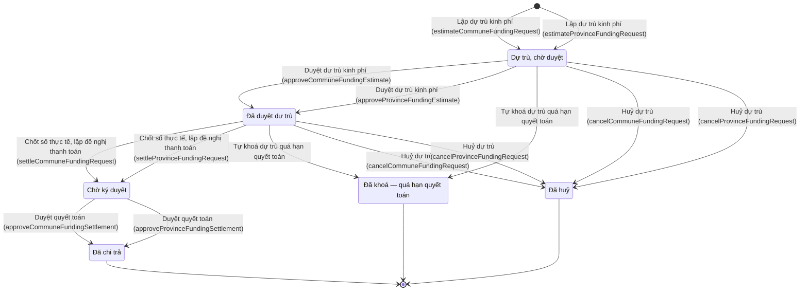

# qt-4.funding-request · Ngân sách dự toán → quyết toán — Đề nghị cấp kinh phí

<!-- máy sinh: tom-tat -->
> **Hồ sơ:** Đề nghị cấp kinh phí (`FundingRequest`)
>
> **Trong sổ phạm vi:** 4 · Ngân sách dự toán → quyết toán — hồ sơ phụ funding-request (tầng 1)
>
> 13 bước · 6 chặng · 5 vai · 0 bảng quyết định · 2 hạn · 15 khớp nối.
>
> **Nguồn:** sổ nghiệp vụ `qt-4.funding-request` · khai báo của app: `dqtv-app/core/processes/budget/workflow/funding-request.yaml`. Các bảng do máy sinh từ nguồn này.
<!-- hết: tom-tat -->

<!-- viết tay: dien-giai -->
## Diễn giải

*Phần này viết tay, diễn giải lại điều các bảng bên dưới ghi.*

### Quy trình này để làm gì

Quy trình theo dõi từng **đề nghị cấp kinh phí** cho một việc cụ thể (một đợt, một lệnh, một hồ sơ nguồn), gắn với một dự toán ngân sách năm, ở cấp xã và cấp tỉnh. Tên đầy đủ là "E27 — Đề nghị cấp kinh phí theo nhiệm vụ"; đây là trạng thái ghi nhận, hệ không làm nghiệp vụ chi thật.

Quy trình có 21 bước, gồm 10 việc mỗi việc hai bước — một cho cấp xã, một cho cấp tỉnh, cùng nhãn — cộng một bước riêng của cấp xã. Hồ sơ đi theo một trong hai nhánh:

- **Nhánh dự trù:** *Dự trù, chờ duyệt* → *Đã duyệt dự trù* → *Chờ ký duyệt* → *Đã chi trả*.
- **Nhánh lập thẳng:** *Chờ ký duyệt* → *Đã ký duyệt, gửi* → *Đã chi trả*.

Ngoài ra có chặng kết thúc *Đã huỷ*.

### Khi nào bắt đầu

Có bốn cửa vào, hai cho mỗi cấp. Người mở ở xã là Nhân viên tài chính kiêm hậu cần, ở tỉnh là Cán bộ tài chính Bộ CHQS tỉnh.

- **Lập dự trù kinh phí** — hồ sơ vào chặng *Dự trù, chờ duyệt*. Phải nhập dự toán năm (`budgetPlanId`), loại nguồn, hồ sơ nguồn, tên đợt/lệnh/hồ sơ nguồn và các dòng khoản.
- **Lập đề nghị cấp kinh phí** — hồ sơ vào thẳng chặng *Chờ ký duyệt*. Phải nhập dự toán năm, khoản, loại nguồn, hồ sơ nguồn, tên nguồn và số tiền; số người, tổng ngày công, định mức áp dụng là ô nhập nếu có.

Cả bốn bước đều ghi mối nối tới Dự toán ngân sách năm và tới Dòng khoản của hồ sơ kinh phí. Cả bốn đòi trước điều kiện `withinItemRemaining` — đúng khi ô `itemOverRemaining` không phải `yes`; riêng hai bước của xã đòi thêm `itemInCommuneBudget`. Có 13 loại nguồn (đợt huấn luyện, lệnh điều động, hồ sơ chế độ, hồ sơ khen thưởng, trang phục đến niên hạn, buổi tuyên truyền vận động, kỳ tuyển chọn, đợt mở rộng lực lượng, cuộc kiểm tra thanh tra, bảo dưỡng sửa chữa trang bị, công trình quốc phòng, vụ việc ứng phó, bảng phụ cấp chức vụ tháng).

### Diễn ra thế nào

Người duyệt ở xã là Chỉ huy trưởng Ban CHQS xã, ở tỉnh là Bộ CHQS cấp tỉnh.

**Chặng "Dự trù, chờ duyệt"** — người duyệt bấm **Duyệt dự trù kinh phí**, hồ sơ sang *Đã duyệt dự trù*. Từ lúc này dự trù đã giữ chỗ trong khoản và là căn cứ chi trong quá trình tổ chức.

**Chặng "Đã duyệt dự trù"** — người lập bấm **Chốt số thực tế, lập đề nghị thanh toán**; phải có dòng khoản. Bước ghi tổng số thực chi (bằng tổng các phiếu chi, không nhập tay) và số tiền dư đã hoàn. Hồ sơ sang *Chờ ký duyệt*.

Ở cả hai chặng trên, người lập còn hai việc:

- **Bớt dòng khoản** — phải nhập `lineId`, lý do bớt dòng nhập nếu có; hồ sơ về (hoặc ở lại) *Dự trù, chờ duyệt*.
- **Huỷ dự trù** — rút hồ sơ dự trù nhầm hoặc không dùng, nhả chỗ trong khoản; hồ sơ sang *Đã huỷ*, ghi lý do huỷ nếu có.

**Chặng "Chờ ký duyệt"** — hai nhánh gặp nhau ở đây, với các bước sau:

- **Ghi nhận hoàn tiền dư** (người lập) — nhập ngày hoàn và ảnh chụp chứng từ; hồ sơ đứng yên.
- **Duyệt quyết toán** (người duyệt) — hồ sơ sang thẳng *Đã chi trả*; đây là lối của nhánh dự trù.
- **Ký duyệt gửi đề nghị** (người duyệt) — hồ sơ sang *Đã ký duyệt, gửi*; đây là lối của nhánh lập thẳng.
- **Trả lại đề nghị chưa ký** (Chỉ huy trưởng Ban CHQS xã) — phải nhập lý do; hồ sơ sang *Đã huỷ*.

**Chặng "Đã ký duyệt, gửi"** — người lập bấm **Đánh dấu đã chi trả**, hồ sơ sang *Đã chi trả*.

### Kết thúc và để lại gì

Hồ sơ kết thúc ở *Đã chi trả* hoặc *Đã huỷ*. Mỗi đề nghị phát sinh từ một hồ sơ nguồn của quy trình khác: buổi tuyên truyền, vận động (11), hồ sơ chế độ chính sách (12b), lệnh điều động (13a), đợt huấn luyện (14), vụ việc ứng phó (20), công trình quốc phòng (23), bảng chi trả phụ cấp chức vụ tháng (30.allowance-sheet), hồ sơ khen thưởng (8), cuộc kiểm tra, thanh tra (9), đợt cấp trang phục (D11.uniform), đợt bảo dưỡng, sửa chữa trang bị (D12), kỳ tuyển chọn (D2), đợt mở rộng lực lượng (D5).

### Điều kiện chặn

- Quy trình này không có bảng quyết định, không có hạn và không có việc ngoài hệ.
- Bốn bước mở: ô `itemOverRemaining` là `yes` thì bị chặn (`withinItemRemaining`); hai bước của xã còn đòi `itemInCommuneBudget` — khoản của đề nghị phải có trong dự toán ngân sách năm mà đề nghị nối tới.
- Bước lập dự trù của xã dừng lại, hồ sơ giữ nguyên khi kết quả xét là `SOURCE_NOT_ELIGIBLE`.
- Bước chốt số thực tế đòi đã có dòng khoản.
- Các bước sau bước mở: ở xã (9 bước), người làm phải thuộc đơn vị chủ hồ sơ; ở tỉnh (8 bước), người làm thuộc đơn vị chủ hồ sơ hoặc một đơn vị nằm trong ô cấp trên của chủ hồ sơ (`actorInOwnerOrSuperiorUnit`).
- Sai người, sai chặng, thiếu thứ phải có trước thì bước bị chặn, hồ sơ giữ nguyên; nhiều lỗi cùng lúc thì báo theo thứ tự quyền → chặng → thông tin.
<!-- hết viết tay -->

## 1. Đường đi ngắn nhất qua các chặng

<!-- máy sinh: luong-chinh -->
Đường ít bước nhất từ lúc mở hồ sơ tới chặng kết thúc xa nhất. Máy chọn theo số chặng, không theo ý nghĩa nghiệp vụ — trình tự công việc thật xem phần Diễn giải và bảng "Việc làm ở từng chặng" ở mục 6.

| # | Ai làm | Làm gì | Hồ sơ sang chặng |
|---|---|---|---|
| 1 | Nhân viên tài chính kiêm hậu cần | Lập dự trù kinh phí (`estimateCommuneFundingRequest`) | Dự trù, chờ duyệt |
| 2 | Chỉ huy trưởng Ban CHQS xã | Duyệt dự trù kinh phí (`approveCommuneFundingEstimate`) | Đã duyệt dự trù |
| 3 | Nhân viên tài chính kiêm hậu cần | Chốt số thực tế, lập đề nghị thanh toán (`settleCommuneFundingRequest`) | Chờ ký duyệt |
| 4 | Chỉ huy trưởng Ban CHQS xã | Duyệt quyết toán (`approveCommuneFundingSettlement`) | Đã chi trả |

<!-- hết: luong-chinh -->

## 2. Hồ sơ và việc nó để lại

<!-- máy sinh: muc-tieu -->
**App gọi quy trình này là:** E27 — Đề nghị cấp kinh phí theo nhiệm vụ.

**Khi mở, hồ sơ này ghi mối nối tới:**
- Cuộc thanh tra, kiểm tra (9) — bước `estimateCommuneFundingRequest`, khớp nối `fundingRequestFromInspection`
- Cuộc thanh tra, kiểm tra (9) — bước `estimateProvinceFundingRequest`, khớp nối `fundingRequestFromInspection`
- Công trình, đất đai quốc phòng (23) — bước `estimateCommuneFundingRequest`, khớp nối `fundingRequestFromDefenceWork`
- Công trình, đất đai quốc phòng (23) — bước `estimateProvinceFundingRequest`, khớp nối `fundingRequestFromDefenceWork`
- Hồ sơ chế độ chính sách (12b) — bước `estimateCommuneFundingRequest`, khớp nối `fundingRequestFromBenefit`
- Hồ sơ chế độ chính sách (12b) — bước `estimateProvinceFundingRequest`, khớp nối `fundingRequestFromBenefit`
- Hồ sơ khen thưởng (8) — bước `estimateCommuneFundingRequest`, khớp nối `fundingRequestFromAward`
- Hồ sơ khen thưởng (8) — bước `estimateProvinceFundingRequest`, khớp nối `fundingRequestFromAward`
- Kỳ tuyển chọn (D2) — bước `estimateCommuneFundingRequest`, khớp nối `fundingRequestFromSelection`
- Kỳ tuyển chọn (D2) — bước `estimateProvinceFundingRequest`, khớp nối `fundingRequestFromSelection`
- Lệnh điều động (13a) — bước `estimateCommuneFundingRequest`, khớp nối `fundingRequestFromDeployment`
- Lệnh điều động (13a) — bước `estimateProvinceFundingRequest`, khớp nối `fundingRequestFromDeployment`
- Sự kiện — huấn luyện, hội thi, diễn tập, hội nghị (14) — bước `estimateCommuneFundingRequest`, khớp nối `fundingRequestFromTraining`
- Sự kiện — huấn luyện, hội thi, diễn tập, hội nghị (14) — bước `estimateProvinceFundingRequest`, khớp nối `fundingRequestFromTraining`
- Trang bị, phương tiện (D12) — bước `estimateCommuneFundingRequest`, khớp nối `fundingRequestFromEquipment`
- Trang bị, phương tiện (D12) — bước `estimateProvinceFundingRequest`, khớp nối `fundingRequestFromEquipment`
- Trang phục, sao mũ, phù hiệu (D11.uniform) — bước `estimateCommuneFundingRequest`, khớp nối `fundingRequestFromUniform`
- Trang phục, sao mũ, phù hiệu (D11.uniform) — bước `estimateProvinceFundingRequest`, khớp nối `fundingRequestFromUniform`
- Vụ việc ứng phó (20) — bước `estimateCommuneFundingRequest`, khớp nối `fundingRequestFromCase`
- Vụ việc ứng phó (20) — bước `estimateProvinceFundingRequest`, khớp nối `fundingRequestFromCase`
- Điều động trong tình trạng đặc biệt (13b) — bước `estimateCommuneFundingRequest`, khớp nối `fundingRequestFromSpecialDeployment`
- Điều động trong tình trạng đặc biệt (13b) — bước `estimateProvinceFundingRequest`, khớp nối `fundingRequestFromSpecialDeployment`
- Đợt mở rộng lực lượng (D5) — bước `estimateCommuneFundingRequest`, khớp nối `fundingRequestFromExpansion`
- Đợt mở rộng lực lượng (D5) — bước `estimateProvinceFundingRequest`, khớp nối `fundingRequestFromExpansion`
- Đợt tuyên truyền, vận động (11) — bước `estimateCommuneFundingRequest`, khớp nối `fundingRequestFromOutreach`
- Đợt tuyên truyền, vận động (11) — bước `estimateProvinceFundingRequest`, khớp nối `fundingRequestFromOutreach`
<!-- hết: muc-tieu -->

## 3. Khởi phát và kết thúc

<!-- máy sinh: khoi-phat -->
**2 cửa vào** — bước mở hồ sơ:

| Bước mở | Ai mở | Hồ sơ vào chặng | App bắt buộc nhập |
|---|---|---|---|
| Lập dự trù kinh phí (`estimateCommuneFundingRequest`) | Nhân viên tài chính kiêm hậu cần | Dự trù, chờ duyệt | `budgetPlanId`, loại nguồn, hồ sơ nguồn, tên đợt/lệnh/hồ sơ nguồn, các dòng khoản |
| Lập dự trù kinh phí (`estimateProvinceFundingRequest`) | Cán bộ tài chính Bộ CHQS tỉnh | Dự trù, chờ duyệt | `budgetPlanId`, loại nguồn, hồ sơ nguồn, tên đợt/lệnh/hồ sơ nguồn, các dòng khoản |

**Kết thúc:** *Đã chi trả* (`PAID`), *Đã huỷ* (`CANCELLED`), *Đã khoá — quá hạn quyết toán* (`LOCKED`)
<!-- hết: khoi-phat -->

## 4. Vai trò

<!-- máy sinh: vai-tro -->
| Vai trong sổ | Tên trong app | Điều kiện | Làm những bước |
|---|---|---|---|
| `communeOperator` | Nhân viên tài chính kiêm hậu cần |  | Lập dự trù kinh phí (`estimateCommuneFundingRequest`) · Chốt số thực tế, lập đề nghị thanh toán (`settleCommuneFundingRequest`) · Huỷ dự trù (`cancelCommuneFundingRequest`) · Bớt dòng khoản (`removeCommuneFundingRequestLine`) |
| `provinceOperator` | Cán bộ tài chính Bộ CHQS tỉnh |  | Lập dự trù kinh phí (`estimateProvinceFundingRequest`) · Chốt số thực tế, lập đề nghị thanh toán (`settleProvinceFundingRequest`) · Huỷ dự trù (`cancelProvinceFundingRequest`) · Bớt dòng khoản (`removeProvinceFundingRequestLine`) |
| `communeVerifier` | Chỉ huy trưởng Ban CHQS xã |  | Duyệt dự trù kinh phí (`approveCommuneFundingEstimate`) · Duyệt quyết toán (`approveCommuneFundingSettlement`) |
| `provinceVerifier` | Bộ CHQS cấp tỉnh |  | Duyệt dự trù kinh phí (`approveProvinceFundingEstimate`) · Duyệt quyết toán (`approveProvinceFundingSettlement`) |
| `system` | Hệ thống tự làm |  | Tự khoá dự trù quá hạn quyết toán |

*"Tên trong app" là tên app đặt cho mã chủ thể của vai. Hồ sơ thuộc đơn vị cấp khác thì người làm là người giữ vai ấy ở đơn vị nêu trong cột "Điều kiện" (nếu sổ có ghi) và ở cột "Người làm phải thuộc" của bảng "Theo khai báo của app" (mục 7).*
<!-- hết: vai-tro -->

## 5. Nhánh phụ

<!-- máy sinh: nhanh-phu -->
**Bước khác đưa hồ sơ sang chặng mới** — đường song song, rẽ nhánh hoặc kết thúc sớm:

| Bước | Ai làm | Từ chặng | Sang chặng |
|---|---|---|---|
| Duyệt dự trù kinh phí (`approveProvinceFundingEstimate`) | Bộ CHQS cấp tỉnh | Dự trù, chờ duyệt | Đã duyệt dự trù |
| Chốt số thực tế, lập đề nghị thanh toán (`settleProvinceFundingRequest`) | Cán bộ tài chính Bộ CHQS tỉnh | Đã duyệt dự trù | Chờ ký duyệt |
| Tự khoá dự trù quá hạn quyết toán | Hệ thống tự làm | Dự trù, chờ duyệt, Đã duyệt dự trù | Đã khoá — quá hạn quyết toán |
| Huỷ dự trù (`cancelCommuneFundingRequest`) | Nhân viên tài chính kiêm hậu cần | Dự trù, chờ duyệt, Đã duyệt dự trù | Đã huỷ |
| Huỷ dự trù (`cancelProvinceFundingRequest`) | Cán bộ tài chính Bộ CHQS tỉnh | Dự trù, chờ duyệt, Đã duyệt dự trù | Đã huỷ |
| Duyệt quyết toán (`approveProvinceFundingSettlement`) | Bộ CHQS cấp tỉnh | Chờ ký duyệt | Đã chi trả |

**Làm trong lúc hồ sơ đứng yên ở một chặng** — ghi nhận, bổ sung:

| Bước | Ai làm | Ở chặng |
|---|---|---|
| Bớt dòng khoản (`removeCommuneFundingRequestLine`) | Nhân viên tài chính kiêm hậu cần | Dự trù, chờ duyệt |
| Bớt dòng khoản (`removeProvinceFundingRequestLine`) | Cán bộ tài chính Bộ CHQS tỉnh | Dự trù, chờ duyệt |

**Cửa vào khác:** 2 bước cùng mở hồ sơ — xem mục 3.

<!-- hết: nhanh-phu -->

## 6. Các chặng và việc làm ở từng chặng

<!-- máy sinh: chang -->
| Chặng | Tên hiển thị | Vào bằng bước | Kết thúc? |
|---|---|---|---|
| `ESTIMATED` | Dự trù, chờ duyệt | Lập dự trù kinh phí (`estimateCommuneFundingRequest`) · Lập dự trù kinh phí (`estimateProvinceFundingRequest`) |  |
| `ESTIMATE_APPROVED` | Đã duyệt dự trù | Duyệt dự trù kinh phí (`approveCommuneFundingEstimate`) · Duyệt dự trù kinh phí (`approveProvinceFundingEstimate`) |  |
| `REQUESTED` | Chờ ký duyệt | Chốt số thực tế, lập đề nghị thanh toán (`settleCommuneFundingRequest`) · Chốt số thực tế, lập đề nghị thanh toán (`settleProvinceFundingRequest`) |  |
| `PAID` | Đã chi trả | Duyệt quyết toán (`approveCommuneFundingSettlement`) · Duyệt quyết toán (`approveProvinceFundingSettlement`) | **kết thúc** |
| `CANCELLED` | Đã huỷ | Huỷ dự trù (`cancelCommuneFundingRequest`) · Huỷ dự trù (`cancelProvinceFundingRequest`) | **kết thúc** |
| `LOCKED` | Đã khoá — quá hạn quyết toán | Tự khoá dự trù quá hạn quyết toán | **kết thúc** |

### Việc làm ở từng chặng

Hồ sơ đang ở chặng nào thì làm được những bước nào.

| Hồ sơ đang ở chặng | Bước làm tại chặng (hồ sơ đứng yên) | Bước đưa hồ sơ sang chặng khác |
|---|---|---|
| **Dự trù, chờ duyệt** | Bớt dòng khoản (`removeCommuneFundingRequestLine`) — Nhân viên tài chính kiêm hậu cần Bớt dòng khoản (`removeProvinceFundingRequestLine`) — Cán bộ tài chính Bộ CHQS tỉnh | Duyệt dự trù kinh phí (`approveCommuneFundingEstimate`) — Chỉ huy trưởng Ban CHQS xã → *Đã duyệt dự trù* Duyệt dự trù kinh phí (`approveProvinceFundingEstimate`) — Bộ CHQS cấp tỉnh → *Đã duyệt dự trù* Tự khoá dự trù quá hạn quyết toán — Hệ thống tự làm → *Đã khoá — quá hạn quyết toán* Huỷ dự trù (`cancelCommuneFundingRequest`) — Nhân viên tài chính kiêm hậu cần → *Đã huỷ* Huỷ dự trù (`cancelProvinceFundingRequest`) — Cán bộ tài chính Bộ CHQS tỉnh → *Đã huỷ* |
| **Đã duyệt dự trù** | — | Chốt số thực tế, lập đề nghị thanh toán (`settleCommuneFundingRequest`) — Nhân viên tài chính kiêm hậu cần → *Chờ ký duyệt* Chốt số thực tế, lập đề nghị thanh toán (`settleProvinceFundingRequest`) — Cán bộ tài chính Bộ CHQS tỉnh → *Chờ ký duyệt* Tự khoá dự trù quá hạn quyết toán — Hệ thống tự làm → *Đã khoá — quá hạn quyết toán* Huỷ dự trù (`cancelCommuneFundingRequest`) — Nhân viên tài chính kiêm hậu cần → *Đã huỷ* Huỷ dự trù (`cancelProvinceFundingRequest`) — Cán bộ tài chính Bộ CHQS tỉnh → *Đã huỷ* |
| **Chờ ký duyệt** | — | Duyệt quyết toán (`approveCommuneFundingSettlement`) — Chỉ huy trưởng Ban CHQS xã → *Đã chi trả* Duyệt quyết toán (`approveProvinceFundingSettlement`) — Bộ CHQS cấp tỉnh → *Đã chi trả* |
| **Đã chi trả** | — | — (kết thúc) |
| **Đã huỷ** | — | — (kết thúc) |
| **Đã khoá — quá hạn quyết toán** | — | — (kết thúc) |
<!-- hết: chang -->

## 7. Bảng bước

<!-- máy sinh: buoc -->
| # | Bước | Mã bước | Ai thực hiện | Từ chặng | Sang chặng | Phải có trước | Ghi lại |
|---|---|---|---|---|---|---|---|
| 1 | Lập dự trù kinh phí (`estimateCommuneFundingRequest`) | `estimateCommuneFundingRequest` | Nhân viên tài chính kiêm hậu cần | — (mở hồ sơ) | `ESTIMATED` | `withinItemRemaining`, `itemInCommuneBudget`, `sourceWorkOpen`, `communePlanAllocated`, `planOfCurrentFiscalYear`, `communeOrganizesTraining`, `communeDecidesDeployment`, `communeDecidesSpecialDeployment` | `id`, lập dự trù lúc, nối tới Dòng khoản của hồ sơ kinh phí, đơn vị chủ hồ sơ, cấp trên của chủ hồ sơ, loại nguồn, khoản, nối tới Dự toán ngân sách năm, `itemOverRemaining`, nối tới Sự kiện — huấn luyện, hội thi, diễn tập, hội nghị, nối tới Lệnh điều động, nối tới Điều động trong tình trạng đặc biệt, nối tới Vụ việc ứng phó, nối tới Hồ sơ chế độ chính sách, nối tới Hồ sơ khen thưởng, nối tới Trang phục, sao mũ, phù hiệu, nối tới Đợt tuyên truyền, vận động, nối tới Cuộc thanh tra, kiểm tra, nối tới Kỳ tuyển chọn, nối tới Đợt mở rộng lực lượng, nối tới Trang bị, phương tiện, nối tới Công trình, đất đai quốc phòng, `budgetPlanId`, tên đợt/lệnh/hồ sơ nguồn, ghi chú, mã tỉnh, mã xã, `planYearOutOfRange`, `budgetYearEnd` |
| 2 | Lập dự trù kinh phí (`estimateProvinceFundingRequest`) | `estimateProvinceFundingRequest` | Cán bộ tài chính Bộ CHQS tỉnh | — (mở hồ sơ) | `ESTIMATED` | `withinItemRemaining`, `sourceWorkOpen`, `provincePlanAllocated`, `planOfCurrentFiscalYear`, `provinceOrganizesTraining`, `provinceDecidesDeployment`, `provinceDecidesSpecialDeployment`, `provinceJoinedResponseCase` | `id`, lập dự trù lúc, nối tới Dòng khoản của hồ sơ kinh phí, đơn vị chủ hồ sơ, cấp trên của chủ hồ sơ, loại nguồn, khoản, nối tới Dự toán ngân sách năm, `itemOverRemaining`, nối tới Sự kiện — huấn luyện, hội thi, diễn tập, hội nghị, nối tới Lệnh điều động, nối tới Điều động trong tình trạng đặc biệt, nối tới Vụ việc ứng phó, nối tới Hồ sơ chế độ chính sách, nối tới Hồ sơ khen thưởng, nối tới Trang phục, sao mũ, phù hiệu, nối tới Đợt tuyên truyền, vận động, nối tới Cuộc thanh tra, kiểm tra, nối tới Kỳ tuyển chọn, nối tới Đợt mở rộng lực lượng, nối tới Trang bị, phương tiện, nối tới Công trình, đất đai quốc phòng, `budgetPlanId`, tên đợt/lệnh/hồ sơ nguồn, ghi chú, mã tỉnh, mã xã, `planYearOutOfRange`, `budgetYearEnd` |
| 3 | Duyệt dự trù kinh phí (`approveCommuneFundingEstimate`) | `approveCommuneFundingEstimate` | Chỉ huy trưởng Ban CHQS xã | `ESTIMATED` | `ESTIMATE_APPROVED` | người làm thuộc đơn vị chủ hồ sơ | duyệt dự trù lúc, `approvedEstimateTotal` |
| 4 | Duyệt dự trù kinh phí (`approveProvinceFundingEstimate`) | `approveProvinceFundingEstimate` | Bộ CHQS cấp tỉnh | `ESTIMATED` | `ESTIMATE_APPROVED` | `actorInOwnerOrSuperiorUnit` | duyệt dự trù lúc, `approvedEstimateTotal` |
| 5 | Chốt số thực tế, lập đề nghị thanh toán (`settleCommuneFundingRequest`) | `settleCommuneFundingRequest` | Nhân viên tài chính kiêm hậu cần | `ESTIMATE_APPROVED` | `REQUESTED` | nối tới Dòng khoản của hồ sơ kinh phí, người làm thuộc đơn vị chủ hồ sơ, `noSurplusOutstanding` | ghi hoàn dư lúc, ngày hoàn tiền dư, ghi chú hoàn dư, chứng từ hoàn tiền (ảnh chụp), số tiền dư đã hoàn |
| 6 | Chốt số thực tế, lập đề nghị thanh toán (`settleProvinceFundingRequest`) | `settleProvinceFundingRequest` | Cán bộ tài chính Bộ CHQS tỉnh | `ESTIMATE_APPROVED` | `REQUESTED` | nối tới Dòng khoản của hồ sơ kinh phí, `actorInOwnerOrSuperiorUnit`, `noSurplusOutstanding` | ghi hoàn dư lúc, ngày hoàn tiền dư, ghi chú hoàn dư, chứng từ hoàn tiền (ảnh chụp), số tiền dư đã hoàn |
| 7 | Tự khoá dự trù quá hạn quyết toán | `lockFundingRequest` | Hệ thống tự làm | `ESTIMATED`, `ESTIMATE_APPROVED` | `LOCKED` | — | khoá lúc |
| 8 | Huỷ dự trù (`cancelCommuneFundingRequest`) | `cancelCommuneFundingRequest` | Nhân viên tài chính kiêm hậu cần | `ESTIMATED`, `ESTIMATE_APPROVED` | `CANCELLED` | người làm thuộc đơn vị chủ hồ sơ, `noLiveVoucher` | huỷ lúc, lý do huỷ |
| 9 | Huỷ dự trù (`cancelProvinceFundingRequest`) | `cancelProvinceFundingRequest` | Cán bộ tài chính Bộ CHQS tỉnh | `ESTIMATED`, `ESTIMATE_APPROVED` | `CANCELLED` | `actorInOwnerOrSuperiorUnit`, `noLiveVoucher` | huỷ lúc, lý do huỷ |
| 10 | Bớt dòng khoản (`removeCommuneFundingRequestLine`) | `removeCommuneFundingRequestLine` | Nhân viên tài chính kiêm hậu cần | `ESTIMATED` | giữ nguyên | người làm thuộc đơn vị chủ hồ sơ | — |
| 11 | Bớt dòng khoản (`removeProvinceFundingRequestLine`) | `removeProvinceFundingRequestLine` | Cán bộ tài chính Bộ CHQS tỉnh | `ESTIMATED` | giữ nguyên | `actorInOwnerOrSuperiorUnit` | — |
| 12 | Duyệt quyết toán (`approveCommuneFundingSettlement`) | `approveCommuneFundingSettlement` | Chỉ huy trưởng Ban CHQS xã | `REQUESTED` | `PAID` | người làm thuộc đơn vị chủ hồ sơ | chi trả lúc |
| 13 | Duyệt quyết toán (`approveProvinceFundingSettlement`) | `approveProvinceFundingSettlement` | Bộ CHQS cấp tỉnh | `REQUESTED` | `PAID` | `actorInOwnerOrSuperiorUnit` | chi trả lúc |

### Khi không đạt điều kiện

Mặc định: không đúng người, hồ sơ không ở đúng chặng, hoặc thiếu thứ "phải có trước" thì bước bị chặn, hồ sơ giữ nguyên. Bảng dưới chỉ kê những bước có kết quả riêng.

| # | Bước | Kết quả riêng |
|---|---|---|
| 7 | Tự khoá dự trù quá hạn quyết toán | bước này không do người nào bấm |

### Điều kiện "phải có trước" bằng lời

Cột "Phải có trước" ở bảng bước có hai loại: ô dữ liệu thường (bước chỉ đòi ô ấy đã có giá trị) và điều kiện hệ tự xét. Bảng này diễn các điều kiện hệ tự xét theo đúng công thức sổ ghi; số ở cột cuối là số thứ tự bước.

| Điều kiện | Đúng khi | Bước đòi |
|---|---|---|
| `withinItemRemaining` | KHÔNG (`itemOverRemaining` là `yes`) | 1, 2 |
| `itemInCommuneBudget` | có hồ sơ Ngân sách dự toán → quyết toán (qt-4) chính là hồ sơ ghi ở ô nối `requestOfPlan` của hồ sơ đang làm mà `budgetLineKind` của hồ sơ đang xét bằng khoản của hồ sơ này | 1 |
| `sourceWorkOpen` | có hồ sơ Đợt tập trung: huấn luyện, diễn tập, tập huấn, hội thi (qt-14) chính là hồ sơ ghi ở ô nối `fundingRequestFromTraining` của hồ sơ đang làm HOẶC có hồ sơ Điều động lực lượng khi bình thường (qt-13a) chính là hồ sơ ghi ở ô nối `fundingRequestFromDeployment` của hồ sơ đang làm mà KHÔNG (hồ sơ ấy đang ở chặng `CANCELLED`) HOẶC có hồ sơ Điều động trong tình trạng đặc biệt (qt-13b) chính là hồ sơ ghi ở ô nối `fundingRequestFromSpecialDeployment` của hồ sơ đang làm mà KHÔNG (hồ sơ ấy đang ở chặng `CANCELLED`) HOẶC có hồ sơ Vụ việc ứng phó (qt-20) chính là hồ sơ ghi ở ô nối `fundingRequestFromCase` của hồ sơ đang làm HOẶC có hồ sơ Giải quyết chế độ theo hồ sơ từng người (qt-12b) chính là hồ sơ ghi ở ô nối `fundingRequestFromBenefit` của hồ sơ đang làm mà KHÔNG (hồ sơ ấy đang ở chặng `CLOSED` hoặc `TRANSFERRED` hoặc `PAID`) HOẶC có hồ sơ Khen thưởng (qt-8) chính là hồ sơ ghi ở ô nối `fundingRequestFromAward` của hồ sơ đang làm mà KHÔNG (hồ sơ ấy đang ở chặng `CLOSED` hoặc `REVOKED` hoặc `RECOVERED` hoặc `REJECTED` hoặc `PAID`) HOẶC có hồ sơ Cấp phát, thu hồi cho người, cho đợt — Trang phục, sao mũ, phù hiệu (qt-D11.uniform) chính là hồ sơ ghi ở ô nối `fundingRequestFromUniform` của hồ sơ đang làm mà KHÔNG (hồ sơ ấy đang ở chặng `cancelled`) HOẶC có hồ sơ Tuyên truyền, phổ biến (qt-11) chính là hồ sơ ghi ở ô nối `fundingRequestFromOutreach` của hồ sơ đang làm mà KHÔNG (hồ sơ ấy đang ở chặng `CANCELLED`) HOẶC có hồ sơ Thanh tra, kiểm tra, giám sát (qt-9) chính là hồ sơ ghi ở ô nối `fundingRequestFromInspection` của hồ sơ đang làm mà KHÔNG (hồ sơ ấy đang ở chặng `CLOSED`) HOẶC có hồ sơ Tuyển chọn vào DQTV (qt-D2) chính là hồ sơ ghi ở ô nối `fundingRequestFromSelection` của hồ sơ đang làm mà KHÔNG (hồ sơ ấy đang ở chặng `CLOSED`) HOẶC có hồ sơ Mở rộng lực lượng DQTV (qt-D5) chính là hồ sơ ghi ở ô nối `fundingRequestFromExpansion` của hồ sơ đang làm mà KHÔNG (hồ sơ ấy đang ở chặng `CANCELLED` hoặc `CLOSED`) HOẶC có hồ sơ Bảo dưỡng, sửa chữa (qt-D12) chính là hồ sơ ghi ở ô nối `fundingRequestFromEquipment` của hồ sơ đang làm mà hồ sơ ấy đang ở chặng `pending_maintenance` hoặc `maintenance` HOẶC có hồ sơ Công trình, đất quốc phòng (qt-23) chính là hồ sơ ghi ở ô nối `fundingRequestFromDefenceWork` của hồ sơ đang làm mà KHÔNG (hồ sơ ấy đang ở chặng `cancelled` hoặc `withdrawn` hoặc `external_listed` hoặc `external_delisted`) | 1, 2 |
| `communePlanAllocated` | có hồ sơ Ngân sách dự toán → quyết toán (qt-4) chính là hồ sơ ghi ở ô nối `requestOfPlan` của hồ sơ đang làm mà hồ sơ ấy đang ở chặng `D3` | 1 |
| `planOfCurrentFiscalYear` | KHÔNG (`planYearOutOfRange` là `yes`) | 1, 2 |
| `communeOrganizesTraining` | KHÔNG (đã có nối tới Sự kiện — huấn luyện, hội thi, diễn tập, hội nghị) HOẶC có hồ sơ Đợt tập trung: huấn luyện, diễn tập, tập huấn, hội thi (qt-14) chính là hồ sơ ghi ở ô nối `fundingRequestFromTraining` của hồ sơ đang làm mà `organizerLevel` là `commune` | 1 |
| `communeDecidesDeployment` | KHÔNG (đã có nối tới Lệnh điều động) HOẶC có hồ sơ Điều động lực lượng khi bình thường (qt-13a) chính là hồ sơ ghi ở ô nối `fundingRequestFromDeployment` của hồ sơ đang làm mà `decidingLevel` là `commune` | 1 |
| `communeDecidesSpecialDeployment` | KHÔNG (đã có nối tới Điều động trong tình trạng đặc biệt) HOẶC có hồ sơ Điều động trong tình trạng đặc biệt (qt-13b) chính là hồ sơ ghi ở ô nối `fundingRequestFromSpecialDeployment` của hồ sơ đang làm mà `decidingLevel` là `commune` | 1 |
| `provincePlanAllocated` | có hồ sơ Ngân sách dự toán → quyết toán — Dự toán ngân sách năm (qt-4.budget-province) chính là hồ sơ ghi ở ô nối `requestOfPlan` của hồ sơ đang làm mà hồ sơ ấy đang ở chặng `D3` | 2 |
| `provinceOrganizesTraining` | KHÔNG (đã có nối tới Sự kiện — huấn luyện, hội thi, diễn tập, hội nghị) HOẶC có hồ sơ Đợt tập trung: huấn luyện, diễn tập, tập huấn, hội thi (qt-14) chính là hồ sơ ghi ở ô nối `fundingRequestFromTraining` của hồ sơ đang làm mà `organizerLevel` là `province` | 2 |
| `provinceDecidesDeployment` | KHÔNG (đã có nối tới Lệnh điều động) HOẶC có hồ sơ Điều động lực lượng khi bình thường (qt-13a) chính là hồ sơ ghi ở ô nối `fundingRequestFromDeployment` của hồ sơ đang làm mà `decidingLevel` là `province` | 2 |
| `provinceDecidesSpecialDeployment` | KHÔNG (đã có nối tới Điều động trong tình trạng đặc biệt) HOẶC có hồ sơ Điều động trong tình trạng đặc biệt (qt-13b) chính là hồ sơ ghi ở ô nối `fundingRequestFromSpecialDeployment` của hồ sơ đang làm mà `decidingLevel` là `province` | 2 |
| `provinceJoinedResponseCase` | KHÔNG (đã có nối tới Vụ việc ứng phó) HOẶC có hồ sơ Vụ việc ứng phó (qt-20) chính là hồ sơ ghi ở ô nối `fundingRequestFromCase` của hồ sơ đang làm mà đã có `reportedToProvinceAt` | 2 |
| `actorInOwnerUnit` | người đang làm là người của đơn vị ghi ở ô đơn vị chủ hồ sơ của hồ sơ này (theo danh mục người của đơn vị, `dm.unit-staff`) | 3, 5, 8, 10, 12 |
| `actorInOwnerOrSuperiorUnit` | người đang làm là người của đơn vị ghi ở ô đơn vị chủ hồ sơ của hồ sơ này HOẶC là người của một đơn vị nằm trong ô cấp trên của chủ hồ sơ của hồ sơ này (theo danh mục người của đơn vị, `dm.unit-staff`) | 4, 6, 9, 11, 13 |
| `noSurplusOutstanding` | `{"le": [{"fact": "surplusRefundAmount"}, {"const": "0"}]}` HOẶC đã có ngày hoàn tiền dư | 5, 6 |
| `noLiveVoucher` | KHÔNG (có hồ sơ Chi trả theo đợt — Phiếu chi (qt-12a.payment-voucher) có `requestId` trỏ về chính hồ sơ đang làm mà hồ sơ ấy đang ở chặng `settled`) | 8, 9 |

### Theo khai báo của app

Người làm phải thuộc đơn vị nào, ô người dùng phải nhập, bước có lặp được không, và căn cứ pháp lý — lấy từ khai báo quy trình trong app.

| # | Bước | Người làm phải thuộc | Bắt buộc nhập | Nhập nếu có | Lặp được | Căn cứ |
|---|---|---|---|---|---|---|
| 1 | Lập dự trù kinh phí (`estimateCommuneFundingRequest`) |  | `budgetPlanId`, loại nguồn, hồ sơ nguồn, tên đợt/lệnh/hồ sơ nguồn, các dòng khoản | ghi chú |  | TT43/2020/TT-BQP Đ.3 k1 h; L48/2019/QH14 Đ.38 k2 |
| 2 | Lập dự trù kinh phí (`estimateProvinceFundingRequest`) |  | `budgetPlanId`, loại nguồn, hồ sơ nguồn, tên đợt/lệnh/hồ sơ nguồn, các dòng khoản | ghi chú |  | TT43/2020/TT-BQP Đ.3 k1 h; L48/2019/QH14 Đ.38 k2 |
| 3 | Duyệt dự trù kinh phí (`approveCommuneFundingEstimate`) | đơn vị chủ hồ sơ | — | — |  | TT43/2020/TT-BQP Đ.3 k1 h |
| 4 | Duyệt dự trù kinh phí (`approveProvinceFundingEstimate`) | đơn vị chủ hồ sơ · cấp trên của chủ hồ sơ | — | — |  | TT43/2020/TT-BQP Đ.3 k1 h |
| 5 | Chốt số thực tế, lập đề nghị thanh toán (`settleCommuneFundingRequest`) | đơn vị chủ hồ sơ | — | ghi chú, ngày hoàn tiền dư, chứng từ hoàn tiền (ảnh chụp), ghi chú hoàn dư |  | QĐ1126/QĐ-TM Đ.16 k2; L48/2019/QH14 Đ.38 k2 |
| 6 | Chốt số thực tế, lập đề nghị thanh toán (`settleProvinceFundingRequest`) | đơn vị chủ hồ sơ · cấp trên của chủ hồ sơ | — | ghi chú, ngày hoàn tiền dư, chứng từ hoàn tiền (ảnh chụp), ghi chú hoàn dư |  | QĐ1126/QĐ-TM Đ.16 k2; L48/2019/QH14 Đ.38 k2 |
| 7 | Tự khoá dự trù quá hạn quyết toán |  | — | — |  | sổ nghiệp vụ qt-4.funding-request · step:lockFundingRequest; NĐ163/2016 Đ.42 (chỉnh lý quyết toán đến hết 31/01) |
| 8 | Huỷ dự trù (`cancelCommuneFundingRequest`) | đơn vị chủ hồ sơ | — | lý do huỷ |  | QĐ1126/QĐ-TM Đ.16 k2 |
| 9 | Huỷ dự trù (`cancelProvinceFundingRequest`) | đơn vị chủ hồ sơ · cấp trên của chủ hồ sơ | — | lý do huỷ |  | QĐ1126/QĐ-TM Đ.16 k2 |
| 10 | Bớt dòng khoản (`removeCommuneFundingRequestLine`) | đơn vị chủ hồ sơ | `lineId` | lý do bớt dòng |  | TT43/2020/TT-BQP Đ.3 k1 h |
| 11 | Bớt dòng khoản (`removeProvinceFundingRequestLine`) | đơn vị chủ hồ sơ · cấp trên của chủ hồ sơ | `lineId` | lý do bớt dòng |  | TT43/2020/TT-BQP Đ.3 k1 h |
| 12 | Duyệt quyết toán (`approveCommuneFundingSettlement`) | đơn vị chủ hồ sơ | — | — |  | TT43/2020/TT-BQP Đ.3 k1 h; QĐ1126/QĐ-TM Đ.2 k3 |
| 13 | Duyệt quyết toán (`approveProvinceFundingSettlement`) | đơn vị chủ hồ sơ · cấp trên của chủ hồ sơ | — | — |  | TT43/2020/TT-BQP Đ.3 k1 h; QĐ1126/QĐ-TM Đ.2 k3 |

### Điều kiện và ghi chú app khai cho từng bước

Lấy từ khai báo quy trình trong app. Lời trong ngoặc kép là câu app hiện cho người dùng. Chức danh người ký ngoài hệ app chỉ khai bằng mã.

| # | Bước | Điều kiện, ghi chú |
|---|---|---|
| 1 | Lập dự trù kinh phí (`estimateCommuneFundingRequest`) | · tạo thêm một hồ sơ con: Dòng khoản của hồ sơ kinh phí (`FundingRequestLine`) |
| 2 | Lập dự trù kinh phí (`estimateProvinceFundingRequest`) | · tạo thêm một hồ sơ con: Dòng khoản của hồ sơ kinh phí (`FundingRequestLine`) |
<!-- hết: buoc -->

## 8. Bảng quyết định, hạn, việc ngoài hệ

<!-- máy sinh: quyet-dinh -->
| Hạn | Tính từ | Thời hạn | Quá hạn thì |
|---|---|---|---|
| `fundingRequestYearLock.approved` | `{"fact": "budgetYearEnd"}` | 1 tháng | hệ làm bước Tự khoá dự trù quá hạn quyết toán |
| `fundingRequestYearLock.estimated` | `{"fact": "budgetYearEnd"}` | 1 tháng | hệ làm bước Tự khoá dự trù quá hạn quyết toán |

**Công thức:** `surplus-refund-amount` — xem trong sổ.

<!-- hết: quyet-dinh -->

## 9. Dữ liệu của hồ sơ

<!-- máy sinh: du-lieu -->
Các ô mà bước trong sổ ghi hoặc đòi. Số trong hai cột cuối là số thứ tự bước ở bảng bước (mục 7).

| Ô dữ liệu | Mã | Kiểu (app) | Giá trị cho phép | Loại ô (sổ) | Bước ghi | Bước đòi | Mô tả trong app |
|---|---|---|---|---|---|---|---|
| — | `id` |  |  | lưu trên hồ sơ (`stored`) | 1, 2 | — |  |
| lập dự trù lúc | `estimatedAt` | ngày giờ |  | lưu trên hồ sơ (`stored`) | 1, 2 | — | Thời điểm lập dự trù kinh phí — doc 112 nhịp 1 |
| đơn vị chủ hồ sơ | `ownerUnit` |  |  | lưu trên hồ sơ (`stored`) | 1, 2 | — |  |
| cấp trên của chủ hồ sơ | `superiorUnits` |  |  | hệ suy ra (`derived`) | 1, 2 | — |  |
| loại nguồn | `sourceType` | chọn một | Đợt huấn luyện (`training_event`), Lệnh điều động (`deployment_order`), Điều động trong tình trạng đặc biệt (`special_deployment`), Vụ việc ứng phó (`response_case`), Hồ sơ chế độ (`benefit_claim`), Hồ sơ khen thưởng (`award_case`), Trang phục đến niên hạn (`uniform_allocation`), Buổi tuyên truyền, vận động (`outreach_session`), Cuộc kiểm tra, thanh tra (`inspection`), Kỳ tuyển chọn (`selection_drive`), Đợt mở rộng lực lượng (`force_expansion`), Bảo dưỡng, sửa chữa trang bị (`equipment`), Công trình quốc phòng (`defence_work`) | lưu trên hồ sơ (`stored`) | 1, 2 | — | Loại hồ sơ nguồn sinh ra đề nghị — quyết định cạnh quan hệ nào mang id nguồn, US-16; doc 112 §8 |
| khoản | `itemCode` | chọn một | Nghiên cứu khoa học quân sự về DQTV của địa phương (`item_1`), Tuyển chọn, xây dựng lực lượng, huấn luyện, hội thi, hội thao, diễn tập (`item_2`), Thông tin, tuyên truyền; kỷ niệm ngày truyền thống (`item_3`), Phụ cấp chức vụ chỉ huy; trợ cấp ngày công, tiền ăn khi làm nhiệm vụ (`item_4`), Chế độ khi ốm đau, tai nạn, chết, bị thương, hy sinh (`item_5`), Mua sắm trang phục, phù hiệu (`item_6`), Vận chuyển, sửa chữa, bảo quản vũ khí, trang bị (`item_7`), Kho tàng, công trình chiến đấu, trụ sở làm việc (`item_8`), Quản lý, bảo vệ công trình quốc phòng, khu quân sự (`item_9`), Hợp tác quốc tế về DQTV (`item_10`), Kiểm tra, thanh tra, xử lý vi phạm; thi đua khen thưởng (`item_11`), Nhiệm vụ chi khác cho DQTV theo pháp luật (`item_12`) | đưa vào ở bước (`input`) | 1, 2 | — | NGƯNG DÙNG doc 112 §14 — khoản ở từng dòng `FundingRequestLine`; field này chỉ còn ở hồ sơ cũ |
| — | `itemOverRemaining` |  | `yes`, `no` | lưu trên hồ sơ (`stored`) | 1, 2 | — |  |
| — | `budgetPlanId` | chữ |  | lưu trên hồ sơ (`stored`) | 1, 2 | — | id dự toán năm — lọc nhanh, quan hệ thật ở requestOfPlan |
| tên đợt/lệnh/hồ sơ nguồn | `sourceLabel` | chữ |  | lưu trên hồ sơ (`stored`) | 1, 2 | — | Tên đợt/lệnh/hồ sơ nguồn — hiển thị màn hình, US-30 không hiện mã nội bộ |
| ghi chú | `note` | chữ |  | đưa vào ở bước (`input`) | 1, 2 | — | Ghi chú |
| mã tỉnh | `provinceCode` | chữ |  | lưu trên hồ sơ (`stored`) | 1, 2 | — | Mã tỉnh — dùng lọc phạm vi theo hàng; rỗng khi hồ sơ thuộc quân khu hoặc Bộ Quốc phòng |
| mã xã | `communeCode` | chữ |  | lưu trên hồ sơ (`stored`) | 1, 2 | — | Mã xã — bỏ trống khi thuộc dự toán cấp tỉnh |
| — | `planYearOutOfRange` |  | `yes`, `no` | đưa vào ở bước (`input`) | 1, 2 | — |  |
| — | `budgetYearEnd` |  |  | lưu trên hồ sơ (`stored`) | 1, 2 | — |  |
| duyệt dự trù lúc | `estimateApprovedAt` | ngày giờ |  | lưu trên hồ sơ (`stored`) | 3, 4 | — | Thời điểm Chỉ huy trưởng duyệt dự trù — TT43/2020/TT-BQP Đ.3 k1 h |
| — | `approvedEstimateTotal` |  |  | lưu trên hồ sơ (`stored`) | 3, 4 | — |  |
| ghi hoàn dư lúc | `surplusRefundedAt` | ngày giờ |  | lưu trên hồ sơ (`stored`) | 5, 6 | — | Thời điểm GHI NHẬN đã hoàn tiền dư — doc 112 §18 |
| ngày hoàn tiền dư | `surplusRefundedOn` | ngày |  | đưa vào ở bước (`input`) | 5, 6 | — | Ngày thực trả tiền dư về tài khoản Ban CHQS |
| ghi chú hoàn dư | `surplusRefundNote` | chữ |  | đưa vào ở bước (`input`) | 5, 6 | — | Ghi chú hoàn tiền dư — số chứng từ, hình thức trả |
| chứng từ hoàn tiền (ảnh chụp) | `surplusRefundScanPath` | tệp |  | đưa vào ở bước (`input`) | 5, 6 | — | Ảnh chụp chứng từ hoàn tiền dư — giấy nộp tiền / uỷ nhiệm chi trả phần thừa về tài khoản |
| số tiền dư đã hoàn | `surplusRefundAmount` | số |  | hệ suy ra (`derived`) | 5, 6 | — | Số tiền dư đã hoàn = tổng dự trù đã duyệt − Σ phiếu chi |
| khoá lúc | `lockedAt` | ngày giờ |  | lưu trên hồ sơ (`stored`) | 7 | — | Thời điểm hệ tự khoá dự trù quá hạn quyết toán — hết 31/01 năm sau năm dự toán |
| huỷ lúc | `cancelledAt` | ngày giờ |  | lưu trên hồ sơ (`stored`) | 8, 9 | — | Thời điểm huỷ hồ sơ dự trù — doc 112 §13 |
| lý do huỷ | `cancelReason` | chữ |  | đưa vào ở bước (`input`) | 8, 9 | — | Lý do huỷ dự trù |
| chi trả lúc | `paidAt` | ngày giờ |  | lưu trên hồ sơ (`stored`) | 12, 13 | — | Thời điểm đánh dấu đã chi trả — US-23 |
| — | `withinItemRemaining` |  |  | hệ suy ra (`derived`) | — | 1, 2 |  |
| — | `itemInCommuneBudget` |  |  | hệ suy ra (`derived`) | — | 1 |  |
| — | `sourceWorkOpen` |  |  | hệ suy ra (`derived`) | — | 1, 2 |  |
| — | `communePlanAllocated` |  | có hay chưa | hệ suy ra (`derived`) | — | 1 |  |
| — | `planOfCurrentFiscalYear` |  | có hay chưa | hệ suy ra (`derived`) | — | 1, 2 |  |
| — | `communeOrganizesTraining` |  | có hay chưa | hệ suy ra (`derived`) | — | 1 |  |
| — | `communeDecidesDeployment` |  | có hay chưa | hệ suy ra (`derived`) | — | 1 |  |
| — | `communeDecidesSpecialDeployment` |  | có hay chưa | hệ suy ra (`derived`) | — | 1 |  |
| — | `provincePlanAllocated` |  | có hay chưa | hệ suy ra (`derived`) | — | 2 |  |
| — | `provinceOrganizesTraining` |  | có hay chưa | hệ suy ra (`derived`) | — | 2 |  |
| — | `provinceDecidesDeployment` |  | có hay chưa | hệ suy ra (`derived`) | — | 2 |  |
| — | `provinceDecidesSpecialDeployment` |  | có hay chưa | hệ suy ra (`derived`) | — | 2 |  |
| — | `provinceJoinedResponseCase` |  | có hay chưa | hệ suy ra (`derived`) | — | 2 |  |
| người làm thuộc đơn vị chủ hồ sơ | `actorInOwnerUnit` |  | có hay chưa | hệ suy ra (`derived`) | — | 3, 5, 8, 10, 12 |  |
| — | `actorInOwnerOrSuperiorUnit` |  | có hay chưa | hệ suy ra (`derived`) | — | 4, 6, 9, 11, 13 |  |
| — | `noSurplusOutstanding` |  | có hay chưa | hệ suy ra (`derived`) | — | 5, 6 |  |
| — | `noLiveVoucher` |  | có hay chưa | hệ suy ra (`derived`) | — | 8, 9 |  |

42 ô. Cột "Loại ô" là cách sổ phân loại ô, in kèm đúng chữ của sổ; ô nào người dùng phải nhập xem bảng "Theo khai báo của app" ở mục 7.
<!-- hết: du-lieu -->

## 10. Khớp nối với quy trình khác

<!-- máy sinh: khop-noi -->
| Quy trình kia | Hồ sơ kia | Quan hệ | Nội dung (mô tả trong app) | Bước ghi mối nối | Tên ô nối |
|---|---|---|---|---|---|
| 11 | Đợt tuyên truyền, vận động | hồ sơ này **mở ra có nối tới** hồ sơ kia | Đề nghị cấp kinh phí phát sinh từ buổi tuyên truyền, vận động nào — E27 k3, doc 106 §1 | 4.funding-request·estimateCommuneFundingRequest ⊕, 4.funding-request·estimateProvinceFundingRequest ⊕ | `fundingRequestFromOutreach` |
| 12a.payment-voucher | Phiếu chi | có nối | NGƯNG DÙNG doc 112 §14 — phiếu chi nay neo về DÒNG KHOẢN (`voucherOfLine`). Giữ để phiếu cũ (nếu có) còn đườn… | — | `voucherOfRequest` |
| 12b | Hồ sơ chế độ chính sách | hồ sơ này **mở ra có nối tới** hồ sơ kia | Đề nghị cấp kinh phí phát sinh từ hồ sơ chế độ nào — E27 US-16, US-18 | 4.funding-request·estimateCommuneFundingRequest ⊕, 4.funding-request·estimateProvinceFundingRequest ⊕ | `fundingRequestFromBenefit` |
| 13a | Lệnh điều động | hồ sơ này **mở ra có nối tới** hồ sơ kia | Đề nghị cấp kinh phí phát sinh từ lệnh điều động nào — E27 US-16, US-18 | 4.funding-request·estimateCommuneFundingRequest ⊕, 4.funding-request·estimateProvinceFundingRequest ⊕ | `fundingRequestFromDeployment` |
| 13b | Điều động trong tình trạng đặc biệt | hồ sơ này **mở ra có nối tới** hồ sơ kia | Dự trù kinh phí phát sinh từ lần điều động trong tình trạng đặc biệt nào — NĐ72/2020 Đ.11, L48/2019 Đ.34 k3 | 4.funding-request·estimateCommuneFundingRequest ⊕, 4.funding-request·estimateProvinceFundingRequest ⊕ | `fundingRequestFromSpecialDeployment` |
| 14 | Sự kiện — huấn luyện, hội thi, diễn tập, hội nghị | hồ sơ này **mở ra có nối tới** hồ sơ kia | Đề nghị cấp kinh phí phát sinh từ đợt huấn luyện nào — E27 US-16, US-18 | 4.funding-request·estimateCommuneFundingRequest ⊕, 4.funding-request·estimateProvinceFundingRequest ⊕ | `fundingRequestFromTraining` |
| 20 | Vụ việc ứng phó | hồ sơ này **mở ra có nối tới** hồ sơ kia | Đề nghị cấp kinh phí phát sinh từ vụ việc ứng phó nào — NĐ72/2020 Đ.11, L48/2019 Đ.38 k4 | 4.funding-request·estimateCommuneFundingRequest ⊕, 4.funding-request·estimateProvinceFundingRequest ⊕ | `fundingRequestFromCase` |
| 23 | Công trình, đất đai quốc phòng | hồ sơ này **mở ra có nối tới** hồ sơ kia | Dự trù/đề nghị kinh phí phát sinh từ công trình quốc phòng nào (đầu tư mới hoặc sửa chữa) — doc 112 §8.2 A7/A… | 4.funding-request·estimateCommuneFundingRequest ⊕, 4.funding-request·estimateProvinceFundingRequest ⊕ | `fundingRequestFromDefenceWork` |
| 30.allowance-sheet | Bảng chi trả phụ cấp chức vụ tháng | có nối | Đề nghị cấp kinh phí khoản 4 phát sinh từ bảng chi trả phụ cấp chức vụ tháng nào — L48/2019 Đ.38 k4, NĐ72/202… | — | `fundingRequestFromAllowanceSheet` |
| 8 | Hồ sơ khen thưởng | hồ sơ này **mở ra có nối tới** hồ sơ kia | Đề nghị cấp kinh phí phát sinh từ hồ sơ khen thưởng nào — E27 US-16, US-18 | 4.funding-request·estimateCommuneFundingRequest ⊕, 4.funding-request·estimateProvinceFundingRequest ⊕ | `fundingRequestFromAward` |
| 9 | Cuộc thanh tra, kiểm tra | hồ sơ này **mở ra có nối tới** hồ sơ kia | Dự trù/đề nghị kinh phí phát sinh từ cuộc kiểm tra, thanh tra nào — doc 112 §8.2 A6, L48 Đ.38 k11 | 4.funding-request·estimateCommuneFundingRequest ⊕, 4.funding-request·estimateProvinceFundingRequest ⊕ | `fundingRequestFromInspection` |
| D11.uniform | Trang phục, sao mũ, phù hiệu | hồ sơ này **mở ra có nối tới** hồ sơ kia | Đề nghị cấp kinh phí phát sinh từ đợt cấp trang phục nào — E27 US-16, US-18 | 4.funding-request·estimateCommuneFundingRequest ⊕, 4.funding-request·estimateProvinceFundingRequest ⊕ | `fundingRequestFromUniform` |
| D12 | Trang bị, phương tiện | hồ sơ này **mở ra có nối tới** hồ sơ kia | Dự trù/đề nghị kinh phí phát sinh từ đợt bảo dưỡng, sửa chữa trang bị nào — doc 112 §8.2 A9, L48 Đ.38 k7 | 4.funding-request·estimateCommuneFundingRequest ⊕, 4.funding-request·estimateProvinceFundingRequest ⊕ | `fundingRequestFromEquipment` |
| D2 | Kỳ tuyển chọn | hồ sơ này **mở ra có nối tới** hồ sơ kia | Dự trù/đề nghị kinh phí phát sinh từ kỳ tuyển chọn nào (khám sức khoẻ) — doc 112 §8.2 A4, L48 Đ.38 k2 | 4.funding-request·estimateCommuneFundingRequest ⊕, 4.funding-request·estimateProvinceFundingRequest ⊕ | `fundingRequestFromSelection` |
| D5 | Đợt mở rộng lực lượng | hồ sơ này **mở ra có nối tới** hồ sơ kia | Dự trù/đề nghị kinh phí phát sinh từ đợt mở rộng lực lượng nào — doc 112 §8.2 A5, L48 Đ.38 k2 | 4.funding-request·estimateCommuneFundingRequest ⊕, 4.funding-request·estimateProvinceFundingRequest ⊕ | `fundingRequestFromExpansion` |

15 khớp nối. ⊕ là bước tạo hồ sơ.
<!-- hết: khop-noi -->

## 11. Thông tin chung

<!-- máy sinh: thong-tin -->
| | |
|---|---|
| **Mã trong sổ** | `qt-4.funding-request` |
| **Quy trình trong app** | `budget` (`workflow/funding-request.yaml`) — mặt công tác: `finance` |
| **Hồ sơ** | Đề nghị cấp kinh phí (`FundingRequest`) |
| **Cùng mã quy trình** | [qt-4](qt-4.html), [qt-4.budget-province](qt-4.budget-province.html) |
| **Căn cứ pháp lý từng bước** | cột "Căn cứ" ở bảng "Theo khai báo của app", mục 7 |
<!-- hết: thong-tin -->
