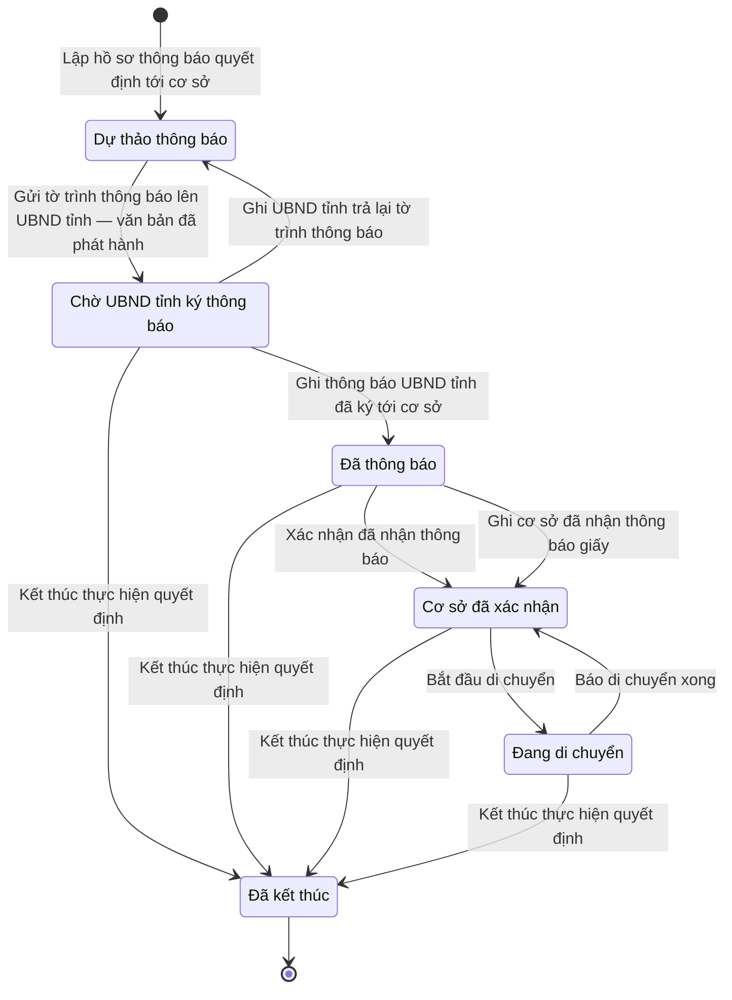

# qt-40 · Thực hành động viên công nghiệp

<!-- máy sinh: tom-tat -->
> **Hồ sơ:** Thực hiện quyết định động viên công nghiệp (`MobilizationExecution`)
>
> **Trong sổ phạm vi:** 40 · Thực hành động viên công nghiệp — mỗi cơ sở một hồ sơ (thật hoặc diễn tập): tỉnh thông báo QĐ Bộ trưởng, cơ sở xác nhận, báo thiếu phương tiện → tỉnh bố trí → di chuyển xong, báo từng lần bàn giao sản phẩm, báo thay đổi, khép theo lô khi có QĐ kết thúc (L38/2024 Đ.55–57; chốt 30/9)
>
> 15 bước · 6 chặng · 4 vai · 2 bảng quyết định · 0 hạn · 7 khớp nối.
>
> **Nguồn:** sổ nghiệp vụ `qt-40` · khai báo của app: `dqtv-app/core/processes/mobilization-execution/workflow/mobilization-execution.yaml`. Các bảng do máy sinh từ nguồn này.
<!-- hết: tom-tat -->

<!-- viết tay: dien-giai -->
## Diễn giải

*Phần này viết tay, diễn giải lại điều các bảng bên dưới ghi.*

### Quy trình này để làm gì

Mỗi cơ sở một hồ sơ thực hành động viên công nghiệp, là thật hoặc diễn tập. Tỉnh thông báo quyết định của Bộ trưởng cho cơ sở, cơ sở xác nhận; cơ sở báo thiếu phương tiện thì tỉnh bố trí, di chuyển xong thì báo; cơ sở báo từng lần bàn giao sản phẩm, báo thay đổi; tỉnh khép khi có quyết định kết thúc.

Hai vai: `province` (tỉnh) và `facility` (cơ sở). Bốn chặng: `NOTIFIED` → `CONFIRMED` ⇄ `RELOCATING` → `CLOSED`.

### Khi nào bắt đầu

Vai `province` làm bước `notifyFacilityOfMobilization`. Bước này mở hồ sơ vào chặng `NOTIFIED` và ghi: đơn vị chủ hồ sơ, đơn vị cơ sở, mối nối tới cơ sở, tới dây chuyền và tới quyết định của Bộ trưởng trong văn bản đến (đọc theo mã `ministerDecisionIncoming`), loại thực hành (`exerciseKind`: thật hay diễn tập), chỉ tiêu sản phẩm (`productTargets`), có phải di chuyển không (`relocationRequired`), và thời điểm thông báo. Bước này không đòi gì trước.

### Diễn ra thế nào

**Chặng `NOTIFIED`** — chờ cơ sở xác nhận. Có hai đường sang `CONFIRMED`:

- `confirmMobilizationNotice` (vai `facility`) — cơ sở xác nhận trên hệ; bước ghi thời điểm xác nhận (`confirmedAt`).
- `recordPaperNoticeReceipt` (vai `province`) — tỉnh ghi thay: bản chụp giấy biên nhận (`paperReceiptScan`) và ngày giao giấy (`paperDeliveredAt`).

**Chặng `CONFIRMED`** — vai `facility` làm được:

- `reportProductHandover` — báo một lần bàn giao sản phẩm; ghi ô nối `handedProduct` và các ô `handedQty`, `receiverUnit`, `handoverMinutesScan`, `handedAt` (cả bốn là ô đưa vào ở bước); hồ sơ đứng yên.
- `reportExecutionChange` — báo thay đổi: bước ghi `changeNote` (ô đưa vào ở bước) và `changeReportedAt` (ô lưu trên hồ sơ); hồ sơ đứng yên. Bước này làm được cả ở chặng `RELOCATING`.
- `reportMissingTransport` — báo thiếu phương tiện (ghi `missingTransportNote`); hồ sơ sang `RELOCATING`.

**Chặng `RELOCATING`**:

- `arrangeRelocation` (vai `province`) — tỉnh bố trí: bước ghi `relocationSite` (ô đưa vào ở bước), ô nối `assignedVehicles` và `arrangedAt` (ô lưu trên hồ sơ); hồ sơ đứng yên.
- `reportRelocationDone` (vai `facility`) — cơ sở báo di chuyển xong: bước ghi `relocatedAt` và `lineRestartedAt` (cả hai là ô đưa vào ở bước); hồ sơ quay về `CONFIRMED`.

**Khép.** `closeMobilizationExecution` (vai `province`) bấm được từ cả ba chặng `NOTIFIED`, `CONFIRMED`, `RELOCATING`; ghi mối nối tới quyết định kết thúc trong văn bản đến (`endDecisionIncoming`) và thời điểm khép; hồ sơ sang `CLOSED`.

### Kết thúc và để lại gì

Hồ sơ kết thúc ở `CLOSED`. Các bước để lại trên hồ sơ sáu ô nối: `facility`, `mobilizationLine`, `ministerDecisionIncoming`, `endDecisionIncoming`, `assignedVehicles`, `handedProduct`.

### Điều kiện chặn

- Bước mở `notifyFacilityOfMobilization` không đòi điều kiện nào.
- Ba bước của `province` sau khi mở (`arrangeRelocation`, `recordPaperNoticeReceipt`, `closeMobilizationExecution`): người làm phải là người của đơn vị ghi ở ô đơn vị chủ hồ sơ.
- Năm bước của `facility` đòi điều kiện `actorInFacility` — người làm là người của đơn vị ghi ở ô `facilityUnit`.
- Cả hai điều kiện xét theo danh mục người của đơn vị (`dm.unit-staff`).
- Sai người, sai chặng thì bước bị chặn, hồ sơ giữ nguyên.
<!-- hết viết tay -->

## 1. Đường đi ngắn nhất qua các chặng

<!-- máy sinh: luong-chinh -->
Đường ít bước nhất từ lúc mở hồ sơ tới chặng kết thúc xa nhất. Máy chọn theo số chặng, không theo ý nghĩa nghiệp vụ — trình tự công việc thật xem phần Diễn giải và bảng "Việc làm ở từng chặng" ở mục 6.

| # | Ai làm | Làm gì | Hồ sơ sang chặng |
|---|---|---|---|
| 1 | Bộ CHQS cấp tỉnh | Lập hồ sơ thông báo quyết định tới cơ sở | Dự thảo thông báo |
| 2 | Hệ thống tự làm | Gửi tờ trình thông báo lên UBND tỉnh — văn bản đã phát hành | Chờ UBND tỉnh ký thông báo |
| 3 | Bộ CHQS cấp tỉnh | Kết thúc thực hiện quyết định | Đã kết thúc |

<!-- hết: luong-chinh -->

## 2. Hồ sơ và việc nó để lại

<!-- máy sinh: muc-tieu -->
**App gọi quy trình này là:** Thực hiện quyết định động viên công nghiệp.

**Khi mở, hồ sơ này ghi mối nối tới:**
- Văn bản đến (1.incoming-document) — bước `notifyFacilityOfMobilization`, khớp nối `ministerDecisionIncoming`
<!-- hết: muc-tieu -->

## 3. Khởi phát và kết thúc

<!-- máy sinh: khoi-phat -->
**1 cửa vào** — bước mở hồ sơ:

| Bước mở | Ai mở | Hồ sơ vào chặng | App bắt buộc nhập |
|---|---|---|---|
| Lập hồ sơ thông báo quyết định tới cơ sở | Bộ CHQS cấp tỉnh | Dự thảo thông báo | đơn vị chủ hồ sơ |

**Kết thúc:** *Đã kết thúc* (`CLOSED`)
<!-- hết: khoi-phat -->

## 4. Vai trò

<!-- máy sinh: vai-tro -->
| Vai trong sổ | Tên trong app | Điều kiện | Làm những bước |
|---|---|---|---|
| `province` | Bộ CHQS cấp tỉnh |  | Lập hồ sơ thông báo quyết định tới cơ sở · Ghi thông báo UBND tỉnh đã ký tới cơ sở · Ghi UBND tỉnh trả lại tờ trình thông báo · Ghi cơ sở đã nhận thông báo giấy · Bố trí di chuyển · Kết thúc thực hiện quyết định · Nối quyết định của Bộ trưởng (văn bản đến) |
| `operator` | Ban Dân quân tự vệ, Bộ CHQS cấp tỉnh |  | Trình ký tờ trình UBND tỉnh ký thông báo quyết định tới cơ sở |
| `system` | Hệ thống tự làm |  | Gửi tờ trình thông báo lên UBND tỉnh — văn bản đã phát hành |
| `facility` | Người của cơ sở động viên công nghiệp |  | Xác nhận đã nhận thông báo · Bắt đầu di chuyển · Báo thiếu phương tiện di chuyển · Báo di chuyển xong · Báo bàn giao sản phẩm · Báo thay đổi khi thực hiện |

*"Tên trong app" là tên app đặt cho mã chủ thể của vai. Hồ sơ thuộc đơn vị cấp khác thì người làm là người giữ vai ấy ở đơn vị nêu trong cột "Điều kiện" (nếu sổ có ghi) và ở cột "Người làm phải thuộc" của bảng "Theo khai báo của app" (mục 7).*
<!-- hết: vai-tro -->

## 5. Nhánh phụ

<!-- máy sinh: nhanh-phu -->
**Bước khác đưa hồ sơ sang chặng mới** — đường song song, rẽ nhánh hoặc kết thúc sớm:

| Bước | Ai làm | Từ chặng | Sang chặng |
|---|---|---|---|
| Ghi thông báo UBND tỉnh đã ký tới cơ sở | Bộ CHQS cấp tỉnh | Chờ UBND tỉnh ký thông báo | Đã thông báo |
| Xác nhận đã nhận thông báo | Người của cơ sở động viên công nghiệp | Đã thông báo | Cơ sở đã xác nhận |
| Ghi cơ sở đã nhận thông báo giấy | Bộ CHQS cấp tỉnh | Đã thông báo | Cơ sở đã xác nhận |
| Bắt đầu di chuyển | Người của cơ sở động viên công nghiệp | Cơ sở đã xác nhận | Đang di chuyển |

**Quay lại một chặng hồ sơ đã đi qua** (tính theo đường ngắn nhất từ lúc mở):

| Bước | Ai làm | Từ chặng | Về chặng |
|---|---|---|---|
| Ghi UBND tỉnh trả lại tờ trình thông báo | Bộ CHQS cấp tỉnh | Chờ UBND tỉnh ký thông báo | Dự thảo thông báo |
| Báo di chuyển xong | Người của cơ sở động viên công nghiệp | Đang di chuyển | Cơ sở đã xác nhận |

**Làm trong lúc hồ sơ đứng yên ở một chặng** — ghi nhận, bổ sung:

| Bước | Ai làm | Ở chặng |
|---|---|---|
| Trình ký tờ trình UBND tỉnh ký thông báo quyết định tới cơ sở | Ban Dân quân tự vệ, Bộ CHQS cấp tỉnh | Dự thảo thông báo |
| Báo thiếu phương tiện di chuyển | Người của cơ sở động viên công nghiệp | Đang di chuyển |
| Bố trí di chuyển | Bộ CHQS cấp tỉnh | Đang di chuyển |
| Báo bàn giao sản phẩm | Người của cơ sở động viên công nghiệp | Cơ sở đã xác nhận |
| Báo thay đổi khi thực hiện | Người của cơ sở động viên công nghiệp | Cơ sở đã xác nhận, Đang di chuyển |
| Nối quyết định của Bộ trưởng (văn bản đến) *(lặp được)* | Bộ CHQS cấp tỉnh | Chờ UBND tỉnh ký thông báo, Đã thông báo, Cơ sở đã xác nhận, Đang di chuyển |

<!-- hết: nhanh-phu -->

## 6. Các chặng và việc làm ở từng chặng

<!-- máy sinh: chang -->
| Chặng | Tên hiển thị | Vào bằng bước | Kết thúc? |
|---|---|---|---|
| `DRAFT` | Dự thảo thông báo | Lập hồ sơ thông báo quyết định tới cơ sở · Ghi UBND tỉnh trả lại tờ trình thông báo |  |
| `AWAITING_COMMITTEE` | Chờ UBND tỉnh ký thông báo | Gửi tờ trình thông báo lên UBND tỉnh — văn bản đã phát hành |  |
| `NOTIFIED` | Đã thông báo | Ghi thông báo UBND tỉnh đã ký tới cơ sở |  |
| `CONFIRMED` | Cơ sở đã xác nhận | Xác nhận đã nhận thông báo · Ghi cơ sở đã nhận thông báo giấy · Báo di chuyển xong |  |
| `RELOCATING` | Đang di chuyển | Bắt đầu di chuyển |  |
| `CLOSED` | Đã kết thúc | Kết thúc thực hiện quyết định | **kết thúc** |

### Việc làm ở từng chặng

Hồ sơ đang ở chặng nào thì làm được những bước nào.

| Hồ sơ đang ở chặng | Bước làm tại chặng (hồ sơ đứng yên) | Bước đưa hồ sơ sang chặng khác |
|---|---|---|
| **Dự thảo thông báo** | Trình ký tờ trình UBND tỉnh ký thông báo quyết định tới cơ sở — Ban Dân quân tự vệ, Bộ CHQS cấp tỉnh | Gửi tờ trình thông báo lên UBND tỉnh — văn bản đã phát hành — Hệ thống tự làm → *Chờ UBND tỉnh ký thông báo* |
| **Chờ UBND tỉnh ký thông báo** | Nối quyết định của Bộ trưởng (văn bản đến) (lặp được) — Bộ CHQS cấp tỉnh | Ghi thông báo UBND tỉnh đã ký tới cơ sở — Bộ CHQS cấp tỉnh → *Đã thông báo* Ghi UBND tỉnh trả lại tờ trình thông báo — Bộ CHQS cấp tỉnh → *Dự thảo thông báo* Kết thúc thực hiện quyết định — Bộ CHQS cấp tỉnh → *Đã kết thúc* |
| **Đã thông báo** | Nối quyết định của Bộ trưởng (văn bản đến) (lặp được) — Bộ CHQS cấp tỉnh | Xác nhận đã nhận thông báo — Người của cơ sở động viên công nghiệp → *Cơ sở đã xác nhận* Ghi cơ sở đã nhận thông báo giấy — Bộ CHQS cấp tỉnh → *Cơ sở đã xác nhận* Kết thúc thực hiện quyết định — Bộ CHQS cấp tỉnh → *Đã kết thúc* |
| **Cơ sở đã xác nhận** | Báo bàn giao sản phẩm — Người của cơ sở động viên công nghiệp Báo thay đổi khi thực hiện — Người của cơ sở động viên công nghiệp Nối quyết định của Bộ trưởng (văn bản đến) (lặp được) — Bộ CHQS cấp tỉnh | Bắt đầu di chuyển — Người của cơ sở động viên công nghiệp → *Đang di chuyển* Kết thúc thực hiện quyết định — Bộ CHQS cấp tỉnh → *Đã kết thúc* |
| **Đang di chuyển** | Báo thiếu phương tiện di chuyển — Người của cơ sở động viên công nghiệp Bố trí di chuyển — Bộ CHQS cấp tỉnh Báo thay đổi khi thực hiện — Người của cơ sở động viên công nghiệp Nối quyết định của Bộ trưởng (văn bản đến) (lặp được) — Bộ CHQS cấp tỉnh | Báo di chuyển xong — Người của cơ sở động viên công nghiệp → *Cơ sở đã xác nhận* Kết thúc thực hiện quyết định — Bộ CHQS cấp tỉnh → *Đã kết thúc* |
| **Đã kết thúc** | — | — (kết thúc) |
<!-- hết: chang -->

## 7. Bảng bước

<!-- máy sinh: buoc -->
| # | Bước | Mã bước | Ai thực hiện | Từ chặng | Sang chặng | Phải có trước | Ghi lại |
|---|---|---|---|---|---|---|---|
| 1 | Lập hồ sơ thông báo quyết định tới cơ sở | `notifyFacilityOfMobilization` | Bộ CHQS cấp tỉnh | — (mở hồ sơ) | `DRAFT` | `facilityInCatalogue`, `facilityManagedByProvince`, `facilityInActorProvince`, `lineActiveOfFacility` | đơn vị chủ hồ sơ, `facilityUnit`, nối `facility`, nối `mobilizationLine`, nối tới Văn bản đến, loại, chỉ tiêu sản phẩm, thay đổi dây chuyền chờ xác nhận lúc thông báo |
| 2 | Trình ký tờ trình UBND tỉnh ký thông báo quyết định tới cơ sở | `requestFacilityNoticeSignature` | Ban Dân quân tự vệ, Bộ CHQS cấp tỉnh | `DRAFT` | giữ nguyên | `noFacilityNoticeDocumentOpen`, người làm thuộc đơn vị chủ hồ sơ | nối tới Văn bản đi |
| 3 | Gửi tờ trình thông báo lên UBND tỉnh — văn bản đã phát hành | `issueFacilityNotice` | Hệ thống tự làm | `DRAFT` | `AWAITING_COMMITTEE` | `facilityNoticeDocumentIssued` | gửi tờ trình lên UBND tỉnh lúc |
| 4 | Ghi thông báo UBND tỉnh đã ký tới cơ sở | `recordCommitteeFacilityNotice` | Bộ CHQS cấp tỉnh | `AWAITING_COMMITTEE` | `NOTIFIED` | người làm thuộc đơn vị chủ hồ sơ, `recordCommitteeFacilityNoticeFromIncomingDocumentUsable` | nối tới Văn bản đến, thông báo lúc |
| 5 | Ghi UBND tỉnh trả lại tờ trình thông báo | `recordCommitteeReturnedFacilityNotice` | Bộ CHQS cấp tỉnh | `AWAITING_COMMITTEE` | `DRAFT` | người làm thuộc đơn vị chủ hồ sơ, `committeeReturnedFacilityNoticeFromIncomingDocumentUsable` | nối tới Văn bản đến, uBND tỉnh trả lại tờ trình lúc |
| 6 | Xác nhận đã nhận thông báo | `confirmMobilizationNotice` | Người của cơ sở động viên công nghiệp | `NOTIFIED` | `CONFIRMED` | `actorInFacility` | `confirmedAt` |
| 7 | Ghi cơ sở đã nhận thông báo giấy | `recordPaperNoticeReceipt` | Bộ CHQS cấp tỉnh | `NOTIFIED` | `CONFIRMED` | người làm thuộc đơn vị chủ hồ sơ | bản quét giấy biên nhận, ngày giao thông báo giấy |
| 8 | Bắt đầu di chuyển | `startRelocation` | Người của cơ sở động viên công nghiệp | `CONFIRMED` | `RELOCATING` | `actorInFacility` | bắt đầu di chuyển lúc |
| 9 | Báo thiếu phương tiện di chuyển | `reportMissingTransport` | Người của cơ sở động viên công nghiệp | `RELOCATING` | giữ nguyên | `actorInFacility` | thiếu phương tiện |
| 10 | Bố trí di chuyển | `arrangeRelocation` | Bộ CHQS cấp tỉnh | `RELOCATING` | giữ nguyên | người làm thuộc đơn vị chủ hồ sơ | `assignedVehicleList`, bố trí lúc, nối `arrangeRelocationFromIncomingDocument` |
| 11 | Báo di chuyển xong | `reportRelocationDone` | Người của cơ sở động viên công nghiệp | `RELOCATING` | `CONFIRMED` | `actorInFacility` | ngày di chuyển xong, ngày dây chuyền chạy lại |
| 12 | Báo bàn giao sản phẩm | `reportProductHandover` | Người của cơ sở động viên công nghiệp | `CONFIRMED` | giữ nguyên | `actorInFacility` | nối `handedProduct`, số lượng bàn giao, đơn vị nhận, bản quét biên bản bàn giao, ngày bàn giao |
| 13 | Báo thay đổi khi thực hiện | `reportExecutionChange` | Người của cơ sở động viên công nghiệp | `CONFIRMED`, `RELOCATING` | giữ nguyên | `actorInFacility` | nội dung thay đổi, báo thay đổi lúc |
| 14 | Kết thúc thực hiện quyết định | `closeMobilizationExecution` | Bộ CHQS cấp tỉnh | `AWAITING_COMMITTEE`, `NOTIFIED`, `CONFIRMED`, `RELOCATING` | `CLOSED` | người làm thuộc đơn vị chủ hồ sơ, `endDecisionIncomingUsable` | nối tới Văn bản đến, kết thúc lúc |
| 15 | Nối quyết định của Bộ trưởng (văn bản đến) | `linkMinisterDecisionDocument` | Bộ CHQS cấp tỉnh | `AWAITING_COMMITTEE`, `NOTIFIED`, `CONFIRMED`, `RELOCATING` | giữ nguyên | người làm thuộc đơn vị chủ hồ sơ, `ministerDecisionIncomingUsable` | nối tới Văn bản đến |

### Khi không đạt điều kiện

Mặc định: không đúng người, hồ sơ không ở đúng chặng, hoặc thiếu thứ "phải có trước" thì bước bị chặn, hồ sơ giữ nguyên. Bảng dưới chỉ kê những bước có kết quả riêng.

| # | Bước | Kết quả riêng |
|---|---|---|
| 1 | Lập hồ sơ thông báo quyết định tới cơ sở | bước dừng lại, hồ sơ giữ nguyên khi kết quả xét là: `relocation_site_missing` |
| 3 | Gửi tờ trình thông báo lên UBND tỉnh — văn bản đã phát hành | bước này không do người nào bấm |
| 8 | Bắt đầu di chuyển | bước dừng lại, hồ sơ giữ nguyên khi kết quả xét là: `relocation_not_required` |

### Điều kiện "phải có trước" bằng lời

Cột "Phải có trước" ở bảng bước có hai loại: ô dữ liệu thường (bước chỉ đòi ô ấy đã có giá trị) và điều kiện hệ tự xét. Bảng này diễn các điều kiện hệ tự xét theo đúng công thức sổ ghi; số ở cột cuối là số thứ tự bước.

| Điều kiện | Đúng khi | Bước đòi |
|---|---|---|
| `facilityInCatalogue` | có hồ sơ Sổ cơ sở động viên công nghiệp (qt-39) chính là hồ sơ ghi ở ô nối `facility` của hồ sơ đang làm mà hồ sơ ấy đang ở chặng `REGISTERED` hoặc `CHANGE_REPORTED` | 1 |
| `facilityManagedByProvince` | có hồ sơ Sổ cơ sở động viên công nghiệp (qt-39) (gọi là r) chính là hồ sơ ghi ở ô nối `facility` của hồ sơ đang làm mà `managingAuthority` của hồ sơ r ấy bằng `province_peoples_committee` | 1 |
| `facilityInActorProvince` | có hồ sơ Sổ cơ sở động viên công nghiệp (qt-39) (gọi là r) chính là hồ sơ ghi ở ô nối `facility` của hồ sơ đang làm mà người đang làm là người của đơn vị ghi ở ô `provinceCommandUnit` của hồ sơ r ấy (theo danh mục người của đơn vị, `dm.unit-staff`) | 1 |
| `lineActiveOfFacility` | có hồ sơ Sổ cơ sở động viên công nghiệp — Dây chuyền động viên công nghiệp (qt-39.mobilization-line) chính là hồ sơ ghi ở ô nối `mobilizationLine` của hồ sơ đang làm mà hồ sơ ấy đang ở chặng `ACTIVE` hoặc `LINE_CHANGE_REPORTED` VÀ nối `lineOfFacility` của hồ sơ đang xét bằng nối `facility` của hồ sơ này | 1 |
| `noFacilityNoticeDocumentOpen` | KHÔNG (có hồ sơ Việc luật giao kèm văn bản đến, đi — Văn bản đi (qt-1.outgoing-document) chính là hồ sơ ghi ở ô nối `facilityNoticeByDocument` của hồ sơ đang làm mà hồ sơ ấy đang ở chặng `DRAFT` hoặc `PENDING_SIGNATURE` hoặc `SIGNED`) | 2 |
| `actorInOwnerUnit` | người đang làm là người của đơn vị ghi ở ô đơn vị chủ hồ sơ của hồ sơ này (theo danh mục người của đơn vị, `dm.unit-staff`) | 2, 4, 5, 7, 10, 14, 15 |
| `facilityNoticeDocumentIssued` | có hồ sơ Việc luật giao kèm văn bản đến, đi — Văn bản đi (qt-1.outgoing-document) chính là hồ sơ ghi ở ô nối `facilityNoticeByDocument` của hồ sơ đang làm mà hồ sơ ấy đang ở chặng `ISSUED` | 3 |
| `recordCommitteeFacilityNoticeFromIncomingDocumentUsable` | có hồ sơ Việc luật giao kèm văn bản đến, đi — Văn bản đến (qt-1.incoming-document) chính là hồ sơ ghi ở ô nối `recordCommitteeFacilityNoticeFromIncomingDocument` của hồ sơ đang làm mà hồ sơ ấy đang ở chặng `RECEIVED` hoặc `DISTRIBUTED` | 4 |
| `committeeReturnedFacilityNoticeFromIncomingDocumentUsable` | có hồ sơ Việc luật giao kèm văn bản đến, đi — Văn bản đến (qt-1.incoming-document) chính là hồ sơ ghi ở ô nối `committeeReturnedFacilityNoticeFromIncomingDocument` của hồ sơ đang làm mà hồ sơ ấy đang ở chặng `RECEIVED` hoặc `DISTRIBUTED` | 5 |
| `actorInFacility` | người đang làm là người của đơn vị ghi ở ô `facilityUnit` của hồ sơ này (theo danh mục người của đơn vị, `dm.unit-staff`) | 6, 8, 9, 11, 12, 13 |
| `endDecisionIncomingUsable` | có hồ sơ Việc luật giao kèm văn bản đến, đi — Văn bản đến (qt-1.incoming-document) chính là hồ sơ ghi ở ô nối `endDecisionIncoming` của hồ sơ đang làm mà hồ sơ ấy đang ở chặng `RECEIVED` hoặc `DISTRIBUTED` | 14 |
| `ministerDecisionIncomingUsable` | có hồ sơ Việc luật giao kèm văn bản đến, đi — Văn bản đến (qt-1.incoming-document) chính là hồ sơ ghi ở ô nối `ministerDecisionIncoming` của hồ sơ đang làm mà hồ sơ ấy đang ở chặng `RECEIVED` hoặc `DISTRIBUTED` | 15 |
| `relocationSiteKnown` | có hồ sơ Sổ cơ sở động viên công nghiệp — Dây chuyền động viên công nghiệp (qt-39.mobilization-line) chính là hồ sơ ghi ở ô nối `mobilizationLine` của hồ sơ đang làm mà đã có địa điểm di chuyển đến | đầu vào bảng quyết định (mục 8) |

### Theo khai báo của app

Người làm phải thuộc đơn vị nào, ô người dùng phải nhập, bước có lặp được không, và căn cứ pháp lý — lấy từ khai báo quy trình trong app.

| # | Bước | Người làm phải thuộc | Bắt buộc nhập | Nhập nếu có | Lặp được | Căn cứ |
|---|---|---|---|---|---|---|
| 1 | Lập hồ sơ thông báo quyết định tới cơ sở |  | đơn vị chủ hồ sơ | chọn cơ sở nhận quyết định, chọn dây chuyền được động viên, quyết định động viên công nghiệp của Bộ trưởng (văn bản đến), loại, chỉ tiêu sản phẩm, thay đổi dây chuyền chờ xác nhận lúc thông báo |  | sổ nghiệp vụ qt-40 · step:notifyFacilityOfMobilization |
| 2 | Trình ký tờ trình UBND tỉnh ký thông báo quyết định tới cơ sở |  | — | tờ trình kèm dự thảo thông báo (PDF) |  | NĐ30/2020/NĐ-CP Đ.13; L38/2024/QH15 Đ.56 |
| 3 | Gửi tờ trình thông báo lên UBND tỉnh — văn bản đã phát hành |  | — | — |  | L38/2024/QH15 Đ.56; NĐ30/2020/NĐ-CP Đ.18 |
| 4 | Ghi thông báo UBND tỉnh đã ký tới cơ sở |  | văn bản đến là thông báo UBND tỉnh đã ký | — |  | L38/2024/QH15 Đ.56; NĐ30/2020/NĐ-CP Đ.21, Đ.22 |
| 5 | Ghi UBND tỉnh trả lại tờ trình thông báo |  | văn bản đến là văn bản UBND tỉnh trả lại tờ trình | — |  | L38/2024/QH15 Đ.56; NĐ30/2020/NĐ-CP Đ.21, Đ.22 |
| 6 | Xác nhận đã nhận thông báo |  | — | — |  | sổ nghiệp vụ qt-40 · step:confirmMobilizationNotice |
| 7 | Ghi cơ sở đã nhận thông báo giấy |  | — | bản quét giấy biên nhận, ngày giao thông báo giấy |  | sổ nghiệp vụ qt-40 · step:recordPaperNoticeReceipt |
| 8 | Bắt đầu di chuyển |  | — | — |  | sổ nghiệp vụ qt-40 · step:startRelocation |
| 9 | Báo thiếu phương tiện di chuyển |  | — | thiếu phương tiện |  | sổ nghiệp vụ qt-40 · step:reportMissingTransport |
| 10 | Bố trí di chuyển |  | — | phương tiện được bố trí |  | sổ nghiệp vụ qt-40 · step:arrangeRelocation |
| 11 | Báo di chuyển xong |  | — | ngày di chuyển xong, ngày dây chuyền chạy lại |  | sổ nghiệp vụ qt-40 · step:reportRelocationDone |
| 12 | Báo bàn giao sản phẩm |  | — | sản phẩm bàn giao, số lượng bàn giao, đơn vị nhận, bản quét biên bản bàn giao, ngày bàn giao |  | sổ nghiệp vụ qt-40 · step:reportProductHandover |
| 13 | Báo thay đổi khi thực hiện |  | — | nội dung thay đổi |  | sổ nghiệp vụ qt-40 · step:reportExecutionChange |
| 14 | Kết thúc thực hiện quyết định |  | văn bản đến là quyết định kết thúc động viên công nghiệp | — |  | sổ nghiệp vụ qt-40 · step:closeMobilizationExecution |
| 15 | Nối quyết định của Bộ trưởng (văn bản đến) |  | văn bản đến là quyết định động viên công nghiệp của Bộ trưởng | — | có | sổ nghiệp vụ qt-40 · step:linkMinisterDecisionDocument; NĐ30/2020/NĐ-CP Đ.21, Đ.22 |

### Điều kiện và ghi chú app khai cho từng bước

Lấy từ khai báo quy trình trong app. Lời trong ngoặc kép là câu app hiện cho người dùng. Chức danh người ký ngoài hệ app chỉ khai bằng mã.

| # | Bước | Điều kiện, ghi chú |
|---|---|---|
| 4 | Ghi thông báo UBND tỉnh đã ký tới cơ sở | · không đòi bản chụp — app ghi: "bản số hoá lấy từ văn bản đến văn thư đã vào sổ (tầng đọc chép `scanPath` của văn bản ấy), không tải ảnh ở bước này" |
| 5 | Ghi UBND tỉnh trả lại tờ trình thông báo | · không đòi bản chụp — app ghi: "bản số hoá lấy từ văn bản đến văn thư đã vào sổ (tầng đọc chép `scanPath` của văn bản ấy), không tải ảnh ở bước này" |
| 14 | Kết thúc thực hiện quyết định | · không đòi bản chụp — app ghi: "bản số hoá lấy từ văn bản đến văn thư đã vào sổ (tầng đọc chép `scanPath` của văn bản ấy), không tải ảnh ở bước này" |
| 15 | Nối quyết định của Bộ trưởng (văn bản đến) | · không đòi bản chụp — app ghi: "bản số hoá lấy từ văn bản đến văn thư đã vào sổ (tầng đọc chép `scanPath` của văn bản ấy), không tải ảnh ở bước này" |
<!-- hết: buoc -->

## 8. Bảng quyết định, hạn, việc ngoài hệ

<!-- máy sinh: quyet-dinh -->
**Bảng `notify-relocation-site-gate`** — xét ở bước *Lập hồ sơ thông báo quyết định tới cơ sở*; đầu vào: thuộc diện di chuyển, `relocationSiteKnown`. 4 dòng, dòng đầu tiên khớp thì dừng.

| Thứ tự dò (số sổ ghi) | Dòng | Khi | Thì |
|---|---|---|---|
| — | `no-relocation` | thuộc diện di chuyển là Không (`no`) | cho qua |
| — | `relocation-unset` | chưa có thuộc diện di chuyển | cho qua |
| — | `site-known` | thuộc diện di chuyển là Có (`yes`) và đã có `relocationSiteKnown` | cho qua |
| — | `site-missing` | thuộc diện di chuyển là Có (`yes`) và chưa có `relocationSiteKnown` | `relocation_site_missing` |

**Bảng `relocation-start-gate`** — xét ở bước *Bắt đầu di chuyển*; đầu vào: thuộc diện di chuyển. 3 dòng, dòng đầu tiên khớp thì dừng.

| Thứ tự dò (số sổ ghi) | Dòng | Khi | Thì |
|---|---|---|---|
| — | `relocation-not-required` | thuộc diện di chuyển là Không (`no`) | `relocation_not_required` |
| — | `relocation-required` | thuộc diện di chuyển là Có (`yes`) | cho qua |
| — | `relocation-unset` | chưa có thuộc diện di chuyển | `relocation_not_required` |

<!-- hết: quyet-dinh -->

## 9. Dữ liệu của hồ sơ

<!-- máy sinh: du-lieu -->
Các ô mà bước trong sổ ghi hoặc đòi. Số trong hai cột cuối là số thứ tự bước ở bảng bước (mục 7).

| Ô dữ liệu | Mã | Kiểu (app) | Giá trị cho phép | Loại ô (sổ) | Bước ghi | Bước đòi | Mô tả trong app |
|---|---|---|---|---|---|---|---|
| đơn vị chủ hồ sơ | `ownerUnit` | chữ |  | lưu trên hồ sơ (`stored`) | 1 | — | Đơn vị chủ hồ sơ — id đơn vị của Bộ CHQS tỉnh đã thông báo |
| — | `facilityUnit` |  |  | lưu trên hồ sơ (`stored`) | 1 | — |  |
| loại | `exerciseKind` | chọn một | Động viên (`real`), Diễn tập (`drill`) | đưa vào ở bước (`input`) | 1 | — | Động viên thật hay diễn tập |
| chỉ tiêu sản phẩm | `productTargets` | chữ |  | đưa vào ở bước (`input`) | 1 | — | Chỉ tiêu sản phẩm |
| thay đổi dây chuyền chờ xác nhận lúc thông báo | `pendingLineChangeKind` | chọn một | Thiết bị hỏng (`equipment_damaged`), Thiết bị mất (`equipment_lost`), Năng lực giảm (`capacity_down`), Khác (`other`) | lưu trên hồ sơ (`stored`) | 1 | — | Thay đổi dây chuyền còn chờ xác nhận lúc thông báo — máy chép từ dây chuyền (qt-39) |
| gửi tờ trình lên UBND tỉnh lúc | `committeeSubmittedAt` | ngày giờ |  | lưu trên hồ sơ (`stored`) | 3 | — | Thời điểm tờ trình thông báo đã phát hành lên UBND tỉnh — chờ UBND tỉnh ký thông báo |
| thông báo lúc | `notifiedAt` | ngày giờ |  | lưu trên hồ sơ (`stored`) | 4 | — | Thời điểm thông báo tới cơ sở |
| uBND tỉnh trả lại tờ trình lúc | `committeeReturnedAt` | ngày giờ |  | lưu trên hồ sơ (`stored`) | 5 | — | Thời điểm ghi văn bản UBND tỉnh trả lại tờ trình thông báo — lần gần nhất |
| — | `confirmedAt` |  |  | lưu trên hồ sơ (`stored`) | 6 | — |  |
| bản quét giấy biên nhận | `paperReceiptScan` | chữ |  | đưa vào ở bước (`input`) | 7 | — | Bản quét giấy biên nhận thông báo |
| ngày giao thông báo giấy | `paperDeliveredAt` | chữ |  | đưa vào ở bước (`input`) | 7 | — | Ngày giao thông báo giấy |
| bắt đầu di chuyển lúc | `relocationStartedAt` | ngày giờ |  | lưu trên hồ sơ (`stored`) | 8 | — | Thời điểm cơ sở bắt đầu di chuyển |
| thiếu phương tiện | `missingTransportNote` | chữ |  | đưa vào ở bước (`input`) | 9 | — | Cơ sở báo thiếu phương tiện di chuyển |
| — | `assignedVehicleList` |  |  | đưa vào ở bước (`input`) | 10 | — |  |
| bố trí lúc | `arrangedAt` | ngày giờ |  | lưu trên hồ sơ (`stored`) | 10 | — | Thời điểm tỉnh bố trí di chuyển |
| ngày di chuyển xong | `relocatedAt` | chữ | có hay chưa | đưa vào ở bước (`input`) | 11 | — | Ngày di chuyển xong |
| ngày dây chuyền chạy lại | `lineRestartedAt` | chữ |  | đưa vào ở bước (`input`) | 11 | — | Ngày dây chuyền chạy lại |
| số lượng bàn giao | `handedQty` | chữ |  | đưa vào ở bước (`input`) | 12 | — | Số lượng bàn giao |
| đơn vị nhận | `receiverUnit` | chữ |  | đưa vào ở bước (`input`) | 12 | — | Đơn vị nhận sản phẩm |
| bản quét biên bản bàn giao | `handoverMinutesScan` | chữ |  | đưa vào ở bước (`input`) | 12 | — | Bản quét biên bản bàn giao |
| ngày bàn giao | `handedAt` | chữ |  | đưa vào ở bước (`input`) | 12 | — | Ngày bàn giao |
| nội dung thay đổi | `changeNote` | chữ |  | đưa vào ở bước (`input`) | 13 | — | Thay đổi trong khi thực hiện |
| báo thay đổi lúc | `changeReportedAt` | ngày giờ |  | lưu trên hồ sơ (`stored`) | 13 | — | Thời điểm cơ sở báo thay đổi |
| kết thúc lúc | `closedAt` | ngày giờ |  | lưu trên hồ sơ (`stored`) | 14 | — | Thời điểm kết thúc hồ sơ |
| — | `facilityInCatalogue` |  | có hay chưa | hệ suy ra (`derived`) | — | 1 |  |
| — | `facilityManagedByProvince` |  | có hay chưa | hệ suy ra (`derived`) | — | 1 |  |
| — | `facilityInActorProvince` |  | có hay chưa | hệ suy ra (`derived`) | — | 1 |  |
| — | `lineActiveOfFacility` |  | có hay chưa | hệ suy ra (`derived`) | — | 1 |  |
| — | `noFacilityNoticeDocumentOpen` |  | có hay chưa | hệ suy ra (`derived`) | — | 2 |  |
| người làm thuộc đơn vị chủ hồ sơ | `actorInOwnerUnit` |  | có hay chưa | hệ suy ra (`derived`) | — | 2, 4, 5, 7, 10, 14, 15 |  |
| — | `facilityNoticeDocumentIssued` |  | có hay chưa | hệ suy ra (`derived`) | — | 3 |  |
| — | `recordCommitteeFacilityNoticeFromIncomingDocumentUsable` |  | có hay chưa | hệ suy ra (`derived`) | — | 4 |  |
| — | `committeeReturnedFacilityNoticeFromIncomingDocumentUsable` |  | có hay chưa | hệ suy ra (`derived`) | — | 5 |  |
| — | `actorInFacility` |  | có hay chưa | hệ suy ra (`derived`) | — | 6, 8, 9, 11, 12, 13 |  |
| — | `endDecisionIncomingUsable` |  | có hay chưa | hệ suy ra (`derived`) | — | 14 |  |
| — | `ministerDecisionIncomingUsable` |  | có hay chưa | hệ suy ra (`derived`) | — | 15 |  |
| thuộc diện di chuyển | `relocationRequired` | chọn một | Có (`yes`), Không (`no`) | hệ suy ra (`derived`) | — | — | Thuộc diện di chuyển — đọc từ dây chuyền (qt-39) |
| — | `relocationSiteKnown` |  | có hay chưa | hệ suy ra (`derived`) | — | — |  |

38 ô. Cột "Loại ô" là cách sổ phân loại ô, in kèm đúng chữ của sổ; ô nào người dùng phải nhập xem bảng "Theo khai báo của app" ở mục 7.
<!-- hết: du-lieu -->

## 10. Khớp nối với quy trình khác

<!-- máy sinh: khop-noi -->
| Quy trình kia | Hồ sơ kia | Quan hệ | Nội dung (mô tả trong app) | Bước ghi mối nối | Tên ô nối |
|---|---|---|---|---|---|
| 1.incoming-document | Văn bản đến | gắn với nhau ở một bước giữa chừng | Văn bản UBND cấp tỉnh trả lại tờ trình thông báo quyết định động viên công nghiệp — văn bản đến đã vào sổ (NĐ… | 40·recordCommitteeReturnedFacilityNotice | `committeeReturnedFacilityNoticeFromIncomingDocument` |
| 1.incoming-document | Văn bản đến | gắn với nhau ở một bước giữa chừng | Quyết định kết thúc động viên công nghiệp — văn bản đến đã vào sổ của Bộ CHQS tỉnh (NĐ30/2020/NĐ-CP Đ.21, Đ.2… | 40·closeMobilizationExecution | `endDecisionIncoming` |
| 1.incoming-document | Văn bản đến | hồ sơ này **mở ra có nối tới** hồ sơ kia | Quyết định động viên công nghiệp của Bộ trưởng Bộ Quốc phòng — văn bản đến đã vào sổ của Bộ CHQS tỉnh (L38/20… | 40·linkMinisterDecisionDocument, 40·notifyFacilityOfMobilization ⊕ | `ministerDecisionIncoming` |
| 1.incoming-document | Văn bản đến | gắn với nhau ở một bước giữa chừng | Thông báo quyết định động viên công nghiệp do UBND cấp tỉnh ký — văn bản đến đã vào sổ (L38/2024/QH15 Đ.56) | 40·recordCommitteeFacilityNotice | `recordCommitteeFacilityNoticeFromIncomingDocument` |
| 1.outgoing-document | Văn bản đi | gắn với nhau ở một bước giữa chừng | Văn bản thông báo quyết định động viên công nghiệp tới cơ sở — văn bản đi của Bộ CHQS tỉnh (L38/2024 Đ.56) | 40·requestFacilityNoticeSignature | `facilityNoticeByDocument` |
| 39 | Cơ sở động viên công nghiệp | có nối | Quyết định động viên công nghiệp này thực hiện tại cơ sở này — sổ nghiệp vụ qt-40 | — | `executionAtFacility` |
| 39.mobilization-line | Dây chuyền động viên công nghiệp | có nối | Quyết định động viên công nghiệp này động viên dây chuyền này — sổ nghiệp vụ qt-40 | — | `executionOfLine` |

7 khớp nối. ⊕ là bước tạo hồ sơ.
<!-- hết: khop-noi -->

## 11. Thông tin chung

<!-- máy sinh: thong-tin -->
| | |
|---|---|
| **Mã trong sổ** | `qt-40` |
| **Quy trình trong app** | `mobilization-execution` (`workflow/mobilization-execution.yaml`) — mặt công tác: `logistics-technical` |
| **Hồ sơ** | Thực hiện quyết định động viên công nghiệp (`MobilizationExecution`) |
| **Căn cứ pháp lý từng bước** | cột "Căn cứ" ở bảng "Theo khai báo của app", mục 7 |
<!-- hết: thong-tin -->
