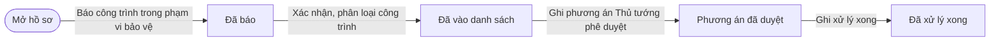
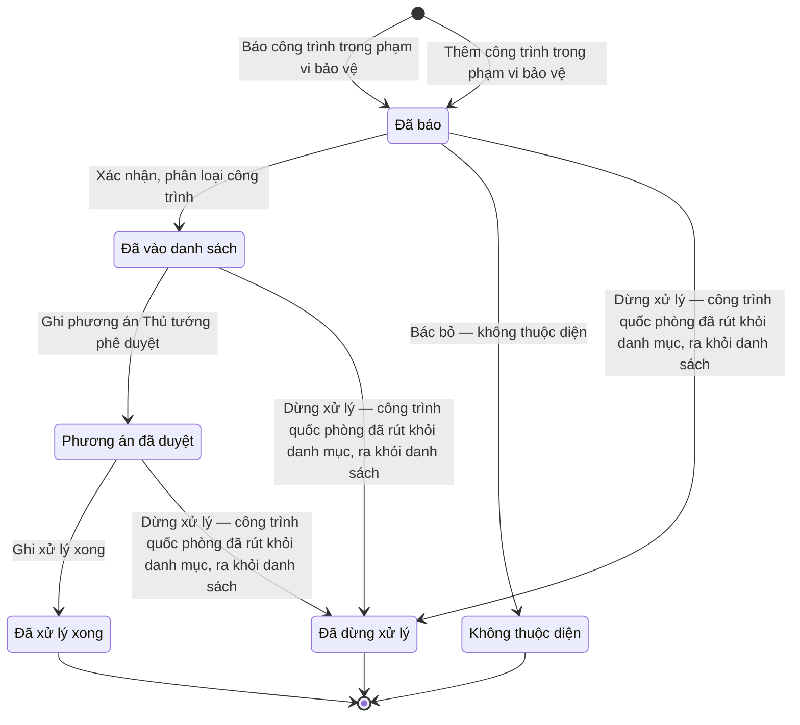

# qt-41 · Xử lý công trình trong phạm vi bảo vệ CTQP, KQS

<!-- máy sinh: tom-tat -->
> **Hồ sơ:** Công trình trong phạm vi bảo vệ (`ZoneStructure`)
>
> **Trong sổ phạm vi:** 41 · Xử lý công trình trong phạm vi bảo vệ CTQP, KQS — mỗi công trình một hồ sơ: xã báo / tỉnh thêm → tỉnh xác nhận + phân loại hợp pháp trước 1/1/2025 hay không → phương án Thủ tướng duyệt (ngoài hệ, ghi số) → bồi thường (UBND tỉnh, ghi số) hoặc xử phạt qt-10 → xong (L25/2023 Đ.19; chốt 30/9)
>
> 9 bước · 6 chặng · 3 vai · 0 bảng quyết định · 0 hạn · 4 khớp nối.
>
> **Nguồn:** sổ nghiệp vụ `qt-41` · khai báo của app: `dqtv-app/core/processes/zone-structure/workflow/zone-structure.yaml`. Các bảng do máy sinh từ nguồn này.
<!-- hết: tom-tat -->

<!-- viết tay: dien-giai -->
## Diễn giải

*Phần này viết tay, diễn giải lại điều các bảng bên dưới ghi.*

### Quy trình này để làm gì

Mỗi công trình nằm trong phạm vi bảo vệ công trình quốc phòng, khu quân sự là một hồ sơ. Xã báo hoặc tỉnh tự thêm; tỉnh xác nhận và phân loại công trình là hợp pháp trước 1/1/2025 hay không; phương án xử lý do Thủ tướng duyệt ngoài hệ, hệ chỉ ghi số; sau đó bồi thường (quyết định của UBND tỉnh, ghi số) hoặc xử phạt theo quy trình 10; rồi xong.

Hai vai: `commune` (chỉ báo) và `province` (làm mọi bước còn lại). Năm chặng: `REPORTED` → `LISTED` → `PLAN_APPROVED` → `HANDLED`, và chặng rẽ `NOT_APPLICABLE`.

### Khi nào bắt đầu

Có hai cửa vào, cùng đưa hồ sơ vào chặng `REPORTED`:

- `reportZoneStructure` — vai `commune` báo một công trình;
- `addZoneStructureByProvince` — vai `province` tự thêm.

Cả hai ghi cùng một bộ ô: nối tới công trình quốc phòng được bảo vệ (`protectedDefenceWork`), loại khu vực (`zoneKind`, năm giá trị), và các ô `structureLocation`, `structureDescription`, `structureOwner`, `structurePhotos`, `reportedAt`; bước còn ghi đơn vị chủ hồ sơ. Bước của `commune` ghi thêm ô `reportingUnit`.

### Diễn ra thế nào

**Chặng `REPORTED`** — vai `province` chọn một trong hai:

- `confirmZoneStructure`: ghi tình trạng pháp lý (`legalStatus`: `lawful_before_2025` hoặc `unlawful`) và `confirmedAt`; hồ sơ sang `LISTED`.
- `rejectZoneStructure`: ghi lý do (`rejectReason`); hồ sơ sang `NOT_APPLICABLE` và kết thúc.

**Chặng `LISTED`** — `recordHandlingPlanApproval`: ghi biện pháp xử lý (`handlingMeasure`: `convert_to_defence_use`, `relocate` hoặc `demolish`) cùng số, ngày và bản chụp quyết định (`pmDecisionNumber`, `pmDecisionDate`, `pmDecisionScan`); hồ sơ sang `PLAN_APPROVED`.

**Chặng `PLAN_APPROVED`** — hai việc làm tại chặng, hồ sơ đứng yên:

- `compensateLawfulStructure`: ghi `compensationDecisionNumber` và `compensationDecisionScan`.
- `openPenaltyForUnlawfulStructure`: nối hồ sơ tới một vụ xử phạt (`penaltyCase`). Bước này làm được ngay từ chặng `LISTED`.

Cuối cùng `recordZoneHandlingDone` ghi `handledAt` và `handlingResultScan`; hồ sơ sang `HANDLED`.

### Kết thúc và để lại gì

Hồ sơ kết thúc ở `HANDLED` hoặc `NOT_APPLICABLE`. Hồ sơ giữ hai mối nối: `protectedDefenceWork` (công trình quốc phòng được bảo vệ, ghi lúc mở hồ sơ) và `penaltyCase` (vụ xử phạt, ghi ở bước mở xử phạt).

### Điều kiện chặn

- Sáu bước sau khi mở đều đòi người làm là người của đơn vị ghi ở ô đơn vị chủ hồ sơ (theo danh mục người của đơn vị, `dm.unit-staff`).
- Sai người, sai chặng thì bước bị chặn, hồ sơ giữ nguyên.
<!-- hết viết tay -->

## 1. Đường đi ngắn nhất qua các chặng

<!-- máy sinh: luong-chinh -->
Đường ít bước nhất từ lúc mở hồ sơ tới chặng kết thúc xa nhất. Máy chọn theo số chặng, không theo ý nghĩa nghiệp vụ — trình tự công việc thật xem phần Diễn giải và bảng "Việc làm ở từng chặng" ở mục 6.

| # | Ai làm | Làm gì | Hồ sơ sang chặng |
|---|---|---|---|
| 1 | Chỉ huy trưởng Ban CHQS xã | Báo công trình trong phạm vi bảo vệ | Đã báo |
| 2 | Bộ CHQS cấp tỉnh | Xác nhận, phân loại công trình | Đã vào danh sách |
| 3 | Bộ CHQS cấp tỉnh | Ghi phương án Thủ tướng phê duyệt | Phương án đã duyệt |
| 4 | Bộ CHQS cấp tỉnh | Ghi xử lý xong | Đã xử lý xong |

<!-- hết: luong-chinh -->

## 2. Hồ sơ và việc nó để lại

<!-- máy sinh: muc-tieu -->
**App gọi quy trình này là:** Xử lý công trình trong phạm vi bảo vệ.

**Khi mở, hồ sơ này ghi mối nối tới:**
- Công trình, đất đai quốc phòng (23) — bước `addZoneStructureByProvince`, khớp nối `protectedDefenceWork`
- Công trình, đất đai quốc phòng (23) — bước `reportZoneStructure`, khớp nối `protectedDefenceWork`
<!-- hết: muc-tieu -->

## 3. Khởi phát và kết thúc

<!-- máy sinh: khoi-phat -->
**2 cửa vào** — bước mở hồ sơ:

| Bước mở | Ai mở | Hồ sơ vào chặng | App bắt buộc nhập |
|---|---|---|---|
| Báo công trình trong phạm vi bảo vệ | Chỉ huy trưởng Ban CHQS xã | Đã báo | công trình quốc phòng, khu quân sự, loại phạm vi bảo vệ, vị trí công trình, mô tả công trình, chủ công trình, ảnh công trình, ngày báo |
| Thêm công trình trong phạm vi bảo vệ | Bộ CHQS cấp tỉnh | Đã báo | công trình quốc phòng, khu quân sự, loại phạm vi bảo vệ, vị trí công trình, mô tả công trình, chủ công trình, ảnh công trình, ngày báo |

**Kết thúc:** *Không thuộc diện* (`NOT_APPLICABLE`), *Đã xử lý xong* (`HANDLED`), *Đã dừng xử lý* (`STOPPED`)
<!-- hết: khoi-phat -->

## 4. Vai trò

<!-- máy sinh: vai-tro -->
| Vai trong sổ | Tên trong app | Điều kiện | Làm những bước |
|---|---|---|---|
| `commune` | Chỉ huy trưởng Ban CHQS xã |  | Báo công trình trong phạm vi bảo vệ |
| `province` | Bộ CHQS cấp tỉnh |  | Thêm công trình trong phạm vi bảo vệ · Xác nhận, phân loại công trình · Bác bỏ — không thuộc diện · Ghi phương án Thủ tướng phê duyệt · Ghi quyết định bồi thường · Ghi kết quả xử lý công trình không hợp pháp · Ghi xử lý xong |
| `system` | Hệ thống tự làm |  | Dừng xử lý — công trình quốc phòng đã rút khỏi danh mục, ra khỏi danh sách |

*"Tên trong app" là tên app đặt cho mã chủ thể của vai. Hồ sơ thuộc đơn vị cấp khác thì người làm là người giữ vai ấy ở đơn vị nêu trong cột "Điều kiện" (nếu sổ có ghi) và ở cột "Người làm phải thuộc" của bảng "Theo khai báo của app" (mục 7).*
<!-- hết: vai-tro -->

## 5. Nhánh phụ

<!-- máy sinh: nhanh-phu -->
**Bước khác đưa hồ sơ sang chặng mới** — đường song song, rẽ nhánh hoặc kết thúc sớm:

| Bước | Ai làm | Từ chặng | Sang chặng |
|---|---|---|---|
| Bác bỏ — không thuộc diện | Bộ CHQS cấp tỉnh | Đã báo | Không thuộc diện |
| Dừng xử lý — công trình quốc phòng đã rút khỏi danh mục, ra khỏi danh sách | Hệ thống tự làm | Đã báo, Đã vào danh sách, Phương án đã duyệt | Đã dừng xử lý |

**Làm trong lúc hồ sơ đứng yên ở một chặng** — ghi nhận, bổ sung:

| Bước | Ai làm | Ở chặng |
|---|---|---|
| Ghi quyết định bồi thường | Bộ CHQS cấp tỉnh | Phương án đã duyệt |
| Ghi kết quả xử lý công trình không hợp pháp | Bộ CHQS cấp tỉnh | Đã vào danh sách, Phương án đã duyệt |

**Cửa vào khác:** 2 bước cùng mở hồ sơ — xem mục 3.

<!-- hết: nhanh-phu -->

## 6. Các chặng và việc làm ở từng chặng

<!-- máy sinh: chang -->
| Chặng | Tên hiển thị | Vào bằng bước | Kết thúc? |
|---|---|---|---|
| `REPORTED` | Đã báo | Báo công trình trong phạm vi bảo vệ · Thêm công trình trong phạm vi bảo vệ |  |
| `LISTED` | Đã vào danh sách | Xác nhận, phân loại công trình |  |
| `NOT_APPLICABLE` | Không thuộc diện | Bác bỏ — không thuộc diện | **kết thúc** |
| `PLAN_APPROVED` | Phương án đã duyệt | Ghi phương án Thủ tướng phê duyệt |  |
| `HANDLED` | Đã xử lý xong | Ghi xử lý xong | **kết thúc** |
| `STOPPED` | Đã dừng xử lý | Dừng xử lý — công trình quốc phòng đã rút khỏi danh mục, ra khỏi danh sách | **kết thúc** |

### Việc làm ở từng chặng

Hồ sơ đang ở chặng nào thì làm được những bước nào.

| Hồ sơ đang ở chặng | Bước làm tại chặng (hồ sơ đứng yên) | Bước đưa hồ sơ sang chặng khác |
|---|---|---|
| **Đã báo** | — | Xác nhận, phân loại công trình — Bộ CHQS cấp tỉnh → *Đã vào danh sách* Bác bỏ — không thuộc diện — Bộ CHQS cấp tỉnh → *Không thuộc diện* Dừng xử lý — công trình quốc phòng đã rút khỏi danh mục, ra khỏi danh sách — Hệ thống tự làm → *Đã dừng xử lý* |
| **Đã vào danh sách** | Ghi kết quả xử lý công trình không hợp pháp — Bộ CHQS cấp tỉnh | Ghi phương án Thủ tướng phê duyệt — Bộ CHQS cấp tỉnh → *Phương án đã duyệt* Dừng xử lý — công trình quốc phòng đã rút khỏi danh mục, ra khỏi danh sách — Hệ thống tự làm → *Đã dừng xử lý* |
| **Không thuộc diện** | — | — (kết thúc) |
| **Phương án đã duyệt** | Ghi quyết định bồi thường — Bộ CHQS cấp tỉnh Ghi kết quả xử lý công trình không hợp pháp — Bộ CHQS cấp tỉnh | Ghi xử lý xong — Bộ CHQS cấp tỉnh → *Đã xử lý xong* Dừng xử lý — công trình quốc phòng đã rút khỏi danh mục, ra khỏi danh sách — Hệ thống tự làm → *Đã dừng xử lý* |
| **Đã xử lý xong** | — | — (kết thúc) |
| **Đã dừng xử lý** | — | — (kết thúc) |
<!-- hết: chang -->

## 7. Bảng bước

<!-- máy sinh: buoc -->
| # | Bước | Mã bước | Ai thực hiện | Từ chặng | Sang chặng | Phải có trước | Ghi lại |
|---|---|---|---|---|---|---|---|
| 1 | Báo công trình trong phạm vi bảo vệ | `reportZoneStructure` | Chỉ huy trưởng Ban CHQS xã | — (mở hồ sơ) | `REPORTED` | `protectedWorkExists`, `reportedAtNotAfterToday` | đơn vị chủ hồ sơ, nối tới Công trình, đất đai quốc phòng, loại phạm vi bảo vệ, vị trí công trình, mô tả công trình, chủ công trình, ảnh công trình, ngày báo, xã báo, `reportedAtInFuture` |
| 2 | Thêm công trình trong phạm vi bảo vệ | `addZoneStructureByProvince` | Bộ CHQS cấp tỉnh | — (mở hồ sơ) | `REPORTED` | `protectedWorkExists`, `reportedAtNotAfterToday` | đơn vị chủ hồ sơ, nối tới Công trình, đất đai quốc phòng, loại phạm vi bảo vệ, vị trí công trình, mô tả công trình, chủ công trình, ảnh công trình, ngày báo, `reportedAtInFuture` |
| 3 | Xác nhận, phân loại công trình | `confirmZoneStructure` | Bộ CHQS cấp tỉnh | `REPORTED` | `LISTED` | người làm thuộc đơn vị chủ hồ sơ, `protectedWorkExists`, `protectedWorkInOwnProvince` | phân loại, `confirmedAt` |
| 4 | Bác bỏ — không thuộc diện | `rejectZoneStructure` | Bộ CHQS cấp tỉnh | `REPORTED` | `NOT_APPLICABLE` | người làm thuộc đơn vị chủ hồ sơ | lý do bác bỏ |
| 5 | Ghi phương án Thủ tướng phê duyệt | `recordHandlingPlanApproval` | Bộ CHQS cấp tỉnh | `LISTED` | `PLAN_APPROVED` | người làm thuộc đơn vị chủ hồ sơ, `protectedWorkExists`, `recordHandlingPlanApprovalFromIncomingDocumentUsable` | biện pháp xử lý, ngày phê duyệt (để trống thì lấy ngày ghi trên văn bản đến), nối tới Văn bản đến |
| 6 | Ghi quyết định bồi thường | `compensateLawfulStructure` | Bộ CHQS cấp tỉnh | `PLAN_APPROVED` | giữ nguyên | người làm thuộc đơn vị chủ hồ sơ, `structureLawful`, `protectedWorkExists`, `compensateLawfulStructureFromIncomingDocumentUsable` | nối tới Văn bản đến |
| 7 | Ghi kết quả xử lý công trình không hợp pháp | `recordUnlawfulStructureHandling` | Bộ CHQS cấp tỉnh | `LISTED`, `PLAN_APPROVED` | giữ nguyên | người làm thuộc đơn vị chủ hồ sơ, `structureUnlawful`, `protectedWorkExists`, `recordUnlawfulStructureHandlingFromIncomingDocumentUsable` | cơ quan ra quyết định xử lý, nối tới Văn bản đến |
| 8 | Ghi xử lý xong | `recordZoneHandlingDone` | Bộ CHQS cấp tỉnh | `PLAN_APPROVED` | `HANDLED` | người làm thuộc đơn vị chủ hồ sơ, `handlingOutcomeRecorded`, `protectedWorkExists` | ngày xử lý xong, kết quả xử lý |
| 9 | Dừng xử lý — công trình quốc phòng đã rút khỏi danh mục, ra khỏi danh sách | `stopOnProtectedWorkWithdrawn` | Hệ thống tự làm | `REPORTED`, `LISTED`, `PLAN_APPROVED` | `STOPPED` | — | ngày dừng xử lý |

### Khi không đạt điều kiện

Mặc định: không đúng người, hồ sơ không ở đúng chặng, hoặc thiếu thứ "phải có trước" thì bước bị chặn, hồ sơ giữ nguyên. Bảng dưới chỉ kê những bước có kết quả riêng.

| # | Bước | Kết quả riêng |
|---|---|---|
| 9 | Dừng xử lý — công trình quốc phòng đã rút khỏi danh mục, ra khỏi danh sách | bước này không do người nào bấm |

### Điều kiện "phải có trước" bằng lời

Cột "Phải có trước" ở bảng bước có hai loại: ô dữ liệu thường (bước chỉ đòi ô ấy đã có giá trị) và điều kiện hệ tự xét. Bảng này diễn các điều kiện hệ tự xét theo đúng công thức sổ ghi; số ở cột cuối là số thứ tự bước.

| Điều kiện | Đúng khi | Bước đòi |
|---|---|---|
| `protectedWorkExists` | có hồ sơ Công trình, đất quốc phòng (qt-23) chính là hồ sơ ghi ở ô nối `protectedDefenceWork` của hồ sơ đang làm mà hồ sơ ấy đang ở chặng `built` hoặc `in_use` hoặc `pending_review` hoặc `review_returned` hoặc `pending_repair` hoặc `under_repair` hoặc `pending_withdrawal` hoặc `external_listed` | 1, 2, 3, 5, 6, 7, 8 |
| `reportedAtNotAfterToday` | KHÔNG (`reportedAtInFuture` là `yes`) | 1, 2 |
| `actorInOwnerUnit` | người đang làm là người của đơn vị ghi ở ô đơn vị chủ hồ sơ của hồ sơ này (theo danh mục người của đơn vị, `dm.unit-staff`) | 3, 4, 5, 6, 7, 8 |
| `protectedWorkInOwnProvince` | có hồ sơ Công trình, đất quốc phòng (qt-23) chính là hồ sơ ghi ở ô nối `protectedDefenceWork` của hồ sơ đang làm mà đơn vị chủ hồ sơ của hồ sơ đang xét bằng đơn vị chủ hồ sơ của hồ sơ này HOẶC đơn vị chủ hồ sơ của hồ sơ này nằm trong cấp trên của chủ hồ sơ của hồ sơ đang xét | 3 |
| `recordHandlingPlanApprovalFromIncomingDocumentUsable` | có hồ sơ Việc luật giao kèm văn bản đến, đi — Văn bản đến (qt-1.incoming-document) chính là hồ sơ ghi ở ô nối `recordHandlingPlanApprovalFromIncomingDocument` của hồ sơ đang làm mà hồ sơ ấy đang ở chặng `RECEIVED` hoặc `DISTRIBUTED` | 5 |
| `structureLawful` | phân loại là Hợp pháp, có trước 1/1/2025 (`lawful_before_2025`) | 6 |
| `compensateLawfulStructureFromIncomingDocumentUsable` | có hồ sơ Việc luật giao kèm văn bản đến, đi — Văn bản đến (qt-1.incoming-document) chính là hồ sơ ghi ở ô nối `compensateLawfulStructureFromIncomingDocument` của hồ sơ đang làm mà hồ sơ ấy đang ở chặng `RECEIVED` hoặc `DISTRIBUTED` | 6 |
| `structureUnlawful` | phân loại là Không hợp pháp (`unlawful`) | 7 |
| `recordUnlawfulStructureHandlingFromIncomingDocumentUsable` | có hồ sơ Việc luật giao kèm văn bản đến, đi — Văn bản đến (qt-1.incoming-document) chính là hồ sơ ghi ở ô nối `recordUnlawfulStructureHandlingFromIncomingDocument` của hồ sơ đang làm mà hồ sơ ấy đang ở chặng `RECEIVED` hoặc `DISTRIBUTED` | 7 |
| `handlingOutcomeRecorded` | (phân loại là Hợp pháp, có trước 1/1/2025 (`lawful_before_2025`) VÀ đã có nối tới Văn bản đến) HOẶC (phân loại là Không hợp pháp (`unlawful`) VÀ đã có nối tới Văn bản đến) | 8 |

### Theo khai báo của app

Người làm phải thuộc đơn vị nào, ô người dùng phải nhập, bước có lặp được không, và căn cứ pháp lý — lấy từ khai báo quy trình trong app.

| # | Bước | Người làm phải thuộc | Bắt buộc nhập | Nhập nếu có | Lặp được | Căn cứ |
|---|---|---|---|---|---|---|
| 1 | Báo công trình trong phạm vi bảo vệ |  | công trình quốc phòng, khu quân sự, loại phạm vi bảo vệ, vị trí công trình, mô tả công trình, chủ công trình, ảnh công trình, ngày báo | — |  | L25/2023/QH15 Đ.19 |
| 2 | Thêm công trình trong phạm vi bảo vệ |  | công trình quốc phòng, khu quân sự, loại phạm vi bảo vệ, vị trí công trình, mô tả công trình, chủ công trình, ảnh công trình, ngày báo | — |  | L25/2023/QH15 Đ.19 |
| 3 | Xác nhận, phân loại công trình | đơn vị chủ hồ sơ | phân loại | — |  | L25/2023/QH15 Đ.19 |
| 4 | Bác bỏ — không thuộc diện | đơn vị chủ hồ sơ | lý do bác bỏ | — |  | L25/2023/QH15 Đ.19 |
| 5 | Ghi phương án Thủ tướng phê duyệt | đơn vị chủ hồ sơ | biện pháp xử lý, văn bản đến là quyết định phê duyệt phương án | ngày phê duyệt (để trống thì lấy ngày ghi trên văn bản đến) |  | L25/2023/QH15 Đ.19 |
| 6 | Ghi quyết định bồi thường | đơn vị chủ hồ sơ | văn bản đến là quyết định bồi thường | — |  | L25/2023/QH15 Đ.19 |
| 7 | Ghi kết quả xử lý công trình không hợp pháp | đơn vị chủ hồ sơ | văn bản đến là quyết định xử lý | — |  | L25/2023/QH15 Đ.19 |
| 8 | Ghi xử lý xong | đơn vị chủ hồ sơ | ngày xử lý xong, kết quả xử lý | — |  | L25/2023/QH15 Đ.19 |
| 9 | Dừng xử lý — công trình quốc phòng đã rút khỏi danh mục, ra khỏi danh sách |  | — | ngày dừng xử lý |  | L25/2023/QH15 Đ.19; sổ qt-41 |

### Điều kiện và ghi chú app khai cho từng bước

Lấy từ khai báo quy trình trong app. Lời trong ngoặc kép là câu app hiện cho người dùng. Chức danh người ký ngoài hệ app chỉ khai bằng mã.

| # | Bước | Điều kiện, ghi chú |
|---|---|---|
| 3 | Xác nhận, phân loại công trình | · không đòi bản chụp — app ghi: "Tỉnh xác nhận trên hệ — chưa có văn bản" |
| 4 | Bác bỏ — không thuộc diện | · không đòi bản chụp — app ghi: "Bác bỏ trên hệ — ghi lý do" |
<!-- hết: buoc -->

## 8. Bảng quyết định, hạn, việc ngoài hệ

<!-- máy sinh: quyet-dinh -->

<!-- hết: quyet-dinh -->

## 9. Dữ liệu của hồ sơ

<!-- máy sinh: du-lieu -->
Các ô mà bước trong sổ ghi hoặc đòi. Số trong hai cột cuối là số thứ tự bước ở bảng bước (mục 7).

| Ô dữ liệu | Mã | Kiểu (app) | Giá trị cho phép | Loại ô (sổ) | Bước ghi | Bước đòi | Mô tả trong app |
|---|---|---|---|---|---|---|---|
| đơn vị chủ hồ sơ | `ownerUnit` | chữ |  | lưu trên hồ sơ (`stored`) | 1, 2 | — | Đơn vị làm chủ — Bộ CHQS tỉnh (id OrgUnit) |
| loại phạm vi bảo vệ | `zoneKind` | chọn một | Vùng cấm (`prohibited_area`), Khu vực bảo vệ công trình nhóm đặc biệt (`special_group_protection_area`), Vành đai an toàn kho đạn dược (`ammunition_depot_safety_belt`), Hành lang an toàn ăng-ten (`antenna_safety_corridor`), Khu vực bảo vệ tính năng kỹ thuật vũ khí (`weapon_performance_protection_area`) | đưa vào ở bước (`input`) | 1, 2 | — | Loại phạm vi bảo vệ |
| vị trí công trình | `structureLocation` | chữ |  | đưa vào ở bước (`input`) | 1, 2 | — | Vị trí công trình |
| mô tả công trình | `structureDescription` | chữ |  | đưa vào ở bước (`input`) | 1, 2 | — | Mô tả công trình |
| chủ công trình | `structureOwner` | chữ |  | đưa vào ở bước (`input`) | 1, 2 | — | Chủ công trình |
| ảnh công trình | `structurePhotos` | tệp |  | đưa vào ở bước (`input`) | 1, 2 | — | Ảnh chụp công trình |
| ngày báo | `reportedAt` | ngày |  | đưa vào ở bước (`input`) | 1, 2 | — | Ngày báo |
| xã báo | `reportingUnit` | chữ |  | lưu trên hồ sơ (`stored`) | 1 | — | Ban CHQS xã đã báo (id OrgUnit) — trống khi tỉnh tự thêm |
| — | `reportedAtInFuture` |  | `yes`, `no` | lưu trên hồ sơ (`stored`) | 1, 2 | — |  |
| phân loại | `legalStatus` | chọn một | Hợp pháp, có trước 1/1/2025 (`lawful_before_2025`), Không hợp pháp (`unlawful`) | đưa vào ở bước (`input`) | 3 | — | Phân loại — hợp pháp trước 1/1/2025 hay không hợp pháp (L25/2023/QH15 Đ.19) |
| — | `confirmedAt` |  |  | lưu trên hồ sơ (`stored`) | 3 | — |  |
| lý do bác bỏ | `rejectReason` | chữ |  | đưa vào ở bước (`input`) | 4 | — | Lý do bác bỏ |
| biện pháp xử lý | `handlingMeasure` | chọn một | Chuyển mục đích sử dụng (`convert_to_defence_use`), Thu hồi đất (`recover_land`), Di dời (`relocate`), Phá dỡ (`demolish`) | đưa vào ở bước (`input`) | 5 | — | Biện pháp xử lý theo phương án |
| ngày phê duyệt phương án | `pmDecisionDate` | ngày |  | đưa vào ở bước (`input`) | 5 | — | Ngày quyết định phê duyệt phương án |
| cơ quan ra quyết định xử lý | `handlingDecisionAgency` | chữ |  | đưa vào ở bước (`input`) | 7 | — | Cơ quan ra quyết định xử lý |
| ngày xử lý xong | `handledAt` | ngày |  | đưa vào ở bước (`input`) | 8 | — | Ngày xử lý xong |
| kết quả xử lý | `handlingResultScan` | tệp |  | đưa vào ở bước (`input`) | 8 | — | Bản chụp biên bản, kết quả xử lý |
| ngày dừng xử lý | `stoppedAt` | ngày |  | lưu trên hồ sơ (`stored`) | 9 | — | Ngày dừng xử lý — công trình quốc phòng được bảo vệ đã rút khỏi danh mục hoặc ra khỏi danh sách |
| — | `protectedWorkExists` |  |  | hệ suy ra (`derived`) | — | 1, 2, 3, 5, 6, 7, 8 |  |
| — | `reportedAtNotAfterToday` |  | có hay chưa | hệ suy ra (`derived`) | — | 1, 2 |  |
| người làm thuộc đơn vị chủ hồ sơ | `actorInOwnerUnit` |  | có hay chưa | hệ suy ra (`derived`) | — | 3, 4, 5, 6, 7, 8 |  |
| — | `protectedWorkInOwnProvince` |  |  | hệ suy ra (`derived`) | — | 3 |  |
| — | `recordHandlingPlanApprovalFromIncomingDocumentUsable` |  | có hay chưa | hệ suy ra (`derived`) | — | 5 |  |
| — | `structureLawful` |  | có hay chưa | hệ suy ra (`derived`) | — | 6 |  |
| — | `compensateLawfulStructureFromIncomingDocumentUsable` |  | có hay chưa | hệ suy ra (`derived`) | — | 6 |  |
| — | `structureUnlawful` |  | có hay chưa | hệ suy ra (`derived`) | — | 7 |  |
| — | `recordUnlawfulStructureHandlingFromIncomingDocumentUsable` |  | có hay chưa | hệ suy ra (`derived`) | — | 7 |  |
| — | `handlingOutcomeRecorded` |  | có hay chưa | hệ suy ra (`derived`) | — | 8 |  |

28 ô. Cột "Loại ô" là cách sổ phân loại ô, in kèm đúng chữ của sổ; ô nào người dùng phải nhập xem bảng "Theo khai báo của app" ở mục 7.
<!-- hết: du-lieu -->

## 10. Khớp nối với quy trình khác

<!-- máy sinh: khop-noi -->
| Quy trình kia | Hồ sơ kia | Quan hệ | Nội dung (mô tả trong app) | Bước ghi mối nối | Tên ô nối |
|---|---|---|---|---|---|
| 1.incoming-document | Văn bản đến | gắn với nhau ở một bước giữa chừng | Văn bản đến là quyết định bồi thường công trình hợp pháp của UBND tỉnh — sổ qt-41 (L25/2023/QH15 Đ.19) | 41·compensateLawfulStructure | `compensateLawfulStructureFromIncomingDocument` |
| 1.incoming-document | Văn bản đến | gắn với nhau ở một bước giữa chừng | Văn bản đến là quyết định của Thủ tướng phê duyệt phương án xử lý công trình — sổ qt-41 (L25/2023/QH15 Đ.19) | 41·recordHandlingPlanApproval | `recordHandlingPlanApprovalFromIncomingDocument` |
| 1.incoming-document | Văn bản đến | gắn với nhau ở một bước giữa chừng | Văn bản đến là quyết định xử lý công trình không hợp pháp (xử phạt, cưỡng chế phá dỡ) của cơ quan có thẩm quy… | 41·recordUnlawfulStructureHandling | `recordUnlawfulStructureHandlingFromIncomingDocument` |
| 23 | Công trình, đất đai quốc phòng | hồ sơ này **mở ra có nối tới** hồ sơ kia | Công trình quốc phòng, khu quân sự có phạm vi bảo vệ mà công trình này nằm trong — sổ qt-41 (L25/2023/QH15 Đ.… | 41·addZoneStructureByProvince ⊕, 41·reportZoneStructure ⊕ | `protectedDefenceWork` |

4 khớp nối. ⊕ là bước tạo hồ sơ.
<!-- hết: khop-noi -->

## 11. Thông tin chung

<!-- máy sinh: thong-tin -->
| | |
|---|---|
| **Mã trong sổ** | `qt-41` |
| **Quy trình trong app** | `zone-structure` (`workflow/zone-structure.yaml`) — mặt công tác: `operations` |
| **Hồ sơ** | Công trình trong phạm vi bảo vệ (`ZoneStructure`) |
| **Căn cứ pháp lý từng bước** | cột "Căn cứ" ở bảng "Theo khai báo của app", mục 7 |
<!-- hết: thong-tin -->
