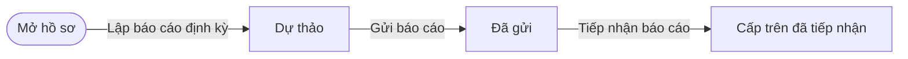
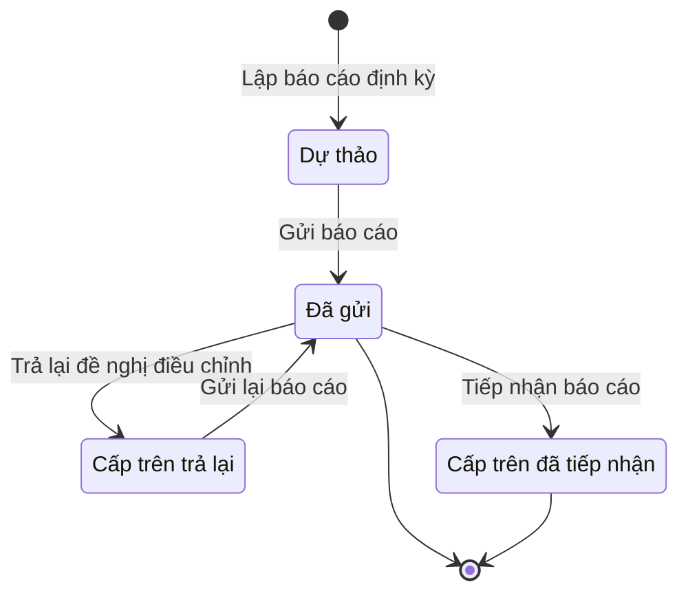

# qt-5 · Báo cáo định kỳ

<!-- máy sinh: tom-tat -->
> **Hồ sơ:** Báo cáo định kỳ, đột xuất (`PeriodicReport`)
>
> **Trong sổ phạm vi:** 5 · Báo cáo định kỳ (tầng 1)
>
> 13 bước · 4 chặng · 3 vai · 1 bảng quyết định · 0 hạn · 6 khớp nối.
>
> **Nguồn:** sổ nghiệp vụ `qt-5` · khai báo của app: `dqtv-app/core/processes/periodic-report/workflow/periodic-report.yaml`. Các bảng do máy sinh từ nguồn này.
<!-- hết: tom-tat -->

<!-- viết tay: dien-giai -->
## Diễn giải

*Phần này viết tay, diễn giải lại điều các bảng bên dưới ghi.*

### Quy trình này để làm gì

Đơn vị lập **báo cáo định kỳ** của một kỳ, chỉ huy duyệt dự thảo, gửi lên cấp trên; cấp trên tiếp nhận, góp ý hoặc trả lại. Người làm: Trợ lý Tác huấn, Chỉ huy trưởng Ban CHQS xã — là người giữ vai ấy ở đơn vị chủ hồ sơ. Ba bước của cấp trên do vai `superior_operator` (Ban Dân quân tự vệ, Bộ CHQS cấp tỉnh) làm, người làm phải thuộc cấp trên của chủ hồ sơ.

Hồ sơ có năm chặng: *Dự thảo* → *Đã duyệt dự thảo* → *Đã gửi* → *Cấp trên đã tiếp nhận*; chặng rẽ là *Cấp trên trả lại* (cấp trên trả lại thì hồ sơ sang chặng này, gửi lại thì về *Đã gửi*).

### Khi nào bắt đầu

Trợ lý Tác huấn bấm **Lập báo cáo định kỳ**. Phải nhập kỳ, kỳ báo cáo, từ ngày, đến ngày; `missionTaskingIds`, `administrativeUnitIds` và hạn nộp là ô nhập nếu có. Hồ sơ mở ra có nối tới *Nhiệm vụ trên giao* (quy trình 1) và tới Đơn vị hành chính. Quân số, số đợt huấn luyện, số vũ khí – trang bị do hệ tự rút, chỉ đọc.

### Diễn ra thế nào

**Chặng "Dự thảo"** — trợ lý soạn, chờ chỉ huy duyệt:

- **Ghi chỉ tiêu báo cáo** (Trợ lý Tác huấn): ghi các dòng chỉ tiêu của báo cáo (hồ sơ con Dòng chỉ tiêu báo cáo). Đây là việc còn nợ cho tới khi có ô "chốt chỉ tiêu lúc".
- **Tổng hợp báo cáo cấp dưới** (lặp được): hệ điền số đơn vị đã báo cáo trên số phải báo cáo, và danh sách đơn vị chưa nộp. Cấp trên vẫn tổng hợp và gửi đúng hạn của mình dù còn cấp dưới chưa nộp; không chặn.
- **Nhắc đơn vị chưa nộp** (lặp được): nút nhắc trong hệ tới trợ lý cấp dưới. Công văn đôn đốc chính thức thì đi đường văn bản đi của quy trình 1.
- Chỉ huy trưởng **Duyệt dự thảo báo cáo** — hồ sơ sang *Đã duyệt dự thảo*; hoặc **Trả lại dự thảo báo cáo** (ghi lý do) — hồ sơ vẫn ở *Dự thảo*.

**Chặng "Đã duyệt dự thảo"** — chờ Uỷ ban nhân dân ký, cấp số rồi gửi cấp trên. Trợ lý Tác huấn **Gửi báo cáo**: bắt nhập số hiệu báo cáo, người ký, ngày ký và bản báo cáo đã ký. Số hiệu do văn thư Uỷ ban nhân dân xã cấp, hệ chỉ ghi lại, không sinh. Hồ sơ sang *Đã gửi*.

**Chặng "Đã gửi".** Trợ lý bên gửi còn **Bổ sung phụ lục, ghi chú** (không sửa số liệu chính). Cấp trên có ba việc:

- **Tiếp nhận báo cáo** — hồ sơ sang *Cấp trên đã tiếp nhận*.
- **Góp ý báo cáo** (lặp được) — ghi ý kiến, báo cáo giữ nguyên.
- **Trả lại đề nghị điều chỉnh** — bắt ghi lý do và hạn nộp lại; bước này xoá bốn ô số hiệu báo cáo, người ký, ngày ký, bản báo cáo đã ký; hồ sơ sang *Cấp trên trả lại*.

**Chặng "Cấp trên trả lại".** Trợ lý sửa lại chỉ tiêu bằng bước ghi chỉ tiêu, rồi **Gửi lại báo cáo** kèm số hiệu, người ký, ngày ký, bản ký mới; hồ sơ về *Đã gửi*. Sửa xong thì trình Uỷ ban nhân dân ký lại; Chỉ huy trưởng không bấm ở vòng này.

### Kết thúc và để lại gì

Hồ sơ xong ở một trong hai chặng: *Đã gửi* và *Cấp trên đã tiếp nhận*. Báo cáo nối tới Nhiệm vụ trên giao mà nó nói về, ghi ở bước lập báo cáo; ô số trong báo cáo nối tới dòng Chỉ tiêu của quy trình 2 mà nó báo cho.

### Điều kiện chặn

- Tám bước của bên gửi sau bước mở đòi người làm thuộc đơn vị chủ hồ sơ. Ba bước của cấp trên đòi người làm là người của một đơn vị nằm trong ô cấp trên của chủ hồ sơ. Không đúng người, sai chặng, thiếu thứ phải có trước thì chặn, hồ sơ giữ nguyên; không bước nào có kết quả chặn riêng.
- Gửi và gửi lại đều đòi đủ bốn thứ: số hiệu, người ký, ngày ký, bản đã ký. Bổ sung phụ lục đòi ô phụ lục, ghi chú bổ sung; góp ý đòi ý kiến cấp trên; trả lại dự thảo bắt ghi lý do từ chối.
- Bảng `commune-defence-report-cadence` (xét ở bước lập báo cáo, theo kỳ báo cáo) cho ra kết quả: kỳ tháng → `due-before-15th-cutoff-15-to-14`; kỳ 6 tháng → `due-before-20-june-merged-with-june`; kỳ năm → `due-before-20-november-merged-with-november`.
- Hạn nộp là một ô của hồ sơ. Uỷ ban nhân dân ký báo cáo ngoài hệ; hệ ghi kết quả ở bước gửi.
<!-- hết viết tay -->

## 1. Đường đi ngắn nhất qua các chặng

<!-- máy sinh: luong-chinh -->
Đường ít bước nhất từ lúc mở hồ sơ tới chặng kết thúc xa nhất. Máy chọn theo số chặng, không theo ý nghĩa nghiệp vụ — trình tự công việc thật xem phần Diễn giải và bảng "Việc làm ở từng chặng" ở mục 6.

| # | Ai làm | Làm gì | Hồ sơ sang chặng |
|---|---|---|---|
| 1 | Trợ lý Tác huấn | Lập báo cáo định kỳ | Dự thảo |
| 2 | Hệ thống tự làm | Gửi báo cáo | Đã gửi |
| 3 | Ban Dân quân tự vệ, Bộ CHQS cấp tỉnh (thuộc cấp trên của chủ hồ sơ) | Tiếp nhận báo cáo | Cấp trên đã tiếp nhận |

<!-- hết: luong-chinh -->

## 2. Hồ sơ và việc nó để lại

<!-- máy sinh: muc-tieu -->
**App gọi quy trình này là:** Báo cáo định kỳ.

**Khi mở, hồ sơ này ghi mối nối tới:**
- Nhiệm vụ trên giao (1) — bước `prepareRoutineReport`, khớp nối `covers`
<!-- hết: muc-tieu -->

## 3. Khởi phát và kết thúc

<!-- máy sinh: khoi-phat -->
**1 cửa vào** — bước mở hồ sơ:

| Bước mở | Ai mở | Hồ sơ vào chặng | App bắt buộc nhập |
|---|---|---|---|
| Lập báo cáo định kỳ | Trợ lý Tác huấn | Dự thảo | kỳ, kỳ báo cáo, từ ngày, đến ngày, `missionTaskingIds` |

**Kết thúc:** *Đã gửi* (`SENT`), *Cấp trên đã tiếp nhận* (`ACCEPTED`)
<!-- hết: khoi-phat -->

## 4. Vai trò

<!-- máy sinh: vai-tro -->
| Vai trong sổ | Tên trong app | Điều kiện | Làm những bước |
|---|---|---|---|
| `operator` | Trợ lý Tác huấn |  | Lập báo cáo định kỳ · Ghi chỉ tiêu báo cáo · Tổng hợp báo cáo cấp dưới · Nhắc đơn vị chưa nộp · Trình ký văn bản báo cáo định kỳ · Bổ sung phụ lục, ghi chú |
| `system` | Hệ thống tự làm |  | Đánh dấu báo cáo quá hạn nộp · Gửi báo cáo · Trả lại đề nghị điều chỉnh · Gửi lại báo cáo |
| `superior_operator` | Ban Dân quân tự vệ, Bộ CHQS cấp tỉnh | thuộc cấp trên của chủ hồ sơ (`actorInSuperiorUnit`, công thức ở mục 7) | Tiếp nhận báo cáo · Góp ý báo cáo · Trình ký văn bản trả lại báo cáo |

*"Tên trong app" là tên app đặt cho mã chủ thể của vai. Hồ sơ thuộc đơn vị cấp khác thì người làm là người giữ vai ấy ở đơn vị nêu trong cột "Điều kiện" (nếu sổ có ghi) và ở cột "Người làm phải thuộc" của bảng "Theo khai báo của app" (mục 7).*
<!-- hết: vai-tro -->

## 5. Nhánh phụ

<!-- máy sinh: nhanh-phu -->
**Bước khác đưa hồ sơ sang chặng mới** — đường song song, rẽ nhánh hoặc kết thúc sớm:

| Bước | Ai làm | Từ chặng | Sang chặng |
|---|---|---|---|
| Trả lại đề nghị điều chỉnh | Hệ thống tự làm | Đã gửi | Cấp trên trả lại |

**Quay lại một chặng hồ sơ đã đi qua** (tính theo đường ngắn nhất từ lúc mở):

| Bước | Ai làm | Từ chặng | Về chặng |
|---|---|---|---|
| Gửi lại báo cáo | Hệ thống tự làm | Cấp trên trả lại | Đã gửi |

**Làm trong lúc hồ sơ đứng yên ở một chặng** — ghi nhận, bổ sung:

| Bước | Ai làm | Ở chặng |
|---|---|---|
| Ghi chỉ tiêu báo cáo | Trợ lý Tác huấn | Dự thảo, Cấp trên trả lại |
| Tổng hợp báo cáo cấp dưới *(lặp được)* | Trợ lý Tác huấn | Dự thảo |
| Nhắc đơn vị chưa nộp *(lặp được)* | Trợ lý Tác huấn | Dự thảo |
| Đánh dấu báo cáo quá hạn nộp | Hệ thống tự làm | Dự thảo |
| Trình ký văn bản báo cáo định kỳ | Trợ lý Tác huấn | Dự thảo, Cấp trên trả lại |
| Bổ sung phụ lục, ghi chú | Trợ lý Tác huấn | Đã gửi |
| Góp ý báo cáo *(lặp được)* | Ban Dân quân tự vệ, Bộ CHQS cấp tỉnh (thuộc cấp trên của chủ hồ sơ) | Đã gửi |
| Trình ký văn bản trả lại báo cáo | Ban Dân quân tự vệ, Bộ CHQS cấp tỉnh (thuộc cấp trên của chủ hồ sơ) | Đã gửi |

<!-- hết: nhanh-phu -->

## 6. Các chặng và việc làm ở từng chặng

<!-- máy sinh: chang -->
| Chặng | Tên hiển thị | Vào bằng bước | Kết thúc? |
|---|---|---|---|
| `DRAFT` | Dự thảo | Lập báo cáo định kỳ |  |
| `SENT` | Đã gửi | Gửi báo cáo · Gửi lại báo cáo | **kết thúc** — vẫn còn bước làm được |
| `RETURNED` | Cấp trên trả lại | Trả lại đề nghị điều chỉnh |  |
| `ACCEPTED` | Cấp trên đã tiếp nhận | Tiếp nhận báo cáo | **kết thúc** |

### Việc làm ở từng chặng

Hồ sơ đang ở chặng nào thì làm được những bước nào.

| Hồ sơ đang ở chặng | Bước làm tại chặng (hồ sơ đứng yên) | Bước đưa hồ sơ sang chặng khác |
|---|---|---|
| **Dự thảo** | Ghi chỉ tiêu báo cáo — Trợ lý Tác huấn Tổng hợp báo cáo cấp dưới (lặp được) — Trợ lý Tác huấn Nhắc đơn vị chưa nộp (lặp được) — Trợ lý Tác huấn Đánh dấu báo cáo quá hạn nộp — Hệ thống tự làm Trình ký văn bản báo cáo định kỳ — Trợ lý Tác huấn | Gửi báo cáo — Hệ thống tự làm → *Đã gửi* |
| **Đã gửi** | Bổ sung phụ lục, ghi chú — Trợ lý Tác huấn Góp ý báo cáo (lặp được) — Ban Dân quân tự vệ, Bộ CHQS cấp tỉnh (thuộc cấp trên của chủ hồ sơ) Trình ký văn bản trả lại báo cáo — Ban Dân quân tự vệ, Bộ CHQS cấp tỉnh (thuộc cấp trên của chủ hồ sơ) | Tiếp nhận báo cáo — Ban Dân quân tự vệ, Bộ CHQS cấp tỉnh (thuộc cấp trên của chủ hồ sơ) → *Cấp trên đã tiếp nhận* Trả lại đề nghị điều chỉnh — Hệ thống tự làm → *Cấp trên trả lại* |
| **Cấp trên trả lại** | Ghi chỉ tiêu báo cáo — Trợ lý Tác huấn Trình ký văn bản báo cáo định kỳ — Trợ lý Tác huấn | Gửi lại báo cáo — Hệ thống tự làm → *Đã gửi* |
| **Cấp trên đã tiếp nhận** | — | — (kết thúc) |
<!-- hết: chang -->

## 7. Bảng bước

<!-- máy sinh: buoc -->
| # | Bước | Mã bước | Ai thực hiện | Từ chặng | Sang chặng | Phải có trước | Ghi lại |
|---|---|---|---|---|---|---|---|
| 1 | Lập báo cáo định kỳ | `prepareRoutineReport` | Trợ lý Tác huấn | — (mở hồ sơ) | `DRAFT` | `taskingAssigned` | nối tới Nhiệm vụ trên giao, nối tới Đơn vị hành chính, `missionTaskingId`, mã tỉnh, mã xã, loại báo cáo, kỳ báo cáo, kỳ, từ ngày, đến ngày, quân số, số đợt huấn luyện, số vũ khí, trang bị, lập lúc, đơn vị chủ hồ sơ, cấp trên của chủ hồ sơ |
| 2 | Ghi chỉ tiêu báo cáo | `recordReportFigures` | Trợ lý Tác huấn | `DRAFT`, `RETURNED` | giữ nguyên | người làm thuộc đơn vị chủ hồ sơ | nối tới Dòng chỉ tiêu báo cáo, nối `figureUnderTarget` (Dòng chỉ tiêu báo cáo → Chỉ tiêu) |
| 3 | Tổng hợp báo cáo cấp dưới | `consolidateSubordinateReports` | Trợ lý Tác huấn | `DRAFT` | giữ nguyên | người làm thuộc đơn vị chủ hồ sơ | đơn vị đã báo cáo, đơn vị phải báo cáo, đơn vị chưa nộp |
| 4 | Nhắc đơn vị chưa nộp | `remindMissingSubordinates` | Trợ lý Tác huấn | `DRAFT` | giữ nguyên | người làm thuộc đơn vị chủ hồ sơ | đơn vị đã nhắc, nhắc lúc |
| 5 | Đánh dấu báo cáo quá hạn nộp | `flagReportOverdue` | Hệ thống tự làm | `DRAFT` | giữ nguyên | `deadlineRunningAndNotFlagged` | quá hạn nộp từ |
| 6 | Trình ký văn bản báo cáo định kỳ | `requestRoutineReportSignature` | Trợ lý Tác huấn | `DRAFT`, `RETURNED` | giữ nguyên | người làm thuộc đơn vị chủ hồ sơ, `noRoutineReportDocumentOpen` | nối tới Văn bản đi |
| 7 | Gửi báo cáo | `sendReport` | Hệ thống tự làm | `DRAFT` | `SENT` | `routineReportDocumentIssued` | gửi lúc, nối `submissionDeliveredAs` |
| 8 | Bổ sung phụ lục, ghi chú | `addReportNote` | Trợ lý Tác huấn | `SENT` | giữ nguyên | người làm thuộc đơn vị chủ hồ sơ, phụ lục, ghi chú bổ sung | phụ lục, ghi chú bổ sung |
| 9 | Tiếp nhận báo cáo | `acceptSubordinateReport` | Ban Dân quân tự vệ, Bộ CHQS cấp tỉnh (thuộc cấp trên của chủ hồ sơ) | `SENT` | `ACCEPTED` | người làm thuộc cấp trên của chủ hồ sơ | cấp trên tiếp nhận lúc |
| 10 | Góp ý báo cáo | `commentSubordinateReport` | Ban Dân quân tự vệ, Bộ CHQS cấp tỉnh (thuộc cấp trên của chủ hồ sơ) | `SENT` | giữ nguyên | ý kiến cấp trên, người làm thuộc cấp trên của chủ hồ sơ | ý kiến cấp trên |
| 11 | Trình ký văn bản trả lại báo cáo | `requestReturnRoutineReportSignature` | Ban Dân quân tự vệ, Bộ CHQS cấp tỉnh (thuộc cấp trên của chủ hồ sơ) | `SENT` | giữ nguyên | lý do trả lại — cấp dưới biết sửa gì, hạn nộp lại, người làm thuộc cấp trên của chủ hồ sơ, `submissionDistributedAtReceiver`, `noReturnRoutineReportDocumentOpen` | lý do trả lại — cấp dưới biết sửa gì, hạn nộp lại, nối tới Văn bản đi |
| 12 | Trả lại đề nghị điều chỉnh | `returnSubordinateReport` | Hệ thống tự làm | `SENT` | `RETURNED` | `returnRoutineReportDocumentIssued` | trả lại lúc, nối `returnDeliveredAs` |
| 13 | Gửi lại báo cáo | `resubmitReport` | Hệ thống tự làm | `RETURNED` | `SENT` | `routineReportDocumentIssued` | gửi lại lúc, nối `submissionDeliveredAs` |

### Khi không đạt điều kiện

Mặc định: không đúng người, hồ sơ không ở đúng chặng, hoặc thiếu thứ "phải có trước" thì bước bị chặn, hồ sơ giữ nguyên. Bảng dưới chỉ kê những bước có kết quả riêng.

| # | Bước | Kết quả riêng |
|---|---|---|
| 5 | Đánh dấu báo cáo quá hạn nộp | bước này không do người nào bấm |
| 7 | Gửi báo cáo | bước này không do người nào bấm |
| 12 | Trả lại đề nghị điều chỉnh | bước này không do người nào bấm |
| 13 | Gửi lại báo cáo | bước này không do người nào bấm |

### Điều kiện "phải có trước" bằng lời

Cột "Phải có trước" ở bảng bước có hai loại: ô dữ liệu thường (bước chỉ đòi ô ấy đã có giá trị) và điều kiện hệ tự xét. Bảng này diễn các điều kiện hệ tự xét theo đúng công thức sổ ghi; số ở cột cuối là số thứ tự bước.

| Điều kiện | Đúng khi | Bước đòi |
|---|---|---|
| `taskingAssigned` | có hồ sơ Việc luật giao kèm văn bản đến, đi (qt-1) chính là hồ sơ ghi ở ô nối `covers` của hồ sơ đang làm mà hồ sơ ấy đang ở chặng `ASSIGNED` hoặc `BROKEN_DOWN` VÀ `servesObligation` là `xa.tb.report` hoặc `tinh.tb.report` | 1 |
| `actorInOwnerUnit` | người đang làm là người của đơn vị ghi ở ô đơn vị chủ hồ sơ của hồ sơ này (theo danh mục người của đơn vị, `dm.unit-staff`) | 2, 3, 4, 6, 8 |
| `deadlineRunningAndNotFlagged` | đã có kỳ báo cáo VÀ KHÔNG (đã có gửi lúc) VÀ KHÔNG (đã có quá hạn nộp từ) | 5 |
| `noRoutineReportDocumentOpen` | KHÔNG (có hồ sơ Việc luật giao kèm văn bản đến, đi — Văn bản đi (qt-1.outgoing-document) chính là hồ sơ ghi ở ô nối `routineReportByDocument` của hồ sơ đang làm mà hồ sơ ấy đang ở chặng `DRAFT` hoặc `PENDING_SIGNATURE` hoặc `SIGNED`) | 6 |
| `routineReportDocumentIssued` | có hồ sơ Việc luật giao kèm văn bản đến, đi — Văn bản đi (qt-1.outgoing-document) chính là hồ sơ ghi ở ô nối `routineReportByDocument` của hồ sơ đang làm mà hồ sơ ấy đang ở chặng `ISSUED` | 7, 13 |
| `actorInSuperiorUnit` | người đang làm là người của một đơn vị nằm trong ô cấp trên của chủ hồ sơ của hồ sơ này (theo danh mục người của đơn vị, `dm.unit-staff`) | 9, 10, 11 |
| `submissionDistributedAtReceiver` | có hồ sơ Việc luật giao kèm văn bản đến, đi — Văn bản đến (qt-1.incoming-document) chính là hồ sơ ghi ở ô nối `submissionDeliveredAs` của hồ sơ đang làm mà hồ sơ ấy đang ở chặng `DISTRIBUTED` | 11 |
| `noReturnRoutineReportDocumentOpen` | KHÔNG (có hồ sơ Việc luật giao kèm văn bản đến, đi — Văn bản đi (qt-1.outgoing-document) chính là hồ sơ ghi ở ô nối `returnRoutineReportByDocument` của hồ sơ đang làm mà hồ sơ ấy đang ở chặng `DRAFT` hoặc `PENDING_SIGNATURE` hoặc `SIGNED`) | 11 |
| `returnRoutineReportDocumentIssued` | có hồ sơ Việc luật giao kèm văn bản đến, đi — Văn bản đi (qt-1.outgoing-document) chính là hồ sơ ghi ở ô nối `returnRoutineReportByDocument` của hồ sơ đang làm mà hồ sơ ấy đang ở chặng `ISSUED` | 12 |

### Theo khai báo của app

Người làm phải thuộc đơn vị nào, ô người dùng phải nhập, bước có lặp được không, và căn cứ pháp lý — lấy từ khai báo quy trình trong app.

| # | Bước | Người làm phải thuộc | Bắt buộc nhập | Nhập nếu có | Lặp được | Căn cứ |
|---|---|---|---|---|---|---|
| 1 | Lập báo cáo định kỳ |  | kỳ, kỳ báo cáo, từ ngày, đến ngày, `missionTaskingIds` | `administrativeUnitIds` |  | Luật Dân quân tự vệ 48/2019/QH14 Điều 36; NĐ168/2018/NĐ-CP Đ.15 k1 a (sửa bởi NĐ220/2025 Đ.1 k6) |
| 2 | Ghi chỉ tiêu báo cáo | đơn vị chủ hồ sơ | — | — |  | Luật Dân quân tự vệ 48/2019/QH14 Điều 36 |
| 3 | Tổng hợp báo cáo cấp dưới | đơn vị chủ hồ sơ | — | — | có | NĐ09/2019/NĐ-CP Đ.8 k5 b, Đ.17 k8 |
| 4 | Nhắc đơn vị chưa nộp | đơn vị chủ hồ sơ | — | — | có | NĐ09/2019/NĐ-CP Đ.8 k5 b |
| 5 | Đánh dấu báo cáo quá hạn nộp |  | — | — |  | NĐ168/2018/NĐ-CP Đ.15 k1 a (sửa bởi NĐ220/2025 Đ.1 k6) |
| 6 | Trình ký văn bản báo cáo định kỳ | đơn vị chủ hồ sơ | — | dự thảo văn bản báo cáo (PDF) |  | NĐ168/2018/NĐ-CP Đ.15 k1 a (sửa bởi NĐ220/2025 Đ.1 k6) · NĐ30/2020/NĐ-CP Đ.13 (trình ký) |
| 7 | Gửi báo cáo | đơn vị chủ hồ sơ | — | — |  | Luật Dân quân tự vệ 48/2019/QH14 Điều 36; NĐ168/2018/NĐ-CP Đ.15 k1 a (sửa bởi NĐ220/2025 Đ.1 k6) |
| 8 | Bổ sung phụ lục, ghi chú | đơn vị chủ hồ sơ | phụ lục, ghi chú bổ sung | — |  | BR-10 |
| 9 | Tiếp nhận báo cáo | cấp trên của chủ hồ sơ | — | — |  | NĐ09/2019/NĐ-CP Đ.8 k5 b; NĐ168/2018/NĐ-CP Đ.15 k1 a (sửa bởi NĐ220/2025 Đ.1 k6) |
| 10 | Góp ý báo cáo | cấp trên của chủ hồ sơ | ý kiến cấp trên | — | có | NĐ09/2019/NĐ-CP Đ.8 k5 b |
| 11 | Trình ký văn bản trả lại báo cáo | cấp trên của chủ hồ sơ | lý do trả lại — cấp dưới biết sửa gì, hạn nộp lại | dự thảo văn bản trả lại (PDF) |  | NĐ09/2019/NĐ-CP Đ.8 k5 b · NĐ30/2020/NĐ-CP Đ.13 |
| 12 | Trả lại đề nghị điều chỉnh |  | — | — |  | NĐ09/2019/NĐ-CP Đ.8 k5 b |
| 13 | Gửi lại báo cáo | đơn vị chủ hồ sơ | — | — |  | NĐ09/2019/NĐ-CP Đ.8 k5 b |

### Điều kiện và ghi chú app khai cho từng bước

Lấy từ khai báo quy trình trong app. Lời trong ngoặc kép là câu app hiện cho người dùng. Chức danh người ký ngoài hệ app chỉ khai bằng mã.

| # | Bước | Điều kiện, ghi chú |
|---|---|---|
| 2 | Ghi chỉ tiêu báo cáo | · tạo thêm một hồ sơ con: Dòng chỉ tiêu báo cáo (`ReportFigure`) · là việc còn nợ cho tới khi có ô "chốt chỉ tiêu lúc" |
| 5 | Đánh dấu báo cáo quá hạn nộp | · phải đã có ô "hạn nộp" — thiếu thì app báo: "báo cáo không có hạn nộp nào đang chạy" · không làm được khi đã có ô "gửi lúc" — app báo: "báo cáo đã gửi — không còn hạn nộp nào chạy" · không làm được khi đã có ô "quá hạn nộp từ" — app báo: "báo cáo đã được ghi quá hạn nộp" |
<!-- hết: buoc -->

## 8. Bảng quyết định, hạn, việc ngoài hệ

<!-- máy sinh: quyet-dinh -->
**Bảng `commune-defence-report-cadence`** — xét ở bước *—*; đầu vào: kỳ báo cáo. 3 dòng, dòng đầu tiên khớp thì dừng.

| Thứ tự dò (số sổ ghi) | Dòng | Khi | Thì |
|---|---|---|---|
| — | `annual` | kỳ báo cáo là Năm (`YEAR`) | `due-before-20-november-merged-with-november` |
| — | `monthly` | kỳ báo cáo là Tháng (`MONTH`) | `due-before-15th-cutoff-15-to-14` |
| — | `semiannual` | kỳ báo cáo là 6 tháng (`HALF_YEAR`) | `due-before-20-june-merged-with-june` |

<!-- hết: quyet-dinh -->

## 9. Dữ liệu của hồ sơ

<!-- máy sinh: du-lieu -->
Các ô mà bước trong sổ ghi hoặc đòi. Số trong hai cột cuối là số thứ tự bước ở bảng bước (mục 7).

| Ô dữ liệu | Mã | Kiểu (app) | Giá trị cho phép | Loại ô (sổ) | Bước ghi | Bước đòi | Mô tả trong app |
|---|---|---|---|---|---|---|---|
| — | `missionTaskingId` | chữ |  | đưa vào ở bước (`input`) | 1 | — | id nhiệm vụ báo cáo này nói về — lọc nhanh, quan hệ thật ở covers |
| mã tỉnh | `provinceCode` | chữ |  |  | 1 | — | Mã tỉnh — dùng lọc phạm vi theo hàng; rỗng khi hồ sơ thuộc quân khu hoặc Bộ Quốc phòng |
| mã xã | `communeCode` | chữ |  | lưu trên hồ sơ (`stored`) | 1 | — | Mã xã — rỗng khi báo cáo của cấp tỉnh |
| loại báo cáo | `reportKind` | chọn một | Định kỳ (`PERIODIC`), Đột xuất (`AD_HOC`) |  | 1 | — | PERIODIC báo cáo định kỳ · AD_HOC báo cáo đột xuất — Luật Dân quân tự vệ Điều 36 |
| kỳ báo cáo | `period` | chọn một | Tháng (`MONTH`), Quý (`QUARTER`), 6 tháng (`HALF_YEAR`), Năm (`YEAR`) | lưu trên hồ sơ (`stored`) | 1 | — | Kỳ báo cáo định kỳ — chỉ áp dụng khi reportKind = PERIODIC; không trộn số liệu giữa các kỳ (BR-09) |
| kỳ | `periodKey` | chữ |  | đưa vào ở bước (`input`) | 1 | — | Khoá kỳ báo cáo — 2026-10 (tháng), 2026-H1 (6 tháng), 2026 (năm) |
| từ ngày | `periodStart` | ngày |  | lưu trên hồ sơ (`stored`) | 1 | — | Ngày bắt đầu kỳ số liệu |
| đến ngày | `periodEnd` | ngày |  | lưu trên hồ sơ (`stored`) | 1 | — | Ngày kết thúc kỳ số liệu |
| quân số | `personnelFigure` | số |  | lưu trên hồ sơ (`stored`) | 1 | — | Quân số trong kỳ — hệ thống tự rút từ MilitiaMember, chỉ đọc (FR-14) |
| số đợt huấn luyện | `trainingFigure` | số |  |  | 1 | — | Số đợt huấn luyện trong kỳ — hệ thống tự rút từ TrainingEvent, chỉ đọc (FR-14) |
| số vũ khí, trang bị | `equipmentFigure` | số |  | lưu trên hồ sơ (`stored`) | 1 | — | Số vũ khí, trang bị trong phạm vi quản lý — hệ thống tự rút từ Equipment, chỉ đọc (FR-14) |
| lập lúc | `preparedAt` | ngày giờ |  | lưu trên hồ sơ (`stored`) | 1 | — | Thời điểm lập báo cáo |
| đơn vị chủ hồ sơ | `ownerUnit` |  |  | lưu trên hồ sơ (`stored`) | 1 | — |  |
| cấp trên của chủ hồ sơ | `superiorUnits` |  |  | hệ suy ra (`derived`) | 1 | — |  |
| đơn vị đã báo cáo | `subordinateReportedCount` | số |  | lưu trên hồ sơ (`stored`) | 3 | — | Số đơn vị cấp dưới đã gửi báo cáo kỳ này |
| đơn vị phải báo cáo | `subordinateTotalCount` | số |  | lưu trên hồ sơ (`stored`) | 3 | — | Số đơn vị cấp dưới phải báo cáo kỳ này |
| đơn vị chưa nộp | `missingSubordinates` | bảng |  | lưu trên hồ sơ (`stored`) | 3 | — | Đơn vị cấp dưới chưa gửi báo cáo kỳ này, lúc tổng hợp — danh sách id OrgUnit |
| đơn vị đã nhắc | `remindedUnits` | bảng |  | đưa vào ở bước (`input`) | 4 | — | Đơn vị cấp dưới đã được nhắc lần gần nhất — danh sách id OrgUnit |
| nhắc lúc | `remindedAt` | ngày giờ |  | lưu trên hồ sơ (`stored`) | 4 | — | Thời điểm nhắc cấp dưới gần nhất |
| quá hạn nộp từ | `overdueAt` | ngày |  | lưu trên hồ sơ (`stored`) | 5 | — | Ngày hệ ghi báo cáo chưa gửi đã quá hạn nộp — trống khi chưa quá hạn |
| gửi lúc | `sentAt` | ngày giờ |  | lưu trên hồ sơ (`stored`) | 7 | — | Thời điểm gửi — FR-17 |
| phụ lục, ghi chú bổ sung | `addendumNote` | chữ |  | đưa vào ở bước (`input`) | 8 | 8 | Phụ lục, ghi chú bổ sung sau khi đã gửi — BR-10, không sửa số liệu chính |
| cấp trên tiếp nhận lúc | `acceptedAt` | ngày giờ |  | lưu trên hồ sơ (`stored`) | 9 | — | Thời điểm cấp trên tiếp nhận báo cáo |
| ý kiến cấp trên | `reviewComment` | chữ |  | đưa vào ở bước (`input`) | 10 | 10 | Ý kiến góp ý gần nhất của cấp trên — báo cáo giữ nguyên; các lần trước ở dòng thời gian |
| lý do trả lại | `returnReason` | chữ |  | đưa vào ở bước (`input`) | 11 | 11 | Cấp trên trả lại vì sao — điều chỉnh gì |
| hạn nộp lại | `resubmitDueDate` | ngày |  | đưa vào ở bước (`input`) | 11 | 11 | Hạn nộp lại do cấp trên ghi khi trả lại |
| trả lại lúc | `returnedAt` | ngày giờ |  | lưu trên hồ sơ (`stored`) | 12 | — | Thời điểm cấp trên trả lại |
| gửi lại lúc | `resubmittedAt` | ngày giờ |  | lưu trên hồ sơ (`stored`) | 13 | — | Thời điểm gửi lại sau khi bị trả |
| — | `taskingAssigned` |  | có hay chưa | hệ suy ra (`derived`) | — | 1 |  |
| người làm thuộc đơn vị chủ hồ sơ | `actorInOwnerUnit` |  | có hay chưa | hệ suy ra (`derived`) | — | 2, 3, 4, 6, 8 |  |
| — | `deadlineRunningAndNotFlagged` |  | có hay chưa | hệ suy ra (`derived`) | — | 5 |  |
| — | `noRoutineReportDocumentOpen` |  | có hay chưa | hệ suy ra (`derived`) | — | 6 |  |
| — | `routineReportDocumentIssued` |  | có hay chưa | hệ suy ra (`derived`) | — | 7, 13 |  |
| người làm thuộc cấp trên của chủ hồ sơ | `actorInSuperiorUnit` |  | có hay chưa | hệ suy ra (`derived`) | — | 9, 10, 11 |  |
| — | `submissionDistributedAtReceiver` |  | có hay chưa | hệ suy ra (`derived`) | — | 11 |  |
| — | `noReturnRoutineReportDocumentOpen` |  | có hay chưa | hệ suy ra (`derived`) | — | 11 |  |
| — | `returnRoutineReportDocumentIssued` |  | có hay chưa | hệ suy ra (`derived`) | — | 12 |  |

37 ô. Cột "Loại ô" là cách sổ phân loại ô, in kèm đúng chữ của sổ; ô nào người dùng phải nhập xem bảng "Theo khai báo của app" ở mục 7.
<!-- hết: du-lieu -->

## 10. Khớp nối với quy trình khác

<!-- máy sinh: khop-noi -->
| Quy trình kia | Hồ sơ kia | Quan hệ | Nội dung (mô tả trong app) | Bước ghi mối nối | Tên ô nối |
|---|---|---|---|---|---|
| 1 | Nhiệm vụ trên giao | hồ sơ này **mở ra có nối tới** hồ sơ kia | Báo cáo này nói về những nhiệm vụ nào — NĐ168/2018/NĐ-CP Đ.15 | 5·prepareRoutineReport ⊕ | `covers` |
| 1.incoming-document | Văn bản đến | có nối | Văn bản trả lại báo cáo định kỳ ở sổ văn bản đến của đơn vị lập (NĐ30/2020/NĐ-CP Đ.20–22) | — | `periodicReportReturnDeliveredAs` |
| 1.incoming-document | Văn bản đến | có nối | Văn bản báo cáo định kỳ ở sổ văn bản đến của cấp trên trực tiếp (NĐ30/2020/NĐ-CP Đ.20–22) | — | `periodicReportSubmissionDeliveredAs` |
| 1.outgoing-document | Văn bản đi | gắn với nhau ở một bước giữa chừng | Văn bản cấp trên trả lại báo cáo định kỳ — văn bản đi của cấp trên, Chỉ huy cấp trên ký | 5·requestReturnRoutineReportSignature | `returnRoutineReportByDocument` |
| 1.outgoing-document | Văn bản đi | gắn với nhau ở một bước giữa chừng | Văn bản đi gửi báo cáo định kỳ lên cấp trên — trợ lý trình, Chỉ huy ký, văn thư phát hành | 5·requestRoutineReportSignature | `routineReportByDocument` |
| 2 | Chỉ tiêu | gắn với nhau ở một bước giữa chừng | Ô số trong báo cáo này báo cho dòng chỉ tiêu nào — không có cạnh thì cấp trên không biết con số ấy thuộc về v… | 5·recordReportFigures | `figureUnderTarget` |

6 khớp nối. ⊕ là bước tạo hồ sơ.

**Ô nối giữa các hồ sơ cùng mã quy trình, hoặc tới danh mục nền:** `reportsTo` (Báo cáo định kỳ, đột xuất → Đơn vị hành chính) — bước Lập báo cáo định kỳ.
<!-- hết: khop-noi -->

## 11. Thông tin chung

<!-- máy sinh: thong-tin -->
| | |
|---|---|
| **Mã trong sổ** | `qt-5` |
| **Quy trình trong app** | `periodic-report` (`workflow/periodic-report.yaml`) — mặt công tác: `common` |
| **Hồ sơ** | Báo cáo định kỳ, đột xuất (`PeriodicReport`) |
| **Căn cứ pháp lý từng bước** | cột "Căn cứ" ở bảng "Theo khai báo của app", mục 7 |
<!-- hết: thong-tin -->
