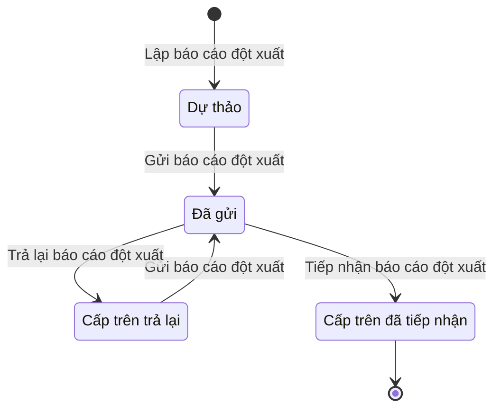

# qt-6 · Báo cáo đột xuất

<!-- máy sinh: tom-tat -->
> **Hồ sơ:** Báo cáo đột xuất (`AdHocReport`)
>
> **Trong sổ phạm vi:** 6 · Báo cáo đột xuất (tầng 1)
>
> 9 bước · 4 chặng · 3 vai · 0 bảng quyết định · 0 hạn · 11 khớp nối.
>
> **Nguồn:** sổ nghiệp vụ `qt-6` · khai báo của app: `dqtv-app/core/processes/superior-report/workflow/ad-hoc-report.yaml`. Các bảng do máy sinh từ nguồn này.
<!-- hết: tom-tat -->

<!-- viết tay: dien-giai -->
## Diễn giải

*Phần này viết tay, diễn giải lại điều các bảng bên dưới ghi.*

### Quy trình này để làm gì

Đơn vị lập một **báo cáo đột xuất** về một việc cụ thể, theo một yêu cầu cụ thể: trợ lý soạn, chỉ huy duyệt dự thảo, gửi lên cấp trên trực tiếp; cấp trên tiếp nhận, góp ý hoặc trả lại. Người làm: Trợ lý Tác huấn, Chỉ huy trưởng Ban CHQS xã — là người giữ vai ấy ở đơn vị chủ hồ sơ. Ba bước của cấp trên do vai `superior_operator` (Ban Dân quân tự vệ, Bộ CHQS cấp tỉnh) làm, người làm phải thuộc cấp trên của chủ hồ sơ.

Hồ sơ có năm chặng: *Dự thảo* → *Đã duyệt dự thảo* → *Đã gửi* → *Cấp trên đã tiếp nhận*; chặng rẽ là *Cấp trên trả lại*.

### Khi nào bắt đầu

Trợ lý Tác huấn bấm **Lập báo cáo đột xuất**. Chỉ bắt nhập "báo cáo về việc" (việc gì, theo yêu cầu nào); hạn trả, văn bản đến yêu cầu báo cáo (`incomingDocumentId`), vụ việc ứng phó (`responseCaseId`) và nhiệm vụ trên giao (`missionTaskingId`) là ô nhập nếu có. Hồ sơ mở ra có nối tới *Văn bản đến* (quy trình 1) mà báo cáo trả lời và tới *Vụ việc ứng phó* (quy trình 20) đã phát sinh báo cáo. Hồ sơ vào chặng *Dự thảo*.

### Diễn ra thế nào

**Chặng "Dự thảo".** Trợ lý Tác huấn **Soạn nội dung báo cáo** (lặp được): nội dung là bắt buộc, số liệu kèm theo nếu có; đây là việc còn nợ cho tới khi có nội dung báo cáo. Chỉ huy trưởng Ban CHQS xã **Duyệt dự thảo báo cáo đột xuất** — đòi đã có nội dung báo cáo — hồ sơ sang *Đã duyệt dự thảo*; hoặc **Trả lại dự thảo báo cáo đột xuất** (ghi vì sao) — hồ sơ vẫn ở *Dự thảo*.

**Chặng "Đã duyệt dự thảo".** Trợ lý Tác huấn **Gửi báo cáo đột xuất**: bắt nhập số hiệu báo cáo, người ký, ngày ký và bản báo cáo đã ký. Số hiệu do văn thư Uỷ ban nhân dân cấp, hệ chỉ ghi lại; người ký là người đứng đầu hoặc cấp phó Uỷ ban nhân dân cùng cấp với đơn vị lập. Hồ sơ sang *Đã gửi*.

**Chặng "Đã gửi"** — cấp trên có ba việc:

- **Tiếp nhận báo cáo đột xuất** — hồ sơ sang *Cấp trên đã tiếp nhận*.
- **Góp ý báo cáo đột xuất** (lặp được) — ghi ý kiến, hồ sơ đứng yên.
- **Trả lại báo cáo đột xuất** — bắt ghi ý kiến cấp trên; bước này xoá bốn ô số hiệu báo cáo, người ký, ngày ký, bản báo cáo đã ký; hồ sơ sang *Cấp trên trả lại*.

**Chặng "Cấp trên trả lại".** Trợ lý sửa bằng bước soạn nội dung, rồi **Nộp lại báo cáo đột xuất** kèm lại đủ số hiệu, người ký, ngày ký, bản đã ký; hồ sơ về *Đã gửi*. Vòng nộp lại không qua bước duyệt dự thảo của Chỉ huy trưởng.

### Kết thúc và để lại gì

Hồ sơ kết thúc ở *Cấp trên đã tiếp nhận*; khi đó người làm bấm xong việc loại báo cáo đột xuất ở quy trình 1 mà báo cáo gắn vào. Ngoài ra hồ sơ nối tới Văn bản đến và Vụ việc ứng phó, ghi lúc mở.

### Điều kiện chặn

- Năm bước của bên lập sau bước mở đòi người làm thuộc đơn vị chủ hồ sơ. Ba bước của cấp trên đòi người làm là người của một đơn vị nằm trong ô cấp trên của chủ hồ sơ.
- Không đúng người, sai chặng, thiếu thứ phải có trước thì chặn, hồ sơ giữ nguyên; không bước nào có kết quả chặn riêng.
- Thứ tự buộc: có nội dung rồi mới duyệt dự thảo; trả lại dự thảo đòi ghi vì sao; góp ý và trả lại báo cáo đòi ý kiến cấp trên; gửi và nộp lại đều đòi đủ số hiệu, người ký, ngày ký, bản đã ký.
- Hạn trả là một ô nhập nếu có.
<!-- hết viết tay -->

## 1. Đường đi ngắn nhất qua các chặng

<!-- máy sinh: luong-chinh -->
Đường ít bước nhất từ lúc mở hồ sơ tới chặng kết thúc xa nhất. Máy chọn theo số chặng, không theo ý nghĩa nghiệp vụ — trình tự công việc thật xem phần Diễn giải và bảng "Việc làm ở từng chặng" ở mục 6.

| # | Ai làm | Làm gì | Hồ sơ sang chặng |
|---|---|---|---|
| 1 | Trợ lý Tác huấn | Lập báo cáo đột xuất | Dự thảo |
| 2 | Hệ thống tự làm | Gửi báo cáo đột xuất | Đã gửi |
| 3 | Ban Dân quân tự vệ, Bộ CHQS cấp tỉnh | Tiếp nhận báo cáo đột xuất | Cấp trên đã tiếp nhận |

<!-- hết: luong-chinh -->

## 2. Hồ sơ và việc nó để lại

<!-- máy sinh: muc-tieu -->
**App gọi quy trình này là:** Báo cáo đột xuất.

**Khi mở, hồ sơ này ghi mối nối tới:**
- Nhiệm vụ trên giao (1) — bước `prepareAdHocReport`, khớp nối `adHocReportForTasking`
- Văn bản đến (1.incoming-document) — bước `prepareAdHocReport`, khớp nối `respondsToIncomingDocument`
- Vụ việc ứng phó (20) — bước `prepareAdHocReport`, khớp nối `raisedFromCase`
<!-- hết: muc-tieu -->

## 3. Khởi phát và kết thúc

<!-- máy sinh: khoi-phat -->
**1 cửa vào** — bước mở hồ sơ:

| Bước mở | Ai mở | Hồ sơ vào chặng | App bắt buộc nhập |
|---|---|---|---|
| Lập báo cáo đột xuất | Trợ lý Tác huấn | Dự thảo | báo cáo về việc |

**Kết thúc:** *Cấp trên đã tiếp nhận* (`ACCEPTED`)
<!-- hết: khoi-phat -->

## 4. Vai trò

<!-- máy sinh: vai-tro -->
| Vai trong sổ | Tên trong app | Điều kiện | Làm những bước |
|---|---|---|---|
| `operator` | Trợ lý Tác huấn |  | Lập báo cáo đột xuất · Soạn nội dung báo cáo · Trình ký văn bản báo cáo đột xuất |
| `system` | Hệ thống tự làm |  | Gửi báo cáo đột xuất · Đánh dấu báo cáo đột xuất quá hạn trả · Trả lại báo cáo đột xuất |
| `superior_operator` | Ban Dân quân tự vệ, Bộ CHQS cấp tỉnh |  | Tiếp nhận báo cáo đột xuất · Góp ý báo cáo đột xuất · Trình ký văn bản trả lại báo cáo đột xuất |

*"Tên trong app" là tên app đặt cho mã chủ thể của vai. Hồ sơ thuộc đơn vị cấp khác thì người làm là người giữ vai ấy ở đơn vị nêu trong cột "Điều kiện" (nếu sổ có ghi) và ở cột "Người làm phải thuộc" của bảng "Theo khai báo của app" (mục 7).*
<!-- hết: vai-tro -->

## 5. Nhánh phụ

<!-- máy sinh: nhanh-phu -->
**Bước khác đưa hồ sơ sang chặng mới** — đường song song, rẽ nhánh hoặc kết thúc sớm:

| Bước | Ai làm | Từ chặng | Sang chặng |
|---|---|---|---|
| Trả lại báo cáo đột xuất | Hệ thống tự làm | Đã gửi | Cấp trên trả lại |

**Làm trong lúc hồ sơ đứng yên ở một chặng** — ghi nhận, bổ sung:

| Bước | Ai làm | Ở chặng |
|---|---|---|
| Soạn nội dung báo cáo *(lặp được)* | Trợ lý Tác huấn | Dự thảo, Cấp trên trả lại |
| Trình ký văn bản báo cáo đột xuất | Trợ lý Tác huấn | Dự thảo, Cấp trên trả lại |
| Đánh dấu báo cáo đột xuất quá hạn trả | Hệ thống tự làm | Dự thảo |
| Góp ý báo cáo đột xuất *(lặp được)* | Ban Dân quân tự vệ, Bộ CHQS cấp tỉnh | Đã gửi |
| Trình ký văn bản trả lại báo cáo đột xuất | Ban Dân quân tự vệ, Bộ CHQS cấp tỉnh | Đã gửi |

<!-- hết: nhanh-phu -->

## 6. Các chặng và việc làm ở từng chặng

<!-- máy sinh: chang -->
| Chặng | Tên hiển thị | Vào bằng bước | Kết thúc? |
|---|---|---|---|
| `DRAFT` | Dự thảo | Lập báo cáo đột xuất |  |
| `SENT` | Đã gửi | Gửi báo cáo đột xuất |  |
| `RETURNED` | Cấp trên trả lại | Trả lại báo cáo đột xuất |  |
| `ACCEPTED` | Cấp trên đã tiếp nhận | Tiếp nhận báo cáo đột xuất | **kết thúc** |

### Việc làm ở từng chặng

Hồ sơ đang ở chặng nào thì làm được những bước nào.

| Hồ sơ đang ở chặng | Bước làm tại chặng (hồ sơ đứng yên) | Bước đưa hồ sơ sang chặng khác |
|---|---|---|
| **Dự thảo** | Soạn nội dung báo cáo (lặp được) — Trợ lý Tác huấn Trình ký văn bản báo cáo đột xuất — Trợ lý Tác huấn Đánh dấu báo cáo đột xuất quá hạn trả — Hệ thống tự làm | Gửi báo cáo đột xuất — Hệ thống tự làm → *Đã gửi* |
| **Đã gửi** | Góp ý báo cáo đột xuất (lặp được) — Ban Dân quân tự vệ, Bộ CHQS cấp tỉnh Trình ký văn bản trả lại báo cáo đột xuất — Ban Dân quân tự vệ, Bộ CHQS cấp tỉnh | Tiếp nhận báo cáo đột xuất — Ban Dân quân tự vệ, Bộ CHQS cấp tỉnh → *Cấp trên đã tiếp nhận* Trả lại báo cáo đột xuất — Hệ thống tự làm → *Cấp trên trả lại* |
| **Cấp trên trả lại** | Soạn nội dung báo cáo (lặp được) — Trợ lý Tác huấn Trình ký văn bản báo cáo đột xuất — Trợ lý Tác huấn | Gửi báo cáo đột xuất — Hệ thống tự làm → *Đã gửi* |
| **Cấp trên đã tiếp nhận** | — | — (kết thúc) |
<!-- hết: chang -->

## 7. Bảng bước

<!-- máy sinh: buoc -->
| # | Bước | Mã bước | Ai thực hiện | Từ chặng | Sang chặng | Phải có trước | Ghi lại |
|---|---|---|---|---|---|---|---|
| 1 | Lập báo cáo đột xuất | `prepareAdHocReport` | Trợ lý Tác huấn | — (mở hồ sơ) | `DRAFT` | `respondsToIncomingDocumentUsable`, `adHocReportTaskingUsable`, `adHocReportHasRoot` | báo cáo về việc, nối tới Văn bản đến, nối tới Vụ việc ứng phó, nối tới Nhiệm vụ trên giao, hạn trả, lập lúc, đơn vị chủ hồ sơ, `receiverUnit`, `chosenReceiverUnit` |
| 2 | Soạn nội dung báo cáo | `recordAdHocReportContent` | Trợ lý Tác huấn | `DRAFT`, `RETURNED` | giữ nguyên | người làm thuộc đơn vị chủ hồ sơ | nội dung báo cáo, số liệu kèm theo |
| 3 | Trình ký văn bản báo cáo đột xuất | `requestAdHocReportSignature` | Trợ lý Tác huấn | `DRAFT`, `RETURNED` | giữ nguyên | người làm thuộc đơn vị chủ hồ sơ, nội dung báo cáo, `noAdHocReportDocumentOpen` | nối tới Văn bản đi |
| 4 | Gửi báo cáo đột xuất | `sendAdHocReport` | Hệ thống tự làm | `DRAFT`, `RETURNED` | `SENT` | `adHocReportDocumentIssued` | gửi lúc, nối `submissionDeliveredAs` |
| 5 | Đánh dấu báo cáo đột xuất quá hạn trả | `flagAdHocReportOverdue` | Hệ thống tự làm | `DRAFT` | giữ nguyên | `deadlineRunningAndNotFlagged` | quá hạn trả từ |
| 6 | Tiếp nhận báo cáo đột xuất | `acceptAdHocReport` | Ban Dân quân tự vệ, Bộ CHQS cấp tỉnh | `SENT` | `ACCEPTED` | `actorInReceiverUnit`, `submissionDistributedAtReceiver` | cấp trên tiếp nhận lúc |
| 7 | Góp ý báo cáo đột xuất | `commentAdHocReport` | Ban Dân quân tự vệ, Bộ CHQS cấp tỉnh | `SENT` | giữ nguyên | `actorInReceiverUnit`, ý kiến cấp trên, `submissionDistributedAtReceiver` | ý kiến cấp trên |
| 8 | Trình ký văn bản trả lại báo cáo đột xuất | `requestReturnAdHocReportSignature` | Ban Dân quân tự vệ, Bộ CHQS cấp tỉnh | `SENT` | giữ nguyên | lý do trả lại — cấp dưới biết sửa gì, `submissionDistributedAtReceiver`, `noReturnAdHocReportDocumentOpen`, `actorInReceiverUnit` | lý do trả lại — cấp dưới biết sửa gì, nối tới Văn bản đi |
| 9 | Trả lại báo cáo đột xuất | `returnAdHocReport` | Hệ thống tự làm | `SENT` | `RETURNED` | `returnAdHocReportDocumentIssued` | cấp trên trả lại lúc, nối `returnDeliveredAs` |

### Khi không đạt điều kiện

Mặc định: không đúng người, hồ sơ không ở đúng chặng, hoặc thiếu thứ "phải có trước" thì bước bị chặn, hồ sơ giữ nguyên. Bảng dưới chỉ kê những bước có kết quả riêng.

| # | Bước | Kết quả riêng |
|---|---|---|
| 4 | Gửi báo cáo đột xuất | bước này không do người nào bấm |
| 5 | Đánh dấu báo cáo đột xuất quá hạn trả | bước này không do người nào bấm |
| 9 | Trả lại báo cáo đột xuất | bước này không do người nào bấm |

### Điều kiện "phải có trước" bằng lời

Cột "Phải có trước" ở bảng bước có hai loại: ô dữ liệu thường (bước chỉ đòi ô ấy đã có giá trị) và điều kiện hệ tự xét. Bảng này diễn các điều kiện hệ tự xét theo đúng công thức sổ ghi; số ở cột cuối là số thứ tự bước.

| Điều kiện | Đúng khi | Bước đòi |
|---|---|---|
| `respondsToIncomingDocumentUsable` | KHÔNG (đã có nối tới Văn bản đến) HOẶC có hồ sơ Việc luật giao kèm văn bản đến, đi — Văn bản đến (qt-1.incoming-document) chính là hồ sơ ghi ở ô nối `respondsToIncomingDocument` của hồ sơ đang làm mà hồ sơ ấy đang ở chặng `RECEIVED` hoặc `DISTRIBUTED` | 1 |
| `adHocReportTaskingUsable` | KHÔNG (đã có nối tới Nhiệm vụ trên giao) HOẶC có hồ sơ Việc luật giao kèm văn bản đến, đi (qt-1) chính là hồ sơ ghi ở ô nối `adHocReportForTasking` của hồ sơ đang làm và có đơn vị chủ hồ sơ trùng với đơn vị chủ hồ sơ của hồ sơ đang làm mà hồ sơ ấy đang ở chặng `ASSIGNED` hoặc `BROKEN_DOWN` hoặc `RECEIVED` VÀ `adHocReport` là `yes` HOẶC có hồ sơ Việc luật giao kèm văn bản đến, đi (qt-1) chính là hồ sơ ghi ở ô nối `adHocReportForTasking` của hồ sơ đang làm và có đơn vị chủ hồ sơ trùng với đơn vị chủ hồ sơ của hồ sơ đang làm và có ô nối `raisesTasking` trùng với ô nối `respondsToIncomingDocument` của hồ sơ đang làm mà hồ sơ ấy đang ở chặng `ASSIGNED` hoặc `BROKEN_DOWN` hoặc `RECEIVED` | 1 |
| `adHocReportHasRoot` | đã có nối tới Nhiệm vụ trên giao HOẶC đã có nối tới Vụ việc ứng phó | 1 |
| `actorInOwnerUnit` | người đang làm là người của đơn vị ghi ở ô đơn vị chủ hồ sơ của hồ sơ này (theo danh mục người của đơn vị, `dm.unit-staff`) | 2, 3 |
| `noAdHocReportDocumentOpen` | KHÔNG (có hồ sơ Việc luật giao kèm văn bản đến, đi — Văn bản đi (qt-1.outgoing-document) chính là hồ sơ ghi ở ô nối `adHocReportByDocument` của hồ sơ đang làm mà hồ sơ ấy đang ở chặng `DRAFT` hoặc `PENDING_SIGNATURE` hoặc `SIGNED`) | 3 |
| `adHocReportDocumentIssued` | có hồ sơ Việc luật giao kèm văn bản đến, đi — Văn bản đi (qt-1.outgoing-document) chính là hồ sơ ghi ở ô nối `adHocReportByDocument` của hồ sơ đang làm mà hồ sơ ấy đang ở chặng `ISSUED` | 4 |
| `deadlineRunningAndNotFlagged` | đã có hạn trả VÀ KHÔNG (đã có gửi lúc) VÀ KHÔNG (đã có quá hạn trả từ) | 5 |
| `actorInReceiverUnit` | người đang làm là người của đơn vị ghi ở ô `receiverUnit` của hồ sơ này HOẶC là người của đơn vị ghi ở ô `chosenReceiverUnit` của hồ sơ này (theo danh mục người của đơn vị, `dm.unit-staff`) | 6, 7, 8 |
| `submissionDistributedAtReceiver` | có hồ sơ Việc luật giao kèm văn bản đến, đi — Văn bản đến (qt-1.incoming-document) chính là hồ sơ ghi ở ô nối `submissionDeliveredAs` của hồ sơ đang làm mà hồ sơ ấy đang ở chặng `DISTRIBUTED` | 6, 7, 8 |
| `noReturnAdHocReportDocumentOpen` | KHÔNG (có hồ sơ Việc luật giao kèm văn bản đến, đi — Văn bản đi (qt-1.outgoing-document) chính là hồ sơ ghi ở ô nối `returnAdHocReportByDocument` của hồ sơ đang làm mà hồ sơ ấy đang ở chặng `DRAFT` hoặc `PENDING_SIGNATURE` hoặc `SIGNED`) | 8 |
| `returnAdHocReportDocumentIssued` | có hồ sơ Việc luật giao kèm văn bản đến, đi — Văn bản đi (qt-1.outgoing-document) chính là hồ sơ ghi ở ô nối `returnAdHocReportByDocument` của hồ sơ đang làm mà hồ sơ ấy đang ở chặng `ISSUED` | 9 |

### Theo khai báo của app

Người làm phải thuộc đơn vị nào, ô người dùng phải nhập, bước có lặp được không, và căn cứ pháp lý — lấy từ khai báo quy trình trong app.

| # | Bước | Người làm phải thuộc | Bắt buộc nhập | Nhập nếu có | Lặp được | Căn cứ |
|---|---|---|---|---|---|---|
| 1 | Lập báo cáo đột xuất |  | báo cáo về việc | hạn trả, `incomingDocumentId`, `responseCaseId`, `missionTaskingId`, `receiverUnit` |  | NĐ168/2018/NĐ-CP Đ.15 k2 — báo cáo đột xuất khi có yêu cầu |
| 2 | Soạn nội dung báo cáo | đơn vị chủ hồ sơ | nội dung báo cáo | số liệu kèm theo | có | NĐ168/2018/NĐ-CP Đ.15 k2 |
| 3 | Trình ký văn bản báo cáo đột xuất | đơn vị chủ hồ sơ | — | dự thảo văn bản báo cáo (PDF) |  | NĐ168/2018/NĐ-CP Đ.15 k2 · NĐ30/2020/NĐ-CP Đ.13 (trình ký) |
| 4 | Gửi báo cáo đột xuất |  | — | — |  | NĐ168/2018/NĐ-CP Đ.15 k2 · NĐ30/2020/NĐ-CP Đ.18 |
| 5 | Đánh dấu báo cáo đột xuất quá hạn trả |  | — | — |  | NĐ168/2018/NĐ-CP Đ.15 k2 |
| 6 | Tiếp nhận báo cáo đột xuất | `receiverUnit` | — | — |  | NĐ09/2019/NĐ-CP Đ.8 k5 b |
| 7 | Góp ý báo cáo đột xuất | `receiverUnit` | ý kiến cấp trên | — | có | NĐ09/2019/NĐ-CP Đ.8 k5 b |
| 8 | Trình ký văn bản trả lại báo cáo đột xuất | `receiverUnit` | lý do trả lại — cấp dưới biết sửa gì | dự thảo văn bản trả lại (PDF) |  | NĐ09/2019/NĐ-CP Đ.8 k5 b · NĐ30/2020/NĐ-CP Đ.13 |
| 9 | Trả lại báo cáo đột xuất |  | — | — |  | NĐ09/2019/NĐ-CP Đ.8 k5 b · NĐ30/2020/NĐ-CP Đ.18 |

### Điều kiện và ghi chú app khai cho từng bước

Lấy từ khai báo quy trình trong app. Lời trong ngoặc kép là câu app hiện cho người dùng. Chức danh người ký ngoài hệ app chỉ khai bằng mã.

| # | Bước | Điều kiện, ghi chú |
|---|---|---|
| 2 | Soạn nội dung báo cáo | · là việc còn nợ cho tới khi có ô "nội dung báo cáo" |
| 3 | Trình ký văn bản báo cáo đột xuất | · phải đã có ô "nội dung báo cáo" — thiếu thì app báo: "dự thảo chưa có nội dung — chưa trình ký được" |
| 5 | Đánh dấu báo cáo đột xuất quá hạn trả | · phải đã có ô "hạn trả" — thiếu thì app báo: "báo cáo không có hạn trả nào đang chạy" · không làm được khi đã có ô "gửi lúc" — app báo: "báo cáo đã gửi — không còn hạn trả nào chạy" · không làm được khi đã có ô "quá hạn trả từ" — app báo: "báo cáo đã được ghi quá hạn trả" |
<!-- hết: buoc -->

## 8. Bảng quyết định, hạn, việc ngoài hệ

<!-- máy sinh: quyet-dinh -->

<!-- hết: quyet-dinh -->

## 9. Dữ liệu của hồ sơ

<!-- máy sinh: du-lieu -->
Các ô mà bước trong sổ ghi hoặc đòi. Số trong hai cột cuối là số thứ tự bước ở bảng bước (mục 7).

| Ô dữ liệu | Mã | Kiểu (app) | Giá trị cho phép | Loại ô (sổ) | Bước ghi | Bước đòi | Mô tả trong app |
|---|---|---|---|---|---|---|---|
| báo cáo về việc | `adHocReason` | chữ |  | đưa vào ở bước (`input`) | 1 | — | Báo cáo về việc gì, theo yêu cầu nào — NĐ168/2018 Đ.15 k2 |
| hạn trả | `requestDueAt` | ngày |  | đưa vào ở bước (`input`) | 1 | — | Hạn trả theo văn bản yêu cầu |
| lập lúc | `preparedAt` | ngày giờ |  | lưu trên hồ sơ (`stored`) | 1 | — | Thời điểm lập |
| đơn vị chủ hồ sơ | `ownerUnit` |  |  | lưu trên hồ sơ (`stored`) | 1 | — |  |
| — | `receiverUnit` | chữ |  | lưu trên hồ sơ (`stored`) | 1 | — | Đơn vị nhận báo cáo (id đơn vị) — chỉ cán bộ đơn vị này làm được việc của cấp trên |
| — | `chosenReceiverUnit` |  |  | đưa vào ở bước (`input`) | 1 | — |  |
| nội dung báo cáo | `reportContent` | chữ |  | đưa vào ở bước (`input`) | 2 | 3 | Nội dung báo cáo — kết quả, phương hướng, kiến nghị |
| số liệu kèm theo | `reportFigures` | chữ |  | đưa vào ở bước (`input`) | 2 | — | Số liệu kèm theo (nếu có) |
| gửi lúc | `sentAt` | ngày giờ |  | lưu trên hồ sơ (`stored`) | 4 | — | Thời điểm gửi cấp trên |
| quá hạn trả từ | `overdueAt` | ngày |  | lưu trên hồ sơ (`stored`) | 5 | — | Ngày hệ ghi báo cáo chưa gửi đã quá hạn trả — trống khi chưa quá hạn |
| cấp trên tiếp nhận lúc | `acceptedAt` | ngày giờ |  | lưu trên hồ sơ (`stored`) | 6 | — | Thời điểm cấp trên tiếp nhận |
| ý kiến cấp trên | `reviewComment` | chữ |  | đưa vào ở bước (`input`) | 7, 8 | 7, 8 | Ý kiến gần nhất của cấp trên — góp ý hoặc lý do trả lại |
| cấp trên trả lại lúc | `returnedAt` | ngày giờ |  | lưu trên hồ sơ (`stored`) | 9 | — | Thời điểm cấp trên trả lại |
| — | `respondsToIncomingDocumentUsable` |  | có hay chưa | hệ suy ra (`derived`) | — | 1 |  |
| — | `adHocReportTaskingUsable` |  | có hay chưa | hệ suy ra (`derived`) | — | 1 |  |
| — | `adHocReportHasRoot` |  | có hay chưa | hệ suy ra (`derived`) | — | 1 |  |
| người làm thuộc đơn vị chủ hồ sơ | `actorInOwnerUnit` |  | có hay chưa | hệ suy ra (`derived`) | — | 2, 3 |  |
| — | `noAdHocReportDocumentOpen` |  | có hay chưa | hệ suy ra (`derived`) | — | 3 |  |
| — | `adHocReportDocumentIssued` |  | có hay chưa | hệ suy ra (`derived`) | — | 4 |  |
| — | `deadlineRunningAndNotFlagged` |  | có hay chưa | hệ suy ra (`derived`) | — | 5 |  |
| — | `actorInReceiverUnit` |  | có hay chưa | hệ suy ra (`derived`) | — | 6, 7, 8 |  |
| — | `submissionDistributedAtReceiver` |  | có hay chưa | hệ suy ra (`derived`) | — | 6, 7, 8 |  |
| — | `noReturnAdHocReportDocumentOpen` |  | có hay chưa | hệ suy ra (`derived`) | — | 8 |  |
| — | `returnAdHocReportDocumentIssued` |  | có hay chưa | hệ suy ra (`derived`) | — | 9 |  |

24 ô. Cột "Loại ô" là cách sổ phân loại ô, in kèm đúng chữ của sổ; ô nào người dùng phải nhập xem bảng "Theo khai báo của app" ở mục 7.
<!-- hết: du-lieu -->

## 10. Khớp nối với quy trình khác

<!-- máy sinh: khop-noi -->
| Quy trình kia | Hồ sơ kia | Quan hệ | Nội dung (mô tả trong app) | Bước ghi mối nối | Tên ô nối |
|---|---|---|---|---|---|
| 1 | Nhiệm vụ trên giao | hồ sơ này **mở ra có nối tới** hồ sơ kia | Việc loại báo cáo đột xuất (qt-1) mà báo cáo này gắn vào — gửi xong người làm bấm xong việc | 6·prepareAdHocReport ⊕ | `adHocReportForTasking` |
| 1.incoming-document | Văn bản đến | có nối | Văn bản trả lại báo cáo đột xuất ở sổ văn bản đến của đơn vị lập (NĐ30/2020/NĐ-CP Đ.20–22) | — | `adHocReportReturnDeliveredAs` |
| 1.incoming-document | Văn bản đến | có nối | Văn bản báo cáo đột xuất ở sổ văn bản đến của cấp trên trực tiếp (NĐ30/2020/NĐ-CP Đ.20–22) | — | `adHocReportSubmissionDeliveredAs` |
| 1.incoming-document | Văn bản đến | hồ sơ này **mở ra có nối tới** hồ sơ kia | Văn bản yêu cầu báo cáo của cấp trên (sổ đến) mà báo cáo đột xuất này trả lời | 6·prepareAdHocReport ⊕ | `respondsToIncomingDocument` |
| 1.outgoing-document | Văn bản đi | gắn với nhau ở một bước giữa chừng | Văn bản đi gửi báo cáo đột xuất lên cấp trên — trợ lý trình, Chỉ huy ký, văn thư phát hành | 6·requestAdHocReportSignature | `adHocReportByDocument` |
| 1.outgoing-document | Văn bản đi | gắn với nhau ở một bước giữa chừng | Văn bản cấp trên trả lại báo cáo đột xuất — văn bản đi của cấp trên, Chỉ huy cấp trên ký | 6·requestReturnAdHocReportSignature | `returnAdHocReportByDocument` |
| 1.outgoing-document | Văn bản đi | có nối | Yêu cầu báo cáo cấp trên gắn với văn bản báo cáo (E24) nào, khi đã lập — nối cứng thay linkedReportDocumentRe… | — | `superiorReportRequestForOutgoingDocument` |
| 20 | Vụ việc ứng phó | hồ sơ này **mở ra có nối tới** hồ sơ kia | Vụ việc ứng phó phát sinh báo cáo đột xuất này | 6·prepareAdHocReport ⊕ | `raisedFromCase` |
| 7 | Phong trào thi đua | có nối | Yêu cầu báo cáo cấp trên phát sinh từ phong trào thi đua nào — FR-14, BR-11 | — | `superiorReportRequestForCampaign` |
| 8 | Hồ sơ khen thưởng | có nối | Yêu cầu báo cáo cấp trên phát sinh từ hồ sơ khen thưởng nào — FR-06, BR-11 | — | `superiorReportRequestForCase` |
| D15 | Vụ việc kỷ luật | có nối | Yêu cầu báo cáo cấp trên phát sinh từ vụ việc kỷ luật nào — FR-12 | — | `superiorReportRequestForDisciplinaryCase` |

11 khớp nối. ⊕ là bước tạo hồ sơ.
<!-- hết: khop-noi -->

## 11. Thông tin chung

<!-- máy sinh: thong-tin -->
| | |
|---|---|
| **Mã trong sổ** | `qt-6` |
| **Quy trình trong app** | `superior-report` (`workflow/ad-hoc-report.yaml`) — mặt công tác: `common` |
| **Hồ sơ** | Báo cáo đột xuất (`AdHocReport`) |
| **Căn cứ pháp lý từng bước** | cột "Căn cứ" ở bảng "Theo khai báo của app", mục 7 |
<!-- hết: thong-tin -->
