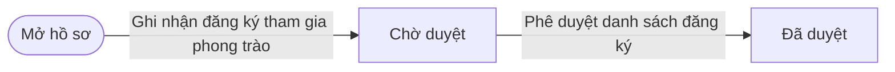
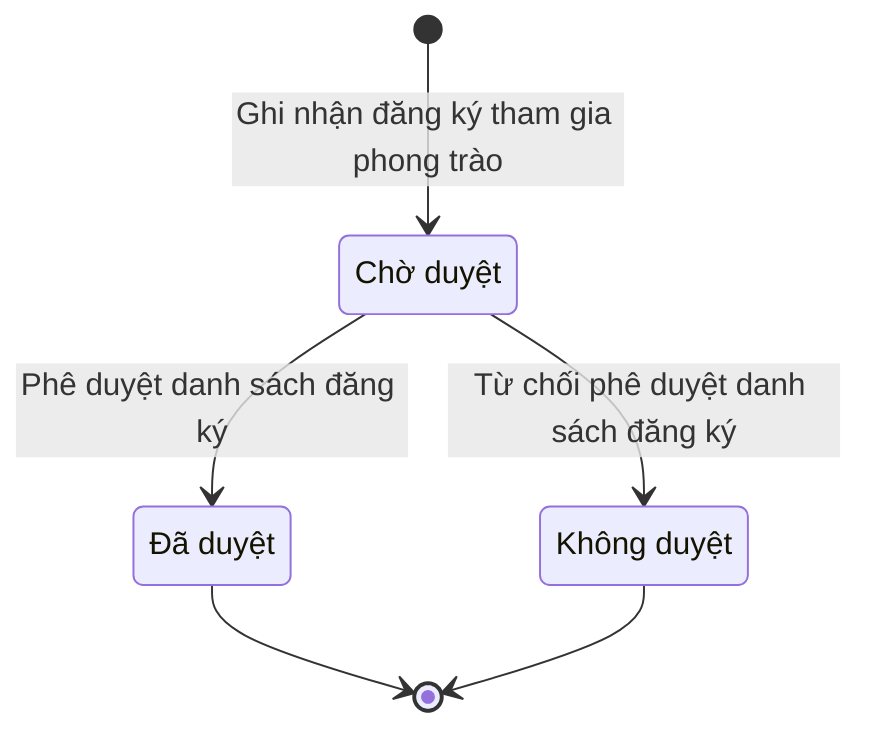

# qt-7.campaign-registration · Phong trào thi đua — Đăng ký tham gia phong trào

<!-- máy sinh: tom-tat -->
> **Hồ sơ:** Đăng ký tham gia phong trào (`CampaignRegistration`)
>
> **Trong sổ phạm vi:** 7 · Phong trào thi đua — hồ sơ phụ campaign-registration (tầng 2)
>
> 3 bước · 3 chặng · 2 vai · 0 bảng quyết định · 0 hạn · 2 khớp nối.
>
> **Nguồn:** sổ nghiệp vụ `qt-7.campaign-registration` · khai báo của app: `dqtv-app/core/processes/award-campaign/workflow/campaign-registration.yaml`. Các bảng do máy sinh từ nguồn này.
<!-- hết: tom-tat -->

<!-- viết tay: dien-giai -->
## Diễn giải

*Phần này viết tay, diễn giải lại điều các bảng bên dưới ghi.*

### Quy trình này để làm gì

Đây là hồ sơ phụ của phong trào thi đua (quy trình 7): mỗi hồ sơ là **một lượt đăng ký tham gia phong trào** của một cá nhân hoặc một tập thể. Vai `operator` (Chính trị viên) ghi đăng ký; vai `verifier` (Chỉ huy trưởng Ban CHQS xã) của đơn vị chủ hồ sơ duyệt hoặc không duyệt.

Hồ sơ có ba chặng: *Chờ duyệt*, rồi rẽ sang *Đã duyệt* hoặc *Không duyệt*. Đăng ký đã duyệt được dùng làm số liệu báo cáo chính thức của phong trào; đăng ký không duyệt thì khép lại, không vào số liệu báo cáo.

### Khi nào bắt đầu

Chính trị viên bấm **Ghi nhận đăng ký tham gia phong trào**: bắt buộc chọn phong trào và nhập tên đăng ký (tên cá nhân hoặc tên tập thể); chiến sĩ và đơn vị là ô nhập nếu có.

Khi mở, hồ sơ nối tới phong trào thi đua, và nối tới **Chiến sĩ dân quân tự vệ** (16.enlistment) hoặc **Đơn vị dân quân tự vệ** (29), đúng một trong hai: lượt đăng ký của cá nhân thì nối chiến sĩ, của tập thể thì nối đơn vị.

### Diễn ra thế nào

**Chặng "Chờ duyệt"** — không có việc nào làm tại chỗ, chỉ có hai bước của vai `verifier` (Chỉ huy trưởng Ban CHQS xã), người làm phải thuộc đơn vị chủ hồ sơ, đưa hồ sơ đi tiếp:

1. **Phê duyệt danh sách đăng ký** → *Đã duyệt*. Không phải nhập gì; hồ sơ ghi lại người phê duyệt và thời điểm phê duyệt.
2. **Từ chối phê duyệt danh sách đăng ký** → *Không duyệt*. Bắt buộc nhập lý do từ chối; hồ sơ ghi lại lý do và thời điểm không duyệt.

Đăng ký đã duyệt hoặc không duyệt thì không có bước nào làm tiếp.

### Kết thúc và để lại gì

Hồ sơ kết thúc ở *Đã duyệt* hoặc *Không duyệt*. Hai mối nối tới chiến sĩ và đơn vị đều ghi ngay ở bước mở.

### Điều kiện chặn

- Hai bước duyệt và từ chối: người làm phải là người của đơn vị ghi ở ô đơn vị chủ hồ sơ. Sai người, sai chặng thì bước bị chặn, hồ sơ giữ nguyên.
- Bước mở không đòi gì trước.
- Bước từ chối bắt buộc nhập lý do từ chối.
- Không bước nào có kết quả chặn riêng.
<!-- hết viết tay -->

## 1. Đường đi ngắn nhất qua các chặng

<!-- máy sinh: luong-chinh -->
Đường ít bước nhất từ lúc mở hồ sơ tới chặng kết thúc xa nhất. Máy chọn theo số chặng, không theo ý nghĩa nghiệp vụ — trình tự công việc thật xem phần Diễn giải và bảng "Việc làm ở từng chặng" ở mục 6.

| # | Ai làm | Làm gì | Hồ sơ sang chặng |
|---|---|---|---|
| 1 | Chính trị viên | Ghi nhận đăng ký tham gia phong trào | Chờ duyệt |
| 2 | Chỉ huy trưởng Ban CHQS xã | Phê duyệt danh sách đăng ký | Đã duyệt |

<!-- hết: luong-chinh -->

## 2. Hồ sơ và việc nó để lại

<!-- máy sinh: muc-tieu -->
**App gọi quy trình này là:** Đăng ký tham gia phong trào.

**Khi mở, hồ sơ này ghi mối nối tới:**
- Chiến sĩ dân quân tự vệ (16.enlistment) — bước `registerCampaignParticipant`, khớp nối `campaignRegistrationForMember`
- Đơn vị dân quân tự vệ (29) — bước `registerCampaignParticipant`, khớp nối `campaignRegistrationForUnit`
<!-- hết: muc-tieu -->

## 3. Khởi phát và kết thúc

<!-- máy sinh: khoi-phat -->
**1 cửa vào** — bước mở hồ sơ:

| Bước mở | Ai mở | Hồ sơ vào chặng | App bắt buộc nhập |
|---|---|---|---|
| Ghi nhận đăng ký tham gia phong trào | Chính trị viên | Chờ duyệt | `campaignId`, tên đăng ký |

**Kết thúc:** *Đã duyệt* (`APPROVED`), *Không duyệt* (`REJECTED`)
<!-- hết: khoi-phat -->

## 4. Vai trò

<!-- máy sinh: vai-tro -->
| Vai trong sổ | Tên trong app | Điều kiện | Làm những bước |
|---|---|---|---|
| `operator` | Chính trị viên |  | Ghi nhận đăng ký tham gia phong trào |
| `verifier` | Chỉ huy trưởng Ban CHQS xã |  | Phê duyệt danh sách đăng ký · Từ chối phê duyệt danh sách đăng ký |

*"Tên trong app" là tên app đặt cho mã chủ thể của vai. Hồ sơ thuộc đơn vị cấp khác thì người làm là người giữ vai ấy ở đơn vị nêu trong cột "Điều kiện" (nếu sổ có ghi) và ở cột "Người làm phải thuộc" của bảng "Theo khai báo của app" (mục 7).*
<!-- hết: vai-tro -->

## 5. Nhánh phụ

<!-- máy sinh: nhanh-phu -->
**Bước khác đưa hồ sơ sang chặng mới** — đường song song, rẽ nhánh hoặc kết thúc sớm:

| Bước | Ai làm | Từ chặng | Sang chặng |
|---|---|---|---|
| Từ chối phê duyệt danh sách đăng ký | Chỉ huy trưởng Ban CHQS xã | Chờ duyệt | Không duyệt |

<!-- hết: nhanh-phu -->

## 6. Các chặng và việc làm ở từng chặng

<!-- máy sinh: chang -->
| Chặng | Tên hiển thị | Vào bằng bước | Kết thúc? |
|---|---|---|---|
| `PENDING` | Chờ duyệt | Ghi nhận đăng ký tham gia phong trào |  |
| `APPROVED` | Đã duyệt | Phê duyệt danh sách đăng ký | **kết thúc** |
| `REJECTED` | Không duyệt | Từ chối phê duyệt danh sách đăng ký | **kết thúc** |

### Việc làm ở từng chặng

Hồ sơ đang ở chặng nào thì làm được những bước nào.

| Hồ sơ đang ở chặng | Bước làm tại chặng (hồ sơ đứng yên) | Bước đưa hồ sơ sang chặng khác |
|---|---|---|
| **Chờ duyệt** | — | Phê duyệt danh sách đăng ký — Chỉ huy trưởng Ban CHQS xã → *Đã duyệt* Từ chối phê duyệt danh sách đăng ký — Chỉ huy trưởng Ban CHQS xã → *Không duyệt* |
| **Đã duyệt** | — | — (kết thúc) |
| **Không duyệt** | — | — (kết thúc) |
<!-- hết: chang -->

## 7. Bảng bước

<!-- máy sinh: buoc -->
| # | Bước | Mã bước | Ai thực hiện | Từ chặng | Sang chặng | Phải có trước | Ghi lại |
|---|---|---|---|---|---|---|---|
| 1 | Ghi nhận đăng ký tham gia phong trào | `registerCampaignParticipant` | Chính trị viên | — (mở hồ sơ) | `PENDING` | — | nối tới Phong trào thi đua, nối tới Chiến sĩ dân quân tự vệ, nối tới Đơn vị dân quân tự vệ, mã tỉnh, mã xã, `ownerScope`, tên đăng ký, đăng ký lúc, đơn vị chủ hồ sơ |
| 2 | Phê duyệt danh sách đăng ký | `approveCampaignRegistration` | Chỉ huy trưởng Ban CHQS xã | `PENDING` | `APPROVED` | người làm thuộc đơn vị chủ hồ sơ | người phê duyệt, phê duyệt lúc |
| 3 | Từ chối phê duyệt danh sách đăng ký | `rejectCampaignRegistration` | Chỉ huy trưởng Ban CHQS xã | `PENDING` | `REJECTED` | người làm thuộc đơn vị chủ hồ sơ | lý do từ chối, không duyệt lúc |

### Khi không đạt điều kiện

Mặc định: không đúng người, hồ sơ không ở đúng chặng, hoặc thiếu thứ "phải có trước" thì bước bị chặn, hồ sơ giữ nguyên. Bảng dưới chỉ kê những bước có kết quả riêng.

Không bước nào có kết quả riêng — tất cả theo mặc định.

### Điều kiện "phải có trước" bằng lời

Cột "Phải có trước" ở bảng bước có hai loại: ô dữ liệu thường (bước chỉ đòi ô ấy đã có giá trị) và điều kiện hệ tự xét. Bảng này diễn các điều kiện hệ tự xét theo đúng công thức sổ ghi; số ở cột cuối là số thứ tự bước.

| Điều kiện | Đúng khi | Bước đòi |
|---|---|---|
| `actorInOwnerUnit` | người đang làm là người của đơn vị ghi ở ô đơn vị chủ hồ sơ của hồ sơ này (theo danh mục người của đơn vị, `dm.unit-staff`) | 2, 3 |

### Theo khai báo của app

Người làm phải thuộc đơn vị nào, ô người dùng phải nhập, bước có lặp được không, và căn cứ pháp lý — lấy từ khai báo quy trình trong app.

| # | Bước | Người làm phải thuộc | Bắt buộc nhập | Nhập nếu có | Lặp được | Căn cứ |
|---|---|---|---|---|---|---|
| 1 | Ghi nhận đăng ký tham gia phong trào |  | `campaignId`, tên đăng ký | `memberId`, `unitId` |  | 23/VBHN-BQP Đ.6 — FR-12 |
| 2 | Phê duyệt danh sách đăng ký | đơn vị chủ hồ sơ | — | — |  | 23/VBHN-BQP Đ.6 — FR-25, BR-10 |
| 3 | Từ chối phê duyệt danh sách đăng ký | đơn vị chủ hồ sơ | lý do từ chối | — |  | 23/VBHN-BQP Đ.6 — FR-25, BR-10 |
<!-- hết: buoc -->

## 8. Bảng quyết định, hạn, việc ngoài hệ

<!-- máy sinh: quyet-dinh -->

<!-- hết: quyet-dinh -->

## 9. Dữ liệu của hồ sơ

<!-- máy sinh: du-lieu -->
Các ô mà bước trong sổ ghi hoặc đòi. Số trong hai cột cuối là số thứ tự bước ở bảng bước (mục 7).

| Ô dữ liệu | Mã | Kiểu (app) | Giá trị cho phép | Loại ô (sổ) | Bước ghi | Bước đòi | Mô tả trong app |
|---|---|---|---|---|---|---|---|
| mã tỉnh | `provinceCode` | chữ |  |  | 1 | — | Mã tỉnh — dùng lọc phạm vi theo hàng; rỗng khi hồ sơ thuộc quân khu hoặc Bộ Quốc phòng |
| mã xã | `communeCode` | chữ |  |  | 1 | — | Mã xã — rỗng khi hồ sơ thuộc cấp trên xã |
| — | `ownerScope` | chữ |  |  | 1 | — | Chủ hồ sơ khi cấp trên xã không có mã địa bàn — 'central' hoặc mã quân khu; rỗng với hồ sơ cấp tỉnh, cấp xã |
| tên đăng ký | `registrantLabel` | chữ |  |  | 1 | — | Tên cá nhân hoặc tên tập thể đăng ký — đóng vai tên hồ sơ, cùng lý do subjectLabel của AwardCase (không thể vừa member: title vừa unit: title) |
| đăng ký lúc | `registeredAt` | ngày giờ |  |  | 1 | — | Thời điểm đăng ký — FR-12 |
| đơn vị chủ hồ sơ | `ownerUnit` |  |  | lưu trên hồ sơ (`stored`) | 1 | — |  |
| người phê duyệt | `approvedBy` | chữ |  |  | 2 | — | Tên người phê duyệt (AC-CHĐV) — FR-25 |
| phê duyệt lúc | `approvedAt` | ngày giờ |  |  | 2 | — | Thời điểm phê duyệt — FR-25 |
| vì sao không duyệt | `rejectionReason` | chữ |  |  | 3 | — | Vì sao không duyệt đăng ký tham gia phong trào |
| không duyệt lúc | `rejectedAt` | ngày giờ |  |  | 3 | — | Thời điểm không duyệt |
| người làm thuộc đơn vị chủ hồ sơ | `actorInOwnerUnit` |  | có hay chưa | hệ suy ra (`derived`) | — | 2, 3 |  |

11 ô. Cột "Loại ô" là cách sổ phân loại ô, in kèm đúng chữ của sổ; ô nào người dùng phải nhập xem bảng "Theo khai báo của app" ở mục 7.
<!-- hết: du-lieu -->

## 10. Khớp nối với quy trình khác

<!-- máy sinh: khop-noi -->
| Quy trình kia | Hồ sơ kia | Quan hệ | Nội dung (mô tả trong app) | Bước ghi mối nối | Tên ô nối |
|---|---|---|---|---|---|
| 16.enlistment | Chiến sĩ dân quân tự vệ | hồ sơ này **mở ra có nối tới** hồ sơ kia | Lượt đăng ký của cá nhân nào — FR-12, đúng 1 trong 2 với campaignRegistrationForUnit | 7.campaign-registration·registerCampaignParticipant ⊕ | `campaignRegistrationForMember` |
| 29 | Đơn vị dân quân tự vệ | hồ sơ này **mở ra có nối tới** hồ sơ kia | Lượt đăng ký của tập thể nào — FR-12, đúng 1 trong 2 với campaignRegistrationForMember | 7.campaign-registration·registerCampaignParticipant ⊕ | `campaignRegistrationForUnit` |

2 khớp nối. ⊕ là bước tạo hồ sơ.

**Ô nối giữa các hồ sơ cùng mã quy trình, hoặc tới danh mục nền:** `campaignRegistrationOf` (Đăng ký tham gia phong trào → Phong trào thi đua) — bước Ghi nhận đăng ký tham gia phong trào.
<!-- hết: khop-noi -->

## 11. Thông tin chung

<!-- máy sinh: thong-tin -->
| | |
|---|---|
| **Mã trong sổ** | `qt-7.campaign-registration` |
| **Quy trình trong app** | `award-campaign` (`workflow/campaign-registration.yaml`) — mặt công tác: `political` |
| **Hồ sơ** | Đăng ký tham gia phong trào (`CampaignRegistration`) |
| **Cùng mã quy trình** | [qt-7](qt-7.html) |
| **Căn cứ pháp lý từng bước** | cột "Căn cứ" ở bảng "Theo khai báo của app", mục 7 |
<!-- hết: thong-tin -->
