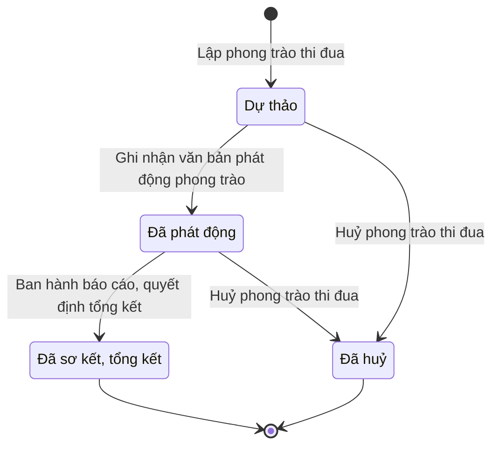

# qt-7 · Phong trào thi đua

<!-- máy sinh: tom-tat -->
> **Hồ sơ:** Phong trào thi đua (`AwardCampaign`)
>
> **Trong sổ phạm vi:** 7 · Phong trào thi đua (tầng 2)
>
> 7 bước · 4 chặng · 1 vai · 3 bảng quyết định · 0 hạn · 6 khớp nối.
>
> **Nguồn:** sổ nghiệp vụ `qt-7` · khai báo của app: `dqtv-app/core/processes/award-campaign/workflow/award-campaign.yaml`. Các bảng do máy sinh từ nguồn này.
<!-- hết: tom-tat -->

<!-- viết tay: dien-giai -->
## Diễn giải

*Phần này viết tay, diễn giải lại điều các bảng bên dưới ghi.*

### Quy trình này để làm gì

Quy trình theo dõi một **phong trào thi đua** từ lúc phát động tới lúc ban hành báo cáo, quyết định tổng kết. Sáu trên bảy bước do Chính trị viên (vai `operator`) làm. Có hai loại phong trào: thi đua thường xuyên hằng năm và thi đua theo chuyên đề, theo đợt.

Hồ sơ chỉ có hai chặng: *Đã phát động* → *Đã sơ kết, tổng kết*. Gần như mọi việc được làm trong lúc hồ sơ đứng ở chặng *Đã phát động*; chỉ bước cuối đẩy hồ sơ sang chặng kết thúc.

### Khi nào bắt đầu

Chính trị viên bấm **Phát động phong trào thi đua**. Phải nhập tên phong trào, loại phong trào, mục tiêu, phạm vi tổ chức thi đua, đối tượng thi đua (cá nhân, tập thể hay cả hai) và nội dung thi đua. Chỉ tiêu thi đua, đợt thi đua từ ngày – đến ngày, năm công tác, hình thức phát động, biện pháp thực hiện, phong trào cấp trên hưởng ứng là ô nhập nếu có. Thêm vào đó: đợt thi đua từ ngày bắt buộc với loại chuyên đề; năm công tác bắt buộc với loại thường xuyên; chỉ tiêu thi đua có thể để trống khi đã gắn kế hoạch thi đua có chỉ tiêu, không được trống cả hai; phạm vi không được rộng hơn cấp của người phát động.

Khi mở, hồ sơ nối tới một **Kế hoạch, văn kiện** của quy trình 2 — kế hoạch thi đua, khen thưởng mà phong trào phát động theo.

### Diễn ra thế nào

**Chặng "Đã phát động"** — năm việc làm tại chỗ, hồ sơ đứng yên:

1. **Ghi nhận văn bản phê duyệt phát động phong trào** (Chính trị viên) — gắn một quyết định ký ngoài hệ thống (`campaignAuthorizedBy`); phải nhập `decisionNumber`, `subject`, `signedBy`, `signedDate`, `legalBasis`, `scanPath`. Bước này bị xét theo bảng người phê duyệt (xem "Điều kiện chặn").
2. **Xác nhận thứ hai kết quả phê duyệt phát động phong trào** (Chỉ huy trưởng Ban CHQS xã) — phải chỉ ra quyết định được xác nhận (`decisionId`), phải đã có quyết định ký ngoài hệ `campaignAuthorizedBy` và phải có người thứ hai kiểm; bước ghi thời điểm xác nhận. Đã xác nhận rồi thì không xác nhận lại được.
3. **Theo dõi, đôn đốc tiến độ phong trào** (Chính trị viên) — phải có xác nhận thứ hai ở trên; phải nhập tiến độ đôn đốc gần nhất; mỗi lần ghi tạo một *lượt đôn đốc phong trào*.
4. **Ban hành báo cáo sơ kết giữa đợt** (Chính trị viên) — cũng phải có xác nhận thứ hai; phải nhập `periodLabel`, `assessmentNote`; tạo một *lượt sơ kết, tổng kết phong trào*.
5. **Lập hồ sơ sơ kết, tổng kết phong trào** (Chính trị viên) — ghi dự thảo báo cáo sơ kết, tổng kết. Đã có dự thảo thì không lập lại được ("đã lập hồ sơ sơ kết, tổng kết cho phong trào này rồi").

**Chuyển chặng:** Chính trị viên bấm **Ban hành báo cáo, quyết định tổng kết** để đưa hồ sơ sang *Đã sơ kết, tổng kết*. Phải có dự thảo ở bước 5; phải nhập đánh giá kết quả thi đua và danh sách cá nhân, tập thể xuất sắc được lựa chọn.

### Kết thúc và để lại gì

Hồ sơ kết thúc ở chặng *Đã sơ kết, tổng kết*, để lại thời điểm ban hành, đánh giá kết quả thi đua, danh sách cá nhân, tập thể xuất sắc và một lượt sơ kết, tổng kết.

Phong trào nối tới **Kế hoạch, văn kiện** (2), ghi ngay lúc phát động. Từ phong trào còn có nối sang Yêu cầu báo cáo cấp trên (quy trình 6) và Hồ sơ khen thưởng (quy trình 8).

### Điều kiện chặn

- Mọi bước trừ bước phát động: người làm phải thuộc đơn vị chủ hồ sơ. Sai người, sai chặng, thiếu thứ phải có trước thì bước bị chặn, hồ sơ giữ nguyên.
- Bước phải có trước bước: đôn đốc tiến độ và sơ kết giữa đợt đòi đã có xác nhận thứ hai (câu báo: "chưa có xác nhận thứ hai phê duyệt phát động phong trào, không được triển khai tiếp"); ban hành tổng kết đòi đã có dự thảo.
- Bảng người phê duyệt (`campaign-approver`, 13 dòng) xét ở bước ghi nhận văn bản phê duyệt, theo hai đầu vào `launcherLevel` và `campaignSignerLevel`. Mỗi cấp phát động chỉ cho qua đúng một người ký: cấp xã (`commune`) – `commune_chairman`; cấp tỉnh (`province`) – `province_chairman`; quân khu (`military_region`) – `military_region_commander`; trung ương (`central`) – `defence_minister`. Người ký khác thì chặn với `wrong_authority`; chưa có người ký thì `signer_unknown`; chưa có cấp phát động thì `level_unknown`.
<!-- hết viết tay -->

## 1. Đường đi ngắn nhất qua các chặng

<!-- máy sinh: luong-chinh -->
Đường ít bước nhất từ lúc mở hồ sơ tới chặng kết thúc xa nhất. Máy chọn theo số chặng, không theo ý nghĩa nghiệp vụ — trình tự công việc thật xem phần Diễn giải và bảng "Việc làm ở từng chặng" ở mục 6.

| # | Ai làm | Làm gì | Hồ sơ sang chặng |
|---|---|---|---|
| 1 | Chính trị viên | Lập phong trào thi đua | Dự thảo |
| 2 | Chính trị viên | Ghi nhận văn bản phát động phong trào | Đã phát động |
| 3 | Chính trị viên | Ban hành báo cáo, quyết định tổng kết | Đã sơ kết, tổng kết |

<!-- hết: luong-chinh -->

## 2. Hồ sơ và việc nó để lại

<!-- máy sinh: muc-tieu -->
**App gọi quy trình này là:** Phong trào thi đua.

**Khi mở, hồ sơ này ghi mối nối tới:**
- Kế hoạch, văn kiện (2) — bước `launchCampaign`, khớp nối `campaignUnderPlan`

**Hồ sơ này để lại cho quy trình khác** (bước tạo hồ sơ của quy trình kia ghi mối nối về đây):
- Hồ sơ khen thưởng (8) — bước `recordMemberSelection`, khớp nối `awardCaseArisesFromCampaign`
- Hồ sơ khen thưởng (8) — bước `recordUnitSelection`, khớp nối `awardCaseArisesFromCampaign`
<!-- hết: muc-tieu -->

## 3. Khởi phát và kết thúc

<!-- máy sinh: khoi-phat -->
**1 cửa vào** — bước mở hồ sơ:

| Bước mở | Ai mở | Hồ sơ vào chặng | App bắt buộc nhập |
|---|---|---|---|
| Lập phong trào thi đua | Chính trị viên | Dự thảo | tên phong trào, loại phong trào, mục tiêu phong trào, phạm vi tổ chức thi đua, đối tượng thi đua, nội dung thi đua |

**Kết thúc:** *Đã sơ kết, tổng kết* (`CONCLUDED`), *Đã huỷ* (`CANCELLED`)
<!-- hết: khoi-phat -->

## 4. Vai trò

<!-- máy sinh: vai-tro -->
| Vai trong sổ | Tên trong app | Điều kiện | Làm những bước |
|---|---|---|---|
| `operator` | Chính trị viên |  | Lập phong trào thi đua · Ghi nhận văn bản phát động phong trào · Theo dõi, đôn đốc tiến độ phong trào · Ban hành báo cáo sơ kết giữa đợt · Lập hồ sơ sơ kết, tổng kết phong trào · Ban hành báo cáo, quyết định tổng kết · Huỷ phong trào thi đua |

*"Tên trong app" là tên app đặt cho mã chủ thể của vai. Hồ sơ thuộc đơn vị cấp khác thì người làm là người giữ vai ấy ở đơn vị nêu trong cột "Điều kiện" (nếu sổ có ghi) và ở cột "Người làm phải thuộc" của bảng "Theo khai báo của app" (mục 7).*
<!-- hết: vai-tro -->

## 5. Nhánh phụ

<!-- máy sinh: nhanh-phu -->
**Bước khác đưa hồ sơ sang chặng mới** — đường song song, rẽ nhánh hoặc kết thúc sớm:

| Bước | Ai làm | Từ chặng | Sang chặng |
|---|---|---|---|
| Huỷ phong trào thi đua | Chính trị viên | Dự thảo, Đã phát động | Đã huỷ |

**Làm trong lúc hồ sơ đứng yên ở một chặng** — ghi nhận, bổ sung:

| Bước | Ai làm | Ở chặng |
|---|---|---|
| Theo dõi, đôn đốc tiến độ phong trào | Chính trị viên | Đã phát động |
| Ban hành báo cáo sơ kết giữa đợt | Chính trị viên | Đã phát động |
| Lập hồ sơ sơ kết, tổng kết phong trào | Chính trị viên | Đã phát động |

<!-- hết: nhanh-phu -->

## 6. Các chặng và việc làm ở từng chặng

<!-- máy sinh: chang -->
| Chặng | Tên hiển thị | Vào bằng bước | Kết thúc? |
|---|---|---|---|
| `DRAFT` | Dự thảo | Lập phong trào thi đua |  |
| `LAUNCHED` | Đã phát động | Ghi nhận văn bản phát động phong trào |  |
| `CONCLUDED` | Đã sơ kết, tổng kết | Ban hành báo cáo, quyết định tổng kết | **kết thúc** |
| `CANCELLED` | Đã huỷ | Huỷ phong trào thi đua | **kết thúc** |

### Việc làm ở từng chặng

Hồ sơ đang ở chặng nào thì làm được những bước nào.

| Hồ sơ đang ở chặng | Bước làm tại chặng (hồ sơ đứng yên) | Bước đưa hồ sơ sang chặng khác |
|---|---|---|
| **Dự thảo** | — | Ghi nhận văn bản phát động phong trào — Chính trị viên → *Đã phát động* Huỷ phong trào thi đua — Chính trị viên → *Đã huỷ* |
| **Đã phát động** | Theo dõi, đôn đốc tiến độ phong trào — Chính trị viên Ban hành báo cáo sơ kết giữa đợt — Chính trị viên Lập hồ sơ sơ kết, tổng kết phong trào — Chính trị viên | Ban hành báo cáo, quyết định tổng kết — Chính trị viên → *Đã sơ kết, tổng kết* Huỷ phong trào thi đua — Chính trị viên → *Đã huỷ* |
| **Đã sơ kết, tổng kết** | — | — (kết thúc) |
| **Đã huỷ** | — | — (kết thúc) |
<!-- hết: chang -->

## 7. Bảng bước

<!-- máy sinh: buoc -->
| # | Bước | Mã bước | Ai thực hiện | Từ chặng | Sang chặng | Phải có trước | Ghi lại |
|---|---|---|---|---|---|---|---|
| 1 | Lập phong trào thi đua | `launchCampaign` | Chính trị viên | — (mở hồ sơ) | `DRAFT` | — | nối tới Kế hoạch, văn kiện, `planDocumentId`, mã tỉnh, mã xã, chủ hồ sơ theo cấp, tên phong trào, loại phong trào, mục tiêu phong trào, phạm vi tổ chức thi đua, đối tượng thi đua, nội dung thi đua, chỉ tiêu thi đua, đợt thi đua từ ngày, đợt thi đua đến ngày, năm công tác, hình thức tổ chức phát động, biện pháp tổ chức thực hiện, phong trào cấp trên hưởng ứng, số lượt sơ kết giữa đợt, phát động lúc, đơn vị chủ hồ sơ, `id` |
| 2 | Ghi nhận văn bản phát động phong trào | `recordCampaignApproval` | Chính trị viên | `DRAFT` | `LAUNCHED` | người làm thuộc đơn vị chủ hồ sơ, `recordCampaignApprovalFromIncomingDocumentUsable` | nối tới Quyết định ký ngoài hệ thống, `subject`, `legalBasis`, nối tới Văn bản đến, `signedBy` |
| 3 | Theo dõi, đôn đốc tiến độ phong trào | `updateCampaignProgress` | Chính trị viên | `LAUNCHED` | giữ nguyên | người làm thuộc đơn vị chủ hồ sơ | nối tới Lượt đôn đốc phong trào |
| 4 | Ban hành báo cáo sơ kết giữa đợt | `issueInterimSummary` | Chính trị viên | `LAUNCHED` | giữ nguyên | người làm thuộc đơn vị chủ hồ sơ | nối tới Lượt sơ kết, tổng kết phong trào |
| 5 | Lập hồ sơ sơ kết, tổng kết phong trào | `draftCampaignSummary` | Chính trị viên | `LAUNCHED` | giữ nguyên | người làm thuộc đơn vị chủ hồ sơ | dự thảo báo cáo sơ kết, tổng kết |
| 6 | Ban hành báo cáo, quyết định tổng kết | `issueCampaignSummary` | Chính trị viên | `LAUNCHED` | `CONCLUDED` | dự thảo báo cáo sơ kết, tổng kết, người làm thuộc đơn vị chủ hồ sơ | ban hành báo cáo lúc, đánh giá kết quả thi đua khi tổng kết, nối tới Chiến sĩ dân quân tự vệ, nối tới Đơn vị dân quân tự vệ, nối tới Lượt sơ kết, tổng kết phong trào |
| 7 | Huỷ phong trào thi đua | `cancelCampaign` | Chính trị viên | `DRAFT`, `LAUNCHED` | `CANCELLED` | vì sao huỷ, người làm thuộc đơn vị chủ hồ sơ | vì sao huỷ, huỷ lúc |

### Khi không đạt điều kiện

Mặc định: không đúng người, hồ sơ không ở đúng chặng, hoặc thiếu thứ "phải có trước" thì bước bị chặn, hồ sơ giữ nguyên. Bảng dưới chỉ kê những bước có kết quả riêng.

| # | Bước | Kết quả riêng |
|---|---|---|
| 1 | Lập phong trào thi đua | bước dừng lại, hồ sơ giữ nguyên khi kết quả xét là: `wrong_scope`, `fields_missing`, `period_missing`, `work_year_missing` |
| 2 | Ghi nhận văn bản phát động phong trào | bước dừng lại, hồ sơ giữ nguyên khi kết quả xét là: `wrong_authority`, `signer_unknown`, `level_unknown` |
| 7 | Huỷ phong trào thi đua | bước dừng lại, hồ sơ giữ nguyên khi kết quả xét là: `award_cases_linked` |

### Điều kiện "phải có trước" bằng lời

Cột "Phải có trước" ở bảng bước có hai loại: ô dữ liệu thường (bước chỉ đòi ô ấy đã có giá trị) và điều kiện hệ tự xét. Bảng này diễn các điều kiện hệ tự xét theo đúng công thức sổ ghi; số ở cột cuối là số thứ tự bước.

| Điều kiện | Đúng khi | Bước đòi |
|---|---|---|
| `actorInOwnerUnit` | người đang làm là người của đơn vị ghi ở ô đơn vị chủ hồ sơ của hồ sơ này (theo danh mục người của đơn vị, `dm.unit-staff`) | 2, 3, 4, 5, 6, 7 |
| `recordCampaignApprovalFromIncomingDocumentUsable` | có hồ sơ Việc luật giao kèm văn bản đến, đi — Văn bản đến (qt-1.incoming-document) chính là hồ sơ ghi ở ô nối `recordCampaignApprovalFromIncomingDocument` của hồ sơ đang làm mà hồ sơ ấy đang ở chặng `RECEIVED` hoặc `DISTRIBUTED` | 2 |

### Theo khai báo của app

Người làm phải thuộc đơn vị nào, ô người dùng phải nhập, bước có lặp được không, và căn cứ pháp lý — lấy từ khai báo quy trình trong app.

| # | Bước | Người làm phải thuộc | Bắt buộc nhập | Nhập nếu có | Lặp được | Căn cứ |
|---|---|---|---|---|---|---|
| 1 | Lập phong trào thi đua |  | tên phong trào, loại phong trào, mục tiêu phong trào, phạm vi tổ chức thi đua, đối tượng thi đua, nội dung thi đua | `planDocumentIds`, chỉ tiêu thi đua, đợt thi đua từ ngày, đợt thi đua đến ngày, năm công tác, hình thức tổ chức phát động, biện pháp tổ chức thực hiện, phong trào cấp trên hưởng ứng |  | L06/2022/QH15 Đ.16 · 23/VBHN-BQP Đ.5, Đ.7 |
| 2 | Ghi nhận văn bản phát động phong trào | đơn vị chủ hồ sơ | văn bản đến là văn bản phê duyệt phát động đã ký, `signedBy`, `legalBasis` | — |  | 23/VBHN-BQP Đ.22, Đ.23 k6 |
| 3 | Theo dõi, đôn đốc tiến độ phong trào | đơn vị chủ hồ sơ | tiến độ đôn đốc gần nhất | — |  | 23/VBHN-BQP Đ.6 |
| 4 | Ban hành báo cáo sơ kết giữa đợt | đơn vị chủ hồ sơ | `periodLabel`, `assessmentNote` | — |  | 23/VBHN-BQP Đ.6 k4 điểm b |
| 5 | Lập hồ sơ sơ kết, tổng kết phong trào | đơn vị chủ hồ sơ | dự thảo báo cáo sơ kết, tổng kết | — |  | L06/2022/QH15 Đ.17 · 23/VBHN-BQP Đ.7 |
| 6 | Ban hành báo cáo, quyết định tổng kết | đơn vị chủ hồ sơ | đánh giá kết quả thi đua khi tổng kết | cá nhân xuất sắc được lựa chọn, tập thể xuất sắc được lựa chọn |  | L06/2022/QH15 Đ.17 · 23/VBHN-BQP Đ.6 k4 điểm a, Đ.7 |
| 7 | Huỷ phong trào thi đua | đơn vị chủ hồ sơ | vì sao huỷ | — |  | Sổ qt-7 · decision campaign-cancel (21/10/2026) |

### Điều kiện và ghi chú app khai cho từng bước

Lấy từ khai báo quy trình trong app. Lời trong ngoặc kép là câu app hiện cho người dùng. Chức danh người ký ngoài hệ app chỉ khai bằng mã.

| # | Bước | Điều kiện, ghi chú |
|---|---|---|
| 2 | Ghi nhận văn bản phát động phong trào | · bước này ghi một quyết định ký NGOÀI hệ (`campaignAuthorizedBy`), người ký: `president`, `prime_minister`, `defence_minister`, `military_region_commander`, `province_chairman`, `province_military_command`, `commune_chairman`, `commune_military_commander` · không đòi bản chụp — app ghi: "bản số hoá lấy từ văn bản đến văn thư đã vào sổ (tầng đọc chép `scanPath` của văn bản ấy), không tải ảnh ở bước này" |
| 3 | Theo dõi, đôn đốc tiến độ phong trào | · tạo thêm một hồ sơ con: Lượt đôn đốc phong trào (`CampaignProgress`) |
| 4 | Ban hành báo cáo sơ kết giữa đợt | · tạo thêm một hồ sơ con: Lượt sơ kết, tổng kết phong trào (`CampaignSummary`) |
| 5 | Lập hồ sơ sơ kết, tổng kết phong trào | · không làm được khi đã có ô "dự thảo báo cáo sơ kết, tổng kết" — app báo: "đã lập hồ sơ sơ kết, tổng kết cho phong trào này rồi" |
| 6 | Ban hành báo cáo, quyết định tổng kết | · phải đã có ô "dự thảo báo cáo sơ kết, tổng kết" — thiếu thì app báo: "chưa lập dự thảo báo cáo tổng kết thì chưa ban hành được" · tạo thêm một hồ sơ con: Lượt sơ kết, tổng kết phong trào (`CampaignSummary`) |
<!-- hết: buoc -->

## 8. Bảng quyết định, hạn, việc ngoài hệ

<!-- máy sinh: quyet-dinh -->
**Bảng `campaign-approver`** — xét ở bước *Ghi nhận văn bản phát động phong trào*; đầu vào: phạm vi tổ chức thi đua, `signedBy`, `launchSignedRegime`. 25 dòng, dòng đầu tiên khớp thì dừng.

| Thứ tự dò (số sổ ghi) | Dòng | Khi | Thì |
|---|---|---|---|
| — | `central-ok` | phạm vi tổ chức thi đua là Toàn quân, toàn lực lượng DQTV (`ARMED_FORCES`) và `signedBy` là `defence_minister` | cho qua |
| — | `central-signer-unset` | phạm vi tổ chức thi đua là Toàn quân, toàn lực lượng DQTV (`ARMED_FORCES`) và chưa có `signedBy` | `signer_unknown` |
| — | `central-wrong` | phạm vi tổ chức thi đua là Toàn quân, toàn lực lượng DQTV (`ARMED_FORCES`) và `signedBy` là `president` hoặc `prime_minister` hoặc `military_region_commander` hoặc `province_chairman` hoặc `province_military_command` hoặc `commune_chairman` hoặc `commune_military_commander` | `wrong_authority` |
| — | `commune-commander-before-2026` | phạm vi tổ chức thi đua là DQTV trong xã (`COMMUNE_MILITARY`) và `signedBy` là `commune_military_commander` và `launchSignedRegime` là `before_2026_01_26` | `wrong_authority` |
| — | `commune-commander-from-2026` | phạm vi tổ chức thi đua là DQTV trong xã (`COMMUNE_MILITARY`) và `signedBy` là `commune_military_commander` và `launchSignedRegime` là `from_2026_01_26` | cho qua |
| — | `commune-ok` | phạm vi tổ chức thi đua là Toàn xã (`COMMUNE`) và `signedBy` là `commune_chairman` | cho qua |
| — | `commune-signer-unset` | phạm vi tổ chức thi đua là Toàn xã (`COMMUNE`) và chưa có `signedBy` | `signer_unknown` |
| — | `commune-wrong` | phạm vi tổ chức thi đua là Toàn xã (`COMMUNE`) và `signedBy` là `president` hoặc `prime_minister` hoặc `defence_minister` hoặc `military_region_commander` hoặc `province_chairman` hoặc `province_military_command` hoặc `commune_military_commander` | `wrong_authority` |
| — | `commune_military-chairman-before-2026` | phạm vi tổ chức thi đua là DQTV trong xã (`COMMUNE_MILITARY`) và `signedBy` là `commune_chairman` và `launchSignedRegime` là `before_2026_01_26` | cho qua |
| — | `commune_military-chairman-from-2026` | phạm vi tổ chức thi đua là DQTV trong xã (`COMMUNE_MILITARY`) và `signedBy` là `commune_chairman` và `launchSignedRegime` là `from_2026_01_26` | `wrong_authority` |
| — | `commune_military-signer-unset` | phạm vi tổ chức thi đua là DQTV trong xã (`COMMUNE_MILITARY`) và chưa có `signedBy` | `signer_unknown` |
| — | `commune_military-wrong` | phạm vi tổ chức thi đua là DQTV trong xã (`COMMUNE_MILITARY`) và `signedBy` là `president` hoặc `prime_minister` hoặc `defence_minister` hoặc `military_region_commander` hoặc `province_chairman` hoặc `province_military_command` | `wrong_authority` |
| — | `level-unset` | chưa có phạm vi tổ chức thi đua | `level_unknown` |
| — | `military_region-ok` | phạm vi tổ chức thi đua là Quân khu (`MILITARY_ZONE`) và `signedBy` là `military_region_commander` | cho qua |
| — | `military_region-signer-unset` | phạm vi tổ chức thi đua là Quân khu (`MILITARY_ZONE`) và chưa có `signedBy` | `signer_unknown` |
| — | `military_region-wrong` | phạm vi tổ chức thi đua là Quân khu (`MILITARY_ZONE`) và `signedBy` là `president` hoặc `prime_minister` hoặc `defence_minister` hoặc `province_chairman` hoặc `province_military_command` hoặc `commune_chairman` hoặc `commune_military_commander` | `wrong_authority` |
| — | `nationwide-ok` | phạm vi tổ chức thi đua là Toàn quốc (`NATIONWIDE`) và `signedBy` là `president` hoặc `prime_minister` | cho qua |
| — | `nationwide-signer-unset` | phạm vi tổ chức thi đua là Toàn quốc (`NATIONWIDE`) và chưa có `signedBy` | `signer_unknown` |
| — | `nationwide-wrong` | phạm vi tổ chức thi đua là Toàn quốc (`NATIONWIDE`) và `signedBy` là `defence_minister` hoặc `military_region_commander` hoặc `province_chairman` hoặc `province_military_command` hoặc `commune_chairman` hoặc `commune_military_commander` | `wrong_authority` |
| — | `province-ok` | phạm vi tổ chức thi đua là Toàn tỉnh (`PROVINCE`) và `signedBy` là `province_chairman` | cho qua |
| — | `province-signer-unset` | phạm vi tổ chức thi đua là Toàn tỉnh (`PROVINCE`) và chưa có `signedBy` | `signer_unknown` |
| — | `province-wrong` | phạm vi tổ chức thi đua là Toàn tỉnh (`PROVINCE`) và `signedBy` là `president` hoặc `prime_minister` hoặc `defence_minister` hoặc `military_region_commander` hoặc `province_military_command` hoặc `commune_chairman` hoặc `commune_military_commander` | `wrong_authority` |
| — | `province_military-ok` | phạm vi tổ chức thi đua là DQTV và cơ quan quân sự trong tỉnh (`PROVINCE_MILITARY`) và `signedBy` là `province_military_command` | cho qua |
| — | `province_military-signer-unset` | phạm vi tổ chức thi đua là DQTV và cơ quan quân sự trong tỉnh (`PROVINCE_MILITARY`) và chưa có `signedBy` | `signer_unknown` |
| — | `province_military-wrong` | phạm vi tổ chức thi đua là DQTV và cơ quan quân sự trong tỉnh (`PROVINCE_MILITARY`) và `signedBy` là `president` hoặc `prime_minister` hoặc `defence_minister` hoặc `military_region_commander` hoặc `province_chairman` hoặc `commune_chairman` hoặc `commune_military_commander` | `wrong_authority` |

**Bảng `campaign-cancel`** — xét ở bước *Huỷ phong trào thi đua*; đầu vào: `linkedAwardCaseStatus`. 3 dòng, dò từ trên xuống, dòng đầu tiên khớp thì dừng.

| Thứ tự dò (số sổ ghi) | Dòng | Khi | Thì |
|---|---|---|---|
| 1 | `has-award-cases` | `linkedAwardCaseStatus` là `some` | `award_cases_linked` |
| 2 | `no-award-cases` | `linkedAwardCaseStatus` là `none` | cho qua |
| 3 | `unknown-award-cases` | chưa có `linkedAwardCaseStatus` | `award_cases_linked` |

**Bảng `campaign-scope-level`** — xét ở bước *Lập phong trào thi đua*; đầu vào: `launcherUnitLevel`, tên phong trào, loại phong trào, mục tiêu phong trào, phạm vi tổ chức thi đua, đối tượng thi đua, nội dung thi đua, đợt thi đua từ ngày, đợt thi đua đến ngày, năm công tác. 15 dòng, dò từ trên xuống, dòng đầu tiên khớp thì dừng.

| Thứ tự dò (số sổ ghi) | Dòng | Khi | Thì |
|---|---|---|---|
| 1 | `commune-wrong-scope` | `launcherUnitLevel` là `commune` và phạm vi tổ chức thi đua là Toàn quốc (`NATIONWIDE`) hoặc Toàn quân, toàn lực lượng DQTV (`ARMED_FORCES`) hoặc Quân khu (`MILITARY_ZONE`) hoặc Toàn tỉnh (`PROVINCE`) hoặc DQTV và cơ quan quân sự trong tỉnh (`PROVINCE_MILITARY`) | `wrong_scope` |
| 2 | `province-wrong-scope` | `launcherUnitLevel` là `province` và phạm vi tổ chức thi đua là Toàn quốc (`NATIONWIDE`) hoặc Toàn quân, toàn lực lượng DQTV (`ARMED_FORCES`) hoặc Quân khu (`MILITARY_ZONE`) hoặc Toàn xã (`COMMUNE`) hoặc DQTV trong xã (`COMMUNE_MILITARY`) | `wrong_scope` |
| 3 | `region-wrong-scope` | `launcherUnitLevel` là `region` và phạm vi tổ chức thi đua là Toàn quốc (`NATIONWIDE`) hoặc Toàn quân, toàn lực lượng DQTV (`ARMED_FORCES`) hoặc Toàn tỉnh (`PROVINCE`) hoặc DQTV và cơ quan quân sự trong tỉnh (`PROVINCE_MILITARY`) hoặc Toàn xã (`COMMUNE`) hoặc DQTV trong xã (`COMMUNE_MILITARY`) | `wrong_scope` |
| 4 | `central-wrong-scope` | `launcherUnitLevel` là `central` và phạm vi tổ chức thi đua là Quân khu (`MILITARY_ZONE`) hoặc Toàn tỉnh (`PROVINCE`) hoặc DQTV và cơ quan quân sự trong tỉnh (`PROVINCE_MILITARY`) hoặc Toàn xã (`COMMUNE`) hoặc DQTV trong xã (`COMMUNE_MILITARY`) | `wrong_scope` |
| 5 | `unit-level-unset` | chưa có `launcherUnitLevel` và phạm vi tổ chức thi đua là Toàn quốc (`NATIONWIDE`) hoặc Toàn quân, toàn lực lượng DQTV (`ARMED_FORCES`) hoặc Quân khu (`MILITARY_ZONE`) hoặc Toàn tỉnh (`PROVINCE`) hoặc DQTV và cơ quan quân sự trong tỉnh (`PROVINCE_MILITARY`) hoặc Toàn xã (`COMMUNE`) hoặc DQTV trong xã (`COMMUNE_MILITARY`) | `wrong_scope` |
| 6 | `campaignName-missing` | chưa có tên phong trào | `fields_missing` |
| 7 | `campaignType-missing` | chưa có loại phong trào | `fields_missing` |
| 8 | `objective-missing` | chưa có mục tiêu phong trào | `fields_missing` |
| 9 | `campaignScope-missing` | chưa có phạm vi tổ chức thi đua | `fields_missing` |
| 10 | `targetSubject-missing` | chưa có đối tượng thi đua | `fields_missing` |
| 11 | `contentNote-missing` | chưa có nội dung thi đua | `fields_missing` |
| 12 | `thematic-no-from` | loại phong trào là Chuyên đề (`THEMATIC`) và chưa có đợt thi đua từ ngày | `period_missing` |
| 13 | `thematic-no-to` | loại phong trào là Chuyên đề (`THEMATIC`) và chưa có đợt thi đua đến ngày | `period_missing` |
| 14 | `regular-no-year` | loại phong trào là Thường xuyên (`REGULAR`) và chưa có năm công tác | `work_year_missing` |
| 15 | `launch-ok` | loại phong trào là Thường xuyên (`REGULAR`) hoặc Chuyên đề (`THEMATIC`) | cho qua |

<!-- hết: quyet-dinh -->

## 9. Dữ liệu của hồ sơ

<!-- máy sinh: du-lieu -->
Các ô mà bước trong sổ ghi hoặc đòi. Số trong hai cột cuối là số thứ tự bước ở bảng bước (mục 7).

| Ô dữ liệu | Mã | Kiểu (app) | Giá trị cho phép | Loại ô (sổ) | Bước ghi | Bước đòi | Mô tả trong app |
|---|---|---|---|---|---|---|---|
| — | `planDocumentId` | chữ |  | đưa vào ở bước (`input`) | 1 | — | id kế hoạch thi đua, khen thưởng — lọc nhanh, quan hệ thật ở campaignUnderPlan |
| mã tỉnh | `provinceCode` | chữ |  | lưu trên hồ sơ (`stored`) | 1 | — | Mã tỉnh — dùng lọc phạm vi theo hàng; rỗng khi hồ sơ thuộc quân khu hoặc Bộ Quốc phòng |
| mã xã | `communeCode` | chữ |  | lưu trên hồ sơ (`stored`) | 1 | — | Mã xã — rỗng khi phong trào thuộc cấp tỉnh, quân khu hoặc Bộ Quốc phòng (Đ.7 k2) |
| chủ hồ sơ theo cấp | `ownerScope` | chữ |  | lưu trên hồ sơ (`stored`) | 1 | — | Chủ hồ sơ khi cấp phát động không có mã địa bàn — 'central' hoặc mã quân khu; rỗng với phong trào cấp tỉnh, cấp xã (FR-36) |
| tên phong trào | `campaignName` | chữ | có hay chưa | đưa vào ở bước (`input`) | 1 | — | Tên phong trào/đợt thi đua |
| loại phong trào | `campaignType` | chọn một | Thường xuyên (`REGULAR`), Chuyên đề (`THEMATIC`) | đưa vào ở bước (`input`) | 1 | — | Thi đua thường xuyên hằng năm hay thi đua theo chuyên đề/đợt — TT93/2024 Đ.5 |
| mục tiêu phong trào | `objective` | chữ | có hay chưa | đưa vào ở bước (`input`) | 1 | — | Mục tiêu phong trào — Đ.5 k1, Đ.6 k1 (FR-11d) |
| phạm vi tổ chức thi đua | `campaignScope` | chọn một | Toàn quốc (`NATIONWIDE`), Toàn quân, toàn lực lượng DQTV (`ARMED_FORCES`), Quân khu (`MILITARY_ZONE`), Toàn tỉnh (`PROVINCE`), DQTV và cơ quan quân sự trong tỉnh (`PROVINCE_MILITARY`), Toàn xã (`COMMUNE`), DQTV trong xã (`COMMUNE_MILITARY`) | đưa vào ở bước (`input`) | 1 | — | Phạm vi tổ chức thi đua — quyết định ai ký văn bản phát động (Luật TĐKT Đ.18; 23/VBHN-BQP Đ.4, Đ.7 k2) |
| đối tượng thi đua | `targetSubject` | chọn một | Cá nhân (`INDIVIDUAL`), Tập thể (`COLLECTIVE`), Cả cá nhân và tập thể (`BOTH`) | đưa vào ở bước (`input`) | 1 | — | Đối tượng thi đua — cá nhân, tập thể hay cả hai (Đ.6 k1, FR-11d) |
| nội dung thi đua | `contentNote` | chữ | có hay chưa | đưa vào ở bước (`input`) | 1 | — | Nội dung thi đua — Đ.5 k1, Đ.6 k1 (FR-11d) |
| chỉ tiêu thi đua | `targetNote` | chữ |  | đưa vào ở bước (`input`) | 1 | — | Chỉ tiêu thi đua cụ thể — Đ.5 k1, Đ.6 k1 (FR-11d); có thể để trống KHI đã gắn kế hoạch thi đua có chỉ tiêu qua campaignUnderPlan, không được trống cả hai (BR-17) |
| đợt thi đua từ ngày | `periodFrom` | ngày |  | đưa vào ở bước (`input`) | 1 | — | Đợt thi đua chuyên đề bắt đầu từ ngày — Đ.5 k2 (FR-11e), bắt buộc với campaignType THEMATIC |
| đợt thi đua đến ngày | `periodTo` | ngày |  | đưa vào ở bước (`input`) | 1 | — | Đợt thi đua chuyên đề kết thúc ngày — Đ.5 k2 (FR-11e), không sớm hơn periodFrom (BR-18) |
| năm công tác | `workYear` | số |  | đưa vào ở bước (`input`) | 1 | — | Năm công tác của phong trào thường xuyên — mốc tổng kết và bình xét danh hiệu cuối năm, Đ.5 k1 (FR-11e), bắt buộc với campaignType REGULAR |
| hình thức tổ chức phát động | `launchFormat` | chữ |  | đưa vào ở bước (`input`) | 1 | — | Hình thức tổ chức phát động thi đua — Đ.6 k2 (FR-11f), không bắt buộc |
| biện pháp tổ chức thực hiện | `measuresNote` | chữ |  | đưa vào ở bước (`input`) | 1 | — | Biện pháp tổ chức thực hiện phong trào — Đ.6 k3 (FR-11f), không bắt buộc |
| phong trào cấp trên hưởng ứng | `parentMovementNote` | chữ |  | đưa vào ở bước (`input`) | 1 | — | Phong trào thi đua cấp trên mà phong trào này hưởng ứng — phong trào Thi đua Quyết thắng của QĐND, phong trào thi đua yêu nước của Bộ, ngành, địa phương; Đ.7 k1 (FR-11g) |
| số lượt sơ kết giữa đợt | `interimSummaryCount` | số |  | lưu trên hồ sơ (`stored`) | 1 | — | Số lượt sơ kết giữa đợt đã ban hành — Đ.6 k4 b (FR-32); đếm thật nằm ở CampaignSummary, ô này để bày trên bảng không phải nối bảng |
| phát động lúc | `launchedAt` | ngày giờ |  | lưu trên hồ sơ (`stored`) | 1 | — | Thời điểm phát động phong trào — FR-11 |
| đơn vị chủ hồ sơ | `ownerUnit` |  |  | lưu trên hồ sơ (`stored`) | 1 | — |  |
| — | `id` |  |  | lưu trên hồ sơ (`stored`) | 1 | — |  |
| — | `subject` |  |  | lưu trên hồ sơ (`stored`) | 2 | — |  |
| — | `legalBasis` |  |  | lưu trên hồ sơ (`stored`) | 2 | — |  |
| — | `signedBy` |  | `president`, `prime_minister`, `defence_minister`, `military_region_commander`, `province_chairman`, `province_military_command`, `commune_chairman`, `commune_military_commander` | đưa vào ở bước (`input`) | 2 | — |  |
| dự thảo báo cáo sơ kết, tổng kết | `summaryDraftNote` | chữ |  | lưu trên hồ sơ (`stored`) | 5 | 6 | Dự thảo báo cáo/quyết định sơ kết, tổng kết — FR-13 |
| ban hành báo cáo lúc | `summaryIssuedAt` | ngày giờ |  | lưu trên hồ sơ (`stored`) | 6 | — | Thời điểm ban hành báo cáo/quyết định sơ kết, tổng kết — FR-14, chuyển P0→P1 |
| đánh giá kết quả thi đua khi tổng kết | `summaryAssessment` | chữ |  | đưa vào ở bước (`input`) | 6 | — | Đánh giá kết quả thi đua của phong trào khi tổng kết — Đ.6 k4 a (FR-33) |
| vì sao huỷ | `cancelReason` | chữ |  | đưa vào ở bước (`input`) | 7 | 7 | Vì sao huỷ phong trào — sổ qt-7 (21/10/2026) |
| huỷ lúc | `cancelledAt` | ngày giờ |  | lưu trên hồ sơ (`stored`) | 7 | — | Thời điểm huỷ phong trào |
| người làm thuộc đơn vị chủ hồ sơ | `actorInOwnerUnit` |  | có hay chưa | hệ suy ra (`derived`) | — | 2, 3, 4, 5, 6, 7 |  |
| — | `recordCampaignApprovalFromIncomingDocumentUsable` |  | có hay chưa | hệ suy ra (`derived`) | — | 2 |  |
| — | `launchSignedRegime` |  | `before_2026_01_26`, `from_2026_01_26` | đưa vào ở bước (`input`) | — | — |  |
| — | `linkedAwardCaseStatus` |  | `none`, `some` | hệ tổng hợp (`aggregate`) | — | — |  |
| — | `launcherUnitLevel` |  | `commune`, `province`, `region`, `central` | đưa vào ở bước (`input`) | — | — |  |

34 ô. Cột "Loại ô" là cách sổ phân loại ô, in kèm đúng chữ của sổ; ô nào người dùng phải nhập xem bảng "Theo khai báo của app" ở mục 7.
<!-- hết: du-lieu -->

## 10. Khớp nối với quy trình khác

<!-- máy sinh: khop-noi -->
| Quy trình kia | Hồ sơ kia | Quan hệ | Nội dung (mô tả trong app) | Bước ghi mối nối | Tên ô nối |
|---|---|---|---|---|---|
| 1.incoming-document | Văn bản đến | gắn với nhau ở một bước giữa chừng | Văn bản phê duyệt phát động phong trào thi đua — văn bản đến đã vào sổ (TT93/2024/TT-BQP Đ.22, Đ.23 k6; 23/VB… | 7·recordCampaignApproval | `recordCampaignApprovalFromIncomingDocument` |
| 16.enlistment | Chiến sĩ dân quân tự vệ | gắn với nhau ở một bước giữa chừng | Cá nhân xuất sắc được lựa chọn khi tổng kết phong trào — 23/VBHN-BQP Đ.6 k4 a | 7·issueCampaignSummary | `summaryOutstandingMember` |
| 2 | Kế hoạch, văn kiện | hồ sơ này **mở ra có nối tới** hồ sơ kia | Phong trào này phát động theo kế hoạch thi đua, khen thưởng của cơ quan quân sự — QĐ704/QĐ-DQ ngày 23/6/2025… | 7·launchCampaign ⊕ | `campaignUnderPlan` |
| 29 | Đơn vị dân quân tự vệ | gắn với nhau ở một bước giữa chừng | Tập thể xuất sắc được lựa chọn khi tổng kết phong trào — 23/VBHN-BQP Đ.6 k4 a | 7·issueCampaignSummary | `summaryOutstandingUnit` |
| 6 | Yêu cầu báo cáo cấp trên | có nối | Yêu cầu báo cáo cấp trên phát sinh từ phong trào thi đua nào — FR-14, BR-11 | — | `superiorReportRequestForCampaign` |
| 8 | Hồ sơ khen thưởng | hồ sơ kia **mở ra từ** hồ sơ này | Hồ sơ khen thưởng phát sinh từ phong trào thi đua nào — BA E16 mục 7, quan hệ TUỲ CHỌN (không phải mọi hồ sơ… | 8·recordMemberSelection ⊕, 8·recordUnitSelection ⊕ | `awardCaseArisesFromCampaign` |

6 khớp nối. ⊕ là bước tạo hồ sơ.
<!-- hết: khop-noi -->

## 11. Thông tin chung

<!-- máy sinh: thong-tin -->
| | |
|---|---|
| **Mã trong sổ** | `qt-7` |
| **Quy trình trong app** | `award-campaign` (`workflow/award-campaign.yaml`) — mặt công tác: `political` |
| **Hồ sơ** | Phong trào thi đua (`AwardCampaign`) |
| **Căn cứ pháp lý từng bước** | cột "Căn cứ" ở bảng "Theo khai báo của app", mục 7 |
<!-- hết: thong-tin -->
