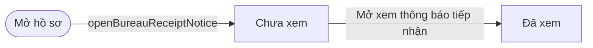
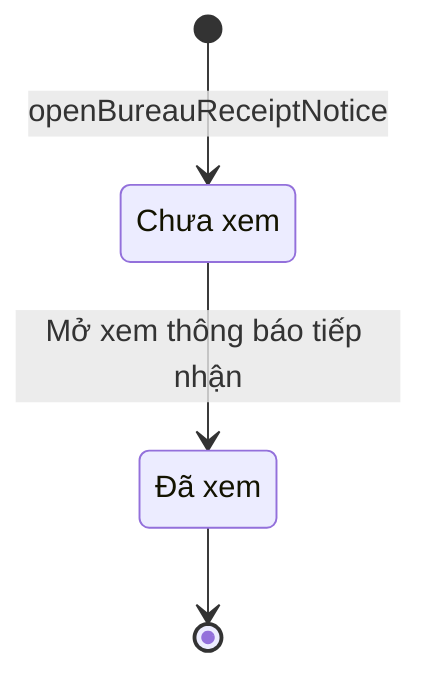

# qt-8.bureau-receipt-notice · Khen thưởng — Thông báo tiếp nhận hồ sơ khen thưởng

<!-- máy sinh: tom-tat -->
> **Hồ sơ:** Thông báo tiếp nhận hồ sơ khen thưởng (`BureauReceiptNotice`)
>
> **Trong sổ phạm vi:** 8 · Khen thưởng — hồ sơ phụ bureau-receipt-notice (tầng 1)
>
> 2 bước · 2 chặng · 2 vai · 0 bảng quyết định · 0 hạn · 0 khớp nối.
>
> **Nguồn:** sổ nghiệp vụ `qt-8.bureau-receipt-notice` · khai báo của app: `dqtv-app/core/processes/award/workflow/bureau-receipt-notice.yaml`. Các bảng do máy sinh từ nguồn này.
<!-- hết: tom-tat -->

<!-- viết tay: dien-giai -->
## Diễn giải

*Phần này viết tay, diễn giải lại điều các bảng bên dưới ghi.*

### Quy trình này để làm gì

Đây là hồ sơ phụ của khen thưởng (quy trình 8): một **thông báo tiếp nhận hồ sơ khen thưởng**, cho biết cơ quan tiếp nhận hồ sơ trình lên đã mở xem hay chưa. Hồ sơ chỉ có hai chặng: *Chưa xem* → *Đã xem*.

Thông báo thuộc về đơn vị **nhận** hồ sơ: người của đơn vị nhận bấm mở xem, bước ghi ai xem và lúc nào; cấp đã trình chỉ thấy trạng thái trên hồ sơ của mình.

### Khi nào bắt đầu

Vai `operator` làm bước `openBureauReceiptNotice`, đưa thông báo vào chặng *Chưa xem* và ghi đơn vị chủ hồ sơ.

### Diễn ra thế nào

**Chặng "Chưa xem"** — chỉ có một bước: Cục Dân quân tự vệ bấm **Mở xem thông báo tiếp nhận**, thông báo sang *Đã xem*. Bước không đòi nhập gì; hệ ghi lại thời điểm xem và người xem.

### Kết thúc và để lại gì

Thông báo kết thúc ở chặng *Đã xem*, để lại thời điểm xem và tên người xem.

### Điều kiện chặn

- Bước mở xem: người làm phải là người của đơn vị ghi ở ô đơn vị chủ hồ sơ của thông báo. Sai người, sai chặng thì bước bị chặn, thông báo giữ nguyên.
<!-- hết viết tay -->

## 1. Đường đi ngắn nhất qua các chặng

<!-- máy sinh: luong-chinh -->
Đường ít bước nhất từ lúc mở hồ sơ tới chặng kết thúc xa nhất. Máy chọn theo số chặng, không theo ý nghĩa nghiệp vụ — trình tự công việc thật xem phần Diễn giải và bảng "Việc làm ở từng chặng" ở mục 6.

| # | Ai làm | Làm gì | Hồ sơ sang chặng |
|---|---|---|---|
| 1 | `operator` | `openBureauReceiptNotice` | Chưa xem |
| 2 | Cục Dân quân tự vệ | Mở xem thông báo tiếp nhận | Đã xem |

<!-- hết: luong-chinh -->

## 2. Hồ sơ và việc nó để lại

<!-- máy sinh: muc-tieu -->
**App gọi quy trình này là:** Thông báo tiếp nhận hồ sơ khen thưởng.
<!-- hết: muc-tieu -->

## 3. Khởi phát và kết thúc

<!-- máy sinh: khoi-phat -->
**1 cửa vào** — bước mở hồ sơ:

| Bước mở | Ai mở | Hồ sơ vào chặng | App bắt buộc nhập |
|---|---|---|---|
| `openBureauReceiptNotice` | `operator` | Chưa xem | — |

**Kết thúc:** *Đã xem* (`VIEWED`)
<!-- hết: khoi-phat -->

## 4. Vai trò

<!-- máy sinh: vai-tro -->
| Vai trong sổ | Tên trong app | Điều kiện | Làm những bước |
|---|---|---|---|
| `bureau` | Cục Dân quân tự vệ |  | Mở xem thông báo tiếp nhận |
| `operator` | `operator` |  | `openBureauReceiptNotice` |

*"Tên trong app" là tên app đặt cho mã chủ thể của vai. Hồ sơ thuộc đơn vị cấp khác thì người làm là người giữ vai ấy ở đơn vị nêu trong cột "Điều kiện" (nếu sổ có ghi) và ở cột "Người làm phải thuộc" của bảng "Theo khai báo của app" (mục 7).*
<!-- hết: vai-tro -->

## 5. Nhánh phụ

<!-- máy sinh: nhanh-phu -->
Không có bước nào ngoài luồng chính.
<!-- hết: nhanh-phu -->

## 6. Các chặng và việc làm ở từng chặng

<!-- máy sinh: chang -->
| Chặng | Tên hiển thị | Vào bằng bước | Kết thúc? |
|---|---|---|---|
| `UNVIEWED` | Chưa xem | `openBureauReceiptNotice` |  |
| `VIEWED` | Đã xem | Mở xem thông báo tiếp nhận | **kết thúc** |

### Việc làm ở từng chặng

Hồ sơ đang ở chặng nào thì làm được những bước nào.

| Hồ sơ đang ở chặng | Bước làm tại chặng (hồ sơ đứng yên) | Bước đưa hồ sơ sang chặng khác |
|---|---|---|
| **Chưa xem** | — | Mở xem thông báo tiếp nhận — Cục Dân quân tự vệ → *Đã xem* |
| **Đã xem** | — | — (kết thúc) |
<!-- hết: chang -->

## 7. Bảng bước

<!-- máy sinh: buoc -->
| # | Bước | Mã bước | Ai thực hiện | Từ chặng | Sang chặng | Phải có trước | Ghi lại |
|---|---|---|---|---|---|---|---|
| 1 | Mở xem thông báo tiếp nhận | `viewBureauReceiptNotice` | Cục Dân quân tự vệ | `UNVIEWED` | `VIEWED` | người làm thuộc đơn vị chủ hồ sơ | xem lúc, người xem |
| 2 | `openBureauReceiptNotice` | `openBureauReceiptNotice` | `operator` | — (mở hồ sơ) | `UNVIEWED` | — | đơn vị chủ hồ sơ |

### Khi không đạt điều kiện

Mặc định: không đúng người, hồ sơ không ở đúng chặng, hoặc thiếu thứ "phải có trước" thì bước bị chặn, hồ sơ giữ nguyên. Bảng dưới chỉ kê những bước có kết quả riêng.

Không bước nào có kết quả riêng — tất cả theo mặc định.

### Điều kiện "phải có trước" bằng lời

Cột "Phải có trước" ở bảng bước có hai loại: ô dữ liệu thường (bước chỉ đòi ô ấy đã có giá trị) và điều kiện hệ tự xét. Bảng này diễn các điều kiện hệ tự xét theo đúng công thức sổ ghi; số ở cột cuối là số thứ tự bước.

| Điều kiện | Đúng khi | Bước đòi |
|---|---|---|
| `actorInOwnerUnit` | người đang làm là người của đơn vị ghi ở ô đơn vị chủ hồ sơ của hồ sơ này (theo danh mục người của đơn vị, `dm.unit-staff`) | 1 |

### Theo khai báo của app

Người làm phải thuộc đơn vị nào, ô người dùng phải nhập, bước có lặp được không, và căn cứ pháp lý — lấy từ khai báo quy trình trong app.

| # | Bước | Người làm phải thuộc | Bắt buộc nhập | Nhập nếu có | Lặp được | Căn cứ |
|---|---|---|---|---|---|---|
| 1 | Mở xem thông báo tiếp nhận | đơn vị chủ hồ sơ | — | — |  | 23/VBHN-BQP Đ.25 k7 — FR-05 |
<!-- hết: buoc -->

## 8. Bảng quyết định, hạn, việc ngoài hệ

<!-- máy sinh: quyet-dinh -->

<!-- hết: quyet-dinh -->

## 9. Dữ liệu của hồ sơ

<!-- máy sinh: du-lieu -->
Các ô mà bước trong sổ ghi hoặc đòi. Số trong hai cột cuối là số thứ tự bước ở bảng bước (mục 7).

| Ô dữ liệu | Mã | Kiểu (app) | Giá trị cho phép | Loại ô (sổ) | Bước ghi | Bước đòi | Mô tả trong app |
|---|---|---|---|---|---|---|---|
| xem lúc | `viewedAt` | ngày giờ |  |  | 1 | — | Thời điểm Cục Dân quân tự vệ mở xem — FR-05 |
| người xem | `viewedBy` | chữ |  |  | 1 | — | Tên người mở xem (AC-CucTĐ) — FR-05 |
| đơn vị chủ hồ sơ | `ownerUnit` |  |  | lưu trên hồ sơ (`stored`) | 2 | — |  |
| người làm thuộc đơn vị chủ hồ sơ | `actorInOwnerUnit` |  | có hay chưa | hệ suy ra (`derived`) | — | 1 |  |

4 ô. Cột "Loại ô" là cách sổ phân loại ô, in kèm đúng chữ của sổ; ô nào người dùng phải nhập xem bảng "Theo khai báo của app" ở mục 7.
<!-- hết: du-lieu -->

## 10. Khớp nối với quy trình khác

<!-- máy sinh: khop-noi -->
Hồ sơ này không có mối nối với hồ sơ của quy trình khác.
<!-- hết: khop-noi -->

## 11. Thông tin chung

<!-- máy sinh: thong-tin -->
| | |
|---|---|
| **Mã trong sổ** | `qt-8.bureau-receipt-notice` |
| **Quy trình trong app** | `award` (`workflow/bureau-receipt-notice.yaml`) — mặt công tác: `political` |
| **Hồ sơ** | Thông báo tiếp nhận hồ sơ khen thưởng (`BureauReceiptNotice`) |
| **Cùng mã quy trình** | [qt-8](qt-8.html), [qt-8.medal](qt-8.medal.html) |
| **Căn cứ pháp lý từng bước** | cột "Căn cứ" ở bảng "Theo khai báo của app", mục 7 |
<!-- hết: thong-tin -->
