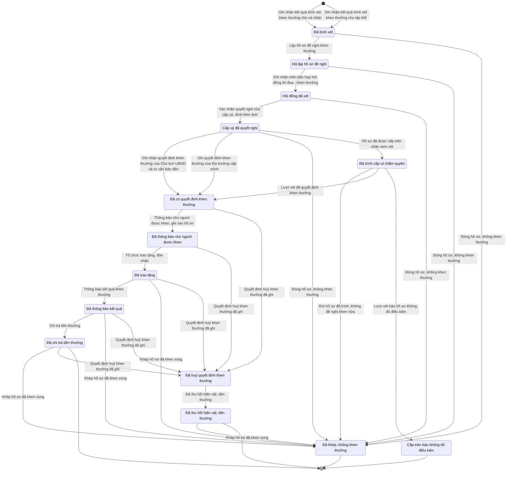

# qt-8 · Khen thưởng

<!-- máy sinh: tom-tat -->
> **Hồ sơ:** Hồ sơ khen thưởng (`AwardCase`)
>
> **Trong sổ phạm vi:** 8 · Khen thưởng — hồ sơ khen thưởng: bình xét, lập hồ sơ, gửi lên hoặc tự quyết, quyết định, công bố, trao tặng, chi, đóng (tầng 1)
>
> 24 bước · 14 chặng · 3 vai · 9 bảng quyết định · 1 hạn · 19 khớp nối.
>
> **Nguồn:** sổ nghiệp vụ `qt-8` · khai báo của app: `dqtv-app/core/processes/award/workflow/award.yaml`. Các bảng do máy sinh từ nguồn này.
<!-- hết: tom-tat -->

<!-- viết tay: dien-giai -->
## Diễn giải

*Phần này viết tay, diễn giải lại điều các bảng bên dưới ghi.*

### Quy trình này để làm gì

Theo dõi một **hồ sơ khen thưởng** của một cá nhân hoặc một tập thể, từ lúc có kết quả bình xét tới lúc chi trả tiền thưởng. Phía đơn vị lập hồ sơ là Chính trị viên (vai `operator`) và Nhân viên tài chính kiêm hậu cần (vai `finance`), người làm thuộc đơn vị chủ hồ sơ. Phía thẩm định và quyết định là ba vai: Phòng Chính trị, Bộ CHQS cấp tỉnh; Cục Chính trị, quân khu; Cục Dân quân tự vệ — người làm thuộc đơn vị đang giữ hồ sơ. Ô "cấp lập hồ sơ" có sáu giá trị: xã, tỉnh, quân khu, Cục, Ban CHQS cơ quan, tổ chức, Ban CHQS bộ, ngành.

Hồ sơ có 13 chặng. Đường chính: *Đã bình xét* → *Cấp uỷ đã quyết nghị* → *Đã ký hồ sơ đề nghị* → *Đã trình cấp có thẩm quyền* → *Đã thẩm định đạt* → *Đã có quyết định khen thưởng* → *Đã thông báo cho người được khen* → *Đã trao tặng* → *Đã chi trả tiền thưởng*. Bốn chặng còn lại là đường rẽ: *Cấp trên báo không đủ điều kiện*, *Đã khép, không khen thưởng*, *Đã huỷ quyết định khen thưởng*, *Đã thu hồi hiện vật, tiền thưởng*.

Cấp quyết định suy ra từ hình thức khen. Ô "cấp quyết định" và ô "cấp lập hồ sơ" mở hoặc khoá từng bước, nên hồ sơ đi một trong các tuyến: quyết ngay tại cấp mình, lên tỉnh, lên quân khu, hay lên Bộ Quốc phòng qua Cục.

### Khi nào bắt đầu

Chính trị viên bấm **Ghi nhận kết quả bình xét khen thưởng**. Phải nhập tên cá nhân hoặc tập thể được đề nghị, kết quả bình xét, hình thức khen thưởng và việc gốc mà đợt bình xét thực hiện (`taskingId`). Khi mở, hồ sơ nối tới **Nhiệm vụ trên giao** (1) và **Chiến sĩ dân quân tự vệ** (16.enlistment). Bước còn ghi các ô cấp lập hồ sơ, loại đơn vị đề nghị, thành tích này đã khen chưa, số lần khen công trạng liên tục, còn trong trần 10% Chiến sĩ thi đua cơ sở hay đã vượt. Loại đơn vị đề nghị do hệ suy từ đơn vị làm chủ hồ sơ; thành tích đã khen chưa, số lần khen công trạng liên tục và trần 10% do hệ tính sẵn (trần 10% tính theo từng đơn vị bình xét trong một năm).

### Diễn ra thế nào

**Chặng "Đã bình xét"** (vai Chính trị viên của đơn vị chủ hồ sơ làm tất cả):

1. **Lập hồ sơ đề nghị khen thưởng** — chốt hình thức khen, người quyết định khen, tặng hay truy tặng. Bị xét theo hai bảng: người quyết định khen phải đúng với hình thức khen, và một thành tích chỉ khen một lần. Chỉ lập được một lần; muốn sửa phải rút hồ sơ về trước.
2. **Đính một thành phần hồ sơ** và **Gỡ một thành phần hồ sơ** — lặp được, làm được cả ở chặng sau; gỡ thì phải ghi vì sao.
3. **Ghi nhận biên bản họp hội đồng thi đua - khen thưởng** — phải lập hồ sơ trước; bị chặn nếu vượt trần 10% Chiến sĩ thi đua cơ sở.
4. Sau biên bản hội đồng, một trong hai: **Xác nhận quyết nghị của cấp uỷ, đính kèm ảnh** đưa hồ sơ sang *Cấp uỷ đã quyết nghị* — bước này ghi một quyết định ký ngoài hệ, người ký mang mã `commune_party_committee`; hoặc **Cấp uỷ không nhất trí** — ghi ý kiến cấp uỷ, hồ sơ đứng yên, chỉ ghi được một lần.

**Chặng "Cấp uỷ đã quyết nghị":** Chính trị viên bấm **Xác nhận thứ hai kết quả quyết nghị cấp ủy đảng**; bước đòi đã có quyết định ký ngoài hệ của `commune_party_committee`. Có xác nhận này mới làm được **Ghi nhận tờ trình đề nghị khen thưởng đã ký** (sang *Đã ký hồ sơ đề nghị*; người ký tờ trình bị xét theo bảng `signer-by-form`), hoặc **Xác nhận giấy khen của Chủ tịch UBND xã, đính kèm ảnh** — bước này đưa thẳng hồ sơ sang *Đã có quyết định khen thưởng*, cũng bấm được từ chặng *Đã ký hồ sơ đề nghị*; chỉ làm được khi cấp quyết định là Chủ tịch UBND cấp xã (`commune`); đây là quyết định ký ngoài hệ, người ký `commune_chairman`.

**Chặng "Đã ký hồ sơ đề nghị"** — chỗ hồ sơ rẽ tuyến:

- **Ghi quyết định khen thưởng của thủ trưởng cấp mình** — sang thẳng *Đã có quyết định khen thưởng*; chỉ làm được khi cấp lập hồ sơ là tỉnh, quân khu hoặc Cục và thẩm quyền quyết định là "Trong thẩm quyền đơn vị"; phải nhập số quyết định và đính văn bản quyết định.
- **Công bố hồ sơ đề nghị đã ký**, rồi trình lên một trong ba nơi, cả ba đều đưa hồ sơ sang *Đã trình cấp có thẩm quyền* và đều đòi đã công bố. Từng bước mở theo cấp lập hồ sơ: **Gửi hồ sơ đề nghị lên cơ quan thi đua, khen thưởng cấp tỉnh** — cấp xã hoặc Ban CHQS cơ quan, tổ chức; **Gửi hồ sơ đề nghị lên cơ quan thi đua, khen thưởng cấp quân khu** — cấp tỉnh; **Trình hồ sơ đề nghị Bộ trưởng Bộ Quốc phòng (qua Cục Dân quân tự vệ)** — quân khu, Ban CHQS bộ, ngành hoặc Ban CHQS cơ quan, tổ chức, và cấp quyết định phải là Bộ Quốc phòng hoặc cấp Nhà nước. Bước cuối còn bị xét theo bảng `bureau-submitter`. Khi trình, bước ghi hồ sơ đang ở cấp nào và đơn vị nào đang thẩm định.

**Chặng "Đã trình cấp có thẩm quyền"** — người làm phải thuộc đơn vị đang giữ hồ sơ (riêng bước thẩm định ở quân khu đòi người làm thuộc cấp trên của chủ hồ sơ), và bước chỉ làm được khi ô "đang ở cấp" đúng cấp của bước:

- *Tuyến tỉnh* (Phòng Chính trị, Bộ CHQS cấp tỉnh): **Thẩm định hồ sơ tại cơ quan thi đua, khen thưởng cấp tỉnh** (lặp được), rồi **Trình người có thẩm quyền cấp tỉnh quyết định khen thưởng** (sang *Đã thẩm định đạt*), hoặc **Trình tiếp hồ sơ lên quân khu** — hồ sơ vẫn ở chặng này nhưng đổi sang cấp quân khu giữ, kèm số và bản tờ trình đã ký.
- *Tuyến quân khu* (Cục Chính trị, quân khu): **Thẩm định hồ sơ tại cơ quan thi đua, khen thưởng cấp quân khu** (lặp được), rồi **Trình người có thẩm quyền cấp quân khu quyết định khen thưởng**, hoặc **Trình tiếp hồ sơ đề nghị Bộ trưởng (qua Cục Dân quân tự vệ)**.
- *Tuyến Cục* (Cục Dân quân tự vệ): **Thẩm định hồ sơ tại Cục Dân quân tự vệ** (lặp được), rồi **Soạn dự thảo quyết định, trình cấp thẩm quyền**.

Ba bước trình người có thẩm quyền và hai bước trình tiếp chỉ làm được khi kết quả thẩm định là Đạt. Các bước này còn xét cấp quyết định: trình người có thẩm quyền cấp tỉnh khi cấp quyết định là `province` hoặc `province_committee`, cấp quân khu khi là `region`, Cục soạn dự thảo khi là `ministry` hoặc `state`; cấp quyết định cao hơn thì trình tiếp. Mỗi cấp chỉ thẩm định một lần (chặn khi đã có "thẩm định lúc"); khi trình tiếp, kết quả, căn cứ và thời điểm thẩm định trên hồ sơ bị xoá. Mỗi lần thẩm định, trình tiếp, báo không đủ điều kiện để lại một *vòng xử lý hồ sơ khen thưởng ở cấp trên*.

**Chặng "Đã thẩm định đạt"** — ra quyết định, sang *Đã có quyết định khen thưởng*:

- Tỉnh: **Ký quyết định khen thưởng cấp tỉnh** (cấp quyết định là `province`), hoặc **Xác nhận bằng khen của Chủ tịch UBND cấp tỉnh, đính kèm ảnh** (cấp quyết định là `province_committee`; quyết định ký ngoài hệ, người ký `province_chairman`). Cả hai đòi đã có nội dung trình cấp có thẩm quyền.
- Quân khu: **Ký quyết định khen thưởng cấp quân khu** (cấp quyết định là `region`), cũng đòi đã có nội dung trình.
- Cục (các bước dưới đây chỉ mở khi cấp quyết định là `ministry` hoặc `state`): **Lập hồ sơ trình quyết định khen thưởng cấp Bộ Quốc phòng/Nhà nước** (lặp được), có hồ sơ trình rồi mới **Ký số quyết định khen thưởng cấp Bộ Quốc phòng/Nhà nước**. Cục còn hai việc ghi nhận, làm được cả sau khi đã có quyết định: **Gắn văn bản trình cấp trên (E24) đã lập** và **Gắn văn bản quyết định nhận về (E24)**. **Từ chối quyết định khen thưởng cấp Bộ Quốc phòng/Nhà nước** ghi lý do và thời điểm từ chối, hồ sơ đứng yên.

**Cấp trên không nhận** (từ *Đã trình* hoặc *Đã thẩm định đạt*): **Cơ quan cấp tỉnh thông báo hồ sơ không đủ điều kiện**, **Cơ quan cấp quân khu thông báo hồ sơ không đủ điều kiện**, hoặc Cục bấm **Ghi nhận thông báo không đủ điều kiện** — hồ sơ sang *Cấp trên báo không đủ điều kiện*. Ba bước này đều phải ghi số văn bản thông báo và lý do. Từ đó Chính trị viên chỉ có một bước: **Rút hồ sơ về để sửa, trình lại kỳ sau**, đưa hồ sơ về *Đã bình xét*.

**Đơn vị tự dừng:** **Đóng hồ sơ, không khen thưởng** bấm được ở ba chặng đầu; **Rút hồ sơ đã trình, không đề nghị khen nữa** bấm được khi đã trình hoặc đã thẩm định đạt, phải kèm công văn rút hồ sơ đã ký. Cả hai đòi lý do đóng và đưa hồ sơ sang *Đã khép, không khen thưởng*.

**Sau khi có quyết định:** Chính trị viên bấm **Thông báo cho người được khen, ghi vào hồ sơ**, rồi **Tổ chức trao tặng, đón nhận**. Ở chặng *Đã trao tặng*: Chính trị viên bấm **Thông báo kết quả khen thưởng**; có thông báo này Nhân viên tài chính kiêm hậu cần mới **Kiểm tra hồ sơ trước khi chi trả** (hợp lệ, hoặc cần bổ sung); Chính trị viên chỉ bấm được **Đã bổ sung, đề nghị kiểm tra lại** khi kết quả là cần bổ sung; cuối cùng Nhân viên tài chính bấm **Chi trả tiền thưởng** — bước đòi đã có kết quả kiểm tra.

**Huỷ quyết định khen** (từ lúc có quyết định, kể cả sau khi đã chi trả): Chính trị viên bấm **Đề nghị huỷ quyết định khen thưởng**, phải ghi số, ngày kết luận vi phạm; có văn bản đề nghị rồi Phòng Chính trị, Bộ CHQS cấp tỉnh (vai `deciding_level_staff`) mới **Ghi quyết định huỷ khen thưởng** (sang *Đã huỷ quyết định khen thưởng*), sau đó **Ghi kết quả thu hồi hiện vật, tiền thưởng** (sang *Đã thu hồi hiện vật, tiền thưởng*). Hai bước này đòi người làm thuộc một đơn vị trong ô cấp trên của chủ hồ sơ.

### Kết thúc và để lại gì

Hồ sơ kết thúc ở một trong ba chặng: *Đã chi trả tiền thưởng*, *Đã thu hồi hiện vật, tiền thưởng*, *Đã khép, không khen thưởng*.

Ngoài hai mối nối ghi lúc mở, hồ sơ được gắn với **Văn bản đi** và **Văn bản đến** (quy trình 1) ở hai bước gắn văn bản E24 của Cục.

### Điều kiện chặn

- Người làm: 24 bước phía đơn vị đòi người làm là người của đơn vị chủ hồ sơ; 18 bước phía cấp trên đòi người làm là người của đơn vị ghi ở ô đơn vị đang thẩm định; ba bước (thẩm định ở quân khu, ghi quyết định huỷ, ghi kết quả thu hồi) đòi người làm thuộc một đơn vị trong ô cấp trên của chủ hồ sơ. Sai người, sai chặng, thiếu thứ phải có trước thì chặn, hồ sơ giữ nguyên.
- Theo cấp: từng bước bị khoá theo ô "cấp lập hồ sơ", "cấp quyết định" và "đang ở cấp" (nêu ở phần trên).
- Làm một lần: không bấm lại được ở lập hồ sơ, ghi biên bản hội đồng, cấp uỷ không nhất trí, công bố, thẩm định, báo không đủ điều kiện, từ chối quyết định cấp Bộ/Nhà nước, đề nghị huỷ, thông báo kết quả. Xác nhận thứ hai quyết nghị cấp uỷ không làm được khi hồ sơ đã công bố.
- Quyết định ký ngoài hệ: quyết nghị cấp uỷ `commune_party_committee`; giấy khen `commune_chairman`; bằng khen `province_chairman`.
- Bảng người quyết định khen (`award-authority`, 19 dòng): mỗi nhóm hình thức khen chỉ cho qua một người quyết định; chưa chọn hình thức, chưa có người quyết định, hoặc sai người thì chặn.
- Một thành tích khen một lần (`achievement-once`): ô "thành tích đã khen chưa" mang giá trị Đã khen thành tích này thì chặn ở bước lập hồ sơ.
- Trần 10% Chiến sĩ thi đua cơ sở (`cstdcs-cap`): hồ sơ xét theo căn cứ sáng kiến, đề tài khoa học – đổi mới sáng tạo, hoặc mưu trí trong chiến đấu mà đã vượt trần thì chặn ở bước ghi biên bản hội đồng.
- Người ký tờ trình (`signer-by-form`): chỉ huy quân sự ký hồ sơ mà người quyết định là Chủ tịch UBND xã hoặc tỉnh thì chặn; Chủ tịch Uỷ ban ký hồ sơ mà người quyết định thuộc tuyến quân sự hoặc cấp Nhà nước thì chặn; chưa ghi người ký cũng chặn.
- Đơn vị trình qua Cục (`bureau-submitter`): loại đơn vị đề nghị là "khác" hoặc chưa ghi thì chặn.
- Hạn: 10 ngày làm việc tính từ khi làm bước thông báo cho người được khen; quá hạn thì chặn.
- Việc ngoài hệ: ranh giới `propaganda-department` (người làm `propagandaDepartment`) — hệ chỉ nhận về số văn bản thông báo không đủ điều kiện; không được thì chặn, hồ sơ giữ nguyên.
<!-- hết viết tay -->

## 1. Đường đi ngắn nhất qua các chặng

<!-- máy sinh: luong-chinh -->
Đường ít bước nhất từ lúc mở hồ sơ tới chặng kết thúc xa nhất. Máy chọn theo số chặng, không theo ý nghĩa nghiệp vụ — trình tự công việc thật xem phần Diễn giải và bảng "Việc làm ở từng chặng" ở mục 6.

| # | Ai làm | Làm gì | Hồ sơ sang chặng |
|---|---|---|---|
| 1 | Chính trị viên | Ghi nhận kết quả bình xét khen thưởng cho cá nhân | Đã bình xét |
| 2 | Chính trị viên | Lập hồ sơ đề nghị khen thưởng | Đã lập hồ sơ đề nghị |
| 3 | Chính trị viên | Ghi nhận biên bản họp hội đồng thi đua - khen thưởng | Hội đồng đã xét |
| 4 | Chính trị viên | Xác nhận quyết nghị của cấp uỷ, đính kèm ảnh | Cấp uỷ đã quyết nghị |
| 5 | Chính trị viên | Ghi nhận quyết định khen thưởng của Chủ tịch UBND xã từ văn bản đến | Đã có quyết định khen thưởng |
| 6 | Chính trị viên | Thông báo cho người được khen, ghi vào hồ sơ | Đã thông báo cho người được khen |
| 7 | Chính trị viên | Tổ chức trao tặng, đón nhận | Đã trao tặng |
| 8 | Chính trị viên | Thông báo kết quả khen thưởng | Đã thông báo kết quả |
| 9 | Nhân viên tài chính kiêm hậu cần | Chi trả tiền thưởng | Đã chi trả tiền thưởng |

<!-- hết: luong-chinh -->

## 2. Hồ sơ và việc nó để lại

<!-- máy sinh: muc-tieu -->
**App gọi quy trình này là:** Hồ sơ khen thưởng.

**Khi mở, hồ sơ này ghi mối nối tới:**
- Chiến sĩ dân quân tự vệ (16.enlistment) — bước `recordMemberSelection`, khớp nối `awardCaseForMember`
- Nhiệm vụ trên giao (1) — bước `recordMemberSelection`, khớp nối `awardCaseServesTasking`
- Nhiệm vụ trên giao (1) — bước `recordUnitSelection`, khớp nối `awardCaseServesTasking`
- Phong trào thi đua (7) — bước `recordMemberSelection`, khớp nối `awardCaseArisesFromCampaign`
- Phong trào thi đua (7) — bước `recordUnitSelection`, khớp nối `awardCaseArisesFromCampaign`
- Vụ việc ứng phó (20) — bước `recordMemberSelection`, khớp nối `awardCaseForIncident`
- Vụ việc ứng phó (20) — bước `recordUnitSelection`, khớp nối `awardCaseForIncident`
- Đơn vị dân quân tự vệ (29) — bước `recordUnitSelection`, khớp nối `awardCaseForUnit`

**Hồ sơ này để lại cho quy trình khác** (bước tạo hồ sơ của quy trình kia ghi mối nối về đây):
- Phiếu chi (12a.payment-voucher) — bước `recordCommunePaymentVoucher`, khớp nối `voucherForAward`
- Phiếu chi (12a.payment-voucher) — bước `recordProvincePaymentVoucher`, khớp nối `voucherForAward`
- Tệp lưu trữ (D16) — bước `recordArchiveFile`, khớp nối `fileOfAwardCase`
- Đề nghị cấp kinh phí (4.funding-request) — bước `estimateCommuneFundingRequest`, khớp nối `fundingRequestFromAward`
- Đề nghị cấp kinh phí (4.funding-request) — bước `estimateProvinceFundingRequest`, khớp nối `fundingRequestFromAward`
<!-- hết: muc-tieu -->

## 3. Khởi phát và kết thúc

<!-- máy sinh: khoi-phat -->
**2 cửa vào** — bước mở hồ sơ:

| Bước mở | Ai mở | Hồ sơ vào chặng | App bắt buộc nhập |
|---|---|---|---|
| Ghi nhận kết quả bình xét khen thưởng cho cá nhân | Chính trị viên | Đã bình xét | tên cá nhân/tập thể được đề nghị, kết quả bình xét, `taskingId` |
| Ghi nhận kết quả bình xét khen thưởng cho tập thể | Chính trị viên | Đã bình xét | tên cá nhân/tập thể được đề nghị, kết quả bình xét, `taskingId` |

**Kết thúc:** *Đã chi trả tiền thưởng* (`PAID`), *Cấp trên báo không đủ điều kiện* (`REJECTED`), *Đã thu hồi hiện vật, tiền thưởng* (`RECOVERED`), *Đã khép, không khen thưởng* (`CLOSED`)
<!-- hết: khoi-phat -->

## 4. Vai trò

<!-- máy sinh: vai-tro -->
| Vai trong sổ | Tên trong app | Điều kiện | Làm những bước |
|---|---|---|---|
| `operator` | Chính trị viên |  | Ghi nhận kết quả bình xét khen thưởng cho cá nhân · Ghi nhận kết quả bình xét khen thưởng cho tập thể · Lập hồ sơ đề nghị khen thưởng · Đính một thành phần hồ sơ · Gỡ một thành phần hồ sơ · Ghi nhận biên bản họp hội đồng thi đua - khen thưởng · Xác nhận quyết nghị của cấp uỷ, đính kèm ảnh · Cấp uỷ không nhất trí · Trình ký tờ trình đề nghị khen thưởng · Công bố hồ sơ đề nghị đã ký · Ghi nhận quyết định khen thưởng của Chủ tịch UBND xã từ văn bản đến · Ghi quyết định khen thưởng của thủ trưởng cấp mình · Thông báo cho người được khen, ghi vào hồ sơ · Tổ chức trao tặng, đón nhận · Đóng hồ sơ, không khen thưởng · Rút hồ sơ đã trình, không đề nghị khen nữa · Thông báo kết quả khen thưởng · Khép hồ sơ đã khen xong |
| `finance` | Nhân viên tài chính kiêm hậu cần |  | Chi trả tiền thưởng |
| `system` | Hệ thống tự làm |  | Hồ sơ đã được cấp trên nhận xem xét · Lượt xét đã quyết định khen thưởng · Lượt xét báo hồ sơ không đủ điều kiện · Quyết định huỷ khen thưởng đã ghi · Đã thu hồi hiện vật, tiền thưởng |

*"Tên trong app" là tên app đặt cho mã chủ thể của vai. Hồ sơ thuộc đơn vị cấp khác thì người làm là người giữ vai ấy ở đơn vị nêu trong cột "Điều kiện" (nếu sổ có ghi) và ở cột "Người làm phải thuộc" của bảng "Theo khai báo của app" (mục 7).*

**Ngoài hệ** (hệ chỉ ghi kết quả, xem mục 8): `propagandaDepartment`.
<!-- hết: vai-tro -->

## 5. Nhánh phụ

<!-- máy sinh: nhanh-phu -->
**Bước khác đưa hồ sơ sang chặng mới** — đường song song, rẽ nhánh hoặc kết thúc sớm:

| Bước | Ai làm | Từ chặng | Sang chặng |
|---|---|---|---|
| Ghi quyết định khen thưởng của thủ trưởng cấp mình | Chính trị viên | Cấp uỷ đã quyết nghị | Đã có quyết định khen thưởng |
| Đóng hồ sơ, không khen thưởng | Chính trị viên | Đã bình xét, Cấp uỷ đã quyết nghị, Đã lập hồ sơ đề nghị, Hội đồng đã xét | Đã khép, không khen thưởng |
| Rút hồ sơ đã trình, không đề nghị khen nữa | Chính trị viên | Đã trình cấp có thẩm quyền | Đã khép, không khen thưởng |
| Khép hồ sơ đã khen xong | Chính trị viên | Đã trao tặng, Đã chi trả tiền thưởng, Đã thu hồi hiện vật, tiền thưởng, Đã thông báo kết quả | Đã khép, không khen thưởng |
| Hồ sơ đã được cấp trên nhận xem xét | Hệ thống tự làm | Cấp uỷ đã quyết nghị | Đã trình cấp có thẩm quyền |
| Lượt xét đã quyết định khen thưởng | Hệ thống tự làm | Đã trình cấp có thẩm quyền | Đã có quyết định khen thưởng |
| Lượt xét báo hồ sơ không đủ điều kiện | Hệ thống tự làm | Đã trình cấp có thẩm quyền | Cấp trên báo không đủ điều kiện |
| Quyết định huỷ khen thưởng đã ghi | Hệ thống tự làm | Đã có quyết định khen thưởng, Đã thông báo cho người được khen, Đã trao tặng, Đã chi trả tiền thưởng, Đã thông báo kết quả | Đã huỷ quyết định khen thưởng |
| Đã thu hồi hiện vật, tiền thưởng | Hệ thống tự làm | Đã huỷ quyết định khen thưởng | Đã thu hồi hiện vật, tiền thưởng |

**Làm trong lúc hồ sơ đứng yên ở một chặng** — ghi nhận, bổ sung:

| Bước | Ai làm | Ở chặng |
|---|---|---|
| Đính một thành phần hồ sơ *(lặp được)* | Chính trị viên | Đã bình xét, Cấp uỷ đã quyết nghị, Đã lập hồ sơ đề nghị, Hội đồng đã xét |
| Gỡ một thành phần hồ sơ *(lặp được)* | Chính trị viên | Đã bình xét, Cấp uỷ đã quyết nghị, Đã lập hồ sơ đề nghị, Hội đồng đã xét |
| Cấp uỷ không nhất trí *(lặp được)* | Chính trị viên | Hội đồng đã xét |
| Trình ký tờ trình đề nghị khen thưởng | Chính trị viên | Cấp uỷ đã quyết nghị |
| Công bố hồ sơ đề nghị đã ký | Chính trị viên | Cấp uỷ đã quyết nghị |

**Cửa vào khác:** 2 bước cùng mở hồ sơ — xem mục 3.

<!-- hết: nhanh-phu -->

## 6. Các chặng và việc làm ở từng chặng

<!-- máy sinh: chang -->
| Chặng | Tên hiển thị | Vào bằng bước | Kết thúc? |
|---|---|---|---|
| `SELECTED` | Đã bình xét | Ghi nhận kết quả bình xét khen thưởng cho cá nhân · Ghi nhận kết quả bình xét khen thưởng cho tập thể |  |
| `DOSSIER_DRAFTED` | Đã lập hồ sơ đề nghị | Lập hồ sơ đề nghị khen thưởng |  |
| `COUNCIL_REVIEWED` | Hội đồng đã xét | Ghi nhận biên bản họp hội đồng thi đua - khen thưởng |  |
| `ENDORSED` | Cấp uỷ đã quyết nghị | Xác nhận quyết nghị của cấp uỷ, đính kèm ảnh |  |
| `SUBMITTED` | Đã trình cấp có thẩm quyền | Hồ sơ đã được cấp trên nhận xem xét |  |
| `DECIDED` | Đã có quyết định khen thưởng | Ghi nhận quyết định khen thưởng của Chủ tịch UBND xã từ văn bản đến · Ghi quyết định khen thưởng của thủ trưởng cấp mình · Lượt xét đã quyết định khen thưởng |  |
| `ANNOUNCED` | Đã thông báo cho người được khen | Thông báo cho người được khen, ghi vào hồ sơ |  |
| `AWARDED` | Đã trao tặng | Tổ chức trao tặng, đón nhận |  |
| `RESULT_NOTIFIED` | Đã thông báo kết quả | Thông báo kết quả khen thưởng |  |
| `PAID` | Đã chi trả tiền thưởng | Chi trả tiền thưởng | **kết thúc** — vẫn còn bước làm được |
| `REJECTED` | Cấp trên báo không đủ điều kiện | Lượt xét báo hồ sơ không đủ điều kiện | **kết thúc** |
| `REVOKED` | Đã huỷ quyết định khen thưởng | Quyết định huỷ khen thưởng đã ghi |  |
| `RECOVERED` | Đã thu hồi hiện vật, tiền thưởng | Đã thu hồi hiện vật, tiền thưởng | **kết thúc** — vẫn còn bước làm được |
| `CLOSED` | Đã khép, không khen thưởng | Đóng hồ sơ, không khen thưởng · Rút hồ sơ đã trình, không đề nghị khen nữa · Khép hồ sơ đã khen xong | **kết thúc** |

### Việc làm ở từng chặng

Hồ sơ đang ở chặng nào thì làm được những bước nào.

| Hồ sơ đang ở chặng | Bước làm tại chặng (hồ sơ đứng yên) | Bước đưa hồ sơ sang chặng khác |
|---|---|---|
| **Đã bình xét** | Đính một thành phần hồ sơ (lặp được) — Chính trị viên Gỡ một thành phần hồ sơ (lặp được) — Chính trị viên | Lập hồ sơ đề nghị khen thưởng — Chính trị viên → *Đã lập hồ sơ đề nghị* Đóng hồ sơ, không khen thưởng — Chính trị viên → *Đã khép, không khen thưởng* |
| **Đã lập hồ sơ đề nghị** | Đính một thành phần hồ sơ (lặp được) — Chính trị viên Gỡ một thành phần hồ sơ (lặp được) — Chính trị viên | Ghi nhận biên bản họp hội đồng thi đua - khen thưởng — Chính trị viên → *Hội đồng đã xét* Đóng hồ sơ, không khen thưởng — Chính trị viên → *Đã khép, không khen thưởng* |
| **Hội đồng đã xét** | Đính một thành phần hồ sơ (lặp được) — Chính trị viên Gỡ một thành phần hồ sơ (lặp được) — Chính trị viên Cấp uỷ không nhất trí (lặp được) — Chính trị viên | Xác nhận quyết nghị của cấp uỷ, đính kèm ảnh — Chính trị viên → *Cấp uỷ đã quyết nghị* Đóng hồ sơ, không khen thưởng — Chính trị viên → *Đã khép, không khen thưởng* |
| **Cấp uỷ đã quyết nghị** | Đính một thành phần hồ sơ (lặp được) — Chính trị viên Gỡ một thành phần hồ sơ (lặp được) — Chính trị viên Trình ký tờ trình đề nghị khen thưởng — Chính trị viên Công bố hồ sơ đề nghị đã ký — Chính trị viên | Ghi nhận quyết định khen thưởng của Chủ tịch UBND xã từ văn bản đến — Chính trị viên → *Đã có quyết định khen thưởng* Ghi quyết định khen thưởng của thủ trưởng cấp mình — Chính trị viên → *Đã có quyết định khen thưởng* Đóng hồ sơ, không khen thưởng — Chính trị viên → *Đã khép, không khen thưởng* Hồ sơ đã được cấp trên nhận xem xét — Hệ thống tự làm → *Đã trình cấp có thẩm quyền* |
| **Đã trình cấp có thẩm quyền** | — | Rút hồ sơ đã trình, không đề nghị khen nữa — Chính trị viên → *Đã khép, không khen thưởng* Lượt xét đã quyết định khen thưởng — Hệ thống tự làm → *Đã có quyết định khen thưởng* Lượt xét báo hồ sơ không đủ điều kiện — Hệ thống tự làm → *Cấp trên báo không đủ điều kiện* |
| **Đã có quyết định khen thưởng** | — | Thông báo cho người được khen, ghi vào hồ sơ — Chính trị viên → *Đã thông báo cho người được khen* Quyết định huỷ khen thưởng đã ghi — Hệ thống tự làm → *Đã huỷ quyết định khen thưởng* |
| **Đã thông báo cho người được khen** | — | Tổ chức trao tặng, đón nhận — Chính trị viên → *Đã trao tặng* Quyết định huỷ khen thưởng đã ghi — Hệ thống tự làm → *Đã huỷ quyết định khen thưởng* |
| **Đã trao tặng** | — | Thông báo kết quả khen thưởng — Chính trị viên → *Đã thông báo kết quả* Khép hồ sơ đã khen xong — Chính trị viên → *Đã khép, không khen thưởng* Quyết định huỷ khen thưởng đã ghi — Hệ thống tự làm → *Đã huỷ quyết định khen thưởng* |
| **Đã thông báo kết quả** | — | Chi trả tiền thưởng — Nhân viên tài chính kiêm hậu cần → *Đã chi trả tiền thưởng* Khép hồ sơ đã khen xong — Chính trị viên → *Đã khép, không khen thưởng* Quyết định huỷ khen thưởng đã ghi — Hệ thống tự làm → *Đã huỷ quyết định khen thưởng* |
| **Đã chi trả tiền thưởng** | — | Khép hồ sơ đã khen xong — Chính trị viên → *Đã khép, không khen thưởng* Quyết định huỷ khen thưởng đã ghi — Hệ thống tự làm → *Đã huỷ quyết định khen thưởng* |
| **Cấp trên báo không đủ điều kiện** | — | — (kết thúc) |
| **Đã huỷ quyết định khen thưởng** | — | Đã thu hồi hiện vật, tiền thưởng — Hệ thống tự làm → *Đã thu hồi hiện vật, tiền thưởng* |
| **Đã thu hồi hiện vật, tiền thưởng** | — | Khép hồ sơ đã khen xong — Chính trị viên → *Đã khép, không khen thưởng* |
| **Đã khép, không khen thưởng** | — | — (kết thúc) |
<!-- hết: chang -->

## 7. Bảng bước

<!-- máy sinh: buoc -->
| # | Bước | Mã bước | Ai thực hiện | Từ chặng | Sang chặng | Phải có trước | Ghi lại |
|---|---|---|---|---|---|---|---|
| 1 | Ghi nhận kết quả bình xét khen thưởng cho cá nhân | `recordMemberSelection` | Chính trị viên | — (mở hồ sơ) | `SELECTED` | `taskingAssigned`, `awardFormNotServiceMedal`, `subjectInActorUnit`, `revisedFromAwardRefused`, `awardFormFitsSubject`, `cstdcsBasisFitsForm` | mã tỉnh, mã xã, tên cá nhân/tập thể được đề nghị, kết quả bình xét, hình thức khen thưởng, cấp quyết định, danh hiệu khen (lần trước), thẩm quyền quyết định, lập hồ sơ lúc, nối tới Chiến sĩ dân quân tự vệ, nối tới Phong trào thi đua, nối tới Nhiệm vụ trên giao, đơn vị chủ hồ sơ, cấp trên của chủ hồ sơ, căn cứ xét Chiến sĩ thi đua cơ sở, lý do thủ tục đơn giản, loại hình khen, loại đơn vị đề nghị, số lần khen công trạng liên tục, cấp lập hồ sơ, trần 10% Chiến sĩ thi đua cơ sở, `id`, mức hoàn thành nhiệm vụ, tỷ lệ nội dung thi, kiểm tra đạt yêu cầu (%), tỷ lệ đạt khá, giỏi (%), tổ chức đảng, tổ chức quần chúng, nguồn số liệu tiêu chuẩn, lý do áp dụng luật mới có lợi hơn, nối tới Vụ việc ứng phó, nối tới Hồ sơ khen thưởng |
| 2 | Ghi nhận kết quả bình xét khen thưởng cho tập thể | `recordUnitSelection` | Chính trị viên | — (mở hồ sơ) | `SELECTED` | `taskingAssigned`, `awardFormNotServiceMedal`, `subjectInActorUnit`, `revisedFromAwardRefused`, `awardFormFitsSubject`, `cstdcsBasisFitsForm` | mã tỉnh, mã xã, tên cá nhân/tập thể được đề nghị, kết quả bình xét, hình thức khen thưởng, cấp quyết định, danh hiệu khen (lần trước), thẩm quyền quyết định, lập hồ sơ lúc, nối tới Đơn vị dân quân tự vệ, nối tới Phong trào thi đua, nối tới Nhiệm vụ trên giao, đơn vị chủ hồ sơ, cấp trên của chủ hồ sơ, căn cứ xét Chiến sĩ thi đua cơ sở, lý do thủ tục đơn giản, loại hình khen, loại đơn vị đề nghị, số lần khen công trạng liên tục, cấp lập hồ sơ, trần 10% Chiến sĩ thi đua cơ sở, `id`, mức hoàn thành nhiệm vụ, tỷ lệ nội dung thi, kiểm tra đạt yêu cầu (%), tỷ lệ đạt khá, giỏi (%), tổ chức đảng, tổ chức quần chúng, nguồn số liệu tiêu chuẩn, lý do áp dụng luật mới có lợi hơn, nối tới Vụ việc ứng phó, nối tới Hồ sơ khen thưởng |
| 3 | Lập hồ sơ đề nghị khen thưởng | `draftDossier` | Chính trị viên | `SELECTED` | `DOSSIER_DRAFTED` | hình thức khen thưởng, người làm thuộc đơn vị chủ hồ sơ | hình thức khen thưởng, tặng hay truy tặng, người được đề nghị đã mất, cấp quyết định, người quyết định khen, thẩm quyền quyết định, lập hồ sơ lúc |
| 4 | Đính một thành phần hồ sơ | `attachDossierPart` | Chính trị viên | `SELECTED`, `ENDORSED`, `DOSSIER_DRAFTED`, `COUNCIL_REVIEWED` | giữ nguyên | người làm thuộc đơn vị chủ hồ sơ | nối tới Thành phần hồ sơ khen thưởng |
| 5 | Gỡ một thành phần hồ sơ | `removeDossierPart` | Chính trị viên | `SELECTED`, `ENDORSED`, `DOSSIER_DRAFTED`, `COUNCIL_REVIEWED` | giữ nguyên | người làm thuộc đơn vị chủ hồ sơ, `dossierPartAttached` | — |
| 6 | Ghi nhận biên bản họp hội đồng thi đua - khen thưởng | `recordCouncilReview` | Chính trị viên | `DOSSIER_DRAFTED` | `COUNCIL_REVIEWED` | người làm thuộc đơn vị chủ hồ sơ | số biên bản họp hội đồng thi đua - khen thưởng, biên bản họp hội đồng (ảnh/bản quét), ngày họp hội đồng, kết luận, đề nghị của hội đồng, ghi nhận biên bản hội đồng lúc |
| 7 | Xác nhận quyết nghị của cấp uỷ, đính kèm ảnh | `recordPartyResolution` | Chính trị viên | `COUNCIL_REVIEWED` | `ENDORSED` | người làm thuộc đơn vị chủ hồ sơ, `recordPartyResolutionFromIncomingDocumentUsable` | cấp uỷ quyết nghị lúc, `resolutionOutcome`, nối tới Văn bản đến |
| 8 | Cấp uỷ không nhất trí | `recordPartyRefusal` | Chính trị viên | `COUNCIL_REVIEWED` | giữ nguyên | `partyNotRefused`, người làm thuộc đơn vị chủ hồ sơ, `recordPartyRefusalFromIncomingDocumentUsable` | ý kiến cấp uỷ, `partyRefusedAt`, nối tới Văn bản đến |
| 9 | Trình ký tờ trình đề nghị khen thưởng | `requestDossierSignature` | Chính trị viên | `ENDORSED` | giữ nguyên | `resolutionOutcome`, người làm thuộc đơn vị chủ hồ sơ, loại hình khen thưởng, `noAwardCaseSubmittedDocumentOpen` | nối tới Văn bản đi |
| 10 | Công bố hồ sơ đề nghị đã ký | `publishDossier` | Chính trị viên | `ENDORSED` | giữ nguyên | người làm thuộc đơn vị chủ hồ sơ | công bố lúc, cách công khai danh sách |
| 11 | Ghi nhận quyết định khen thưởng của Chủ tịch UBND xã từ văn bản đến | `recordCommuneAward` | Chính trị viên | `ENDORSED` | `DECIDED` | `decidedByCommune`, `ownedByCommune`, người làm thuộc đơn vị chủ hồ sơ, `awardReviewForIncomingDocumentUsable`, `awardCaseSubmittedDocumentIssued` | ký quyết định lúc, nối tới Văn bản đi |
| 12 | Ghi quyết định khen thưởng của thủ trưởng cấp mình | `recordOwnLevelDecision` | Chính trị viên | `ENDORSED` | `DECIDED` | `ownerAboveCommune`, `routedWithinUnitAuthority`, người làm thuộc đơn vị chủ hồ sơ, `ownDecisionDocumentReady`, `awardCaseSubmittedDocumentIssued` | ký quyết định lúc, nối `awardReviewForIncomingDocument` (Một vòng xử lý hồ sơ khen thưởng ở cấp trên → Văn bản đến), nối tới Văn bản đi |
| 13 | Thông báo cho người được khen, ghi vào hồ sơ | `announceAward` | Chính trị viên | `DECIDED` | `ANNOUNCED` | người làm thuộc đơn vị chủ hồ sơ | thông báo cho người được khen lúc, nội dung thông báo, trao tặng, nơi thông báo, trao tặng |
| 14 | Tổ chức trao tặng, đón nhận | `organizeAward` | Chính trị viên | `ANNOUNCED` | `AWARDED` | người làm thuộc đơn vị chủ hồ sơ | trao tặng lúc, người trao tặng, ngày trao tặng |
| 15 | Đóng hồ sơ, không khen thưởng | `approveAwardClosure` | Chính trị viên | `SELECTED`, `ENDORSED`, `DOSSIER_DRAFTED`, `COUNCIL_REVIEWED` | `CLOSED` | lý do đóng, ghi rõ vì sao đóng, người làm thuộc đơn vị chủ hồ sơ | lý do đóng, ghi rõ vì sao đóng, khép lúc, đề nghị khép |
| 16 | Rút hồ sơ đã trình, không đề nghị khen nữa | `withdrawSubmittedAward` | Chính trị viên | `SUBMITTED` | `CLOSED` | lý do rút, ghi rõ vì sao rút, người làm thuộc đơn vị chủ hồ sơ | lý do rút, ghi rõ vì sao rút, khép lúc, đề nghị khép |
| 17 | Thông báo kết quả khen thưởng | `notifyAwardResult` | Chính trị viên | `AWARDED` | `RESULT_NOTIFIED` | người làm thuộc đơn vị chủ hồ sơ | thông báo kết quả lúc |
| 18 | Chi trả tiền thưởng | `disbursePayment` | Nhân viên tài chính kiêm hậu cần | `RESULT_NOTIFIED` | `PAID` | người làm thuộc đơn vị chủ hồ sơ, `awardVoucherSettled` | mức tiền thưởng, hình thức chi trả, văn bản, chứng từ chi trả đính kèm, chi trả lúc, hạn xử lý bước kế tiếp, nguồn chi tiền thưởng |
| 19 | Khép hồ sơ đã khen xong | `closeCompletedAward` | Chính trị viên | `AWARDED`, `PAID`, `RECOVERED`, `RESULT_NOTIFIED` | `CLOSED` | ghi rõ vì sao khép, người làm thuộc đơn vị chủ hồ sơ | ghi rõ vì sao khép, khép lúc, đề nghị khép |
| 20 | Hồ sơ đã được cấp trên nhận xem xét | `markAwardSubmitted` | Hệ thống tự làm | `ENDORSED` | `SUBMITTED` | `submissionRoundOpened` | — |
| 21 | Lượt xét đã quyết định khen thưởng | `markAwardDecidedBySubmission` | Hệ thống tự làm | `SUBMITTED` | `DECIDED` | `submissionDecided` | ký quyết định lúc |
| 22 | Lượt xét báo hồ sơ không đủ điều kiện | `markAwardRefused` | Hệ thống tự làm | `SUBMITTED` | `REJECTED` | `submissionRefused` | ghi nhận không đủ điều kiện lúc |
| 23 | Quyết định huỷ khen thưởng đã ghi | `markAwardRevoked` | Hệ thống tự làm | `DECIDED`, `ANNOUNCED`, `AWARDED`, `PAID`, `RESULT_NOTIFIED` | `REVOKED` | `awardRevocationDecided` | — |
| 24 | Đã thu hồi hiện vật, tiền thưởng | `markAwardRecovered` | Hệ thống tự làm | `REVOKED` | `RECOVERED` | `awardRecoveryRecorded` | — |

### Khi không đạt điều kiện

Mặc định: không đúng người, hồ sơ không ở đúng chặng, hoặc thiếu thứ "phải có trước" thì bước bị chặn, hồ sơ giữ nguyên. Bảng dưới chỉ kê những bước có kết quả riêng.

| # | Bước | Kết quả riêng |
|---|---|---|
| 1 | Ghi nhận kết quả bình xét khen thưởng cho cá nhân | bước dừng lại, hồ sơ giữ nguyên khi kết quả xét là: `campaign_missing`, `campaign_not_authorized`, `campaign_not_concluded`, `not_campaign_participant`, `title_member_type_not_eligible`, `new_law_reason_missing` |
| 2 | Ghi nhận kết quả bình xét khen thưởng cho tập thể | bước dừng lại, hồ sơ giữ nguyên khi kết quả xét là: `campaign_missing`, `campaign_not_authorized`, `campaign_not_concluded`, `not_campaign_participant`, `new_law_reason_missing` |
| 3 | Lập hồ sơ đề nghị khen thưởng | bước dừng lại, hồ sơ giữ nguyên khi kết quả xét là: `form_not_chosen`, `achievement_already_awarded`, `conferral_not_fit_subject`, `wrong_authority` |
| 6 | Ghi nhận biên bản họp hội đồng thi đua - khen thưởng | bước dừng lại, hồ sơ giữ nguyên khi kết quả xét là: `innovation_cap_exceeded`, `council_must_confirm_overlap`, `achievement_already_awarded` |
| 20 | Hồ sơ đã được cấp trên nhận xem xét | bước này không do người nào bấm |
| 21 | Lượt xét đã quyết định khen thưởng | bước này không do người nào bấm |
| 22 | Lượt xét báo hồ sơ không đủ điều kiện | bước này không do người nào bấm |
| 23 | Quyết định huỷ khen thưởng đã ghi | bước này không do người nào bấm |
| 24 | Đã thu hồi hiện vật, tiền thưởng | bước này không do người nào bấm |

### Điều kiện "phải có trước" bằng lời

Cột "Phải có trước" ở bảng bước có hai loại: ô dữ liệu thường (bước chỉ đòi ô ấy đã có giá trị) và điều kiện hệ tự xét. Bảng này diễn các điều kiện hệ tự xét theo đúng công thức sổ ghi; số ở cột cuối là số thứ tự bước.

| Điều kiện | Đúng khi | Bước đòi |
|---|---|---|
| `taskingAssigned` | có hồ sơ Việc luật giao kèm văn bản đến, đi (qt-1) chính là hồ sơ ghi ở ô nối `awardCaseServesTasking` của hồ sơ đang làm mà hồ sơ ấy đang ở chặng `ASSIGNED` hoặc `BROKEN_DOWN` | 1, 2 |
| `awardFormNotServiceMedal` | KHÔNG (hình thức khen thưởng là Kỷ niệm chương Vì sự nghiệp vũ trang quần chúng (`service_medal`)) | 1, 2 |
| `subjectInActorUnit` | người đang làm là người của đơn vị ghi ở ô `memberUnit` của hồ sơ này (theo danh mục người của đơn vị, `dm.unit-staff`) HOẶC người đang làm là người của đơn vị ghi ở ô `collectiveUnit` của hồ sơ này (theo danh mục người của đơn vị, `dm.unit-staff`) | 1, 2 |
| `revisedFromAwardRefused` | không có hồ sơ Khen thưởng (qt-8) chính là hồ sơ ghi ở ô nối `revisedFromAward` của hồ sơ đang làm mà KHÔNG (hồ sơ ấy đang ở chặng `REJECTED`) | 1, 2 |
| `awardFormFitsSubject` | (đã có nối tới Chiến sĩ dân quân tự vệ VÀ KHÔNG (hình thức khen thưởng là Đơn vị tiên tiến (`advanced_unit`) hoặc Đơn vị quyết thắng (`determined_to_win_unit`))) HOẶC (đã có nối tới Đơn vị dân quân tự vệ VÀ KHÔNG (hình thức khen thưởng là Chiến sĩ tiên tiến (`advanced_soldier`))) | 1, 2 |
| `cstdcsBasisFitsForm` | KHÔNG (đã có căn cứ xét Chiến sĩ thi đua cơ sở) HOẶC hình thức khen thưởng là Chiến sĩ thi đua cơ sở (`grassroots_emulation_soldier`) | 1, 2 |
| `actorInOwnerUnit` | người đang làm là người của đơn vị ghi ở ô đơn vị chủ hồ sơ của hồ sơ này (theo danh mục người của đơn vị, `dm.unit-staff`) | 3, 4, 5, 6, 7, 8, 9, 10, 11, 12, 13, 14, 15, 16, 17, 18, 19 |
| `dossierPartAttached` | đã có nối tới Thành phần hồ sơ khen thưởng | 5 |
| `recordPartyResolutionFromIncomingDocumentUsable` | có hồ sơ Việc luật giao kèm văn bản đến, đi — Văn bản đến (qt-1.incoming-document) chính là hồ sơ ghi ở ô nối `recordPartyResolutionFromIncomingDocument` của hồ sơ đang làm mà hồ sơ ấy đang ở chặng `RECEIVED` hoặc `DISTRIBUTED` | 7 |
| `partyNotRefused` | KHÔNG (đã có `partyRefusedAt`) | 8 |
| `recordPartyRefusalFromIncomingDocumentUsable` | có hồ sơ Việc luật giao kèm văn bản đến, đi — Văn bản đến (qt-1.incoming-document) chính là hồ sơ ghi ở ô nối `recordPartyRefusalFromIncomingDocument` của hồ sơ đang làm mà hồ sơ ấy đang ở chặng `RECEIVED` hoặc `DISTRIBUTED` | 8 |
| `awardType` | ô hệ tự suy ra | 9 |
| `noAwardCaseSubmittedDocumentOpen` | KHÔNG (có hồ sơ Việc luật giao kèm văn bản đến, đi — Văn bản đi (qt-1.outgoing-document) chính là hồ sơ ghi ở ô nối `awardCaseSubmittedByDocument` của hồ sơ đang làm mà hồ sơ ấy đang ở chặng `DRAFT` hoặc `PENDING_SIGNATURE` hoặc `SIGNED`) | 9 |
| `decidedByCommune` | cấp quyết định là Chủ tịch UBND cấp xã (`commune`) | 11 |
| `ownedByCommune` | cấp lập hồ sơ là Cấp xã (`commune`) | 11 |
| `awardReviewForIncomingDocumentUsable` | có hồ sơ Việc luật giao kèm văn bản đến, đi — Văn bản đến (qt-1.incoming-document) chính là hồ sơ ghi ở ô nối `awardReviewForIncomingDocument` của hồ sơ đang làm mà hồ sơ ấy đang ở chặng `RECEIVED` hoặc `DISTRIBUTED` | 11 |
| `awardCaseSubmittedDocumentIssued` | có hồ sơ Việc luật giao kèm văn bản đến, đi — Văn bản đi (qt-1.outgoing-document) chính là hồ sơ ghi ở ô nối `awardCaseSubmittedByDocument` của hồ sơ đang làm mà hồ sơ ấy đang ở chặng `ISSUED` | 11, 12 |
| `ownerAboveCommune` | cấp lập hồ sơ là Cấp tỉnh (`province`) hoặc Quân khu (`region`) hoặc Cục Dân quân tự vệ (`central`) | 12 |
| `routedWithinUnitAuthority` | thẩm quyền quyết định là Trong thẩm quyền đơn vị (`WITHIN_UNIT_AUTHORITY`) | 12 |
| `ownDecisionDocumentReady` | (cấp lập hồ sơ là Cấp tỉnh (`province`) VÀ cấp quyết định là Thủ trưởng Bộ CHQS cấp tỉnh (`province`)) HOẶC (cấp lập hồ sơ là Quân khu (`region`) VÀ cấp quyết định là Tư lệnh quân khu (`region`)) HOẶC có hồ sơ Việc luật giao kèm văn bản đến, đi — Văn bản đến (qt-1.incoming-document) chính là hồ sơ ghi ở ô nối `awardReviewForIncomingDocument` của hồ sơ đang làm mà hồ sơ ấy đang ở chặng `RECEIVED` hoặc `DISTRIBUTED` | 12 |
| `awardVoucherSettled` | cấp quyết định là Tư lệnh quân khu (`region`) hoặc Bộ Quốc phòng / BTTM, TCCT, quân chủng, binh chủng (`ministry`) hoặc Cấp Nhà nước (`state`) HOẶC có hồ sơ Chi trả theo đợt — Phiếu chi (qt-12a.payment-voucher) có ô nối `voucherForAward` trỏ về chính hồ sơ đang làm mà hồ sơ ấy đang ở chặng `settled` | 18 |
| `submissionRoundOpened` | có hồ sơ Khen thưởng — Một vòng xử lý hồ sơ khen thưởng ở cấp trên (qt-8.submission) có ô nối `submissionOfAward` trỏ về chính hồ sơ đang làm mà hồ sơ ấy đang ở chặng `RECEIVED` hoặc `REVIEWED` hoặc `FORWARDED` hoặc `DECIDED` hoặc `REFUSED` | 20 |
| `submissionDecided` | có hồ sơ Khen thưởng — Một vòng xử lý hồ sơ khen thưởng ở cấp trên (qt-8.submission) có ô nối `submissionOfAward` trỏ về chính hồ sơ đang làm mà hồ sơ ấy đang ở chặng `DECIDED` | 21 |
| `submissionRefused` | có hồ sơ Khen thưởng — Một vòng xử lý hồ sơ khen thưởng ở cấp trên (qt-8.submission) có ô nối `submissionOfAward` trỏ về chính hồ sơ đang làm mà hồ sơ ấy đang ở chặng `REFUSED` | 22 |
| `awardRevocationDecided` | có hồ sơ Khen thưởng — Một lượt đề nghị huỷ quyết định khen thưởng, thu hồi (qt-8.revocation) có ô nối `revocationOfAward` trỏ về chính hồ sơ đang làm mà hồ sơ ấy đang ở chặng `REVOKED` hoặc `RECOVERED` | 23 |
| `awardRecoveryRecorded` | có hồ sơ Khen thưởng — Một lượt đề nghị huỷ quyết định khen thưởng, thu hồi (qt-8.revocation) có ô nối `revocationOfAward` trỏ về chính hồ sơ đang làm mà hồ sơ ấy đang ở chặng `RECOVERED` | 24 |
| `campaignLinkedNotCancelled` | có hồ sơ Phong trào thi đua (qt-7) chính là hồ sơ ghi ở ô nối `awardCaseArisesFromCampaign` của hồ sơ đang làm mà hồ sơ ấy đang ở chặng `DRAFT` hoặc `LAUNCHED` hoặc `CONCLUDED` | đầu vào bảng quyết định (mục 8) |
| `campaignApproved` | có hồ sơ Phong trào thi đua (qt-7) chính là hồ sơ ghi ở ô nối `awardCaseArisesFromCampaign` của hồ sơ đang làm mà hồ sơ ấy đang ở chặng `LAUNCHED` hoặc `CONCLUDED` | đầu vào bảng quyết định (mục 8) |
| `campaignReviewed` | có hồ sơ Phong trào thi đua (qt-7) chính là hồ sơ ghi ở ô nối `awardCaseArisesFromCampaign` của hồ sơ đang làm mà hồ sơ ấy đang ở chặng `CONCLUDED` HOẶC (hồ sơ ấy đang ở chặng `LAUNCHED` VÀ đã có nối `campaignSummaryOf`) | đầu vào bảng quyết định (mục 8) |
| `campaignScopeCoversMember` | có hồ sơ Phong trào thi đua (qt-7) chính là hồ sơ ghi ở ô nối `awardCaseArisesFromCampaign` của hồ sơ đang làm mà (đơn vị chủ hồ sơ của hồ sơ đang xét bằng đơn vị chủ hồ sơ của hồ sơ này HOẶC đơn vị chủ hồ sơ của hồ sơ đang xét nằm trong cấp trên của chủ hồ sơ của hồ sơ này) VÀ `targetSubject` là `INDIVIDUAL` hoặc `BOTH` | đầu vào bảng quyết định (mục 8) |
| `achievementAlreadyAwarded` | có hồ sơ Khen thưởng (qt-8) mà KHÔNG (`id` của hồ sơ đang xét bằng `id` của hồ sơ này) VÀ (hồ sơ ấy đang ở chặng `DECIDED` hoặc `ANNOUNCED` hoặc `AWARDED` hoặc `RESULT_NOTIFIED` hoặc `PAID` HOẶC (hồ sơ ấy đang ở chặng `CLOSED` VÀ đã có ký quyết định lúc)) VÀ ((đã có nối tới Chiến sĩ dân quân tự vệ VÀ nối tới Chiến sĩ dân quân tự vệ của hồ sơ đang xét bằng nối tới Chiến sĩ dân quân tự vệ của hồ sơ này) HOẶC (đã có nối tới Đơn vị dân quân tự vệ VÀ nối tới Đơn vị dân quân tự vệ của hồ sơ đang xét bằng nối tới Đơn vị dân quân tự vệ của hồ sơ này)) VÀ loại hình khen của hồ sơ đang xét bằng loại hình khen của hồ sơ này VÀ ((loại hình khen là Chuyên đề (`thematic`) VÀ đã có nối tới Phong trào thi đua VÀ nối tới Phong trào thi đua của hồ sơ đang xét bằng nối tới Phong trào thi đua của hồ sơ này) HOẶC (loại hình khen là Đột xuất (`sudden`) VÀ đã có nối tới Vụ việc ứng phó VÀ nối tới Vụ việc ứng phó của hồ sơ đang xét bằng nối tới Vụ việc ứng phó của hồ sơ này)) | đầu vào bảng quyết định (mục 8) |
| `suddenAwardInCampaignPeriod` | loại hình khen là Đột xuất (`sudden`) VÀ có hồ sơ Phong trào thi đua (qt-7) (gọi là camp) chính là hồ sơ ghi ở ô nối `awardCaseArisesFromCampaign` của hồ sơ đang làm mà có hồ sơ Khen thưởng (qt-8) mà KHÔNG (`id` của hồ sơ đang xét bằng `id` của hồ sơ này) VÀ (hồ sơ ấy đang ở chặng `DECIDED` hoặc `ANNOUNCED` hoặc `AWARDED` hoặc `RESULT_NOTIFIED` hoặc `PAID` HOẶC (hồ sơ ấy đang ở chặng `CLOSED` VÀ đã có ký quyết định lúc)) VÀ ((đã có nối tới Chiến sĩ dân quân tự vệ VÀ nối tới Chiến sĩ dân quân tự vệ của hồ sơ đang xét bằng nối tới Chiến sĩ dân quân tự vệ của hồ sơ này) HOẶC (đã có nối tới Đơn vị dân quân tự vệ VÀ nối tới Đơn vị dân quân tự vệ của hồ sơ đang xét bằng nối tới Đơn vị dân quân tự vệ của hồ sơ này)) VÀ loại hình khen là Đột xuất (`sudden`) VÀ `{"ge": [{"fact": "decidedAt"}, {"fact": "periodFrom", "on": "camp"}]}` VÀ `{"le": [{"fact": "decidedAt"}, {"fact": "periodTo", "on": "camp"}]}` | đầu vào bảng quyết định (mục 8) |
| `campaignScopeCoversUnit` | có hồ sơ Phong trào thi đua (qt-7) chính là hồ sơ ghi ở ô nối `awardCaseArisesFromCampaign` của hồ sơ đang làm mà (đơn vị chủ hồ sơ của hồ sơ đang xét bằng đơn vị chủ hồ sơ của hồ sơ này HOẶC đơn vị chủ hồ sơ của hồ sơ đang xét nằm trong cấp trên của chủ hồ sơ của hồ sơ này) VÀ `targetSubject` là `COLLECTIVE` hoặc `BOTH` | đầu vào bảng quyết định (mục 8) |

### Theo khai báo của app

Người làm phải thuộc đơn vị nào, ô người dùng phải nhập, bước có lặp được không, và căn cứ pháp lý — lấy từ khai báo quy trình trong app.

| # | Bước | Người làm phải thuộc | Bắt buộc nhập | Nhập nếu có | Lặp được | Căn cứ |
|---|---|---|---|---|---|---|
| 1 | Ghi nhận kết quả bình xét khen thưởng cho cá nhân |  | tên cá nhân/tập thể được đề nghị, kết quả bình xét, `taskingId` | hình thức khen thưởng, `memberId`, `unitId`, `campaignId`, sự việc (khen đột xuất), hồ sơ bị báo không đủ điều kiện, nay lập lại, mức hoàn thành nhiệm vụ, tỷ lệ nội dung thi, kiểm tra đạt yêu cầu (%), tỷ lệ đạt khá, giỏi (%), tổ chức đảng, tổ chức quần chúng, nguồn số liệu tiêu chuẩn, loại hình khen, sự việc lập thành tích, căn cứ xét Chiến sĩ thi đua cơ sở, lý do thủ tục đơn giản, số văn bản chỉ đạo, ngày văn bản chỉ đạo, luật áp dụng cho thành tích, lý do áp dụng luật mới có lợi hơn |  | L06/2022/QH15 Đ.83 k1 · 23/VBHN-BQP Đ.8, Đ.15, Đ.25 k1-k3 |
| 2 | Ghi nhận kết quả bình xét khen thưởng cho tập thể |  | tên cá nhân/tập thể được đề nghị, kết quả bình xét, `taskingId` | hình thức khen thưởng, `memberId`, `unitId`, `campaignId`, sự việc (khen đột xuất), hồ sơ bị báo không đủ điều kiện, nay lập lại, mức hoàn thành nhiệm vụ, tỷ lệ nội dung thi, kiểm tra đạt yêu cầu (%), tỷ lệ đạt khá, giỏi (%), tổ chức đảng, tổ chức quần chúng, nguồn số liệu tiêu chuẩn, loại hình khen, sự việc lập thành tích, căn cứ xét Chiến sĩ thi đua cơ sở, lý do thủ tục đơn giản, số văn bản chỉ đạo, ngày văn bản chỉ đạo, luật áp dụng cho thành tích, lý do áp dụng luật mới có lợi hơn |  | L06/2022/QH15 Đ.83 k1 · 23/VBHN-BQP Đ.8, Đ.15, Đ.25 k1-k3 |
| 3 | Lập hồ sơ đề nghị khen thưởng | đơn vị chủ hồ sơ | — | hình thức khen thưởng, loại hình khen, sự việc lập thành tích, căn cứ xét Chiến sĩ thi đua cơ sở, lý do thủ tục đơn giản, ngày văn bản chỉ đạo, tặng hay truy tặng, người được đề nghị đã mất |  | 23/VBHN-BQP Đ.26 k2 điểm b |
| 4 | Đính một thành phần hồ sơ | đơn vị chủ hồ sơ | thành phần hồ sơ, bản đã ký | ghi chú | có | TT93/2024/TT-BQP Đ.26 k2, k3, k4, k5, k6 |
| 5 | Gỡ một thành phần hồ sơ | đơn vị chủ hồ sơ | thành phần cần gỡ, vì sao gỡ | — | có | TT93/2024/TT-BQP Đ.26 |
| 6 | Ghi nhận biên bản họp hội đồng thi đua - khen thưởng | đơn vị chủ hồ sơ | số biên bản họp hội đồng thi đua - khen thưởng, ngày họp hội đồng, kết luận, đề nghị của hội đồng, biên bản họp hội đồng (ảnh/bản quét) | hội đồng xác nhận: trùng hay thành tích khác |  | 23/VBHN-BQP Đ.25 k3, k4 · Đ.26 k2 điểm b · Đ.26 k3 điểm b |
| 7 | Xác nhận quyết nghị của cấp uỷ, đính kèm ảnh | đơn vị chủ hồ sơ | văn bản đến là quyết nghị của cấp uỷ, `resolutionOutcome` | — |  | 23/VBHN-BQP Đ.25 k4, k5 |
| 8 | Cấp uỷ không nhất trí | đơn vị chủ hồ sơ | văn bản đến là ý kiến không nhất trí của cấp uỷ, ý kiến cấp uỷ | — | có | 23/VBHN-BQP Đ.25 k4 |
| 9 | Trình ký tờ trình đề nghị khen thưởng | đơn vị chủ hồ sơ | — | tờ trình (PDF), tờ trình chung của lô |  | L06/2022/QH15 Đ.83 k1 · 23/VBHN-BQP Đ.25 k5 · NĐ30/2020/NĐ-CP Đ.10, Đ.13 |
| 10 | Công bố hồ sơ đề nghị đã ký | đơn vị chủ hồ sơ | — | cách công khai danh sách |  | 23/VBHN-BQP Đ.25 k5 |
| 11 | Ghi nhận quyết định khen thưởng của Chủ tịch UBND xã từ văn bản đến | đơn vị chủ hồ sơ | quyết định khen thưởng trong sổ văn bản đến | — |  | 23/VBHN-BQP Đ.22 · Đ.23 k6 · Đ.4 k5 (trách nhiệm xem xét, khen thưởng theo thẩm quyền của Chủ tịch UBND các cấp) |
| 12 | Ghi quyết định khen thưởng của thủ trưởng cấp mình | đơn vị chủ hồ sơ | — | số quyết định, văn bản quyết định đính kèm, quyết định khen thưởng trong sổ văn bản đến |  | TT93/2024/TT-BQP Đ.23 k2, k3, k6 · Đ.25 k5 |
| 13 | Thông báo cho người được khen, ghi vào hồ sơ | đơn vị chủ hồ sơ | nội dung thông báo, trao tặng | nơi thông báo, trao tặng |  | 23/VBHN-BQP Đ.27 k3 b · Đ.24 |
| 14 | Tổ chức trao tặng, đón nhận | đơn vị chủ hồ sơ | — | số căn cước công dân, nhóm đối tượng áp dụng, số năm thâm niên tính đến ngày đề nghị, căn cứ cấp thẩm quyền công nhận, đề nghị khen thưởng, người trao tặng, ngày trao tặng |  | L06/2022/QH15 Đ.82 · 23/VBHN-BQP Đ.24 (BR-03) · NĐ152/2025/NĐ-CP Đ.28-31 (trao tặng, từ 01/7/2025) · NĐ98/2023/NĐ-CP Đ.24-27 (hồ sơ trước 01/7/2025) · Đ.16, Đ.26 k6 (Kỷ niệm chương, khi awardForm=service_medal) |
| 15 | Đóng hồ sơ, không khen thưởng | đơn vị chủ hồ sơ | lý do đóng, ghi rõ vì sao đóng | — |  | TT93/2024/TT-BQP Đ.25 k4 · 23/VBHN-BQP Đ.27 k1 a |
| 16 | Rút hồ sơ đã trình, không đề nghị khen nữa | đơn vị chủ hồ sơ | lý do rút, ghi rõ vì sao rút | — |  | TT93/2024/TT-BQP Đ.25 k4 · 23/VBHN-BQP Đ.27 k1 a |
| 17 | Thông báo kết quả khen thưởng | đơn vị chủ hồ sơ | — | — |  | 23/VBHN-BQP Đ.27 k3 b |
| 18 | Chi trả tiền thưởng | đơn vị chủ hồ sơ | mức tiền thưởng, hình thức chi trả, văn bản, chứng từ chi trả đính kèm | — |  | 23/VBHN-BQP Đ.28, Đ.29 · NĐ152/2025/NĐ-CP Đ.50-55 (mức tiền thưởng, từ 01/7/2025) · NĐ98/2023/NĐ-CP Đ.54-59 (hồ sơ quyết định trước 01/7/2025) · QĐ1126/QĐ-TM ngày 08/5/2026 Đ.16 k2 (nhiệm vụ nhân viên Tài chính: quản lý, cấp phát, thanh toán kinh phí) |
| 19 | Khép hồ sơ đã khen xong | đơn vị chủ hồ sơ | ghi rõ vì sao khép | — |  | TT93/2024/TT-BQP Đ.27 · Luật Thi đua, khen thưởng Đ.93 |
| 20 | Hồ sơ đã được cấp trên nhận xem xét |  | — | — |  | 23/VBHN-BQP Đ.25 k5-k7 · sổ qt-8 `markAwardSubmitted` |
| 21 | Lượt xét đã quyết định khen thưởng |  | — | — |  | 23/VBHN-BQP Đ.23 · sổ qt-8 `markAwardDecidedBySubmission` |
| 22 | Lượt xét báo hồ sơ không đủ điều kiện |  | — | — |  | 23/VBHN-BQP Đ.27 k3 a · sổ qt-8 `markAwardRefused` |
| 23 | Quyết định huỷ khen thưởng đã ghi |  | — | — |  | Luật Thi đua, khen thưởng Đ.93 · sổ qt-8 `markAwardRevoked` |
| 24 | Đã thu hồi hiện vật, tiền thưởng |  | — | — |  | Luật Thi đua, khen thưởng Đ.93 · sổ qt-8 `markAwardRecovered` |

### Điều kiện và ghi chú app khai cho từng bước

Lấy từ khai báo quy trình trong app. Lời trong ngoặc kép là câu app hiện cho người dùng. Chức danh người ký ngoài hệ app chỉ khai bằng mã.

| # | Bước | Điều kiện, ghi chú |
|---|---|---|
| 4 | Đính một thành phần hồ sơ | · tạo thêm một hồ sơ con: Thành phần hồ sơ khen thưởng (`AwardDossierPart`) |
| 6 | Ghi nhận biên bản họp hội đồng thi đua - khen thưởng | · phải đã có ô "lập hồ sơ lúc" — thiếu thì app báo: "chưa lập hồ sơ đề nghị thì chưa có gì để hội đồng thi đua - khen thưởng xét" · không làm được khi đã có ô "ghi nhận biên bản hội đồng lúc" — app báo: "đã ghi nhận biên bản họp hội đồng của hồ sơ này rồi" |
| 7 | Xác nhận quyết nghị của cấp uỷ, đính kèm ảnh | · phải đã có ô "ghi nhận biên bản hội đồng lúc" — thiếu thì app báo: "chưa ghi nhận biên bản họp hội đồng thi đua - khen thưởng thì cấp uỷ chưa có căn cứ quyết nghị" · bước này ghi một quyết định ký NGOÀI hệ (`awardAuthorizedBy`), người ký: `commune_party_committee` · không đòi bản chụp — app ghi: "bản số hoá lấy từ văn bản đến văn thư đã vào sổ (tầng đọc chép `scanPath` của văn bản ấy), không tải ảnh ở bước này" |
| 8 | Cấp uỷ không nhất trí | · phải đã có ô "ghi nhận biên bản hội đồng lúc" — thiếu thì app báo: "chưa ghi nhận biên bản họp hội đồng thi đua - khen thưởng thì cấp uỷ chưa có căn cứ quyết nghị" · không làm được khi đã có `partyRefusedAt` — app báo: "đã ghi nhận ý kiến không nhất trí của cấp uỷ rồi — nếu cần sửa phải rút hồ sơ về từ đầu" · bước này là một quyết định trong hệ, kết quả: từ chối, phải ghi ô "ý kiến cấp uỷ" |
| 9 | Trình ký tờ trình đề nghị khen thưởng | · tạo thêm một hồ sơ con: Văn bản đi (`OutgoingDocument`) |
| 10 | Công bố hồ sơ đề nghị đã ký | · không làm được khi đã có ô "công bố lúc" — app báo: "đã công bố hồ sơ đề nghị này rồi" |
| 11 | Ghi nhận quyết định khen thưởng của Chủ tịch UBND xã từ văn bản đến | · chỉ làm được khi ô "cấp quyết định" là Chủ tịch UBND cấp xã (`commune`) — ngoài ra app báo: "hình thức khen này vượt thẩm quyền xã — phải ký hồ sơ đề nghị và trình lên" |
| 12 | Ghi quyết định khen thưởng của thủ trưởng cấp mình | · chỉ làm được khi ô "cấp lập hồ sơ" là Cấp tỉnh (`province`) hoặc Quân khu (`region`) hoặc Cục Dân quân tự vệ (`central`) — ngoài ra app báo: "bước này của Bộ CHQS tỉnh, quân khu, Cục Dân quân tự vệ — cấp xã ghi giấy khen của Chủ tịch UBND xã ở bước riêng" · chỉ làm được khi ô "thẩm quyền quyết định" là Trong thẩm quyền đơn vị (`WITHIN_UNIT_AUTHORITY`) — ngoài ra app báo: "hình thức khen này vượt thẩm quyền của cấp mình — phải trình lên cấp trên trực tiếp" |
| 13 | Thông báo cho người được khen, ghi vào hồ sơ | · hạn: 10 ngày làm việc — Thông báo cho cá nhân, tập thể được khen trong 10 ngày làm việc |
| 17 | Thông báo kết quả khen thưởng | · không làm được khi đã có ô "thông báo kết quả lúc" — app báo: "đã thông báo kết quả khen thưởng cho vụ việc này rồi" |
| 18 | Chi trả tiền thưởng | · hạn: 5 ngày làm việc — Lập hồ sơ 5 ngày, chi trả 5 ngày — BA mục 4 FR-19/FR-20 |
<!-- hết: buoc -->

## 8. Bảng quyết định, hạn, việc ngoài hệ

<!-- máy sinh: quyet-dinh -->
**Bảng `authority-routing-fill`** — xét ở bước *—*; đầu vào: cấp lập hồ sơ, cấp quyết định. 9 dòng, dòng đầu tiên khớp thì dừng.

| Thứ tự dò (số sổ ghi) | Dòng | Khi | Thì |
|---|---|---|---|
| — | `exceeds-central` | cấp lập hồ sơ là Cục Dân quân tự vệ (`central`) và cấp quyết định là Chủ tịch UBND cấp xã (`commune`) hoặc Thủ trưởng Bộ CHQS cấp tỉnh (`province`) hoặc Chủ tịch UBND cấp tỉnh (`province_committee`) | `EXCEEDS_UNIT_AUTHORITY` |
| — | `exceeds-commune` | cấp lập hồ sơ là Cấp xã (`commune`) và cấp quyết định là Thủ trưởng Bộ CHQS cấp tỉnh (`province`) hoặc Chủ tịch UBND cấp tỉnh (`province_committee`) hoặc Tư lệnh quân khu (`region`) hoặc Bộ Quốc phòng / BTTM, TCCT, quân chủng, binh chủng (`ministry`) hoặc Cấp Nhà nước (`state`) | `EXCEEDS_UNIT_AUTHORITY` |
| — | `exceeds-organization-ministry` | cấp lập hồ sơ là Ban CHQS cơ quan, tổ chức (`organization`) hoặc Ban CHQS bộ, ngành (`ministry`) và cấp quyết định là Chủ tịch UBND cấp xã (`commune`) hoặc Thủ trưởng Bộ CHQS cấp tỉnh (`province`) hoặc Chủ tịch UBND cấp tỉnh (`province_committee`) hoặc Tư lệnh quân khu (`region`) hoặc Bộ Quốc phòng / BTTM, TCCT, quân chủng, binh chủng (`ministry`) hoặc Cấp Nhà nước (`state`) | `EXCEEDS_UNIT_AUTHORITY` |
| — | `exceeds-province` | cấp lập hồ sơ là Cấp tỉnh (`province`) và cấp quyết định là Chủ tịch UBND cấp xã (`commune`) hoặc Tư lệnh quân khu (`region`) hoặc Bộ Quốc phòng / BTTM, TCCT, quân chủng, binh chủng (`ministry`) hoặc Cấp Nhà nước (`state`) | `EXCEEDS_UNIT_AUTHORITY` |
| — | `exceeds-region` | cấp lập hồ sơ là Quân khu (`region`) và cấp quyết định là Chủ tịch UBND cấp xã (`commune`) hoặc Thủ trưởng Bộ CHQS cấp tỉnh (`province`) hoặc Chủ tịch UBND cấp tỉnh (`province_committee`) hoặc Bộ Quốc phòng / BTTM, TCCT, quân chủng, binh chủng (`ministry`) hoặc Cấp Nhà nước (`state`) | `EXCEEDS_UNIT_AUTHORITY` |
| — | `within-central` | cấp lập hồ sơ là Cục Dân quân tự vệ (`central`) và cấp quyết định là Tư lệnh quân khu (`region`) hoặc Bộ Quốc phòng / BTTM, TCCT, quân chủng, binh chủng (`ministry`) hoặc Cấp Nhà nước (`state`) | `WITHIN_UNIT_AUTHORITY` |
| — | `within-commune` | cấp lập hồ sơ là Cấp xã (`commune`) và cấp quyết định là Chủ tịch UBND cấp xã (`commune`) | `WITHIN_UNIT_AUTHORITY` |
| — | `within-province` | cấp lập hồ sơ là Cấp tỉnh (`province`) và cấp quyết định là Thủ trưởng Bộ CHQS cấp tỉnh (`province`) hoặc Chủ tịch UBND cấp tỉnh (`province_committee`) | `WITHIN_UNIT_AUTHORITY` |
| — | `within-region` | cấp lập hồ sơ là Quân khu (`region`) và cấp quyết định là Tư lệnh quân khu (`region`) | `WITHIN_UNIT_AUTHORITY` |

**Bảng `award-type-fill`** — xét ở bước *—*; đầu vào: loại hình khen, lý do thủ tục đơn giản. 8 dòng, dò từ trên xuống, dòng đầu tiên khớp thì dừng.

| Thứ tự dò (số sổ ghi) | Dòng | Khi | Thì |
|---|---|---|---|
| 1 | `simplified` | lý do thủ tục đơn giản là Thành tích đột xuất (`sudden_achievement`) hoặc Cấp có thẩm quyền chỉ đạo (`directed_by_competent_authority`) hoặc Trường hợp khác theo thủ tục đơn giản (`other_simplified`) | `simplified` |
| 2 | `merit` | loại hình khen là Công trạng (`merit`) | `merit` |
| 3 | `sudden` | loại hình khen là Đột xuất (`sudden`) | `extraordinary` |
| 4 | `thematic` | loại hình khen là Chuyên đề (`thematic`) | `thematic` |
| 5 | `political-task` | loại hình khen là Nhiệm vụ chính trị (`political_task`) | `political_task` |
| 6 | `service-tenure` | loại hình khen là Quá trình cống hiến (`service_tenure`) | `dedication` |
| 7 | `seniority` | loại hình khen là Niên hạn (`seniority`) | `seniority` |
| 8 | `external` | loại hình khen là Đối ngoại (`external`) | `foreign` |

**Bảng `council-gate`** — xét ở bước *Ghi nhận biên bản họp hội đồng thi đua - khen thưởng*; đầu vào: căn cứ xét Chiến sĩ thi đua cơ sở, trần 10% Chiến sĩ thi đua cơ sở, `suddenAwardInCampaignPeriod`, hội đồng xác nhận trùng hay khác. 4 dòng, dò từ trên xuống, dòng đầu tiên khớp thì dừng.

| Thứ tự dò (số sổ ghi) | Dòng | Khi | Thì |
|---|---|---|---|
| 1 | `over-cap` | căn cứ xét Chiến sĩ thi đua cơ sở là Chiến sĩ tiên tiến, có sáng kiến (`advanced_plus_initiative`) hoặc Chiến sĩ tiên tiến, có đề tài khoa học, đổi mới sáng tạo (`advanced_plus_science_innovation`) hoặc Chiến sĩ tiên tiến, mưu trí, sáng tạo trong chiến đấu (`advanced_plus_combat_ingenuity`) và trần 10% Chiến sĩ thi đua cơ sở là Vượt trần 10% (`exceeded`) | `innovation_cap_exceeded` |
| 2 | `overlap-not-confirmed` | đã có `suddenAwardInCampaignPeriod` và chưa có hội đồng xác nhận trùng hay khác | `council_must_confirm_overlap` |
| 3 | `overlap-duplicate` | đã có `suddenAwardInCampaignPeriod` và hội đồng xác nhận trùng hay khác là Trùng thành tích đã khen (`duplicate`) | `achievement_already_awarded` |
| 4 | `otherwise` | mọi trường hợp còn lại | cho qua |

**Bảng `deciding-authority-fill`** — xét ở bước *—*; đầu vào: hình thức khen thưởng. 6 dòng, dòng đầu tiên khớp thì dừng.

| Thứ tự dò (số sổ ghi) | Dòng | Khi | Thì |
|---|---|---|---|
| — | `by-commune-chairman` | hình thức khen thưởng là Giấy khen của Chủ tịch UBND cấp xã (`commune_certificate`) | `commune_chairman` |
| — | `by-defence-minister` | hình thức khen thưởng là Chiến sĩ thi đua toàn quân (`armywide_emulation_soldier`) hoặc Bằng khen của Bộ trưởng Bộ Quốc phòng (`ministry_commendation`) hoặc Kỷ niệm chương Vì sự nghiệp vũ trang quần chúng (`service_medal`) | `defence_minister` |
| — | `by-prime-minister-or-president` | hình thức khen thưởng là Danh hiệu vinh dự nhà nước (`honor_title`) hoặc Huy chương (`medal`) hoặc Chiến sĩ thi đua toàn quốc (`national_emulation_soldier`) hoặc Huân chương (`order_of_merit`) hoặc Bằng khen của Thủ tướng Chính phủ (`pm_commendation`) hoặc Giải thưởng Hồ Chí Minh / Giải thưởng Nhà nước (`state_prize`) | `prime_minister_or_president` |
| — | `by-province-chairman` | hình thức khen thưởng là Bằng khen của Bộ, ban, ngành, tỉnh (`ministry_branch_province_commendation`) | `province_chairman` |
| — | `by-province-commander` | hình thức khen thưởng là Chiến sĩ tiên tiến (`advanced_soldier`) hoặc Đơn vị tiên tiến (`advanced_unit`) hoặc Chiến sĩ thi đua cơ sở (`grassroots_emulation_soldier`) hoặc Giấy khen của Thủ trưởng Bộ CHQS cấp tỉnh (`province_certificate`) | `province_commander` |
| — | `by-region-commander` | hình thức khen thưởng là Đơn vị quyết thắng (`determined_to_win_unit`) hoặc Giấy khen của Thủ trưởng BTTM, quân khu, quân chủng (`military_zone_certificate`) hoặc Bằng khen của Thủ trưởng BTTM, TCCT, quân khu, quân chủng (`military_zone_commendation`) | `region_commander` |

**Bảng `deciding-level-fill`** — xét ở bước *—*; đầu vào: hình thức khen thưởng. 6 dòng, dòng đầu tiên khớp thì dừng.

| Thứ tự dò (số sổ ghi) | Dòng | Khi | Thì |
|---|---|---|---|
| — | `by-commune` | hình thức khen thưởng là Giấy khen của Chủ tịch UBND cấp xã (`commune_certificate`) | `commune` |
| — | `by-ministry` | hình thức khen thưởng là Chiến sĩ thi đua toàn quân (`armywide_emulation_soldier`) hoặc Bằng khen của Bộ trưởng Bộ Quốc phòng (`ministry_commendation`) hoặc Kỷ niệm chương Vì sự nghiệp vũ trang quần chúng (`service_medal`) | `ministry` |
| — | `by-province` | hình thức khen thưởng là Chiến sĩ tiên tiến (`advanced_soldier`) hoặc Đơn vị tiên tiến (`advanced_unit`) hoặc Chiến sĩ thi đua cơ sở (`grassroots_emulation_soldier`) hoặc Giấy khen của Thủ trưởng Bộ CHQS cấp tỉnh (`province_certificate`) | `province` |
| — | `by-province-committee` | hình thức khen thưởng là Bằng khen của Bộ, ban, ngành, tỉnh (`ministry_branch_province_commendation`) | `province_committee` |
| — | `by-region` | hình thức khen thưởng là Đơn vị quyết thắng (`determined_to_win_unit`) hoặc Giấy khen của Thủ trưởng BTTM, quân khu, quân chủng (`military_zone_certificate`) hoặc Bằng khen của Thủ trưởng BTTM, TCCT, quân khu, quân chủng (`military_zone_commendation`) | `region` |
| — | `by-state` | hình thức khen thưởng là Danh hiệu vinh dự nhà nước (`honor_title`) hoặc Huy chương (`medal`) hoặc Chiến sĩ thi đua toàn quốc (`national_emulation_soldier`) hoặc Huân chương (`order_of_merit`) hoặc Bằng khen của Thủ tướng Chính phủ (`pm_commendation`) hoặc Giải thưởng Hồ Chí Minh / Giải thưởng Nhà nước (`state_prize`) | `state` |

**Bảng `drafting-gate`** — xét ở bước *Lập hồ sơ đề nghị khen thưởng*; đầu vào: hình thức khen thưởng, `achievementAlreadyAwarded`, loại hình khen, tặng hay truy tặng, nối tới Chiến sĩ dân quân tự vệ, người được đề nghị đã mất. 5 dòng, dò theo số thứ tự sổ ghi, từ nhỏ đến lớn, dòng đầu tiên khớp thì dừng.

| Thứ tự dò (số sổ ghi) | Dòng | Khi | Thì |
|---|---|---|---|
| 1 | `form-not-chosen` | chưa có hình thức khen thưởng | `form_not_chosen` |
| 14 | `conferral-not-fit` | tặng hay truy tặng là Truy tặng (`posthumous`) và đã có nối tới Chiến sĩ dân quân tự vệ và người được đề nghị đã mất là Còn sống (`no`) | `conferral_not_fit_subject` |
| 14 | `posthumous-deceased-unset` | tặng hay truy tặng là Truy tặng (`posthumous`) và đã có nối tới Chiến sĩ dân quân tự vệ và chưa có người được đề nghị đã mất | `conferral_not_fit_subject` |
| 15 | `already-awarded` | đã có `achievementAlreadyAwarded` | `achievement_already_awarded` |
| 16 | `otherwise` | mọi trường hợp còn lại | cho qua |

**Bảng `selection-gate`** — xét ở bước *Ghi nhận kết quả bình xét khen thưởng cho cá nhân*; đầu vào: loại hình khen, hình thức khen thưởng, `campaignLinkedNotCancelled`, `campaignApproved`, `campaignReviewed`, `campaignScopeCoversMember`, nối tới Phong trào thi đua, `subjectMilitiaType`. 9 dòng, dò theo số thứ tự sổ ghi, từ nhỏ đến lớn, dòng đầu tiên khớp thì dừng.

| Thứ tự dò (số sổ ghi) | Dòng | Khi | Thì |
|---|---|---|---|
| 0 | `title-member-type-not-eligible` | hình thức khen thưởng là Chiến sĩ tiên tiến (`advanced_soldier`) hoặc Chiến sĩ thi đua cơ sở (`grassroots_emulation_soldier`) hoặc Chiến sĩ thi đua toàn quân (`armywide_emulation_soldier`) hoặc Chiến sĩ thi đua toàn quốc (`national_emulation_soldier`) và `subjectMilitiaType` là `local` hoặc `maritime` hoặc `specialist` | `title_member_type_not_eligible` |
| 0 | `title-member-type-unknown` | hình thức khen thưởng là Chiến sĩ tiên tiến (`advanced_soldier`) hoặc Chiến sĩ thi đua cơ sở (`grassroots_emulation_soldier`) hoặc Chiến sĩ thi đua toàn quân (`armywide_emulation_soldier`) hoặc Chiến sĩ thi đua toàn quốc (`national_emulation_soldier`) và chưa có `subjectMilitiaType` | `title_member_type_not_eligible` |
| 1 | `thematic-no-campaign` | loại hình khen là Chuyên đề (`thematic`) và chưa có `campaignLinkedNotCancelled` | `campaign_missing` |
| 2 | `thematic-campaign-unset` | loại hình khen là Chuyên đề (`thematic`) và chưa có nối tới Phong trào thi đua | `campaign_missing` |
| 3 | `thematic-not-authorized` | loại hình khen là Chuyên đề (`thematic`) và đã có `campaignLinkedNotCancelled` và chưa có `campaignApproved` | `campaign_not_authorized` |
| 4 | `thematic-not-concluded` | loại hình khen là Chuyên đề (`thematic`) và đã có `campaignApproved` và chưa có `campaignReviewed` | `campaign_not_concluded` |
| 5 | `thematic-not-participant` | loại hình khen là Chuyên đề (`thematic`) và chưa có `campaignScopeCoversMember` | `not_campaign_participant` |
| 7 | `other-form-member-type-unknown` | hình thức khen thưởng là Giấy khen của Chủ tịch UBND cấp xã (`commune_certificate`) hoặc Đơn vị tiên tiến (`advanced_unit`) hoặc Giấy khen của Thủ trưởng Bộ CHQS cấp tỉnh (`province_certificate`) hoặc Đơn vị quyết thắng (`determined_to_win_unit`) hoặc Bằng khen của Bộ trưởng Bộ Quốc phòng (`ministry_commendation`) hoặc Kỷ niệm chương Vì sự nghiệp vũ trang quần chúng (`service_medal`) hoặc Bằng khen của Thủ tướng Chính phủ (`pm_commendation`) hoặc Huân chương (`order_of_merit`) hoặc Huy chương (`medal`) hoặc Danh hiệu vinh dự nhà nước (`honor_title`) hoặc Giải thưởng Hồ Chí Minh / Giải thưởng Nhà nước (`state_prize`) hoặc Bằng khen của Bộ, ban, ngành, tỉnh (`ministry_branch_province_commendation`) hoặc Bằng khen của Thủ trưởng BTTM, TCCT, quân khu, quân chủng (`military_zone_commendation`) hoặc Giấy khen của Thủ trưởng BTTM, quân khu, quân chủng (`military_zone_certificate`) và chưa có `subjectMilitiaType` | cho qua |
| 7 | `otherwise` | mọi trường hợp còn lại | cho qua |

**Bảng `signer-by-form`** — xét ở bước *Trình ký tờ trình đề nghị khen thưởng*; đầu vào: người quyết định khen. 2 dòng, dò từ trên xuống, dòng đầu tiên khớp thì dừng.

| Thứ tự dò (số sổ ghi) | Dòng | Khi | Thì |
|---|---|---|---|
| 2 | `military-form-chairman-signer` | người quyết định khen là Thủ trưởng Bộ CHQS cấp tỉnh (`province_commander`) hoặc Thủ trưởng quân khu và tương đương (`region_commander`) hoặc Bộ trưởng Bộ Quốc phòng (`defence_minister`) hoặc Thủ tướng Chính phủ, Chủ tịch nước (`prime_minister_or_president`) | `wrong_signer_for_award_form` |
| 4 | `otherwise` | mọi trường hợp còn lại | cho qua |

**Bảng `unit-selection-gate`** — xét ở bước *Ghi nhận kết quả bình xét khen thưởng cho tập thể*; đầu vào: loại hình khen, `campaignLinkedNotCancelled`, `campaignApproved`, `campaignReviewed`, `campaignScopeCoversUnit`, nối tới Phong trào thi đua. 6 dòng, dò từ trên xuống, dòng đầu tiên khớp thì dừng.

| Thứ tự dò (số sổ ghi) | Dòng | Khi | Thì |
|---|---|---|---|
| 1 | `thematic-no-campaign` | loại hình khen là Chuyên đề (`thematic`) và chưa có `campaignLinkedNotCancelled` | `campaign_missing` |
| 2 | `thematic-campaign-unset` | loại hình khen là Chuyên đề (`thematic`) và chưa có nối tới Phong trào thi đua | `campaign_missing` |
| 3 | `thematic-not-authorized` | loại hình khen là Chuyên đề (`thematic`) và đã có `campaignLinkedNotCancelled` và chưa có `campaignApproved` | `campaign_not_authorized` |
| 4 | `thematic-not-concluded` | loại hình khen là Chuyên đề (`thematic`) và đã có `campaignApproved` và chưa có `campaignReviewed` | `campaign_not_concluded` |
| 5 | `thematic-not-participant` | loại hình khen là Chuyên đề (`thematic`) và chưa có `campaignScopeCoversUnit` | `not_campaign_participant` |
| 7 | `otherwise` | mọi trường hợp còn lại | cho qua |

| Hạn | Tính từ | Thời hạn | Quá hạn thì |
|---|---|---|---|
| `announceAward.deadline` | khi làm bước Thông báo cho người được khen, ghi vào hồ sơ | 10 ngày làm việc | chặn |

**Việc làm ngoài hệ, hệ chỉ ghi kết quả:**

| Ranh giới | Ai làm | Hệ gửi ra | Hệ nhận về | Không được thì |
|---|---|---|---|---|
| `propaganda-department` | `propagandaDepartment` | — | số văn bản thông báo không đủ điều kiện (văn bản của Cục Tuyên huấn) | chặn, hồ sơ giữ nguyên |
<!-- hết: quyet-dinh -->

## 9. Dữ liệu của hồ sơ

<!-- máy sinh: du-lieu -->
Các ô mà bước trong sổ ghi hoặc đòi. Số trong hai cột cuối là số thứ tự bước ở bảng bước (mục 7).

| Ô dữ liệu | Mã | Kiểu (app) | Giá trị cho phép | Loại ô (sổ) | Bước ghi | Bước đòi | Mô tả trong app |
|---|---|---|---|---|---|---|---|
| mã tỉnh | `provinceCode` | chữ |  | lưu trên hồ sơ (`stored`) | 1, 2 | — | Mã tỉnh — dùng lọc phạm vi theo hàng; rỗng khi hồ sơ thuộc quân khu hoặc Bộ Quốc phòng |
| mã xã | `communeCode` | chữ |  | lưu trên hồ sơ (`stored`) | 1, 2 | — | Mã xã |
| tên cá nhân/tập thể được đề nghị | `subjectLabel` | chữ |  | đưa vào ở bước (`input`) | 1, 2 | — | Tên cá nhân hoặc tên tập thể được đề nghị — FR-01/02, do màn hình truyền khi ghi nhận bình xét (đóng vai tên hồ sơ, xem ghi chú trên entity) |
| kết quả bình xét | `selectionResult` | chữ |  | đưa vào ở bước (`input`) | 1, 2 | — | Kết quả bình xét khen thưởng |
| hình thức khen thưởng | `awardForm` | chọn một | Giấy khen của Chủ tịch UBND cấp xã (`commune_certificate`), Chiến sĩ tiên tiến (`advanced_soldier`), Chiến sĩ thi đua cơ sở (`grassroots_emulation_soldier`), Đơn vị tiên tiến (`advanced_unit`), Giấy khen của Thủ trưởng Bộ CHQS cấp tỉnh (`province_certificate`), Đơn vị quyết thắng (`determined_to_win_unit`), Chiến sĩ thi đua toàn quân (`armywide_emulation_soldier`), Bằng khen của Bộ trưởng Bộ Quốc phòng (`ministry_commendation`), Kỷ niệm chương Vì sự nghiệp vũ trang quần chúng (`service_medal`), Chiến sĩ thi đua toàn quốc (`national_emulation_soldier`), Bằng khen của Thủ tướng Chính phủ (`pm_commendation`), Huân chương (`order_of_merit`), Huy chương (`medal`), Danh hiệu vinh dự nhà nước (`honor_title`), Giải thưởng Hồ Chí Minh / Giải thưởng Nhà nước (`state_prize`), Bằng khen của Bộ, ban, ngành, tỉnh (`ministry_branch_province_commendation`), Bằng khen của Thủ trưởng BTTM, TCCT, quân khu, quân chủng (`military_zone_commendation`), Giấy khen của Thủ trưởng BTTM, quân khu, quân chủng (`military_zone_certificate`) | đưa vào ở bước (`input`) | 1, 2, 3 | 3 | Hình thức khen thưởng đề nghị — Đ.8, Đ.15. Cấp quyết định suy ra từ đây, xem decidingLevel |
| cấp quyết định | `decidingLevel` | chọn một | Chủ tịch UBND cấp xã (`commune`), Thủ trưởng Bộ CHQS cấp tỉnh (`province`), Chủ tịch UBND cấp tỉnh (`province_committee`), Tư lệnh quân khu (`region`), Bộ Quốc phòng / BTTM, TCCT, quân chủng, binh chủng (`ministry`), Cấp Nhà nước (`state`) | hệ suy ra (`derived`) | 1, 2, 3 | — | Cấp quyết định khen thưởng, suy ra từ hình thức khen — Đ.23 (sửa bởi TT62/2025); `province_committee` là Chủ tịch UBND cấp tỉnh theo Đ.23 k6 → Đ.79 k4 Luật Thi đua, khen thưởng |
| danh hiệu khen (lần trước) | `awardFormHistory` | chọn một | Giấy khen của Chủ tịch UBND cấp xã (`commune_certificate`), Chiến sĩ tiên tiến (`advanced_soldier`), Chiến sĩ thi đua cơ sở (`grassroots_emulation_soldier`), Đơn vị tiên tiến (`advanced_unit`), Giấy khen của Thủ trưởng Bộ CHQS cấp tỉnh (`province_certificate`), Đơn vị quyết thắng (`determined_to_win_unit`), Chiến sĩ thi đua toàn quân (`armywide_emulation_soldier`), Bằng khen của Bộ trưởng Bộ Quốc phòng (`ministry_commendation`), Kỷ niệm chương Vì sự nghiệp vũ trang quần chúng (`service_medal`), Chiến sĩ thi đua toàn quốc (`national_emulation_soldier`), Bằng khen của Thủ tướng Chính phủ (`pm_commendation`), Huân chương (`order_of_merit`), Huy chương (`medal`), Danh hiệu vinh dự nhà nước (`honor_title`), Giải thưởng Hồ Chí Minh / Giải thưởng Nhà nước (`state_prize`), Bằng khen của Bộ, ban, ngành, tỉnh (`ministry_branch_province_commendation`), Bằng khen của Thủ trưởng BTTM, TCCT, quân khu, quân chủng (`military_zone_commendation`), Giấy khen của Thủ trưởng BTTM, quân khu, quân chủng (`military_zone_certificate`) | lưu trên hồ sơ (`stored`) | 1, 2 | — | Hình thức khen thưởng lần trước — lưu lịch sử cho UI khi rút hồ sơ về SELECTED sửa, người dùng nhớ lựa chọn gốc |
| thẩm quyền quyết định | `authorityRouting` | chọn một | Vượt thẩm quyền đơn vị (`EXCEEDS_UNIT_AUTHORITY`), Trong thẩm quyền đơn vị (`WITHIN_UNIT_AUTHORITY`) | hệ suy ra (`derived`) | 1, 2, 3 | — | Hồ sơ thuộc trường hợp vượt thẩm quyền đơn vị hay không — BR-01. Việc so khớp giá trị (không chỉ kiểm sự tồn tại) nằm ở server/read/award.mjs, vì `requiresFact` của bộ máy quy trình chỉ kiểm SỰ TỒN… |
| lập hồ sơ lúc | `draftedAt` | ngày giờ |  | lưu trên hồ sơ (`stored`) | 1, 2, 3 | — | Thời điểm lập hồ sơ đề nghị khen thưởng (draftDossier) — chốt cho forbidsFact chặn bấm lại, độc lập với awardForm |
| đơn vị chủ hồ sơ | `ownerUnit` |  |  | lưu trên hồ sơ (`stored`) | 1, 2 | — |  |
| cấp trên của chủ hồ sơ | `superiorUnits` |  |  | lưu trên hồ sơ (`stored`) | 1, 2 | — |  |
| căn cứ xét Chiến sĩ thi đua cơ sở | `cstdcsBasis` | chọn một | Hoàn thành xuất sắc nhiệm vụ (`excellent_completion`), Chiến sĩ tiên tiến, có sáng kiến (`advanced_plus_initiative`), Chiến sĩ tiên tiến, có đề tài khoa học, đổi mới sáng tạo (`advanced_plus_science_innovation`), Chiến sĩ tiên tiến, mưu trí, sáng tạo trong chiến đấu (`advanced_plus_combat_ingenuity`) | đưa vào ở bước (`input`) | 1, 2 | — | Căn cứ xét Chiến sĩ thi đua cơ sở: a) hoàn thành xuất sắc · b) có sáng kiến · c) có đề tài khoa học, đổi mới sáng tạo · d) mưu trí, sáng tạo trong chiến đấu — b, c, d chịu trần 10% |
| lý do thủ tục đơn giản | `simplifiedReason` | chọn một | Thành tích đột xuất (`sudden_achievement`), Cấp có thẩm quyền chỉ đạo (`directed_by_competent_authority`), Trường hợp khác theo thủ tục đơn giản (`other_simplified`) | đưa vào ở bước (`input`) | 1, 2 | — | Lý do xét theo thủ tục đơn giản |
| loại hình khen | `achievementKind` | chọn một | Công trạng (`merit`), Đột xuất (`sudden`), Chuyên đề (`thematic`), Nhiệm vụ chính trị (`political_task`), Quá trình cống hiến (`service_tenure`), Niên hạn (`seniority`), Đối ngoại (`external`) | đưa vào ở bước (`input`) | 1, 2 | — | Loại hình khen: công trạng · đột xuất · chuyên đề · quá trình cống hiến · niên hạn · đối ngoại — cùng đối tượng, cùng loại hình, cùng năm / phong trào / sự việc là cùng một thành tích |
| loại đơn vị đề nghị | `submitterKind` | chọn một | Đơn vị trực thuộc Bộ Quốc phòng (`defence_ministry_direct_unit`), Ban CHQS bộ, ngành, cơ quan, tổ chức (`ministry_or_organisation_command_board`), Đơn vị khác (`other`) | lưu trên hồ sơ (`stored`) | 1, 2 | — | Hệ suy từ đơn vị làm chủ hồ sơ: đơn vị trực thuộc Bộ Quốc phòng · Ban CHQS bộ, ngành, cơ quan, tổ chức · khác — chỉ hai loại đầu được đề nghị Bộ trưởng qua Cục (Thông tư 93/2024/TT-BQP Điều 25 khoản… |
| số lần khen công trạng liên tục | `consecutiveMeritCount` | số |  | lưu trên hồ sơ (`stored`) | 1, 2 | — | Hệ tính sẵn: số lần khen công trạng liên tục của đối tượng — để người xét xem, không chặn (Thông tư 93/2024/TT-BQP Điều 17) |
| cấp lập hồ sơ | `ownerLevel` | chọn một | Cấp xã (`commune`), Cấp tỉnh (`province`), Quân khu (`region`), Cục Dân quân tự vệ (`central`), Ban CHQS cơ quan, tổ chức (`organization`), Ban CHQS bộ, ngành (`ministry`) | lưu trên hồ sơ (`stored`) | 1, 2 | — | Cấp của đơn vị lập hồ sơ — vai các bước phía đơn vị giải theo cấp này |
| trần 10% Chiến sĩ thi đua cơ sở | `cstdcsCapStatus` | chọn một | Trong trần 10% (`within`), Vượt trần 10% (`exceeded`) | lưu trên hồ sơ (`stored`) | 1, 2 | — | Hệ tính sẵn theo từng đơn vị bình xét trong một năm: hồ sơ theo căn cứ b, c, d còn trong trần 10% hay đã vượt — Nghị định 368/2026/NĐ-CP Điều 5 |
| — | `id` |  |  | lưu trên hồ sơ (`stored`) | 1, 2 | — |  |
| mức hoàn thành nhiệm vụ | `taskCompletionLevel` | chọn một | Hoàn thành nhiệm vụ (`completed`), Hoàn thành tốt nhiệm vụ (`good`), Hoàn thành xuất sắc nhiệm vụ (`excellent`) | đưa vào ở bước (`input`) | 1, 2 | — | Mức hoàn thành nhiệm vụ của cá nhân, tập thể trong kỳ — Đ.12 k2 (hoàn thành tốt trở lên), Đ.13 k2 (xuất sắc), Đ.14 k2 (hoàn thành tốt) |
| tỷ lệ nội dung thi, kiểm tra đạt yêu cầu (%) | `testPassRate` | số |  | đưa vào ở bước (`input`) | 1, 2 | — | Tỷ lệ % nội dung thi, kiểm tra đạt yêu cầu — Đ.12 k2, Đ.13 k2, Đ.14 k3 đòi 100% |
| tỷ lệ đạt khá, giỏi (%) | `goodExcellentRate` | số |  | đưa vào ở bước (`input`) | 1, 2 | — | Tỷ lệ % nội dung thi, kiểm tra đạt khá, giỏi — Đ.12 k2 và Đ.13 k2 đòi ≥75%, Đ.14 k3 đòi ≥65% |
| tổ chức đảng, tổ chức quần chúng | `partyOrgRating` | chọn một | Hoàn thành tốt nhiệm vụ trở lên (`good_or_above`), Chưa đạt hoàn thành tốt nhiệm vụ (`below`), Tập thể không có tổ chức đảng, tổ chức quần chúng (`not_applicable`) | đưa vào ở bước (`input`) | 1, 2 | — | Tổ chức đảng, tổ chức quần chúng của tập thể đạt hoàn thành tốt nhiệm vụ trở lên hay không — Đ.13 k4, Đ.14 k4; not_applicable khi tập thể không có tổ chức này ('nếu có') |
| nguồn số liệu tiêu chuẩn | `standardSourceRef` | chữ |  | đưa vào ở bước (`input`) | 1, 2 | — | Nguồn số liệu tiêu chuẩn — số, ngày văn bản báo cáo kết quả huấn luyện và kỳ áp dụng (BR-20: số liệu không nguồn thì không nhận) |
| lý do áp dụng luật mới có lợi hơn | `newLawFavourableReason` | chữ |  | đưa vào ở bước (`input`) | 1, 2 | — | Lý do áp dụng luật mới có lợi hơn cho tập thể, cá nhân — khen nhiệm vụ chính trị theo luật cũ (Luật 06/2026/QH16 Đ.4 k4) |
| tặng hay truy tặng | `conferral` | chọn một | Tặng (`confer`), Truy tặng (`posthumous`) | đưa vào ở bước (`input`) | 3 | — | Tặng hay truy tặng — cá nhân đã hy sinh, từ trần thì truy tặng (L06/2022/QH15; NĐ368/2026 Phụ lục I Mẫu 01a) |
| người được đề nghị đã mất | `subjectDeceased` | chọn một | Đã mất (`yes`), Còn sống (`no`) | đưa vào ở bước (`input`) | 3 | — | Người được đề nghị (cá nhân) đã hy sinh, từ trần chưa — người lập hồ sơ khai ở bước lập hồ sơ; truy tặng chỉ cho người đã mất |
| người quyết định khen | `decidingAuthority` | chọn một | Chủ tịch UBND cấp xã (`commune_chairman`), Chủ tịch UBND cấp tỉnh (`province_chairman`), Thủ trưởng Bộ CHQS cấp tỉnh (`province_commander`), Thủ trưởng quân khu và tương đương (`region_commander`), Bộ trưởng Bộ Quốc phòng (`defence_minister`), Thủ tướng Chính phủ, Chủ tịch nước (`prime_minister_or_president`) | hệ suy ra (`derived`) | 3 | — | Người có thẩm quyền quyết định hình thức khen này — máy điền theo hình thức khen, bảng award-authority (Thông tư 93/2024/TT-BQP Điều 23) |
| số biên bản họp hội đồng thi đua - khen thưởng | `councilMinutesNo` | chữ |  | đưa vào ở bước (`input`) | 6 | — | Số biên bản họp hội đồng, tổ thi đua - khen thưởng — Đ.26 k2 điểm b (danh hiệu thi đua), Đ.26 k3 điểm b (Huân chương, Bằng khen) |
| biên bản họp hội đồng (ảnh/bản quét) | `councilMinutesScanPath` | tệp |  | đưa vào ở bước (`input`) | 6 | — | Ảnh/bản quét biên bản họp hội đồng, tổ thi đua - khen thưởng — tài liệu bắt buộc của hồ sơ, 23/VBHN-BQP Đ.26 k2 điểm b |
| ngày họp hội đồng | `councilMeetingDate` | ngày |  | đưa vào ở bước (`input`) | 6 | — | Ngày họp hội đồng, tổ thi đua - khen thưởng xem xét, đề nghị khen thưởng — Đ.25 k3 |
| kết luận, đề nghị của hội đồng | `councilProposal` | chữ |  | đưa vào ở bước (`input`) | 6 | — | Kết luận, đề nghị của hội đồng, tổ thi đua - khen thưởng — nội dung cơ quan chính trị tổng hợp báo cáo cấp uỷ theo Đ.25 k4 |
| ghi nhận biên bản hội đồng lúc | `councilReviewedAt` | ngày giờ |  | lưu trên hồ sơ (`stored`) | 6 | — | Thời điểm ghi nhận biên bản họp hội đồng — cổng requiresFact trước khi ghi quyết nghị cấp uỷ (Đ.25 k4), và chốt forbidsFact chặn bấm lại; xoá khi rút hồ sơ về sửa |
| cấp uỷ quyết nghị lúc | `partyResolvedAt` | ngày giờ |  | lưu trên hồ sơ (`stored`) | 7 | — | Thời điểm ghi nhận quyết nghị của cấp uỷ — chưa có thì chưa ký, chưa trình được |
| — | `resolutionOutcome` |  | `AGREE`, `DISAGREE` | đưa vào ở bước (`input`) | 7 | 9 |  |
| ý kiến cấp uỷ | `partyOpinion` | chữ |  | đưa vào ở bước (`input`) | 8 | — | Ý kiến của cấp uỷ khi không nhất trí — căn cứ để sửa hoặc đề nghị khép |
| — | `partyRefusedAt` | ngày giờ |  | lưu trên hồ sơ (`stored`) | 8 | — | Thời điểm ghi nhận ý kiến không nhất trí của cấp uỷ — dùng cấm bấm lần 2 (forbidsFact), xoá khi rút hồ sơ về sửa |
| công bố lúc | `publishedAt` | ngày giờ |  | lưu trên hồ sơ (`stored`) | 10 | — | Thời điểm công bố hồ sơ đề nghị đã ký |
| cách công khai | `publicityMethod` | chữ |  | đưa vào ở bước (`input`) | 10 | — | Cách công khai danh sách đề nghị — người làm nhập ở bước công bố (sổ qt-8 `publicityMethod`) |
| ký quyết định lúc | `decidedAt` | ngày giờ |  | lưu trên hồ sơ (`stored`) | 11, 12, 21 | — | Thời điểm ký quyết định khen thưởng (cấp đơn vị hoặc cấp Bộ Quốc phòng/Nhà nước, xem decisionNumber) |
| thông báo cho người được khen lúc | `announcedAt` | ngày giờ |  | lưu trên hồ sơ (`stored`) | 13 | — | Thời điểm thông báo cho cá nhân, tập thể được khen |
| nội dung thông báo, trao tặng | `announceNote` | chữ |  | đưa vào ở bước (`input`) | 13 | — | Đã thông báo bằng cách nào, tổ chức trao ra sao |
| nơi thông báo, trao tặng | `announcementVenue` | chữ | có hay chưa | đưa vào ở bước (`input`) | 13 | — | Nơi, cách tổ chức thông báo, trao tặng — người làm nhập ở bước thông báo (sổ qt-8 `announcementVenue`) |
| trao tặng lúc | `awardedAt` | ngày giờ |  | lưu trên hồ sơ (`stored`) | 14 | — | Thời điểm tổ chức trao tặng, đón nhận danh hiệu/hình thức khen thưởng — UC-b6 FR-17 |
| người trao tặng | `awardPresentedBy` | chữ | có hay chưa | đưa vào ở bước (`input`) | 14 | — | Người trao tặng — họ tên, chức vụ, uỷ quyền (nếu có) |
| ngày trao tặng | `awardPresentedAt` | ngày |  | đưa vào ở bước (`input`) | 14 | — | Ngày tổ chức trao tặng — người nhập, không lấy giờ máy |
| lý do đóng | `closureReasonCode` | chọn một | Cấp uỷ không nhất trí (`party_refused`), Cấp có thẩm quyền không đồng ý (`authority_refused`), Đơn vị rút đề nghị (`unit_withdrew`), Không đủ điều kiện, tiêu chuẩn (`not_eligible`) | đưa vào ở bước (`input`) | 15, 16 | 15, 16 | Vì sao đóng hồ sơ không khen |
| diễn giải lý do đóng | `closeNote` | chữ |  | đưa vào ở bước (`input`) | 15, 16, 19 | 15, 16, 19 | Diễn giải lý do đóng hoặc rút hồ sơ |
| khép lúc | `closedAt` | ngày giờ |  | lưu trên hồ sơ (`stored`) | 15, 16, 19 | — | Thời điểm khép hồ sơ |
| đề nghị khép | `closureStatus` | chọn một | Chờ Chỉ huy trưởng duyệt (`proposed`), Đã khép (`approved`), Không đồng ý khép (`rejected`) | lưu trên hồ sơ (`stored`) | 15, 16, 19 | — | Kết quả lần đề nghị khép gần nhất — lịch sử đủ nằm ở AwardClosure |
| thông báo kết quả lúc | `notifiedAt` | ngày giờ |  | lưu trên hồ sơ (`stored`) | 17 | — | Thời điểm thông báo kết quả khen thưởng tới đơn vị/cá nhân — UC-b6 FR-18, cổng BR-04 trước khi chi trả |
| mức tiền thưởng | `paymentAmount` | số |  | đưa vào ở bước (`input`) | 18 | — | Mức tiền thưởng — Điều 29 TT93/2024/TT-BQP; các Điều 50-55 NĐ152/2025/NĐ-CP (từ 01/7/2025), các Điều 54-59 NĐ98/2023/NĐ-CP với hồ sơ quyết định trước ngày đó — xem AWARD_PAYMENT_ERAS,… |
| hình thức chi trả | `paymentMethod` | chọn một | Chuyển khoản (`bank_transfer`), Bưu chính (`postal`), Trực tiếp (`in_person`) | đưa vào ở bước (`input`) | 18 | — | Hình thức chi trả — chuyển khoản/bưu chính/trực tiếp, UC-b7 FR-20 |
| văn bản, chứng từ chi trả đính kèm | `paymentAttachmentPath` | tệp |  | đưa vào ở bước (`input`) | 18 | — | Đường dẫn văn bản/chứng từ chi trả tiền thưởng đính kèm — bắt buộc trước khi hoàn tất chi trả (UC-b7), mục 7 BA |
| chi trả lúc | `paidAt` | ngày giờ |  | lưu trên hồ sơ (`stored`) | 18 | — | Thời điểm thực hiện chi trả tiền thưởng — UC-b7 FR-20, chuyển trạng thái sang PAID |
| hạn xử lý bước kế tiếp | `dueDate` | ngày |  | lưu trên hồ sơ (`stored`) | 18 | — | Hạn xử lý của bước kế tiếp đang chờ — tính theo ngày làm việc (3/5/5 ngày, BA mục 5) |
| nguồn chi tiền thưởng | `paymentSource` | chọn một | Ngân sách cấp xã (`commune_fund`), Quỹ thi đua, khen thưởng của Bộ CHQS tỉnh (`province_command_fund`), Quỹ thi đua, khen thưởng của Uỷ ban nhân dân tỉnh (`province_committee_fund`), Quỹ thi đua, khen thưởng của quân khu (`region_fund`), Quỹ thi đua, khen thưởng của Bộ Quốc phòng (`ministry_fund`) | lưu trên hồ sơ (`stored`) | 18 | — | Nguồn chi tiền thưởng — hệ điền theo cấp quyết định khen: xã · Bộ CHQS tỉnh · Uỷ ban nhân dân tỉnh · quân khu · Bộ Quốc phòng (cả khen cấp Nhà nước) |
| ghi nhận không đủ điều kiện lúc | `refusedAt` | ngày giờ |  | lưu trên hồ sơ (`stored`) | 22 | — | Thời điểm ghi nhận cấp thẩm định thông báo không đủ điều kiện |
| — | `taskingAssigned` |  | có hay chưa | hệ suy ra (`derived`) | — | 1, 2 |  |
| — | `awardFormNotServiceMedal` |  | có hay chưa | hệ suy ra (`derived`) | — | 1, 2 |  |
| — | `subjectInActorUnit` |  | có hay chưa | hệ suy ra (`derived`) | — | 1, 2 |  |
| — | `revisedFromAwardRefused` |  | có hay chưa | hệ suy ra (`derived`) | — | 1, 2 |  |
| — | `awardFormFitsSubject` |  | có hay chưa | hệ suy ra (`derived`) | — | 1, 2 |  |
| — | `cstdcsBasisFitsForm` |  | có hay chưa | hệ suy ra (`derived`) | — | 1, 2 |  |
| người làm thuộc đơn vị chủ hồ sơ | `actorInOwnerUnit` |  | có hay chưa | hệ suy ra (`derived`) | — | 3, 4, 5, 6, 7, 8, 9, 10, 11, 12, 13, 14, 15, 16, 17, 18, 19 |  |
| — | `dossierPartAttached` |  | có hay chưa | hệ suy ra (`derived`) | — | 5 |  |
| — | `recordPartyResolutionFromIncomingDocumentUsable` |  | có hay chưa | hệ suy ra (`derived`) | — | 7 |  |
| — | `partyNotRefused` |  | có hay chưa | hệ suy ra (`derived`) | — | 8 |  |
| — | `recordPartyRefusalFromIncomingDocumentUsable` |  | có hay chưa | hệ suy ra (`derived`) | — | 8 |  |
| loại hình khen thưởng | `awardType` | chọn một | Công trạng (`merit`), Đột xuất (`extraordinary`), Chuyên đề (`thematic`), Cống hiến (`dedication`), Niên hạn (`seniority`), Đối ngoại (`foreign`), Theo thủ tục đơn giản (`simplified`), Nhiệm vụ chính trị (`political_task`) | hệ suy ra (`derived`) | — | 9 | Loại hình khen thưởng ghi trên tờ trình — NĐ152/2025 Mẫu 01 chú thích 6 |
| — | `noAwardCaseSubmittedDocumentOpen` |  | có hay chưa | hệ suy ra (`derived`) | — | 9 |  |
| — | `decidedByCommune` |  | có hay chưa | hệ suy ra (`derived`) | — | 11 |  |
| — | `ownedByCommune` |  | có hay chưa | hệ suy ra (`derived`) | — | 11 |  |
| — | `awardReviewForIncomingDocumentUsable` |  | có hay chưa | hệ suy ra (`derived`) | — | 11 |  |
| — | `awardCaseSubmittedDocumentIssued` |  | có hay chưa | hệ suy ra (`derived`) | — | 11, 12 |  |
| — | `ownerAboveCommune` |  | có hay chưa | hệ suy ra (`derived`) | — | 12 |  |
| — | `routedWithinUnitAuthority` |  | có hay chưa | hệ suy ra (`derived`) | — | 12 |  |
| — | `ownDecisionDocumentReady` |  | có hay chưa | hệ suy ra (`derived`) | — | 12 |  |
| — | `awardVoucherSettled` |  | có hay chưa | hệ suy ra (`derived`) | — | 18 |  |
| — | `submissionRoundOpened` |  | có hay chưa | hệ suy ra (`derived`) | — | 20 |  |
| — | `submissionDecided` |  | có hay chưa | hệ suy ra (`derived`) | — | 21 |  |
| — | `submissionRefused` |  | có hay chưa | hệ suy ra (`derived`) | — | 22 |  |
| — | `awardRevocationDecided` |  | có hay chưa | hệ suy ra (`derived`) | — | 23 |  |
| — | `awardRecoveryRecorded` |  | có hay chưa | hệ suy ra (`derived`) | — | 24 |  |
| — | `campaignLinkedNotCancelled` |  | có hay chưa | hệ suy ra (`derived`) | — | — |  |
| — | `campaignApproved` |  | có hay chưa | hệ suy ra (`derived`) | — | — |  |
| — | `campaignReviewed` |  | có hay chưa | hệ suy ra (`derived`) | — | — |  |
| — | `campaignScopeCoversMember` |  | có hay chưa | hệ suy ra (`derived`) | — | — |  |
| — | `subjectMilitiaType` |  | `local`, `mobile`, `standing`, `maritime`, `specialist` | hệ suy ra (`derived`) | — | — |  |
| — | `achievementAlreadyAwarded` |  | có hay chưa | hệ suy ra (`derived`) | — | — |  |
| — | `suddenAwardInCampaignPeriod` |  | có hay chưa | hệ suy ra (`derived`) | — | — |  |
| hội đồng xác nhận trùng hay khác | `councilDuplicateFinding` | chọn một | Trùng thành tích đã khen (`duplicate`), Thành tích khác (`different_achievement`) | đưa vào ở bước (`input`) | — | — | Hội đồng xác nhận thành tích trùng hay thành tích khác khi cùng người có hồ sơ khen đột xuất trong kỳ phong trào |
| — | `campaignScopeCoversUnit` |  | có hay chưa | hệ suy ra (`derived`) | — | — |  |

93 ô. Cột "Loại ô" là cách sổ phân loại ô, in kèm đúng chữ của sổ; ô nào người dùng phải nhập xem bảng "Theo khai báo của app" ở mục 7.
<!-- hết: du-lieu -->

## 10. Khớp nối với quy trình khác

<!-- máy sinh: khop-noi -->
| Quy trình kia | Hồ sơ kia | Quan hệ | Nội dung (mô tả trong app) | Bước ghi mối nối | Tên ô nối |
|---|---|---|---|---|---|
| 1 | Nhiệm vụ trên giao | hồ sơ này **mở ra có nối tới** hồ sơ kia | Việc gốc mà hồ sơ khen thưởng này thực hiện — đợt bình xét bao giờ cũng chạy theo một hướng dẫn/kế hoạch được… | 8·recordMemberSelection ⊕, 8·recordUnitSelection ⊕ | `awardCaseServesTasking` |
| 1.incoming-document | Văn bản đến | gắn với nhau ở một bước giữa chừng | Quyết định, thông báo của cấp trên về hồ sơ khen thưởng ở sổ văn bản đến của từng đơn vị trên đường trình (NĐ… | 8.revocation·recordAwardRevocation | `awardCaseDecisionDeliveredAs` |
| 1.incoming-document | Văn bản đến | có nối | Quyết định khen thưởng ghi từ văn bản đến (sổ `link.awardReviewForIncomingDocument`; tên cạnh mang tiền tố th… | — | `awardCaseReviewForIncomingDocument` |
| 1.incoming-document | Văn bản đến | có nối | Tờ trình đề nghị khen thưởng ở sổ văn bản đến của cấp nhận (NĐ30/2020/NĐ-CP Đ.20; TT93/2024 Đ.25 k5–k7) | — | `awardCaseSubmissionDeliveredAs` |
| 1.incoming-document | Văn bản đến | gắn với nhau ở một bước giữa chừng | Văn bản cấp uỷ không nhất trí đề nghị khen thưởng — văn bản đến đã vào sổ (TT93/2024/TT-BQP Đ.25 k4) | 8·recordPartyRefusal | `recordPartyRefusalFromIncomingDocument` |
| 1.incoming-document | Văn bản đến | gắn với nhau ở một bước giữa chừng | Quyết nghị khen thưởng của cấp uỷ đảng cùng cấp — văn bản đến đã vào sổ (TT93/2024/TT-BQP Đ.25 k4) | 8·recordPartyResolution | `recordPartyResolutionFromIncomingDocument` |
| 1.outgoing-document | Văn bản đi | có nối | Văn bản quyết định khen thưởng của Bộ CHQS tỉnh, Tư lệnh quân khu — TT93/2024/TT-BQP Đ.23 k2, k3 | — | `awardCaseDecidedByDocument` |
| 1.outgoing-document | Văn bản đi | gắn với nhau ở một bước giữa chừng | Tờ trình đi kèm mỗi lượt trình hồ sơ khen thưởng — văn bản đi của Ban CHQS, đã ký và vào sổ (NĐ30/2020/NĐ-CP… | 8·requestDossierSignature | `awardCaseSubmittedByDocument` |
| 1.outgoing-document | Văn bản đi | có nối | Tờ trình tiếp hồ sơ khen thưởng của quân khu đề nghị Bộ trưởng qua Cục — TT93/2024/TT-BQP Đ.25 k6, k7 | — | `awardForwardedToBureauByDocument` |
| 1.outgoing-document | Văn bản đi | có nối | Tờ trình tiếp hồ sơ khen thưởng của Bộ CHQS tỉnh lên quân khu — TT93/2024/TT-BQP Đ.25 k5 | — | `awardForwardedToRegionByDocument` |
| 1.outgoing-document | Văn bản đi | gắn với nhau ở một bước giữa chừng | Quyết định khen thưởng của thủ trưởng chính đơn vị lập hồ sơ — văn bản đi đã phát hành (sổ `link.ownDecisionO… | 8·recordCommuneAward, 8·recordOwnLevelDecision | `ownDecisionOutgoingDocument` |
| 12a.payment-voucher | Phiếu chi | hồ sơ kia **mở ra từ** hồ sơ này | Phiếu chi này chi tiền thưởng của hồ sơ khen thưởng nào — L48/2019 Đ.38 k11 | 12a.payment-voucher·recordCommunePaymentVoucher ⊕, 12a.payment-voucher·recordProvincePaymentVoucher ⊕ | `voucherForAward` |
| 16.enlistment | Chiến sĩ dân quân tự vệ | hồ sơ này **mở ra có nối tới** hồ sơ kia | Hồ sơ khen thưởng của chiến sĩ nào — Luật Thi đua, khen thưởng | 8·recordMemberSelection ⊕ | `awardCaseForMember` |
| 20 | Vụ việc ứng phó | hồ sơ này **mở ra có nối tới** hồ sơ kia | Sự việc của hồ sơ khen đột xuất (achievementKind = sudden) — cùng người hoặc tập thể, cùng sự việc là cùng mộ… | 8·recordMemberSelection ⊕, 8·recordUnitSelection ⊕ | `awardCaseForIncident` |
| 29 | Đơn vị dân quân tự vệ | hồ sơ này **mở ra có nối tới** hồ sơ kia | Hồ sơ khen thưởng của tập thể nào — FR-01/02 BA E16, dựng bổ sung 13/08/2026 (DANH-GIA-E16.md gap #2) | 8·recordUnitSelection ⊕ | `awardCaseForUnit` |
| 4.funding-request | Đề nghị cấp kinh phí | hồ sơ kia **mở ra từ** hồ sơ này | Đề nghị cấp kinh phí phát sinh từ hồ sơ khen thưởng nào — E27 US-16, US-18 | 4.funding-request·estimateCommuneFundingRequest ⊕, 4.funding-request·estimateProvinceFundingRequest ⊕ | `fundingRequestFromAward` |
| 6 | Yêu cầu báo cáo cấp trên | có nối | Yêu cầu báo cáo cấp trên phát sinh từ hồ sơ khen thưởng nào — FR-06, BR-11 | — | `superiorReportRequestForCase` |
| 7 | Phong trào thi đua | hồ sơ này **mở ra có nối tới** hồ sơ kia | Hồ sơ khen thưởng phát sinh từ phong trào thi đua nào — BA E16 mục 7, quan hệ TUỲ CHỌN (không phải mọi hồ sơ… | 8·recordMemberSelection ⊕, 8·recordUnitSelection ⊕ | `awardCaseArisesFromCampaign` |
| D16 | Tệp lưu trữ | hồ sơ kia **mở ra từ** hồ sơ này | Tệp là quyết định khen thưởng đã ký hoặc chứng từ chi trả tiền thưởng đính kèm hồ sơ khen thưởng | D16.archive-file·recordArchiveFile ⊕ | `fileOfAwardCase` |

19 khớp nối. ⊕ là bước tạo hồ sơ.

**Ô nối giữa các hồ sơ cùng mã quy trình, hoặc tới danh mục nền:** `awardCaseGeneratedMedalCase` (Hồ sơ khen thưởng → Hồ sơ Kỷ niệm chương "Vì sự nghiệp vũ trang quần chúng") — bước Tổ chức trao tặng, đón nhận; `revisedFromAward` (Hồ sơ khen thưởng → Hồ sơ khen thưởng) — bước Ghi nhận kết quả bình xét khen thưởng cho cá nhân, Ghi nhận kết quả bình xét khen thưởng cho tập thể.
<!-- hết: khop-noi -->

## 11. Thông tin chung

<!-- máy sinh: thong-tin -->
| | |
|---|---|
| **Mã trong sổ** | `qt-8` |
| **Quy trình trong app** | `award` (`workflow/award.yaml`) — mặt công tác: `political` |
| **Hồ sơ** | Hồ sơ khen thưởng (`AwardCase`) |
| **Cùng mã quy trình** | [qt-8.medal](qt-8.medal.html), [qt-8.revocation](qt-8.revocation.html), [qt-8.submission](qt-8.submission.html) |
| **Căn cứ pháp lý từng bước** | cột "Căn cứ" ở bảng "Theo khai báo của app", mục 7 |
<!-- hết: thong-tin -->
