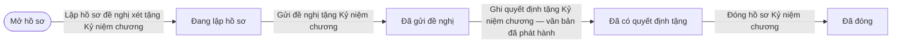
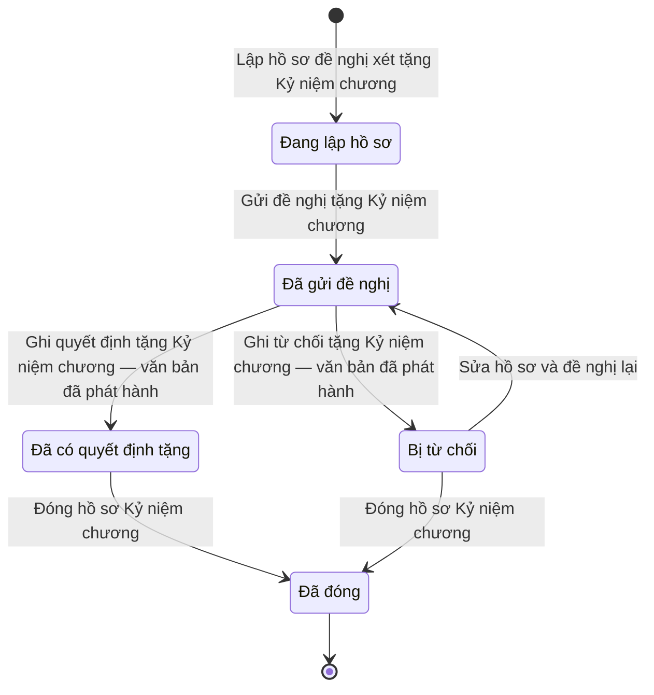

# qt-8.medal · Khen thưởng — Hồ sơ Kỷ niệm chương "Vì sự nghiệp vũ trang quần chúng"

<!-- máy sinh: tom-tat -->
> **Hồ sơ:** Hồ sơ Kỷ niệm chương "Vì sự nghiệp vũ trang quần chúng" (`MedalCase`)
>
> **Trong sổ phạm vi:** 8 · Khen thưởng — hồ sơ phụ medal: Kỷ niệm chương (tầng 1)
>
> 10 bước · 5 chặng · 3 vai · 2 bảng quyết định · 0 hạn · 8 khớp nối.
>
> **Nguồn:** sổ nghiệp vụ `qt-8.medal` · khai báo của app: `dqtv-app/core/processes/award/workflow/medal.yaml`. Các bảng do máy sinh từ nguồn này.
<!-- hết: tom-tat -->

<!-- viết tay: dien-giai -->
## Diễn giải

*Phần này viết tay, diễn giải lại điều các bảng bên dưới ghi.*

### Quy trình này để làm gì

Đây là hồ sơ phụ của khen thưởng (quy trình 8): một **hồ sơ đề nghị xét tặng Kỷ niệm chương "Vì sự nghiệp vũ trang quần chúng"** cho một cá nhân. Chính trị viên lập hồ sơ; Cục Dân quân tự vệ ghi quyết định tặng hoặc ghi từ chối. Quyết định là của Bộ trưởng Bộ Quốc phòng, Cục ghi vào hệ.

Hồ sơ có bốn chặng: *Đã lập hồ sơ đề nghị* → *Đã có quyết định tặng* → *Đã đóng*, và một chặng rẽ *Bị từ chối*.

### Khi nào bắt đầu

Chính trị viên bấm **Lập hồ sơ đề nghị xét tặng Kỷ niệm chương**. Phải nhập họ tên cá nhân được đề nghị, số căn cước công dân và nhóm đối tượng áp dụng; người được đề nghị chọn từ danh sách dân quân là ô nhập nếu có. Khi mở, hồ sơ nối tới **Chiến sĩ dân quân tự vệ** (16.enlistment) — mối nối này là tuỳ chọn, chỉ có khi cá nhân là chiến sĩ hoặc chỉ huy.

Bước mở bị xét điều kiện ngay (bảng `medal-eligibility`, xem "Điều kiện chặn"): không đủ điều kiện thì không lập được hồ sơ. Ba kết quả cho qua (`eligible`, `eligible_with_recognition`, `minister_decides`) đều đưa hồ sơ vào *Đã lập hồ sơ đề nghị*.

### Diễn ra thế nào

**Chặng "Đã lập hồ sơ đề nghị"** — không có việc làm tại chỗ; Cục Dân quân tự vệ bấm một trong hai:

1. **Ghi quyết định tặng Kỷ niệm chương** → *Đã có quyết định tặng*. Phải nhập số quyết định và ảnh hoặc bản quét quyết định.
2. **Ghi từ chối tặng Kỷ niệm chương** → *Bị từ chối*. Phải nhập lý do từ chối.

Theo luật là Bộ Quốc phòng quyết; hệ không có tài khoản cho Bộ, Cục là nơi đại diện.

**Chặng "Bị từ chối"** — Chính trị viên chọn một trong hai:

1. **Sửa hồ sơ và đề nghị lại** → quay về *Đã lập hồ sơ đề nghị*. Phải nhập lại nhóm đối tượng; số năm thâm niên, căn cứ công nhận, người được đề nghị là ô nhập nếu có. Bước này bị xét lại điều kiện như lúc lập mới (bảng `medal-reeligibility`). Bước ghi thời điểm đề nghị lại và các lần đề nghị trước (số liệu lúc gửi, lý do từ chối, thời điểm).
2. **Đóng hồ sơ Kỷ niệm chương** → *Đã đóng*.

**Chặng "Đã có quyết định tặng"** — Chính trị viên bấm **Đóng hồ sơ Kỷ niệm chương** để khép hồ sơ. Ở chặng này quyết định đã ký, hệ chặn lập hồ sơ mới cho cùng cá nhân.

### Kết thúc và để lại gì

Hồ sơ kết thúc ở chặng *Đã đóng*. Hồ sơ nối tới **Chiến sĩ dân quân tự vệ**, ghi ở bước lập và bước sửa – đề nghị lại.

### Điều kiện chặn

- Hai bước sửa – đề nghị lại và đóng hồ sơ: người làm phải là người của đơn vị ghi ở ô đơn vị chủ hồ sơ. Sai người, sai chặng thì chặn, hồ sơ giữ nguyên.
- Hai bảng điều kiện xét tặng (`medal-eligibility` ở bước lập, `medal-reeligibility` ở bước đề nghị lại) có 13 dòng giống hệt nhau. Bị chặn với kết quả `not_eligible` khi: chưa ghi cá nhân đã được tặng hay chưa, hoặc đã được tặng; chưa chọn nhóm đối tượng; cá nhân đã từ trần; cá nhân bị kỷ luật ra khỏi lực lượng; nhóm chỉ huy hoặc chiến sĩ mà chưa nối tới chiến sĩ dân quân; nhóm ngoài lực lượng hoặc người nước ngoài có công mà chưa có căn cứ công nhận.
- Qua được các dòng trên thì xét số năm thâm niên: nhóm chỉ huy từ 10 năm, nhóm ngoài lực lượng từ 10 năm, nhóm chiến sĩ từ 6 năm; nhóm người nước ngoài có công và nhóm trường hợp đặc biệt không xét số năm. Còn lại là không đủ điều kiện.
<!-- hết viết tay -->

## 1. Đường đi ngắn nhất qua các chặng

<!-- máy sinh: luong-chinh -->
Đường ít bước nhất từ lúc mở hồ sơ tới chặng kết thúc xa nhất. Máy chọn theo số chặng, không theo ý nghĩa nghiệp vụ — trình tự công việc thật xem phần Diễn giải và bảng "Việc làm ở từng chặng" ở mục 6.

| # | Ai làm | Làm gì | Hồ sơ sang chặng |
|---|---|---|---|
| 1 | Chính trị viên | Lập hồ sơ đề nghị xét tặng Kỷ niệm chương | Đang lập hồ sơ |
| 2 | Hệ thống tự làm | Gửi đề nghị tặng Kỷ niệm chương | Đã gửi đề nghị |
| 3 | Cục Dân quân tự vệ | Ghi quyết định tặng Kỷ niệm chương — văn bản đã phát hành | Đã có quyết định tặng |
| 4 | Chính trị viên | Đóng hồ sơ Kỷ niệm chương | Đã đóng |

<!-- hết: luong-chinh -->

## 2. Hồ sơ và việc nó để lại

<!-- máy sinh: muc-tieu -->
**App gọi quy trình này là:** Hồ sơ Kỷ niệm chương.

**Khi mở, hồ sơ này ghi mối nối tới:**
- Chiến sĩ dân quân tự vệ (16.enlistment) — bước `proposeMedal`, khớp nối `medalCaseForMember`
- Nhiệm vụ trên giao (1) — bước `proposeMedal`, khớp nối `medalCaseServesTasking`

**Hồ sơ này để lại cho quy trình khác** (bước tạo hồ sơ của quy trình kia ghi mối nối về đây):
- Tệp lưu trữ (D16) — bước `recordArchiveFile`, khớp nối `fileOfMedalCase`
<!-- hết: muc-tieu -->

## 3. Khởi phát và kết thúc

<!-- máy sinh: khoi-phat -->
**1 cửa vào** — bước mở hồ sơ:

| Bước mở | Ai mở | Hồ sơ vào chặng | App bắt buộc nhập |
|---|---|---|---|
| Lập hồ sơ đề nghị xét tặng Kỷ niệm chương | Chính trị viên | Đang lập hồ sơ | họ tên cá nhân được đề nghị, số căn cước công dân, nhóm đối tượng áp dụng, `taskingId`, tờ khai cá nhân, kỳ báo cáo |

**Kết thúc:** *Đã đóng* (`CLOSED`)
<!-- hết: khoi-phat -->

## 4. Vai trò

<!-- máy sinh: vai-tro -->
| Vai trong sổ | Tên trong app | Điều kiện | Làm những bước |
|---|---|---|---|
| `operator` | Chính trị viên |  | Lập hồ sơ đề nghị xét tặng Kỷ niệm chương · Trình ký văn bản đề nghị tặng Kỷ niệm chương · Trình ký văn bản đề nghị lại tặng Kỷ niệm chương · Đóng hồ sơ Kỷ niệm chương |
| `authority` | Cục Dân quân tự vệ |  | Trình ký văn bản quyết định tặng Kỷ niệm chương · Ghi quyết định tặng Kỷ niệm chương — văn bản đã phát hành · Trình ký văn bản từ chối tặng Kỷ niệm chương · Ghi từ chối tặng Kỷ niệm chương — văn bản đã phát hành |
| `system` | Hệ thống tự làm |  | Gửi đề nghị tặng Kỷ niệm chương · Sửa hồ sơ và đề nghị lại |

*"Tên trong app" là tên app đặt cho mã chủ thể của vai. Hồ sơ thuộc đơn vị cấp khác thì người làm là người giữ vai ấy ở đơn vị nêu trong cột "Điều kiện" (nếu sổ có ghi) và ở cột "Người làm phải thuộc" của bảng "Theo khai báo của app" (mục 7).*
<!-- hết: vai-tro -->

## 5. Nhánh phụ

<!-- máy sinh: nhanh-phu -->
**Bước khác đưa hồ sơ sang chặng mới** — đường song song, rẽ nhánh hoặc kết thúc sớm:

| Bước | Ai làm | Từ chặng | Sang chặng |
|---|---|---|---|
| Ghi từ chối tặng Kỷ niệm chương — văn bản đã phát hành | Cục Dân quân tự vệ | Đã gửi đề nghị | Bị từ chối |

**Quay lại một chặng hồ sơ đã đi qua** (tính theo đường ngắn nhất từ lúc mở):

| Bước | Ai làm | Từ chặng | Về chặng |
|---|---|---|---|
| Sửa hồ sơ và đề nghị lại | Hệ thống tự làm | Bị từ chối | Đã gửi đề nghị |

**Làm trong lúc hồ sơ đứng yên ở một chặng** — ghi nhận, bổ sung:

| Bước | Ai làm | Ở chặng |
|---|---|---|
| Trình ký văn bản quyết định tặng Kỷ niệm chương | Cục Dân quân tự vệ | Đã gửi đề nghị |
| Trình ký văn bản từ chối tặng Kỷ niệm chương | Cục Dân quân tự vệ | Đã gửi đề nghị |
| Trình ký văn bản đề nghị tặng Kỷ niệm chương | Chính trị viên | Đang lập hồ sơ |
| Trình ký văn bản đề nghị lại tặng Kỷ niệm chương | Chính trị viên | Bị từ chối |

<!-- hết: nhanh-phu -->

## 6. Các chặng và việc làm ở từng chặng

<!-- máy sinh: chang -->
| Chặng | Tên hiển thị | Vào bằng bước | Kết thúc? |
|---|---|---|---|
| `DRAFT` | Đang lập hồ sơ | Lập hồ sơ đề nghị xét tặng Kỷ niệm chương |  |
| `PROPOSED` | Đã gửi đề nghị | Gửi đề nghị tặng Kỷ niệm chương · Sửa hồ sơ và đề nghị lại |  |
| `DECIDED` | Đã có quyết định tặng | Ghi quyết định tặng Kỷ niệm chương — văn bản đã phát hành |  |
| `REJECTED` | Bị từ chối | Ghi từ chối tặng Kỷ niệm chương — văn bản đã phát hành |  |
| `CLOSED` | Đã đóng | Đóng hồ sơ Kỷ niệm chương | **kết thúc** |

### Việc làm ở từng chặng

Hồ sơ đang ở chặng nào thì làm được những bước nào.

| Hồ sơ đang ở chặng | Bước làm tại chặng (hồ sơ đứng yên) | Bước đưa hồ sơ sang chặng khác |
|---|---|---|
| **Đang lập hồ sơ** | Trình ký văn bản đề nghị tặng Kỷ niệm chương — Chính trị viên | Gửi đề nghị tặng Kỷ niệm chương — Hệ thống tự làm → *Đã gửi đề nghị* |
| **Đã gửi đề nghị** | Trình ký văn bản quyết định tặng Kỷ niệm chương — Cục Dân quân tự vệ Trình ký văn bản từ chối tặng Kỷ niệm chương — Cục Dân quân tự vệ | Ghi quyết định tặng Kỷ niệm chương — văn bản đã phát hành — Cục Dân quân tự vệ → *Đã có quyết định tặng* Ghi từ chối tặng Kỷ niệm chương — văn bản đã phát hành — Cục Dân quân tự vệ → *Bị từ chối* |
| **Đã có quyết định tặng** | — | Đóng hồ sơ Kỷ niệm chương — Chính trị viên → *Đã đóng* |
| **Bị từ chối** | Trình ký văn bản đề nghị lại tặng Kỷ niệm chương — Chính trị viên | Sửa hồ sơ và đề nghị lại — Hệ thống tự làm → *Đã gửi đề nghị* Đóng hồ sơ Kỷ niệm chương — Chính trị viên → *Đã đóng* |
| **Đã đóng** | — | — (kết thúc) |
<!-- hết: chang -->

## 7. Bảng bước

<!-- máy sinh: buoc -->
| # | Bước | Mã bước | Ai thực hiện | Từ chặng | Sang chặng | Phải có trước | Ghi lại |
|---|---|---|---|---|---|---|---|
| 1 | Lập hồ sơ đề nghị xét tặng Kỷ niệm chương | `proposeMedal` | Chính trị viên | — (mở hồ sơ) | `DRAFT` | `memberNotDisciplinedOut`, tờ khai cá nhân đã ký (ảnh hoặc PDF), nối tới Nhiệm vụ trên giao, `taskingNotDone` | mã tỉnh, mã xã, họ tên cá nhân được đề nghị, số căn cước công dân, nhóm đối tượng áp dụng, số năm thâm niên, đơn vị chủ hồ sơ, cấp trên của chủ hồ sơ, nối tới Chiến sĩ dân quân tự vệ, tờ khai cá nhân đã ký (ảnh hoặc PDF), kỳ báo cáo, nối tới Nhiệm vụ trên giao |
| 2 | Trình ký văn bản quyết định tặng Kỷ niệm chương | `requestMedalDecisionSignature` | Cục Dân quân tự vệ | `PROPOSED` | giữ nguyên | `submissionDistributedAtReceiver`, `noMedalCaseDecidedDocumentOpen` | nối tới Văn bản đi |
| 3 | Ghi quyết định tặng Kỷ niệm chương — văn bản đã phát hành | `issueMedal` | Cục Dân quân tự vệ | `PROPOSED` | `DECIDED` | `submissionDistributedAtReceiver`, `medalCaseDecidedDocumentIssued` | ký quyết định lúc, nối tới Văn bản đến |
| 4 | Trình ký văn bản từ chối tặng Kỷ niệm chương | `requestRejectMedalSignature` | Cục Dân quân tự vệ | `PROPOSED` | giữ nguyên | `noMedalCaseRejectedDocumentOpen` | lý do từ chối, nối tới Văn bản đi |
| 5 | Ghi từ chối tặng Kỷ niệm chương — văn bản đã phát hành | `rejectMedal` | Cục Dân quân tự vệ | `PROPOSED` | `REJECTED` | `medalCaseRejectedDocumentIssued` | từ chối lúc, nối tới Văn bản đến |
| 6 | Trình ký văn bản đề nghị tặng Kỷ niệm chương | `requestMedalProposalSignature` | Chính trị viên | `DRAFT` | giữ nguyên | `noMedalCaseSubmittedDocumentOpen`, người làm thuộc đơn vị chủ hồ sơ | nối tới Văn bản đi |
| 7 | Gửi đề nghị tặng Kỷ niệm chương | `issueMedalProposal` | Hệ thống tự làm | `DRAFT` | `PROPOSED` | — | gửi đề nghị lúc, nối tới Văn bản đến |
| 8 | Trình ký văn bản đề nghị lại tặng Kỷ niệm chương | `requestReviseMedalSignature` | Chính trị viên | `REJECTED` | giữ nguyên | `memberNotDisciplinedOut`, `noMedalCaseSubmittedDocumentOpen`, người làm thuộc đơn vị chủ hồ sơ | nhóm đối tượng áp dụng, số năm thâm niên, các lần đề nghị trước, nối tới Chiến sĩ dân quân tự vệ, họ tên cá nhân được đề nghị, số căn cước công dân, tờ khai cá nhân mới (nếu có), nối tới Văn bản đi |
| 9 | Sửa hồ sơ và đề nghị lại | `reviseMedal` | Hệ thống tự làm | `REJECTED` | `PROPOSED` | — | đề nghị lại lúc, nối tới Văn bản đến |
| 10 | Đóng hồ sơ Kỷ niệm chương | `closeMedal` | Chính trị viên | `DECIDED`, `REJECTED` | `CLOSED` | người làm thuộc đơn vị chủ hồ sơ | đóng lúc |

### Khi không đạt điều kiện

Mặc định: không đúng người, hồ sơ không ở đúng chặng, hoặc thiếu thứ "phải có trước" thì bước bị chặn, hồ sơ giữ nguyên. Bảng dưới chỉ kê những bước có kết quả riêng.

| # | Bước | Kết quả riêng |
|---|---|---|
| 1 | Lập hồ sơ đề nghị xét tặng Kỷ niệm chương | kết quả xét `eligible` → hồ sơ sang *Đã gửi đề nghị*; kết quả xét `eligible_with_recognition` → hồ sơ sang *Đã gửi đề nghị*; kết quả xét `minister_decides` → hồ sơ sang *Đã gửi đề nghị*; bước dừng lại, hồ sơ giữ nguyên khi kết quả xét là: `not_eligible` |
| 7 | Gửi đề nghị tặng Kỷ niệm chương | bước này không do người nào bấm |
| 9 | Sửa hồ sơ và đề nghị lại | bước dừng lại, hồ sơ giữ nguyên khi kết quả xét là: `not_eligible`; bước này không do người nào bấm |

### Điều kiện "phải có trước" bằng lời

Cột "Phải có trước" ở bảng bước có hai loại: ô dữ liệu thường (bước chỉ đòi ô ấy đã có giá trị) và điều kiện hệ tự xét. Bảng này diễn các điều kiện hệ tự xét theo đúng công thức sổ ghi; số ở cột cuối là số thứ tự bước.

| Điều kiện | Đúng khi | Bước đòi |
|---|---|---|
| `memberNotDisciplinedOut` | không có hồ sơ Xử lý kỷ luật DQTV (qt-D15) có ô nối `disciplinaryCaseFor` trùng với ô nối `medalCaseForMember` của hồ sơ đang làm mà `titleRevoked` là `yes` | 1, 8 |
| `taskingNotDone` | KHÔNG (có hồ sơ Việc luật giao kèm văn bản đến, đi (qt-1) chính là hồ sơ ghi ở ô nối `medalCaseServesTasking` của hồ sơ đang làm mà hồ sơ ấy đang ở chặng `DONE` hoặc `REVOKED` hoặc `RETURNED`) | 1 |
| `submissionDistributedAtReceiver` | có hồ sơ Việc luật giao kèm văn bản đến, đi — Văn bản đến (qt-1.incoming-document) chính là hồ sơ ghi ở ô nối `medalCaseSubmissionDeliveredAs` của hồ sơ đang làm mà hồ sơ ấy đang ở chặng `DISTRIBUTED` | 2, 3 |
| `noMedalCaseDecidedDocumentOpen` | KHÔNG (có hồ sơ Việc luật giao kèm văn bản đến, đi — Văn bản đi (qt-1.outgoing-document) chính là hồ sơ ghi ở ô nối `medalCaseDecidedByDocument` của hồ sơ đang làm mà hồ sơ ấy đang ở chặng `DRAFT` hoặc `PENDING_SIGNATURE` hoặc `SIGNED`) | 2 |
| `medalCaseDecidedDocumentIssued` | có hồ sơ Việc luật giao kèm văn bản đến, đi — Văn bản đi (qt-1.outgoing-document) chính là hồ sơ ghi ở ô nối `medalCaseDecidedByDocument` của hồ sơ đang làm mà hồ sơ ấy đang ở chặng `ISSUED` | 3 |
| `noMedalCaseRejectedDocumentOpen` | KHÔNG (có hồ sơ Việc luật giao kèm văn bản đến, đi — Văn bản đi (qt-1.outgoing-document) chính là hồ sơ ghi ở ô nối `medalCaseRejectedByDocument` của hồ sơ đang làm mà hồ sơ ấy đang ở chặng `DRAFT` hoặc `PENDING_SIGNATURE` hoặc `SIGNED`) | 4 |
| `medalCaseRejectedDocumentIssued` | có hồ sơ Việc luật giao kèm văn bản đến, đi — Văn bản đi (qt-1.outgoing-document) chính là hồ sơ ghi ở ô nối `medalCaseRejectedByDocument` của hồ sơ đang làm mà hồ sơ ấy đang ở chặng `ISSUED` | 5 |
| `noMedalCaseSubmittedDocumentOpen` | KHÔNG (có hồ sơ Việc luật giao kèm văn bản đến, đi — Văn bản đi (qt-1.outgoing-document) chính là hồ sơ ghi ở ô nối `medalCaseSubmittedByDocument` của hồ sơ đang làm mà hồ sơ ấy đang ở chặng `DRAFT` hoặc `PENDING_SIGNATURE` hoặc `SIGNED`) | 6, 8 |
| `actorInOwnerUnit` | người đang làm là người của đơn vị ghi ở ô đơn vị chủ hồ sơ của hồ sơ này (theo danh mục người của đơn vị, `dm.unit-staff`) | 6, 8, 10 |

### Theo khai báo của app

Người làm phải thuộc đơn vị nào, ô người dùng phải nhập, bước có lặp được không, và căn cứ pháp lý — lấy từ khai báo quy trình trong app.

| # | Bước | Người làm phải thuộc | Bắt buộc nhập | Nhập nếu có | Lặp được | Căn cứ |
|---|---|---|---|---|---|---|
| 1 | Lập hồ sơ đề nghị xét tặng Kỷ niệm chương |  | họ tên cá nhân được đề nghị, số căn cước công dân, nhóm đối tượng áp dụng, `taskingId`, tờ khai cá nhân đã ký (ảnh hoặc PDF), kỳ báo cáo | người được đề nghị (chọn từ danh sách dân quân) |  | 23/VBHN-BQP Đ.16 k1; TT93/2024/TT-BQP Đ.27 k1 a |
| 2 | Trình ký văn bản quyết định tặng Kỷ niệm chương |  | — | dự thảo quyết định tặng (PDF) |  | 23/VBHN-BQP Đ.16 k1, Đ.23 k1 c — Bộ trưởng Bộ Quốc phòng quyết định tặng Kỷ niệm chương; NĐ30/2020/NĐ-CP Đ.13 |
| 3 | Ghi quyết định tặng Kỷ niệm chương — văn bản đã phát hành |  | — | — |  | 23/VBHN-BQP Đ.16 k1, Đ.23 k1 c — Bộ trưởng Bộ Quốc phòng quyết định tặng Kỷ niệm chương |
| 4 | Trình ký văn bản từ chối tặng Kỷ niệm chương |  | lý do từ chối | dự thảo văn bản từ chối (PDF) |  | 23/VBHN-BQP Đ.16 k1, Đ.23 k1 c; NĐ30/2020/NĐ-CP Đ.13 |
| 5 | Ghi từ chối tặng Kỷ niệm chương — văn bản đã phát hành |  | — | — |  | 23/VBHN-BQP Đ.16 k1, Đ.23 k1 c |
| 6 | Trình ký văn bản đề nghị tặng Kỷ niệm chương | đơn vị chủ hồ sơ | — | dự thảo văn bản (PDF) |  | TT93/2024/TT-BQP Đ.27 k1 a; NĐ30/2020/NĐ-CP Đ.13 |
| 7 | Gửi đề nghị tặng Kỷ niệm chương |  | — | — |  | TT93/2024/TT-BQP Đ.27 k1 a |
| 8 | Trình ký văn bản đề nghị lại tặng Kỷ niệm chương | đơn vị chủ hồ sơ | nhóm đối tượng áp dụng | số năm thâm niên, căn cứ công nhận (nhóm ngoài diện tính năm), người được đề nghị (chọn từ danh sách dân quân), dự thảo văn bản (PDF), tờ khai cá nhân mới (nếu có) |  | TT93/2024/TT-BQP Đ.27 k1 a; NĐ30/2020/NĐ-CP Đ.13 |
| 9 | Sửa hồ sơ và đề nghị lại |  | — | — |  | 23/VBHN-BQP Đ.16 k1; TT93/2024/TT-BQP Đ.27 k1 a |
| 10 | Đóng hồ sơ Kỷ niệm chương | đơn vị chủ hồ sơ | — | — |  | 23/VBHN-BQP Đ.16 · NĐ30/2020/NĐ-CP Đ.18 k3, k4 |
<!-- hết: buoc -->

## 8. Bảng quyết định, hạn, việc ngoài hệ

<!-- máy sinh: quyet-dinh -->
**Bảng `medal-eligibility`** — xét ở bước *Lập hồ sơ đề nghị xét tặng Kỷ niệm chương*; đầu vào: `medalAlreadyAwarded`, nhóm đối tượng áp dụng, số năm thâm niên, căn cứ công nhận (nhóm ngoài diện tính năm), nối tới Chiến sĩ dân quân tự vệ, `memberDeceased`. 12 dòng, dò theo số thứ tự sổ ghi, từ nhỏ đến lớn, dòng đầu tiên khớp thì dừng.

| Thứ tự dò (số sổ ghi) | Dòng | Khi | Thì |
|---|---|---|---|
| 0 | `medalAlreadyAwarded-unset` | chưa có `medalAlreadyAwarded` | `not_eligible` |
| 0 | `serviceGroup-unset` | chưa có nhóm đối tượng áp dụng | `not_eligible` |
| 1 | `already-awarded` | `medalAlreadyAwarded` là `yes` | `not_eligible` |
| 1 | `member-deceased` | `memberDeceased` là `yes` | `not_eligible` |
| 1 | `member-missing` | nhóm đối tượng áp dụng là Chỉ huy (`COMMANDER`) hoặc Chiến sĩ (`SOLDIER`) và chưa có nối tới Chiến sĩ dân quân tự vệ | `not_eligible` |
| 1 | `recognition-missing` | nhóm đối tượng áp dụng là Ngoài lực lượng (`OUTSIDER`) hoặc Người nước ngoài/Việt kiều có công lao (điểm d) (`FOREIGN_CONTRIBUTOR`) và chưa có căn cứ công nhận (nhóm ngoài diện tính năm) | `not_eligible` |
| 2 | `commander-10-years` | nhóm đối tượng áp dụng là Chỉ huy (`COMMANDER`) và số năm thâm niên từ 10 | cho qua |
| 3 | `outside-force-15-years` | nhóm đối tượng áp dụng là Ngoài lực lượng (`OUTSIDER`) và số năm thâm niên từ 10 | cho qua |
| 4 | `member-6-years` | nhóm đối tượng áp dụng là Chiến sĩ (`SOLDIER`) và số năm thâm niên từ 6 | cho qua |
| 5 | `foreign-contributor` | nhóm đối tượng áp dụng là Người nước ngoài/Việt kiều có công lao (điểm d) (`FOREIGN_CONTRIBUTOR`) | cho qua |
| 6 | `special-case` | nhóm đối tượng áp dụng là Trường hợp đặc biệt — Bộ trưởng xem xét (điểm đ) (`SPECIAL_CASE`) | cho qua |
| 7 | `not-enough-years` | mọi trường hợp còn lại | `not_eligible` |

**Bảng `medal-reeligibility`** — xét ở bước *Sửa hồ sơ và đề nghị lại*; đầu vào: `medalAlreadyAwarded`, nhóm đối tượng áp dụng, số năm thâm niên, căn cứ công nhận (nhóm ngoài diện tính năm), nối tới Chiến sĩ dân quân tự vệ, `memberDeceased`. 12 dòng, dò theo số thứ tự sổ ghi, từ nhỏ đến lớn, dòng đầu tiên khớp thì dừng.

| Thứ tự dò (số sổ ghi) | Dòng | Khi | Thì |
|---|---|---|---|
| 0 | `medalAlreadyAwarded-unset` | chưa có `medalAlreadyAwarded` | `not_eligible` |
| 0 | `serviceGroup-unset` | chưa có nhóm đối tượng áp dụng | `not_eligible` |
| 1 | `already-awarded` | `medalAlreadyAwarded` là `yes` | `not_eligible` |
| 1 | `member-deceased` | `memberDeceased` là `yes` | `not_eligible` |
| 1 | `member-missing` | nhóm đối tượng áp dụng là Chỉ huy (`COMMANDER`) hoặc Chiến sĩ (`SOLDIER`) và chưa có nối tới Chiến sĩ dân quân tự vệ | `not_eligible` |
| 1 | `recognition-missing` | nhóm đối tượng áp dụng là Ngoài lực lượng (`OUTSIDER`) hoặc Người nước ngoài/Việt kiều có công lao (điểm d) (`FOREIGN_CONTRIBUTOR`) và chưa có căn cứ công nhận (nhóm ngoài diện tính năm) | `not_eligible` |
| 2 | `commander-10-years` | nhóm đối tượng áp dụng là Chỉ huy (`COMMANDER`) và số năm thâm niên từ 10 | cho qua |
| 3 | `outside-force-15-years` | nhóm đối tượng áp dụng là Ngoài lực lượng (`OUTSIDER`) và số năm thâm niên từ 10 | cho qua |
| 4 | `member-6-years` | nhóm đối tượng áp dụng là Chiến sĩ (`SOLDIER`) và số năm thâm niên từ 6 | cho qua |
| 5 | `foreign-contributor` | nhóm đối tượng áp dụng là Người nước ngoài/Việt kiều có công lao (điểm d) (`FOREIGN_CONTRIBUTOR`) | cho qua |
| 6 | `special-case` | nhóm đối tượng áp dụng là Trường hợp đặc biệt — Bộ trưởng xem xét (điểm đ) (`SPECIAL_CASE`) | cho qua |
| 7 | `not-enough-years` | mọi trường hợp còn lại | `not_eligible` |

<!-- hết: quyet-dinh -->

## 9. Dữ liệu của hồ sơ

<!-- máy sinh: du-lieu -->
Các ô mà bước trong sổ ghi hoặc đòi. Số trong hai cột cuối là số thứ tự bước ở bảng bước (mục 7).

| Ô dữ liệu | Mã | Kiểu (app) | Giá trị cho phép | Loại ô (sổ) | Bước ghi | Bước đòi | Mô tả trong app |
|---|---|---|---|---|---|---|---|
| mã tỉnh | `provinceCode` | chữ |  | lưu trên hồ sơ (`stored`) | 1 | — | Mã tỉnh — dùng lọc phạm vi theo hàng; rỗng khi hồ sơ thuộc quân khu hoặc Bộ Quốc phòng |
| mã xã | `communeCode` | chữ |  | lưu trên hồ sơ (`stored`) | 1 | — | Mã xã |
| họ tên cá nhân được đề nghị | `subjectName` | chữ |  | đưa vào ở bước (`input`) | 1, 8 | — | Họ tên cá nhân được đề nghị |
| số căn cước công dân | `subjectNationalId` | chữ |  | đưa vào ở bước (`input`) | 1, 8 | — | Số căn cước công dân (công dân Việt Nam) hoặc số hộ chiếu (người nước ngoài có công, nhóm FOREIGN_CONTRIBUTOR) — khoá đối chiếu chỉ tặng 01 lần (BR-05). Không ép mẫu CCCD 12 số: người nước ngoài… |
| nhóm đối tượng áp dụng | `serviceGroup` | chọn một | Chỉ huy (`COMMANDER`), Ngoài lực lượng (`OUTSIDER`), Chiến sĩ (`SOLDIER`), Người nước ngoài/Việt kiều có công lao (điểm d) (`FOREIGN_CONTRIBUTOR`), Trường hợp đặc biệt — Bộ trưởng xem xét (điểm đ) (`SPECIAL_CASE`) | đưa vào ở bước (`input`) | 1, 8 | — | Nhóm đối tượng áp dụng — điểm a/b/c tính theo mốc năm thâm niên (chỉ huy/ngoài lực lượng/chiến sĩ); điểm d (FOREIGN_CONTRIBUTOR) và điểm đ (SPECIAL_CASE) KHÔNG tính theo năm (TT93/2024/TT-BQP Đ.16… |
| số năm thâm niên | `yearsOfService` | số |  | đưa vào ở bước (`input`) | 1, 8 | — | Số năm thâm niên tính đến ngày đề nghị — BẮT BUỘC và so khớp mốc theo đúng nhóm ở server/read/medal.mjs, đọc từ danh mục tham số medal_service_years (BR-06), CHỈ áp dụng nhóm… |
| đơn vị chủ hồ sơ | `ownerUnit` |  |  | lưu trên hồ sơ (`stored`) | 1 | — |  |
| cấp trên của chủ hồ sơ | `superiorUnits` |  |  | lưu trên hồ sơ (`stored`) | 1 | — |  |
| tờ khai cá nhân | `personalDeclarationScan` | tệp |  | đưa vào ở bước (`input`) | 1, 8 | 1 | Tờ khai cá nhân đề nghị tặng Kỷ niệm chương đã ký — NĐ152/2025/NĐ-CP Mẫu 02; TT93/2024/TT-BQP Đ.26 k6 |
| kỳ báo cáo | `reportingRound` | chọn một | Kỳ trước ngày 15 tháng 3 (`before_15_march`), Kỳ trước ngày 15 tháng 7 (`before_15_july`) | lưu trên hồ sơ (`stored`) | 1 | — | Kỳ báo cáo đề nghị về Bộ Quốc phòng (qua Cục Dân quân tự vệ) — TT93/2024/TT-BQP Đ.27 k1 a |
| ký quyết định lúc | `decidedAt` | ngày giờ |  | lưu trên hồ sơ (`stored`) | 3 | — | Thời điểm AC-BT (vai R-BQP) ký số quyết định tặng — FR-24 |
| vì sao từ chối | `rejectionReason` | chữ |  | đưa vào ở bước (`input`) | 4 | — | Vì sao cấp có thẩm quyền từ chối hồ sơ Kỷ niệm chương — cán bộ trình cần biết sửa gì |
| từ chối lúc | `rejectedAt` | ngày giờ |  | lưu trên hồ sơ (`stored`) | 5 | — | Thời điểm từ chối |
| gửi đề nghị lúc | `medalProposedAt` | ngày giờ |  | lưu trên hồ sơ (`stored`) | 7 | — | Thời điểm văn thư phát hành văn bản đề nghị lần đầu — hồ sơ sang chờ quyết định |
| các lần đề nghị trước | `submissionHistory` | bảng |  | lưu trên hồ sơ (`stored`) | 8 | — | Các lần đề nghị đã gửi lên và bị từ chối — số liệu lúc gửi, lý do, thời điểm |
| đề nghị lại lúc | `revisedAt` | ngày giờ |  | lưu trên hồ sơ (`stored`) | 9 | — | Thời điểm sửa hồ sơ và đề nghị lại sau khi bị từ chối |
| đóng lúc | `closedAt` | ngày giờ |  | lưu trên hồ sơ (`stored`) | 10 | — | Thời điểm đóng hồ sơ Kỷ niệm chương |
| — | `memberNotDisciplinedOut` |  | có hay chưa | hệ suy ra (`derived`) | — | 1, 8 |  |
| — | `taskingNotDone` |  | có hay chưa | hệ suy ra (`derived`) | — | 1 |  |
| — | `submissionDistributedAtReceiver` |  | có hay chưa | hệ suy ra (`derived`) | — | 2, 3 |  |
| — | `noMedalCaseDecidedDocumentOpen` |  | có hay chưa | hệ suy ra (`derived`) | — | 2 |  |
| — | `medalCaseDecidedDocumentIssued` |  | có hay chưa | hệ suy ra (`derived`) | — | 3 |  |
| — | `noMedalCaseRejectedDocumentOpen` |  | có hay chưa | hệ suy ra (`derived`) | — | 4 |  |
| — | `medalCaseRejectedDocumentIssued` |  | có hay chưa | hệ suy ra (`derived`) | — | 5 |  |
| — | `noMedalCaseSubmittedDocumentOpen` |  | có hay chưa | hệ suy ra (`derived`) | — | 6, 8 |  |
| người làm thuộc đơn vị chủ hồ sơ | `actorInOwnerUnit` |  | có hay chưa | hệ suy ra (`derived`) | — | 6, 8, 10 |  |
| — | `medalAlreadyAwarded` |  | `yes`, `no` | đưa vào ở bước (`input`) | — | — |  |
| căn cứ công nhận (nhóm ngoài diện tính năm) | `recognitionNote` | chữ | có hay chưa | đưa vào ở bước (`input`) | — | — | Căn cứ cấp thẩm quyền công nhận, đề nghị khen thưởng — BẮT BUỘC cho nhóm FOREIGN_CONTRIBUTOR (điểm d), thay thế điều kiện số năm thâm niên (TT93/2024/TT-BQP Đ.16 k1 điểm d, hợp nhất 23/VBHN-BQP) |
| — | `memberDeceased` |  | `yes`, `no` | đưa vào ở bước (`input`) | — | — |  |

29 ô. Cột "Loại ô" là cách sổ phân loại ô, in kèm đúng chữ của sổ; ô nào người dùng phải nhập xem bảng "Theo khai báo của app" ở mục 7.
<!-- hết: du-lieu -->

## 10. Khớp nối với quy trình khác

<!-- máy sinh: khop-noi -->
| Quy trình kia | Hồ sơ kia | Quan hệ | Nội dung (mô tả trong app) | Bước ghi mối nối | Tên ô nối |
|---|---|---|---|---|---|
| 1 | Nhiệm vụ trên giao | hồ sơ này **mở ra có nối tới** hồ sơ kia | Việc gốc mà hồ sơ đề nghị Kỷ niệm chương thực hiện — TT93/2024/TT-BQP Đ.27 k1 a (danh sách gốc kín 13/10/2026) | 8.medal·proposeMedal ⊕ · đòi: 8.medal·proposeMedal | `medalCaseServesTasking` |
| 1.incoming-document | Văn bản đến | gắn với nhau ở một bước giữa chừng | Quyết định tặng hoặc từ chối tặng Kỷ niệm chương ở sổ văn bản đến của đơn vị đề nghị (NĐ30/2020/NĐ-CP Đ.20) | 8.medal·issueMedal, 8.medal·rejectMedal | `medalCaseDecisionDeliveredAs` |
| 1.incoming-document | Văn bản đến | gắn với nhau ở một bước giữa chừng | Văn bản đề nghị tặng Kỷ niệm chương ở sổ văn bản đến của Cục Dân quân tự vệ (NĐ30/2020/NĐ-CP Đ.20) | 8.medal·issueMedalProposal, 8.medal·reviseMedal | `medalCaseSubmissionDeliveredAs` |
| 1.outgoing-document | Văn bản đi | gắn với nhau ở một bước giữa chừng | Văn bản quyết định tặng Kỷ niệm chương — 23/VBHN-BQP Đ.23 k1 c | 8.medal·requestMedalDecisionSignature | `medalCaseDecidedByDocument` |
| 1.outgoing-document | Văn bản đi | gắn với nhau ở một bước giữa chừng | Văn bản từ chối tặng Kỷ niệm chương — 23/VBHN-BQP Đ.23 k1 c | 8.medal·requestRejectMedalSignature | `medalCaseRejectedByDocument` |
| 1.outgoing-document | Văn bản đi | gắn với nhau ở một bước giữa chừng | Văn bản đề nghị tặng Kỷ niệm chương về Bộ Quốc phòng (qua Cục Dân quân tự vệ) — TT93/2024/TT-BQP Đ.27 k1 a | 8.medal·requestMedalProposalSignature, 8.medal·requestReviseMedalSignature | `medalCaseSubmittedByDocument` |
| 16.enlistment | Chiến sĩ dân quân tự vệ | hồ sơ này **mở ra có nối tới** hồ sơ kia | Hồ sơ Kỷ niệm chương của chiến sĩ nào — TUỲ CHỌN, chỉ có khi cá nhân là chiến sĩ/chỉ huy DQTV có bản ghi Mili… | 8.medal·proposeMedal ⊕, 8.medal·requestReviseMedalSignature | `medalCaseForMember` |
| D16 | Tệp lưu trữ | hồ sơ kia **mở ra từ** hồ sơ này | Tệp là quyết định tặng Kỷ niệm chương đã ký đính kèm hồ sơ này | D16.archive-file·recordArchiveFile ⊕ | `fileOfMedalCase` |

8 khớp nối. ⊕ là bước tạo hồ sơ.
<!-- hết: khop-noi -->

## 11. Thông tin chung

<!-- máy sinh: thong-tin -->
| | |
|---|---|
| **Mã trong sổ** | `qt-8.medal` |
| **Quy trình trong app** | `award` (`workflow/medal.yaml`) — mặt công tác: `political` |
| **Hồ sơ** | Hồ sơ Kỷ niệm chương "Vì sự nghiệp vũ trang quần chúng" (`MedalCase`) |
| **Cùng mã quy trình** | [qt-8](qt-8.html), [qt-8.revocation](qt-8.revocation.html), [qt-8.submission](qt-8.submission.html) |
| **Căn cứ pháp lý từng bước** | cột "Căn cứ" ở bảng "Theo khai báo của app", mục 7 |
<!-- hết: thong-tin -->
