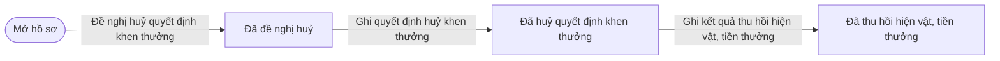
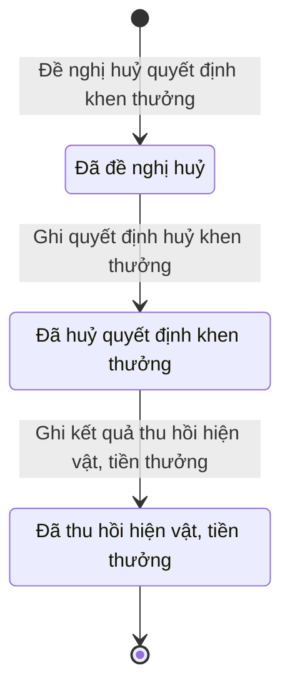

# qt-8.revocation · Khen thưởng — Một lượt đề nghị huỷ quyết định khen thưởng, thu hồi

<!-- máy sinh: tom-tat -->
> **Hồ sơ:** Một lượt đề nghị huỷ quyết định khen thưởng, thu hồi (`AwardRevocation`)
>
> **Trong sổ phạm vi:** 8 · Khen thưởng — hồ sơ phụ revocation: thu hồi khen thưởng — đề nghị, quyết định thu hồi, thu lại hiện vật và tiền (tầng 1)
>
> 3 bước · 3 chặng · 2 vai · 0 bảng quyết định · 0 hạn · 2 khớp nối.
>
> **Nguồn:** sổ nghiệp vụ `qt-8.revocation` · khai báo của app: `dqtv-app/core/processes/award/workflow/award-revocation.yaml`. Các bảng do máy sinh từ nguồn này.
<!-- hết: tom-tat -->

## 1. Đường đi ngắn nhất qua các chặng

<!-- máy sinh: luong-chinh -->
Đường ít bước nhất từ lúc mở hồ sơ tới chặng kết thúc xa nhất. Máy chọn theo số chặng, không theo ý nghĩa nghiệp vụ — trình tự công việc thật xem phần Diễn giải và bảng "Việc làm ở từng chặng" ở mục 6.

| # | Ai làm | Làm gì | Hồ sơ sang chặng |
|---|---|---|---|
| 1 | Chính trị viên | Đề nghị huỷ quyết định khen thưởng | Đã đề nghị huỷ |
| 2 | Phòng Chính trị, Bộ CHQS cấp tỉnh | Ghi quyết định huỷ khen thưởng | Đã huỷ quyết định khen thưởng |
| 3 | Phòng Chính trị, Bộ CHQS cấp tỉnh | Ghi kết quả thu hồi hiện vật, tiền thưởng | Đã thu hồi hiện vật, tiền thưởng |

<!-- hết: luong-chinh -->

## 2. Hồ sơ và việc nó để lại

<!-- máy sinh: muc-tieu -->
**App gọi quy trình này là:** Thu hồi khen thưởng.
<!-- hết: muc-tieu -->

## 3. Khởi phát và kết thúc

<!-- máy sinh: khoi-phat -->
**1 cửa vào** — bước mở hồ sơ:

| Bước mở | Ai mở | Hồ sơ vào chặng | App bắt buộc nhập |
|---|---|---|---|
| Đề nghị huỷ quyết định khen thưởng | Chính trị viên | Đã đề nghị huỷ | hồ sơ khen thưởng bị đề nghị huỷ, kết luận vi phạm |

**Kết thúc:** *Đã thu hồi hiện vật, tiền thưởng* (`RECOVERED`)
<!-- hết: khoi-phat -->

## 4. Vai trò

<!-- máy sinh: vai-tro -->
| Vai trong sổ | Tên trong app | Điều kiện | Làm những bước |
|---|---|---|---|
| `operator` | Chính trị viên |  | Đề nghị huỷ quyết định khen thưởng |
| `deciding_level_staff` | Phòng Chính trị, Bộ CHQS cấp tỉnh |  | Ghi quyết định huỷ khen thưởng · Ghi kết quả thu hồi hiện vật, tiền thưởng |

*"Tên trong app" là tên app đặt cho mã chủ thể của vai. Hồ sơ thuộc đơn vị cấp khác thì người làm là người giữ vai ấy ở đơn vị nêu trong cột "Điều kiện" (nếu sổ có ghi) và ở cột "Người làm phải thuộc" của bảng "Theo khai báo của app" (mục 7).*
<!-- hết: vai-tro -->

## 5. Nhánh phụ

<!-- máy sinh: nhanh-phu -->
Không có bước nào ngoài luồng chính.
<!-- hết: nhanh-phu -->

## 6. Các chặng và việc làm ở từng chặng

<!-- máy sinh: chang -->
| Chặng | Tên hiển thị | Vào bằng bước | Kết thúc? |
|---|---|---|---|
| `PROPOSED` | Đã đề nghị huỷ | Đề nghị huỷ quyết định khen thưởng |  |
| `REVOKED` | Đã huỷ quyết định khen thưởng | Ghi quyết định huỷ khen thưởng |  |
| `RECOVERED` | Đã thu hồi hiện vật, tiền thưởng | Ghi kết quả thu hồi hiện vật, tiền thưởng | **kết thúc** |

### Việc làm ở từng chặng

Hồ sơ đang ở chặng nào thì làm được những bước nào.

| Hồ sơ đang ở chặng | Bước làm tại chặng (hồ sơ đứng yên) | Bước đưa hồ sơ sang chặng khác |
|---|---|---|
| **Đã đề nghị huỷ** | — | Ghi quyết định huỷ khen thưởng — Phòng Chính trị, Bộ CHQS cấp tỉnh → *Đã huỷ quyết định khen thưởng* |
| **Đã huỷ quyết định khen thưởng** | — | Ghi kết quả thu hồi hiện vật, tiền thưởng — Phòng Chính trị, Bộ CHQS cấp tỉnh → *Đã thu hồi hiện vật, tiền thưởng* |
| **Đã thu hồi hiện vật, tiền thưởng** | — | — (kết thúc) |
<!-- hết: chang -->

## 7. Bảng bước

<!-- máy sinh: buoc -->
| # | Bước | Mã bước | Ai thực hiện | Từ chặng | Sang chặng | Phải có trước | Ghi lại |
|---|---|---|---|---|---|---|---|
| 1 | Đề nghị huỷ quyết định khen thưởng | `proposeAwardRevocation` | Chính trị viên | — (mở hồ sơ) | `PROPOSED` | số, ngày kết luận vi phạm, `actorInAwardUnit`, `awardOpenForRevocation`, `noAwardRevocationProposalOpen` | `id`, nối tới Hồ sơ khen thưởng, đơn vị chủ hồ sơ, số, ngày kết luận vi phạm, ngày đề nghị huỷ |
| 2 | Ghi quyết định huỷ khen thưởng | `recordAwardRevocation` | Phòng Chính trị, Bộ CHQS cấp tỉnh | `PROPOSED` | `REVOKED` | kết luận vi phạm, `actorInAwardDecidingUnit`, `awardOpenForRevocation`, `recordAwardRevocationFromIncomingDocumentUsable` | ngày ghi quyết định huỷ, nối `awardCaseDecisionDeliveredAs` (Hồ sơ khen thưởng → Văn bản đến), nối tới Văn bản đến |
| 3 | Ghi kết quả thu hồi hiện vật, tiền thưởng | `recordAwardRecovery` | Phòng Chính trị, Bộ CHQS cấp tỉnh | `REVOKED` | `RECOVERED` | `actorInAwardDecidingUnit` | hiện vật đã thu hồi, tiền thưởng đã thu hồi, ngày ghi thu hồi |

### Khi không đạt điều kiện

Mặc định: không đúng người, hồ sơ không ở đúng chặng, hoặc thiếu thứ "phải có trước" thì bước bị chặn, hồ sơ giữ nguyên. Bảng dưới chỉ kê những bước có kết quả riêng.

Không bước nào có kết quả riêng — tất cả theo mặc định.

### Điều kiện "phải có trước" bằng lời

Cột "Phải có trước" ở bảng bước có hai loại: ô dữ liệu thường (bước chỉ đòi ô ấy đã có giá trị) và điều kiện hệ tự xét. Bảng này diễn các điều kiện hệ tự xét theo đúng công thức sổ ghi; số ở cột cuối là số thứ tự bước.

| Điều kiện | Đúng khi | Bước đòi |
|---|---|---|
| `actorInAwardUnit` | có hồ sơ Khen thưởng (qt-8) (gọi là src) chính là hồ sơ ghi ở ô nối `revocationOfAward` của hồ sơ đang làm mà người đang làm là người của đơn vị ghi ở ô đơn vị chủ hồ sơ của hồ sơ src ấy (theo danh mục người của đơn vị, `dm.unit-staff`) | 1 |
| `awardOpenForRevocation` | có hồ sơ Khen thưởng (qt-8) chính là hồ sơ ghi ở ô nối `revocationOfAward` của hồ sơ đang làm mà hồ sơ ấy đang ở chặng `DECIDED` hoặc `ANNOUNCED` hoặc `AWARDED` hoặc `PAID` hoặc `RESULT_NOTIFIED` | 1, 2 |
| `noAwardRevocationProposalOpen` | KHÔNG (có hồ sơ Khen thưởng — Một lượt đề nghị huỷ quyết định khen thưởng, thu hồi (qt-8.revocation) có ô nối `revocationOfAward` trùng với ô nối `revocationOfAward` của hồ sơ đang làm mà hồ sơ ấy đang ở chặng `PROPOSED`) | 1 |
| `actorInAwardDecidingUnit` | (có hồ sơ Khen thưởng (qt-8) chính là hồ sơ ghi ở ô nối `revocationOfAward` của hồ sơ đang làm mà `decidingLevel` là `ministry` hoặc `state` VÀ có hồ sơ Khen thưởng — Một vòng xử lý hồ sơ khen thưởng ở cấp trên (qt-8.submission) (gọi là rnd) có ô nối `submissionOfAward` trùng với ô nối `revocationOfAward` của hồ sơ đang làm mà hồ sơ ấy đang ở chặng `DECIDED` VÀ người đang làm là người của đơn vị ghi ở ô `submittingUnit` của hồ sơ rnd ấy (theo danh mục người của đơn vị, `dm.unit-staff`)) HOẶC (có hồ sơ Khen thưởng (qt-8) chính là hồ sơ ghi ở ô nối `revocationOfAward` của hồ sơ đang làm mà KHÔNG (`decidingLevel` là `ministry` hoặc `state`) VÀ có hồ sơ Khen thưởng — Một vòng xử lý hồ sơ khen thưởng ở cấp trên (qt-8.submission) (gọi là rnd) có ô nối `submissionOfAward` trùng với ô nối `revocationOfAward` của hồ sơ đang làm mà hồ sơ ấy đang ở chặng `DECIDED` VÀ người đang làm là người của đơn vị ghi ở ô `reviewingUnit` của hồ sơ rnd ấy (theo danh mục người của đơn vị, `dm.unit-staff`)) HOẶC (không có hồ sơ Khen thưởng — Một vòng xử lý hồ sơ khen thưởng ở cấp trên (qt-8.submission) có ô nối `submissionOfAward` trùng với ô nối `revocationOfAward` của hồ sơ đang làm mà hồ sơ ấy đang ở chặng `DECIDED` VÀ có hồ sơ Khen thưởng (qt-8) (gọi là src) chính là hồ sơ ghi ở ô nối `revocationOfAward` của hồ sơ đang làm mà người đang làm là người của đơn vị ghi ở ô đơn vị chủ hồ sơ của hồ sơ src ấy (theo danh mục người của đơn vị, `dm.unit-staff`)) | 2, 3 |
| `recordAwardRevocationFromIncomingDocumentUsable` | có hồ sơ Việc luật giao kèm văn bản đến, đi — Văn bản đến (qt-1.incoming-document) chính là hồ sơ ghi ở ô nối `recordAwardRevocationFromIncomingDocument` của hồ sơ đang làm mà hồ sơ ấy đang ở chặng `RECEIVED` hoặc `DISTRIBUTED` | 2 |

### Theo khai báo của app

Người làm phải thuộc đơn vị nào, ô người dùng phải nhập, bước có lặp được không, và căn cứ pháp lý — lấy từ khai báo quy trình trong app.

| # | Bước | Người làm phải thuộc | Bắt buộc nhập | Nhập nếu có | Lặp được | Căn cứ |
|---|---|---|---|---|---|---|
| 1 | Đề nghị huỷ quyết định khen thưởng |  | hồ sơ khen thưởng bị đề nghị huỷ, số, ngày kết luận vi phạm | — |  | L06/2022/QH15 Đ.93 |
| 2 | Ghi quyết định huỷ khen thưởng |  | quyết định huỷ trong sổ văn bản đến | — |  | L06/2022/QH15 Đ.93 |
| 3 | Ghi kết quả thu hồi hiện vật, tiền thưởng |  | hiện vật đã thu hồi | tiền thưởng đã thu hồi |  | L06/2022/QH15 Đ.93 |
<!-- hết: buoc -->

## 8. Bảng quyết định, hạn, việc ngoài hệ

<!-- máy sinh: quyet-dinh -->

<!-- hết: quyet-dinh -->

## 9. Dữ liệu của hồ sơ

<!-- máy sinh: du-lieu -->
Các ô mà bước trong sổ ghi hoặc đòi. Số trong hai cột cuối là số thứ tự bước ở bảng bước (mục 7).

| Ô dữ liệu | Mã | Kiểu (app) | Giá trị cho phép | Loại ô (sổ) | Bước ghi | Bước đòi | Mô tả trong app |
|---|---|---|---|---|---|---|---|
| — | `id` |  |  | lưu trên hồ sơ (`stored`) | 1 | — |  |
| đơn vị chủ hồ sơ | `ownerUnit` |  |  | lưu trên hồ sơ (`stored`) | 1 | — |  |
| kết luận vi phạm | `violationConclusionRef` | chữ |  | đưa vào ở bước (`input`) | 1 | 1, 2 | Số, ngày kết luận vi phạm làm căn cứ đề nghị huỷ quyết định khen |
| ngày đề nghị huỷ | `revocationProposedAt` | ngày giờ |  | lưu trên hồ sơ (`stored`) | 1 | — | Thời điểm đơn vị đề nghị huỷ quyết định khen |
| ngày ghi quyết định huỷ | `revokedAt` | ngày giờ |  | lưu trên hồ sơ (`stored`) | 2 | — | Thời điểm ghi quyết định huỷ khen thưởng |
| hiện vật đã thu hồi | `recoveredItems` | chữ |  | đưa vào ở bước (`input`) | 3 | — | Hiện vật khen thưởng đã thu hồi |
| tiền thưởng đã thu hồi | `recoveredAmount` | số |  | đưa vào ở bước (`input`) | 3 | — | Tiền thưởng đã thu hồi |
| ngày ghi thu hồi | `recoveredAt` | ngày giờ |  | lưu trên hồ sơ (`stored`) | 3 | — | Thời điểm ghi kết quả thu hồi |
| — | `actorInAwardUnit` |  | có hay chưa | hệ suy ra (`derived`) | — | 1 |  |
| — | `awardOpenForRevocation` |  | có hay chưa | hệ suy ra (`derived`) | — | 1, 2 |  |
| — | `noAwardRevocationProposalOpen` |  | có hay chưa | hệ suy ra (`derived`) | — | 1 |  |
| — | `actorInAwardDecidingUnit` |  | có hay chưa | hệ suy ra (`derived`) | — | 2, 3 |  |
| — | `recordAwardRevocationFromIncomingDocumentUsable` |  | có hay chưa | hệ suy ra (`derived`) | — | 2 |  |

13 ô. Cột "Loại ô" là cách sổ phân loại ô, in kèm đúng chữ của sổ; ô nào người dùng phải nhập xem bảng "Theo khai báo của app" ở mục 7.
<!-- hết: du-lieu -->

## 10. Khớp nối với quy trình khác

<!-- máy sinh: khop-noi -->
| Quy trình kia | Hồ sơ kia | Quan hệ | Nội dung (mô tả trong app) | Bước ghi mối nối | Tên ô nối |
|---|---|---|---|---|---|
| 1.incoming-document | Văn bản đến | có nối | Bản chuyển quyết định huỷ khen thưởng ở sổ văn bản đến của từng đơn vị liên quan (NĐ30/2020/NĐ-CP Đ.20) | — | `awardRevocationDecisionDeliveredAs` |
| 1.incoming-document | Văn bản đến | gắn với nhau ở một bước giữa chừng | Quyết định huỷ khen thưởng — văn bản đến đã vào sổ của đơn vị đã quyết định khen (Luật Thi đua, khen thưởng Đ… | 8.revocation·recordAwardRevocation | `recordAwardRevocationFromIncomingDocument` |

2 khớp nối. ⊕ là bước tạo hồ sơ.
<!-- hết: khop-noi -->

## 11. Thông tin chung

<!-- máy sinh: thong-tin -->
| | |
|---|---|
| **Mã trong sổ** | `qt-8.revocation` |
| **Quy trình trong app** | `award` (`workflow/award-revocation.yaml`) — mặt công tác: `political` |
| **Hồ sơ** | Một lượt đề nghị huỷ quyết định khen thưởng, thu hồi (`AwardRevocation`) |
| **Cùng mã quy trình** | [qt-8](qt-8.html), [qt-8.medal](qt-8.medal.html), [qt-8.submission](qt-8.submission.html) |
| **Căn cứ pháp lý từng bước** | cột "Căn cứ" ở bảng "Theo khai báo của app", mục 7 |
<!-- hết: thong-tin -->
