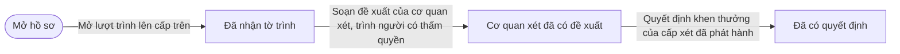
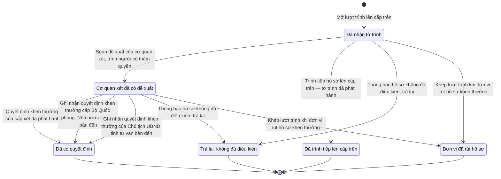

# qt-8.submission · Khen thưởng — Một vòng xử lý hồ sơ khen thưởng ở cấp trên

<!-- máy sinh: tom-tat -->
> **Hồ sơ:** Một vòng xử lý hồ sơ khen thưởng ở cấp trên (`AwardReview`)
>
> **Trong sổ phạm vi:** 8 · Khen thưởng — hồ sơ phụ submission: một lượt trình lên và xem xét ở một cấp trên — nhận, thẩm định, chuyển tiếp, quyết, trả lại, rút (tầng 1)
>
> 15 bước · 6 chặng · 6 vai · 1 bảng quyết định · 0 hạn · 8 khớp nối.
>
> **Nguồn:** sổ nghiệp vụ `qt-8.submission` · khai báo của app: `dqtv-app/core/processes/award/workflow/award-submission.yaml`. Các bảng do máy sinh từ nguồn này.
<!-- hết: tom-tat -->

## 1. Đường đi ngắn nhất qua các chặng

<!-- máy sinh: luong-chinh -->
Đường ít bước nhất từ lúc mở hồ sơ tới chặng kết thúc xa nhất. Máy chọn theo số chặng, không theo ý nghĩa nghiệp vụ — trình tự công việc thật xem phần Diễn giải và bảng "Việc làm ở từng chặng" ở mục 6.

| # | Ai làm | Làm gì | Hồ sơ sang chặng |
|---|---|---|---|
| 1 | Nhân viên văn thư | Mở lượt trình lên cấp trên | Đã nhận tờ trình |
| 2 | Phòng Chính trị, Bộ CHQS cấp tỉnh (`reviewingStaff`) | Soạn đề xuất của cơ quan xét, trình người có thẩm quyền | Cơ quan xét đã có đề xuất |
| 3 | Phòng Chính trị, Bộ CHQS cấp tỉnh (`reviewingStaff`) | Quyết định khen thưởng của cấp xét đã phát hành | Đã có quyết định |

<!-- hết: luong-chinh -->

## 2. Hồ sơ và việc nó để lại

<!-- máy sinh: muc-tieu -->
**App gọi quy trình này là:** Lượt trình và xem xét hồ sơ khen thưởng.

**Khi mở, hồ sơ này ghi mối nối tới:**
- Văn bản đi (1.outgoing-document) — bước `openAwardSubmissionRound`, khớp nối `awardReviewSubmittedByDocument`
- Văn bản đến (1.incoming-document) — bước `openAwardSubmissionRound`, khớp nối `awardReviewDeliveredAs`

**Hồ sơ này để lại cho quy trình khác** (bước tạo hồ sơ của quy trình kia ghi mối nối về đây):
- Hồ sơ thẩm định dùng chung (nhận, kiểm đủ, thẩm định, thông báo) (29.appraisal) — bước `openAppraisalOfSubmission`, khớp nối `appraisalOfSubmission`
<!-- hết: muc-tieu -->

## 3. Khởi phát và kết thúc

<!-- máy sinh: khoi-phat -->
**1 cửa vào** — bước mở hồ sơ:

| Bước mở | Ai mở | Hồ sơ vào chặng | App bắt buộc nhập |
|---|---|---|---|
| Mở lượt trình lên cấp trên | Nhân viên văn thư | Đã nhận tờ trình | `caseId` |

**Kết thúc:** *Đã có quyết định* (`DECIDED`), *Đã trình tiếp lên cấp trên* (`FORWARDED`), *Trả lại, không đủ điều kiện* (`REFUSED`), *Đơn vị đã rút hồ sơ* (`WITHDRAWN`)
<!-- hết: khoi-phat -->

## 4. Vai trò

<!-- máy sinh: vai-tro -->
| Vai trong sổ | Tên trong app | Điều kiện | Làm những bước |
|---|---|---|---|
| `clerk` | Nhân viên văn thư |  | Mở lượt trình lên cấp trên · Văn bản trình cấp Bộ Quốc phòng, Nhà nước đã phát hành |
| `reviewingStaff` | Phòng Chính trị, Bộ CHQS cấp tỉnh (`reviewingStaff`) |  | Soạn đề xuất của cơ quan xét, trình người có thẩm quyền · Trình ký tờ trình tiếp hồ sơ lên cấp trên · Trình tiếp hồ sơ lên cấp trên — tờ trình đã phát hành · Trình ký quyết định khen thưởng của cấp xét · Quyết định khen thưởng của cấp xét đã phát hành · Thông báo hồ sơ không đủ điều kiện, trả lại |
| `bureau` | Cục Dân quân tự vệ |  | Lập hồ sơ trình quyết định khen thưởng cấp Bộ Quốc phòng, Nhà nước · Ghi nhận cấp có thẩm quyền từ chối đề nghị của Cục · Trình ký văn bản trình cấp Bộ Quốc phòng, Nhà nước |
| `operator` | Chính trị viên |  | Nối văn bản quyết định của cấp Bộ Quốc phòng, Nhà nước nhận về · Ghi nhận quyết định khen thưởng cấp Bộ Quốc phòng, Nhà nước từ văn bản đến |
| `provinceStaff` | Phòng Chính trị, Bộ CHQS cấp tỉnh (`provinceStaff`) |  | Ghi nhận quyết định khen thưởng của Chủ tịch UBND tỉnh từ văn bản đến |
| `system` | Hệ thống tự làm |  | Khép lượt trình khi đơn vị rút hồ sơ khen thưởng |

*"Tên trong app" là tên app đặt cho mã chủ thể của vai. Hồ sơ thuộc đơn vị cấp khác thì người làm là người giữ vai ấy ở đơn vị nêu trong cột "Điều kiện" (nếu sổ có ghi) và ở cột "Người làm phải thuộc" của bảng "Theo khai báo của app" (mục 7).*
<!-- hết: vai-tro -->

## 5. Nhánh phụ

<!-- máy sinh: nhanh-phu -->
**Bước khác đưa hồ sơ sang chặng mới** — đường song song, rẽ nhánh hoặc kết thúc sớm:

| Bước | Ai làm | Từ chặng | Sang chặng |
|---|---|---|---|
| Trình tiếp hồ sơ lên cấp trên — tờ trình đã phát hành | Phòng Chính trị, Bộ CHQS cấp tỉnh (`reviewingStaff`) | Đã nhận tờ trình | Đã trình tiếp lên cấp trên |
| Ghi nhận quyết định khen thưởng cấp Bộ Quốc phòng, Nhà nước từ văn bản đến | Chính trị viên | Cơ quan xét đã có đề xuất | Đã có quyết định |
| Ghi nhận quyết định khen thưởng của Chủ tịch UBND tỉnh từ văn bản đến | Phòng Chính trị, Bộ CHQS cấp tỉnh (`provinceStaff`) | Cơ quan xét đã có đề xuất | Đã có quyết định |
| Thông báo hồ sơ không đủ điều kiện, trả lại | Phòng Chính trị, Bộ CHQS cấp tỉnh (`reviewingStaff`) | Đã nhận tờ trình, Cơ quan xét đã có đề xuất | Trả lại, không đủ điều kiện |
| Khép lượt trình khi đơn vị rút hồ sơ khen thưởng | Hệ thống tự làm | Đã nhận tờ trình, Cơ quan xét đã có đề xuất | Đơn vị đã rút hồ sơ |

**Làm trong lúc hồ sơ đứng yên ở một chặng** — ghi nhận, bổ sung:

| Bước | Ai làm | Ở chặng |
|---|---|---|
| Trình ký tờ trình tiếp hồ sơ lên cấp trên | Phòng Chính trị, Bộ CHQS cấp tỉnh (`reviewingStaff`) | Đã nhận tờ trình |
| Trình ký quyết định khen thưởng của cấp xét | Phòng Chính trị, Bộ CHQS cấp tỉnh (`reviewingStaff`) | Cơ quan xét đã có đề xuất |
| Lập hồ sơ trình quyết định khen thưởng cấp Bộ Quốc phòng, Nhà nước | Cục Dân quân tự vệ | Cơ quan xét đã có đề xuất |
| Ghi nhận cấp có thẩm quyền từ chối đề nghị của Cục | Cục Dân quân tự vệ | Cơ quan xét đã có đề xuất |
| Trình ký văn bản trình cấp Bộ Quốc phòng, Nhà nước | Cục Dân quân tự vệ | Cơ quan xét đã có đề xuất |
| Văn bản trình cấp Bộ Quốc phòng, Nhà nước đã phát hành | Nhân viên văn thư | Cơ quan xét đã có đề xuất |
| Nối văn bản quyết định của cấp Bộ Quốc phòng, Nhà nước nhận về | Chính trị viên | Cơ quan xét đã có đề xuất |

<!-- hết: nhanh-phu -->

## 6. Các chặng và việc làm ở từng chặng

<!-- máy sinh: chang -->
| Chặng | Tên hiển thị | Vào bằng bước | Kết thúc? |
|---|---|---|---|
| `RECEIVED` | Đã nhận tờ trình | Mở lượt trình lên cấp trên |  |
| `REVIEWED` | Cơ quan xét đã có đề xuất | Soạn đề xuất của cơ quan xét, trình người có thẩm quyền |  |
| `DECIDED` | Đã có quyết định | Quyết định khen thưởng của cấp xét đã phát hành · Ghi nhận quyết định khen thưởng cấp Bộ Quốc phòng, Nhà nước từ văn bản đến · Ghi nhận quyết định khen thưởng của Chủ tịch UBND tỉnh từ văn bản đến | **kết thúc** |
| `FORWARDED` | Đã trình tiếp lên cấp trên | Trình tiếp hồ sơ lên cấp trên — tờ trình đã phát hành | **kết thúc** |
| `REFUSED` | Trả lại, không đủ điều kiện | Thông báo hồ sơ không đủ điều kiện, trả lại | **kết thúc** |
| `WITHDRAWN` | Đơn vị đã rút hồ sơ | Khép lượt trình khi đơn vị rút hồ sơ khen thưởng | **kết thúc** |

### Việc làm ở từng chặng

Hồ sơ đang ở chặng nào thì làm được những bước nào.

| Hồ sơ đang ở chặng | Bước làm tại chặng (hồ sơ đứng yên) | Bước đưa hồ sơ sang chặng khác |
|---|---|---|
| **Đã nhận tờ trình** | Trình ký tờ trình tiếp hồ sơ lên cấp trên — Phòng Chính trị, Bộ CHQS cấp tỉnh (`reviewingStaff`) | Soạn đề xuất của cơ quan xét, trình người có thẩm quyền — Phòng Chính trị, Bộ CHQS cấp tỉnh (`reviewingStaff`) → *Cơ quan xét đã có đề xuất* Trình tiếp hồ sơ lên cấp trên — tờ trình đã phát hành — Phòng Chính trị, Bộ CHQS cấp tỉnh (`reviewingStaff`) → *Đã trình tiếp lên cấp trên* Thông báo hồ sơ không đủ điều kiện, trả lại — Phòng Chính trị, Bộ CHQS cấp tỉnh (`reviewingStaff`) → *Trả lại, không đủ điều kiện* Khép lượt trình khi đơn vị rút hồ sơ khen thưởng — Hệ thống tự làm → *Đơn vị đã rút hồ sơ* |
| **Cơ quan xét đã có đề xuất** | Trình ký quyết định khen thưởng của cấp xét — Phòng Chính trị, Bộ CHQS cấp tỉnh (`reviewingStaff`) Lập hồ sơ trình quyết định khen thưởng cấp Bộ Quốc phòng, Nhà nước — Cục Dân quân tự vệ Ghi nhận cấp có thẩm quyền từ chối đề nghị của Cục — Cục Dân quân tự vệ Trình ký văn bản trình cấp Bộ Quốc phòng, Nhà nước — Cục Dân quân tự vệ Văn bản trình cấp Bộ Quốc phòng, Nhà nước đã phát hành — Nhân viên văn thư Nối văn bản quyết định của cấp Bộ Quốc phòng, Nhà nước nhận về — Chính trị viên | Quyết định khen thưởng của cấp xét đã phát hành — Phòng Chính trị, Bộ CHQS cấp tỉnh (`reviewingStaff`) → *Đã có quyết định* Ghi nhận quyết định khen thưởng cấp Bộ Quốc phòng, Nhà nước từ văn bản đến — Chính trị viên → *Đã có quyết định* Ghi nhận quyết định khen thưởng của Chủ tịch UBND tỉnh từ văn bản đến — Phòng Chính trị, Bộ CHQS cấp tỉnh (`provinceStaff`) → *Đã có quyết định* Thông báo hồ sơ không đủ điều kiện, trả lại — Phòng Chính trị, Bộ CHQS cấp tỉnh (`reviewingStaff`) → *Trả lại, không đủ điều kiện* Khép lượt trình khi đơn vị rút hồ sơ khen thưởng — Hệ thống tự làm → *Đơn vị đã rút hồ sơ* |
| **Đã có quyết định** | — | — (kết thúc) |
| **Đã trình tiếp lên cấp trên** | — | — (kết thúc) |
| **Trả lại, không đủ điều kiện** | — | — (kết thúc) |
| **Đơn vị đã rút hồ sơ** | — | — (kết thúc) |
<!-- hết: chang -->

## 7. Bảng bước

<!-- máy sinh: buoc -->
| # | Bước | Mã bước | Ai thực hiện | Từ chặng | Sang chặng | Phải có trước | Ghi lại |
|---|---|---|---|---|---|---|---|
| 1 | Mở lượt trình lên cấp trên | `openAwardSubmissionRound` | Nhân viên văn thư | — (mở hồ sơ) | `RECEIVED` | `awardReadyForSubmission`, `previousRoundForwardedOrNone`, `submissionExceedsSubmitterAuthority`, `actorInAwardUnit`, `submittedDocumentIssued` | `id`, nối tới Hồ sơ khen thưởng, nối tới Một vòng xử lý hồ sơ khen thưởng ở cấp trên, nối `submittedByDocument`, nối `deliveredAs`, đơn vị trình, cấp đơn vị trình, đơn vị xem xét, cấp xem xét, đơn vị chủ hồ sơ, ngày nhận tờ trình |
| 2 | Soạn đề xuất của cơ quan xét, trình người có thẩm quyền | `draftReviewProposal` | Phòng Chính trị, Bộ CHQS cấp tỉnh (`reviewingStaff`) | `RECEIVED` | `REVIEWED` | `reviewPassed`, `actorInReviewingUnit` | đề xuất của cơ quan xét |
| 3 | Trình ký tờ trình tiếp hồ sơ lên cấp trên | `requestForwardSignature` | Phòng Chính trị, Bộ CHQS cấp tỉnh (`reviewingStaff`) | `RECEIVED` | giữ nguyên | `reviewPassed`, `exceedsReviewingLevelAuthority`, `actorInReviewingUnit`, `noForwardDocumentOpen` | nối `forwardedByDocument` |
| 4 | Trình tiếp hồ sơ lên cấp trên — tờ trình đã phát hành | `forwardSubmission` | Phòng Chính trị, Bộ CHQS cấp tỉnh (`reviewingStaff`) | `RECEIVED` | `FORWARDED` | `reviewPassed`, `exceedsReviewingLevelAuthority`, `actorInReviewingUnit`, `forwardDocumentIssued` | trình tiếp lúc |
| 5 | Trình ký quyết định khen thưởng của cấp xét | `requestReviewingLevelDecisionSignature` | Phòng Chính trị, Bộ CHQS cấp tỉnh (`reviewingStaff`) | `REVIEWED` | giữ nguyên | đề xuất của cơ quan xét, `decidedAtReviewingLevel`, `actorInReviewingUnit`, `noDecisionDocumentOpen` | nối `decidedByDocument` |
| 6 | Quyết định khen thưởng của cấp xét đã phát hành | `issueReviewingLevelDecision` | Phòng Chính trị, Bộ CHQS cấp tỉnh (`reviewingStaff`) | `REVIEWED` | `DECIDED` | đề xuất của cơ quan xét, `decidedAtReviewingLevel`, `actorInReviewingUnit`, `decisionDocumentIssued` | có quyết định lúc, nối `decisionDeliveredAs` |
| 7 | Lập hồ sơ trình quyết định khen thưởng cấp Bộ Quốc phòng, Nhà nước | `proposeAuthorityDecision` | Cục Dân quân tự vệ | `REVIEWED` | giữ nguyên | `decidedByMinistryOrState`, `actorInReviewingUnit` | hồ sơ trình cấp có thẩm quyền |
| 8 | Ghi nhận cấp có thẩm quyền từ chối đề nghị của Cục | `rejectAuthorityDecision` | Cục Dân quân tự vệ | `REVIEWED` | giữ nguyên | `decidedByMinistryOrState`, `actorInReviewingUnit` | cấp có thẩm quyền từ chối lúc |
| 9 | Trình ký văn bản trình cấp Bộ Quốc phòng, Nhà nước | `requestAuthorityProposalSignature` | Cục Dân quân tự vệ | `REVIEWED` | giữ nguyên | `decidedByMinistryOrState`, `noAuthorityProposalDocumentOpen`, `actorInReviewingUnit`, `authorityProposalDocumentNotIssued` | nối `reviewForOutgoingDocument` |
| 10 | Văn bản trình cấp Bộ Quốc phòng, Nhà nước đã phát hành | `linkAuthorityProposalDocument` | Nhân viên văn thư | `REVIEWED` | giữ nguyên | `authorityProposalDocumentIssued` | — |
| 11 | Nối văn bản quyết định của cấp Bộ Quốc phòng, Nhà nước nhận về | `linkAuthorityDecisionDocument` | Chính trị viên | `REVIEWED` | giữ nguyên | `decidedByMinistryOrState`, `actorInSubmittingUnit`, `decisionIncomingNotLinked`, `decisionIncomingUsable` | nối `reviewForIncomingDocument`, ngày nối quyết định nhận về |
| 12 | Ghi nhận quyết định khen thưởng cấp Bộ Quốc phòng, Nhà nước từ văn bản đến | `issueAuthorityDecision` | Chính trị viên | `REVIEWED` | `DECIDED` | hồ sơ trình cấp có thẩm quyền, `decidedByMinistryOrState`, `actorInSubmittingUnit`, `decisionIncomingUsable`, `decisionIncomingScanned` | có quyết định lúc, nối `reviewForIncomingDocument`, nối `decisionDeliveredAs`, ngày nối quyết định nhận về |
| 13 | Ghi nhận quyết định khen thưởng của Chủ tịch UBND tỉnh từ văn bản đến | `recordProvinceCommitteeAward` | Phòng Chính trị, Bộ CHQS cấp tỉnh (`provinceStaff`) | `REVIEWED` | `DECIDED` | đề xuất của cơ quan xét, `decidedByProvinceCommittee`, `submittedDocumentIssued`, `actorInReviewingUnit`, `decisionIncomingUsable` | có quyết định lúc, nối `reviewForIncomingDocument`, nối `decisionDeliveredAs`, ngày nối quyết định nhận về |
| 14 | Thông báo hồ sơ không đủ điều kiện, trả lại | `refuseSubmission` | Phòng Chính trị, Bộ CHQS cấp tỉnh (`reviewingStaff`) | `RECEIVED`, `REVIEWED` | `REFUSED` | `actorInReviewingUnit`, `deliveredDistributedAtReceiver` | trả lại lúc, lý do trả lại, nối `decisionDeliveredAs` |
| 15 | Khép lượt trình khi đơn vị rút hồ sơ khen thưởng | `closeRoundOnAwardWithdrawn` | Hệ thống tự làm | `RECEIVED`, `REVIEWED` | `WITHDRAWN` | `awardWithdrawn` | đơn vị rút lúc |

### Khi không đạt điều kiện

Mặc định: không đúng người, hồ sơ không ở đúng chặng, hoặc thiếu thứ "phải có trước" thì bước bị chặn, hồ sơ giữ nguyên. Bảng dưới chỉ kê những bước có kết quả riêng.

| # | Bước | Kết quả riêng |
|---|---|---|
| 1 | Mở lượt trình lên cấp trên | bước dừng lại, hồ sơ giữ nguyên khi kết quả xét là: `submitter_not_in_article_25_k6` |
| 10 | Văn bản trình cấp Bộ Quốc phòng, Nhà nước đã phát hành | bước này không do người nào bấm |
| 15 | Khép lượt trình khi đơn vị rút hồ sơ khen thưởng | bước này không do người nào bấm |

### Điều kiện "phải có trước" bằng lời

Cột "Phải có trước" ở bảng bước có hai loại: ô dữ liệu thường (bước chỉ đòi ô ấy đã có giá trị) và điều kiện hệ tự xét. Bảng này diễn các điều kiện hệ tự xét theo đúng công thức sổ ghi; số ở cột cuối là số thứ tự bước.

| Điều kiện | Đúng khi | Bước đòi |
|---|---|---|
| `awardReadyForSubmission` | có hồ sơ Khen thưởng (qt-8) chính là hồ sơ ghi ở ô nối `submissionOfAward` của hồ sơ đang làm mà hồ sơ ấy đang ở chặng `ENDORSED` hoặc `SUBMITTED` VÀ đã có `publishedAt` VÀ `resolutionOutcome` là `AGREE` | 1 |
| `previousRoundForwardedOrNone` | không có hồ sơ Khen thưởng — Một vòng xử lý hồ sơ khen thưởng ở cấp trên (qt-8.submission) chính là hồ sơ ghi ở ô nối `previousRound` của hồ sơ đang làm mà KHÔNG (đã có `reviewPassed`) | 1 |
| `submissionExceedsSubmitterAuthority` | có hồ sơ Khen thưởng — Một vòng xử lý hồ sơ khen thưởng ở cấp trên (qt-8.submission) chính là hồ sơ ghi ở ô nối `previousRound` của hồ sơ đang làm mà đã có `reviewPassed` HOẶC có hồ sơ Khen thưởng (qt-8) chính là hồ sơ ghi ở ô nối `submissionOfAward` của hồ sơ đang làm mà (`ownerLevel` là `commune` hoặc `organization` VÀ `decidingLevel` là `province` hoặc `province_committee` hoặc `region` hoặc `ministry` hoặc `state`) HOẶC (`ownerLevel` là `province` VÀ `decidingLevel` là `region` hoặc `ministry` hoặc `state`) HOẶC (`ownerLevel` là `region` hoặc `ministry` VÀ `decidingLevel` là `ministry` hoặc `state`) | 1 |
| `actorInAwardUnit` | có hồ sơ Khen thưởng (qt-8) (gọi là src) chính là hồ sơ ghi ở ô nối `submissionOfAward` của hồ sơ đang làm mà người đang làm là người của đơn vị ghi ở ô đơn vị chủ hồ sơ của hồ sơ src ấy (theo danh mục người của đơn vị, `dm.unit-staff`) HOẶC có hồ sơ Khen thưởng — Một vòng xử lý hồ sơ khen thưởng ở cấp trên (qt-8.submission) (gọi là prev) chính là hồ sơ ghi ở ô nối `previousRound` của hồ sơ đang làm mà người đang làm là người của đơn vị ghi ở ô đơn vị xem xét của hồ sơ prev ấy (theo danh mục người của đơn vị, `dm.unit-staff`) | 1 |
| `submittedDocumentIssued` | có hồ sơ Việc luật giao kèm văn bản đến, đi — Văn bản đi (qt-1.outgoing-document) chính là hồ sơ ghi ở ô nối `submittedByDocument` của hồ sơ đang làm mà hồ sơ ấy đang ở chặng `ISSUED` | 1, 13 |
| `reviewPassed` | có hồ sơ Thẩm định hồ sơ ở một cấp (tỉnh, quân khu, Cục) — Hồ sơ thẩm định dùng chung (nhận, kiểm đủ, thẩm định, thông báo) (qt-29.appraisal) có ô nối `appraisalOfSubmission` trỏ về chính hồ sơ đang làm mà hồ sơ ấy đang ở chặng `APPRAISED` hoặc `APPRAISAL_NOTIFIED` VÀ `appraisalOutcome` là `PASSED` | 2, 3, 4 |
| `actorInReviewingUnit` | người đang làm là người của đơn vị ghi ở ô đơn vị xem xét của hồ sơ này (theo danh mục người của đơn vị, `dm.unit-staff`) | 2, 3, 4, 5, 6, 7, 8, 9, 13, 14 |
| `exceedsReviewingLevelAuthority` | (cấp xem xét là Cơ quan thi đua, khen thưởng cấp tỉnh (`province`) VÀ có hồ sơ Khen thưởng (qt-8) chính là hồ sơ ghi ở ô nối `submissionOfAward` của hồ sơ đang làm mà `decidingLevel` là `region` hoặc `ministry` hoặc `state`) HOẶC (cấp xem xét là Cơ quan thi đua, khen thưởng cấp quân khu (`region`) VÀ có hồ sơ Khen thưởng (qt-8) chính là hồ sơ ghi ở ô nối `submissionOfAward` của hồ sơ đang làm mà `decidingLevel` là `ministry` hoặc `state`) | 3, 4 |
| `noForwardDocumentOpen` | KHÔNG (có hồ sơ Việc luật giao kèm văn bản đến, đi — Văn bản đi (qt-1.outgoing-document) chính là hồ sơ ghi ở ô nối `forwardedByDocument` của hồ sơ đang làm mà hồ sơ ấy đang ở chặng `DRAFT` hoặc `PENDING_SIGNATURE` hoặc `SIGNED`) | 3 |
| `forwardDocumentIssued` | có hồ sơ Việc luật giao kèm văn bản đến, đi — Văn bản đi (qt-1.outgoing-document) chính là hồ sơ ghi ở ô nối `forwardedByDocument` của hồ sơ đang làm mà hồ sơ ấy đang ở chặng `ISSUED` | 4 |
| `decidedAtReviewingLevel` | (cấp xem xét là Cơ quan thi đua, khen thưởng cấp tỉnh (`province`) VÀ có hồ sơ Khen thưởng (qt-8) chính là hồ sơ ghi ở ô nối `submissionOfAward` của hồ sơ đang làm mà `decidingLevel` là `province`) HOẶC (cấp xem xét là Cơ quan thi đua, khen thưởng cấp quân khu (`region`) VÀ có hồ sơ Khen thưởng (qt-8) chính là hồ sơ ghi ở ô nối `submissionOfAward` của hồ sơ đang làm mà `decidingLevel` là `region`) | 5, 6 |
| `noDecisionDocumentOpen` | KHÔNG (có hồ sơ Việc luật giao kèm văn bản đến, đi — Văn bản đi (qt-1.outgoing-document) chính là hồ sơ ghi ở ô nối `decidedByDocument` của hồ sơ đang làm mà hồ sơ ấy đang ở chặng `DRAFT` hoặc `PENDING_SIGNATURE` hoặc `SIGNED`) | 5 |
| `decisionDocumentIssued` | có hồ sơ Việc luật giao kèm văn bản đến, đi — Văn bản đi (qt-1.outgoing-document) chính là hồ sơ ghi ở ô nối `decidedByDocument` của hồ sơ đang làm mà hồ sơ ấy đang ở chặng `ISSUED` | 6 |
| `decidedByMinistryOrState` | có hồ sơ Khen thưởng (qt-8) chính là hồ sơ ghi ở ô nối `submissionOfAward` của hồ sơ đang làm mà `decidingLevel` là `ministry` hoặc `state` | 7, 8, 9, 11, 12 |
| `noAuthorityProposalDocumentOpen` | KHÔNG (có hồ sơ Việc luật giao kèm văn bản đến, đi — Văn bản đi (qt-1.outgoing-document) chính là hồ sơ ghi ở ô nối `reviewForOutgoingDocument` của hồ sơ đang làm mà hồ sơ ấy đang ở chặng `DRAFT` hoặc `PENDING_SIGNATURE` hoặc `SIGNED`) | 9 |
| `authorityProposalDocumentNotIssued` | KHÔNG (có hồ sơ Việc luật giao kèm văn bản đến, đi — Văn bản đi (qt-1.outgoing-document) chính là hồ sơ ghi ở ô nối `reviewForOutgoingDocument` của hồ sơ đang làm mà hồ sơ ấy đang ở chặng `ISSUED`) | 9 |
| `authorityProposalDocumentIssued` | có hồ sơ Việc luật giao kèm văn bản đến, đi — Văn bản đi (qt-1.outgoing-document) chính là hồ sơ ghi ở ô nối `reviewForOutgoingDocument` của hồ sơ đang làm mà hồ sơ ấy đang ở chặng `ISSUED` | 10 |
| `actorInSubmittingUnit` | người đang làm là người của đơn vị ghi ở ô đơn vị trình của hồ sơ này (theo danh mục người của đơn vị, `dm.unit-staff`) | 11, 12 |
| `decisionIncomingNotLinked` | KHÔNG (đã có ngày nối quyết định nhận về) | 11 |
| `decisionIncomingUsable` | có hồ sơ Việc luật giao kèm văn bản đến, đi — Văn bản đến (qt-1.incoming-document) chính là hồ sơ ghi ở ô nối `reviewForIncomingDocument` của hồ sơ đang làm mà hồ sơ ấy đang ở chặng `RECEIVED` hoặc `DISTRIBUTED` | 11, 12, 13 |
| `decisionIncomingScanned` | có hồ sơ Việc luật giao kèm văn bản đến, đi — Văn bản đến (qt-1.incoming-document) chính là hồ sơ ghi ở ô nối `reviewForIncomingDocument` của hồ sơ đang làm mà đã có `scanPath` | 12 |
| `decidedByProvinceCommittee` | có hồ sơ Khen thưởng (qt-8) chính là hồ sơ ghi ở ô nối `submissionOfAward` của hồ sơ đang làm mà `decidingLevel` là `province_committee` | 13 |
| `deliveredDistributedAtReceiver` | có hồ sơ Việc luật giao kèm văn bản đến, đi — Văn bản đến (qt-1.incoming-document) chính là hồ sơ ghi ở ô nối `deliveredAs` của hồ sơ đang làm mà hồ sơ ấy đang ở chặng `DISTRIBUTED` | 14 |
| `awardWithdrawn` | có hồ sơ Khen thưởng (qt-8) chính là hồ sơ ghi ở ô nối `submissionOfAward` của hồ sơ đang làm mà hồ sơ ấy đang ở chặng `CLOSED` | 15 |
| `toBureau` | cấp xem xét là Cục Dân quân tự vệ (`central`) | đầu vào bảng quyết định (mục 8) |

### Theo khai báo của app

Người làm phải thuộc đơn vị nào, ô người dùng phải nhập, bước có lặp được không, và căn cứ pháp lý — lấy từ khai báo quy trình trong app.

| # | Bước | Người làm phải thuộc | Bắt buộc nhập | Nhập nếu có | Lặp được | Căn cứ |
|---|---|---|---|---|---|---|
| 1 | Mở lượt trình lên cấp trên |  | `caseId` | `previousRoundId`, `submissionDocumentId`, `deliveredIncomingId` |  | TT93/2024/TT-BQP Đ.25 k5-k7; NĐ30/2020/NĐ-CP Đ.18, Đ.20 |
| 2 | Soạn đề xuất của cơ quan xét, trình người có thẩm quyền | đơn vị đang giữ hồ sơ | đề xuất của cơ quan xét | — |  | TT93/2024/TT-BQP Đ.27 k2; 23/VBHN-BQP Đ.25 k7 |
| 3 | Trình ký tờ trình tiếp hồ sơ lên cấp trên | đơn vị đang giữ hồ sơ | — | dự thảo tờ trình (PDF) |  | TT93/2024/TT-BQP Đ.25 k5-k7; NĐ30/2020/NĐ-CP Đ.13 |
| 4 | Trình tiếp hồ sơ lên cấp trên — tờ trình đã phát hành | đơn vị đang giữ hồ sơ | — | — |  | TT93/2024/TT-BQP Đ.25 k5-k7; NĐ30/2020/NĐ-CP Đ.13 |
| 5 | Trình ký quyết định khen thưởng của cấp xét | đơn vị đang giữ hồ sơ | — | dự thảo quyết định (PDF) |  | TT93/2024/TT-BQP Đ.23 k2-k3; NĐ30/2020/NĐ-CP Đ.13 |
| 6 | Quyết định khen thưởng của cấp xét đã phát hành | đơn vị đang giữ hồ sơ | — | — |  | TT93/2024/TT-BQP Đ.23 k2-k3; Luật Thi đua, khen thưởng Đ.11 k4, Đ.82 |
| 7 | Lập hồ sơ trình quyết định khen thưởng cấp Bộ Quốc phòng, Nhà nước | đơn vị đang giữ hồ sơ | hồ sơ trình cấp có thẩm quyền | — |  | 23/VBHN-BQP Đ.25 k6, k7; TT179/2019/TT-BQP Đ.2 k2 c |
| 8 | Ghi nhận cấp có thẩm quyền từ chối đề nghị của Cục | đơn vị đang giữ hồ sơ | — | — |  | 23/VBHN-BQP Đ.27 k3 |
| 9 | Trình ký văn bản trình cấp Bộ Quốc phòng, Nhà nước | đơn vị đang giữ hồ sơ | — | dự thảo văn bản trình (PDF) |  | 23/VBHN-BQP Đ.25 k6, k7; NĐ30/2020/NĐ-CP Đ.13 |
| 10 | Văn bản trình cấp Bộ Quốc phòng, Nhà nước đã phát hành |  | — | `submissionDocumentId` |  | NĐ30/2020/NĐ-CP Đ.18, Đ.19 |
| 11 | Nối văn bản quyết định của cấp Bộ Quốc phòng, Nhà nước nhận về | `submittingUnit` | quyết định khen thưởng cấp Bộ trong sổ văn bản đến | — |  | 23/VBHN-BQP Đ.23 k1, k2; NĐ30/2020/NĐ-CP Đ.20 |
| 12 | Ghi nhận quyết định khen thưởng cấp Bộ Quốc phòng, Nhà nước từ văn bản đến | `submittingUnit` | quyết định khen thưởng cấp Bộ trong sổ văn bản đến | — |  | 23/VBHN-BQP Đ.23 k1, k2 · L06/2022/QH15 Đ.77, Đ.78 k2 |
| 13 | Ghi nhận quyết định khen thưởng của Chủ tịch UBND tỉnh từ văn bản đến | đơn vị đang giữ hồ sơ | quyết định khen thưởng của Chủ tịch UBND tỉnh trong sổ văn bản đến | — |  | L06/2022/QH15 Đ.79 k4; TT93/2024/TT-BQP Đ.23 k6 |
| 14 | Thông báo hồ sơ không đủ điều kiện, trả lại | đơn vị đang giữ hồ sơ | lý do trả lại | — |  | TT93/2024/TT-BQP Đ.27 k3 a |
| 15 | Khép lượt trình khi đơn vị rút hồ sơ khen thưởng |  | — | — |  | TT93/2024/TT-BQP Đ.25 k5 |

### Điều kiện và ghi chú app khai cho từng bước

Lấy từ khai báo quy trình trong app. Lời trong ngoặc kép là câu app hiện cho người dùng. Chức danh người ký ngoài hệ app chỉ khai bằng mã.

| # | Bước | Điều kiện, ghi chú |
|---|---|---|
| 7 | Lập hồ sơ trình quyết định khen thưởng cấp Bộ Quốc phòng, Nhà nước | · không làm được khi đã có ô "hồ sơ trình cấp có thẩm quyền" — app báo: "lượt này đã lập hồ sơ trình cấp Bộ Quốc phòng, Nhà nước rồi" |
| 8 | Ghi nhận cấp có thẩm quyền từ chối đề nghị của Cục | · không làm được khi đã có ô "cấp có thẩm quyền từ chối lúc" — app báo: "lượt này đã ghi cấp có thẩm quyền từ chối rồi" |
| 11 | Nối văn bản quyết định của cấp Bộ Quốc phòng, Nhà nước nhận về | · không làm được khi đã có ô "ngày nối quyết định nhận về" — app báo: "lượt này đã nối văn bản quyết định nhận về rồi" |
<!-- hết: buoc -->

## 8. Bảng quyết định, hạn, việc ngoài hệ

<!-- máy sinh: quyet-dinh -->
**Bảng `bureau-submitter`** — xét ở bước *Mở lượt trình lên cấp trên*; đầu vào: `toBureau`, `awardSubmitterKind`. 4 dòng, dò từ trên xuống, dòng đầu tiên khớp thì dừng.

| Thứ tự dò (số sổ ghi) | Dòng | Khi | Thì |
|---|---|---|---|
| 0 | `not-to-bureau` | chưa có `toBureau` | cho qua |
| 1 | `not-listed` | `awardSubmitterKind` là `other` | `submitter_not_in_article_25_k6` |
| 2 | `kind-not-recorded` | chưa có `awardSubmitterKind` | `submitter_not_in_article_25_k6` |
| 3 | `otherwise` | mọi trường hợp còn lại | cho qua |

<!-- hết: quyet-dinh -->

## 9. Dữ liệu của hồ sơ

<!-- máy sinh: du-lieu -->
Các ô mà bước trong sổ ghi hoặc đòi. Số trong hai cột cuối là số thứ tự bước ở bảng bước (mục 7).

| Ô dữ liệu | Mã | Kiểu (app) | Giá trị cho phép | Loại ô (sổ) | Bước ghi | Bước đòi | Mô tả trong app |
|---|---|---|---|---|---|---|---|
| — | `id` |  |  | lưu trên hồ sơ (`stored`) | 1 | — |  |
| đơn vị trình | `submittingUnit` | chữ |  | lưu trên hồ sơ (`stored`) | 1 | — | Đơn vị đưa hồ sơ lên ở lượt này — hệ ghi; đơn vị này nối văn bản quyết định cấp Bộ nhận về |
| cấp đơn vị trình | `submittingLevel` | chọn một | Ban CHQS xã (`commune`), Bộ CHQS tỉnh (`province`), Quân khu (`region`), Ban CHQS cơ quan, tổ chức (`organization`), Ban CHQS bộ, ngành (`ministry`) | lưu trên hồ sơ (`stored`) | 1 | — | Cấp của đơn vị trình — hệ ghi; vai các bước phía đơn vị trình giải theo cấp này |
| đơn vị xem xét | `reviewingUnit` | chữ |  | lưu trên hồ sơ (`stored`) | 1 | — | Đơn vị xem xét lượt này — hệ ghi; chỉ cán bộ đơn vị này xét, trình tiếp, trả lại |
| cấp xem xét | `reviewingLevel` | chọn một | Cơ quan thi đua, khen thưởng cấp tỉnh (`province`), Cơ quan thi đua, khen thưởng cấp quân khu (`region`), Cục Dân quân tự vệ (`central`) | lưu trên hồ sơ (`stored`) | 1 | — | Cấp của đơn vị xem xét — hệ ghi; vai các bước phía cơ quan xét giải theo cấp này |
| đơn vị chủ hồ sơ | `ownerUnit` |  |  | lưu trên hồ sơ (`stored`) | 1 | — |  |
| ngày nhận tờ trình | `reviewerReceivedAt` | ngày giờ |  | lưu trên hồ sơ (`stored`) | 1 | — | Thời điểm cơ quan xét nhận tờ trình |
| đề xuất của cơ quan xét | `staffProposalNote` | chữ |  | đưa vào ở bước (`input`) | 2 | 5, 6, 13 | Đề xuất của cơ quan xét (cơ quan thi đua, khen thưởng cấp tỉnh, quân khu) trình người có thẩm quyền |
| trình tiếp lúc | `forwardedAt` | ngày giờ |  | lưu trên hồ sơ (`stored`) | 4 | — | Lúc tờ trình tiếp lên cấp trên nữa được phát hành |
| có quyết định lúc | `decidedAt` | ngày giờ |  | lưu trên hồ sơ (`stored`) | 6, 12, 13 | — | Lúc lượt này có quyết định khen thưởng |
| hồ sơ trình cấp có thẩm quyền | `authorityProposalNote` | chữ |  | đưa vào ở bước (`input`) | 7 | 12 | Hồ sơ Cục trình Bộ trưởng, cấp Nhà nước quyết định |
| cấp có thẩm quyền từ chối lúc | `rejectedAt` | ngày giờ |  | lưu trên hồ sơ (`stored`) | 8 | — | Lần gần nhất cấp có thẩm quyền (Bộ, Nhà nước) từ chối đề nghị của Cục |
| ngày nối quyết định nhận về | `incomingLinkedAt` | ngày |  | lưu trên hồ sơ (`stored`) | 11, 12, 13 | — | Ngày nối văn bản quyết định nhận về (sổ `incomingLinkedAt`) |
| trả lại lúc | `refusedAt` | ngày giờ |  | lưu trên hồ sơ (`stored`) | 14 | — | Lúc lượt này bị trả lại |
| lý do trả lại | `refusalReason` | chữ |  | đưa vào ở bước (`input`) | 14 | — | Lý do cơ quan xét báo hồ sơ không đủ điều kiện (trả lại) |
| đơn vị rút lúc | `withdrawnAt` | ngày giờ |  | lưu trên hồ sơ (`stored`) | 15 | — | Lúc hồ sơ khen thưởng bị đơn vị rút (đóng) nên lượt này khép |
| — | `awardReadyForSubmission` |  | có hay chưa | hệ suy ra (`derived`) | — | 1 |  |
| — | `previousRoundForwardedOrNone` |  | có hay chưa | hệ suy ra (`derived`) | — | 1 |  |
| — | `submissionExceedsSubmitterAuthority` |  | có hay chưa | hệ suy ra (`derived`) | — | 1 |  |
| — | `actorInAwardUnit` |  | có hay chưa | hệ suy ra (`derived`) | — | 1 |  |
| — | `submittedDocumentIssued` |  | có hay chưa | hệ suy ra (`derived`) | — | 1, 13 |  |
| — | `reviewPassed` |  | có hay chưa | hệ suy ra (`derived`) | — | 2, 3, 4 |  |
| — | `actorInReviewingUnit` |  | có hay chưa | hệ suy ra (`derived`) | — | 2, 3, 4, 5, 6, 7, 8, 9, 13, 14 |  |
| — | `exceedsReviewingLevelAuthority` |  | có hay chưa | hệ suy ra (`derived`) | — | 3, 4 |  |
| — | `noForwardDocumentOpen` |  | có hay chưa | hệ suy ra (`derived`) | — | 3 |  |
| — | `forwardDocumentIssued` |  | có hay chưa | hệ suy ra (`derived`) | — | 4 |  |
| — | `decidedAtReviewingLevel` |  | có hay chưa | hệ suy ra (`derived`) | — | 5, 6 |  |
| — | `noDecisionDocumentOpen` |  | có hay chưa | hệ suy ra (`derived`) | — | 5 |  |
| — | `decisionDocumentIssued` |  | có hay chưa | hệ suy ra (`derived`) | — | 6 |  |
| — | `decidedByMinistryOrState` |  | có hay chưa | hệ suy ra (`derived`) | — | 7, 8, 9, 11, 12 |  |
| — | `noAuthorityProposalDocumentOpen` |  | có hay chưa | hệ suy ra (`derived`) | — | 9 |  |
| — | `authorityProposalDocumentNotIssued` |  | có hay chưa | hệ suy ra (`derived`) | — | 9 |  |
| — | `authorityProposalDocumentIssued` |  | có hay chưa | hệ suy ra (`derived`) | — | 10 |  |
| — | `actorInSubmittingUnit` |  | có hay chưa | hệ suy ra (`derived`) | — | 11, 12 |  |
| — | `decisionIncomingNotLinked` |  | có hay chưa | hệ suy ra (`derived`) | — | 11 |  |
| — | `decisionIncomingUsable` |  | có hay chưa | hệ suy ra (`derived`) | — | 11, 12, 13 |  |
| — | `decisionIncomingScanned` |  | có hay chưa | hệ suy ra (`derived`) | — | 12 |  |
| — | `decidedByProvinceCommittee` |  | có hay chưa | hệ suy ra (`derived`) | — | 13 |  |
| — | `deliveredDistributedAtReceiver` |  | có hay chưa | hệ suy ra (`derived`) | — | 14 |  |
| — | `awardWithdrawn` |  | có hay chưa | hệ suy ra (`derived`) | — | 15 |  |
| — | `toBureau` |  | có hay chưa | hệ suy ra (`derived`) | — | — |  |
| — | `awardSubmitterKind` |  | `defence_ministry_direct_unit`, `ministry_or_organisation_command_board`, `other` | hệ suy ra (`derived`) | — | — |  |

42 ô. Cột "Loại ô" là cách sổ phân loại ô, in kèm đúng chữ của sổ; ô nào người dùng phải nhập xem bảng "Theo khai báo của app" ở mục 7.
<!-- hết: du-lieu -->

## 10. Khớp nối với quy trình khác

<!-- máy sinh: khop-noi -->
| Quy trình kia | Hồ sơ kia | Quan hệ | Nội dung (mô tả trong app) | Bước ghi mối nối | Tên ô nối |
|---|---|---|---|---|---|
| 1.incoming-document | Văn bản đến | gắn với nhau ở một bước giữa chừng | Quyết định, thông báo trả lại của cấp trên về sổ văn bản đến của đơn vị trình và các đơn vị trên đường trình… | 8.submission·issueAuthorityDecision, 8.submission·issueReviewingLevelDecision, 8.submission·recordProvinceCommitteeAward, 8.submission·refuseSubmission | `awardReviewDecisionDeliveredAs` |
| 1.incoming-document | Văn bản đến | hồ sơ này **mở ra có nối tới** hồ sơ kia | Tờ trình vào sổ văn bản đến của cơ quan xét — chờ tiếp nhận, phân phối (NĐ30/2020 Đ.20) | 8.submission·openAwardSubmissionRound ⊕ | `awardReviewDeliveredAs` |
| 1.incoming-document | Văn bản đến | gắn với nhau ở một bước giữa chừng | Văn bản quyết định của cấp trên gửi VỀ (E24), vào sổ văn bản đến — NĐ30/2020/NĐ-CP Đ.20 | 8·recordOwnLevelDecision | `awardReviewForIncomingDocument` |
| 1.outgoing-document | Văn bản đi | gắn với nhau ở một bước giữa chừng | Quyết định khen thưởng của cơ quan xét (tỉnh, quân khu) — văn bản đi của chính cơ quan xét | 8.submission·requestReviewingLevelDecisionSignature | `awardReviewDecidedByDocument` |
| 1.outgoing-document | Văn bản đi | gắn với nhau ở một bước giữa chừng | Hồ sơ trình cấp trên (E24) của vòng xử lý này, khi đã lập | 8.submission·requestAuthorityProposalSignature | `awardReviewForOutgoingDocument` |
| 1.outgoing-document | Văn bản đi | gắn với nhau ở một bước giữa chừng | Tờ trình tiếp hồ sơ lên cấp trên nữa của cơ quan xét (tỉnh lên quân khu, quân khu lên Cục) — TT93/2024 Đ.25 k… | 8.submission·requestForwardSignature | `awardReviewForwardedByDocument` |
| 1.outgoing-document | Văn bản đi | hồ sơ này **mở ra có nối tới** hồ sơ kia | Tờ trình của đơn vị trình đưa hồ sơ lên lượt này — văn bản đi đã phát hành (NĐ30/2020 Đ.18, Đ.19) | 8.submission·openAwardSubmissionRound ⊕ | `awardReviewSubmittedByDocument` |
| 29.appraisal | Hồ sơ thẩm định dùng chung (nhận, kiểm đủ, thẩm định, thông báo) | hồ sơ kia **mở ra từ** hồ sơ này | Lượt trình lên và xem xét hồ sơ khen thưởng mà hồ sơ thẩm định này thuộc về (TT93/2024/TT-BQP Đ.27) — lượt cầ… | 29.appraisal·openAppraisalOfSubmission ⊕ | `appraisalOfSubmission` |

8 khớp nối. ⊕ là bước tạo hồ sơ.

**Ô nối giữa các hồ sơ cùng mã quy trình, hoặc tới danh mục nền:** `previousRound` (Một vòng xử lý hồ sơ khen thưởng ở cấp trên → Một vòng xử lý hồ sơ khen thưởng ở cấp trên) — bước Mở lượt trình lên cấp trên; `submissionOfAward` (Một vòng xử lý hồ sơ khen thưởng ở cấp trên → Hồ sơ khen thưởng) — bước Mở lượt trình lên cấp trên.
<!-- hết: khop-noi -->

## 11. Thông tin chung

<!-- máy sinh: thong-tin -->
| | |
|---|---|
| **Mã trong sổ** | `qt-8.submission` |
| **Quy trình trong app** | `award` (`workflow/award-submission.yaml`) — mặt công tác: `political` |
| **Hồ sơ** | Một vòng xử lý hồ sơ khen thưởng ở cấp trên (`AwardReview`) |
| **Cùng mã quy trình** | [qt-8](qt-8.html), [qt-8.medal](qt-8.medal.html), [qt-8.revocation](qt-8.revocation.html) |
| **Căn cứ pháp lý từng bước** | cột "Căn cứ" ở bảng "Theo khai báo của app", mục 7 |
<!-- hết: thong-tin -->
