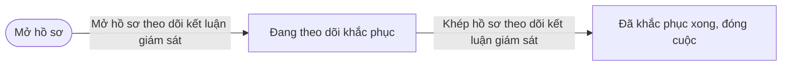
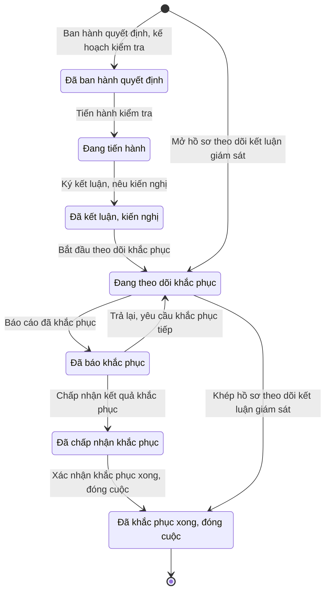

# qt-9 · Thanh tra, kiểm tra, giám sát

<!-- máy sinh: tom-tat -->
> **Hồ sơ:** Cuộc thanh tra, kiểm tra (`Inspection`)
>
> **Trong sổ phạm vi:** 9 · Thanh tra, kiểm tra, giám sát (tầng 1)
>
> 13 bước · 7 chặng · 3 vai · 0 bảng quyết định · 0 hạn · 8 khớp nối.
>
> **Nguồn:** sổ nghiệp vụ `qt-9` · khai báo của app: `dqtv-app/core/processes/inspection/workflow/inspection.yaml`. Các bảng do máy sinh từ nguồn này.
<!-- hết: tom-tat -->

<!-- viết tay: dien-giai -->
## Diễn giải

*Phần này viết tay, diễn giải lại điều các bảng bên dưới ghi.*

### Quy trình này để làm gì

Theo dõi một **cuộc thanh tra, kiểm tra** từ quyết định kiểm tra tới lúc mọi kiến nghị được khắc phục; cùng hồ sơ này cũng dùng để theo dõi việc thực hiện một kết luận giám sát của Hội đồng nhân dân. Có bốn loại cuộc (thanh tra, kiểm tra, sơ kết, tổng kết), tính chất định kỳ hoặc đột xuất.

Có hai bên. **Đơn vị đi kiểm tra** là chủ hồ sơ (vai `inspector`); **đơn vị được kiểm tra** ghi tên trên hồ sơ và báo cáo khắc phục (vai `subject`). Vai của đoàn giải theo cấp của đơn vị đi kiểm tra, vai báo cáo khắc phục giải theo cấp của đơn vị được kiểm tra. Ngoài ra có vai `AC-CUC` (Cục Dân quân tự vệ) và vai `operator` (Trợ lý Tác huấn).

Hồ sơ đi qua năm chặng: *Đã ban hành quyết định* → *Đang tiến hành* → *Đã kết luận, kiến nghị* → *Đang theo dõi khắc phục* → *Đã khắc phục xong, đóng cuộc*.

### Khi nào bắt đầu

Hai cửa vào:

- **Ban hành quyết định, kế hoạch kiểm tra** (vai `inspector`) — hồ sơ vào *Đã ban hành quyết định*. Phải nhập đơn vị được kiểm tra, tên cuộc, loại, cơ quan chủ trì, ngày ban hành. Hồ sơ mở ra có nối tới kế hoạch kiểm tra và chỉ tiêu kiểm tra của quy trình 2 (ô nhập nếu có). Theo lời người dùng: đoàn chọn được bất kỳ đơn vị cấp dưới nào trong tuyến, không riêng cấp dưới trực tiếp.
- **Mở hồ sơ theo dõi kết luận giám sát** (vai `subject`) — hồ sơ vào thẳng *Đang theo dõi khắc phục*. Phải nhập tên, cơ quan giám sát, kiến nghị của kết luận giám sát, ngày mở; văn bản kết luận trong sổ văn bản đến (quy trình 1) là ô nhập nếu có.

Cả hai bước mở ghi ô đơn vị chủ hồ sơ và cấp trên của chủ hồ sơ.

### Diễn ra thế nào

**Chặng "Đã ban hành quyết định".** Bên đi kiểm tra bấm **Tiến hành kiểm tra**: ghi ngày bắt đầu và loại đơn vị được kiểm tra (Ban CHQS xã, hội đồng GDQP&AN cấp dưới, trung tâm GDQP&AN, cơ sở đào tạo, đơn vị liên kết). Hồ sơ sang *Đang tiến hành*.

**Chặng "Đang tiến hành".** Bên đi kiểm tra **Ký kết luận, nêu kiến nghị**: ghi ngày ký, kết luận, danh mục kiến nghị và thời hạn; bước ghi mối nối tới các dòng *Kiến nghị của cuộc kiểm tra*. Hồ sơ sang *Đã kết luận, kiến nghị*.

**Chặng "Đã kết luận, kiến nghị".**

- **Ghi nhận đã công khai kết luận** (bên đi kiểm tra, lặp được).
- Hai bước của Cục Dân quân tự vệ: **Ghi quyết định cho ngừng giảng dạy** — chỉ khi đơn vị được kiểm tra là trung tâm GDQP&AN hoặc cơ sở đào tạo; **Ghi quyết định điều chỉnh, phân luồng** — chỉ khi là đơn vị liên kết, và gắn được vào một đợt điều chỉnh danh sách liên kết (G10). Theo lời người dùng: hai bước này chỉ kiểm người bấm là cán bộ Cục, không kiểm cấp trên trực tiếp của chủ hồ sơ.
- Bên đi kiểm tra **Bắt đầu theo dõi khắc phục** để sang *Đang theo dõi khắc phục*.

**Chặng "Đang theo dõi khắc phục"** — làm theo từng kiến nghị:

- Người của đơn vị được kiểm tra (vai `subject`) **Báo cáo đã khắc phục một kiến nghị** (chọn kiến nghị, ngày báo cáo, đã khắc phục bằng cách nào, chứng cứ nếu có).
- Bên đi kiểm tra **Xác nhận kết quả khắc phục** (chọn kiến nghị, kết quả xác nhận, ngày, ý kiến của đoàn).
- Bên đi kiểm tra **Xác nhận khắc phục xong, đóng cuộc** — hồ sơ sang *Đã khắc phục xong, đóng cuộc*.
- Với hồ sơ theo dõi kết luận giám sát: vai `subject`, người của đơn vị chủ hồ sơ, bấm **Khép hồ sơ theo dõi kết luận giám sát** (nhập ngày đóng cuộc). Theo lời người dùng: Hội đồng nhân dân không dùng hệ nên bên bị giám sát tự khép.

**Khiếu nại, tố cáo trong cuộc kiểm tra** — làm được ở ba chặng *Đang tiến hành*, *Đã kết luận, kiến nghị*, *Đang theo dõi khắc phục*, lặp được, cả hai đòi người làm thuộc đơn vị chủ hồ sơ: Trợ lý Tác huấn **Tiếp nhận khiếu nại, tố cáo** (loại đơn, nội dung, ngày nhận); bên đi kiểm tra **Giải quyết xong khiếu nại, tố cáo** (kết quả, ngày giải quyết xong).

### Kết thúc và để lại gì

Hồ sơ kết thúc ở *Đã khắc phục xong, đóng cuộc* — mọi kiến nghị đã được xác nhận đạt. Mối nối sang quy trình khác: kế hoạch và chỉ tiêu kiểm tra (2) lúc mở; văn bản kết luận giám sát trong sổ văn bản đến (1); đợt điều chỉnh danh sách liên kết (G10) ở bước ghi quyết định điều chỉnh, phân luồng.

### Điều kiện chặn

- Chín bước đòi người làm là người của đơn vị chủ hồ sơ: bảy bước của bên đi kiểm tra sau khi mở, bước khép hồ sơ giám sát và bước tiếp nhận khiếu nại. Bước báo cáo khắc phục đòi người làm là người của đơn vị ghi ở ô đơn vị được kiểm tra (`actorInInspectedUnit`). Hai bước mở và hai bước của Cục không có điều kiện về đơn vị của người làm.
- Hai bước của Cục đòi điều kiện theo loại đơn vị được kiểm tra: ngừng giảng dạy khi loại là trung tâm GDQP&AN hoặc cơ sở đào tạo (`inspectedUnitTeaches`), điều chỉnh, phân luồng khi loại là đơn vị liên kết (`inspectedUnitIsLinkage`); với Ban CHQS xã và hội đồng GDQP&AN cấp dưới thì ô loại đơn vị chỉ để tra cứu, thống kê.
- Không đúng người, sai chặng, thiếu thứ phải có trước thì chặn, hồ sơ giữ nguyên; không bước nào có kết quả chặn riêng.
- Quy trình không có bảng quyết định và không đặt hạn; thời hạn của từng kiến nghị là ô nhập ở bước ký kết luận.
<!-- hết viết tay -->

## 1. Đường đi ngắn nhất qua các chặng

<!-- máy sinh: luong-chinh -->
Đường ít bước nhất từ lúc mở hồ sơ tới chặng kết thúc xa nhất. Máy chọn theo số chặng, không theo ý nghĩa nghiệp vụ — trình tự công việc thật xem phần Diễn giải và bảng "Việc làm ở từng chặng" ở mục 6.

| # | Ai làm | Làm gì | Hồ sơ sang chặng |
|---|---|---|---|
| 1 | Chỉ huy trưởng Ban CHQS xã (`subject`) | Mở hồ sơ theo dõi kết luận giám sát | Đang theo dõi khắc phục |
| 2 | Chỉ huy trưởng Ban CHQS xã (`subject`) | Khép hồ sơ theo dõi kết luận giám sát | Đã khắc phục xong, đóng cuộc |

<!-- hết: luong-chinh -->

## 2. Hồ sơ và việc nó để lại

<!-- máy sinh: muc-tieu -->
**App gọi quy trình này là:** Cuộc thanh tra, kiểm tra.

**Khi mở, hồ sơ này ghi mối nối tới:**
- Chỉ tiêu (2) — bước `openInspection`, khớp nối `inspectionUnderTarget`
- Kế hoạch, văn kiện (2) — bước `openInspection`, khớp nối `inspectionUnderPlan`
- Văn bản đến (1.incoming-document) — bước `openFromSupervisionConclusion`, khớp nối `conclusionDocument`
- Văn bản đến (1.incoming-document) — bước `openInspection`, khớp nối `openInspectionFromIncomingDocument`

**Hồ sơ này để lại cho quy trình khác** (bước tạo hồ sơ của quy trình kia ghi mối nối về đây):
- Đề nghị cấp kinh phí (4.funding-request) — bước `estimateCommuneFundingRequest`, khớp nối `fundingRequestFromInspection`
- Đề nghị cấp kinh phí (4.funding-request) — bước `estimateProvinceFundingRequest`, khớp nối `fundingRequestFromInspection`
<!-- hết: muc-tieu -->

## 3. Khởi phát và kết thúc

<!-- máy sinh: khoi-phat -->
**2 cửa vào** — bước mở hồ sơ:

| Bước mở | Ai mở | Hồ sơ vào chặng | App bắt buộc nhập |
|---|---|---|---|
| Ban hành quyết định, kế hoạch kiểm tra | Chỉ huy trưởng Ban CHQS xã (`inspector`) | Đã ban hành quyết định | đơn vị được kiểm tra, tên cuộc kiểm tra, loại, cơ quan chủ trì, ngày ban hành, `incomingDocumentId` |
| Mở hồ sơ theo dõi kết luận giám sát | Chỉ huy trưởng Ban CHQS xã (`subject`) | Đang theo dõi khắc phục | tên cuộc kiểm tra, cơ quan giám sát, kiến nghị của kết luận giám sát, ngày mở hồ sơ |

**Kết thúc:** *Đã khắc phục xong, đóng cuộc* (`CLOSED`)
<!-- hết: khoi-phat -->

## 4. Vai trò

<!-- máy sinh: vai-tro -->
| Vai trong sổ | Tên trong app | Điều kiện | Làm những bước |
|---|---|---|---|
| `inspector` | Chỉ huy trưởng Ban CHQS xã (`inspector`) |  | Ban hành quyết định, kế hoạch kiểm tra · Tiến hành kiểm tra · Ký kết luận, nêu kiến nghị · Bắt đầu theo dõi khắc phục · Chấp nhận kết quả khắc phục · Trả lại, yêu cầu khắc phục tiếp · Xác nhận khắc phục xong, đóng cuộc · Ghi nhận đã công khai kết luận |
| `subject` | Chỉ huy trưởng Ban CHQS xã (`subject`) |  | Báo cáo đã khắc phục · Mở hồ sơ theo dõi kết luận giám sát · Khép hồ sơ theo dõi kết luận giám sát |
| `AC-CUC` | Cục Dân quân tự vệ |  | Ghi quyết định cho ngừng giảng dạy · Ghi quyết định điều chỉnh, phân luồng |

*"Tên trong app" là tên app đặt cho mã chủ thể của vai. Hồ sơ thuộc đơn vị cấp khác thì người làm là người giữ vai ấy ở đơn vị nêu trong cột "Điều kiện" (nếu sổ có ghi) và ở cột "Người làm phải thuộc" của bảng "Theo khai báo của app" (mục 7).*
<!-- hết: vai-tro -->

## 5. Nhánh phụ

<!-- máy sinh: nhanh-phu -->
**Bước khác đưa hồ sơ sang chặng mới** — đường song song, rẽ nhánh hoặc kết thúc sớm:

| Bước | Ai làm | Từ chặng | Sang chặng |
|---|---|---|---|
| Tiến hành kiểm tra | Chỉ huy trưởng Ban CHQS xã (`inspector`) | Đã ban hành quyết định | Đang tiến hành |
| Ký kết luận, nêu kiến nghị | Chỉ huy trưởng Ban CHQS xã (`inspector`) | Đang tiến hành | Đã kết luận, kiến nghị |
| Bắt đầu theo dõi khắc phục | Chỉ huy trưởng Ban CHQS xã (`inspector`) | Đã kết luận, kiến nghị | Đang theo dõi khắc phục |
| Báo cáo đã khắc phục | Chỉ huy trưởng Ban CHQS xã (`subject`) | Đang theo dõi khắc phục | Đã báo khắc phục |
| Chấp nhận kết quả khắc phục | Chỉ huy trưởng Ban CHQS xã (`inspector`) | Đã báo khắc phục | Đã chấp nhận khắc phục |
| Xác nhận khắc phục xong, đóng cuộc | Chỉ huy trưởng Ban CHQS xã (`inspector`) | Đã chấp nhận khắc phục | Đã khắc phục xong, đóng cuộc |

**Quay lại một chặng hồ sơ đã đi qua** (tính theo đường ngắn nhất từ lúc mở):

| Bước | Ai làm | Từ chặng | Về chặng |
|---|---|---|---|
| Trả lại, yêu cầu khắc phục tiếp | Chỉ huy trưởng Ban CHQS xã (`inspector`) | Đã báo khắc phục | Đang theo dõi khắc phục |

**Làm trong lúc hồ sơ đứng yên ở một chặng** — ghi nhận, bổ sung:

| Bước | Ai làm | Ở chặng |
|---|---|---|
| Ghi nhận đã công khai kết luận *(lặp được)* | Chỉ huy trưởng Ban CHQS xã (`inspector`) | Đã kết luận, kiến nghị |
| Ghi quyết định cho ngừng giảng dạy | Cục Dân quân tự vệ | Đã kết luận, kiến nghị |
| Ghi quyết định điều chỉnh, phân luồng | Cục Dân quân tự vệ | Đã kết luận, kiến nghị |

**Cửa vào khác:** 2 bước cùng mở hồ sơ — xem mục 3.

<!-- hết: nhanh-phu -->

## 6. Các chặng và việc làm ở từng chặng

<!-- máy sinh: chang -->
| Chặng | Tên hiển thị | Vào bằng bước | Kết thúc? |
|---|---|---|---|
| `PLANNED` | Đã ban hành quyết định | Ban hành quyết định, kế hoạch kiểm tra |  |
| `IN_PROGRESS` | Đang tiến hành | Tiến hành kiểm tra |  |
| `CONCLUDED` | Đã kết luận, kiến nghị | Ký kết luận, nêu kiến nghị |  |
| `REMEDIATING` | Đang theo dõi khắc phục | Bắt đầu theo dõi khắc phục · Trả lại, yêu cầu khắc phục tiếp · Mở hồ sơ theo dõi kết luận giám sát |  |
| `REMEDIATION_REPORTED` | Đã báo khắc phục | Báo cáo đã khắc phục |  |
| `REMEDIATION_ACCEPTED` | Đã chấp nhận khắc phục | Chấp nhận kết quả khắc phục |  |
| `CLOSED` | Đã khắc phục xong, đóng cuộc | Xác nhận khắc phục xong, đóng cuộc · Khép hồ sơ theo dõi kết luận giám sát | **kết thúc** |

### Việc làm ở từng chặng

Hồ sơ đang ở chặng nào thì làm được những bước nào.

| Hồ sơ đang ở chặng | Bước làm tại chặng (hồ sơ đứng yên) | Bước đưa hồ sơ sang chặng khác |
|---|---|---|
| **Đã ban hành quyết định** | — | Tiến hành kiểm tra — Chỉ huy trưởng Ban CHQS xã (`inspector`) → *Đang tiến hành* |
| **Đang tiến hành** | — | Ký kết luận, nêu kiến nghị — Chỉ huy trưởng Ban CHQS xã (`inspector`) → *Đã kết luận, kiến nghị* |
| **Đã kết luận, kiến nghị** | Ghi nhận đã công khai kết luận (lặp được) — Chỉ huy trưởng Ban CHQS xã (`inspector`) Ghi quyết định cho ngừng giảng dạy — Cục Dân quân tự vệ Ghi quyết định điều chỉnh, phân luồng — Cục Dân quân tự vệ | Bắt đầu theo dõi khắc phục — Chỉ huy trưởng Ban CHQS xã (`inspector`) → *Đang theo dõi khắc phục* |
| **Đang theo dõi khắc phục** | — | Báo cáo đã khắc phục — Chỉ huy trưởng Ban CHQS xã (`subject`) → *Đã báo khắc phục* Khép hồ sơ theo dõi kết luận giám sát — Chỉ huy trưởng Ban CHQS xã (`subject`) → *Đã khắc phục xong, đóng cuộc* |
| **Đã báo khắc phục** | — | Chấp nhận kết quả khắc phục — Chỉ huy trưởng Ban CHQS xã (`inspector`) → *Đã chấp nhận khắc phục* Trả lại, yêu cầu khắc phục tiếp — Chỉ huy trưởng Ban CHQS xã (`inspector`) → *Đang theo dõi khắc phục* |
| **Đã chấp nhận khắc phục** | — | Xác nhận khắc phục xong, đóng cuộc — Chỉ huy trưởng Ban CHQS xã (`inspector`) → *Đã khắc phục xong, đóng cuộc* |
| **Đã khắc phục xong, đóng cuộc** | — | — (kết thúc) |
<!-- hết: chang -->

## 7. Bảng bước

<!-- máy sinh: buoc -->
| # | Bước | Mã bước | Ai thực hiện | Từ chặng | Sang chặng | Phải có trước | Ghi lại |
|---|---|---|---|---|---|---|---|
| 1 | Ban hành quyết định, kế hoạch kiểm tra | `openInspection` | Chỉ huy trưởng Ban CHQS xã (`inspector`) | — (mở hồ sơ) | `PLANNED` | `openInspectionFromIncomingDocumentUsable` | `planDocumentId`, mã tỉnh, mã xã, tên cuộc kiểm tra, đơn vị được kiểm tra, loại, tính chất, cơ quan chủ trì, ngày ban hành, nội dung, phạm vi, nối tới Kế hoạch, văn kiện, nối tới Chỉ tiêu, đơn vị chủ hồ sơ, `id`, nối tới Văn bản đến |
| 2 | Tiến hành kiểm tra | `startInspection` | Chỉ huy trưởng Ban CHQS xã (`inspector`) | `PLANNED` | `IN_PROGRESS` | người làm thuộc đơn vị chủ hồ sơ | ngày bắt đầu, loại đơn vị được kiểm tra |
| 3 | Ký kết luận, nêu kiến nghị | `concludeInspection` | Chỉ huy trưởng Ban CHQS xã (`inspector`) | `IN_PROGRESS` | `CONCLUDED` | người làm thuộc đơn vị chủ hồ sơ | nối tới Kiến nghị của cuộc kiểm tra, ngày ký kết luận, kết luận kiểm tra |
| 4 | Bắt đầu theo dõi khắc phục | `startRemediation` | Chỉ huy trưởng Ban CHQS xã (`inspector`) | `CONCLUDED` | `REMEDIATING` | người làm thuộc đơn vị chủ hồ sơ | — |
| 5 | Báo cáo đã khắc phục | `reportRemediation` | Chỉ huy trưởng Ban CHQS xã (`subject`) | `REMEDIATING` | `REMEDIATION_REPORTED` | `actorInInspectedUnit` | đã khắc phục bằng cách nào, chứng cứ khắc phục |
| 6 | Chấp nhận kết quả khắc phục | `reviewRemediation` | Chỉ huy trưởng Ban CHQS xã (`inspector`) | `REMEDIATION_REPORTED` | `REMEDIATION_ACCEPTED` | người làm thuộc đơn vị chủ hồ sơ | ý kiến của đoàn kiểm tra |
| 7 | Trả lại, yêu cầu khắc phục tiếp | `returnRemediation` | Chỉ huy trưởng Ban CHQS xã (`inspector`) | `REMEDIATION_REPORTED` | `REMEDIATING` | người làm thuộc đơn vị chủ hồ sơ | vì sao chưa chấp nhận — đơn vị khắc phục tiếp |
| 8 | Xác nhận khắc phục xong, đóng cuộc | `closeInspection` | Chỉ huy trưởng Ban CHQS xã (`inspector`) | `REMEDIATION_ACCEPTED` | `CLOSED` | người làm thuộc đơn vị chủ hồ sơ | ngày đóng cuộc, nhận xét khi đóng |
| 9 | Ghi nhận đã công khai kết luận | `publishInspectionConclusion` | Chỉ huy trưởng Ban CHQS xã (`inspector`) | `CONCLUDED` | giữ nguyên | người làm thuộc đơn vị chủ hồ sơ | — |
| 10 | Ghi quyết định cho ngừng giảng dạy | `recordTeachingSuspensionDecision` | Cục Dân quân tự vệ | `CONCLUDED` | giữ nguyên | `inspectedUnitTeaches`, `recordTeachingSuspensionDecisionFromIncomingDocumentUsable` | ngày cho ngừng giảng dạy, nối `recordTeachingSuspensionDecisionFromIncomingDocument` |
| 11 | Ghi quyết định điều chỉnh, phân luồng | `recordLinkageReroutingDecision` | Cục Dân quân tự vệ | `CONCLUDED` | giữ nguyên | `inspectedUnitIsLinkage`, `recordLinkageReroutingDecisionFromIncomingDocumentUsable` | ngày điều chỉnh, phân luồng, nối tới Đợt điều chỉnh danh sách liên kết GDQP&AN, nối tới Văn bản đến |
| 12 | Mở hồ sơ theo dõi kết luận giám sát | `openFromSupervisionConclusion` | Chỉ huy trưởng Ban CHQS xã (`subject`) | — (mở hồ sơ) | `REMEDIATING` | — | cơ quan giám sát, kiến nghị của kết luận giám sát, nối tới Văn bản đến, ngày mở hồ sơ, đơn vị chủ hồ sơ, `id` |
| 13 | Khép hồ sơ theo dõi kết luận giám sát | `closeSupervisionFollowUp` | Chỉ huy trưởng Ban CHQS xã (`subject`) | `REMEDIATING` | `CLOSED` | người làm thuộc đơn vị chủ hồ sơ, `supervisionFollowUp` | ngày đóng cuộc |

### Khi không đạt điều kiện

Mặc định: không đúng người, hồ sơ không ở đúng chặng, hoặc thiếu thứ "phải có trước" thì bước bị chặn, hồ sơ giữ nguyên. Bảng dưới chỉ kê những bước có kết quả riêng.

Không bước nào có kết quả riêng — tất cả theo mặc định.

### Điều kiện "phải có trước" bằng lời

Cột "Phải có trước" ở bảng bước có hai loại: ô dữ liệu thường (bước chỉ đòi ô ấy đã có giá trị) và điều kiện hệ tự xét. Bảng này diễn các điều kiện hệ tự xét theo đúng công thức sổ ghi; số ở cột cuối là số thứ tự bước.

| Điều kiện | Đúng khi | Bước đòi |
|---|---|---|
| `openInspectionFromIncomingDocumentUsable` | có hồ sơ Việc luật giao kèm văn bản đến, đi — Văn bản đến (qt-1.incoming-document) chính là hồ sơ ghi ở ô nối `openInspectionFromIncomingDocument` của hồ sơ đang làm mà hồ sơ ấy đang ở chặng `RECEIVED` hoặc `DISTRIBUTED` | 1 |
| `actorInOwnerUnit` | người đang làm là người của đơn vị ghi ở ô đơn vị chủ hồ sơ của hồ sơ này (theo danh mục người của đơn vị, `dm.unit-staff`) | 2, 3, 4, 6, 7, 8, 9, 13 |
| `actorInInspectedUnit` | người đang làm là người của đơn vị ghi ở ô đơn vị được kiểm tra của hồ sơ này (theo danh mục người của đơn vị, `dm.unit-staff`) | 5 |
| `inspectedUnitTeaches` | loại đơn vị được kiểm tra là Trung tâm giáo dục quốc phòng và an ninh (`gdqp_centre`) hoặc Cơ sở đào tạo (`training_institution`) | 10 |
| `recordTeachingSuspensionDecisionFromIncomingDocumentUsable` | có hồ sơ Việc luật giao kèm văn bản đến, đi — Văn bản đến (qt-1.incoming-document) chính là hồ sơ ghi ở ô nối `recordTeachingSuspensionDecisionFromIncomingDocument` của hồ sơ đang làm mà hồ sơ ấy đang ở chặng `RECEIVED` hoặc `DISTRIBUTED` | 10 |
| `inspectedUnitIsLinkage` | loại đơn vị được kiểm tra là Đơn vị liên kết (`gdqp_linkage`) | 11 |
| `recordLinkageReroutingDecisionFromIncomingDocumentUsable` | có hồ sơ Việc luật giao kèm văn bản đến, đi — Văn bản đến (qt-1.incoming-document) chính là hồ sơ ghi ở ô nối `recordLinkageReroutingDecisionFromIncomingDocument` của hồ sơ đang làm mà hồ sơ ấy đang ở chặng `RECEIVED` hoặc `DISTRIBUTED` | 11 |
| `supervisionFollowUp` | đã có ngày mở hồ sơ | 13 |

### Theo khai báo của app

Người làm phải thuộc đơn vị nào, ô người dùng phải nhập, bước có lặp được không, và căn cứ pháp lý — lấy từ khai báo quy trình trong app.

| # | Bước | Người làm phải thuộc | Bắt buộc nhập | Nhập nếu có | Lặp được | Căn cứ |
|---|---|---|---|---|---|---|
| 1 | Ban hành quyết định, kế hoạch kiểm tra |  | đơn vị được kiểm tra, tên cuộc kiểm tra, loại, cơ quan chủ trì, ngày ban hành, quyết định, kế hoạch kiểm tra (văn bản đến đã vào sổ) | tính chất, nội dung, phạm vi, `planDocumentIds`, `planTargetIds` |  | L48/2019/QH14 Đ.37 |
| 2 | Tiến hành kiểm tra | đơn vị chủ hồ sơ | ngày bắt đầu, loại đơn vị được kiểm tra | — |  | Luật Thanh tra 11/2022 Đ.42 |
| 3 | Ký kết luận, nêu kiến nghị | đơn vị chủ hồ sơ | ngày ký kết luận, kết luận kiểm tra, danh mục kiến nghị và thời hạn | — |  | Luật Thanh tra 11/2022 Đ.73 |
| 4 | Bắt đầu theo dõi khắc phục | đơn vị chủ hồ sơ | — | — |  | Luật Thanh tra 11/2022 Đ.42 |
| 5 | Báo cáo đã khắc phục | đơn vị được kiểm tra | ngày báo cáo, đã khắc phục bằng cách nào | chứng cứ khắc phục |  | Luật Thanh tra 11/2022 Đ.42 |
| 6 | Chấp nhận kết quả khắc phục | đơn vị chủ hồ sơ | ngày chấp nhận | ý kiến của đoàn kiểm tra |  | Luật Thanh tra 11/2022 Đ.42 |
| 7 | Trả lại, yêu cầu khắc phục tiếp | đơn vị chủ hồ sơ | vì sao chưa chấp nhận — đơn vị khắc phục tiếp | — |  | Luật Thanh tra 11/2022 Đ.42 |
| 8 | Xác nhận khắc phục xong, đóng cuộc | đơn vị chủ hồ sơ | ngày đóng cuộc | nhận xét khi đóng |  | L48/2019/QH14 Đ.37 |
| 9 | Ghi nhận đã công khai kết luận | đơn vị chủ hồ sơ | — | — | có | Luật Thanh tra 11/2022 Đ.79 |
| 10 | Ghi quyết định cho ngừng giảng dạy |  | quyết định cho ngừng giảng dạy (văn bản đến đã vào sổ), ngày cho ngừng giảng dạy | — |  | QĐ10/2025/QĐ-TTg Đ.21 k1 d |
| 11 | Ghi quyết định điều chỉnh, phân luồng |  | quyết định điều chỉnh, phân luồng (văn bản đến đã vào sổ), ngày điều chỉnh, phân luồng | đợt cập nhật danh sách liên kết |  | QĐ10/2025/QĐ-TTg Đ.21 k1 e |
| 12 | Mở hồ sơ theo dõi kết luận giám sát |  | tên cuộc kiểm tra, cơ quan giám sát, kiến nghị của kết luận giám sát, ngày mở hồ sơ | văn bản kết luận giám sát (sổ đến) |  | Luật Hoạt động giám sát của Quốc hội và Hội đồng nhân dân 87/2015 Đ.5 |
| 13 | Khép hồ sơ theo dõi kết luận giám sát | đơn vị chủ hồ sơ | ngày đóng cuộc | — |  | Luật Hoạt động giám sát của Quốc hội và Hội đồng nhân dân 87/2015 Đ.5 |

### Điều kiện và ghi chú app khai cho từng bước

Lấy từ khai báo quy trình trong app. Lời trong ngoặc kép là câu app hiện cho người dùng. Chức danh người ký ngoài hệ app chỉ khai bằng mã.

| # | Bước | Điều kiện, ghi chú |
|---|---|---|
| 3 | Ký kết luận, nêu kiến nghị | · tạo thêm một hồ sơ con: Kiến nghị của cuộc kiểm tra (`InspectionFinding`) |
<!-- hết: buoc -->

## 8. Bảng quyết định, hạn, việc ngoài hệ

<!-- máy sinh: quyet-dinh -->

<!-- hết: quyet-dinh -->

## 9. Dữ liệu của hồ sơ

<!-- máy sinh: du-lieu -->
Các ô mà bước trong sổ ghi hoặc đòi. Số trong hai cột cuối là số thứ tự bước ở bảng bước (mục 7).

| Ô dữ liệu | Mã | Kiểu (app) | Giá trị cho phép | Loại ô (sổ) | Bước ghi | Bước đòi | Mô tả trong app |
|---|---|---|---|---|---|---|---|
| — | `planDocumentId` | chữ |  | đưa vào ở bước (`input`) | 1 | — | id kế hoạch kiểm tra mà đợt này thực hiện — lọc nhanh, quan hệ thật ở inspectionUnderPlan |
| mã tỉnh | `provinceCode` | chữ |  | lưu trên hồ sơ (`stored`) | 1 | — | Mã tỉnh — dùng lọc phạm vi theo hàng; rỗng khi hồ sơ thuộc quân khu hoặc Bộ Quốc phòng |
| mã xã | `communeCode` | chữ |  | lưu trên hồ sơ (`stored`) | 1 | — | Mã xã được kiểm tra — rỗng khi đơn vị được kiểm tra là tỉnh, quân khu |
| tên cuộc kiểm tra | `subject` | chữ |  | đưa vào ở bước (`input`) | 1 | — | Tên cuộc thanh tra, kiểm tra |
| đơn vị được kiểm tra | `inspectedUnit` | chữ |  | lưu trên hồ sơ (`stored`) | 1 | — | Đơn vị được kiểm tra — id đơn vị trong danh mục; cán bộ đơn vị này báo cáo khắc phục (sổ qt-9, chốt 9/10/2026) |
| loại | `inspectionType` | chọn một | Thanh tra (`inspection`), Kiểm tra (`examination`), Sơ kết (`interim_review`), Tổng kết (`final_review`) | đưa vào ở bước (`input`) | 1 | — | Thanh tra, kiểm tra, sơ kết, tổng kết — Luật DQTV Đ.37 |
| tính chất | `periodicity` | chọn một | Định kỳ (`scheduled`), Đột xuất (`ad_hoc`) | đưa vào ở bước (`input`) | 1 | — | Định kỳ hay đột xuất |
| cơ quan chủ trì | `inspectingBody` | chữ |  | đưa vào ở bước (`input`) | 1 | — | Cơ quan chủ trì kiểm tra |
| ngày ban hành | `decidedAt` | ngày |  | đưa vào ở bước (`input`) | 1 | — | Ngày ban hành quyết định |
| nội dung, phạm vi | `scopeNote` | chữ |  | đưa vào ở bước (`input`) | 1 | — | Nội dung, phạm vi kiểm tra |
| đơn vị chủ hồ sơ | `ownerUnit` |  |  | lưu trên hồ sơ (`stored`) | 1, 12 | — |  |
| — | `id` |  |  | lưu trên hồ sơ (`stored`) | 1, 12 | — |  |
| ngày bắt đầu | `startedAt` | ngày |  | đưa vào ở bước (`input`) | 2 | — | Ngày bắt đầu tiến hành |
| loại đơn vị được kiểm tra | `inspectedUnitKind` | chọn một | Ban CHQS cấp xã (`commune_command`), Hội đồng giáo dục quốc phòng và an ninh cấp dưới (`lower_gdqp_council`), Trung tâm giáo dục quốc phòng và an ninh (`gdqp_centre`), Cơ sở đào tạo (`training_institution`), Đơn vị liên kết (`gdqp_linkage`) | lưu trên hồ sơ (`stored`) | 2 | — | Loại đơn vị được kiểm tra, ghi lúc tiến hành — quyết định cho ngừng giảng dạy chỉ với trung tâm, cơ sở đào tạo; điều chuyển liên kết chỉ với đơn vị liên kết (sổ qt-9, 6/10/2026) |
| ngày ký kết luận | `concludedAt` | ngày |  | đưa vào ở bước (`input`) | 3 | — | Ngày ký kết luận |
| kết luận kiểm tra | `conclusion` | chữ |  | đưa vào ở bước (`input`) | 3 | — | Kết luận kiểm tra |
| đã khắc phục bằng cách nào | `reportNote` | chữ |  | đưa vào ở bước (`input`) | 5 | — | Đơn vị được kiểm tra báo cáo đã khắc phục bằng cách nào |
| chứng cứ khắc phục | `evidence` | chữ |  | đưa vào ở bước (`input`) | 5 | — | Chứng cứ khắc phục: số văn bản, biên bản |
| ý kiến của đoàn kiểm tra | `reviewNote` | chữ |  | đưa vào ở bước (`input`) | 6, 7 | — | Ý kiến của đoàn kiểm tra về kết quả khắc phục |
| ngày đóng cuộc | `closedAt` | ngày |  | lưu trên hồ sơ (`stored`) | 8, 13 | — | Ngày đóng cuộc |
| nhận xét khi đóng | `closingNote` | chữ |  | đưa vào ở bước (`input`) | 8 | — | Nhận xét khi đóng cuộc |
| ngày cho ngừng giảng dạy | `suspendedAt` | ngày |  | lưu trên hồ sơ (`stored`) | 10 | — | Ngày quyết định cho ngừng giảng dạy |
| ngày điều chỉnh, phân luồng | `reroutedAt` | ngày |  | lưu trên hồ sơ (`stored`) | 11 | — | Ngày quyết định điều chỉnh, phân luồng |
| cơ quan giám sát | `supervisionBody` | chữ |  | đưa vào ở bước (`input`) | 12 | — | Cơ quan giám sát — Hội đồng nhân dân, Ban của Hội đồng nhân dân |
| kiến nghị của kết luận giám sát | `recommendations` | chữ |  | đưa vào ở bước (`input`) | 12 | — | Kiến nghị nêu trong kết luận giám sát |
| ngày mở hồ sơ | `openedAt` | ngày |  | lưu trên hồ sơ (`stored`) | 12 | — | Ngày mở hồ sơ theo dõi kết luận giám sát |
| — | `openInspectionFromIncomingDocumentUsable` |  | có hay chưa | hệ suy ra (`derived`) | — | 1 |  |
| người làm thuộc đơn vị chủ hồ sơ | `actorInOwnerUnit` |  | có hay chưa | hệ suy ra (`derived`) | — | 2, 3, 4, 6, 7, 8, 9, 13 |  |
| — | `actorInInspectedUnit` |  | có hay chưa | hệ suy ra (`derived`) | — | 5 |  |
| — | `inspectedUnitTeaches` |  | có hay chưa | hệ suy ra (`derived`) | — | 10 |  |
| — | `recordTeachingSuspensionDecisionFromIncomingDocumentUsable` |  | có hay chưa | hệ suy ra (`derived`) | — | 10 |  |
| — | `inspectedUnitIsLinkage` |  | có hay chưa | hệ suy ra (`derived`) | — | 11 |  |
| — | `recordLinkageReroutingDecisionFromIncomingDocumentUsable` |  | có hay chưa | hệ suy ra (`derived`) | — | 11 |  |
| — | `supervisionFollowUp` |  | có hay chưa | hệ suy ra (`derived`) | — | 13 |  |

34 ô. Cột "Loại ô" là cách sổ phân loại ô, in kèm đúng chữ của sổ; ô nào người dùng phải nhập xem bảng "Theo khai báo của app" ở mục 7.
<!-- hết: du-lieu -->

## 10. Khớp nối với quy trình khác

<!-- máy sinh: khop-noi -->
| Quy trình kia | Hồ sơ kia | Quan hệ | Nội dung (mô tả trong app) | Bước ghi mối nối | Tên ô nối |
|---|---|---|---|---|---|
| 1.incoming-document | Văn bản đến | hồ sơ này **mở ra có nối tới** hồ sơ kia | Văn bản kết luận giám sát của Hội đồng nhân dân đã vào sổ đến — hồ sơ theo dõi mở từ văn bản này (sổ qt-9) | 9·openFromSupervisionConclusion ⊕ | `conclusionDocument` |
| 1.incoming-document | Văn bản đến | hồ sơ này **mở ra có nối tới** hồ sơ kia | Quyết định, kế hoạch kiểm tra — văn bản đến đã vào sổ (L48/2019/QH14 Đ.37) | 9·openInspection ⊕ | `openInspectionFromIncomingDocument` |
| 1.incoming-document | Văn bản đến | gắn với nhau ở một bước giữa chừng | Quyết định điều chỉnh, phân luồng đơn vị liên kết — văn bản đến đã vào sổ (QĐ10/2025/QĐ-TTg Đ.21 k1 e) | 9·recordLinkageReroutingDecision | `recordLinkageReroutingDecisionFromIncomingDocument` |
| 1.incoming-document | Văn bản đến | gắn với nhau ở một bước giữa chừng | Quyết định cho ngừng giảng dạy của Bộ Quốc phòng — văn bản đến đã vào sổ (QĐ10/2025/QĐ-TTg Đ.21 k1 d) | 9·recordTeachingSuspensionDecision | `teachingSuspensionFromIncomingDocument` |
| 2 | Kế hoạch, văn kiện | hồ sơ này **mở ra có nối tới** hồ sơ kia | Đợt kiểm tra này thực hiện kế hoạch kiểm tra công tác quốc phòng — NĐ168/2018/NĐ-CP Đ.16 k2; QĐ704/QĐ-DQ ngày… | 9·openInspection ⊕ | `inspectionUnderPlan` |
| 2 | Chỉ tiêu | hồ sơ này **mở ra có nối tới** hồ sơ kia | Cuộc kiểm tra này thực hiện theo chỉ tiêu kiểm tra được giao — L48/2019/QH14 Đ.44 k2 g, Đ.41 (kiểm tra việc t… | 9·openInspection ⊕ | `inspectionUnderTarget` |
| 4.funding-request | Đề nghị cấp kinh phí | hồ sơ kia **mở ra từ** hồ sơ này | Dự trù/đề nghị kinh phí phát sinh từ cuộc kiểm tra, thanh tra nào — doc 112 §8.2 A6, L48 Đ.38 k11 | 4.funding-request·estimateCommuneFundingRequest ⊕, 4.funding-request·estimateProvinceFundingRequest ⊕ | `fundingRequestFromInspection` |
| G10 | Đợt điều chỉnh danh sách liên kết GDQP&AN | gắn với nhau ở một bước giữa chừng | Đợt cập nhật danh sách liên kết thực hiện quyết định điều chỉnh, phân luồng — QĐ10/2025/QĐ-TTg Đ.21 k1 e | 9·recordLinkageReroutingDecision | `reroutingUpdatesLinkageList` |

8 khớp nối. ⊕ là bước tạo hồ sơ.
<!-- hết: khop-noi -->

## 11. Thông tin chung

<!-- máy sinh: thong-tin -->
| | |
|---|---|
| **Mã trong sổ** | `qt-9` |
| **Quy trình trong app** | `inspection` (`workflow/inspection.yaml`) — mặt công tác: `common` |
| **Hồ sơ** | Cuộc thanh tra, kiểm tra (`Inspection`) |
| **Căn cứ pháp lý từng bước** | cột "Căn cứ" ở bảng "Theo khai báo của app", mục 7 |
<!-- hết: thong-tin -->
