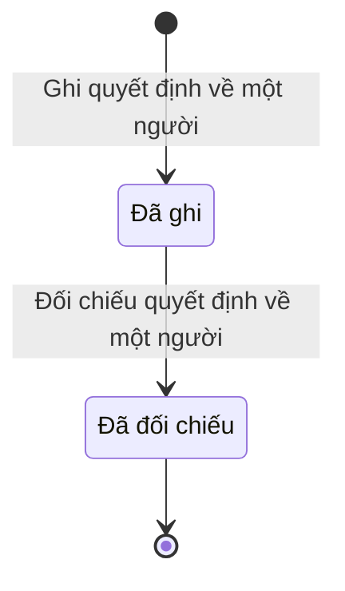

# qt-C1 · Quyết định về một người trong sổ

<!-- máy sinh: tom-tat -->
> **Hồ sơ:** Dòng quyết định về một người (`PersonRulingEntry`)
>
> **Trong sổ phạm vi:** C1 · Quyết định về một người trong sổ (tầng 1)
>
> 2 bước · 2 chặng · 2 vai · 2 bảng quyết định · 0 hạn · 7 khớp nối.
>
> **Nguồn:** sổ nghiệp vụ `qt-C1` · khai báo của app: `dqtv-app/core/processes/person-decision/workflow/person-decision.yaml`. Các bảng do máy sinh từ nguồn này.
<!-- hết: tom-tat -->

<!-- viết tay: dien-giai -->
## Diễn giải

*Phần này viết tay, diễn giải lại điều các bảng bên dưới ghi.*

### Quy trình này để làm gì

Mỗi hồ sơ là **một dòng quyết định về một người**, ghi vào hệ sau khi quyết định đã được ký: loại quyết định, số quyết định, ngày ký, bản chụp quyết định đã ký. Ô "loại quyết định" có năm giá trị: tạm hoãn gọi nhập ngũ, miễn gọi nhập ngũ, giải ngạch quân nhân chuyên nghiệp dự bị, công nhận tuyên truyền viên, thôi công nhận tuyên truyền viên.

Dòng đi qua ba chặng: *Đã ghi* (trợ lý đã ghi, chờ chỉ huy đối chiếu bản gốc) → *Đã đối chiếu* (quyết định có hiệu lực trên hồ sơ người) → *Hết lý do tạm hoãn* (quyết định tạm hoãn không còn chặn việc gọi, người ấy trở lại diện gọi).

### Khi nào bắt đầu

Trợ lý Quân lực (vai `operator`) làm bước `recordPersonDutyDecision` — ghi quyết định về một người. Bước đòi loại quyết định, số quyết định, ngày ký, bản chụp quyết định đã ký, và dòng phải nối tới **Sổ nghĩa vụ** của người đó (quy trình 16). Bước này còn ghi lý do trên quyết định, nguồn giấy chứng nhận tập huấn, bản chụp giấy chứng nhận, căn cứ thôi công nhận và người ghi; khi giấy chứng nhận do lớp tập huấn trên hệ cấp thì nối tới **Sự kiện huấn luyện** (quy trình 14).

### Diễn ra thế nào

**Chặng "Đã ghi"** — Chỉ huy trưởng Ban CHQS xã làm bước `verifyPersonDutyDecision` — đối chiếu quyết định với bản gốc: người làm phải là người của đơn vị chủ hồ sơ và không phải chính người đã ghi dòng (`notRecorder`); bước ghi lại ngày đối chiếu và người đối chiếu. Dòng sang *Đã đối chiếu*.

**Chặng "Đã đối chiếu"** — Trợ lý Quân lực (vai `communeOperator`) bấm **Ghi hết lý do tạm hoãn**: phải nhập vì sao hết lý do tạm hoãn và ngày ghi hết lý do tạm hoãn. Dòng sang *Hết lý do tạm hoãn*. Quyết định tạm hoãn chặn việc gọi cho tới khi Ban CHQS xã ghi hết lý do.

**Chặng "Hết lý do tạm hoãn"** — không còn bước nào.

### Kết thúc và để lại gì

Dòng kết thúc ở chặng *Đã đối chiếu*; dòng quyết định tạm hoãn còn có thể đi tiếp sang *Hết lý do tạm hoãn*.

Dòng không mở ra hồ sơ nào của quy trình khác; hai khớp nối đều ghi lúc mở dòng: tới sổ nghĩa vụ (16) và tới sự kiện huấn luyện (14).

### Điều kiện chặn

- Bảng `eligibility-check`, xét ở bước ghi quyết định, 3 dòng: quyết định công nhận tuyên truyền viên mà thiếu giấy chứng nhận tập huấn thì chặn (`certificate-missing`); quyết định thôi công nhận mà thiếu căn cứ thôi công nhận thì chặn (`ground-missing`); còn lại cho qua.
- Bước đối chiếu: người làm phải thuộc đơn vị chủ hồ sơ và không phải người đã ghi dòng.
- Sai người, sai chặng, thiếu thứ phải có trước thì bước bị chặn, dòng giữ nguyên.
<!-- hết viết tay -->

## 1. Đường đi ngắn nhất qua các chặng

<!-- máy sinh: luong-chinh -->
Đường ít bước nhất từ lúc mở hồ sơ tới chặng kết thúc xa nhất. Máy chọn theo số chặng, không theo ý nghĩa nghiệp vụ — trình tự công việc thật xem phần Diễn giải và bảng "Việc làm ở từng chặng" ở mục 6.

| # | Ai làm | Làm gì | Hồ sơ sang chặng |
|---|---|---|---|
| 1 | Trợ lý Quân lực | Ghi quyết định về một người | Đã ghi |
| 2 | Chỉ huy trưởng Ban CHQS xã | Đối chiếu quyết định về một người | Đã đối chiếu |

<!-- hết: luong-chinh -->

## 2. Hồ sơ và việc nó để lại

<!-- máy sinh: muc-tieu -->
**App gọi quy trình này là:** Quyết định về một người.

**Khi mở, hồ sơ này ghi mối nối tới:**
- Sổ nghĩa vụ (16) — bước `recordPersonDutyDecision`, khớp nối `personDecisionOfRegistration`
- Văn bản đến (1.incoming-document) — bước `recordPersonDutyDecision`, khớp nối `personDecisionFromIncomingDocument`
<!-- hết: muc-tieu -->

## 3. Khởi phát và kết thúc

<!-- máy sinh: khoi-phat -->
**1 cửa vào** — bước mở hồ sơ:

| Bước mở | Ai mở | Hồ sơ vào chặng | App bắt buộc nhập |
|---|---|---|---|
| Ghi quyết định về một người | Trợ lý Quân lực | Đã ghi | `registrationId`, loại quyết định, quyết định đã ký trong sổ văn bản đến, số quyết định, ngày ký, bản chụp quyết định đã ký |

**Kết thúc:** *Đã đối chiếu* (`VERIFIED`)
<!-- hết: khoi-phat -->

## 4. Vai trò

<!-- máy sinh: vai-tro -->
| Vai trong sổ | Tên trong app | Điều kiện | Làm những bước |
|---|---|---|---|
| `operator` | Trợ lý Quân lực |  | Ghi quyết định về một người |
| `verifier` | Chỉ huy trưởng Ban CHQS xã |  | Đối chiếu quyết định về một người |

*"Tên trong app" là tên app đặt cho mã chủ thể của vai. Hồ sơ thuộc đơn vị cấp khác thì người làm là người giữ vai ấy ở đơn vị nêu trong cột "Điều kiện" (nếu sổ có ghi) và ở cột "Người làm phải thuộc" của bảng "Theo khai báo của app" (mục 7).*
<!-- hết: vai-tro -->

## 5. Nhánh phụ

<!-- máy sinh: nhanh-phu -->
Không có bước nào ngoài luồng chính.
<!-- hết: nhanh-phu -->

## 6. Các chặng và việc làm ở từng chặng

<!-- máy sinh: chang -->
| Chặng | Tên hiển thị | Vào bằng bước | Kết thúc? |
|---|---|---|---|
| `RECORDED` | Đã ghi | Ghi quyết định về một người |  |
| `VERIFIED` | Đã đối chiếu | Đối chiếu quyết định về một người | **kết thúc** |

### Việc làm ở từng chặng

Hồ sơ đang ở chặng nào thì làm được những bước nào.

| Hồ sơ đang ở chặng | Bước làm tại chặng (hồ sơ đứng yên) | Bước đưa hồ sơ sang chặng khác |
|---|---|---|
| **Đã ghi** | — | Đối chiếu quyết định về một người — Chỉ huy trưởng Ban CHQS xã → *Đã đối chiếu* |
| **Đã đối chiếu** | — | — (kết thúc) |
<!-- hết: chang -->

## 7. Bảng bước

<!-- máy sinh: buoc -->
| # | Bước | Mã bước | Ai thực hiện | Từ chặng | Sang chặng | Phải có trước | Ghi lại |
|---|---|---|---|---|---|---|---|
| 1 | Ghi quyết định về một người | `recordPersonDutyDecision` | Trợ lý Quân lực | — (mở hồ sơ) | `RECORDED` | loại quyết định, nối tới Sổ nghĩa vụ, nối tới Văn bản đến, `disciplineGroundBacked`, `personDecisionFromIncomingDocumentUsable`, `personRegistrationNotLeft` | loại quyết định, nối tới Sổ nghĩa vụ, lý do ghi trên quyết định, người ghi, nối tới Văn bản đến |
| 2 | Đối chiếu quyết định về một người | `verifyPersonDutyDecision` | Chỉ huy trưởng Ban CHQS xã | `RECORDED` | `VERIFIED` | người làm thuộc đơn vị chủ hồ sơ, `notRecorder` | ngày đối chiếu, người đối chiếu |

### Khi không đạt điều kiện

Mặc định: không đúng người, hồ sơ không ở đúng chặng, hoặc thiếu thứ "phải có trước" thì bước bị chặn, hồ sơ giữ nguyên. Bảng dưới chỉ kê những bước có kết quả riêng.

| # | Bước | Kết quả riêng |
|---|---|---|
| 1 | Ghi quyết định về một người | bước dừng lại, hồ sơ giữ nguyên khi kết quả xét là: `certificate-missing`, `ground-missing`, `not-in-drive-list`, `deferment-ground-missing`, `exemption-ground-missing`; nhánh `conscription-deferment`: hồ sơ sang *Đã ghi*, ghi thêm `defermentGround`, nối tới Đợt tuyển quân; nhánh `conscription-exemption`: hồ sơ sang *Đã ghi*, ghi thêm `exemptionGround`, nối tới Đợt tuyển quân; nhánh `recognition-off-system`: hồ sơ sang *Đã ghi*, ghi thêm giấy chứng nhận tập huấn, bản chụp giấy chứng nhận tập huấn; nhánh `recognition-on-system`: hồ sơ sang *Đã ghi*, ghi thêm giấy chứng nhận tập huấn, nối tới Sự kiện — huấn luyện, hội thi, diễn tập, hội nghị; nhánh `withdrawal-article-9`: hồ sơ sang *Đã ghi*, ghi thêm căn cứ thôi công nhận; nhánh `withdrawal-discipline`: hồ sơ sang *Đã ghi*, ghi thêm căn cứ thôi công nhận, nối tới Vụ việc kỷ luật |
| 2 | Đối chiếu quyết định về một người | bước dừng lại, hồ sơ giữ nguyên khi kết quả xét là: `no-type`; nhánh `commune-decision`: hồ sơ sang *Đã đối chiếu*; nhánh `province-decision`: hồ sơ sang *Đã đối chiếu*, ghi thêm nối `decisionDeliveredAs` |

### Điều kiện "phải có trước" bằng lời

Cột "Phải có trước" ở bảng bước có hai loại: ô dữ liệu thường (bước chỉ đòi ô ấy đã có giá trị) và điều kiện hệ tự xét. Bảng này diễn các điều kiện hệ tự xét theo đúng công thức sổ ghi; số ở cột cuối là số thứ tự bước.

| Điều kiện | Đúng khi | Bước đòi |
|---|---|---|
| `disciplineGroundBacked` | KHÔNG (loại quyết định là Thôi công nhận tuyên truyền viên (`propagandistWithdrawal`)) HOẶC KHÔNG (căn cứ thôi công nhận là Bị xử lý kỷ luật từ cảnh cáo trở lên (`discipline_warning_or_above`)) HOẶC có hồ sơ Xử lý kỷ luật DQTV (qt-D15) chính là hồ sơ ghi ở ô nối `withdrawalDisciplinaryCase` của hồ sơ đang làm mà hồ sơ ấy đang ở chặng `DECIDED` VÀ `disciplinaryForm` là `warning` hoặc `demotion` hoặc `dismissal` hoặc `title_revocation` | 1 |
| `personDecisionFromIncomingDocumentUsable` | có hồ sơ Việc luật giao kèm văn bản đến, đi — Văn bản đến (qt-1.incoming-document) chính là hồ sơ ghi ở ô nối `personDecisionFromIncomingDocument` của hồ sơ đang làm mà hồ sơ ấy đang ở chặng `RECEIVED` hoặc `DISTRIBUTED` | 1 |
| `personRegistrationNotLeft` | không có hồ sơ Sổ đăng ký người theo diện (qt-16) chính là hồ sơ ghi ở ô nối `personDecisionOfRegistration` của hồ sơ đang làm mà hồ sơ ấy đang ở chặng `LEFT` | 1 |
| `actorInOwnerUnit` | người đang làm là người của đơn vị ghi ở ô đơn vị chủ hồ sơ của hồ sơ này (theo danh mục người của đơn vị, `dm.unit-staff`) | 2 |
| `notRecorder` | KHÔNG (người ghi là chính người đang làm) | 2 |
| `inSubmittedDriveList` | có hồ sơ Tuyển quân, giao quân (qt-17) chính là hồ sơ ghi ở ô nối `personDecisionOfDrive` của hồ sơ đang làm mà hồ sơ ấy đang ở chặng `LIST_SUBMITTED` hoặc `PROVINCE_APPROVED` hoặc `CALLED` hoặc `HANDED_OVER` | đầu vào bảng quyết định (mục 8) |

### Theo khai báo của app

Người làm phải thuộc đơn vị nào, ô người dùng phải nhập, bước có lặp được không, và căn cứ pháp lý — lấy từ khai báo quy trình trong app.

| # | Bước | Người làm phải thuộc | Bắt buộc nhập | Nhập nếu có | Lặp được | Căn cứ |
|---|---|---|---|---|---|---|
| 1 | Ghi quyết định về một người |  | `registrationId`, loại quyết định, quyết định đã ký trong sổ văn bản đến, số quyết định, ngày ký, bản chụp quyết định đã ký | lý do ghi trên quyết định, giấy chứng nhận tập huấn, `trainingEventId`, bản chụp giấy chứng nhận tập huấn, căn cứ thôi công nhận, `disciplinaryCaseId`, lý do tạm hoãn gọi nhập ngũ (L78 Đ.41 k1), lý do miễn gọi nhập ngũ (L78 Đ.41 k2), đợt tuyển quân có tên người này trong danh sách |  | L78/2015/QH13 Đ.41, Đ.42; L14/2026/QH16 Đ.3 k1; VBHN83 Đ.2, Đ.4 k4, Đ.6 |
| 2 | Đối chiếu quyết định về một người | đơn vị chủ hồ sơ | — | — |  | L78/2015/QH13 Đ.42; VBHN83 Đ.2, Đ.6 |
<!-- hết: buoc -->

## 8. Bảng quyết định, hạn, việc ngoài hệ

<!-- máy sinh: quyet-dinh -->
**Bảng `decision-level`** — xét ở bước *Đối chiếu quyết định về một người*; đầu vào: loại quyết định. 3 dòng, dò từ trên xuống, dòng đầu tiên khớp thì dừng.

| Thứ tự dò (số sổ ghi) | Dòng | Khi | Thì |
|---|---|---|---|
| 1 | `province-decision` | loại quyết định là Tạm hoãn gọi nhập ngũ (`conscriptionDeferment`) hoặc Miễn gọi nhập ngũ (`conscriptionExemption`) hoặc Giải ngạch quân nhân chuyên nghiệp dự bị (`reserveProfessionalDischarge`) | `province-decision` |
| 2 | `commune-decision` | loại quyết định là Công nhận tuyên truyền viên (`propagandistRecognition`) hoặc Thôi công nhận tuyên truyền viên (`propagandistWithdrawal`) | `commune-decision` |
| 3 | `no-type` | chưa có loại quyết định | `no-type` |

**Bảng `eligibility-check`** — xét ở bước *Ghi quyết định về một người*; đầu vào: loại quyết định, giấy chứng nhận tập huấn, căn cứ thôi công nhận, `inSubmittedDriveList`, `defermentGround`, `exemptionGround`. 12 dòng, dò từ trên xuống, dòng đầu tiên khớp thì dừng.

| Thứ tự dò (số sổ ghi) | Dòng | Khi | Thì |
|---|---|---|---|
| 1 | `propagandist-no-certificate` | loại quyết định là Công nhận tuyên truyền viên (`propagandistRecognition`) và chưa có giấy chứng nhận tập huấn | `certificate-missing` |
| 2 | `withdrawal-no-ground` | loại quyết định là Thôi công nhận tuyên truyền viên (`propagandistWithdrawal`) và chưa có căn cứ thôi công nhận | `ground-missing` |
| 3 | `recognition-on-system` | loại quyết định là Công nhận tuyên truyền viên (`propagandistRecognition`) và giấy chứng nhận tập huấn là Lớp tập huấn trên hệ (`on_system_training`) | `recognition-on-system` |
| 4 | `recognition-off-system` | loại quyết định là Công nhận tuyên truyền viên (`propagandistRecognition`) và giấy chứng nhận tập huấn là Giấy chứng nhận học ngoài, đính bản chụp (`off_system`) | `recognition-off-system` |
| 5 | `withdrawal-discipline` | loại quyết định là Thôi công nhận tuyên truyền viên (`propagandistWithdrawal`) và căn cứ thôi công nhận là Bị xử lý kỷ luật từ cảnh cáo trở lên (`discipline_warning_or_above`) | `withdrawal-discipline` |
| 6 | `withdrawal-article-9` | loại quyết định là Thôi công nhận tuyên truyền viên (`propagandistWithdrawal`) và căn cứ thôi công nhận là Vi phạm Điều 9 Luật Giáo dục quốc phòng và an ninh (`law_article_9_violation`) | `withdrawal-article-9` |
| 10 | `conscription-not-in-drive-list` | loại quyết định là Tạm hoãn gọi nhập ngũ (`conscriptionDeferment`) hoặc Miễn gọi nhập ngũ (`conscriptionExemption`) và chưa có `inSubmittedDriveList` | `not-in-drive-list` |
| 11 | `deferment-no-ground` | loại quyết định là Tạm hoãn gọi nhập ngũ (`conscriptionDeferment`) và chưa có `defermentGround` | `deferment-ground-missing` |
| 12 | `exemption-no-ground` | loại quyết định là Miễn gọi nhập ngũ (`conscriptionExemption`) và chưa có `exemptionGround` | `exemption-ground-missing` |
| 13 | `conscription-deferment` | loại quyết định là Tạm hoãn gọi nhập ngũ (`conscriptionDeferment`) | `conscription-deferment` |
| 14 | `conscription-exemption` | loại quyết định là Miễn gọi nhập ngũ (`conscriptionExemption`) | `conscription-exemption` |
| 20 | `otherwise` | mọi trường hợp còn lại | cho qua |

<!-- hết: quyet-dinh -->

## 9. Dữ liệu của hồ sơ

<!-- máy sinh: du-lieu -->
Các ô mà bước trong sổ ghi hoặc đòi. Số trong hai cột cuối là số thứ tự bước ở bảng bước (mục 7).

| Ô dữ liệu | Mã | Kiểu (app) | Giá trị cho phép | Loại ô (sổ) | Bước ghi | Bước đòi | Mô tả trong app |
|---|---|---|---|---|---|---|---|
| loại quyết định | `decisionType` | chọn một | Tạm hoãn gọi nhập ngũ (`conscriptionDeferment`), Miễn gọi nhập ngũ (`conscriptionExemption`), Giải ngạch quân nhân chuyên nghiệp dự bị (`reserveProfessionalDischarge`), Công nhận tuyên truyền viên (`propagandistRecognition`), Thôi công nhận tuyên truyền viên (`propagandistWithdrawal`) | đưa vào ở bước (`input`) | 1 | 1 | Loại quyết định về một người — sổ qt-C1 |
| lý do ghi trên quyết định | `reason` | chữ |  | đưa vào ở bước (`input`) | 1 | — | Lý do ghi trên quyết định — tạm hoãn, miễn, giải ngạch |
| người ghi | `recordedBy` | chữ |  | lưu trên hồ sơ (`stored`) | 1 | — | Người ghi dòng quyết định — đối chiếu phải là người khác |
| ngày đối chiếu | `verifiedAt` | ngày |  | lưu trên hồ sơ (`stored`) | 2 | — | Ngày đối chiếu |
| người đối chiếu | `verifiedBy` | chữ |  | lưu trên hồ sơ (`stored`) | 2 | — | Người đối chiếu bản gốc |
| — | `disciplineGroundBacked` |  | có hay chưa | hệ suy ra (`derived`) | — | 1 |  |
| — | `personDecisionFromIncomingDocumentUsable` |  | có hay chưa | hệ suy ra (`derived`) | — | 1 |  |
| — | `personRegistrationNotLeft` |  | có hay chưa | hệ suy ra (`derived`) | — | 1 |  |
| người làm thuộc đơn vị chủ hồ sơ | `actorInOwnerUnit` |  | có hay chưa | hệ suy ra (`derived`) | — | 2 |  |
| — | `notRecorder` |  | có hay chưa | hệ suy ra (`derived`) | — | 2 |  |
| giấy chứng nhận tập huấn | `propagandistCertificateSource` | chọn một | Lớp tập huấn trên hệ (`on_system_training`), Giấy chứng nhận học ngoài, đính bản chụp (`off_system`) | đưa vào ở bước (`input`) | — | — | Giấy chứng nhận tập huấn của tuyên truyền viên lấy từ đâu — VBHN83 Đ.4 k4 |
| căn cứ thôi công nhận | `propagandistWithdrawalGround` | chọn một | Bị xử lý kỷ luật từ cảnh cáo trở lên (`discipline_warning_or_above`), Vi phạm Điều 9 Luật Giáo dục quốc phòng và an ninh (`law_article_9_violation`) | đưa vào ở bước (`input`) | — | — | Căn cứ thôi công nhận tuyên truyền viên — VBHN83 Đ.6 |
| — | `inSubmittedDriveList` |  | có hay chưa | hệ suy ra (`derived`) | — | — |  |
| — | `defermentGround` |  | `unfit_health`, `sole_breadwinner`, `child_of_sick_veteran`, `sibling_in_service`, `resettled_household`, `posted_to_hardship_area`, `general_school`, `higher_education`, `standing_militia` | đưa vào ở bước (`input`) | — | — |  |
| — | `exemptionGround` |  | `martyr_or_war_invalid_child`, `martyr_sibling`, `war_invalid_grade2_child`, `cipher_staff`, `hardship_area_24_months` | đưa vào ở bước (`input`) | — | — |  |

15 ô. Cột "Loại ô" là cách sổ phân loại ô, in kèm đúng chữ của sổ; ô nào người dùng phải nhập xem bảng "Theo khai báo của app" ở mục 7.
<!-- hết: du-lieu -->

## 10. Khớp nối với quy trình khác

<!-- máy sinh: khop-noi -->
| Quy trình kia | Hồ sơ kia | Quan hệ | Nội dung (mô tả trong app) | Bước ghi mối nối | Tên ô nối |
|---|---|---|---|---|---|
| 1.incoming-document | Văn bản đến | có nối | Bản chuyển của quyết định cấp tỉnh trong Sổ văn bản đến của xã có người trên dòng (N4) | — | `personDecisionDeliveredAs` |
| 1.incoming-document | Văn bản đến | hồ sơ này **mở ra có nối tới** hồ sơ kia | Dòng quyết định về một người ghi từ văn bản đến nào — tờ đã ký, văn thư đã vào sổ văn bản đến | C1·recordPersonDutyDecision ⊕ · đòi: C1·recordPersonDutyDecision | `personDecisionFromIncomingDocument` |
| 14 | Sự kiện — huấn luyện, hội thi, diễn tập, hội nghị | có nối | Lớp tập huấn trên hệ cấp giấy chứng nhận cho tuyên truyền viên — VBHN83 Đ.4 k4 | — | `propagandistCertificateFromTraining` |
| 16 | Sổ nghĩa vụ | hồ sơ này **mở ra có nối tới** hồ sơ kia | Dòng quyết định về một người thuộc hồ sơ người nào — một người nhiều quyết định trong đời (76_ người làm gốc) | C1·recordPersonDutyDecision ⊕ · đòi: C1·recordPersonDutyDecision | `personDecisionOfRegistration` |
| 17 | Đợt tuyển quân | có nối | Dòng quyết định tạm hoãn, miễn gọi nhập ngũ thuộc đợt tuyển quân nào — danh sách xã gửi lên tỉnh của đợt ấy | — | `personDecisionOfDrive` |
| 17 | Đợt tuyển quân | gắn với nhau ở một bước giữa chừng | Quyết định tạm hoãn, miễn gọi nhập ngũ của đợt mà xã đã niêm yết — sổ qt-17 link.postedRulingDocument | 17·recordDefermentListPosted | `postedRulingDocument` |
| D15 | Vụ việc kỷ luật | có nối | Vụ kỷ luật đã quyết hình thức từ cảnh cáo trở lên làm căn cứ thôi công nhận tuyên truyền viên — VBHN83 Đ.6 | — | `withdrawalDisciplinaryCase` |

7 khớp nối. ⊕ là bước tạo hồ sơ.

**Ô nối giữa các hồ sơ cùng mã quy trình, hoặc tới danh mục nền:** `personDecisionSheet` (Dòng quyết định về một người → Quyết định ký ngoài hệ thống) — bước Ghi quyết định về một người.
<!-- hết: khop-noi -->

## 11. Thông tin chung

<!-- máy sinh: thong-tin -->
| | |
|---|---|
| **Mã trong sổ** | `qt-C1` |
| **Quy trình trong app** | `person-decision` (`workflow/person-decision.yaml`) — mặt công tác: `personnel` |
| **Hồ sơ** | Dòng quyết định về một người (`PersonRulingEntry`) |
| **Căn cứ pháp lý từng bước** | cột "Căn cứ" ở bảng "Theo khai báo của app", mục 7 |
<!-- hết: thong-tin -->
