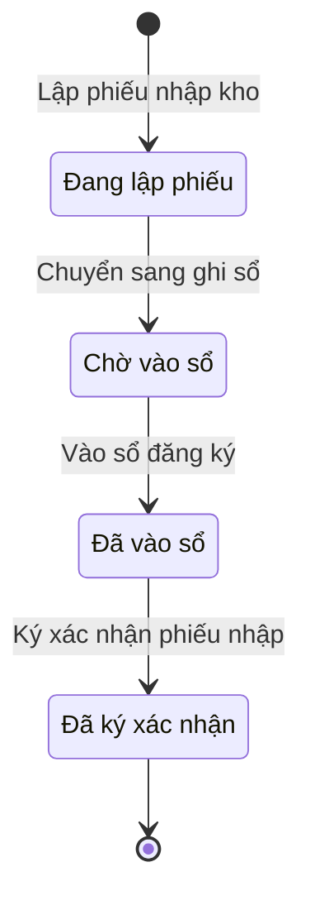

# qt-D10 · Nhập kho, vào sổ

<!-- máy sinh: tom-tat -->
> **Hồ sơ:** Phiếu nhập kho (`StockInSlip`)
>
> **Trong sổ phạm vi:** D10 · Nhập kho, vào sổ (tầng 2)
>
> 7 bước · 4 chặng · 3 vai · 0 bảng quyết định · 0 hạn · 4 khớp nối.
>
> **Nguồn:** sổ nghiệp vụ `qt-D10` · khai báo của app: `dqtv-app/core/processes/stock-in/workflow/stock-in.yaml`. Các bảng do máy sinh từ nguồn này.
<!-- hết: tom-tat -->

<!-- viết tay: dien-giai -->
## Diễn giải

*Phần này viết tay, diễn giải lại điều các bảng bên dưới ghi.*

### Quy trình này để làm gì

Đơn vị ghi nhận hàng về kho bằng một **phiếu nhập kho** và đưa từng món vào sổ đăng ký trang bị. Ba vai làm nối nhau: Nhân viên quân khí kiêm thủ kho lập phiếu, Trợ lý Quân lực vào sổ, Chỉ huy trưởng Ban CHQS xã ký xác nhận. Sau bước mở, người làm bước nào cũng phải thuộc đơn vị chủ hồ sơ. Có hai nguồn cấp: trên cấp, hoặc địa phương mua.

Hồ sơ đi qua bốn chặng: *Đang lập phiếu* → *Chờ vào sổ* → *Đã vào sổ* → *Đã ký xác nhận*.

### Khi nào bắt đầu

Thủ kho bấm **Lập phiếu nhập kho**. Bắt buộc nhập ngày nhập và nguồn cấp; văn bản kèm theo là ô nhập nếu có. Số phiếu tự sinh.

Khi mở, phiếu có thể nối tới một trong ba hồ sơ nguồn (đều là ô nhập nếu có): Đề nghị trang bị đã có quyết định (D7.provision-request), Đợt mua sắm đã nhận hàng (D9), hoặc dòng của một Đợt cấp phát từ trên xuống (D8).

### Diễn ra thế nào

**Chặng "Đang lập phiếu"** — thủ kho làm:

- **Thêm dòng vào phiếu nhập** (lặp được) — mỗi lần tạo một *Dòng phiếu nhập kho*; bắt buộc nhập `itemName`, `equipmentType`, `quantity`, `intakeCondition`; `serialNumber`, `lotNumber`, `note` là ô nhập nếu có.
- **Đính ảnh chứng từ nhập kho**.
- **Ghi nhận thiếu (biên bản)** (lặp được) — dùng khi hàng nhận thiếu so với chứng từ giao (mất, hỏng khi vận chuyển, giao nhầm); phải nhập nội dung ghi nhận thiếu và bản quét biên bản. Xã nhập đúng số thực nhận kèm biên bản thiếu; tỉnh chọn cấp bù hoặc chuyển sự cố mất hỏng, rồi đóng đợt.
- **Chuyển sang ghi sổ** → *Chờ vào sổ*.

**Chặng "Chờ vào sổ"** — Trợ lý Quân lực bấm **Vào sổ đăng ký** → *Đã vào sổ*. Bước này ghi mối nối giữa dòng phiếu nhập và bản ghi trang bị (quy trình D12): dòng phiếu sinh ra bản ghi trang bị nào khi vào sổ, để truy vết nguồn nhập. `lineIds`, `equipmentIds` là ô nhập nếu có.

**Chặng "Đã vào sổ"** — Chỉ huy trưởng bấm **Ký xác nhận phiếu nhập** → *Đã ký xác nhận*; `equipmentIds` là ô nhập nếu có.

### Kết thúc và để lại gì

Hồ sơ kết thúc ở chặng *Đã ký xác nhận*. Phiếu để lại mối nối tới các bản ghi **Trang bị, phương tiện** (D12), ghi ở bước vào sổ. Ba mối nối về hồ sơ nguồn (D7.provision-request, D8, D9) được ghi ngay lúc lập phiếu.

### Điều kiện chặn

- Sáu bước sau bước mở: người làm phải là người của đơn vị ghi ở ô đơn vị chủ hồ sơ. Sai người, sai chặng, thiếu ô bắt buộc nhập thì bước bị chặn, hồ sơ giữ nguyên.
<!-- hết viết tay -->

## 1. Đường đi ngắn nhất qua các chặng

<!-- máy sinh: luong-chinh -->
Đường ít bước nhất từ lúc mở hồ sơ tới chặng kết thúc xa nhất. Máy chọn theo số chặng, không theo ý nghĩa nghiệp vụ — trình tự công việc thật xem phần Diễn giải và bảng "Việc làm ở từng chặng" ở mục 6.

| # | Ai làm | Làm gì | Hồ sơ sang chặng |
|---|---|---|---|
| 1 | Nhân viên quân khí kiêm thủ kho | Lập phiếu nhập kho | Đang lập phiếu |
| 2 | Nhân viên quân khí kiêm thủ kho | Chuyển sang ghi sổ | Chờ vào sổ |
| 3 | Trợ lý Quân lực | Vào sổ đăng ký | Đã vào sổ |
| 4 | Chỉ huy trưởng Ban CHQS xã | Ký xác nhận phiếu nhập | Đã ký xác nhận |

<!-- hết: luong-chinh -->

## 2. Hồ sơ và việc nó để lại

<!-- máy sinh: muc-tieu -->
**App gọi quy trình này là:** Phiếu nhập kho.

**Khi mở, hồ sơ này ghi mối nối tới:**
- Dòng đợt cấp phát (D8) — bước `openStockInSlip`, khớp nối `stockInFromIssue`
- Đề nghị trang bị (D7.provision-request) — bước `openStockInSlip`, khớp nối `stockInFromRequest`
- Đợt mua sắm (D9) — bước `openStockInSlip`, khớp nối `stockInFromProcurement`
<!-- hết: muc-tieu -->

## 3. Khởi phát và kết thúc

<!-- máy sinh: khoi-phat -->
**1 cửa vào** — bước mở hồ sơ:

| Bước mở | Ai mở | Hồ sơ vào chặng | App bắt buộc nhập |
|---|---|---|---|
| Lập phiếu nhập kho | Nhân viên quân khí kiêm thủ kho | Đang lập phiếu | ngày nhập, nguồn cấp |

**Kết thúc:** *Đã ký xác nhận* (`CONFIRMED`)
<!-- hết: khoi-phat -->

## 4. Vai trò

<!-- máy sinh: vai-tro -->
| Vai trong sổ | Tên trong app | Điều kiện | Làm những bước |
|---|---|---|---|
| `keeper` | Nhân viên quân khí kiêm thủ kho |  | Lập phiếu nhập kho · Thêm dòng vào phiếu nhập · Đính ảnh chứng từ nhập kho · Ghi nhận thiếu (biên bản) · Chuyển sang ghi sổ |
| `registrar` | Trợ lý Quân lực |  | Vào sổ đăng ký |
| `commander` | Chỉ huy trưởng Ban CHQS xã |  | Ký xác nhận phiếu nhập |

*"Tên trong app" là tên app đặt cho mã chủ thể của vai. Hồ sơ thuộc đơn vị cấp khác thì người làm là người giữ vai ấy ở đơn vị nêu trong cột "Điều kiện" (nếu sổ có ghi) và ở cột "Người làm phải thuộc" của bảng "Theo khai báo của app" (mục 7).*
<!-- hết: vai-tro -->

## 5. Nhánh phụ

<!-- máy sinh: nhanh-phu -->
**Làm trong lúc hồ sơ đứng yên ở một chặng** — ghi nhận, bổ sung:

| Bước | Ai làm | Ở chặng |
|---|---|---|
| Thêm dòng vào phiếu nhập *(lặp được)* | Nhân viên quân khí kiêm thủ kho | Đang lập phiếu |
| Đính ảnh chứng từ nhập kho | Nhân viên quân khí kiêm thủ kho | Đang lập phiếu |
| Ghi nhận thiếu (biên bản) *(lặp được)* | Nhân viên quân khí kiêm thủ kho | Đang lập phiếu |

<!-- hết: nhanh-phu -->

## 6. Các chặng và việc làm ở từng chặng

<!-- máy sinh: chang -->
| Chặng | Tên hiển thị | Vào bằng bước | Kết thúc? |
|---|---|---|---|
| `DRAFT` | Đang lập phiếu | Lập phiếu nhập kho |  |
| `PENDING_REGISTRATION` | Chờ vào sổ | Chuyển sang ghi sổ |  |
| `REGISTERED` | Đã vào sổ | Vào sổ đăng ký |  |
| `CONFIRMED` | Đã ký xác nhận | Ký xác nhận phiếu nhập | **kết thúc** |

### Việc làm ở từng chặng

Hồ sơ đang ở chặng nào thì làm được những bước nào.

| Hồ sơ đang ở chặng | Bước làm tại chặng (hồ sơ đứng yên) | Bước đưa hồ sơ sang chặng khác |
|---|---|---|
| **Đang lập phiếu** | Thêm dòng vào phiếu nhập (lặp được) — Nhân viên quân khí kiêm thủ kho Đính ảnh chứng từ nhập kho — Nhân viên quân khí kiêm thủ kho Ghi nhận thiếu (biên bản) (lặp được) — Nhân viên quân khí kiêm thủ kho | Chuyển sang ghi sổ — Nhân viên quân khí kiêm thủ kho → *Chờ vào sổ* |
| **Chờ vào sổ** | — | Vào sổ đăng ký — Trợ lý Quân lực → *Đã vào sổ* |
| **Đã vào sổ** | — | Ký xác nhận phiếu nhập — Chỉ huy trưởng Ban CHQS xã → *Đã ký xác nhận* |
| **Đã ký xác nhận** | — | — (kết thúc) |
<!-- hết: chang -->

## 7. Bảng bước

<!-- máy sinh: buoc -->
| # | Bước | Mã bước | Ai thực hiện | Từ chặng | Sang chặng | Phải có trước | Ghi lại |
|---|---|---|---|---|---|---|---|
| 1 | Lập phiếu nhập kho | `openStockInSlip` | Nhân viên quân khí kiêm thủ kho | — (mở hồ sơ) | `DRAFT` | — | nối tới Đề nghị trang bị, nối tới Đợt mua sắm, nối tới Dòng đợt cấp phát, mã tỉnh, mã xã, số phiếu, ngày nhập, nguồn cấp, văn bản kèm theo, đơn vị chủ hồ sơ |
| 2 | Thêm dòng vào phiếu nhập | `addStockInLine` | Nhân viên quân khí kiêm thủ kho | `DRAFT` | giữ nguyên | người làm thuộc đơn vị chủ hồ sơ | nối tới Dòng phiếu nhập kho |
| 3 | Đính ảnh chứng từ nhập kho | `attachStockInScan` | Nhân viên quân khí kiêm thủ kho | `DRAFT` | giữ nguyên | người làm thuộc đơn vị chủ hồ sơ | ảnh chứng từ |
| 4 | Ghi nhận thiếu (biên bản) | `recordReceiptShortfall` | Nhân viên quân khí kiêm thủ kho | `DRAFT` | giữ nguyên | người làm thuộc đơn vị chủ hồ sơ | ghi nhận thiếu, biên bản nhận thiếu |
| 5 | Chuyển sang ghi sổ | `submitForRegistration` | Nhân viên quân khí kiêm thủ kho | `DRAFT` | `PENDING_REGISTRATION` | người làm thuộc đơn vị chủ hồ sơ | chuyển ghi sổ lúc |
| 6 | Vào sổ đăng ký | `registerFromSlip` | Trợ lý Quân lực | `PENDING_REGISTRATION` | `REGISTERED` | người làm thuộc đơn vị chủ hồ sơ | vào sổ lúc, nối `stockInProducesEquipment` (Dòng phiếu nhập kho → Trang bị, phương tiện) |
| 7 | Ký xác nhận phiếu nhập | `confirmStockIn` | Chỉ huy trưởng Ban CHQS xã | `REGISTERED` | `CONFIRMED` | người làm thuộc đơn vị chủ hồ sơ | ký xác nhận lúc |

### Khi không đạt điều kiện

Mặc định: không đúng người, hồ sơ không ở đúng chặng, hoặc thiếu thứ "phải có trước" thì bước bị chặn, hồ sơ giữ nguyên. Bảng dưới chỉ kê những bước có kết quả riêng.

Không bước nào có kết quả riêng — tất cả theo mặc định.

### Điều kiện "phải có trước" bằng lời

Cột "Phải có trước" ở bảng bước có hai loại: ô dữ liệu thường (bước chỉ đòi ô ấy đã có giá trị) và điều kiện hệ tự xét. Bảng này diễn các điều kiện hệ tự xét theo đúng công thức sổ ghi; số ở cột cuối là số thứ tự bước.

| Điều kiện | Đúng khi | Bước đòi |
|---|---|---|
| `actorInOwnerUnit` | người đang làm là người của đơn vị ghi ở ô đơn vị chủ hồ sơ của hồ sơ này (theo danh mục người của đơn vị, `dm.unit-staff`) | 2, 3, 4, 5, 6, 7 |

### Theo khai báo của app

Người làm phải thuộc đơn vị nào, ô người dùng phải nhập, bước có lặp được không, và căn cứ pháp lý — lấy từ khai báo quy trình trong app.

| # | Bước | Người làm phải thuộc | Bắt buộc nhập | Nhập nếu có | Lặp được | Căn cứ |
|---|---|---|---|---|---|---|
| 1 | Lập phiếu nhập kho |  | ngày nhập, nguồn cấp | văn bản kèm theo, `requestId`, `procurementId`, dòng cấp phát của tỉnh được phiếu này nhận |  | QĐ1126 :282 |
| 2 | Thêm dòng vào phiếu nhập | đơn vị chủ hồ sơ | `itemName`, `equipmentType`, `quantity`, `intakeCondition` | `serialNumber`, `lotNumber`, `note` | có | QĐ1126 :282 |
| 3 | Đính ảnh chứng từ nhập kho | đơn vị chủ hồ sơ | ảnh chứng từ | — |  | QĐ1126 :282 |
| 4 | Ghi nhận thiếu (biên bản) | đơn vị chủ hồ sơ | ghi nhận thiếu, biên bản nhận thiếu | — | có | TT76/2020/TT-BQP Đ.12 k2 |
| 5 | Chuyển sang ghi sổ | đơn vị chủ hồ sơ | — | — |  | QĐ1126 :282 |
| 6 | Vào sổ đăng ký | đơn vị chủ hồ sơ | — | `lineIds`, `equipmentIds` |  | QĐ1126 :264, :101; NQ66.12/2026 k7 |
| 7 | Ký xác nhận phiếu nhập | đơn vị chủ hồ sơ | — | `equipmentIds` |  | QĐ1126 :264 |

### Điều kiện và ghi chú app khai cho từng bước

Lấy từ khai báo quy trình trong app. Lời trong ngoặc kép là câu app hiện cho người dùng. Chức danh người ký ngoài hệ app chỉ khai bằng mã.

| # | Bước | Điều kiện, ghi chú |
|---|---|---|
| 2 | Thêm dòng vào phiếu nhập | · tạo thêm một hồ sơ con: Dòng phiếu nhập kho (`StockInLine`) |
<!-- hết: buoc -->

## 8. Bảng quyết định, hạn, việc ngoài hệ

<!-- máy sinh: quyet-dinh -->

<!-- hết: quyet-dinh -->

## 9. Dữ liệu của hồ sơ

<!-- máy sinh: du-lieu -->
Các ô mà bước trong sổ ghi hoặc đòi. Số trong hai cột cuối là số thứ tự bước ở bảng bước (mục 7).

| Ô dữ liệu | Mã | Kiểu (app) | Giá trị cho phép | Loại ô (sổ) | Bước ghi | Bước đòi | Mô tả trong app |
|---|---|---|---|---|---|---|---|
| mã tỉnh | `provinceCode` | chữ |  | lưu trên hồ sơ (`stored`) | 1 | — | Mã tỉnh — dùng lọc phạm vi theo hàng; rỗng khi hồ sơ thuộc quân khu hoặc Bộ Quốc phòng |
| mã xã | `communeCode` | chữ |  | lưu trên hồ sơ (`stored`) | 1 | — | Mã xã |
| số phiếu | `slipNumber` | chữ |  | lưu trên hồ sơ (`stored`) | 1 | — | Số phiếu nhập kho, tự sinh (vd NK-2026-0042) |
| ngày nhập | `receivedDate` | ngày |  | đưa vào ở bước (`input`) | 1 | — | Ngày nhập kho |
| nguồn cấp | `source` | chọn một | Trên cấp (`superior`), Địa phương mua (`local_purchase`) | đưa vào ở bước (`input`) | 1 | — | Nguồn cấp: trên cấp hay địa phương mua |
| văn bản kèm theo | `attachedDocument` | chữ |  | đưa vào ở bước (`input`) | 1 | — | Số văn bản kèm theo (vd quyết định trang cấp) |
| đơn vị chủ hồ sơ | `ownerUnit` |  |  | lưu trên hồ sơ (`stored`) | 1 | — |  |
| ảnh chứng từ | `scanRef` | chữ |  | lưu trên hồ sơ (`stored`) | 3 | — | Đường dẫn ảnh chụp chứng từ đính kèm |
| ghi nhận thiếu | `shortfallNote` | chữ |  | lưu trên hồ sơ (`stored`) | 4 | — | Ghi nhận phần hàng nhận thiếu so với chứng từ giao (mất, hỏng khi vận chuyển, giao nhầm) |
| biên bản nhận thiếu | `shortfallMinutesScan` | tệp |  | lưu trên hồ sơ (`stored`) | 4 | — | Bản quét biên bản nhận thiếu đã ký (lưu qua FileStore ở tầng route) |
| chuyển ghi sổ lúc | `submittedAt` | ngày giờ |  | lưu trên hồ sơ (`stored`) | 5 | — | Thời điểm thủ kho chuyển sang ghi sổ |
| vào sổ lúc | `registeredAt` | ngày giờ |  | đưa vào ở bước (`input`) | 6 | — | Thời điểm trợ lý quân lực vào sổ |
| ký xác nhận lúc | `signedOffAt` | ngày giờ |  | lưu trên hồ sơ (`stored`) | 7 | — | Thời điểm Chỉ huy trưởng ký xác nhận |
| người làm thuộc đơn vị chủ hồ sơ | `actorInOwnerUnit` |  | có hay chưa | hệ suy ra (`derived`) | — | 2, 3, 4, 5, 6, 7 |  |

14 ô. Cột "Loại ô" là cách sổ phân loại ô, in kèm đúng chữ của sổ; ô nào người dùng phải nhập xem bảng "Theo khai báo của app" ở mục 7.
<!-- hết: du-lieu -->

## 10. Khớp nối với quy trình khác

<!-- máy sinh: khop-noi -->
| Quy trình kia | Hồ sơ kia | Quan hệ | Nội dung (mô tả trong app) | Bước ghi mối nối | Tên ô nối |
|---|---|---|---|---|---|
| D12 | Trang bị, phương tiện | gắn với nhau ở một bước giữa chừng | Dòng phiếu nhập kho sinh ra bản ghi trang bị nào khi trợ lý quân lực vào sổ — truy vết nguồn nhập | D10·registerFromSlip | `stockInProducesEquipment` |
| D7.provision-request | Đề nghị trang bị | hồ sơ này **mở ra có nối tới** hồ sơ kia | Phiếu nhập kho lập từ đề nghị trang bị (QT-2) đã có quyết định nào — truy vết + đối chiếu theo số QĐ | D10·openStockInSlip ⊕ | `stockInFromRequest` |
| D8 | Dòng đợt cấp phát | hồ sơ này **mở ra có nối tới** hồ sơ kia | Phiếu nhập kho của xã nhận theo dòng cấp phát nào của tỉnh (QT-3) — nền của đối chiếu 'đã giao vs đã nhận' | D10·openStockInSlip ⊕ | `stockInFromIssue` |
| D9 | Đợt mua sắm | hồ sơ này **mở ra có nối tới** hồ sơ kia | Phiếu nhập Sổ trang bị lập từ đợt mua sắm (QT-5) trang bị đã nhận hàng nào — truy vết + đối chiếu 'đã mua vs… | D10·openStockInSlip ⊕ | `stockInFromProcurement` |

4 khớp nối. ⊕ là bước tạo hồ sơ.
<!-- hết: khop-noi -->

## 11. Thông tin chung

<!-- máy sinh: thong-tin -->
| | |
|---|---|
| **Mã trong sổ** | `qt-D10` |
| **Quy trình trong app** | `stock-in` (`workflow/stock-in.yaml`) — mặt công tác: `logistics-technical` |
| **Hồ sơ** | Phiếu nhập kho (`StockInSlip`) |
| **Cùng mã quy trình** | [qt-D10.uniform-stock-in](qt-D10.uniform-stock-in.html) |
| **Căn cứ pháp lý từng bước** | cột "Căn cứ" ở bảng "Theo khai báo của app", mục 7 |
<!-- hết: thong-tin -->
