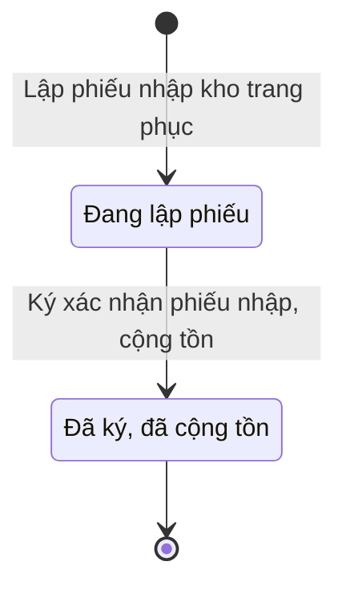

# qt-D10.uniform-stock-in · Nhập kho, vào sổ — Phiếu nhập kho trang phục

<!-- máy sinh: tom-tat -->
> **Hồ sơ:** Phiếu nhập kho trang phục (`UniformStockInSlip`)
>
> **Trong sổ phạm vi:** D10 · Nhập kho, vào sổ — hồ sơ phụ uniform-stock-in (tầng 2)
>
> 5 bước · 2 chặng · 2 vai · 0 bảng quyết định · 0 hạn · 2 khớp nối.
>
> **Nguồn:** sổ nghiệp vụ `qt-D10.uniform-stock-in` · khai báo của app: `dqtv-app/core/processes/stock-in/workflow/uniform-stock-in.yaml`. Các bảng do máy sinh từ nguồn này.
<!-- hết: tom-tat -->

<!-- viết tay: dien-giai -->
## Diễn giải

*Phần này viết tay, diễn giải lại điều các bảng bên dưới ghi.*

### Quy trình này để làm gì

Đơn vị ghi nhận trang phục về kho bằng một **phiếu nhập kho trang phục**. Vai `keeper` (Nhân viên quân khí kiêm thủ kho) lập phiếu và thêm từng dòng; vai `commander` (Chỉ huy trưởng Ban CHQS xã) ký xác nhận, số lượng được cộng vào tồn. Có hai nguồn nhập: tỉnh cấp, hoặc địa phương mua.

Hồ sơ chỉ có hai chặng: *Đang lập phiếu* → *Đã ký, đã cộng tồn*.

### Khi nào bắt đầu

Thủ kho bấm **Lập phiếu nhập kho trang phục**: bắt buộc nhập ngày nhập và nguồn nhập; số quyết định cấp phát của tỉnh và người giao là ô nhập nếu có. Số phiếu tự sinh. Bước lập không đòi bản chụp: phiếu là chứng từ nội bộ của kho; số quyết định cấp phát là ô tuỳ chọn trỏ về quyết định trang cấp đã ghi ở nơi khác (`recordProvisionDecision`).

Khi mở, phiếu có thể nối tới một Đợt mua sắm đã nhận hàng (D9) hoặc một dòng của Đợt cấp phát từ tỉnh xuống (D8) — cả hai là ô nhập nếu có.

### Diễn ra thế nào

**Chặng "Đang lập phiếu"** — thủ kho làm:

- **Thêm dòng vào phiếu nhập** (lặp được) — mỗi lần tạo một *Dòng phiếu nhập kho trang phục*; bắt buộc nhập `uniformType`, `itemName`, `sizeCode`, `quantity`, `intakeState`; `note` là ô nhập nếu có.
- **Đính ảnh biên bản giao nhận**.
- **Ghi nhận thiếu (biên bản)** (lặp được) — dùng khi hàng nhận thiếu so với chứng từ giao; phải nhập nội dung ghi nhận thiếu và bản quét biên bản.

**Chuyển chặng:** vai `commander` bấm **Ký xác nhận phiếu nhập, cộng tồn** → *Đã ký, đã cộng tồn*; bước ghi lại lúc ký, không phải nhập gì.

### Kết thúc và để lại gì

Hồ sơ kết thúc ở chặng *Đã ký, đã cộng tồn*. Hai mối nối về hồ sơ nguồn (D8, D9) được ghi lúc lập phiếu.

### Điều kiện chặn

- Bốn bước sau bước mở: người làm phải là người của đơn vị ghi ở ô đơn vị chủ hồ sơ. Sai người, sai chặng thì bước bị chặn, hồ sơ giữ nguyên.
- Không bước nào có kết quả chặn riêng.
<!-- hết viết tay -->

## 1. Đường đi ngắn nhất qua các chặng

<!-- máy sinh: luong-chinh -->
Đường ít bước nhất từ lúc mở hồ sơ tới chặng kết thúc xa nhất. Máy chọn theo số chặng, không theo ý nghĩa nghiệp vụ — trình tự công việc thật xem phần Diễn giải và bảng "Việc làm ở từng chặng" ở mục 6.

| # | Ai làm | Làm gì | Hồ sơ sang chặng |
|---|---|---|---|
| 1 | Nhân viên quân khí kiêm thủ kho | Lập phiếu nhập kho trang phục | Đang lập phiếu |
| 2 | Chỉ huy trưởng Ban CHQS xã | Ký xác nhận phiếu nhập, cộng tồn | Đã ký, đã cộng tồn |

<!-- hết: luong-chinh -->

## 2. Hồ sơ và việc nó để lại

<!-- máy sinh: muc-tieu -->
**App gọi quy trình này là:** Phiếu nhập kho trang phục.

**Khi mở, hồ sơ này ghi mối nối tới:**
- Dòng đợt cấp phát (D8) — bước `openUniformStockIn`, khớp nối `uniformStockFromIssue`
- Đợt mua sắm (D9) — bước `openUniformStockIn`, khớp nối `uniformStockFromProcurement`
<!-- hết: muc-tieu -->

## 3. Khởi phát và kết thúc

<!-- máy sinh: khoi-phat -->
**1 cửa vào** — bước mở hồ sơ:

| Bước mở | Ai mở | Hồ sơ vào chặng | App bắt buộc nhập |
|---|---|---|---|
| Lập phiếu nhập kho trang phục | Nhân viên quân khí kiêm thủ kho | Đang lập phiếu | ngày nhập, nguồn nhập |

**Kết thúc:** *Đã ký, đã cộng tồn* (`CONFIRMED`)
<!-- hết: khoi-phat -->

## 4. Vai trò

<!-- máy sinh: vai-tro -->
| Vai trong sổ | Tên trong app | Điều kiện | Làm những bước |
|---|---|---|---|
| `keeper` | Nhân viên quân khí kiêm thủ kho |  | Lập phiếu nhập kho trang phục · Thêm dòng vào phiếu nhập · Đính ảnh biên bản giao nhận · Ghi nhận thiếu (biên bản) |
| `commander` | Chỉ huy trưởng Ban CHQS xã |  | Ký xác nhận phiếu nhập, cộng tồn |

*"Tên trong app" là tên app đặt cho mã chủ thể của vai. Hồ sơ thuộc đơn vị cấp khác thì người làm là người giữ vai ấy ở đơn vị nêu trong cột "Điều kiện" (nếu sổ có ghi) và ở cột "Người làm phải thuộc" của bảng "Theo khai báo của app" (mục 7).*
<!-- hết: vai-tro -->

## 5. Nhánh phụ

<!-- máy sinh: nhanh-phu -->
**Làm trong lúc hồ sơ đứng yên ở một chặng** — ghi nhận, bổ sung:

| Bước | Ai làm | Ở chặng |
|---|---|---|
| Thêm dòng vào phiếu nhập *(lặp được)* | Nhân viên quân khí kiêm thủ kho | Đang lập phiếu |
| Đính ảnh biên bản giao nhận | Nhân viên quân khí kiêm thủ kho | Đang lập phiếu |
| Ghi nhận thiếu (biên bản) *(lặp được)* | Nhân viên quân khí kiêm thủ kho | Đang lập phiếu |

<!-- hết: nhanh-phu -->

## 6. Các chặng và việc làm ở từng chặng

<!-- máy sinh: chang -->
| Chặng | Tên hiển thị | Vào bằng bước | Kết thúc? |
|---|---|---|---|
| `DRAFT` | Đang lập phiếu | Lập phiếu nhập kho trang phục |  |
| `CONFIRMED` | Đã ký, đã cộng tồn | Ký xác nhận phiếu nhập, cộng tồn | **kết thúc** |

### Việc làm ở từng chặng

Hồ sơ đang ở chặng nào thì làm được những bước nào.

| Hồ sơ đang ở chặng | Bước làm tại chặng (hồ sơ đứng yên) | Bước đưa hồ sơ sang chặng khác |
|---|---|---|
| **Đang lập phiếu** | Thêm dòng vào phiếu nhập (lặp được) — Nhân viên quân khí kiêm thủ kho Đính ảnh biên bản giao nhận — Nhân viên quân khí kiêm thủ kho Ghi nhận thiếu (biên bản) (lặp được) — Nhân viên quân khí kiêm thủ kho | Ký xác nhận phiếu nhập, cộng tồn — Chỉ huy trưởng Ban CHQS xã → *Đã ký, đã cộng tồn* |
| **Đã ký, đã cộng tồn** | — | — (kết thúc) |
<!-- hết: chang -->

## 7. Bảng bước

<!-- máy sinh: buoc -->
| # | Bước | Mã bước | Ai thực hiện | Từ chặng | Sang chặng | Phải có trước | Ghi lại |
|---|---|---|---|---|---|---|---|
| 1 | Lập phiếu nhập kho trang phục | `openUniformStockIn` | Nhân viên quân khí kiêm thủ kho | — (mở hồ sơ) | `DRAFT` | — | mã tỉnh, mã xã, số phiếu, ngày nhập, nguồn nhập, số QĐ tỉnh cấp, người giao, nối tới Đợt mua sắm, nối tới Dòng đợt cấp phát, đơn vị chủ hồ sơ |
| 2 | Thêm dòng vào phiếu nhập | `addUniformStockInLine` | Nhân viên quân khí kiêm thủ kho | `DRAFT` | giữ nguyên | người làm thuộc đơn vị chủ hồ sơ | nối tới Dòng phiếu nhập kho trang phục |
| 3 | Đính ảnh biên bản giao nhận | `attachUniformStockInScan` | Nhân viên quân khí kiêm thủ kho | `DRAFT` | giữ nguyên | người làm thuộc đơn vị chủ hồ sơ | ảnh biên bản |
| 4 | Ghi nhận thiếu (biên bản) | `recordUniformReceiptShortfall` | Nhân viên quân khí kiêm thủ kho | `DRAFT` | giữ nguyên | người làm thuộc đơn vị chủ hồ sơ | ghi nhận thiếu, biên bản nhận thiếu |
| 5 | Ký xác nhận phiếu nhập, cộng tồn | `confirmUniformStockIn` | Chỉ huy trưởng Ban CHQS xã | `DRAFT` | `CONFIRMED` | người làm thuộc đơn vị chủ hồ sơ | ký xác nhận lúc |

### Khi không đạt điều kiện

Mặc định: không đúng người, hồ sơ không ở đúng chặng, hoặc thiếu thứ "phải có trước" thì bước bị chặn, hồ sơ giữ nguyên. Bảng dưới chỉ kê những bước có kết quả riêng.

Không bước nào có kết quả riêng — tất cả theo mặc định.

### Điều kiện "phải có trước" bằng lời

Cột "Phải có trước" ở bảng bước có hai loại: ô dữ liệu thường (bước chỉ đòi ô ấy đã có giá trị) và điều kiện hệ tự xét. Bảng này diễn các điều kiện hệ tự xét theo đúng công thức sổ ghi; số ở cột cuối là số thứ tự bước.

| Điều kiện | Đúng khi | Bước đòi |
|---|---|---|
| `actorInOwnerUnit` | người đang làm là người của đơn vị ghi ở ô đơn vị chủ hồ sơ của hồ sơ này (theo danh mục người của đơn vị, `dm.unit-staff`) | 2, 3, 4, 5 |

### Theo khai báo của app

Người làm phải thuộc đơn vị nào, ô người dùng phải nhập, bước có lặp được không, và căn cứ pháp lý — lấy từ khai báo quy trình trong app.

| # | Bước | Người làm phải thuộc | Bắt buộc nhập | Nhập nếu có | Lặp được | Căn cứ |
|---|---|---|---|---|---|---|
| 1 | Lập phiếu nhập kho trang phục |  | ngày nhập, nguồn nhập | số QĐ tỉnh cấp, người giao, `procurementId`, dòng cấp phát của tỉnh được phiếu này nhận |  | QĐ1126/QĐ-TM Đ.12; TT04/2015/TT-BQP Đ.5 k5 b |
| 2 | Thêm dòng vào phiếu nhập | đơn vị chủ hồ sơ | `uniformType`, `itemName`, `sizeCode`, `quantity`, `intakeState` | `note` | có | QĐ1126/QĐ-TM Đ.12 |
| 3 | Đính ảnh biên bản giao nhận | đơn vị chủ hồ sơ | ảnh biên bản | — |  | QĐ1126/QĐ-TM Đ.12 |
| 4 | Ghi nhận thiếu (biên bản) | đơn vị chủ hồ sơ | ghi nhận thiếu, biên bản nhận thiếu | — | có | TT76/2020/TT-BQP Đ.12 k2 |
| 5 | Ký xác nhận phiếu nhập, cộng tồn | đơn vị chủ hồ sơ | — | — |  | QĐ1126/QĐ-TM Đ.12; TT04/2015/TT-BQP Đ.5 k5 b |

### Điều kiện và ghi chú app khai cho từng bước

Lấy từ khai báo quy trình trong app. Lời trong ngoặc kép là câu app hiện cho người dùng. Chức danh người ký ngoài hệ app chỉ khai bằng mã.

| # | Bước | Điều kiện, ghi chú |
|---|---|---|
| 1 | Lập phiếu nhập kho trang phục | · không đòi bản chụp — app ghi: "Bước LẬP phiếu nhập kho — phiếu là chứng từ NỘI BỘ của kho, không phải văn bản phát hành. `intakeDecisionNo` là ô TUỲ CHỌN trỏ về quyết định trang cấp đã ghi ở nơi khác (`recordProvisionDecision`), và bản gốc nằm ở đó." |
| 2 | Thêm dòng vào phiếu nhập | · tạo thêm một hồ sơ con: Dòng phiếu nhập kho trang phục (`UniformStockInLine`) |
<!-- hết: buoc -->

## 8. Bảng quyết định, hạn, việc ngoài hệ

<!-- máy sinh: quyet-dinh -->

<!-- hết: quyet-dinh -->

## 9. Dữ liệu của hồ sơ

<!-- máy sinh: du-lieu -->
Các ô mà bước trong sổ ghi hoặc đòi. Số trong hai cột cuối là số thứ tự bước ở bảng bước (mục 7).

| Ô dữ liệu | Mã | Kiểu (app) | Giá trị cho phép | Loại ô (sổ) | Bước ghi | Bước đòi | Mô tả trong app |
|---|---|---|---|---|---|---|---|
| mã tỉnh | `provinceCode` | chữ |  | lưu trên hồ sơ (`stored`) | 1 | — | Mã tỉnh — lọc phạm vi theo hàng |
| mã xã | `communeCode` | chữ |  | lưu trên hồ sơ (`stored`) | 1 | — | Mã xã |
| số phiếu | `slipNumber` | chữ |  | lưu trên hồ sơ (`stored`) | 1 | — | Số phiếu nhập, tự sinh (vd NKTP-2026-0007) |
| ngày nhập | `receivedDate` | ngày |  | đưa vào ở bước (`input`) | 1 | — | Ngày nhập kho |
| nguồn nhập | `intakeSource` | chọn một | Tỉnh cấp (`superior`), Địa phương mua (`local_purchase`) | đưa vào ở bước (`input`) | 1 | — | Nguồn nhập: tỉnh cấp hay địa phương mua (TT04 Đ.5.5.b tiếp nhận từ tỉnh) |
| số QĐ tỉnh cấp | `intakeDecisionNo` | chữ |  | đưa vào ở bước (`input`) | 1 | — | Số quyết định cấp phát của tỉnh (khi nguồn = tỉnh cấp) |
| người giao | `handoverBy` | chữ |  | đưa vào ở bước (`input`) | 1 | — | Người giao |
| đơn vị chủ hồ sơ | `ownerUnit` |  |  | lưu trên hồ sơ (`stored`) | 1 | — |  |
| ảnh biên bản | `scanRef` | chữ |  | lưu trên hồ sơ (`stored`) | 3 | — | Ảnh biên bản giao nhận đính kèm |
| ghi nhận thiếu | `shortfallNote` | chữ |  | lưu trên hồ sơ (`stored`) | 4 | — | Ghi nhận phần hàng nhận thiếu so với chứng từ giao (mất, hỏng khi vận chuyển, giao nhầm) |
| biên bản nhận thiếu | `shortfallMinutesScan` | tệp |  | lưu trên hồ sơ (`stored`) | 4 | — | Bản quét biên bản nhận thiếu đã ký (lưu qua FileStore ở tầng route) |
| ký xác nhận lúc | `signedOffAt` | ngày giờ |  | lưu trên hồ sơ (`stored`) | 5 | — | Thời điểm Chỉ huy trưởng ký xác nhận |
| người làm thuộc đơn vị chủ hồ sơ | `actorInOwnerUnit` |  | có hay chưa | hệ suy ra (`derived`) | — | 2, 3, 4, 5 |  |

13 ô. Cột "Loại ô" là cách sổ phân loại ô, in kèm đúng chữ của sổ; ô nào người dùng phải nhập xem bảng "Theo khai báo của app" ở mục 7.
<!-- hết: du-lieu -->

## 10. Khớp nối với quy trình khác

<!-- máy sinh: khop-noi -->
| Quy trình kia | Hồ sơ kia | Quan hệ | Nội dung (mô tả trong app) | Bước ghi mối nối | Tên ô nối |
|---|---|---|---|---|---|
| D8 | Dòng đợt cấp phát | hồ sơ này **mở ra có nối tới** hồ sơ kia | Phiếu nhập KHO TRANG PHỤC của xã nhận theo dòng cấp phát nào của tỉnh (QT-3) | D10.uniform-stock-in·openUniformStockIn ⊕ | `uniformStockFromIssue` |
| D9 | Đợt mua sắm | hồ sơ này **mở ra có nối tới** hồ sơ kia | Phiếu nhập kho trang phục lập từ đợt mua sắm (QT-5) đã nhận hàng nào — truy vết + đối chiếu 'đã mua vs đã nhậ… | D10.uniform-stock-in·openUniformStockIn ⊕ | `uniformStockFromProcurement` |

2 khớp nối. ⊕ là bước tạo hồ sơ.
<!-- hết: khop-noi -->

## 11. Thông tin chung

<!-- máy sinh: thong-tin -->
| | |
|---|---|
| **Mã trong sổ** | `qt-D10.uniform-stock-in` |
| **Quy trình trong app** | `stock-in` (`workflow/uniform-stock-in.yaml`) — mặt công tác: `logistics-technical` |
| **Hồ sơ** | Phiếu nhập kho trang phục (`UniformStockInSlip`) |
| **Cùng mã quy trình** | [qt-D10](qt-D10.html) |
| **Căn cứ pháp lý từng bước** | cột "Căn cứ" ở bảng "Theo khai báo của app", mục 7 |
<!-- hết: thong-tin -->
