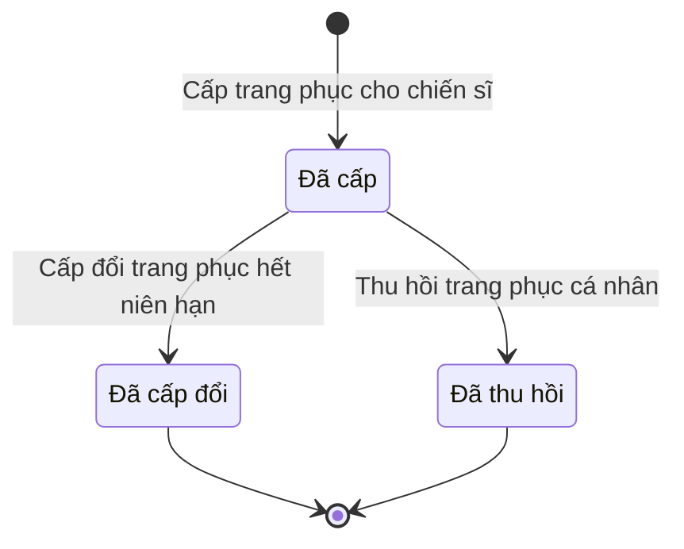

# qt-D11 · Cấp phát, thu hồi cho người, cho đợt

<!-- máy sinh: tom-tat -->
> **Hồ sơ:** Trang phục cá nhân (`MemberUniform`)
>
> **Trong sổ phạm vi:** D11 · Cấp phát, thu hồi cho người, cho đợt (tầng 2)
>
> 3 bước · 3 chặng · 1 vai · 0 bảng quyết định · 0 hạn · 5 khớp nối.
>
> **Nguồn:** sổ nghiệp vụ `qt-D11` · khai báo của app: `dqtv-app/core/processes/allocation/workflow/member-uniform.yaml`. Các bảng do máy sinh từ nguồn này.
<!-- hết: tom-tat -->

<!-- viết tay: dien-giai -->
## Diễn giải

*Phần này viết tay, diễn giải lại điều các bảng bên dưới ghi.*

### Quy trình này để làm gì

Nhân viên quân khí kiêm thủ kho theo dõi **trang phục cá nhân**: mỗi hồ sơ là một mặt hàng trang phục đã cấp cho một chiến sĩ, kèm ngày cấp, niên hạn và ngày hết niên hạn. Niên hạn do nhóm đối tượng của chiến sĩ quyết định và được chốt ngay lúc cấp.

Hồ sơ có ba chặng: *Đã cấp*, rồi kết thúc ở *Đã cấp đổi* hoặc *Đã thu hồi*. Cả ba bước đều do thủ kho làm.

### Khi nào bắt đầu

Thủ kho bấm **Cấp trang phục cho chiến sĩ**, nhập chiến sĩ được cấp, mặt hàng và ngày cấp. Hồ sơ mở ra có nối tới Chiến sĩ dân quân tự vệ (quy trình 16.enlistment) và tới *Trang phục, sao mũ, phù hiệu*, rồi vào thẳng chặng *Đã cấp*.

Bước mở ghi lại loại trang phục, nhóm đối tượng, cỡ số, mặt hàng kho đã trừ, niên hạn, ngày hết niên hạn, số phiếu ký nhận và ảnh phiếu ký nhận. Chiến sĩ ký trên giấy, cán bộ quét lên.

### Diễn ra thế nào

**Chặng "Đã cấp"** — hồ sơ đứng ở đây để theo dõi niên hạn. Thủ kho khép hồ sơ bằng một trong hai bước:

- **Cấp đổi trang phục hết niên hạn** → *Đã cấp đổi*. Phải nhập ngày cấp; trang phục hết niên hạn, đã cấp đổi bằng bộ mới.
- **Thu hồi trang phục cá nhân** → *Đã thu hồi*. Phải nhập ngày thu hồi và vì sao thu hồi.

### Kết thúc và để lại gì

Hồ sơ kết thúc ở *Đã cấp đổi* hoặc *Đã thu hồi*. **Sự cố trang phục** (D13) mở ra từ đúng bản trang phục cá nhân gặp sự cố.

### Điều kiện chặn

- Cấp đổi và thu hồi: người làm phải là người của đơn vị ghi ở ô đơn vị chủ hồ sơ, và hồ sơ phải đang ở *Đã cấp*. Sai thì bước bị chặn, hồ sơ giữ nguyên.
- Thiếu ô bắt buộc nhập của bước thì bước cũng không qua.
<!-- hết viết tay -->

## 1. Đường đi ngắn nhất qua các chặng

<!-- máy sinh: luong-chinh -->
Đường ít bước nhất từ lúc mở hồ sơ tới chặng kết thúc xa nhất. Máy chọn theo số chặng, không theo ý nghĩa nghiệp vụ — trình tự công việc thật xem phần Diễn giải và bảng "Việc làm ở từng chặng" ở mục 6.

| # | Ai làm | Làm gì | Hồ sơ sang chặng |
|---|---|---|---|
| 1 | Nhân viên quân khí kiêm thủ kho | Cấp trang phục cho chiến sĩ | Đã cấp |
| 2 | Nhân viên quân khí kiêm thủ kho | Cấp đổi trang phục hết niên hạn | Đã cấp đổi |

<!-- hết: luong-chinh -->

## 2. Hồ sơ và việc nó để lại

<!-- máy sinh: muc-tieu -->
**App gọi quy trình này là:** Chặng C3 — Trang phục cấp cho từng cá nhân.

**Khi mở, hồ sơ này ghi mối nối tới:**
- Chiến sĩ dân quân tự vệ (16.enlistment) — bước `issueToMember`, khớp nối `memberUniformOf`

**Hồ sơ này để lại cho quy trình khác** (bước tạo hồ sơ của quy trình kia ghi mối nối về đây):
- Sự cố trang phục (D13) — bước `reportUniformIncident`, khớp nối `incidentOfUniform`
<!-- hết: muc-tieu -->

## 3. Khởi phát và kết thúc

<!-- máy sinh: khoi-phat -->
**1 cửa vào** — bước mở hồ sơ:

| Bước mở | Ai mở | Hồ sơ vào chặng | App bắt buộc nhập |
|---|---|---|---|
| Cấp trang phục cho chiến sĩ | Nhân viên quân khí kiêm thủ kho | Đã cấp | `memberId`, mặt hàng, ngày cấp |

**Kết thúc:** *Đã cấp đổi* (`replaced`), *Đã thu hồi* (`recalled`)
<!-- hết: khoi-phat -->

## 4. Vai trò

<!-- máy sinh: vai-tro -->
| Vai trong sổ | Tên trong app | Điều kiện | Làm những bước |
|---|---|---|---|
| `quartermaster` | Nhân viên quân khí kiêm thủ kho |  | Cấp trang phục cho chiến sĩ · Cấp đổi trang phục hết niên hạn · Thu hồi trang phục cá nhân |

*"Tên trong app" là tên app đặt cho mã chủ thể của vai. Hồ sơ thuộc đơn vị cấp khác thì người làm là người giữ vai ấy ở đơn vị nêu trong cột "Điều kiện" (nếu sổ có ghi) và ở cột "Người làm phải thuộc" của bảng "Theo khai báo của app" (mục 7).*
<!-- hết: vai-tro -->

## 5. Nhánh phụ

<!-- máy sinh: nhanh-phu -->
**Bước khác đưa hồ sơ sang chặng mới** — đường song song, rẽ nhánh hoặc kết thúc sớm:

| Bước | Ai làm | Từ chặng | Sang chặng |
|---|---|---|---|
| Thu hồi trang phục cá nhân | Nhân viên quân khí kiêm thủ kho | Đã cấp | Đã thu hồi |

<!-- hết: nhanh-phu -->

## 6. Các chặng và việc làm ở từng chặng

<!-- máy sinh: chang -->
| Chặng | Tên hiển thị | Vào bằng bước | Kết thúc? |
|---|---|---|---|
| `issued` | Đã cấp | Cấp trang phục cho chiến sĩ |  |
| `replaced` | Đã cấp đổi | Cấp đổi trang phục hết niên hạn | **kết thúc** |
| `recalled` | Đã thu hồi | Thu hồi trang phục cá nhân | **kết thúc** |

### Việc làm ở từng chặng

Hồ sơ đang ở chặng nào thì làm được những bước nào.

| Hồ sơ đang ở chặng | Bước làm tại chặng (hồ sơ đứng yên) | Bước đưa hồ sơ sang chặng khác |
|---|---|---|
| **Đã cấp** | — | Cấp đổi trang phục hết niên hạn — Nhân viên quân khí kiêm thủ kho → *Đã cấp đổi* Thu hồi trang phục cá nhân — Nhân viên quân khí kiêm thủ kho → *Đã thu hồi* |
| **Đã cấp đổi** | — | — (kết thúc) |
| **Đã thu hồi** | — | — (kết thúc) |
<!-- hết: chang -->

## 7. Bảng bước

<!-- máy sinh: buoc -->
| # | Bước | Mã bước | Ai thực hiện | Từ chặng | Sang chặng | Phải có trước | Ghi lại |
|---|---|---|---|---|---|---|---|
| 1 | Cấp trang phục cho chiến sĩ | `issueToMember` | Nhân viên quân khí kiêm thủ kho | — (mở hồ sơ) | `issued` | — | nối tới Chiến sĩ dân quân tự vệ, nối tới Trang phục, sao mũ, phù hiệu, mã tỉnh, mã xã, loại trang phục, mặt hàng, nhóm đối tượng, cỡ số (cũ), cỡ số, mặt hàng kho (đã trừ), ngày cấp, niên hạn (tháng), ngày hết niên hạn, số phiếu ký nhận, phiếu ký nhận (ảnh/bản quét có chữ ký), đơn vị chủ hồ sơ |
| 2 | Cấp đổi trang phục hết niên hạn | `replaceMemberUniform` | Nhân viên quân khí kiêm thủ kho | `issued` | `replaced` | người làm thuộc đơn vị chủ hồ sơ | — |
| 3 | Thu hồi trang phục cá nhân | `recallMemberUniform` | Nhân viên quân khí kiêm thủ kho | `issued` | `recalled` | người làm thuộc đơn vị chủ hồ sơ | ngày thu hồi, vì sao thu hồi |

### Khi không đạt điều kiện

Mặc định: không đúng người, hồ sơ không ở đúng chặng, hoặc thiếu thứ "phải có trước" thì bước bị chặn, hồ sơ giữ nguyên. Bảng dưới chỉ kê những bước có kết quả riêng.

Không bước nào có kết quả riêng — tất cả theo mặc định.

### Điều kiện "phải có trước" bằng lời

Cột "Phải có trước" ở bảng bước có hai loại: ô dữ liệu thường (bước chỉ đòi ô ấy đã có giá trị) và điều kiện hệ tự xét. Bảng này diễn các điều kiện hệ tự xét theo đúng công thức sổ ghi; số ở cột cuối là số thứ tự bước.

| Điều kiện | Đúng khi | Bước đòi |
|---|---|---|
| `actorInOwnerUnit` | người đang làm là người của đơn vị ghi ở ô đơn vị chủ hồ sơ của hồ sơ này (theo danh mục người của đơn vị, `dm.unit-staff`) | 2, 3 |

### Theo khai báo của app

Người làm phải thuộc đơn vị nào, ô người dùng phải nhập, bước có lặp được không, và căn cứ pháp lý — lấy từ khai báo quy trình trong app.

| # | Bước | Người làm phải thuộc | Bắt buộc nhập | Nhập nếu có | Lặp được | Căn cứ |
|---|---|---|---|---|---|---|
| 1 | Cấp trang phục cho chiến sĩ |  | `memberId`, mặt hàng, ngày cấp | — |  | L48/2019/QH14 Đ.24; NĐ72/2020/NĐ-CP Đ.6, Phụ lục II |
| 2 | Cấp đổi trang phục hết niên hạn |  | ngày cấp | — |  | L48/2019/QH14 Đ.24; NĐ72/2020/NĐ-CP Đ.6, Phụ lục II |
| 3 | Thu hồi trang phục cá nhân |  | ngày thu hồi, vì sao thu hồi | — |  | L48/2019/QH14 Đ.24; TT04/2015/TT-BQP Đ.5 |
<!-- hết: buoc -->

## 8. Bảng quyết định, hạn, việc ngoài hệ

<!-- máy sinh: quyet-dinh -->

<!-- hết: quyet-dinh -->

## 9. Dữ liệu của hồ sơ

<!-- máy sinh: du-lieu -->
Các ô mà bước trong sổ ghi hoặc đòi. Số trong hai cột cuối là số thứ tự bước ở bảng bước (mục 7).

| Ô dữ liệu | Mã | Kiểu (app) | Giá trị cho phép | Loại ô (sổ) | Bước ghi | Bước đòi | Mô tả trong app |
|---|---|---|---|---|---|---|---|
| mã tỉnh | `provinceCode` | chữ |  | lưu trên hồ sơ (`stored`) | 1 | — | Mã tỉnh — dùng lọc phạm vi theo hàng |
| mã xã | `communeCode` | chữ |  | lưu trên hồ sơ (`stored`) | 1 | — | Mã xã |
| loại trang phục | `uniformType` | chọn một | Quân phục (`field_uniform`), Mũ (`hard_hat`), Sao mũ (`cap_badge`), Phù hiệu (`insignia`), Giày dép (`footwear`), Phụ kiện (`other`) | lưu trên hồ sơ (`stored`) | 1 | — | Loại lớn (nhóm hiển thị) — suy từ itemName. NĐ72/2020 Phụ lục II |
| mặt hàng | `itemName` | chữ |  | đưa vào ở bước (`input`) | 1 | — | Mặt hàng CỤ THỂ theo định mức NĐ72 (vd 'Quần áo chiến sĩ', 'Giày da đen', 'Bít tất') — Mức 3, ghi cấp phát tới từng mặt hàng |
| nhóm đối tượng | `targetCategory` | chọn một | Chỉ huy: CHT/Phó CHT xã, chỉ huy cơ động (NĐ72 PLII k.1) (`command_mobile`), Chỉ huy dân quân thường trực (NĐ72 PLII k.2) (`command_standing`), CTV, thôn đội trưởng, chỉ huy khác (NĐ72 PLII k.3) (`command_local`), Chiến sĩ cơ động, biển (NĐ72 PLII k.4) (`soldier_mobile`), Chiến sĩ thường trực (NĐ72 PLII k.5) (`soldier_standing`), Chiến sĩ tại chỗ, binh chủng (NĐ72 PLII k.6) (`soldier_local`) | lưu trên hồ sơ (`stored`) | 1 | — | Nhóm đối tượng của chiến sĩ — quyết định niên hạn (NĐ72/2020 Phụ lục II mục II) |
| cỡ số (cũ) | `size` | chữ |  | đưa vào ở bước (`input`) | 1 | — | Cỡ số (text cũ) — giữ cho hồ sơ đã cấp; nay dùng sizeCode (P3) |
| cỡ số | `sizeCode` | chọn một | Cỡ S (`s`), Cỡ M (`m`), Cỡ L (`l`), Cỡ XL (`xl`), Cỡ XXL (`xxl`), `xxxl`, Không phân cỡ (`none`) | đưa vào ở bước (`input`) | 1 | — | Cỡ số CHUẨN S/M/L/XL/XXL — cùng bộ với UniformStock.sizeCode, để khớp kho khi trừ tồn (P3) |
| mặt hàng kho (đã trừ) | `stockItemName` | chữ |  | đưa vào ở bước (`input`) | 1 | — | Tên mặt hàng THỰC trong kho đã trừ khi cấp (vd 'Áo quân phục K08') — khác itemName định mức; khoá trừ tồn (loại+stockItemName+cỡ). NĐ72 định mức là quyền lợi, kho là vật tư thực (P3b) |
| ngày cấp | `issueDate` | ngày |  | đưa vào ở bước (`input`) | 1 | — | Ngày cấp — mốc tính niên hạn |
| niên hạn (tháng) | `serviceLifeMonths` | số |  | lưu trên hồ sơ (`stored`) | 1 | — | Niên hạn (tháng) đã áp dụng — chốt lúc cấp |
| ngày hết niên hạn | `expiryDate` | ngày |  | lưu trên hồ sơ (`stored`) | 1 | — | Ngày hết niên hạn — chốt lúc cấp = ngày cấp + niên hạn |
| số phiếu ký nhận | `receiptRef` | chữ |  | đưa vào ở bước (`input`) | 1 | — | Số phiếu ký nhận giấy — bằng chứng đã giao |
| phiếu ký nhận (bản quét) | `receiptScanPath` | tệp |  | đưa vào ở bước (`input`) | 1 | — | Ảnh/bản quét phiếu ký nhận có chữ ký chiến sĩ (chiến sĩ ký GIẤY, cán bộ quét lên) |
| đơn vị chủ hồ sơ | `ownerUnit` |  |  | lưu trên hồ sơ (`stored`) | 1 | — |  |
| ngày thu hồi | `recallDate` | ngày |  | đưa vào ở bước (`input`) | 3 | — | Ngày thu hồi |
| lý do thu hồi | `recallReason` | chữ |  | đưa vào ở bước (`input`) | 3 | — | Lý do thu hồi |
| người làm thuộc đơn vị chủ hồ sơ | `actorInOwnerUnit` |  | có hay chưa | hệ suy ra (`derived`) | — | 2, 3 |  |

17 ô. Cột "Loại ô" là cách sổ phân loại ô, in kèm đúng chữ của sổ; ô nào người dùng phải nhập xem bảng "Theo khai báo của app" ở mục 7.
<!-- hết: du-lieu -->

## 10. Khớp nối với quy trình khác

<!-- máy sinh: khop-noi -->
| Quy trình kia | Hồ sơ kia | Quan hệ | Nội dung (mô tả trong app) | Bước ghi mối nối | Tên ô nối |
|---|---|---|---|---|---|
| 16.enlistment | Chiến sĩ dân quân tự vệ | gắn với nhau ở một bước giữa chừng | Chiến sĩ KÝ NHẬN khẩu vũ khí trong đợt cấp phát — sổ cấp phát theo người (TT76 mục II-IV; TT81 Đ.24 quy trách… | D11.training-allocation·addAllocationLine | `issuedToMember` |
| 16.enlistment | Chiến sĩ dân quân tự vệ | hồ sơ này **mở ra có nối tới** hồ sơ kia | Chiến sĩ được cấp trang phục cá nhân — E09 (L48/2019 Đ.24; TT04/2015 Đ.5 k5 b) | D11·issueToMember ⊕ | `memberUniformOf` |
| D12 | Trang bị, phương tiện | gắn với nhau ở một bước giữa chừng | Dòng VŨ KHÍ cấp cho huấn luyện trỏ khoản trang bị THẬT trong sổ — giữ chỗ khi duyệt, hoàn/khóa khi quyết toán… | D11.training-allocation·addAllocationLine | `allocatedEquipment` |
| D13 | Sự cố trang phục | hồ sơ kia **mở ra từ** hồ sơ này | Sự cố xảy ra với đúng BẢN trang phục cá nhân nào — E09 (nối sự cố vào cấp đổi) | D13·reportUniformIncident ⊕ | `incidentOfUniform` |
| D13 | Sự cố mất, hư hỏng | gắn với nhau ở một bước giữa chừng | Khai báo mất phát sinh từ quyết toán đợt huấn luyện — dòng vật chất thiếu sau đối chiếu (UC-10 màn I ③) | D11.training-allocation·closeAllocation | `lossFromSettlement` |

5 khớp nối. ⊕ là bước tạo hồ sơ.

**Ô nối giữa các hồ sơ cùng mã quy trình, hoặc tới danh mục nền:** `memberUniformIn` (Trang phục cá nhân → Trang phục, sao mũ, phù hiệu) — bước Cấp trang phục cho chiến sĩ.
<!-- hết: khop-noi -->

## 11. Thông tin chung

<!-- máy sinh: thong-tin -->
| | |
|---|---|
| **Mã trong sổ** | `qt-D11` |
| **Quy trình trong app** | `allocation` (`workflow/member-uniform.yaml`) — mặt công tác: `logistics-technical` |
| **Hồ sơ** | Trang phục cá nhân (`MemberUniform`) |
| **Cùng mã quy trình** | [qt-D11.training-allocation](qt-D11.training-allocation.html), [qt-D11.uniform](qt-D11.uniform.html), [qt-D11.uniform-stock-out](qt-D11.uniform-stock-out.html) |
| **Căn cứ pháp lý từng bước** | cột "Căn cứ" ở bảng "Theo khai báo của app", mục 7 |
<!-- hết: thong-tin -->
