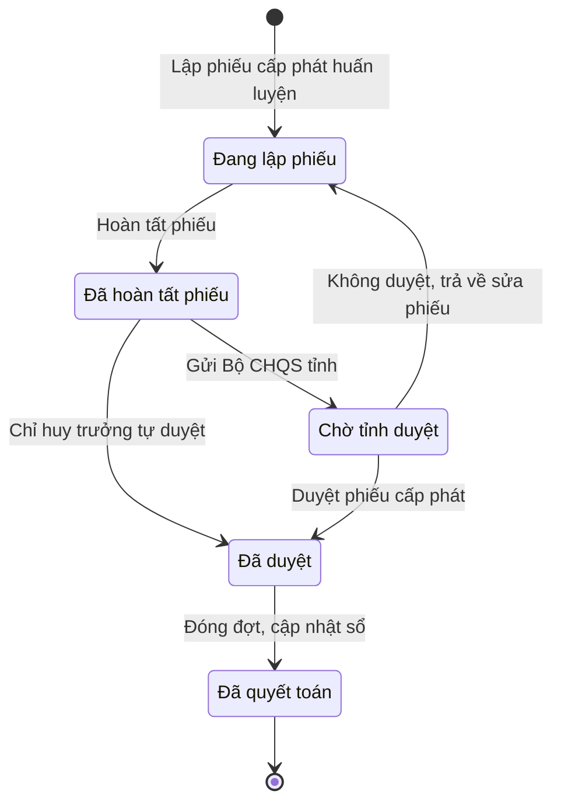

# qt-D11.training-allocation · Cấp phát, thu hồi cho người, cho đợt — Phiếu cấp phát huấn luyện

<!-- máy sinh: tom-tat -->
> **Hồ sơ:** Phiếu cấp phát huấn luyện (`TrainingAllocation`)
>
> **Trong sổ phạm vi:** D11 · Cấp phát, thu hồi cho người, cho đợt — hồ sơ phụ training-allocation (tầng 2)
>
> 14 bước · 5 chặng · 6 vai · 0 bảng quyết định · 0 hạn · 7 khớp nối.
>
> **Nguồn:** sổ nghiệp vụ `qt-D11.training-allocation` · khai báo của app: `dqtv-app/core/processes/allocation/workflow/training-allocation.yaml`. Các bảng do máy sinh từ nguồn này.
<!-- hết: tom-tat -->

<!-- viết tay: dien-giai -->
## Diễn giải

*Phần này viết tay, diễn giải lại điều các bảng bên dưới ghi.*

### Quy trình này để làm gì

Đơn vị lập một **phiếu cấp phát huấn luyện** để cấp mượn trang bị, vật chất cho một đợt, rồi sau đợt thì quyết toán: đã dùng bao nhiêu, trả lại bao nhiêu, thiếu gì. Có ba căn cứ cấp: huấn luyện, đợt hoạt động theo kế hoạch, vụ việc theo mệnh lệnh. Bốn vai: `quartermaster` (Nhân viên quân khí kiêm thủ kho) lập và quyết toán; `commander` (Chỉ huy trưởng Ban CHQS xã) tự duyệt hoặc ký tờ trình; `clerk` (Nhân viên văn thư) gửi; `approver` (Bộ CHQS cấp tỉnh) duyệt.

Hồ sơ đi qua bảy chặng: *Đang lập phiếu* → *Đã hoàn tất phiếu* → *Chờ ký tờ trình* → *Đã ký, chờ gửi* → *Chờ tỉnh duyệt* → *Đã duyệt* → *Đã quyết toán*. Có một đường tắt: Chỉ huy trưởng tự duyệt, bỏ qua ba chặng trình tỉnh.

### Khi nào bắt đầu

Thủ kho bấm **Lập phiếu cấp phát huấn luyện**. Phải nhập tên phiếu và nhiệm vụ trên giao mà đợt cấp phát này thực hiện; đợt huấn luyện, vụ việc ứng phó và căn cứ cấp là ô nhập nếu có.

Hồ sơ mở ra có nối tới Nhiệm vụ trên giao (quy trình 1), và nếu có thì tới Sự kiện huấn luyện (quy trình 14) hoặc Vụ việc ứng phó (quy trình 20).

### Diễn ra thế nào

**Chặng "Đang lập phiếu"** — thủ kho **Thêm dòng trang bị** và **Bỏ dòng trang bị** (đều lặp được). Mỗi lần thêm tạo một *Dòng trang bị cấp phát*; phải nhập `itemName`, `itemCategory`, `quantity`; `equipmentId`, `memberId` và số phiếu ký nhận là ô nhập nếu có. Xong thì bấm **Hoàn tất phiếu** → *Đã hoàn tất phiếu*.

**Chặng "Đã hoàn tất phiếu"** — rẽ hai đường:

- **Chỉ huy trưởng tự duyệt** → thẳng sang *Đã duyệt*; đường này dành cho phiếu "toàn vật chất cấp tổ chức". Bước để lại ba ô: tỉnh duyệt lúc, cơ quan duyệt, người ký duyệt.
- **Trình ký tờ trình phân bổ trang bị huấn luyện** (thủ kho) → *Chờ ký tờ trình*; phải đính tờ trình (PDF), bước tạo một hồ sơ con *Văn bản đi*.

**Chặng "Chờ ký tờ trình"** — Chỉ huy trưởng **Ký tờ trình** → *Đã ký, chờ gửi*, hoặc **Trả lại tờ trình** → về *Đã hoàn tất phiếu* (phải ghi cần sửa gì).

**Chặng "Đã ký, chờ gửi"** — Nhân viên văn thư bấm **Gửi Bộ CHQS tỉnh** → *Chờ tỉnh duyệt*; phải đính tờ trình đã ký, đã ghi số; nơi nhận tờ trình là `province_military_command`. Chỉ huy trưởng vẫn trả lại tờ trình được từ chặng này.

**Chặng "Chờ tỉnh duyệt"** — vai `approver` (Bộ CHQS cấp tỉnh) **Duyệt phiếu cấp phát** → *Đã duyệt*, hoặc **Không duyệt, trả về sửa phiếu** → về tận *Đang lập phiếu* (phải ghi vì sao trả về).

**Chặng "Đã duyệt"** — thủ kho làm:

- `issueAllocation` — để lại ô `issuedAt`, hồ sơ đứng yên.
- **Ghi quyết toán dòng trang bị** (lặp được) — từng dòng: đã dùng, trả lại, lý do chênh nếu có.
- **Đóng đợt, cập nhật sổ** → *Đã quyết toán*; ô nhập nếu có gồm dòng thiếu, lý do thiếu, khẩu vũ khí trả lại, khẩu vũ khí mất và hoàn cảnh mất.

### Kết thúc và để lại gì

Hồ sơ kết thúc ở chặng *Đã quyết toán*. Bước đóng đợt ghi hai mối nối tới **Sự cố mất, hư hỏng** (`incidentOfEquipment`, `lossFromSettlement`) và tạo một hồ sơ con *Sự cố mất, hư hỏng*. **Văn bản đi** (quy trình 1) gắn vào ở bước trình ký.

### Điều kiện chặn

- Mười ba bước sau bước mở: người làm phải là người của đơn vị ghi ở ô đơn vị chủ hồ sơ — kể cả hai bước của vai Bộ CHQS cấp tỉnh. Sai người, sai chặng thì bước bị chặn, hồ sơ giữ nguyên.
- Mỗi bước còn chặn khi thiếu ô bắt buộc nhập của bước ấy.
<!-- hết viết tay -->

## 1. Đường đi ngắn nhất qua các chặng

<!-- máy sinh: luong-chinh -->
Đường ít bước nhất từ lúc mở hồ sơ tới chặng kết thúc xa nhất. Máy chọn theo số chặng, không theo ý nghĩa nghiệp vụ — trình tự công việc thật xem phần Diễn giải và bảng "Việc làm ở từng chặng" ở mục 6.

| # | Ai làm | Làm gì | Hồ sơ sang chặng |
|---|---|---|---|
| 1 | Nhân viên quân khí kiêm thủ kho | Lập phiếu cấp phát huấn luyện | Đang lập phiếu |
| 2 | Nhân viên quân khí kiêm thủ kho | Hoàn tất phiếu | Đã hoàn tất phiếu |
| 3 | Chỉ huy trưởng Ban CHQS xã | Chỉ huy trưởng tự duyệt | Đã duyệt |
| 4 | Nhân viên quân khí kiêm thủ kho | Đóng đợt, cập nhật sổ | Đã quyết toán |

<!-- hết: luong-chinh -->

## 2. Hồ sơ và việc nó để lại

<!-- máy sinh: muc-tieu -->
**App gọi quy trình này là:** Phiếu cấp phát huấn luyện.

**Khi mở, hồ sơ này ghi mối nối tới:**
- Nhiệm vụ trên giao (1) — bước `openTrainingAllocation`, khớp nối `trainingAllocationServesTasking`
- Sự kiện — huấn luyện, hội thi, diễn tập, hội nghị (14) — bước `openTrainingAllocation`, khớp nối `allocationForEvent`
- Vụ việc ứng phó (20) — bước `openTrainingAllocation`, khớp nối `allocationForCase`
<!-- hết: muc-tieu -->

## 3. Khởi phát và kết thúc

<!-- máy sinh: khoi-phat -->
**1 cửa vào** — bước mở hồ sơ:

| Bước mở | Ai mở | Hồ sơ vào chặng | App bắt buộc nhập |
|---|---|---|---|
| Lập phiếu cấp phát huấn luyện | Nhân viên quân khí kiêm thủ kho | Đang lập phiếu | tên phiếu, `taskingId` |

**Kết thúc:** *Đã quyết toán* (`SETTLED`)
<!-- hết: khoi-phat -->

## 4. Vai trò

<!-- máy sinh: vai-tro -->
| Vai trong sổ | Tên trong app | Điều kiện | Làm những bước |
|---|---|---|---|
| `quartermaster` | Nhân viên quân khí kiêm thủ kho |  | Lập phiếu cấp phát huấn luyện · Thêm dòng trang bị · Bỏ dòng trang bị · Hoàn tất phiếu · Trình ký tờ trình phân bổ trang bị huấn luyện · Ghi đã xuất cấp · Ghi quyết toán dòng trang bị · Đóng đợt, cập nhật sổ |
| `commander` | Chỉ huy trưởng Ban CHQS xã |  | Chỉ huy trưởng tự duyệt |
| `clerk` | Nhân viên văn thư |  | Gửi Bộ CHQS tỉnh |
| `approver` | Bộ CHQS cấp tỉnh | thuộc cấp trên của chủ hồ sơ (`actorInSuperiorUnit`, công thức ở mục 7) | Duyệt phiếu cấp phát |
| `operator` | Ban Dân quân tự vệ, Bộ CHQS cấp tỉnh | thuộc cấp trên của chủ hồ sơ (`actorInSuperiorUnit`, công thức ở mục 7) | Trình ký văn bản trả phiếu cấp phát về |
| `system` | Hệ thống tự làm |  | Không duyệt, trả về sửa phiếu · Ghi người ký nhận vũ khí đã thôi phục vụ |

*"Tên trong app" là tên app đặt cho mã chủ thể của vai. Hồ sơ thuộc đơn vị cấp khác thì người làm là người giữ vai ấy ở đơn vị nêu trong cột "Điều kiện" (nếu sổ có ghi) và ở cột "Người làm phải thuộc" của bảng "Theo khai báo của app" (mục 7).*
<!-- hết: vai-tro -->

## 5. Nhánh phụ

<!-- máy sinh: nhanh-phu -->
**Bước khác đưa hồ sơ sang chặng mới** — đường song song, rẽ nhánh hoặc kết thúc sớm:

| Bước | Ai làm | Từ chặng | Sang chặng |
|---|---|---|---|
| Gửi Bộ CHQS tỉnh | Nhân viên văn thư | Đã hoàn tất phiếu | Chờ tỉnh duyệt |
| Duyệt phiếu cấp phát | Bộ CHQS cấp tỉnh (thuộc cấp trên của chủ hồ sơ) | Chờ tỉnh duyệt | Đã duyệt |

**Quay lại một chặng hồ sơ đã đi qua** (tính theo đường ngắn nhất từ lúc mở):

| Bước | Ai làm | Từ chặng | Về chặng |
|---|---|---|---|
| Không duyệt, trả về sửa phiếu | Hệ thống tự làm | Chờ tỉnh duyệt | Đang lập phiếu |

**Làm trong lúc hồ sơ đứng yên ở một chặng** — ghi nhận, bổ sung:

| Bước | Ai làm | Ở chặng |
|---|---|---|
| Thêm dòng trang bị *(lặp được)* | Nhân viên quân khí kiêm thủ kho | Đang lập phiếu |
| Bỏ dòng trang bị *(lặp được)* | Nhân viên quân khí kiêm thủ kho | Đang lập phiếu |
| Trình ký tờ trình phân bổ trang bị huấn luyện | Nhân viên quân khí kiêm thủ kho | Đã hoàn tất phiếu |
| Ghi đã xuất cấp | Nhân viên quân khí kiêm thủ kho | Đã duyệt |
| Trình ký văn bản trả phiếu cấp phát về | Ban Dân quân tự vệ, Bộ CHQS cấp tỉnh (thuộc cấp trên của chủ hồ sơ) | Chờ tỉnh duyệt |
| Ghi quyết toán dòng trang bị *(lặp được)* | Nhân viên quân khí kiêm thủ kho | Đã duyệt |
| Ghi người ký nhận vũ khí đã thôi phục vụ *(lặp được)* | Hệ thống tự làm | Đã duyệt |

<!-- hết: nhanh-phu -->

## 6. Các chặng và việc làm ở từng chặng

<!-- máy sinh: chang -->
| Chặng | Tên hiển thị | Vào bằng bước | Kết thúc? |
|---|---|---|---|
| `DRAFT` | Đang lập phiếu | Lập phiếu cấp phát huấn luyện · Không duyệt, trả về sửa phiếu |  |
| `PENDING_SUBMISSION` | Đã hoàn tất phiếu | Hoàn tất phiếu |  |
| `SUBMITTED` | Chờ tỉnh duyệt | Gửi Bộ CHQS tỉnh |  |
| `APPROVED` | Đã duyệt | Chỉ huy trưởng tự duyệt · Duyệt phiếu cấp phát |  |
| `SETTLED` | Đã quyết toán | Đóng đợt, cập nhật sổ | **kết thúc** |

### Việc làm ở từng chặng

Hồ sơ đang ở chặng nào thì làm được những bước nào.

| Hồ sơ đang ở chặng | Bước làm tại chặng (hồ sơ đứng yên) | Bước đưa hồ sơ sang chặng khác |
|---|---|---|
| **Đang lập phiếu** | Thêm dòng trang bị (lặp được) — Nhân viên quân khí kiêm thủ kho Bỏ dòng trang bị (lặp được) — Nhân viên quân khí kiêm thủ kho | Hoàn tất phiếu — Nhân viên quân khí kiêm thủ kho → *Đã hoàn tất phiếu* |
| **Đã hoàn tất phiếu** | Trình ký tờ trình phân bổ trang bị huấn luyện — Nhân viên quân khí kiêm thủ kho | Chỉ huy trưởng tự duyệt — Chỉ huy trưởng Ban CHQS xã → *Đã duyệt* Gửi Bộ CHQS tỉnh — Nhân viên văn thư → *Chờ tỉnh duyệt* |
| **Chờ tỉnh duyệt** | Trình ký văn bản trả phiếu cấp phát về — Ban Dân quân tự vệ, Bộ CHQS cấp tỉnh (thuộc cấp trên của chủ hồ sơ) | Duyệt phiếu cấp phát — Bộ CHQS cấp tỉnh (thuộc cấp trên của chủ hồ sơ) → *Đã duyệt* Không duyệt, trả về sửa phiếu — Hệ thống tự làm → *Đang lập phiếu* |
| **Đã duyệt** | Ghi đã xuất cấp — Nhân viên quân khí kiêm thủ kho Ghi quyết toán dòng trang bị (lặp được) — Nhân viên quân khí kiêm thủ kho Ghi người ký nhận vũ khí đã thôi phục vụ (lặp được) — Hệ thống tự làm | Đóng đợt, cập nhật sổ — Nhân viên quân khí kiêm thủ kho → *Đã quyết toán* |
| **Đã quyết toán** | — | — (kết thúc) |
<!-- hết: chang -->

## 7. Bảng bước

<!-- máy sinh: buoc -->
| # | Bước | Mã bước | Ai thực hiện | Từ chặng | Sang chặng | Phải có trước | Ghi lại |
|---|---|---|---|---|---|---|---|
| 1 | Lập phiếu cấp phát huấn luyện | `openTrainingAllocation` | Nhân viên quân khí kiêm thủ kho | — (mở hồ sơ) | `DRAFT` | `taskingAssignedOrFromCase` | nối tới Sự kiện — huấn luyện, hội thi, diễn tập, hội nghị, nối tới Vụ việc ứng phó, nối tới Nhiệm vụ trên giao, mã tỉnh, mã xã, tên phiếu, căn cứ cấp, đơn vị chủ hồ sơ |
| 2 | Thêm dòng trang bị | `addAllocationLine` | Nhân viên quân khí kiêm thủ kho | `DRAFT` | giữ nguyên | người làm thuộc đơn vị chủ hồ sơ, `allocatedEquipmentInOwnerUnit`, `allocatedEquipmentServiceableWeapon`, `weaponLineHasEquipmentAndHolder` | nối `allocatedEquipment` (Dòng trang bị cấp phát → Trang bị, phương tiện), nối `issuedToMember` (Dòng trang bị cấp phát → Chiến sĩ dân quân tự vệ), nối tới Dòng trang bị cấp phát |
| 3 | Bỏ dòng trang bị | `removeAllocationLine` | Nhân viên quân khí kiêm thủ kho | `DRAFT` | giữ nguyên | người làm thuộc đơn vị chủ hồ sơ | — |
| 4 | Hoàn tất phiếu | `finalizeAllocation` | Nhân viên quân khí kiêm thủ kho | `DRAFT` | `PENDING_SUBMISSION` | người làm thuộc đơn vị chủ hồ sơ | — |
| 5 | Chỉ huy trưởng tự duyệt | `selfApproveAllocation` | Chỉ huy trưởng Ban CHQS xã | `PENDING_SUBMISSION` | `APPROVED` | người làm thuộc đơn vị chủ hồ sơ | tỉnh duyệt lúc, cơ quan duyệt, người ký duyệt |
| 6 | Trình ký tờ trình phân bổ trang bị huấn luyện | `requestAllocationSignature` | Nhân viên quân khí kiêm thủ kho | `PENDING_SUBMISSION` | giữ nguyên | người làm thuộc đơn vị chủ hồ sơ, `numberedSubmissionRequired`, `noTrainingAllocationSubmittedDocumentOpen` | nối tới Văn bản đi |
| 7 | Gửi Bộ CHQS tỉnh | `submitTrainingAllocation` | Nhân viên văn thư | `PENDING_SUBMISSION` | `SUBMITTED` | người làm thuộc đơn vị chủ hồ sơ, `numberedSubmissionRequired`, `trainingAllocationSubmittedDocumentIssued` | trình duyệt lúc, nối `submissionDeliveredAs` |
| 8 | Duyệt phiếu cấp phát | `approveTrainingAllocation` | Bộ CHQS cấp tỉnh (thuộc cấp trên của chủ hồ sơ) | `SUBMITTED` | `APPROVED` | người làm thuộc cấp trên của chủ hồ sơ, `submissionDistributedAtReceiver`, `noRejectTrainingAllocationDocumentOpen` | tỉnh duyệt lúc, người ký duyệt, cơ quan duyệt, ý kiến khi duyệt |
| 9 | Ghi đã xuất cấp | `issueAllocation` | Nhân viên quân khí kiêm thủ kho | `APPROVED` | giữ nguyên | người làm thuộc đơn vị chủ hồ sơ | xuất cấp lúc |
| 10 | Trình ký văn bản trả phiếu cấp phát về | `requestRejectTrainingAllocationSignature` | Ban Dân quân tự vệ, Bộ CHQS cấp tỉnh (thuộc cấp trên của chủ hồ sơ) | `SUBMITTED` | giữ nguyên | `submissionDistributedAtReceiver`, `noRejectTrainingAllocationDocumentOpen`, người làm thuộc cấp trên của chủ hồ sơ | vì sao trả về, nối tới Văn bản đi |
| 11 | Không duyệt, trả về sửa phiếu | `rejectTrainingAllocation` | Hệ thống tự làm | `SUBMITTED` | `DRAFT` | `rejectTrainingAllocationDocumentIssued` | trả về lúc, người ký trả phiếu, cơ quan trả phiếu, nối `returnDeliveredAs` |
| 12 | Ghi quyết toán dòng trang bị | `recordSettlement` | Nhân viên quân khí kiêm thủ kho | `APPROVED` | giữ nguyên | người làm thuộc đơn vị chủ hồ sơ | — |
| 13 | Ghi người ký nhận vũ khí đã thôi phục vụ | `flagHolderLeftService` | Hệ thống tự làm | `APPROVED` | giữ nguyên | `lineHolderLeftService`, `holderLeftNotFlagged` | `holderLeftServiceAt` |
| 14 | Đóng đợt, cập nhật sổ | `closeAllocation` | Nhân viên quân khí kiêm thủ kho | `APPROVED` | `SETTLED` | người làm thuộc đơn vị chủ hồ sơ | quyết toán lúc, nối `incidentOfEquipment`, nối `lossFromSettlement` (Sự cố mất, hư hỏng → Dòng trang bị cấp phát), nối `incidentResponsibleMember` |

### Khi không đạt điều kiện

Mặc định: không đúng người, hồ sơ không ở đúng chặng, hoặc thiếu thứ "phải có trước" thì bước bị chặn, hồ sơ giữ nguyên. Bảng dưới chỉ kê những bước có kết quả riêng.

| # | Bước | Kết quả riêng |
|---|---|---|
| 11 | Không duyệt, trả về sửa phiếu | bước này không do người nào bấm |
| 13 | Ghi người ký nhận vũ khí đã thôi phục vụ | bước này không do người nào bấm |

### Điều kiện "phải có trước" bằng lời

Cột "Phải có trước" ở bảng bước có hai loại: ô dữ liệu thường (bước chỉ đòi ô ấy đã có giá trị) và điều kiện hệ tự xét. Bảng này diễn các điều kiện hệ tự xét theo đúng công thức sổ ghi; số ở cột cuối là số thứ tự bước.

| Điều kiện | Đúng khi | Bước đòi |
|---|---|---|
| `taskingAssignedOrFromCase` | đã có nối tới Vụ việc ứng phó HOẶC có hồ sơ Việc luật giao kèm văn bản đến, đi (qt-1) chính là hồ sơ ghi ở ô nối `trainingAllocationServesTasking` của hồ sơ đang làm mà hồ sơ ấy đang ở chặng `ASSIGNED` hoặc `BROKEN_DOWN` | 1 |
| `actorInOwnerUnit` | người đang làm là người của đơn vị ghi ở ô đơn vị chủ hồ sơ của hồ sơ này (theo danh mục người của đơn vị, `dm.unit-staff`) | 2, 3, 4, 5, 6, 7, 9, 12, 14 |
| `allocatedEquipmentInOwnerUnit` | KHÔNG (đã có nối `allocatedEquipment` (Dòng trang bị cấp phát → Trang bị, phương tiện)) HOẶC có hồ sơ Bảo dưỡng, sửa chữa (qt-D12) chính là hồ sơ ghi ở ô nối `allocatedEquipment` của hồ sơ đang làm mà đơn vị chủ hồ sơ của hồ sơ đang xét bằng đơn vị chủ hồ sơ của hồ sơ này | 2 |
| `allocatedEquipmentServiceableWeapon` | KHÔNG (đã có nối `allocatedEquipment` (Dòng trang bị cấp phát → Trang bị, phương tiện)) HOẶC có hồ sơ Bảo dưỡng, sửa chữa (qt-D12) chính là hồ sơ ghi ở ô nối `allocatedEquipment` của hồ sơ đang làm mà hồ sơ ấy đang ở chặng `available` VÀ `condition` là `serviceable` VÀ `equipmentType` là `weapon` | 2 |
| `weaponLineHasEquipmentAndHolder` | KHÔNG (`itemCategory` là `weapon`) HOẶC (đã có nối `allocatedEquipment` (Dòng trang bị cấp phát → Trang bị, phương tiện) VÀ đã có nối `issuedToMember` (Dòng trang bị cấp phát → Chiến sĩ dân quân tự vệ)) | 2 |
| `numberedSubmissionRequired` | đã có mã xã | 6, 7 |
| `noTrainingAllocationSubmittedDocumentOpen` | KHÔNG (có hồ sơ Việc luật giao kèm văn bản đến, đi — Văn bản đi (qt-1.outgoing-document) chính là hồ sơ ghi ở ô nối `trainingAllocationSubmittedByDocument` của hồ sơ đang làm mà hồ sơ ấy đang ở chặng `DRAFT` hoặc `PENDING_SIGNATURE` hoặc `SIGNED`) | 6 |
| `trainingAllocationSubmittedDocumentIssued` | có hồ sơ Việc luật giao kèm văn bản đến, đi — Văn bản đi (qt-1.outgoing-document) chính là hồ sơ ghi ở ô nối `trainingAllocationSubmittedByDocument` của hồ sơ đang làm mà hồ sơ ấy đang ở chặng `ISSUED` | 7 |
| `actorInSuperiorUnit` | người đang làm là người của một đơn vị nằm trong ô cấp trên của chủ hồ sơ của hồ sơ này (theo danh mục người của đơn vị, `dm.unit-staff`) | 8, 10 |
| `submissionDistributedAtReceiver` | có hồ sơ Việc luật giao kèm văn bản đến, đi — Văn bản đến (qt-1.incoming-document) chính là hồ sơ ghi ở ô nối `submissionDeliveredAs` của hồ sơ đang làm mà hồ sơ ấy đang ở chặng `DISTRIBUTED` | 8, 10 |
| `noRejectTrainingAllocationDocumentOpen` | KHÔNG (có hồ sơ Việc luật giao kèm văn bản đến, đi — Văn bản đi (qt-1.outgoing-document) chính là hồ sơ ghi ở ô nối `rejectTrainingAllocationByDocument` của hồ sơ đang làm mà hồ sơ ấy đang ở chặng `DRAFT` hoặc `PENDING_SIGNATURE` hoặc `SIGNED`) | 8, 10 |
| `rejectTrainingAllocationDocumentIssued` | có hồ sơ Việc luật giao kèm văn bản đến, đi — Văn bản đi (qt-1.outgoing-document) chính là hồ sơ ghi ở ô nối `rejectTrainingAllocationByDocument` của hồ sơ đang làm mà hồ sơ ấy đang ở chặng `ISSUED` | 11 |

### Theo khai báo của app

Người làm phải thuộc đơn vị nào, ô người dùng phải nhập, bước có lặp được không, và căn cứ pháp lý — lấy từ khai báo quy trình trong app.

| # | Bước | Người làm phải thuộc | Bắt buộc nhập | Nhập nếu có | Lặp được | Căn cứ |
|---|---|---|---|---|---|---|
| 1 | Lập phiếu cấp phát huấn luyện |  | tên phiếu, `taskingId` | `eventId`, căn cứ cấp, `caseId` |  | TT78/VBHN-BQP Đ.10 k2 (:194-198); TT76/2020/TT-BQP Đ.12 k4 |
| 2 | Thêm dòng trang bị | đơn vị chủ hồ sơ | `itemName`, `itemCategory`, `quantity` | `equipmentId`, `memberId`, số phiếu ký nhận | có | TT78/VBHN-BQP Đ.10 k2 |
| 3 | Bỏ dòng trang bị | đơn vị chủ hồ sơ | `lineId` | `equipmentId`, `memberId` | có | TT78/VBHN-BQP Đ.10 k2 |
| 4 | Hoàn tất phiếu | đơn vị chủ hồ sơ | — | — |  | TT78/VBHN-BQP Đ.10 k2 |
| 5 | Chỉ huy trưởng tự duyệt | đơn vị chủ hồ sơ | — | cơ quan duyệt, người ký duyệt |  | TT76/2020/TT-BQP Đ.8 k1, k2 |
| 6 | Trình ký tờ trình phân bổ trang bị huấn luyện | đơn vị chủ hồ sơ | tờ trình (PDF) | — |  | TT78/VBHN-BQP Đ.10 k2; NĐ30/2020/NĐ-CP Đ.10, Đ.13 |
| 7 | Gửi Bộ CHQS tỉnh | đơn vị chủ hồ sơ | — | — |  | TT78/VBHN-BQP Đ.10 k2; NĐ30/2020/NĐ-CP Đ.18, Đ.19 |
| 8 | Duyệt phiếu cấp phát | cấp trên của chủ hồ sơ | — | ý kiến khi duyệt, cơ quan duyệt, người ký duyệt |  | TT78/VBHN-BQP Đ.10 k2 (:150) |
| 9 | Ghi đã xuất cấp | đơn vị chủ hồ sơ | — | — |  | QĐ1126 Đ.12 k2 |
| 10 | Trình ký văn bản trả phiếu cấp phát về | cấp trên của chủ hồ sơ | vì sao trả về | dự thảo văn bản (PDF) |  | TT78/VBHN-BQP Đ.10 k2 (:150); NĐ30/2020/NĐ-CP Đ.13 |
| 11 | Không duyệt, trả về sửa phiếu |  | — | — |  | TT78/VBHN-BQP Đ.10 k2 (:150) |
| 12 | Ghi quyết toán dòng trang bị | đơn vị chủ hồ sơ | `lineId`, đã dùng, trả lại | lý do lệch | có | TT78/VBHN-BQP Đ.10 k2; TT81/VBHN-BQP Đ.24 |
| 13 | Ghi người ký nhận vũ khí đã thôi phục vụ |  | `lineId`, thôi phục vụ từ | — | có | TT81/VBHN-BQP Đ.24; L48/2019/QH14 Đ.12 |
| 14 | Đóng đợt, cập nhật sổ | đơn vị chủ hồ sơ | — | dòng thiếu, lý do thiếu, khẩu vũ khí trả lại, khẩu vũ khí mất, hoàn cảnh mất khẩu vũ khí |  | TT78/VBHN-BQP Đ.10 k2; TT81/VBHN-BQP Đ.24 |

### Điều kiện và ghi chú app khai cho từng bước

Lấy từ khai báo quy trình trong app. Lời trong ngoặc kép là câu app hiện cho người dùng. Chức danh người ký ngoài hệ app chỉ khai bằng mã.

| # | Bước | Điều kiện, ghi chú |
|---|---|---|
| 2 | Thêm dòng trang bị | · tạo thêm một hồ sơ con: Dòng trang bị cấp phát (`AllocationLine`) |
| 6 | Trình ký tờ trình phân bổ trang bị huấn luyện | · tạo thêm một hồ sơ con: Văn bản đi (`OutgoingDocument`) |
| 7 | Gửi Bộ CHQS tỉnh | · app khai nơi nhận: `province_military_command` |
| 14 | Đóng đợt, cập nhật sổ | · tạo thêm một hồ sơ con: Sự cố mất, hư hỏng (`EquipmentIncident`) |
<!-- hết: buoc -->

## 8. Bảng quyết định, hạn, việc ngoài hệ

<!-- máy sinh: quyet-dinh -->

<!-- hết: quyet-dinh -->

## 9. Dữ liệu của hồ sơ

<!-- máy sinh: du-lieu -->
Các ô mà bước trong sổ ghi hoặc đòi. Số trong hai cột cuối là số thứ tự bước ở bảng bước (mục 7).

| Ô dữ liệu | Mã | Kiểu (app) | Giá trị cho phép | Loại ô (sổ) | Bước ghi | Bước đòi | Mô tả trong app |
|---|---|---|---|---|---|---|---|
| mã tỉnh | `provinceCode` | chữ |  | lưu trên hồ sơ (`stored`) | 1 | — | Mã tỉnh — dùng lọc phạm vi theo hàng; rỗng khi hồ sơ thuộc quân khu hoặc Bộ Quốc phòng |
| mã xã | `communeCode` | chữ |  | lưu trên hồ sơ (`stored`) | 1 | — | Mã xã — rỗng khi phiếu thuộc cấp tỉnh (QT-4 T4) |
| tên phiếu | `allocationName` | chữ |  | đưa vào ở bước (`input`) | 1 | — | Tên phiếu cấp phát huấn luyện |
| căn cứ cấp | `issueBasis` | chọn một | Huấn luyện (`training`), Đợt hoạt động theo kế hoạch (`planned_activity`), Vụ việc theo mệnh lệnh (`incident`) | đưa vào ở bước (`input`) | 1 | — | Căn cứ cấp mượn (QT-4): huấn luyện / đợt hoạt động theo kế hoạch / vụ việc theo mệnh lệnh — TT76 Đ.12 k4 |
| đơn vị chủ hồ sơ | `ownerUnit` |  |  | lưu trên hồ sơ (`stored`) | 1 | — |  |
| tỉnh duyệt lúc | `approvedAt` | ngày giờ |  | lưu trên hồ sơ (`stored`) | 5, 8 | — | Thời điểm tỉnh duyệt phiếu |
| cơ quan duyệt | `approverUnit` | chữ |  | lưu trên hồ sơ (`stored`) | 5, 8 | — | Cơ quan tỉnh duyệt kế hoạch cấp xã — 78/VBHN-BQP Đ.7 k2 c |
| người ký duyệt | `approvedBy` | chữ |  | lưu trên hồ sơ (`stored`) | 5, 8 | — | Người ký duyệt — lấy từ phiên đăng nhập, không gõ tay |
| trình duyệt lúc | `submittedAt` | ngày giờ |  | lưu trên hồ sơ (`stored`) | 7 | — | Thời điểm trình Bộ CHQS tỉnh duyệt |
| ý kiến khi duyệt | `approverOpinion` | chữ |  | đưa vào ở bước (`input`) | 8 | — | Ý kiến khi duyệt |
| xuất cấp lúc | `issuedAt` | ngày giờ |  | lưu trên hồ sơ (`stored`) | 9 | — | Thời điểm thủ kho xuất cấp vật chất theo phiếu đã duyệt |
| vì sao trả về | `rejectionReason` | chữ |  | đưa vào ở bước (`input`) | 10 | — | Vì sao trả về |
| trả về lúc | `rejectedAt` | ngày giờ |  | lưu trên hồ sơ (`stored`) | 11 | — | Thời điểm tỉnh trả về |
| người ký trả phiếu | `rejectedBy` | chữ |  | lưu trên hồ sơ (`stored`) | 11 | — | Người ký văn bản trả phiếu về — hệ ghi từ văn bản đi đã phát hành, không gõ tay |
| cơ quan trả phiếu | `rejectedByUnit` | chữ |  | lưu trên hồ sơ (`stored`) | 11 | — | Cơ quan ban hành văn bản trả phiếu về — hệ ghi lúc văn thư phát hành |
| — | `holderLeftServiceAt` | ngày — ở hồ sơ con Dòng trang bị cấp phát |  | lưu trên hồ sơ (`stored`) | 13 | — | Ngày người ký nhận khẩu vũ khí thôi phục vụ (ngày kết thúc lần tham gia theo quyết định), hệ ghi khi dòng còn chưa quyết toán — trống khi người ấy còn đang phục vụ |
| quyết toán lúc | `settledAt` | ngày giờ |  | lưu trên hồ sơ (`stored`) | 14 | — | Thời điểm đóng đợt, quyết toán sau huấn luyện |
| — | `taskingAssignedOrFromCase` |  | có hay chưa | hệ suy ra (`derived`) | — | 1 |  |
| người làm thuộc đơn vị chủ hồ sơ | `actorInOwnerUnit` |  | có hay chưa | hệ suy ra (`derived`) | — | 2, 3, 4, 5, 6, 7, 9, 12, 14 |  |
| — | `allocatedEquipmentInOwnerUnit` |  |  | hệ suy ra (`derived`) | — | 2 |  |
| — | `allocatedEquipmentServiceableWeapon` |  |  | hệ suy ra (`derived`) | — | 2 |  |
| — | `weaponLineHasEquipmentAndHolder` |  | có hay chưa | hệ suy ra (`derived`) | — | 2 |  |
| — | `numberedSubmissionRequired` |  | có hay chưa | hệ suy ra (`derived`) | — | 6, 7 |  |
| — | `noTrainingAllocationSubmittedDocumentOpen` |  | có hay chưa | hệ suy ra (`derived`) | — | 6 |  |
| — | `trainingAllocationSubmittedDocumentIssued` |  | có hay chưa | hệ suy ra (`derived`) | — | 7 |  |
| người làm thuộc cấp trên của chủ hồ sơ | `actorInSuperiorUnit` |  |  | hệ suy ra (`derived`) | — | 8, 10 |  |
| — | `submissionDistributedAtReceiver` |  | có hay chưa | hệ suy ra (`derived`) | — | 8, 10 |  |
| — | `noRejectTrainingAllocationDocumentOpen` |  | có hay chưa | hệ suy ra (`derived`) | — | 8, 10 |  |
| — | `rejectTrainingAllocationDocumentIssued` |  | có hay chưa | hệ suy ra (`derived`) | — | 11 |  |
| — | `lineHolderLeftService` |  | có hay chưa | đưa vào ở bước (`input`) | — | 13 |  |
| — | `holderLeftNotFlagged` |  | có hay chưa | đưa vào ở bước (`input`) | — | 13 |  |

31 ô. Cột "Loại ô" là cách sổ phân loại ô, in kèm đúng chữ của sổ; ô nào người dùng phải nhập xem bảng "Theo khai báo của app" ở mục 7.
<!-- hết: du-lieu -->

## 10. Khớp nối với quy trình khác

<!-- máy sinh: khop-noi -->
| Quy trình kia | Hồ sơ kia | Quan hệ | Nội dung (mô tả trong app) | Bước ghi mối nối | Tên ô nối |
|---|---|---|---|---|---|
| 1 | Nhiệm vụ trên giao | hồ sơ này **mở ra có nối tới** hồ sơ kia | Việc gốc mà đợt cấp phát vật chất huấn luyện này thực hiện (docs/123 §T, chốt 20/9/2026) | D11.training-allocation·openTrainingAllocation ⊕ | `trainingAllocationServesTasking` |
| 1.incoming-document | Văn bản đến | có nối | Văn bản trả phiếu về đến sổ văn bản đến của xã lập phiếu — sổ qt-D11.training-allocation `link.returnDelivere… | — | `allocationReturnDeliveredAs` |
| 1.incoming-document | Văn bản đến | có nối | Văn bản đến ở sổ của tỉnh là tờ trình phiếu cấp phát xã gửi lên — sổ qt-D11.training-allocation `link.submiss… | — | `trainingAllocationSubmissionDeliveredAs` |
| 1.outgoing-document | Văn bản đi | gắn với nhau ở một bước giữa chừng | Văn bản Bộ CHQS tỉnh trả phiếu cấp phát huấn luyện về để sửa (TT78/VBHN-BQP Đ.10 k2) | D11.training-allocation·requestRejectTrainingAllocationSignature | `rejectTrainingAllocationByDocument` |
| 1.outgoing-document | Văn bản đi | gắn với nhau ở một bước giữa chừng | Tờ trình đi kèm mỗi lượt trình đợt phân bổ chỉ tiêu huấn luyện — văn bản đi của Ban CHQS, đã ký và vào sổ (NĐ… | D11.training-allocation·requestAllocationSignature | `trainingAllocationSubmittedByDocument` |
| 14 | Sự kiện — huấn luyện, hội thi, diễn tập, hội nghị | hồ sơ này **mở ra có nối tới** hồ sơ kia | Phiếu cấp phát cho đợt huấn luyện nào — cửa đạn thật đọc liveAmmoAuthorizedAt của đợt | D11.training-allocation·openTrainingAllocation ⊕ | `allocationForEvent` |
| 20 | Vụ việc ứng phó | hồ sơ này **mở ra có nối tới** hồ sơ kia | QT-4: phiếu cấp mượn theo VỤ VIỆC gắn với vụ việc ứng phó nào — để huy động vụ việc cũng có phiếu, có quyết t… | D11.training-allocation·openTrainingAllocation ⊕ | `allocationForCase` |

7 khớp nối. ⊕ là bước tạo hồ sơ.

**Ô nối giữa các hồ sơ cùng mã quy trình, hoặc tới danh mục nền:** `allocatedEquipment` (Dòng trang bị cấp phát → Trang bị, phương tiện) — bước Thêm dòng trang bị; `incidentOfEquipment` (Sự cố mất, hư hỏng → Trang bị, phương tiện) — bước Đóng đợt, cập nhật sổ; `issuedToMember` (Dòng trang bị cấp phát → Chiến sĩ dân quân tự vệ) — bước Thêm dòng trang bị.
<!-- hết: khop-noi -->

## 11. Thông tin chung

<!-- máy sinh: thong-tin -->
| | |
|---|---|
| **Mã trong sổ** | `qt-D11.training-allocation` |
| **Quy trình trong app** | `allocation` (`workflow/training-allocation.yaml`) — mặt công tác: `logistics-technical` |
| **Hồ sơ** | Phiếu cấp phát huấn luyện (`TrainingAllocation`) |
| **Cùng mã quy trình** | [qt-D11](qt-D11.html), [qt-D11.uniform](qt-D11.uniform.html), [qt-D11.uniform-stock-out](qt-D11.uniform-stock-out.html) |
| **Căn cứ pháp lý từng bước** | cột "Căn cứ" ở bảng "Theo khai báo của app", mục 7 |
<!-- hết: thong-tin -->
