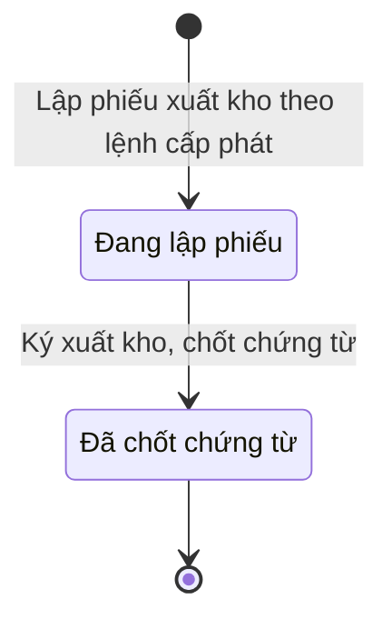

# qt-D11.uniform-stock-out · Cấp phát, thu hồi cho người, cho đợt — Phiếu xuất kho trang phục

<!-- máy sinh: tom-tat -->
> **Hồ sơ:** Phiếu xuất kho trang phục (`UniformStockOutSlip`)
>
> **Trong sổ phạm vi:** D11 · Cấp phát, thu hồi cho người, cho đợt — hồ sơ phụ uniform-stock-out (tầng 2)
>
> 2 bước · 2 chặng · 1 vai · 0 bảng quyết định · 0 hạn · 0 khớp nối.
>
> **Nguồn:** sổ nghiệp vụ `qt-D11.uniform-stock-out` · khai báo của app: `dqtv-app/core/processes/allocation/workflow/uniform-stock-out.yaml`. Các bảng do máy sinh từ nguồn này.
<!-- hết: tom-tat -->

<!-- viết tay: dien-giai -->
## Diễn giải

*Phần này viết tay, diễn giải lại điều các bảng bên dưới ghi.*

### Quy trình này để làm gì

Nhân viên quân khí kiêm thủ kho lập **phiếu xuất kho trang phục** làm chứng từ xuất kho cho một đợt cấp trang phục đã có lệnh cấp phát. Hồ sơ chỉ có hai chặng: *Đang lập phiếu* → *Đã chốt chứng từ*, và chỉ một người làm cả hai bước.

### Khi nào bắt đầu

Thủ kho bấm **Lập phiếu xuất kho theo lệnh cấp phát**. Phải nhập ngày xuất và `allocationId`; người nhận là ô nhập nếu có. Số phiếu tự sinh. Bước mở nối phiếu tới hồ sơ Trang phục, sao mũ, phù hiệu.

### Diễn ra thế nào

**Chặng "Đang lập phiếu"** — phiếu đã lập, chứng từ chờ chốt. Không có bước nào làm tại chặng này.

**Chuyển chặng:** thủ kho bấm **Ký xuất kho, chốt chứng từ** → *Đã chốt chứng từ*; bước ghi ô "xuất lúc" — thời điểm xuất.

### Kết thúc và để lại gì

Hồ sơ kết thúc ở chặng *Đã chốt chứng từ*. Phiếu giữ mối nối tới hồ sơ Trang phục, sao mũ, phù hiệu ghi từ lúc lập.

### Điều kiện chặn

- Bước ký xuất kho đòi người làm là người của đơn vị ghi ở ô đơn vị chủ hồ sơ (`actorInOwnerUnit`), phiếu phải đang ở *Đang lập phiếu*. Sai thì bước bị chặn, hồ sơ giữ nguyên.
- Bước mở không đòi điều kiện phải có trước nào.
<!-- hết viết tay -->

## 1. Đường đi ngắn nhất qua các chặng

<!-- máy sinh: luong-chinh -->
Đường ít bước nhất từ lúc mở hồ sơ tới chặng kết thúc xa nhất. Máy chọn theo số chặng, không theo ý nghĩa nghiệp vụ — trình tự công việc thật xem phần Diễn giải và bảng "Việc làm ở từng chặng" ở mục 6.

| # | Ai làm | Làm gì | Hồ sơ sang chặng |
|---|---|---|---|
| 1 | Nhân viên quân khí kiêm thủ kho | Lập phiếu xuất kho theo lệnh cấp phát | Đang lập phiếu |
| 2 | Nhân viên quân khí kiêm thủ kho | Ký xuất kho, chốt chứng từ | Đã chốt chứng từ |

<!-- hết: luong-chinh -->

## 2. Hồ sơ và việc nó để lại

<!-- máy sinh: muc-tieu -->
**App gọi quy trình này là:** Phiếu xuất kho trang phục.
<!-- hết: muc-tieu -->

## 3. Khởi phát và kết thúc

<!-- máy sinh: khoi-phat -->
**1 cửa vào** — bước mở hồ sơ:

| Bước mở | Ai mở | Hồ sơ vào chặng | App bắt buộc nhập |
|---|---|---|---|
| Lập phiếu xuất kho theo lệnh cấp phát | Nhân viên quân khí kiêm thủ kho | Đang lập phiếu | ngày xuất, `allocationId` |

**Kết thúc:** *Đã chốt chứng từ* (`CONFIRMED`)
<!-- hết: khoi-phat -->

## 4. Vai trò

<!-- máy sinh: vai-tro -->
| Vai trong sổ | Tên trong app | Điều kiện | Làm những bước |
|---|---|---|---|
| `keeper` | Nhân viên quân khí kiêm thủ kho |  | Lập phiếu xuất kho theo lệnh cấp phát · Ký xuất kho, chốt chứng từ |

*"Tên trong app" là tên app đặt cho mã chủ thể của vai. Hồ sơ thuộc đơn vị cấp khác thì người làm là người giữ vai ấy ở đơn vị nêu trong cột "Điều kiện" (nếu sổ có ghi) và ở cột "Người làm phải thuộc" của bảng "Theo khai báo của app" (mục 7).*
<!-- hết: vai-tro -->

## 5. Nhánh phụ

<!-- máy sinh: nhanh-phu -->
Không có bước nào ngoài luồng chính.
<!-- hết: nhanh-phu -->

## 6. Các chặng và việc làm ở từng chặng

<!-- máy sinh: chang -->
| Chặng | Tên hiển thị | Vào bằng bước | Kết thúc? |
|---|---|---|---|
| `DRAFT` | Đang lập phiếu | Lập phiếu xuất kho theo lệnh cấp phát |  |
| `CONFIRMED` | Đã chốt chứng từ | Ký xuất kho, chốt chứng từ | **kết thúc** |

### Việc làm ở từng chặng

Hồ sơ đang ở chặng nào thì làm được những bước nào.

| Hồ sơ đang ở chặng | Bước làm tại chặng (hồ sơ đứng yên) | Bước đưa hồ sơ sang chặng khác |
|---|---|---|
| **Đang lập phiếu** | — | Ký xuất kho, chốt chứng từ — Nhân viên quân khí kiêm thủ kho → *Đã chốt chứng từ* |
| **Đã chốt chứng từ** | — | — (kết thúc) |
<!-- hết: chang -->

## 7. Bảng bước

<!-- máy sinh: buoc -->
| # | Bước | Mã bước | Ai thực hiện | Từ chặng | Sang chặng | Phải có trước | Ghi lại |
|---|---|---|---|---|---|---|---|
| 1 | Lập phiếu xuất kho theo lệnh cấp phát | `openUniformStockOut` | Nhân viên quân khí kiêm thủ kho | — (mở hồ sơ) | `DRAFT` | — | nối tới Trang phục, sao mũ, phù hiệu, mã tỉnh, mã xã, số phiếu, ngày xuất, người nhận, đơn vị chủ hồ sơ |
| 2 | Ký xuất kho, chốt chứng từ | `confirmUniformStockOut` | Nhân viên quân khí kiêm thủ kho | `DRAFT` | `CONFIRMED` | người làm thuộc đơn vị chủ hồ sơ, `stockIssuedInAllocation` | xuất lúc |

### Khi không đạt điều kiện

Mặc định: không đúng người, hồ sơ không ở đúng chặng, hoặc thiếu thứ "phải có trước" thì bước bị chặn, hồ sơ giữ nguyên. Bảng dưới chỉ kê những bước có kết quả riêng.

Không bước nào có kết quả riêng — tất cả theo mặc định.

### Điều kiện "phải có trước" bằng lời

Cột "Phải có trước" ở bảng bước có hai loại: ô dữ liệu thường (bước chỉ đòi ô ấy đã có giá trị) và điều kiện hệ tự xét. Bảng này diễn các điều kiện hệ tự xét theo đúng công thức sổ ghi; số ở cột cuối là số thứ tự bước.

| Điều kiện | Đúng khi | Bước đòi |
|---|---|---|
| `actorInOwnerUnit` | người đang làm là người của đơn vị ghi ở ô đơn vị chủ hồ sơ của hồ sơ này (theo danh mục người của đơn vị, `dm.unit-staff`) | 2 |
| `stockIssuedInAllocation` | có hồ sơ Cấp phát, thu hồi cho người, cho đợt (qt-D11) có ô nối `memberUniformIn` trùng với ô nối `stockOutForAllocation` của hồ sơ đang làm mà hồ sơ ấy đang ở chặng `issued` hoặc `replaced` VÀ đã có `stockItemName` | 2 |

### Theo khai báo của app

Người làm phải thuộc đơn vị nào, ô người dùng phải nhập, bước có lặp được không, và căn cứ pháp lý — lấy từ khai báo quy trình trong app.

| # | Bước | Người làm phải thuộc | Bắt buộc nhập | Nhập nếu có | Lặp được | Căn cứ |
|---|---|---|---|---|---|---|
| 1 | Lập phiếu xuất kho theo lệnh cấp phát |  | ngày xuất, `allocationId` | người nhận |  | QĐ1126/QĐ-TM Đ.12; TT04/2015/TT-BQP Đ.5 k5 b |
| 2 | Ký xuất kho, chốt chứng từ |  | — | — |  | QĐ1126/QĐ-TM Đ.12; TT04/2015/TT-BQP Đ.5 k5 b |
<!-- hết: buoc -->

## 8. Bảng quyết định, hạn, việc ngoài hệ

<!-- máy sinh: quyet-dinh -->

<!-- hết: quyet-dinh -->

## 9. Dữ liệu của hồ sơ

<!-- máy sinh: du-lieu -->
Các ô mà bước trong sổ ghi hoặc đòi. Số trong hai cột cuối là số thứ tự bước ở bảng bước (mục 7).

| Ô dữ liệu | Mã | Kiểu (app) | Giá trị cho phép | Loại ô (sổ) | Bước ghi | Bước đòi | Mô tả trong app |
|---|---|---|---|---|---|---|---|
| mã tỉnh | `provinceCode` | chữ |  | lưu trên hồ sơ (`stored`) | 1 | — | Mã tỉnh — lọc phạm vi theo hàng |
| mã xã | `communeCode` | chữ |  | lưu trên hồ sơ (`stored`) | 1 | — | Mã xã |
| số phiếu | `slipNumber` | chữ |  | lưu trên hồ sơ (`stored`) | 1 | — | Số phiếu xuất, tự sinh (vd XKTP-2026-0003) |
| ngày xuất | `issueDate` | ngày |  | đưa vào ở bước (`input`) | 1 | — | Ngày xuất kho |
| người nhận | `recipient` | chữ |  | đưa vào ở bước (`input`) | 1 | — | Người nhận (đơn vị/cá nhân nhận hàng) |
| đơn vị chủ hồ sơ | `ownerUnit` |  |  | lưu trên hồ sơ (`stored`) | 1 | — |  |
| xuất lúc | `signedOffAt` | ngày giờ |  | lưu trên hồ sơ (`stored`) | 2 | — | Thời điểm xuất, trừ tồn |
| người làm thuộc đơn vị chủ hồ sơ | `actorInOwnerUnit` |  | có hay chưa | hệ suy ra (`derived`) | — | 2 |  |
| — | `stockIssuedInAllocation` |  | có hay chưa | hệ suy ra (`derived`) | — | 2 |  |

9 ô. Cột "Loại ô" là cách sổ phân loại ô, in kèm đúng chữ của sổ; ô nào người dùng phải nhập xem bảng "Theo khai báo của app" ở mục 7.
<!-- hết: du-lieu -->

## 10. Khớp nối với quy trình khác

<!-- máy sinh: khop-noi -->

**Ô nối giữa các hồ sơ cùng mã quy trình, hoặc tới danh mục nền:** `stockOutForAllocation` (Phiếu xuất kho trang phục → Trang phục, sao mũ, phù hiệu) — bước Lập phiếu xuất kho theo lệnh cấp phát.
<!-- hết: khop-noi -->

## 11. Thông tin chung

<!-- máy sinh: thong-tin -->
| | |
|---|---|
| **Mã trong sổ** | `qt-D11.uniform-stock-out` |
| **Quy trình trong app** | `allocation` (`workflow/uniform-stock-out.yaml`) — mặt công tác: `logistics-technical` |
| **Hồ sơ** | Phiếu xuất kho trang phục (`UniformStockOutSlip`) |
| **Cùng mã quy trình** | [qt-D11](qt-D11.html), [qt-D11.training-allocation](qt-D11.training-allocation.html), [qt-D11.uniform](qt-D11.uniform.html) |
| **Căn cứ pháp lý từng bước** | cột "Căn cứ" ở bảng "Theo khai báo của app", mục 7 |
<!-- hết: thong-tin -->
