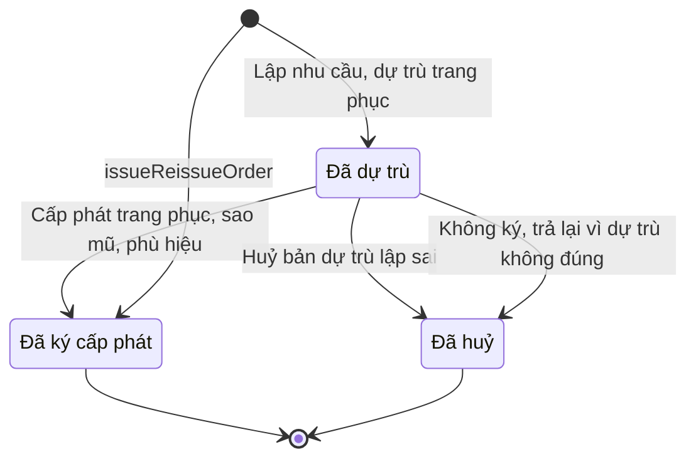

# qt-D11.uniform · Cấp phát, thu hồi cho người, cho đợt — Trang phục, sao mũ, phù hiệu

<!-- máy sinh: tom-tat -->
> **Hồ sơ:** Trang phục, sao mũ, phù hiệu (`UniformAllocation`)
>
> **Trong sổ phạm vi:** D11 · Cấp phát, thu hồi cho người, cho đợt — hồ sơ phụ uniform (tầng 2)
>
> 5 bước · 3 chặng · 2 vai · 0 bảng quyết định · 0 hạn · 3 khớp nối.
>
> **Nguồn:** sổ nghiệp vụ `qt-D11.uniform` · khai báo của app: `dqtv-app/core/processes/allocation/workflow/uniform.yaml`. Các bảng do máy sinh từ nguồn này.
<!-- hết: tom-tat -->

<!-- viết tay: dien-giai -->
## Diễn giải

*Phần này viết tay, diễn giải lại điều các bảng bên dưới ghi.*

### Quy trình này để làm gì

Xã lập và ký một **đợt cấp trang phục, sao mũ, phù hiệu** cho một đơn vị dân quân tự vệ: một loại trang phục, một nhóm đối tượng cấp, bao nhiêu suất. Nhân viên quân khí kiêm thủ kho lập bản dự trù; Chỉ huy trưởng Ban CHQS xã ký cấp phát. Việc cấp đổi, thu hồi làm ở từng cá nhân (`MemberUniform`).

Hồ sơ có ba chặng: *Đã dự trù*, rồi kết thúc ở *Đã ký cấp phát* hoặc *Đã huỷ*.

### Khi nào bắt đầu

Thủ kho bấm **Lập nhu cầu, dự trù trang phục**. Phải nhập loại trang phục, đối tượng cấp, số lượng, `unitId` và ngày dự trù. Hồ sơ mở ra có nối tới Đơn vị dân quân tự vệ (quy trình 29) và vào thẳng chặng *Đã dự trù*.

### Diễn ra thế nào

**Chặng "Đã dự trù"** — bản dự trù chờ cấp phát. Có ba lối ra, mỗi lối khép hồ sơ:

- **Cấp phát trang phục, sao mũ, phù hiệu** (Chỉ huy trưởng) → *Đã ký cấp phát*. Phải nhập ngày cấp phát; bước còn ghi chu kỳ niên hạn (tháng), chốt tại ngày cấp phát. Đây là một quyết định trong hệ, kết quả: đồng ý.
- **Không ký, trả lại vì dự trù không đúng** (Chỉ huy trưởng) → *Đã huỷ*. Đây là một quyết định trong hệ, kết quả: từ chối, phải ghi ô "bản dự trù sai ở đâu".
- **Huỷ bản dự trù lập sai** (thủ kho) → *Đã huỷ*. Phải nhập vì sao huỷ.

Ở chặng *Đã huỷ*, bản dự trù sai đã huỷ; cần thì lập bản mới.

### Kết thúc và để lại gì

Hồ sơ kết thúc ở *Đã ký cấp phát* hoặc *Đã huỷ*. Sau khi ký thì đợt được phát và theo dõi tiến độ phát từng người. Đề nghị cấp kinh phí (4.funding-request) ghi nó phát sinh từ đợt cấp trang phục nào; đợt cấp lại sau một Sự cố trang phục (D13) là một đợt riêng, bộ mới thuộc đợt ấy, không dồn vào đợt gốc.

### Điều kiện chặn

- Ba bước sau bước mở: người làm phải là người của đơn vị ghi ở ô đơn vị chủ hồ sơ (`actorInOwnerUnit`), hồ sơ phải đang ở *Đã dự trù*. Sai thì bước bị chặn, hồ sơ giữ nguyên.
- Chỉ huy trưởng không ký thì phải ghi bản dự trù sai ở đâu; thủ kho huỷ thì phải ghi vì sao huỷ.
<!-- hết viết tay -->

## 1. Đường đi ngắn nhất qua các chặng

<!-- máy sinh: luong-chinh -->
Đường ít bước nhất từ lúc mở hồ sơ tới chặng kết thúc xa nhất. Máy chọn theo số chặng, không theo ý nghĩa nghiệp vụ — trình tự công việc thật xem phần Diễn giải và bảng "Việc làm ở từng chặng" ở mục 6.

| # | Ai làm | Làm gì | Hồ sơ sang chặng |
|---|---|---|---|
| 1 | Nhân viên quân khí kiêm thủ kho | Lập nhu cầu, dự trù trang phục | Đã dự trù |
| 2 | Nhân viên quân khí kiêm thủ kho | Huỷ bản dự trù lập sai | Đã huỷ |

<!-- hết: luong-chinh -->

## 2. Hồ sơ và việc nó để lại

<!-- máy sinh: muc-tieu -->
**App gọi quy trình này là:** Chặng C3 — Trang phục, sao mũ, phù hiệu.

**Khi mở, hồ sơ này ghi mối nối tới:**
- Đơn vị dân quân tự vệ (29) — bước `issueReissueOrder`, khớp nối `allocatedToUnit`
- Đơn vị dân quân tự vệ (29) — bước `requisitionUniform`, khớp nối `allocatedToUnit`

**Hồ sơ này để lại cho quy trình khác** (bước tạo hồ sơ của quy trình kia ghi mối nối về đây):
- Đề nghị cấp kinh phí (4.funding-request) — bước `estimateCommuneFundingRequest`, khớp nối `fundingRequestFromUniform`
- Đề nghị cấp kinh phí (4.funding-request) — bước `estimateProvinceFundingRequest`, khớp nối `fundingRequestFromUniform`
<!-- hết: muc-tieu -->

## 3. Khởi phát và kết thúc

<!-- máy sinh: khoi-phat -->
**2 cửa vào** — bước mở hồ sơ:

| Bước mở | Ai mở | Hồ sơ vào chặng | App bắt buộc nhập |
|---|---|---|---|
| Lập nhu cầu, dự trù trang phục | Nhân viên quân khí kiêm thủ kho | Đã dự trù | loại trang phục, đối tượng cấp, số lượng, `unitId`, ngày dự trù |
| `issueReissueOrder` | Chỉ huy trưởng Ban CHQS xã | Đã ký cấp phát | — |

**Kết thúc:** *Đã ký cấp phát* (`issued`), *Đã huỷ* (`cancelled`)
<!-- hết: khoi-phat -->

## 4. Vai trò

<!-- máy sinh: vai-tro -->
| Vai trong sổ | Tên trong app | Điều kiện | Làm những bước |
|---|---|---|---|
| `quartermaster` | Nhân viên quân khí kiêm thủ kho |  | Lập nhu cầu, dự trù trang phục · Huỷ bản dự trù lập sai |
| `commander` | Chỉ huy trưởng Ban CHQS xã |  | Cấp phát trang phục, sao mũ, phù hiệu · Không ký, trả lại vì dự trù không đúng · `issueReissueOrder` |

*"Tên trong app" là tên app đặt cho mã chủ thể của vai. Hồ sơ thuộc đơn vị cấp khác thì người làm là người giữ vai ấy ở đơn vị nêu trong cột "Điều kiện" (nếu sổ có ghi) và ở cột "Người làm phải thuộc" của bảng "Theo khai báo của app" (mục 7).*
<!-- hết: vai-tro -->

## 5. Nhánh phụ

<!-- máy sinh: nhanh-phu -->
**Bước khác đưa hồ sơ sang chặng mới** — đường song song, rẽ nhánh hoặc kết thúc sớm:

| Bước | Ai làm | Từ chặng | Sang chặng |
|---|---|---|---|
| Cấp phát trang phục, sao mũ, phù hiệu | Chỉ huy trưởng Ban CHQS xã | Đã dự trù | Đã ký cấp phát |
| Không ký, trả lại vì dự trù không đúng | Chỉ huy trưởng Ban CHQS xã | Đã dự trù | Đã huỷ |

**Cửa vào khác:** 2 bước cùng mở hồ sơ — xem mục 3.

<!-- hết: nhanh-phu -->

## 6. Các chặng và việc làm ở từng chặng

<!-- máy sinh: chang -->
| Chặng | Tên hiển thị | Vào bằng bước | Kết thúc? |
|---|---|---|---|
| `requisitioned` | Đã dự trù | Lập nhu cầu, dự trù trang phục |  |
| `issued` | Đã ký cấp phát | Cấp phát trang phục, sao mũ, phù hiệu · `issueReissueOrder` | **kết thúc** |
| `cancelled` | Đã huỷ | Huỷ bản dự trù lập sai · Không ký, trả lại vì dự trù không đúng | **kết thúc** |

### Việc làm ở từng chặng

Hồ sơ đang ở chặng nào thì làm được những bước nào.

| Hồ sơ đang ở chặng | Bước làm tại chặng (hồ sơ đứng yên) | Bước đưa hồ sơ sang chặng khác |
|---|---|---|
| **Đã dự trù** | — | Cấp phát trang phục, sao mũ, phù hiệu — Chỉ huy trưởng Ban CHQS xã → *Đã ký cấp phát* Huỷ bản dự trù lập sai — Nhân viên quân khí kiêm thủ kho → *Đã huỷ* Không ký, trả lại vì dự trù không đúng — Chỉ huy trưởng Ban CHQS xã → *Đã huỷ* |
| **Đã ký cấp phát** | — | — (kết thúc) |
| **Đã huỷ** | — | — (kết thúc) |
<!-- hết: chang -->

## 7. Bảng bước

<!-- máy sinh: buoc -->
| # | Bước | Mã bước | Ai thực hiện | Từ chặng | Sang chặng | Phải có trước | Ghi lại |
|---|---|---|---|---|---|---|---|
| 1 | Lập nhu cầu, dự trù trang phục | `requisitionUniform` | Nhân viên quân khí kiêm thủ kho | — (mở hồ sơ) | `requisitioned` | — | nối tới Đơn vị dân quân tự vệ, mã tỉnh, mã xã, loại trang phục, đối tượng cấp, số lượng, ngày dự trù, đơn vị chủ hồ sơ, `id` |
| 2 | Cấp phát trang phục, sao mũ, phù hiệu | `issueUniform` | Chỉ huy trưởng Ban CHQS xã | `requisitioned` | `issued` | người làm thuộc đơn vị chủ hồ sơ | ngày cấp phát, chu kỳ niên hạn (tháng) |
| 3 | Huỷ bản dự trù lập sai | `cancelRequisition` | Nhân viên quân khí kiêm thủ kho | `requisitioned` | `cancelled` | người làm thuộc đơn vị chủ hồ sơ | — |
| 4 | Không ký, trả lại vì dự trù không đúng | `rejectRequisition` | Chỉ huy trưởng Ban CHQS xã | `requisitioned` | `cancelled` | người làm thuộc đơn vị chủ hồ sơ | — |
| 5 | `issueReissueOrder` | `issueReissueOrder` | Chỉ huy trưởng Ban CHQS xã | — (mở hồ sơ) | `issued` | người làm thuộc đơn vị chủ hồ sơ | nối tới Đơn vị dân quân tự vệ, mã tỉnh, mã xã, loại trang phục, đối tượng cấp, số lượng, ngày dự trù, ngày cấp phát, `id`, đơn vị chủ hồ sơ |

### Khi không đạt điều kiện

Mặc định: không đúng người, hồ sơ không ở đúng chặng, hoặc thiếu thứ "phải có trước" thì bước bị chặn, hồ sơ giữ nguyên. Bảng dưới chỉ kê những bước có kết quả riêng.

Không bước nào có kết quả riêng — tất cả theo mặc định.

### Điều kiện "phải có trước" bằng lời

Cột "Phải có trước" ở bảng bước có hai loại: ô dữ liệu thường (bước chỉ đòi ô ấy đã có giá trị) và điều kiện hệ tự xét. Bảng này diễn các điều kiện hệ tự xét theo đúng công thức sổ ghi; số ở cột cuối là số thứ tự bước.

| Điều kiện | Đúng khi | Bước đòi |
|---|---|---|
| `actorInOwnerUnit` | người đang làm là người của đơn vị ghi ở ô đơn vị chủ hồ sơ của hồ sơ này (theo danh mục người của đơn vị, `dm.unit-staff`) | 2, 3, 4, 5 |

### Theo khai báo của app

Người làm phải thuộc đơn vị nào, ô người dùng phải nhập, bước có lặp được không, và căn cứ pháp lý — lấy từ khai báo quy trình trong app.

| # | Bước | Người làm phải thuộc | Bắt buộc nhập | Nhập nếu có | Lặp được | Căn cứ |
|---|---|---|---|---|---|---|
| 1 | Lập nhu cầu, dự trù trang phục |  | loại trang phục, đối tượng cấp, số lượng, `unitId`, ngày dự trù | — |  | L48/2019/QH14 Đ.24; NĐ72/2020/NĐ-CP Đ.6 |
| 2 | Cấp phát trang phục, sao mũ, phù hiệu |  | ngày cấp phát | — |  | L48/2019/QH14 Đ.24; NĐ72/2020/NĐ-CP Đ.6, Phụ lục II |
| 3 | Huỷ bản dự trù lập sai |  | vì sao huỷ bản dự trù | — |  | L48/2019/QH14 Đ.24; NĐ72/2020/NĐ-CP Đ.6 |
| 4 | Không ký, trả lại vì dự trù không đúng |  | bản dự trù sai ở đâu | — |  | L48/2019/QH14 Đ.24; NĐ72/2020/NĐ-CP Đ.6, Phụ lục II |

### Điều kiện và ghi chú app khai cho từng bước

Lấy từ khai báo quy trình trong app. Lời trong ngoặc kép là câu app hiện cho người dùng. Chức danh người ký ngoài hệ app chỉ khai bằng mã.

| # | Bước | Điều kiện, ghi chú |
|---|---|---|
| 2 | Cấp phát trang phục, sao mũ, phù hiệu | · bước này là một quyết định trong hệ, kết quả: đồng ý |
| 4 | Không ký, trả lại vì dự trù không đúng | · bước này là một quyết định trong hệ, kết quả: từ chối, phải ghi ô "bản dự trù sai ở đâu" |
<!-- hết: buoc -->

## 8. Bảng quyết định, hạn, việc ngoài hệ

<!-- máy sinh: quyet-dinh -->

<!-- hết: quyet-dinh -->

## 9. Dữ liệu của hồ sơ

<!-- máy sinh: du-lieu -->
Các ô mà bước trong sổ ghi hoặc đòi. Số trong hai cột cuối là số thứ tự bước ở bảng bước (mục 7).

| Ô dữ liệu | Mã | Kiểu (app) | Giá trị cho phép | Loại ô (sổ) | Bước ghi | Bước đòi | Mô tả trong app |
|---|---|---|---|---|---|---|---|
| mã tỉnh | `provinceCode` | chữ |  | lưu trên hồ sơ (`stored`) | 1, 5 | — | Mã tỉnh — dùng lọc phạm vi theo hàng |
| mã xã | `communeCode` | chữ |  | lưu trên hồ sơ (`stored`) | 1, 5 | — | Mã xã |
| loại trang phục | `uniformType` | chọn một | Quân phục (`field_uniform`), Mũ (`hard_hat`), Sao mũ (`cap_badge`), Phù hiệu (`insignia`), Giày dép (`footwear`), Phụ kiện (`other`) | đưa vào ở bước (`input`) | 1, 5 | — | Loại lớn của đợt — mọi mặt hàng cấp trong đợt phải thuộc loại này (NĐ72/2020 Phụ lục II) |
| đối tượng cấp | `targetCategory` | chọn một | Chỉ huy: CHT/Phó CHT xã, chỉ huy cơ động (NĐ72 PLII k.1) (`command_mobile`), Chỉ huy dân quân thường trực (NĐ72 PLII k.2) (`command_standing`), CTV, thôn đội trưởng, chỉ huy khác (NĐ72 PLII k.3) (`command_local`), Chiến sĩ cơ động, biển (NĐ72 PLII k.4) (`soldier_mobile`), Chiến sĩ thường trực (NĐ72 PLII k.5) (`soldier_standing`), Chiến sĩ tại chỗ, binh chủng (NĐ72 PLII k.6) (`soldier_local`) | đưa vào ở bước (`input`) | 1, 5 | — | Đối tượng cấp — theo thành phần DQTV (NĐ72/2020 Đ.6) |
| số lượng | `quantity` | số |  | đưa vào ở bước (`input`) | 1, 5 | — | Số suất (người) của đợt |
| ngày dự trù | `requisitionDate` | ngày |  | đưa vào ở bước (`input`) | 1, 5 | — | Ngày lập dự trù |
| đơn vị chủ hồ sơ | `ownerUnit` |  |  | lưu trên hồ sơ (`stored`) | 1, 5 | — |  |
| — | `id` |  |  | lưu trên hồ sơ (`stored`) | 1, 5 | — |  |
| ngày cấp phát | `issueDate` | ngày |  | đưa vào ở bước (`input`) | 2, 5 | — | Ngày cấp phát — mốc tính niên hạn |
| chu kỳ niên hạn (tháng) | `serviceLifeMonths` | số |  | lưu trên hồ sơ (`stored`) | 2 | — | Chu kỳ niên hạn (tháng) chốt tại issueDate — NĐ72/2020 Phụ lục II. Cộng với issueDate để tính năm đến hạn cấp lại; dùng cho dự toán ngân sách E27 |
| người làm thuộc đơn vị chủ hồ sơ | `actorInOwnerUnit` |  | có hay chưa | hệ suy ra (`derived`) | — | 2, 3, 4, 5 |  |

11 ô. Cột "Loại ô" là cách sổ phân loại ô, in kèm đúng chữ của sổ; ô nào người dùng phải nhập xem bảng "Theo khai báo của app" ở mục 7.
<!-- hết: du-lieu -->

## 10. Khớp nối với quy trình khác

<!-- máy sinh: khop-noi -->
| Quy trình kia | Hồ sơ kia | Quan hệ | Nội dung (mô tả trong app) | Bước ghi mối nối | Tên ô nối |
|---|---|---|---|---|---|
| 29 | Đơn vị dân quân tự vệ | hồ sơ này **mở ra có nối tới** hồ sơ kia | Đơn vị nhận đợt trang phục — E09 (L48/2019 Đ.24) | D11.uniform·issueReissueOrder ⊕, D11.uniform·requisitionUniform ⊕ | `allocatedToUnit` |
| 4.funding-request | Đề nghị cấp kinh phí | hồ sơ kia **mở ra từ** hồ sơ này | Đề nghị cấp kinh phí phát sinh từ đợt cấp trang phục nào — E27 US-16, US-18 | 4.funding-request·estimateCommuneFundingRequest ⊕, 4.funding-request·estimateProvinceFundingRequest ⊕ | `fundingRequestFromUniform` |
| D13 | Sự cố trang phục | gắn với nhau ở một bước giữa chừng | Đợt CẤP LẠI (lệnh xuất) tự sinh khi CHT cho cấp lại — bộ mới thuộc đợt này, không dồn vào đợt gốc (review §5.… | D13·resolveReissue | `incidentReissueOrder` |

3 khớp nối. ⊕ là bước tạo hồ sơ.
<!-- hết: khop-noi -->

## 11. Thông tin chung

<!-- máy sinh: thong-tin -->
| | |
|---|---|
| **Mã trong sổ** | `qt-D11.uniform` |
| **Quy trình trong app** | `allocation` (`workflow/uniform.yaml`) — mặt công tác: `logistics-technical` |
| **Hồ sơ** | Trang phục, sao mũ, phù hiệu (`UniformAllocation`) |
| **Cùng mã quy trình** | [qt-D11](qt-D11.html), [qt-D11.training-allocation](qt-D11.training-allocation.html), [qt-D11.uniform-stock-out](qt-D11.uniform-stock-out.html) |
| **Căn cứ pháp lý từng bước** | cột "Căn cứ" ở bảng "Theo khai báo của app", mục 7 |
<!-- hết: thong-tin -->
