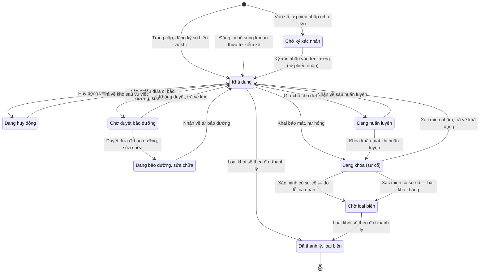

# qt-D12 · Bảo dưỡng, sửa chữa

<!-- máy sinh: tom-tat -->
> **Hồ sơ:** Trang bị, phương tiện (`Equipment`)
>
> **Trong sổ phạm vi:** D12 · Bảo dưỡng, sửa chữa (tầng 2)
>
> 23 bước · 9 chặng · 4 vai · 1 bảng quyết định · 0 hạn · 17 khớp nối.
>
> **Nguồn:** sổ nghiệp vụ `qt-D12` · khai báo của app: `dqtv-app/core/processes/equipment/workflow/equipment.yaml`. Các bảng do máy sinh từ nguồn này.
<!-- hết: tom-tat -->

<!-- viết tay: dien-giai -->
## Diễn giải

*Phần này viết tay, diễn giải lại điều các bảng bên dưới ghi.*

### Quy trình này để làm gì

Mỗi hồ sơ là một khoản **trang bị, phương tiện** của đơn vị (xuồng, phao, máy phát, phương tiện, vũ khí, đạn dược…). Quy trình theo dõi khoản ấy đang ở đâu trong vòng đời: sẵn sàng dùng, đang ở một vụ việc, đang cấp cho huấn luyện, đang bảo dưỡng, đang khoá vì sự cố, hay đã loại biên. Các chặng này là nền cho hàm tính sẵn sàng.

Có tám chặng, xoay quanh chặng *Khả dụng*: từ đó khoản trang bị rẽ sang *Đang huy động*, *Đang huấn luyện*, *Chờ duyệt bảo dưỡng* → *Đang bảo dưỡng, sửa chữa*, hoặc *Đang khóa (sự cố)*, rồi quay về *Khả dụng*. Chỉ có một chặng kết thúc: *Đã thanh lý, loại biên*. Chặng *Chờ ký xác nhận* là cửa vào riêng của trang bị nhập từ phiếu nhập kho.

### Khi nào bắt đầu

Có hai cửa vào, đều do Trợ lý Quân lực mở:

- **Trang cấp, đăng ký số hiệu vũ khí** — hồ sơ vào thẳng *Khả dụng*. Bắt buộc nhập tên, loại, số lượng, `unitId`, số QĐ trang cấp và cấp trang cấp; số hiệu vũ khí, số lô, tình trạng kỹ thuật, bản quét quyết định trang cấp là ô nhập nếu có.
- **Vào sổ từ phiếu nhập (chờ ký)** — hồ sơ vào *Chờ ký xác nhận*, lúc này khoản trang bị còn đứng ngoài số khả dụng. Bắt buộc nhập tên, loại, số lượng, `unitId`. Bản ghi này sinh ra từ một dòng phiếu nhập kho (quy trình D10) khi trợ lý vào sổ.

Bước Trang cấp ghi mối nối tới Đơn vị dân quân tự vệ đang giữ trang bị (quy trình 29).

### Diễn ra thế nào

**Chặng "Chờ ký xác nhận"** — Chỉ huy trưởng bấm **Ký xác nhận vào lực lượng (từ phiếu nhập)** → *Khả dụng*.

**Chặng "Khả dụng"** — Trợ lý Quân lực có thể **Đăng ký, lập sổ số hiệu vũ khí** (lặp được, hồ sơ đứng yên): ghi số đăng ký và ngày đăng ký. Từ chặng này có bốn lối rẽ:

1. **Bảo dưỡng.** Thủ kho **Lập phiếu đưa đi bảo dưỡng, sửa chữa** (phải ghi lý do) → *Chờ duyệt bảo dưỡng*. Chỉ huy trưởng **Duyệt đưa đi bảo dưỡng, sửa chữa** → *Đang bảo dưỡng, sửa chữa*, hoặc **Không duyệt, trả về kho** → *Khả dụng* (phải ghi vì sao không duyệt). Hai bước này là quyết định trong hệ. Thủ kho **Nhận về từ bảo dưỡng** → *Khả dụng*, phải nhập tình trạng kỹ thuật; bước tạo thêm một hồ sơ con Lần đổi tình trạng kỹ thuật.
2. **Vụ việc.** Chỉ huy trưởng **Huy động vào vụ việc** → *Đang huy động*; rồi **Trả về kho sau vụ việc** → *Khả dụng*.
3. **Huấn luyện.** Thủ kho **Giữ chỗ cho đợt huấn luyện** → *Đang huấn luyện*; rồi **Nhận về sau huấn luyện** → *Khả dụng*.
4. **Sự cố.** Thủ kho **Khai báo mất, hư hỏng** → *Đang khóa (sự cố)*; bắt buộc nhập `incidentType`, `discoveredAt`, `circumstances`, số lượng; `involvedPerson` nhập nếu có. Bước này tạo một hồ sơ Sự cố mất, hư hỏng (quy trình D13).

**Chặng "Đang khóa (sự cố)"** — khoản trang bị bị khoá chờ xác minh. Chỉ huy trưởng kết luận một trong ba nhánh, đều phải ghi kết luận xác minh:

- **Xác minh có sự cố — do lỗi cá nhân** → *Đã thanh lý, loại biên*; bước ghi ngày thanh lý, ô nối `incidentDisciplineCase` và ô `compensationAmount`.
- **Xác minh có sự cố — bất khả kháng** → *Đã thanh lý, loại biên*; bước ghi ngày thanh lý và ô nối `replacementRequest`.
- **Xác minh nhầm, trả về khả dụng** → *Khả dụng*; bước ghi tình trạng kỹ thuật.

Cũng ở chặng này, thủ kho làm bước `reportEquipmentLossToProvince`, hồ sơ đứng yên, ghi `lossReportedAt` và ô nối `lossReportDocument`.

### Kết thúc và để lại gì

Hồ sơ kết thúc ở *Đã thanh lý, loại biên*, tới chặng ấy qua hai nhánh xác minh có sự cố. Khoản trang bị nối với: **Đơn vị dân quân tự vệ** (29) đang giữ nó, ghi ở bước Trang cấp và bước Khai báo mất, hư hỏng; **Sự cố mất, hư hỏng** (D13); **Dòng phiếu nhập kho** (D10) sinh ra bản ghi trang bị; **Dòng trang bị cấp phát** cho huấn luyện (D11); **Dòng đếm kiểm kê** (15); **Khoản trong đợt thu hồi** (D14).

### Điều kiện chặn

- Mọi bước trừ hai bước mở: người làm phải thuộc đơn vị chủ hồ sơ. Sai người, sai chặng thì bước bị chặn, hồ sơ giữ nguyên.
- Mỗi lối rẽ chỉ đi được từ *Khả dụng*; khai báo sự cố cũng vậy.
- Đưa đi bảo dưỡng phải ghi lý do; không duyệt phải ghi vì sao; ba nhánh xác minh sự cố đều phải ghi kết luận xác minh.
<!-- hết viết tay -->

## 1. Đường đi ngắn nhất qua các chặng

<!-- máy sinh: luong-chinh -->
Đường ít bước nhất từ lúc mở hồ sơ tới chặng kết thúc xa nhất. Máy chọn theo số chặng, không theo ý nghĩa nghiệp vụ — trình tự công việc thật xem phần Diễn giải và bảng "Việc làm ở từng chặng" ở mục 6.

| # | Ai làm | Làm gì | Hồ sơ sang chặng |
|---|---|---|---|
| 1 | Trợ lý Quân lực | Trang cấp, đăng ký số hiệu vũ khí | Khả dụng |
| 2 | Chỉ huy trưởng Ban CHQS xã | Loại khỏi sổ theo đợt thanh lý | Đã thanh lý, loại biên |

<!-- hết: luong-chinh -->

## 2. Hồ sơ và việc nó để lại

<!-- máy sinh: muc-tieu -->
**App gọi quy trình này là:** Chặng 5 — Trang bị, phương tiện.

**Khi mở, hồ sơ này ghi mối nối tới:**
- Dòng đếm kiểm kê (15.count-line) — bước `registerFromInventory`, khớp nối `followsCountLine`
- Đơn vị dân quân tự vệ (29) — bước `registerEquipment`, khớp nối `heldByUnit`
- Đơn vị dân quân tự vệ (29) — bước `registerFromInventory`, khớp nối `heldByUnit`

**Hồ sơ này để lại cho quy trình khác** (bước tạo hồ sơ của quy trình kia ghi mối nối về đây):
- Dòng đếm kiểm kê (15.count-line) — bước `recordCountLine`, khớp nối `countOfEquipment`
- Vụ việc kỷ luật (D15) — bước `openDisciplineFromSource`, khớp nối `disciplineFromEquipment`
- Đề nghị cấp kinh phí (4.funding-request) — bước `estimateCommuneFundingRequest`, khớp nối `fundingRequestFromEquipment`
- Đề nghị cấp kinh phí (4.funding-request) — bước `estimateProvinceFundingRequest`, khớp nối `fundingRequestFromEquipment`
<!-- hết: muc-tieu -->

## 3. Khởi phát và kết thúc

<!-- máy sinh: khoi-phat -->
**3 cửa vào** — bước mở hồ sơ:

| Bước mở | Ai mở | Hồ sơ vào chặng | App bắt buộc nhập |
|---|---|---|---|
| Trang cấp, đăng ký số hiệu vũ khí | Trợ lý Quân lực | Khả dụng | tên, loại, loại, số lượng, số QĐ trang cấp, cấp trang cấp |
| Đăng ký bổ sung khoản thừa từ kiểm kê | Nhân viên quân khí kiêm thủ kho | Khả dụng | `followsCountLine`, tên, loại, loại, số lượng |
| Vào sổ từ phiếu nhập (chờ ký) | Trợ lý Quân lực | Chờ ký xác nhận | tên, loại, loại, số lượng |

**Kết thúc:** *Đã thanh lý, loại biên* (`retired`)
<!-- hết: khoi-phat -->

## 4. Vai trò

<!-- máy sinh: vai-tro -->
| Vai trong sổ | Tên trong app | Điều kiện | Làm những bước |
|---|---|---|---|
| `registrar` | Trợ lý Quân lực |  | Trang cấp, đăng ký số hiệu vũ khí · Đăng ký, lập sổ số hiệu vũ khí · Vào sổ từ phiếu nhập (chờ ký) |
| `quartermaster` | Nhân viên quân khí kiêm thủ kho |  | Lập phiếu đưa đi bảo dưỡng, sửa chữa · Nhận về từ bảo dưỡng · Khai báo mất, hư hỏng · Trình ký văn bản báo tỉnh việc mất vũ khí, đạn, vật liệu nổ · Đề nghị xử lý kỷ luật người làm mất, hỏng · Đăng ký bổ sung khoản thừa từ kiểm kê · Giữ chỗ cho đợt huấn luyện · Khóa khẩu mất khi huấn luyện · Nhận về sau huấn luyện |
| `commander` | Chỉ huy trưởng Ban CHQS xã |  | Duyệt đưa đi bảo dưỡng, sửa chữa · Không duyệt, trả về kho · Xác minh có sự cố — do lỗi cá nhân · Xác minh có sự cố — bất khả kháng · Xác minh nhầm, trả về khả dụng · Ký xác nhận vào lực lượng (từ phiếu nhập) · Huy động vào vụ việc · Trả về kho sau vụ việc · Loại khỏi sổ theo đợt thanh lý |
| `system` | Hệ thống tự làm |  | Báo tỉnh việc mất vũ khí, đạn, vật liệu nổ · Giao trang bị về đơn vị nhận theo quyết định giải thể |

*"Tên trong app" là tên app đặt cho mã chủ thể của vai. Hồ sơ thuộc đơn vị cấp khác thì người làm là người giữ vai ấy ở đơn vị nêu trong cột "Điều kiện" (nếu sổ có ghi) và ở cột "Người làm phải thuộc" của bảng "Theo khai báo của app" (mục 7).*
<!-- hết: vai-tro -->

## 5. Nhánh phụ

<!-- máy sinh: nhanh-phu -->
**Bước khác đưa hồ sơ sang chặng mới** — đường song song, rẽ nhánh hoặc kết thúc sớm:

| Bước | Ai làm | Từ chặng | Sang chặng |
|---|---|---|---|
| Lập phiếu đưa đi bảo dưỡng, sửa chữa | Nhân viên quân khí kiêm thủ kho | Khả dụng | Chờ duyệt bảo dưỡng |
| Duyệt đưa đi bảo dưỡng, sửa chữa | Chỉ huy trưởng Ban CHQS xã | Chờ duyệt bảo dưỡng | Đang bảo dưỡng, sửa chữa |
| Khai báo mất, hư hỏng | Nhân viên quân khí kiêm thủ kho | Khả dụng | Đang khóa (sự cố) |
| Xác minh có sự cố — do lỗi cá nhân | Chỉ huy trưởng Ban CHQS xã | Đang khóa (sự cố) | Chờ loại biên |
| Xác minh có sự cố — bất khả kháng | Chỉ huy trưởng Ban CHQS xã | Đang khóa (sự cố) | Chờ loại biên |
| Ký xác nhận vào lực lượng (từ phiếu nhập) | Chỉ huy trưởng Ban CHQS xã | Chờ ký xác nhận | Khả dụng |
| Huy động vào vụ việc | Chỉ huy trưởng Ban CHQS xã | Khả dụng | Đang huy động |
| Giữ chỗ cho đợt huấn luyện | Nhân viên quân khí kiêm thủ kho | Khả dụng | Đang huấn luyện |
| Khóa khẩu mất khi huấn luyện | Nhân viên quân khí kiêm thủ kho | Đang huấn luyện | Đang khóa (sự cố) |

**Quay lại một chặng hồ sơ đã đi qua** (tính theo đường ngắn nhất từ lúc mở):

| Bước | Ai làm | Từ chặng | Về chặng |
|---|---|---|---|
| Không duyệt, trả về kho | Chỉ huy trưởng Ban CHQS xã | Chờ duyệt bảo dưỡng | Khả dụng |
| Nhận về từ bảo dưỡng | Nhân viên quân khí kiêm thủ kho | Đang bảo dưỡng, sửa chữa | Khả dụng |
| Xác minh nhầm, trả về khả dụng | Chỉ huy trưởng Ban CHQS xã | Đang khóa (sự cố) | Khả dụng |
| Trả về kho sau vụ việc | Chỉ huy trưởng Ban CHQS xã | Đang huy động | Khả dụng |
| Nhận về sau huấn luyện | Nhân viên quân khí kiêm thủ kho | Đang huấn luyện | Khả dụng |

**Làm trong lúc hồ sơ đứng yên ở một chặng** — ghi nhận, bổ sung:

| Bước | Ai làm | Ở chặng |
|---|---|---|
| Đăng ký, lập sổ số hiệu vũ khí *(lặp được)* | Trợ lý Quân lực | Khả dụng |
| Trình ký văn bản báo tỉnh việc mất vũ khí, đạn, vật liệu nổ | Nhân viên quân khí kiêm thủ kho | Đang khóa (sự cố) |
| Báo tỉnh việc mất vũ khí, đạn, vật liệu nổ | Hệ thống tự làm | Đang khóa (sự cố) |
| Đề nghị xử lý kỷ luật người làm mất, hỏng | Nhân viên quân khí kiêm thủ kho | Đang khóa (sự cố), Đã thanh lý, loại biên, Chờ loại biên |
| Giao trang bị về đơn vị nhận theo quyết định giải thể *(lặp được)* | Hệ thống tự làm | Khả dụng, Đang huy động, Đang huấn luyện, Đang khóa (sự cố), Đang bảo dưỡng, sửa chữa, Chờ duyệt bảo dưỡng, Chờ loại biên |

**Cửa vào khác:** 3 bước cùng mở hồ sơ — xem mục 3.

<!-- hết: nhanh-phu -->

## 6. Các chặng và việc làm ở từng chặng

<!-- máy sinh: chang -->
| Chặng | Tên hiển thị | Vào bằng bước | Kết thúc? |
|---|---|---|---|
| `pending_confirmation` | Chờ ký xác nhận | Vào sổ từ phiếu nhập (chờ ký) |  |
| `available` | Khả dụng | Trang cấp, đăng ký số hiệu vũ khí · Không duyệt, trả về kho · Nhận về từ bảo dưỡng · Xác minh nhầm, trả về khả dụng · Đăng ký bổ sung khoản thừa từ kiểm kê · Ký xác nhận vào lực lượng (từ phiếu nhập) · Trả về kho sau vụ việc · Nhận về sau huấn luyện |  |
| `committed` | Đang huy động | Huy động vào vụ việc |  |
| `committed_training` | Đang huấn luyện | Giữ chỗ cho đợt huấn luyện |  |
| `pending_maintenance` | Chờ duyệt bảo dưỡng | Lập phiếu đưa đi bảo dưỡng, sửa chữa |  |
| `maintenance` | Đang bảo dưỡng, sửa chữa | Duyệt đưa đi bảo dưỡng, sửa chữa |  |
| `locked` | Đang khóa (sự cố) | Khai báo mất, hư hỏng · Khóa khẩu mất khi huấn luyện |  |
| `pending_disposal` | Chờ loại biên | Xác minh có sự cố — do lỗi cá nhân · Xác minh có sự cố — bất khả kháng |  |
| `retired` | Đã thanh lý, loại biên | Loại khỏi sổ theo đợt thanh lý | **kết thúc** — vẫn còn bước làm được |

### Việc làm ở từng chặng

Hồ sơ đang ở chặng nào thì làm được những bước nào.

| Hồ sơ đang ở chặng | Bước làm tại chặng (hồ sơ đứng yên) | Bước đưa hồ sơ sang chặng khác |
|---|---|---|
| **Chờ ký xác nhận** | — | Ký xác nhận vào lực lượng (từ phiếu nhập) — Chỉ huy trưởng Ban CHQS xã → *Khả dụng* |
| **Khả dụng** | Đăng ký, lập sổ số hiệu vũ khí (lặp được) — Trợ lý Quân lực Giao trang bị về đơn vị nhận theo quyết định giải thể (lặp được) — Hệ thống tự làm | Lập phiếu đưa đi bảo dưỡng, sửa chữa — Nhân viên quân khí kiêm thủ kho → *Chờ duyệt bảo dưỡng* Khai báo mất, hư hỏng — Nhân viên quân khí kiêm thủ kho → *Đang khóa (sự cố)* Huy động vào vụ việc — Chỉ huy trưởng Ban CHQS xã → *Đang huy động* Giữ chỗ cho đợt huấn luyện — Nhân viên quân khí kiêm thủ kho → *Đang huấn luyện* Loại khỏi sổ theo đợt thanh lý — Chỉ huy trưởng Ban CHQS xã → *Đã thanh lý, loại biên* |
| **Đang huy động** | Giao trang bị về đơn vị nhận theo quyết định giải thể (lặp được) — Hệ thống tự làm | Trả về kho sau vụ việc — Chỉ huy trưởng Ban CHQS xã → *Khả dụng* |
| **Đang huấn luyện** | Giao trang bị về đơn vị nhận theo quyết định giải thể (lặp được) — Hệ thống tự làm | Khóa khẩu mất khi huấn luyện — Nhân viên quân khí kiêm thủ kho → *Đang khóa (sự cố)* Nhận về sau huấn luyện — Nhân viên quân khí kiêm thủ kho → *Khả dụng* |
| **Chờ duyệt bảo dưỡng** | Giao trang bị về đơn vị nhận theo quyết định giải thể (lặp được) — Hệ thống tự làm | Duyệt đưa đi bảo dưỡng, sửa chữa — Chỉ huy trưởng Ban CHQS xã → *Đang bảo dưỡng, sửa chữa* Không duyệt, trả về kho — Chỉ huy trưởng Ban CHQS xã → *Khả dụng* |
| **Đang bảo dưỡng, sửa chữa** | Giao trang bị về đơn vị nhận theo quyết định giải thể (lặp được) — Hệ thống tự làm | Nhận về từ bảo dưỡng — Nhân viên quân khí kiêm thủ kho → *Khả dụng* |
| **Đang khóa (sự cố)** | Trình ký văn bản báo tỉnh việc mất vũ khí, đạn, vật liệu nổ — Nhân viên quân khí kiêm thủ kho Báo tỉnh việc mất vũ khí, đạn, vật liệu nổ — Hệ thống tự làm Đề nghị xử lý kỷ luật người làm mất, hỏng — Nhân viên quân khí kiêm thủ kho Giao trang bị về đơn vị nhận theo quyết định giải thể (lặp được) — Hệ thống tự làm | Xác minh có sự cố — do lỗi cá nhân — Chỉ huy trưởng Ban CHQS xã → *Chờ loại biên* Xác minh có sự cố — bất khả kháng — Chỉ huy trưởng Ban CHQS xã → *Chờ loại biên* Xác minh nhầm, trả về khả dụng — Chỉ huy trưởng Ban CHQS xã → *Khả dụng* |
| **Chờ loại biên** | Đề nghị xử lý kỷ luật người làm mất, hỏng — Nhân viên quân khí kiêm thủ kho Giao trang bị về đơn vị nhận theo quyết định giải thể (lặp được) — Hệ thống tự làm | Loại khỏi sổ theo đợt thanh lý — Chỉ huy trưởng Ban CHQS xã → *Đã thanh lý, loại biên* |
| **Đã thanh lý, loại biên** | Đề nghị xử lý kỷ luật người làm mất, hỏng — Nhân viên quân khí kiêm thủ kho | — (kết thúc) |
<!-- hết: chang -->

## 7. Bảng bước

<!-- máy sinh: buoc -->
| # | Bước | Mã bước | Ai thực hiện | Từ chặng | Sang chặng | Phải có trước | Ghi lại |
|---|---|---|---|---|---|---|---|
| 1 | Trang cấp, đăng ký số hiệu vũ khí | `registerEquipment` | Trợ lý Quân lực | — (mở hồ sơ) | `available` | `registerEquipmentFromIncomingDocumentUsable` | mã tỉnh, mã xã, tên, loại, loại, số lượng, tình trạng kỹ thuật, cấp trang cấp, số hiệu vũ khí, số lô, nối tới Đơn vị dân quân tự vệ, đơn vị chủ hồ sơ, `id`, nối `registerEquipmentFromIncomingDocument`, loại nơi giữ |
| 2 | Lập phiếu đưa đi bảo dưỡng, sửa chữa | `sendToMaintenance` | Nhân viên quân khí kiêm thủ kho | `available` | `pending_maintenance` | người làm thuộc đơn vị chủ hồ sơ, `countLineFollowUpAllowed` | nối tới Dòng đếm kiểm kê |
| 3 | Duyệt đưa đi bảo dưỡng, sửa chữa | `approveMaintenance` | Chỉ huy trưởng Ban CHQS xã | `pending_maintenance` | `maintenance` | người làm thuộc đơn vị chủ hồ sơ | — |
| 4 | Không duyệt, trả về kho | `rejectMaintenance` | Chỉ huy trưởng Ban CHQS xã | `pending_maintenance` | `available` | người làm thuộc đơn vị chủ hồ sơ | — |
| 5 | Nhận về từ bảo dưỡng | `returnFromMaintenance` | Nhân viên quân khí kiêm thủ kho | `maintenance` | `available` | người làm thuộc đơn vị chủ hồ sơ | tình trạng kỹ thuật, nối tới Lần đổi tình trạng kỹ thuật |
| 6 | Đăng ký, lập sổ số hiệu vũ khí | `registerWeaponUse` | Trợ lý Quân lực | `available` | giữ nguyên | người làm thuộc đơn vị chủ hồ sơ | số đăng ký, sổ số hiệu vũ khí, ngày đăng ký, nối tới Lần đăng ký số hiệu vũ khí |
| 7 | Khai báo mất, hư hỏng | `reportIncident` | Nhân viên quân khí kiêm thủ kho | `available` | `locked` | người làm thuộc đơn vị chủ hồ sơ, `countLineFollowUpAllowed` | số lượng, nối tới Đơn vị dân quân tự vệ, nối tới Sự cố mất, hư hỏng, `incidentType`, nối `incidentResponsibleMember`, nối tới Dòng đếm kiểm kê |
| 8 | Trình ký văn bản báo tỉnh việc mất vũ khí, đạn, vật liệu nổ | `requestReportEquipmentLossToProvinceSignature` | Nhân viên quân khí kiêm thủ kho | `locked` | giữ nguyên | `noLossReportDocumentOpen`, người làm thuộc đơn vị chủ hồ sơ, `lossReportableType` | nối tới Văn bản đi |
| 9 | Báo tỉnh việc mất vũ khí, đạn, vật liệu nổ | `reportEquipmentLossToProvince` | Hệ thống tự làm | `locked` | giữ nguyên | `attachedOutgoingDocumentIssued`, `reportEquipmentLossToProvinceNotSent` | ngày báo tỉnh mất vũ khí, nối tới Văn bản đến |
| 10 | Đề nghị xử lý kỷ luật người làm mất, hỏng | `proposeEquipmentLossDiscipline` | Nhân viên quân khí kiêm thủ kho | `locked`, `retired`, `pending_disposal` | giữ nguyên | người làm thuộc đơn vị chủ hồ sơ | nối `violatingMember`, nối `handlingDisciplinaryCase` |
| 11 | Xác minh có sự cố — do lỗi cá nhân | `confirmIncident` | Chỉ huy trưởng Ban CHQS xã | `locked` | `pending_disposal` | người làm thuộc đơn vị chủ hồ sơ, `weaponLossReportedToProvince` | ngày thanh lý, số tiền phải bồi thường (đồng) |
| 12 | Xác minh có sự cố — bất khả kháng | `confirmIncidentNoFault` | Chỉ huy trưởng Ban CHQS xã | `locked` | `pending_disposal` | người làm thuộc đơn vị chủ hồ sơ, `weaponLossReportedToProvince` | ngày thanh lý |
| 13 | Xác minh nhầm, trả về khả dụng | `dismissIncident` | Chỉ huy trưởng Ban CHQS xã | `locked` | `available` | người làm thuộc đơn vị chủ hồ sơ | tình trạng kỹ thuật |
| 14 | Đăng ký bổ sung khoản thừa từ kiểm kê | `registerFromInventory` | Nhân viên quân khí kiêm thủ kho | — (mở hồ sơ) | `available` | `countLineSurplusToRegister`, `actorInCountLineUnit` | mã tỉnh, mã xã, tên, loại, loại, số lượng, tình trạng kỹ thuật, số hiệu vũ khí, số lô, nối tới Đơn vị dân quân tự vệ, đơn vị chủ hồ sơ, `id`, nối tới Dòng đếm kiểm kê, loại nơi giữ |
| 15 | Vào sổ từ phiếu nhập (chờ ký) | `registerFromStockIn` | Trợ lý Quân lực | — (mở hồ sơ) | `pending_confirmation` | `actorInStockInSlipUnit` | đơn vị chủ hồ sơ, `id` |
| 16 | Ký xác nhận vào lực lượng (từ phiếu nhập) | `confirmFromStockIn` | Chỉ huy trưởng Ban CHQS xã | `pending_confirmation` | `available` | người làm thuộc đơn vị chủ hồ sơ | — |
| 17 | Huy động vào vụ việc | `markCommittedToCase` | Chỉ huy trưởng Ban CHQS xã | `available` | `committed` | người làm thuộc đơn vị chủ hồ sơ | — |
| 18 | Trả về kho sau vụ việc | `releaseFromCase` | Chỉ huy trưởng Ban CHQS xã | `committed` | `available` | người làm thuộc đơn vị chủ hồ sơ | — |
| 19 | Giữ chỗ cho đợt huấn luyện | `markCommittedToTraining` | Nhân viên quân khí kiêm thủ kho | `available` | `committed_training` | người làm thuộc đơn vị chủ hồ sơ | — |
| 20 | Loại khỏi sổ theo đợt thanh lý | `retireByDisposal` | Chỉ huy trưởng Ban CHQS xã | `available`, `pending_disposal` | `retired` | người làm thuộc đơn vị chủ hồ sơ, `countLineFollowUpAllowed` | ngày thanh lý, nối tới Dòng đếm kiểm kê |
| 21 | Khóa khẩu mất khi huấn luyện | `lockLostInTraining` | Nhân viên quân khí kiêm thủ kho | `committed_training` | `locked` | người làm thuộc đơn vị chủ hồ sơ | `incidentType`, nối tới Sự cố mất, hư hỏng |
| 22 | Nhận về sau huấn luyện | `returnFromTraining` | Nhân viên quân khí kiêm thủ kho | `committed_training` | `available` | người làm thuộc đơn vị chủ hồ sơ | — |
| 23 | Giao trang bị về đơn vị nhận theo quyết định giải thể | `transferHolderOnDisband` | Hệ thống tự làm | `available`, `committed`, `committed_training`, `locked`, `maintenance`, `pending_maintenance`, `pending_disposal` | giữ nguyên | `holderUnitDisbandedWithTransferChosen`, `handoverDestination` | nối tới Đơn vị dân quân tự vệ, nối tới Ban chỉ huy quân sự cấp xã, nối tới Ban chỉ huy quân sự cơ quan, tổ chức, ngày nhận bàn giao theo giải thể, nối tới Hồ sơ giải thể tổ chức, loại nơi giữ |

### Khi không đạt điều kiện

Mặc định: không đúng người, hồ sơ không ở đúng chặng, hoặc thiếu thứ "phải có trước" thì bước bị chặn, hồ sơ giữ nguyên. Bảng dưới chỉ kê những bước có kết quả riêng.

| # | Bước | Kết quả riêng |
|---|---|---|
| 9 | Báo tỉnh việc mất vũ khí, đạn, vật liệu nổ | bước này không do người nào bấm |
| 23 | Giao trang bị về đơn vị nhận theo quyết định giải thể | bước này không do người nào bấm |

### Điều kiện "phải có trước" bằng lời

Cột "Phải có trước" ở bảng bước có hai loại: ô dữ liệu thường (bước chỉ đòi ô ấy đã có giá trị) và điều kiện hệ tự xét. Bảng này diễn các điều kiện hệ tự xét theo đúng công thức sổ ghi; số ở cột cuối là số thứ tự bước.

| Điều kiện | Đúng khi | Bước đòi |
|---|---|---|
| `registerEquipmentFromIncomingDocumentUsable` | có hồ sơ Việc luật giao kèm văn bản đến, đi — Văn bản đến (qt-1.incoming-document) chính là hồ sơ ghi ở ô nối `registerEquipmentFromIncomingDocument` của hồ sơ đang làm mà hồ sơ ấy đang ở chặng `RECEIVED` hoặc `DISTRIBUTED` | 1 |
| `actorInOwnerUnit` | người đang làm là người của đơn vị ghi ở ô đơn vị chủ hồ sơ của hồ sơ này (theo danh mục người của đơn vị, `dm.unit-staff`) | 2, 3, 4, 5, 6, 7, 8, 10, 11, 12, 13, 16, 17, 18, 19, 20, 21, 22 |
| `countLineFollowUpAllowed` | KHÔNG (đã có nối tới Dòng đếm kiểm kê) HOẶC có hồ sơ Kiểm kê — Dòng đếm kiểm kê (qt-15.count-line) chính là hồ sơ ghi ở ô nối `followsCountLine` của hồ sơ đang làm mà hồ sơ ấy đang ở chặng `COUNTED` VÀ có hồ sơ Kiểm kê (qt-15) chính là hồ sơ ghi ở ô nối `lineOfCheck` của hồ sơ vừa nêu mà hồ sơ ấy đang ở chặng `APPROVED` VÀ ((đã có nối tới Dòng đếm kiểm kê VÀ KHÔNG (`{"ge": [{"fact": "countedQuantity"}, {"fact": "bookQuantity"}]}`)) HOẶC tình trạng kỹ thuật là Cần sửa (`needs_repair`) hoặc Hỏng (`unserviceable`)) | 2, 7, 20 |
| `noLossReportDocumentOpen` | KHÔNG (có hồ sơ Việc luật giao kèm văn bản đến, đi — Văn bản đi (qt-1.outgoing-document) chính là hồ sơ ghi ở ô nối `lossReportDocument` của hồ sơ đang làm mà hồ sơ ấy đang ở chặng `DRAFT` hoặc `PENDING_SIGNATURE` hoặc `SIGNED`) | 8 |
| `lossReportableType` | loại là Vũ khí (`weapon`) hoặc Đạn dược (`ammunition`) hoặc Thuốc nổ (`explosive`) | 8 |
| `attachedOutgoingDocumentIssued` | có hồ sơ Việc luật giao kèm văn bản đến, đi — Văn bản đi (qt-1.outgoing-document) chính là hồ sơ ghi ở ô nối `lossReportDocument` của hồ sơ đang làm mà hồ sơ ấy đang ở chặng `ISSUED` | 9 |
| `reportEquipmentLossToProvinceNotSent` | KHÔNG (đã có ngày báo tỉnh mất vũ khí) | 9 |
| `weaponLossReportedToProvince` | KHÔNG (loại là Vũ khí (`weapon`) hoặc Đạn dược (`ammunition`) hoặc Thuốc nổ (`explosive`) VÀ `incidentType` là `lost`) HOẶC đã có ngày báo tỉnh mất vũ khí | 11, 12 |
| `countLineSurplusToRegister` | có hồ sơ Kiểm kê — Dòng đếm kiểm kê (qt-15.count-line) chính là hồ sơ ghi ở ô nối `followsCountLine` của hồ sơ đang làm mà hồ sơ ấy đang ở chặng `COUNTED` VÀ có hồ sơ Kiểm kê (qt-15) chính là hồ sơ ghi ở ô nối `lineOfCheck` của hồ sơ vừa nêu mà hồ sơ ấy đang ở chặng `APPROVED` VÀ `countedItemCategory` là `weapon` hoặc `technical_equipment` VÀ (KHÔNG (đã có nối tới Dòng đếm kiểm kê) HOẶC KHÔNG (`{"le": [{"fact": "countedQuantity"}, {"fact": "bookQuantity"}]}`)) | 14 |
| `actorInCountLineUnit` | có hồ sơ Kiểm kê — Dòng đếm kiểm kê (qt-15.count-line) (gọi là line) chính là hồ sơ ghi ở ô nối `followsCountLine` của hồ sơ đang làm mà người đang làm là người của đơn vị ghi ở ô đơn vị chủ hồ sơ của hồ sơ line ấy (theo danh mục người của đơn vị, `dm.unit-staff`) | 14 |
| `actorInStockInSlipUnit` | có hồ sơ Nhập kho, vào sổ (qt-D10) (gọi là slip) có ô nối `stockInProducesEquipment` trỏ về chính hồ sơ đang làm mà người đang làm là người của đơn vị ghi ở ô đơn vị chủ hồ sơ của hồ sơ slip ấy (theo danh mục người của đơn vị, `dm.unit-staff`) | 15 |
| `holderUnitDisbandedWithTransferChosen` | có hồ sơ Giải thể tổ chức (qt-31) có ô nối `dissolutionOfUnit` trùng với ô nối `heldByUnit` của hồ sơ đang làm mà hồ sơ ấy đang ở chặng `DISBANDED` | 23 |
| `handoverDestination` | ô hệ tự suy ra | 23 |

### Theo khai báo của app

Người làm phải thuộc đơn vị nào, ô người dùng phải nhập, bước có lặp được không, và căn cứ pháp lý — lấy từ khai báo quy trình trong app.

| # | Bước | Người làm phải thuộc | Bắt buộc nhập | Nhập nếu có | Lặp được | Căn cứ |
|---|---|---|---|---|---|---|
| 1 | Trang cấp, đăng ký số hiệu vũ khí |  | tên, loại, loại, số lượng, số QĐ trang cấp, cấp trang cấp | `unitId`, `commandBoardId`, `orgBoardId`, tình trạng kỹ thuật, số hiệu vũ khí, số lô, quyết định trang cấp (ảnh/bản quét) |  | L42/2024/QH15; L48/2019/QH14 Đ.35 |
| 2 | Lập phiếu đưa đi bảo dưỡng, sửa chữa | đơn vị chủ hồ sơ | lý do đưa đi bảo dưỡng | dòng kiểm kê có chênh lệch |  | TT76/2020/TT-BQP Đ.14; TT243/2011/TT-BQP |
| 3 | Duyệt đưa đi bảo dưỡng, sửa chữa | đơn vị chủ hồ sơ | — | — |  | TT76/2020/TT-BQP Đ.14; TT243/2011/TT-BQP |
| 4 | Không duyệt, trả về kho | đơn vị chủ hồ sơ | vì sao không duyệt | — |  | TT76/2020/TT-BQP Đ.14; TT243/2011/TT-BQP |
| 5 | Nhận về từ bảo dưỡng | đơn vị chủ hồ sơ | tình trạng kỹ thuật | `changeReason` |  | TT76/2020/TT-BQP Đ.14; TT243/2011/TT-BQP |
| 6 | Đăng ký, lập sổ số hiệu vũ khí | đơn vị chủ hồ sơ | số đăng ký, sổ số hiệu vũ khí, ngày đăng ký | — | có | NQ66.12/2026 Đ.4 k7; L48/2019/QH14 Đ.25 k2 |
| 7 | Khai báo mất, hư hỏng | đơn vị chủ hồ sơ | `incidentType`, `discoveredAt`, `circumstances`, số lượng | `involvedPerson`, dòng kiểm kê có chênh lệch |  | TT81/VBHN-BQP Đ.24 (:296), Đ.25 (:306); QĐ1126 :287 |
| 8 | Trình ký văn bản báo tỉnh việc mất vũ khí, đạn, vật liệu nổ | đơn vị chủ hồ sơ | — | dự thảo văn bản (PDF) |  | QĐ1126 Đ.12 k4; L42/2024/QH15 Đ.3 k8; NĐ30/2020/NĐ-CP Đ.13 |
| 9 | Báo tỉnh việc mất vũ khí, đạn, vật liệu nổ |  | ngày báo tỉnh mất vũ khí | — |  | QĐ1126 Đ.12 k4 |
| 10 | Đề nghị xử lý kỷ luật người làm mất, hỏng | đơn vị chủ hồ sơ | chiến sĩ vi phạm, ngày vi phạm, ngày phát hiện, mô tả hành vi vi phạm | nhóm hành vi (gợi ý Đ.25), thời hiệu |  | sổ qt-D12 · TT81/VBHN-BQP Đ.25, Đ.33 |
| 11 | Xác minh có sự cố — do lỗi cá nhân | đơn vị chủ hồ sơ | kết luận xác minh, số tiền phải bồi thường (đồng) | ngày thanh lý |  | TT81/VBHN-BQP Đ.24 (:296); TT75/2020/TT-BQP Đ.7; QC20.6.2025 |
| 12 | Xác minh có sự cố — bất khả kháng | đơn vị chủ hồ sơ | kết luận xác minh | ngày thanh lý |  | TT81/VBHN-BQP Đ.24 (:296); TT75/2020/TT-BQP Đ.7 |
| 13 | Xác minh nhầm, trả về khả dụng | đơn vị chủ hồ sơ | kết luận xác minh | — |  | TT81/VBHN-BQP Đ.24 (:296) |
| 14 | Đăng ký bổ sung khoản thừa từ kiểm kê |  | dòng kiểm kê có khoản thừa, tên, loại, loại, số lượng | tình trạng kỹ thuật, số hiệu vũ khí, số lô |  | QĐ1126/QĐ-TM Đ.12 k4 · sổ qt-D12 (27/10/2026) |
| 15 | Vào sổ từ phiếu nhập (chờ ký) |  | tên, loại, loại, số lượng | `unitId`, `commandBoardId`, `orgBoardId`, tình trạng kỹ thuật, số hiệu vũ khí, số lô, số QĐ trang cấp, cấp trang cấp, đơn vị chủ hồ sơ |  | QĐ1126 :264, :101; NQ66.12/2026 k7 |
| 16 | Ký xác nhận vào lực lượng (từ phiếu nhập) | đơn vị chủ hồ sơ | — | — |  | QĐ1126 :264 |
| 17 | Huy động vào vụ việc | đơn vị chủ hồ sơ | — | — |  | NĐ02/2020/NĐ-CP Đ.20 k2 |
| 18 | Trả về kho sau vụ việc | đơn vị chủ hồ sơ | — | — |  | NĐ02/2020/NĐ-CP Đ.20 k2 |
| 19 | Giữ chỗ cho đợt huấn luyện | đơn vị chủ hồ sơ | — | — |  | QĐ1126 Đ.12 k2 |
| 20 | Loại khỏi sổ theo đợt thanh lý | đơn vị chủ hồ sơ | — | ngày thanh lý, dòng kiểm kê có chênh lệch |  | TT32/2026/TT-BQP Đ.6, Đ.38–43; QC20.6.2025 (836-838) |
| 21 | Khóa khẩu mất khi huấn luyện | đơn vị chủ hồ sơ | — | — |  | QĐ1126 Đ.12 k4; TT81/VBHN-BQP Đ.25 |
| 22 | Nhận về sau huấn luyện | đơn vị chủ hồ sơ | — | — |  | QĐ1126 Đ.12 k2 |
| 23 | Giao trang bị về đơn vị nhận theo quyết định giải thể |  | `dissolutionDossierId` | `toUnitId`, `toCommandBoardId`, `toOrgBoardId`, `fromUnitId`, `fromCommandBoardId`, `fromOrgBoardId`, số quyết định giải thể, tên đơn vị nhận | có | Luật 42/2024/QH15 Đ.9; L48/2019/QH14 Đ.22 k2 |

### Điều kiện và ghi chú app khai cho từng bước

Lấy từ khai báo quy trình trong app. Lời trong ngoặc kép là câu app hiện cho người dùng. Chức danh người ký ngoài hệ app chỉ khai bằng mã.

| # | Bước | Điều kiện, ghi chú |
|---|---|---|
| 3 | Duyệt đưa đi bảo dưỡng, sửa chữa | · bước này là một quyết định trong hệ, kết quả: đồng ý |
| 4 | Không duyệt, trả về kho | · bước này là một quyết định trong hệ, kết quả: từ chối, phải ghi ô "vì sao không duyệt" |
| 5 | Nhận về từ bảo dưỡng | · tạo thêm một hồ sơ con: Lần đổi tình trạng kỹ thuật (`ConditionChange`) |
| 6 | Đăng ký, lập sổ số hiệu vũ khí | · tạo thêm một hồ sơ con: Lần đăng ký số hiệu vũ khí (`WeaponUseRegistration`) |
| 7 | Khai báo mất, hư hỏng | · tạo thêm một hồ sơ con: Sự cố mất, hư hỏng (`EquipmentIncident`) |
| 8 | Trình ký văn bản báo tỉnh việc mất vũ khí, đạn, vật liệu nổ | · không làm được khi đã có ô "ngày báo tỉnh mất vũ khí" — app báo: "đã báo Bộ CHQS tỉnh việc mất khoản này" |
| 9 | Báo tỉnh việc mất vũ khí, đạn, vật liệu nổ | · không làm được khi đã có ô "ngày báo tỉnh mất vũ khí" — app báo: "đã báo Bộ CHQS tỉnh việc mất khoản này" |
<!-- hết: buoc -->

## 8. Bảng quyết định, hạn, việc ngoài hệ

<!-- máy sinh: quyet-dinh -->
**Bảng `handover-destination`** — xét ở bước *—*; đầu vào: `equipmentReceiverChosen`. 2 dòng, dò từ trên xuống, dòng đầu tiên khớp thì dừng.

| Thứ tự dò (số sổ ghi) | Dòng | Khi | Thì |
|---|---|---|---|
| 0 | `as-chosen` | đã có `equipmentReceiverChosen` | `as-chosen` |
| 1 | `by-default` | mọi trường hợp còn lại | `commune-command-board` |

<!-- hết: quyet-dinh -->

## 9. Dữ liệu của hồ sơ

<!-- máy sinh: du-lieu -->
Các ô mà bước trong sổ ghi hoặc đòi. Số trong hai cột cuối là số thứ tự bước ở bảng bước (mục 7).

| Ô dữ liệu | Mã | Kiểu (app) | Giá trị cho phép | Loại ô (sổ) | Bước ghi | Bước đòi | Mô tả trong app |
|---|---|---|---|---|---|---|---|
| mã tỉnh | `provinceCode` | chữ |  | lưu trên hồ sơ (`stored`) | 1, 14 | — | Mã tỉnh — dùng lọc phạm vi theo hàng |
| mã xã | `communeCode` | chữ |  | lưu trên hồ sơ (`stored`) | 1, 14 | — | Mã xã |
| tên, loại | `equipmentName` | chữ |  | đưa vào ở bước (`input`) | 1, 14 | — | Tên trang bị, phương tiện |
| loại | `equipmentType` | chọn một | Xuồng cứu sinh (`rescue_boat`), Phao cứu sinh (`life_vest`), Cưa máy (`chainsaw`), Máy phát điện (`generator`), Bộ cứu thương (`first_aid_kit`), Máy thông tin (`radio`), Phương tiện vận tải (`vehicle`), Vũ khí (`weapon`), Đạn dược (`ammunition`), Thuốc nổ (`explosive`), Trang thiết bị làm việc (`office_equipment`), Khác (`other`) | đưa vào ở bước (`input`) | 1, 14 | — | Xuồng cứu sinh, phao, cưa máy, máy phát, cứu thương, thông tin, phương tiện, vũ khí, đạn dược, thuốc nổ — TT179 Đ.2 k3i. ⭐ Đạn dược, thuốc nổ quản theo LÔ + SỐ LƯỢNG (không số hiệu); loại còn lại… |
| số lượng | `quantity` | số |  | đưa vào ở bước (`input`) | 1, 7, 14 | — | Số lượng |
| tình trạng kỹ thuật | `condition` | chọn một | Dùng được (`serviceable`), Cần sửa (`needs_repair`), Hỏng (`unserviceable`) | đưa vào ở bước (`input`) | 1, 5, 13, 14 | — | Tình trạng kỹ thuật |
| cấp trang cấp | `allocationAuthority` | chữ |  | đưa vào ở bước (`input`) | 1 | — | Cấp trang cấp (vd Bộ CHQS tỉnh) — L48/2019 Đ.25 k2 |
| số hiệu vũ khí | `serialNumber` | chữ |  | đưa vào ở bước (`input`) | 1, 14 | — | Số hiệu vũ khí — đăng ký khi trang cấp (L48/2019 Đ.25 k2). BẮT BUỘC với loại quản theo số hiệu (mỗi khẩu 1 bản ghi SL=1); để trống với đạn, thuốc nổ |
| số lô | `lotNumber` | chữ |  | đưa vào ở bước (`input`) | 1, 14 | — | Số lô — chỉ đạn, thuốc nổ (quản theo lô + số lượng, thay cho số hiệu) |
| đơn vị chủ hồ sơ | `ownerUnit` |  |  | lưu trên hồ sơ (`stored`) | 1, 14, 15 | — |  |
| — | `id` |  |  | lưu trên hồ sơ (`stored`) | 1, 14, 15 | — |  |
| loại nơi giữ | `holderKind` | chọn một | Đơn vị dân quân tự vệ (`militia-unit`), Ban chỉ huy quân sự cấp xã (`commune-command-board`), Ban chỉ huy quân sự cơ quan, tổ chức (`org-military-board`) | lưu trên hồ sơ (`stored`) | 1, 14, 23 | — | Loại nơi giữ — hệ ghi theo cạnh nơi giữ |
| số đăng ký, sổ số hiệu vũ khí | `weaponUseRef` | chữ |  | đưa vào ở bước (`input`) | 6 | — | Số đăng ký, số vào sổ quản lý số hiệu vũ khí |
| ngày đăng ký | `registrationDate` | ngày |  | đưa vào ở bước (`input`) | 6 | — | Ngày đăng ký, vào sổ số hiệu vũ khí |
| — | `incidentType` |  | `lost`, `damaged` | lưu trên hồ sơ (`stored`) | 7, 21 | — |  |
| ngày báo tỉnh mất vũ khí | `lossReportedAt` | ngày |  | lưu trên hồ sơ (`stored`) | 9 | — | Ngày báo Bộ CHQS tỉnh việc mất vũ khí, đạn dược, vật liệu nổ |
| ngày thanh lý | `disposalDate` | ngày |  | đưa vào ở bước (`input`) | 11, 12, 20 | — | Ngày quyết định thanh lý, loại biên |
| số tiền phải bồi thường (đồng) | `compensationAmount` |  |  | lưu trên hồ sơ (`stored`) | 11 | — |  |
| ngày nhận bàn giao theo giải thể | `handoverNotedAt` | ngày |  | lưu trên hồ sơ (`stored`) | 23 | — | Ngày hệ giao trang bị về đơn vị nhận theo quyết định giải thể đơn vị giữ cũ — mốc của dòng nhắc nhận bàn giao |
| — | `registerEquipmentFromIncomingDocumentUsable` |  | có hay chưa | hệ suy ra (`derived`) | — | 1 |  |
| người làm thuộc đơn vị chủ hồ sơ | `actorInOwnerUnit` |  | có hay chưa | hệ suy ra (`derived`) | — | 2, 3, 4, 5, 6, 7, 8, 10, 11, 12, 13, 16, 17, 18, 19, 20, 21, 22 |  |
| — | `countLineFollowUpAllowed` |  | có hay chưa | hệ suy ra (`derived`) | — | 2, 7, 20 |  |
| — | `noLossReportDocumentOpen` |  | có hay chưa | hệ suy ra (`derived`) | — | 8 |  |
| — | `lossReportableType` |  | có hay chưa | hệ suy ra (`derived`) | — | 8 |  |
| — | `attachedOutgoingDocumentIssued` |  | có hay chưa | hệ suy ra (`derived`) | — | 9 |  |
| — | `reportEquipmentLossToProvinceNotSent` |  | có hay chưa | hệ suy ra (`derived`) | — | 9 |  |
| — | `weaponLossReportedToProvince` |  |  | hệ suy ra (`derived`) | — | 11, 12 |  |
| — | `countLineSurplusToRegister` |  | có hay chưa | hệ suy ra (`derived`) | — | 14 |  |
| — | `actorInCountLineUnit` |  | có hay chưa | hệ suy ra (`derived`) | — | 14 |  |
| — | `actorInStockInSlipUnit` |  | có hay chưa | hệ suy ra (`derived`) | — | 15 |  |
| — | `holderUnitDisbandedWithTransferChosen` |  | có hay chưa | hệ suy ra (`derived`) | — | 23 |  |
| — | `handoverDestination` |  | `as-chosen`, `commune-command-board` | hệ suy ra (`derived`) | — | 23 |  |
| — | `equipmentReceiverChosen` |  | có hay chưa | đưa vào ở bước (`input`) | — | — |  |

33 ô. Cột "Loại ô" là cách sổ phân loại ô, in kèm đúng chữ của sổ; ô nào người dùng phải nhập xem bảng "Theo khai báo của app" ở mục 7.
<!-- hết: du-lieu -->

## 10. Khớp nối với quy trình khác

<!-- máy sinh: khop-noi -->
| Quy trình kia | Hồ sơ kia | Quan hệ | Nội dung (mô tả trong app) | Bước ghi mối nối | Tên ô nối |
|---|---|---|---|---|---|
| 1.incoming-document | Văn bản đến | gắn với nhau ở một bước giữa chừng | Văn bản báo mất vũ khí, đạn dược, vật liệu nổ ở sổ văn bản đến của Bộ CHQS tỉnh (NĐ30/2020/NĐ-CP Đ.20) | D12·reportEquipmentLossToProvince | `equipmentSubmissionDeliveredAs` |
| 1.outgoing-document | Văn bản đi | gắn với nhau ở một bước giữa chừng | Văn bản Ban CHQS báo Bộ CHQS tỉnh việc mất vũ khí, đạn dược, vật liệu nổ — QĐ1126 Đ.12 k4; L42/2024 Đ.3 k8 | D12·requestReportEquipmentLossToProvinceSignature | `lossReportDocument` |
| 15.count-line | Dòng đếm kiểm kê | hồ sơ kia **mở ra từ** hồ sơ này | Dòng đếm soi khoản trang bị nào — đối chiếu sổ với thực tế | 15.count-line·recordCountLine ⊕ | `countOfEquipment` |
| 15.count-line | Dòng đếm kiểm kê | hồ sơ này **mở ra có nối tới** hồ sơ kia | Dòng kiểm kê có chênh lệch mà việc này xử lý — sổ qt-D12 link.followsCountLine | D12·registerFromInventory ⊕, D12·reportIncident, D12·retireByDisposal, D12·sendToMaintenance | `followsCountLine` |
| 16.enlistment | Chiến sĩ dân quân tự vệ | gắn với nhau ở một bước giữa chừng | Chiến sĩ bị đề nghị xử lý kỷ luật vì làm mất, hư hỏng khoản trang bị — TT81 Đ.25 | D12·proposeEquipmentLossDiscipline | `equipmentViolatingMember` |
| 20 | Vụ việc ứng phó | gắn với nhau ở một bước giữa chừng | Trang bị, phương tiện đã huy động cho vụ việc | 20·commitForce | `committedEquipment` |
| 29 | Ban chỉ huy quân sự cơ quan, tổ chức | gắn với nhau ở một bước giữa chừng | Ban chỉ huy quân sự cơ quan, tổ chức đang giữ trang bị — TT76/2020/TT-BQP; đúng một trong ba với heldByUnit,… | D12·transferHolderOnDisband | `heldByOrgBoard` |
| 29 | Đơn vị dân quân tự vệ | hồ sơ này **mở ra có nối tới** hồ sơ kia | Đơn vị nào đang giữ trang bị, phương tiện — nền của hàm tính sẵn sàng | D12·registerEquipment ⊕, D12·registerFromInventory ⊕, D12·reportIncident, D12·transferHolderOnDisband | `heldByUnit` |
| 29.command-board | Ban chỉ huy quân sự cấp xã | gắn với nhau ở một bước giữa chừng | Ban chỉ huy quân sự cấp xã đang giữ trang bị (tủ súng tại trụ sở Ban) — TT76/2020/TT-BQP; đúng một trong ba v… | D12·transferHolderOnDisband | `heldByCommandBoard` |
| 31 | Hồ sơ giải thể tổ chức | gắn với nhau ở một bước giữa chừng | Hồ sơ giải thể đơn vị giữ cũ đã giao trang bị này về đơn vị nhận — Luật 42/2024 Đ.9 | D12·transferHolderOnDisband | `equipmentHandedOverByDisband` |
| 4.funding-request | Đề nghị cấp kinh phí | hồ sơ kia **mở ra từ** hồ sơ này | Dự trù/đề nghị kinh phí phát sinh từ đợt bảo dưỡng, sửa chữa trang bị nào — doc 112 §8.2 A9, L48 Đ.38 k7 | 4.funding-request·estimateCommuneFundingRequest ⊕, 4.funding-request·estimateProvinceFundingRequest ⊕ | `fundingRequestFromEquipment` |
| D10 | Dòng phiếu nhập kho | gắn với nhau ở một bước giữa chừng | Dòng phiếu nhập kho sinh ra bản ghi trang bị nào khi trợ lý quân lực vào sổ — truy vết nguồn nhập | D10·registerFromSlip | `stockInProducesEquipment` |
| D11 | Dòng trang bị cấp phát | gắn với nhau ở một bước giữa chừng | Dòng VŨ KHÍ cấp cho huấn luyện trỏ khoản trang bị THẬT trong sổ — giữ chỗ khi duyệt, hoàn/khóa khi quyết toán… | D11.training-allocation·addAllocationLine | `allocatedEquipment` |
| D13 | Sự cố mất, hư hỏng | gắn với nhau ở một bước giữa chừng | Một lần khai báo sự cố mất, hư hỏng của khoản trang bị — UC-09 (TT81/VBHN-BQP Đ.25) | D11.training-allocation·closeAllocation, D12·lockLostInTraining, D12·reportIncident | `incidentOfEquipment` |
| D14 | Khoản trong đợt thu hồi | gắn với nhau ở một bước giữa chừng | Khoản thu hồi soi khoản trang bị nào — loại biên khi đợt hoàn tất | D14·addDisposalLine | `disposalOfEquipment` |
| D15 | Vụ việc kỷ luật | hồ sơ kia **mở ra từ** hồ sơ này | Vụ việc kỷ luật mở từ khoản trang bị bị mất, hư hỏng (qt-D12) — TT81 Đ.25 | D15·openDisciplineFromSource ⊕ | `disciplineFromEquipment` |
| D15 | Vụ việc kỷ luật | gắn với nhau ở một bước giữa chừng | Hồ sơ kỷ luật (qt-D15) mở từ đề nghị trên khoản trang bị bị mất, hư hỏng | D12·proposeEquipmentLossDiscipline | `equipmentHandlingDisciplinaryCase` |

17 khớp nối. ⊕ là bước tạo hồ sơ.
<!-- hết: khop-noi -->

## 11. Thông tin chung

<!-- máy sinh: thong-tin -->
| | |
|---|---|
| **Mã trong sổ** | `qt-D12` |
| **Quy trình trong app** | `equipment` (`workflow/equipment.yaml`) — mặt công tác: `logistics-technical` |
| **Hồ sơ** | Trang bị, phương tiện (`Equipment`) |
| **Căn cứ pháp lý từng bước** | cột "Căn cứ" ở bảng "Theo khai báo của app", mục 7 |
<!-- hết: thong-tin -->
