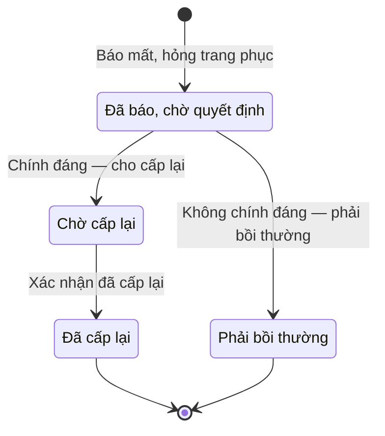

# qt-D13 · Sự cố mất, hỏng, bồi thường

<!-- máy sinh: tom-tat -->
> **Hồ sơ:** Sự cố trang phục (`UniformIncident`)
>
> **Trong sổ phạm vi:** D13 · Sự cố mất, hỏng, bồi thường (tầng 2)
>
> 6 bước · 4 chặng · 3 vai · 0 bảng quyết định · 0 hạn · 12 khớp nối.
>
> **Nguồn:** sổ nghiệp vụ `qt-D13` · khai báo của app: `dqtv-app/core/processes/equipment-incident/workflow/uniform-incident.yaml`. Các bảng do máy sinh từ nguồn này.
<!-- hết: tom-tat -->

<!-- viết tay: dien-giai -->
## Diễn giải

*Phần này viết tay, diễn giải lại điều các bảng bên dưới ghi.*

### Quy trình này để làm gì

Xã xử lý một **sự cố trang phục**: chiến sĩ báo làm mất hoặc làm hỏng một món trang phục đã được cấp. Trợ lý Quân lực ghi lời báo, Chỉ huy trưởng Ban CHQS xã quyết định theo một trong hai nhánh — chính đáng thì cho cấp lại, không chính đáng thì phải bồi thường — rồi Nhân viên quân khí kiêm thủ kho cấp bộ mới, hoặc Trợ lý ghi tiền bồi thường đã nộp.

Hồ sơ có bốn chặng: *Đã báo, chờ quyết định*, rồi rẽ sang *Chờ cấp lại* → *Đã cấp lại*, hoặc sang *Phải bồi thường*.

### Khi nào bắt đầu

Trợ lý Quân lực bấm **Báo mất, hỏng trang phục**. Phải nhập `memberUniformId`, loại sự cố (mất, thất lạc hay hư hỏng), ngày báo, và lý do, hoàn cảnh — chép từ lời báo của chiến sĩ. Bước này còn ghi loại trang phục và ảnh, đơn kèm (nếu có).

Hồ sơ mở ra có nối tới Trang phục cá nhân (quy trình D11) và Chiến sĩ dân quân tự vệ (quy trình 16.enlistment).

### Diễn ra thế nào

**Chặng "Đã báo, chờ quyết định"** — Chỉ huy trưởng chọn một trong hai:

- **Chính đáng — cho cấp lại** → *Chờ cấp lại*; ghi ngày quyết định và kết luận (vì sao chính đáng). Đây là quyết định trong hệ, kết quả: đồng ý.
- **Không chính đáng — phải bồi thường** → *Phải bồi thường*; phải nhập ngày quyết định, kết luận và số tiền phải bồi thường. Đây là quyết định trong hệ, kết quả: từ chối.

**Chặng "Chờ cấp lại"** — chờ thủ kho cấp bộ mới, lấy chữ ký. Thủ kho bấm **Xác nhận đã cấp lại** → *Đã cấp lại*; ghi ngày cấp lại, số phiếu ký nhận và phiếu ký nhận (ảnh/bản quét có chữ ký). Ở chặng *Đã cấp lại*, bộ cũ đã được cấp đổi.

**Chặng "Phải bồi thường"** — Trợ lý Quân lực bấm **Ghi đã nộp tiền bồi thường**; phải đã có số tiền phải bồi thường, thiếu thì báo "chưa có số tiền phải bồi thường — Chỉ huy trưởng chưa ghi số phải đền". Phải nhập ngày đã nộp và số biên lai, chứng từ nộp. Hồ sơ đứng yên ở chặng này.

### Kết thúc và để lại gì

Hồ sơ kết thúc ở *Đã cấp lại* hoặc *Phải bồi thường*. Hai mối nối sang quy trình khác đều ghi lúc mở hồ sơ: tới Trang phục cá nhân và tới Chiến sĩ dân quân tự vệ. Sự cố đã kết luận không chính đáng, phải bồi thường có thể được nối tuỳ chọn tới Hồ sơ bồi thường thiệt hại (quy trình 12b.compensation); khi Chỉ huy trưởng cho cấp lại, bộ mới thuộc một đợt cấp lại riêng (quy trình D11.uniform), không dồn vào đợt gốc.

### Điều kiện chặn

- Mọi bước trừ bước mở đều đòi người làm thuộc đơn vị chủ hồ sơ.
- Bước ghi đã nộp tiền bồi thường đòi đã có số tiền phải bồi thường.
- Sai người, sai chặng, thiếu thứ phải có trước thì bước bị chặn, hồ sơ giữ nguyên.
<!-- hết viết tay -->

## 1. Đường đi ngắn nhất qua các chặng

<!-- máy sinh: luong-chinh -->
Đường ít bước nhất từ lúc mở hồ sơ tới chặng kết thúc xa nhất. Máy chọn theo số chặng, không theo ý nghĩa nghiệp vụ — trình tự công việc thật xem phần Diễn giải và bảng "Việc làm ở từng chặng" ở mục 6.

| # | Ai làm | Làm gì | Hồ sơ sang chặng |
|---|---|---|---|
| 1 | Trợ lý Quân lực | Báo mất, hỏng trang phục | Đã báo, chờ quyết định |
| 2 | Chỉ huy trưởng Ban CHQS xã | Chính đáng — cho cấp lại | Chờ cấp lại |
| 3 | Nhân viên quân khí kiêm thủ kho | Xác nhận đã cấp lại | Đã cấp lại |

<!-- hết: luong-chinh -->

## 2. Hồ sơ và việc nó để lại

<!-- máy sinh: muc-tieu -->
**App gọi quy trình này là:** Chặng C3 — Sự cố trang phục (mất, hỏng).

**Khi mở, hồ sơ này ghi mối nối tới:**
- Chiến sĩ dân quân tự vệ (16.enlistment) — bước `reportUniformIncident`, khớp nối `incidentOfMember`
- Trang phục cá nhân (D11) — bước `reportUniformIncident`, khớp nối `incidentOfUniform`

**Hồ sơ này để lại cho quy trình khác** (bước tạo hồ sơ của quy trình kia ghi mối nối về đây):
- Hồ sơ bồi thường thiệt hại (12b.compensation) — bước `fileCompensation`, khớp nối `compensationCaseFromIncident`
- Hồ sơ bồi thường thiệt hại (12b.compensation) — bước `fileCompensation`, khớp nối `compensationCaseFromUniformIncident`
- Vụ việc kỷ luật (D15) — bước `openDisciplineFromSource`, khớp nối `disciplineFromUniformIncident`
<!-- hết: muc-tieu -->

## 3. Khởi phát và kết thúc

<!-- máy sinh: khoi-phat -->
**1 cửa vào** — bước mở hồ sơ:

| Bước mở | Ai mở | Hồ sơ vào chặng | App bắt buộc nhập |
|---|---|---|---|
| Báo mất, hỏng trang phục | Trợ lý Quân lực | Đã báo, chờ quyết định | `memberUniformId`, loại sự cố, ngày báo, lý do, hoàn cảnh |

**Kết thúc:** *Đã cấp lại* (`reissued`), *Phải bồi thường* (`compensation_required`)
<!-- hết: khoi-phat -->

## 4. Vai trò

<!-- máy sinh: vai-tro -->
| Vai trong sổ | Tên trong app | Điều kiện | Làm những bước |
|---|---|---|---|
| `assistant` | Trợ lý Quân lực |  | Báo mất, hỏng trang phục · Ghi đã nộp tiền bồi thường · Đề nghị xử lý kỷ luật người làm mất, hỏng trang phục |
| `commander` | Chỉ huy trưởng Ban CHQS xã |  | Chính đáng — cho cấp lại · Không chính đáng — phải bồi thường |
| `quartermaster` | Nhân viên quân khí kiêm thủ kho |  | Xác nhận đã cấp lại |

*"Tên trong app" là tên app đặt cho mã chủ thể của vai. Hồ sơ thuộc đơn vị cấp khác thì người làm là người giữ vai ấy ở đơn vị nêu trong cột "Điều kiện" (nếu sổ có ghi) và ở cột "Người làm phải thuộc" của bảng "Theo khai báo của app" (mục 7).*
<!-- hết: vai-tro -->

## 5. Nhánh phụ

<!-- máy sinh: nhanh-phu -->
**Bước khác đưa hồ sơ sang chặng mới** — đường song song, rẽ nhánh hoặc kết thúc sớm:

| Bước | Ai làm | Từ chặng | Sang chặng |
|---|---|---|---|
| Không chính đáng — phải bồi thường | Chỉ huy trưởng Ban CHQS xã | Đã báo, chờ quyết định | Phải bồi thường |

**Làm trong lúc hồ sơ đứng yên ở một chặng** — ghi nhận, bổ sung:

| Bước | Ai làm | Ở chặng |
|---|---|---|
| Ghi đã nộp tiền bồi thường | Trợ lý Quân lực | Phải bồi thường |
| Đề nghị xử lý kỷ luật người làm mất, hỏng trang phục | Trợ lý Quân lực | Đã báo, chờ quyết định, Phải bồi thường, Chờ cấp lại, Đã cấp lại |

<!-- hết: nhanh-phu -->

## 6. Các chặng và việc làm ở từng chặng

<!-- máy sinh: chang -->
| Chặng | Tên hiển thị | Vào bằng bước | Kết thúc? |
|---|---|---|---|
| `reported` | Đã báo, chờ quyết định | Báo mất, hỏng trang phục |  |
| `reissue_approved` | Chờ cấp lại | Chính đáng — cho cấp lại |  |
| `reissued` | Đã cấp lại | Xác nhận đã cấp lại | **kết thúc** — vẫn còn bước làm được |
| `compensation_required` | Phải bồi thường | Không chính đáng — phải bồi thường | **kết thúc** — vẫn còn bước làm được |

### Việc làm ở từng chặng

Hồ sơ đang ở chặng nào thì làm được những bước nào.

| Hồ sơ đang ở chặng | Bước làm tại chặng (hồ sơ đứng yên) | Bước đưa hồ sơ sang chặng khác |
|---|---|---|
| **Đã báo, chờ quyết định** | Đề nghị xử lý kỷ luật người làm mất, hỏng trang phục — Trợ lý Quân lực | Chính đáng — cho cấp lại — Chỉ huy trưởng Ban CHQS xã → *Chờ cấp lại* Không chính đáng — phải bồi thường — Chỉ huy trưởng Ban CHQS xã → *Phải bồi thường* |
| **Chờ cấp lại** | Đề nghị xử lý kỷ luật người làm mất, hỏng trang phục — Trợ lý Quân lực | Xác nhận đã cấp lại — Nhân viên quân khí kiêm thủ kho → *Đã cấp lại* |
| **Đã cấp lại** | Đề nghị xử lý kỷ luật người làm mất, hỏng trang phục — Trợ lý Quân lực | — (kết thúc) |
| **Phải bồi thường** | Ghi đã nộp tiền bồi thường — Trợ lý Quân lực Đề nghị xử lý kỷ luật người làm mất, hỏng trang phục — Trợ lý Quân lực | — (kết thúc) |
<!-- hết: chang -->

## 7. Bảng bước

<!-- máy sinh: buoc -->
| # | Bước | Mã bước | Ai thực hiện | Từ chặng | Sang chặng | Phải có trước | Ghi lại |
|---|---|---|---|---|---|---|---|
| 1 | Báo mất, hỏng trang phục | `reportUniformIncident` | Trợ lý Quân lực | — (mở hồ sơ) | `reported` | `noOpenIncidentForUniform` | nối tới Chiến sĩ dân quân tự vệ, nối tới Trang phục cá nhân, mã tỉnh, mã xã, loại trang phục, loại sự cố, ngày báo, lý do, hoàn cảnh, ảnh, đơn kèm (nếu có), đơn vị chủ hồ sơ |
| 2 | Chính đáng — cho cấp lại | `resolveReissue` | Chỉ huy trưởng Ban CHQS xã | `reported` | `reissue_approved` | người làm thuộc đơn vị chủ hồ sơ, `uniformWithinServiceLife` | ngày quyết định, kết luận (vì sao chính đáng), nối tới Trang phục, sao mũ, phù hiệu |
| 3 | Xác nhận đã cấp lại | `executeReissue` | Nhân viên quân khí kiêm thủ kho | `reissue_approved` | `reissued` | người làm thuộc đơn vị chủ hồ sơ, `reissueOrderIssued` | ngày cấp lại, số phiếu ký nhận, phiếu ký nhận (ảnh/bản quét có chữ ký) |
| 4 | Không chính đáng — phải bồi thường | `requireCompensation` | Chỉ huy trưởng Ban CHQS xã | `reported` | `compensation_required` | người làm thuộc đơn vị chủ hồ sơ | ngày quyết định, kết luận (vì sao không chính đáng), số tiền phải bồi thường (đồng) |
| 5 | Ghi đã nộp tiền bồi thường | `recordCompensationPaid` | Trợ lý Quân lực | `compensation_required` | giữ nguyên | số tiền phải bồi thường, người làm thuộc đơn vị chủ hồ sơ | ngày đã nộp, số biên lai, chứng từ nộp |
| 6 | Đề nghị xử lý kỷ luật người làm mất, hỏng trang phục | `proposeUniformLossDiscipline` | Trợ lý Quân lực | `reported`, `compensation_required`, `reissue_approved`, `reissued` | giữ nguyên | người làm thuộc đơn vị chủ hồ sơ | nối `violatingMember`, nối `handlingDisciplinaryCase` |

### Khi không đạt điều kiện

Mặc định: không đúng người, hồ sơ không ở đúng chặng, hoặc thiếu thứ "phải có trước" thì bước bị chặn, hồ sơ giữ nguyên. Bảng dưới chỉ kê những bước có kết quả riêng.

Không bước nào có kết quả riêng — tất cả theo mặc định.

### Điều kiện "phải có trước" bằng lời

Cột "Phải có trước" ở bảng bước có hai loại: ô dữ liệu thường (bước chỉ đòi ô ấy đã có giá trị) và điều kiện hệ tự xét. Bảng này diễn các điều kiện hệ tự xét theo đúng công thức sổ ghi; số ở cột cuối là số thứ tự bước.

| Điều kiện | Đúng khi | Bước đòi |
|---|---|---|
| `noOpenIncidentForUniform` | không có hồ sơ Sự cố mất, hỏng, bồi thường (qt-D13) có ô nối `incidentOfUniform` trùng với ô nối `incidentOfUniform` của hồ sơ đang làm mà hồ sơ ấy đang ở chặng `reported` hoặc `reissue_approved` | 1 |
| `actorInOwnerUnit` | người đang làm là người của đơn vị ghi ở ô đơn vị chủ hồ sơ của hồ sơ này (theo danh mục người của đơn vị, `dm.unit-staff`) | 2, 3, 4, 5, 6 |
| `reissueOrderIssued` | có hồ sơ Cấp phát, thu hồi cho người, cho đợt — Trang phục, sao mũ, phù hiệu (qt-D11.uniform) chính là hồ sơ ghi ở ô nối `incidentReissueOrder` của hồ sơ đang làm mà hồ sơ ấy đang ở chặng `issued` | 3 |

### Theo khai báo của app

Người làm phải thuộc đơn vị nào, ô người dùng phải nhập, bước có lặp được không, và căn cứ pháp lý — lấy từ khai báo quy trình trong app.

| # | Bước | Người làm phải thuộc | Bắt buộc nhập | Nhập nếu có | Lặp được | Căn cứ |
|---|---|---|---|---|---|---|
| 1 | Báo mất, hỏng trang phục |  | `memberUniformId`, loại sự cố, ngày báo, lý do, hoàn cảnh | — |  | TT04/2015/TT-BQP Đ.5 k7 c |
| 2 | Chính đáng — cho cấp lại | đơn vị chủ hồ sơ | ngày quyết định | — |  | TT04/2015/TT-BQP Đ.5 k7 c |
| 3 | Xác nhận đã cấp lại | đơn vị chủ hồ sơ | ngày cấp lại | — |  | TT04/2015/TT-BQP Đ.5 k7 c |
| 4 | Không chính đáng — phải bồi thường | đơn vị chủ hồ sơ | ngày quyết định, kết luận (vì sao không chính đáng), số tiền phải bồi thường (đồng) | — |  | TT04/2015/TT-BQP Đ.5 k7 c |
| 5 | Ghi đã nộp tiền bồi thường | đơn vị chủ hồ sơ | ngày đã nộp, số biên lai, chứng từ nộp | — |  | TT04/2015/TT-BQP Đ.5 k7 c |
| 6 | Đề nghị xử lý kỷ luật người làm mất, hỏng trang phục | đơn vị chủ hồ sơ | chiến sĩ vi phạm, ngày vi phạm, ngày phát hiện, mô tả hành vi vi phạm | nhóm hành vi (gợi ý Đ.30), thời hiệu |  | sổ qt-D13 · TT81/VBHN-BQP Đ.30, Đ.33 |

### Điều kiện và ghi chú app khai cho từng bước

Lấy từ khai báo quy trình trong app. Lời trong ngoặc kép là câu app hiện cho người dùng. Chức danh người ký ngoài hệ app chỉ khai bằng mã.

| # | Bước | Điều kiện, ghi chú |
|---|---|---|
| 2 | Chính đáng — cho cấp lại | · bước này là một quyết định trong hệ, kết quả: đồng ý |
| 4 | Không chính đáng — phải bồi thường | · bước này là một quyết định trong hệ, kết quả: từ chối, phải ghi ô "kết luận (vì sao không chính đáng)" |
| 5 | Ghi đã nộp tiền bồi thường | · phải đã có ô "số tiền phải bồi thường" — thiếu thì app báo: "chưa có số tiền phải bồi thường — Chỉ huy trưởng chưa ghi số phải đền" |
<!-- hết: buoc -->

## 8. Bảng quyết định, hạn, việc ngoài hệ

<!-- máy sinh: quyet-dinh -->

<!-- hết: quyet-dinh -->

## 9. Dữ liệu của hồ sơ

<!-- máy sinh: du-lieu -->
Các ô mà bước trong sổ ghi hoặc đòi. Số trong hai cột cuối là số thứ tự bước ở bảng bước (mục 7).

| Ô dữ liệu | Mã | Kiểu (app) | Giá trị cho phép | Loại ô (sổ) | Bước ghi | Bước đòi | Mô tả trong app |
|---|---|---|---|---|---|---|---|
| mã tỉnh | `provinceCode` | chữ |  | lưu trên hồ sơ (`stored`) | 1 | — | Mã tỉnh — dùng lọc phạm vi theo hàng |
| mã xã | `communeCode` | chữ |  | lưu trên hồ sơ (`stored`) | 1 | — | Mã xã |
| loại trang phục | `uniformType` | chọn một | Quân phục (`field_uniform`), Mũ (`hard_hat`), Sao mũ (`cap_badge`), Phù hiệu (`insignia`), Giày dép (`footwear`), Phụ kiện (`other`) | lưu trên hồ sơ (`stored`) | 1 | — | Loại trang phục bị mất/hỏng — NĐ72/2020 Phụ lục II |
| loại sự cố | `incidentType` | chọn một | Mất, thất lạc (`lost`), Hư hỏng (`damaged`) | đưa vào ở bước (`input`) | 1 | — | Vô ý làm mất hoặc làm hư hỏng — TT81/VBHN-BQP Đ.25 (cùng bộ với EquipmentIncident.incidentType) |
| ngày báo | `reportedDate` | ngày |  | đưa vào ở bước (`input`) | 1 | — | Ngày chiến sĩ báo |
| lý do, hoàn cảnh | `reason` | chữ |  | đưa vào ở bước (`input`) | 1 | — | Lý do, hoàn cảnh mất/hỏng — chép từ lời báo của chiến sĩ |
| ảnh, đơn kèm | `incidentScanPath` | tệp |  | đưa vào ở bước (`input`) | 1 | — | Ảnh hiện trạng / đơn báo (nếu có) |
| đơn vị chủ hồ sơ | `ownerUnit` |  |  | lưu trên hồ sơ (`stored`) | 1 | — |  |
| ngày quyết định | `decidedDate` | ngày |  | đưa vào ở bước (`input`) | 2, 4 | — | Ngày Chỉ huy trưởng quyết định |
| kết luận của Chỉ huy trưởng | `decisionNote` | chữ |  | đưa vào ở bước (`input`) | 2, 4 | — | Kết luận của Chỉ huy trưởng (chính đáng/không, lý do) |
| ngày cấp lại | `reissuedDate` | ngày |  | lưu trên hồ sơ (`stored`) | 3 | — | Ngày Thủ kho thực hiện cấp lại |
| số phiếu ký nhận | `receiptRef` | chữ |  | đưa vào ở bước (`input`) | 3 | — | Số phiếu ký nhận của bộ cấp lại |
| phiếu ký nhận | `receiptScanPath` | tệp |  | lưu trên hồ sơ (`stored`) | 3 | — | Phiếu ký nhận bộ cấp lại (ảnh/bản quét có chữ ký) |
| số tiền phải bồi thường | `compensationAmount` | số |  | lưu trên hồ sơ (`stored`) | 4 | 5 | Số tiền phải bồi thường (đồng) — CHT ghi khi kết luận phải bồi thường |
| ngày đã nộp bồi thường | `compensationPaidAt` | ngày |  | lưu trên hồ sơ (`stored`) | 5 | — | Ngày người có lỗi đã nộp tiền bồi thường |
| số biên lai nộp bồi thường | `compensationReceiptRef` | chữ |  | lưu trên hồ sơ (`stored`) | 5 | — | Số biên lai, chứng từ nộp tiền bồi thường |
| — | `noOpenIncidentForUniform` |  |  | hệ suy ra (`derived`) | — | 1 |  |
| người làm thuộc đơn vị chủ hồ sơ | `actorInOwnerUnit` |  | có hay chưa | hệ suy ra (`derived`) | — | 2, 3, 4, 5, 6 |  |
| — | `uniformWithinServiceLife` |  | có hay chưa | đưa vào ở bước (`input`) | — | 2 |  |
| — | `reissueOrderIssued` |  |  | hệ suy ra (`derived`) | — | 3 |  |

20 ô. Cột "Loại ô" là cách sổ phân loại ô, in kèm đúng chữ của sổ; ô nào người dùng phải nhập xem bảng "Theo khai báo của app" ở mục 7.
<!-- hết: du-lieu -->

## 10. Khớp nối với quy trình khác

<!-- máy sinh: khop-noi -->
| Quy trình kia | Hồ sơ kia | Quan hệ | Nội dung (mô tả trong app) | Bước ghi mối nối | Tên ô nối |
|---|---|---|---|---|---|
| 12b.compensation | Hồ sơ bồi thường thiệt hại | hồ sơ kia **mở ra từ** hồ sơ này | Liên kết TUỲ CHỌN tới sự cố mất, hư hỏng trang bị đã kết luận có lỗi cá nhân — TT81/VBHN-BQP Đ.25; TT75/2020/… | 12b.compensation·fileCompensation ⊕ | `compensationCaseFromIncident` |
| 12b.compensation | Hồ sơ bồi thường thiệt hại | hồ sơ kia **mở ra từ** hồ sơ này | Liên kết TUỲ CHỌN tới sự cố quân trang đã kết luận không chính đáng, phải bồi thường — TT04/2015/TT-BQP Đ.5 k… | 12b.compensation·fileCompensation ⊕ | `compensationCaseFromUniformIncident` |
| 16.enlistment | Chiến sĩ dân quân tự vệ | hồ sơ này **mở ra có nối tới** hồ sơ kia | Sự cố mất/hỏng trang phục của chiến sĩ nào — E09 (TT04/2015 Đ.5 k7 c) | D13·reportUniformIncident ⊕ | `incidentOfMember` |
| 16.enlistment | Chiến sĩ dân quân tự vệ | gắn với nhau ở một bước giữa chừng | Chiến sĩ đã ký nhận khoản bị mất, hư hỏng — quy trách nhiệm cá nhân (TT81 Đ.24), là đầu mối mở hồ sơ bồi thườ… | D11.training-allocation·closeAllocation, D12·reportIncident | `incidentResponsibleMember` |
| 16.enlistment | Chiến sĩ dân quân tự vệ | gắn với nhau ở một bước giữa chừng | Chiến sĩ bị đề nghị xử lý kỷ luật vì làm mất, hỏng trang phục — TT81 Đ.30 | D13·proposeUniformLossDiscipline | `uniformIncidentViolatingMember` |
| D11 | Trang phục cá nhân | hồ sơ này **mở ra có nối tới** hồ sơ kia | Sự cố xảy ra với đúng BẢN trang phục cá nhân nào — E09 (nối sự cố vào cấp đổi) | D13·reportUniformIncident ⊕ | `incidentOfUniform` |
| D11 | Dòng trang bị cấp phát | gắn với nhau ở một bước giữa chừng | Khai báo mất phát sinh từ quyết toán đợt huấn luyện — dòng vật chất thiếu sau đối chiếu (UC-10 màn I ③) | D11.training-allocation·closeAllocation | `lossFromSettlement` |
| D11.uniform | Trang phục, sao mũ, phù hiệu | gắn với nhau ở một bước giữa chừng | Đợt CẤP LẠI (lệnh xuất) tự sinh khi CHT cho cấp lại — bộ mới thuộc đợt này, không dồn vào đợt gốc (review §5.… | D13·resolveReissue | `incidentReissueOrder` |
| D12 | Trang bị, phương tiện | gắn với nhau ở một bước giữa chừng | Một lần khai báo sự cố mất, hư hỏng của khoản trang bị — UC-09 (TT81/VBHN-BQP Đ.25) | D11.training-allocation·closeAllocation, D12·lockLostInTraining, D12·reportIncident | `incidentOfEquipment` |
| D15 | Vụ việc kỷ luật | hồ sơ kia **mở ra từ** hồ sơ này | Vụ việc kỷ luật mở từ sự cố mất, hỏng trang phục (qt-D13) — TT81 Đ.30 | D15·openDisciplineFromSource ⊕ | `disciplineFromUniformIncident` |
| D15 | Vụ việc kỷ luật | gắn với nhau ở một bước giữa chừng | Hồ sơ kỷ luật (qt-D15) mở từ đề nghị trên sự cố mất, hỏng trang phục | D13·proposeUniformLossDiscipline | `uniformIncidentHandlingDisciplinaryCase` |
| D8 | Đợt cấp phát xuống dưới | gắn với nhau ở một bước giữa chừng | Sự cố mất, hỏng mà phần xã nhận thiếu của đợt này được chuyển sang — sổ qt-D8 (30/9/2026) | D8·resolveIssueShortfall | `shortfallIncident` |

12 khớp nối. ⊕ là bước tạo hồ sơ.
<!-- hết: khop-noi -->

## 11. Thông tin chung

<!-- máy sinh: thong-tin -->
| | |
|---|---|
| **Mã trong sổ** | `qt-D13` |
| **Quy trình trong app** | `equipment-incident` (`workflow/uniform-incident.yaml`) — mặt công tác: `logistics-technical` |
| **Hồ sơ** | Sự cố trang phục (`UniformIncident`) |
| **Căn cứ pháp lý từng bước** | cột "Căn cứ" ở bảng "Theo khai báo của app", mục 7 |
<!-- hết: thong-tin -->
