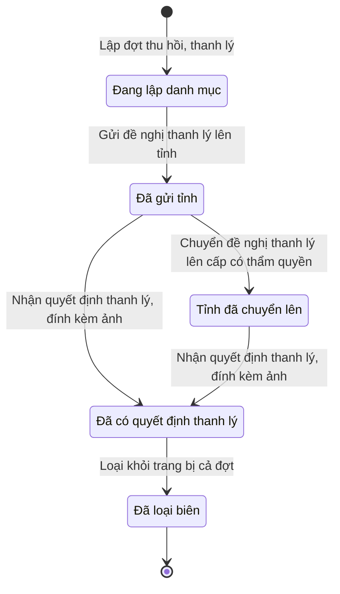

# qt-D14 · Thu hồi, thanh lý, loại biên

<!-- máy sinh: tom-tat -->
> **Hồ sơ:** Đợt thu hồi, thanh lý (`DisposalBatch`)
>
> **Trong sổ phạm vi:** D14 · Thu hồi, thanh lý, loại biên (tầng 2)
>
> 7 bước · 5 chặng · 4 vai · 1 bảng quyết định · 0 hạn · 6 khớp nối.
>
> **Nguồn:** sổ nghiệp vụ `qt-D14` · khai báo của app: `dqtv-app/core/processes/disposal/workflow/disposal-batch.yaml`. Các bảng do máy sinh từ nguồn này.
<!-- hết: tom-tat -->

<!-- viết tay: dien-giai -->
## Diễn giải

*Phần này viết tay, diễn giải lại điều các bảng bên dưới ghi.*

### Quy trình này để làm gì

Xã gom các khoản trang bị cần thu hồi, thanh lý vào một **đợt thu hồi, thanh lý**, làm tờ trình đề nghị lên tỉnh, chờ quyết định thanh lý của cấp có thẩm quyền, rồi loại khỏi trang bị cả đợt. Xã đề nghị lên tỉnh; ai quyết thì tuỳ loại tài sản và nguồn tài sản.

Hồ sơ đi qua bảy chặng: *Đang lập danh mục* → *Chờ ký tờ trình* → *Đã ký, chờ gửi* → *Đã gửi tỉnh* → *Tỉnh đã chuyển lên* → *Đã có quyết định thanh lý* → *Đã loại biên*. Chặng *Tỉnh đã chuyển lên* có thể bỏ qua khi quyết định về thẳng.

### Khi nào bắt đầu

Chỉ huy trưởng Ban CHQS xã bấm **Lập đợt thu hồi, thanh lý**. Phải nhập tên đợt và `taskingId`; loại tài sản, nguồn tài sản, có phải tài sản cố định không là ô nhập nếu có. Hồ sơ mở ra có nối tới Nhiệm vụ trên giao (quy trình 1).

### Diễn ra thế nào

**Chặng "Đang lập danh mục"** — Nhân viên quân khí kiêm thủ kho **Thêm khoản vào đợt** (lặp được): bước tạo một hồ sơ con Khoản trong đợt thu hồi, nối tới một khoản Trang bị, phương tiện (quy trình D12); phải nhập `equipmentId`, `recallReason`, `grade`. Thủ kho bấm **Trình ký tờ trình thanh, xử lý** → *Chờ ký tờ trình*; phải đính tờ trình (PDF), bước tạo một hồ sơ con Văn bản đi.

**Chặng "Chờ ký tờ trình"** — Chỉ huy trưởng **Ký tờ trình** → *Đã ký, chờ gửi*, hoặc **Trả lại tờ trình** → về *Đang lập danh mục* (phải ghi cần sửa gì).

**Chặng "Đã ký, chờ gửi"** — Nhân viên văn thư bấm **Gửi đề nghị thanh lý lên tỉnh** → *Đã gửi tỉnh*; phải đính tờ trình đã ký, đã ghi số; nơi nhận tờ trình là `province_military_command`. Chỉ huy trưởng vẫn trả lại tờ trình được từ chặng này.

**Chặng "Đã gửi tỉnh"** — hai lối:

- Bộ CHQS cấp tỉnh (phải là người của một đơn vị nằm trong ô cấp trên của chủ hồ sơ) bấm **Chuyển đề nghị thanh lý lên cấp có thẩm quyền** → *Tỉnh đã chuyển lên*.
- Hoặc quyết định thanh lý về luôn, đơn vị chủ hồ sơ ghi nhận ngay (bước dưới).

**Nhận quyết định:** từ *Đã gửi tỉnh* hoặc *Tỉnh đã chuyển lên*, Chỉ huy trưởng (thuộc đơn vị chủ hồ sơ) bấm **Nhận quyết định thanh lý, đính kèm ảnh** → *Đã có quyết định thanh lý*. Phải nhập `decisionNumber`, `subject`, `signedBy`, `signedDate`, `legalBasis`, `scanPath`; `guidanceRef` nhập nếu có. Bước ghi ngày ký, số và ảnh quyết định thanh lý, và nối tới một Văn bản đến; đây là bước ghi một quyết định ký ngoài hệ. Bước bị xét theo bảng thẩm quyền (xem Điều kiện chặn).

**Chặng "Đã có quyết định thanh lý"** — Chỉ huy trưởng bấm **Loại khỏi trang bị cả đợt** → *Đã loại biên*; phải đã có ngày ký quyết định thanh lý (thiếu thì báo "Chưa có quyết định thanh lý của cấp có thẩm quyền"), và nhập ngày thanh lý.

### Kết thúc và để lại gì

Hồ sơ kết thúc ở chặng *Đã loại biên*. Đợt nối tới: **Trang bị, phương tiện** (D12) qua từng khoản của đợt — loại biên khi đợt hoàn tất; **Văn bản đi** và **Văn bản đến** (quy trình 1); và **Đợt kiểm kê** (quy trình 15), nơi kết quả kiểm kê đề nghị ra đợt thanh lý này.

### Điều kiện chặn

- Người làm phải thuộc đơn vị chủ hồ sơ; riêng bước chuyển lên cấp có thẩm quyền thì phải thuộc một đơn vị nằm trong ô cấp trên của chủ hồ sơ. Sai người, sai chặng, thiếu thứ phải có trước thì bước bị chặn, hồ sơ giữ nguyên.
- Nhận quyết định: phải đã có loại tài sản; thiếu thì báo "Đợt chưa ghi loại tài sản — chưa xét được ai có thẩm quyền quyết thanh lý".
- Bảng `disposal.decider` (18 dòng) xét lúc nhận quyết định, theo loại tài sản, nguồn tài sản, có phải tài sản cố định, và cấp người ký:
  - Thiếu loại tài sản, nguồn tài sản, cấp người ký, hoặc (với loại cần) thiếu thông tin tài sản cố định → chặn (`category_unknown`, `source_unknown`, `signer_unknown`, `fixed_unknown`).
  - **Quân đội cấp:** vũ khí quân dụng — `bqp_minister` hoặc `general_staff`; vật liệu nổ, công cụ hỗ trợ — chỉ `general_staff`; các loại còn lại — là tài sản cố định thì `region_commander`, không cố định thì `province_commander`.
  - **Ngân sách địa phương hoặc kinh phí cơ quan, tổ chức:** vũ khí quân dụng, vật liệu nổ → chặn (`not_purchasable_source`); các loại còn lại, kể cả công cụ hỗ trợ — tài sản cố định thì `province_chairman`, không cố định thì `owner_unit`.
  - Người ký không đúng các trường hợp trên → chặn (`wrong_authority`).
<!-- hết viết tay -->

## 1. Đường đi ngắn nhất qua các chặng

<!-- máy sinh: luong-chinh -->
Đường ít bước nhất từ lúc mở hồ sơ tới chặng kết thúc xa nhất. Máy chọn theo số chặng, không theo ý nghĩa nghiệp vụ — trình tự công việc thật xem phần Diễn giải và bảng "Việc làm ở từng chặng" ở mục 6.

| # | Ai làm | Làm gì | Hồ sơ sang chặng |
|---|---|---|---|
| 1 | Chỉ huy trưởng Ban CHQS xã | Lập đợt thu hồi, thanh lý | Đang lập danh mục |
| 2 | Nhân viên văn thư | Gửi đề nghị thanh lý lên tỉnh | Đã gửi tỉnh |
| 3 | Nhân viên quân khí kiêm thủ kho | Nhận quyết định thanh lý, đính kèm ảnh | Đã có quyết định thanh lý |
| 4 | Chỉ huy trưởng Ban CHQS xã | Loại khỏi trang bị cả đợt | Đã loại biên |

<!-- hết: luong-chinh -->

## 2. Hồ sơ và việc nó để lại

<!-- máy sinh: muc-tieu -->
**App gọi quy trình này là:** Đợt thu hồi, thanh lý.

**Khi mở, hồ sơ này ghi mối nối tới:**
- Nhiệm vụ trên giao (1) — bước `openDisposalBatch`, khớp nối `disposalBatchServesTasking`
<!-- hết: muc-tieu -->

## 3. Khởi phát và kết thúc

<!-- máy sinh: khoi-phat -->
**1 cửa vào** — bước mở hồ sơ:

| Bước mở | Ai mở | Hồ sơ vào chặng | App bắt buộc nhập |
|---|---|---|---|
| Lập đợt thu hồi, thanh lý | Chỉ huy trưởng Ban CHQS xã | Đang lập danh mục | tên đợt, `taskingId` |

**Kết thúc:** *Đã loại biên* (`COMPLETED`)
<!-- hết: khoi-phat -->

## 4. Vai trò

<!-- máy sinh: vai-tro -->
| Vai trong sổ | Tên trong app | Điều kiện | Làm những bước |
|---|---|---|---|
| `commander` | Chỉ huy trưởng Ban CHQS xã |  | Lập đợt thu hồi, thanh lý · Loại khỏi trang bị cả đợt |
| `quartermaster` | Nhân viên quân khí kiêm thủ kho |  | Thêm khoản vào đợt · Trình ký tờ trình thanh, xử lý · Nhận quyết định thanh lý, đính kèm ảnh |
| `clerk` | Nhân viên văn thư |  | Gửi đề nghị thanh lý lên tỉnh |
| `province` | Bộ CHQS cấp tỉnh | thuộc cấp trên của chủ hồ sơ (`actorInSuperiorUnit`, công thức ở mục 7) | Chuyển đề nghị thanh lý lên cấp có thẩm quyền |

*"Tên trong app" là tên app đặt cho mã chủ thể của vai. Hồ sơ thuộc đơn vị cấp khác thì người làm là người giữ vai ấy ở đơn vị nêu trong cột "Điều kiện" (nếu sổ có ghi) và ở cột "Người làm phải thuộc" của bảng "Theo khai báo của app" (mục 7).*
<!-- hết: vai-tro -->

## 5. Nhánh phụ

<!-- máy sinh: nhanh-phu -->
**Bước khác đưa hồ sơ sang chặng mới** — đường song song, rẽ nhánh hoặc kết thúc sớm:

| Bước | Ai làm | Từ chặng | Sang chặng |
|---|---|---|---|
| Chuyển đề nghị thanh lý lên cấp có thẩm quyền | Bộ CHQS cấp tỉnh (thuộc cấp trên của chủ hồ sơ) | Đã gửi tỉnh | Tỉnh đã chuyển lên |

**Làm trong lúc hồ sơ đứng yên ở một chặng** — ghi nhận, bổ sung:

| Bước | Ai làm | Ở chặng |
|---|---|---|
| Thêm khoản vào đợt *(lặp được)* | Nhân viên quân khí kiêm thủ kho | Đang lập danh mục |
| Trình ký tờ trình thanh, xử lý | Nhân viên quân khí kiêm thủ kho | Đang lập danh mục |

<!-- hết: nhanh-phu -->

## 6. Các chặng và việc làm ở từng chặng

<!-- máy sinh: chang -->
| Chặng | Tên hiển thị | Vào bằng bước | Kết thúc? |
|---|---|---|---|
| `DRAFT` | Đang lập danh mục | Lập đợt thu hồi, thanh lý |  |
| `SUBMITTED` | Đã gửi tỉnh | Gửi đề nghị thanh lý lên tỉnh |  |
| `FORWARDED` | Tỉnh đã chuyển lên | Chuyển đề nghị thanh lý lên cấp có thẩm quyền |  |
| `DECIDED` | Đã có quyết định thanh lý | Nhận quyết định thanh lý, đính kèm ảnh |  |
| `COMPLETED` | Đã loại biên | Loại khỏi trang bị cả đợt | **kết thúc** |

### Việc làm ở từng chặng

Hồ sơ đang ở chặng nào thì làm được những bước nào.

| Hồ sơ đang ở chặng | Bước làm tại chặng (hồ sơ đứng yên) | Bước đưa hồ sơ sang chặng khác |
|---|---|---|
| **Đang lập danh mục** | Thêm khoản vào đợt (lặp được) — Nhân viên quân khí kiêm thủ kho Trình ký tờ trình thanh, xử lý — Nhân viên quân khí kiêm thủ kho | Gửi đề nghị thanh lý lên tỉnh — Nhân viên văn thư → *Đã gửi tỉnh* |
| **Đã gửi tỉnh** | — | Chuyển đề nghị thanh lý lên cấp có thẩm quyền — Bộ CHQS cấp tỉnh (thuộc cấp trên của chủ hồ sơ) → *Tỉnh đã chuyển lên* Nhận quyết định thanh lý, đính kèm ảnh — Nhân viên quân khí kiêm thủ kho → *Đã có quyết định thanh lý* |
| **Tỉnh đã chuyển lên** | — | Nhận quyết định thanh lý, đính kèm ảnh — Nhân viên quân khí kiêm thủ kho → *Đã có quyết định thanh lý* |
| **Đã có quyết định thanh lý** | — | Loại khỏi trang bị cả đợt — Chỉ huy trưởng Ban CHQS xã → *Đã loại biên* |
| **Đã loại biên** | — | — (kết thúc) |
<!-- hết: chang -->

## 7. Bảng bước

<!-- máy sinh: buoc -->
| # | Bước | Mã bước | Ai thực hiện | Từ chặng | Sang chặng | Phải có trước | Ghi lại |
|---|---|---|---|---|---|---|---|
| 1 | Lập đợt thu hồi, thanh lý | `openDisposalBatch` | Chỉ huy trưởng Ban CHQS xã | — (mở hồ sơ) | `DRAFT` | `taskingAssigned` | mã tỉnh, mã xã, tên đợt, nối tới Nhiệm vụ trên giao, đơn vị chủ hồ sơ, cấp trên của chủ hồ sơ, loại tài sản, nguồn tài sản, tài sản cố định |
| 2 | Thêm khoản vào đợt | `addDisposalLine` | Nhân viên quân khí kiêm thủ kho | `DRAFT` | giữ nguyên | người làm thuộc đơn vị chủ hồ sơ, `disposalEquipmentInOwnerUnit`, `disposalEquipmentAvailable`, `equipmentNotInOtherOpenDisposal`, `recallGroundFitsEquipment`, `grade5GroundMatchesGrade`, `recallGroundFitsState` | nối `disposalOfEquipment` (Khoản trong đợt thu hồi → Trang bị, phương tiện), nối tới Khoản trong đợt thu hồi, `recallGround`, `grade` |
| 3 | Trình ký tờ trình thanh, xử lý | `requestDisposalBatchSignature` | Nhân viên quân khí kiêm thủ kho | `DRAFT` | giữ nguyên | người làm thuộc đơn vị chủ hồ sơ, `disposalBatchHasLine`, `noDisposalBatchSubmittedDocumentOpen` | nối tới Văn bản đi |
| 4 | Gửi đề nghị thanh lý lên tỉnh | `submitDisposalBatch` | Nhân viên văn thư | `DRAFT` | `SUBMITTED` | người làm thuộc đơn vị chủ hồ sơ, `disposalBatchSubmittedDocumentIssued` | gửi tỉnh lúc, nối `submissionDeliveredAs` |
| 5 | Chuyển đề nghị thanh lý lên cấp có thẩm quyền | `forwardDisposalToUpper` | Bộ CHQS cấp tỉnh (thuộc cấp trên của chủ hồ sơ) | `SUBMITTED` | `FORWARDED` | người làm thuộc cấp trên của chủ hồ sơ, `submissionDistributedAtReceiver` | tỉnh chuyển lên lúc |
| 6 | Nhận quyết định thanh lý, đính kèm ảnh | `recordDisposalBatchDecision` | Nhân viên quân khí kiêm thủ kho | `SUBMITTED`, `FORWARDED` | `DECIDED` | loại tài sản, người làm thuộc đơn vị chủ hồ sơ, `disposalDecisionFromIncomingDocumentUsable` | ngày ký quyết định thanh lý, nối tới Văn bản đến, cấp người ký quyết định |
| 7 | Loại khỏi trang bị cả đợt | `completeDisposal` | Chỉ huy trưởng Ban CHQS xã | `DECIDED` | `COMPLETED` | ngày ký quyết định thanh lý, người làm thuộc đơn vị chủ hồ sơ, `disposalDateNotFuture` | loại biên lúc, ngày thanh lý |

### Khi không đạt điều kiện

Mặc định: không đúng người, hồ sơ không ở đúng chặng, hoặc thiếu thứ "phải có trước" thì bước bị chặn, hồ sơ giữ nguyên. Bảng dưới chỉ kê những bước có kết quả riêng.

| # | Bước | Kết quả riêng |
|---|---|---|
| 6 | Nhận quyết định thanh lý, đính kèm ảnh | bước dừng lại, hồ sơ giữ nguyên khi kết quả xét là: `category_unknown`, `source_unknown`, `fixed_unknown`, `signer_unknown`, `wrong_authority`, `not_purchasable_source` |

### Điều kiện "phải có trước" bằng lời

Cột "Phải có trước" ở bảng bước có hai loại: ô dữ liệu thường (bước chỉ đòi ô ấy đã có giá trị) và điều kiện hệ tự xét. Bảng này diễn các điều kiện hệ tự xét theo đúng công thức sổ ghi; số ở cột cuối là số thứ tự bước.

| Điều kiện | Đúng khi | Bước đòi |
|---|---|---|
| `taskingAssigned` | có hồ sơ Việc luật giao kèm văn bản đến, đi (qt-1) chính là hồ sơ ghi ở ô nối `disposalBatchServesTasking` của hồ sơ đang làm mà hồ sơ ấy đang ở chặng `ASSIGNED` hoặc `BROKEN_DOWN` | 1 |
| `actorInOwnerUnit` | người đang làm là người của đơn vị ghi ở ô đơn vị chủ hồ sơ của hồ sơ này (theo danh mục người của đơn vị, `dm.unit-staff`) | 2, 3, 4, 6, 7 |
| `disposalEquipmentInOwnerUnit` | có hồ sơ Bảo dưỡng, sửa chữa (qt-D12) chính là hồ sơ ghi ở ô nối `disposalOfEquipment` của hồ sơ đang làm mà đơn vị chủ hồ sơ của hồ sơ đang xét bằng đơn vị chủ hồ sơ của hồ sơ này | 2 |
| `disposalEquipmentAvailable` | có hồ sơ Bảo dưỡng, sửa chữa (qt-D12) chính là hồ sơ ghi ở ô nối `disposalOfEquipment` của hồ sơ đang làm mà hồ sơ ấy đang ở chặng `available` hoặc `pending_disposal` | 2 |
| `equipmentNotInOtherOpenDisposal` | không có hồ sơ Thu hồi, thanh lý, loại biên (qt-D14) có ô nối `disposalOfEquipment` trùng với ô nối `disposalOfEquipment` của hồ sơ đang làm mà KHÔNG (hồ sơ ấy đang ở chặng `COMPLETED`) | 2 |
| `recallGroundFitsEquipment` | (`recallGround` là `unrepairable` hoặc `expired` hoặc `grade5` hoặc `unsafe` hoặc `lost_destroyed` VÀ có hồ sơ Bảo dưỡng, sửa chữa (qt-D12) chính là hồ sơ ghi ở ô nối `disposalOfEquipment` của hồ sơ đang làm mà `equipmentType` là `weapon` hoặc `ammunition` hoặc `explosive`) HOẶC (`recallGround` là `unrepairable` hoặc `expired` hoặc `grade5` hoặc `surplus` hoặc `incomplete_obsolete` hoặc `lost_destroyed` VÀ không có hồ sơ Bảo dưỡng, sửa chữa (qt-D12) chính là hồ sơ ghi ở ô nối `disposalOfEquipment` của hồ sơ đang làm mà `equipmentType` là `weapon` hoặc `ammunition` hoặc `explosive`) | 2 |
| `grade5GroundMatchesGrade` | KHÔNG (`recallGround` là `grade5`) HOẶC `grade` là `grade5` | 2 |
| `recallGroundFitsState` | (có hồ sơ Bảo dưỡng, sửa chữa (qt-D12) chính là hồ sơ ghi ở ô nối `disposalOfEquipment` của hồ sơ đang làm mà hồ sơ ấy đang ở chặng `pending_disposal` VÀ `recallGround` là `lost_destroyed` hoặc `unrepairable`) HOẶC (có hồ sơ Bảo dưỡng, sửa chữa (qt-D12) chính là hồ sơ ghi ở ô nối `disposalOfEquipment` của hồ sơ đang làm mà hồ sơ ấy đang ở chặng `available` VÀ KHÔNG (`recallGround` là `lost_destroyed`)) | 2 |
| `disposalBatchHasLine` | `{"counted": "addDisposalLine", "atLeast": 1}` | 3 |
| `noDisposalBatchSubmittedDocumentOpen` | KHÔNG (có hồ sơ Việc luật giao kèm văn bản đến, đi — Văn bản đi (qt-1.outgoing-document) chính là hồ sơ ghi ở ô nối `disposalBatchSubmittedByDocument` của hồ sơ đang làm mà hồ sơ ấy đang ở chặng `DRAFT` hoặc `PENDING_SIGNATURE` hoặc `SIGNED`) | 3 |
| `disposalBatchSubmittedDocumentIssued` | có hồ sơ Việc luật giao kèm văn bản đến, đi — Văn bản đi (qt-1.outgoing-document) chính là hồ sơ ghi ở ô nối `disposalBatchSubmittedByDocument` của hồ sơ đang làm mà hồ sơ ấy đang ở chặng `ISSUED` | 4 |
| `actorInSuperiorUnit` | người đang làm là người của một đơn vị nằm trong ô cấp trên của chủ hồ sơ của hồ sơ này (theo danh mục người của đơn vị, `dm.unit-staff`) | 5 |
| `submissionDistributedAtReceiver` | có hồ sơ Việc luật giao kèm văn bản đến, đi — Văn bản đến (qt-1.incoming-document) chính là hồ sơ ghi ở ô nối `submissionDeliveredAs` của hồ sơ đang làm mà hồ sơ ấy đang ở chặng `DISTRIBUTED` | 5 |
| `disposalDecisionFromIncomingDocumentUsable` | có hồ sơ Việc luật giao kèm văn bản đến, đi — Văn bản đến (qt-1.incoming-document) chính là hồ sơ ghi ở ô nối `disposalDecisionFromIncomingDocument` của hồ sơ đang làm mà hồ sơ ấy đang ở chặng `RECEIVED` hoặc `DISTRIBUTED` | 6 |

### Theo khai báo của app

Người làm phải thuộc đơn vị nào, ô người dùng phải nhập, bước có lặp được không, và căn cứ pháp lý — lấy từ khai báo quy trình trong app.

| # | Bước | Người làm phải thuộc | Bắt buộc nhập | Nhập nếu có | Lặp được | Căn cứ |
|---|---|---|---|---|---|---|
| 1 | Lập đợt thu hồi, thanh lý |  | tên đợt, `taskingId` | loại tài sản, nguồn tài sản, tài sản cố định |  | QC20.6.2025 (836-838) |
| 2 | Thêm khoản vào đợt | đơn vị chủ hồ sơ | `equipmentId`, `recallGround`, `recallReason`, `grade` | — | có | QC20.6.2025 (836-838) |
| 3 | Trình ký tờ trình thanh, xử lý | đơn vị chủ hồ sơ | tờ trình (PDF) | — |  | QC20.6.2025 (836-838); NĐ30/2020/NĐ-CP Đ.10, Đ.13 |
| 4 | Gửi đề nghị thanh lý lên tỉnh | đơn vị chủ hồ sơ | — | — |  | QC20.6.2025 (836-838); NĐ30/2020/NĐ-CP Đ.18, Đ.19 |
| 5 | Chuyển đề nghị thanh lý lên cấp có thẩm quyền | cấp trên của chủ hồ sơ | — | — |  | sổ nghiệp vụ qt-D14 · step:forwardDisposalToUpper; TT32/2026; NĐ186 |
| 6 | Nhận quyết định thanh lý, đính kèm ảnh | đơn vị chủ hồ sơ | văn bản đến là quyết định thanh lý, `signedBy` | ngày ký (để trống thì lấy ngày ghi trên văn bản đến), `guidanceRef` |  | sổ nghiệp vụ qt-D14 · decision:disposal.decider; TT32/2026; NĐ186 |
| 7 | Loại khỏi trang bị cả đợt | đơn vị chủ hồ sơ | ngày thanh lý | `equipmentIds` |  | QC20.6.2025 (836-838) |

### Điều kiện và ghi chú app khai cho từng bước

Lấy từ khai báo quy trình trong app. Lời trong ngoặc kép là câu app hiện cho người dùng. Chức danh người ký ngoài hệ app chỉ khai bằng mã.

| # | Bước | Điều kiện, ghi chú |
|---|---|---|
| 2 | Thêm khoản vào đợt | · tạo thêm một hồ sơ con: Khoản trong đợt thu hồi (`DisposalLine`) |
| 3 | Trình ký tờ trình thanh, xử lý | · tạo thêm một hồ sơ con: Văn bản đi (`OutgoingDocument`) |
| 4 | Gửi đề nghị thanh lý lên tỉnh | · app khai nơi nhận: `province_military_command` |
| 6 | Nhận quyết định thanh lý, đính kèm ảnh | · phải đã có ô "loại tài sản" — thiếu thì app báo: "Đợt chưa ghi loại tài sản — chưa xét được ai có thẩm quyền quyết thanh lý" · bước này ghi một quyết định ký NGOÀI hệ (`disposalBatchAuthorizedBy`), người ký: `defence_minister`, `general_staff_chief`, `military_region_commander`, `province_military_command`, `province_chairman`, `asset_owner_unit` · không đòi bản chụp — app ghi: "bản số hoá lấy từ văn bản đến văn thư đã vào sổ (tầng đọc chép `scanPath` của văn bản ấy), không tải ảnh ở bước này" |
| 7 | Loại khỏi trang bị cả đợt | · phải đã có ô "ngày ký quyết định thanh lý" — thiếu thì app báo: "Chưa có quyết định thanh lý của cấp có thẩm quyền" |
<!-- hết: buoc -->

## 8. Bảng quyết định, hạn, việc ngoài hệ

<!-- máy sinh: quyet-dinh -->
**Bảng `disposal.decider`** — xét ở bước *Nhận quyết định thanh lý, đính kèm ảnh*; đầu vào: loại tài sản, nguồn tài sản, tài sản cố định, cấp người ký quyết định. 18 dòng, dòng đầu tiên khớp thì dừng.

| Thứ tự dò (số sổ ghi) | Dòng | Khi | Thì |
|---|---|---|---|
| — | `category-unknown` | chưa có loại tài sản | `category_unknown` |
| — | `local-fixed-ok` | loại tài sản là Công cụ hỗ trợ (`support_tool`) hoặc Vũ khí thô sơ (`primitive_weapon`) hoặc Trang bị kỹ thuật (`technical_equipment`) hoặc Trang phục (`uniform`) hoặc Học cụ (`teaching_aid`) và nguồn tài sản là Ngân sách địa phương (`local_budget`) hoặc Kinh phí cơ quan, tổ chức (`organisation_budget`) và tài sản cố định là Là tài sản cố định (`yes`) và cấp người ký quyết định là Chủ tịch UBND tỉnh (`province_chairman`) | cho qua |
| — | `local-fixed-unknown` | loại tài sản là Công cụ hỗ trợ (`support_tool`) hoặc Vũ khí thô sơ (`primitive_weapon`) hoặc Trang bị kỹ thuật (`technical_equipment`) hoặc Trang phục (`uniform`) hoặc Học cụ (`teaching_aid`) và nguồn tài sản là Ngân sách địa phương (`local_budget`) hoặc Kinh phí cơ quan, tổ chức (`organisation_budget`) và chưa có tài sản cố định và cấp người ký quyết định là Bộ trưởng Bộ Quốc phòng (`bqp_minister`) hoặc Tổng Tham mưu trưởng (`general_staff`) hoặc Tư lệnh quân khu (`region_commander`) hoặc Chỉ huy trưởng Bộ CHQS tỉnh (`province_commander`) hoặc Chủ tịch UBND tỉnh (`province_chairman`) hoặc Đơn vị quản lý tài sản (`owner_unit`) | `fixed_unknown` |
| — | `local-fixed-wrong` | loại tài sản là Công cụ hỗ trợ (`support_tool`) hoặc Vũ khí thô sơ (`primitive_weapon`) hoặc Trang bị kỹ thuật (`technical_equipment`) hoặc Trang phục (`uniform`) hoặc Học cụ (`teaching_aid`) và nguồn tài sản là Ngân sách địa phương (`local_budget`) hoặc Kinh phí cơ quan, tổ chức (`organisation_budget`) và tài sản cố định là Là tài sản cố định (`yes`) và cấp người ký quyết định là Bộ trưởng Bộ Quốc phòng (`bqp_minister`) hoặc Tổng Tham mưu trưởng (`general_staff`) hoặc Tư lệnh quân khu (`region_commander`) hoặc Chỉ huy trưởng Bộ CHQS tỉnh (`province_commander`) hoặc Đơn vị quản lý tài sản (`owner_unit`) | `wrong_authority` |
| — | `local-military` | loại tài sản là Vũ khí quân dụng (`military_weapon`) hoặc Vật liệu nổ (`explosive`) và nguồn tài sản là Ngân sách địa phương (`local_budget`) hoặc Kinh phí cơ quan, tổ chức (`organisation_budget`) và cấp người ký quyết định là Bộ trưởng Bộ Quốc phòng (`bqp_minister`) hoặc Tổng Tham mưu trưởng (`general_staff`) hoặc Tư lệnh quân khu (`region_commander`) hoặc Chỉ huy trưởng Bộ CHQS tỉnh (`province_commander`) hoặc Chủ tịch UBND tỉnh (`province_chairman`) hoặc Đơn vị quản lý tài sản (`owner_unit`) | `not_purchasable_source` |
| — | `local-nonfixed-ok` | loại tài sản là Công cụ hỗ trợ (`support_tool`) hoặc Vũ khí thô sơ (`primitive_weapon`) hoặc Trang bị kỹ thuật (`technical_equipment`) hoặc Trang phục (`uniform`) hoặc Học cụ (`teaching_aid`) và nguồn tài sản là Ngân sách địa phương (`local_budget`) hoặc Kinh phí cơ quan, tổ chức (`organisation_budget`) và tài sản cố định là Không phải tài sản cố định (`no`) và cấp người ký quyết định là Đơn vị quản lý tài sản (`owner_unit`) | cho qua |
| — | `local-nonfixed-wrong` | loại tài sản là Công cụ hỗ trợ (`support_tool`) hoặc Vũ khí thô sơ (`primitive_weapon`) hoặc Trang bị kỹ thuật (`technical_equipment`) hoặc Trang phục (`uniform`) hoặc Học cụ (`teaching_aid`) và nguồn tài sản là Ngân sách địa phương (`local_budget`) hoặc Kinh phí cơ quan, tổ chức (`organisation_budget`) và tài sản cố định là Không phải tài sản cố định (`no`) và cấp người ký quyết định là Bộ trưởng Bộ Quốc phòng (`bqp_minister`) hoặc Tổng Tham mưu trưởng (`general_staff`) hoặc Tư lệnh quân khu (`region_commander`) hoặc Chỉ huy trưởng Bộ CHQS tỉnh (`province_commander`) hoặc Chủ tịch UBND tỉnh (`province_chairman`) | `wrong_authority` |
| — | `mil-expl-cct-ok` | loại tài sản là Vật liệu nổ (`explosive`) hoặc Công cụ hỗ trợ (`support_tool`) và nguồn tài sản là Quân đội cấp (`military_issued`) và cấp người ký quyết định là Tổng Tham mưu trưởng (`general_staff`) | cho qua |
| — | `mil-expl-cct-wrong` | loại tài sản là Vật liệu nổ (`explosive`) hoặc Công cụ hỗ trợ (`support_tool`) và nguồn tài sản là Quân đội cấp (`military_issued`) và cấp người ký quyết định là Bộ trưởng Bộ Quốc phòng (`bqp_minister`) hoặc Tư lệnh quân khu (`region_commander`) hoặc Chỉ huy trưởng Bộ CHQS tỉnh (`province_commander`) hoặc Chủ tịch UBND tỉnh (`province_chairman`) hoặc Đơn vị quản lý tài sản (`owner_unit`) | `wrong_authority` |
| — | `mil-other-fixed-ok` | loại tài sản là Vũ khí thô sơ (`primitive_weapon`) hoặc Trang bị kỹ thuật (`technical_equipment`) hoặc Trang phục (`uniform`) hoặc Học cụ (`teaching_aid`) và nguồn tài sản là Quân đội cấp (`military_issued`) và tài sản cố định là Là tài sản cố định (`yes`) và cấp người ký quyết định là Tư lệnh quân khu (`region_commander`) | cho qua |
| — | `mil-other-fixed-unknown` | loại tài sản là Vũ khí thô sơ (`primitive_weapon`) hoặc Trang bị kỹ thuật (`technical_equipment`) hoặc Trang phục (`uniform`) hoặc Học cụ (`teaching_aid`) và nguồn tài sản là Quân đội cấp (`military_issued`) và chưa có tài sản cố định và cấp người ký quyết định là Bộ trưởng Bộ Quốc phòng (`bqp_minister`) hoặc Tổng Tham mưu trưởng (`general_staff`) hoặc Tư lệnh quân khu (`region_commander`) hoặc Chỉ huy trưởng Bộ CHQS tỉnh (`province_commander`) hoặc Chủ tịch UBND tỉnh (`province_chairman`) hoặc Đơn vị quản lý tài sản (`owner_unit`) | `fixed_unknown` |
| — | `mil-other-fixed-wrong` | loại tài sản là Vũ khí thô sơ (`primitive_weapon`) hoặc Trang bị kỹ thuật (`technical_equipment`) hoặc Trang phục (`uniform`) hoặc Học cụ (`teaching_aid`) và nguồn tài sản là Quân đội cấp (`military_issued`) và tài sản cố định là Là tài sản cố định (`yes`) và cấp người ký quyết định là Bộ trưởng Bộ Quốc phòng (`bqp_minister`) hoặc Tổng Tham mưu trưởng (`general_staff`) hoặc Chỉ huy trưởng Bộ CHQS tỉnh (`province_commander`) hoặc Chủ tịch UBND tỉnh (`province_chairman`) hoặc Đơn vị quản lý tài sản (`owner_unit`) | `wrong_authority` |
| — | `mil-other-nonfixed-ok` | loại tài sản là Vũ khí thô sơ (`primitive_weapon`) hoặc Trang bị kỹ thuật (`technical_equipment`) hoặc Trang phục (`uniform`) hoặc Học cụ (`teaching_aid`) và nguồn tài sản là Quân đội cấp (`military_issued`) và tài sản cố định là Không phải tài sản cố định (`no`) và cấp người ký quyết định là Chỉ huy trưởng Bộ CHQS tỉnh (`province_commander`) | cho qua |
| — | `mil-other-nonfixed-wrong` | loại tài sản là Vũ khí thô sơ (`primitive_weapon`) hoặc Trang bị kỹ thuật (`technical_equipment`) hoặc Trang phục (`uniform`) hoặc Học cụ (`teaching_aid`) và nguồn tài sản là Quân đội cấp (`military_issued`) và tài sản cố định là Không phải tài sản cố định (`no`) và cấp người ký quyết định là Bộ trưởng Bộ Quốc phòng (`bqp_minister`) hoặc Tổng Tham mưu trưởng (`general_staff`) hoặc Tư lệnh quân khu (`region_commander`) hoặc Chủ tịch UBND tỉnh (`province_chairman`) hoặc Đơn vị quản lý tài sản (`owner_unit`) | `wrong_authority` |
| — | `mil-weapon-ok` | loại tài sản là Vũ khí quân dụng (`military_weapon`) và nguồn tài sản là Quân đội cấp (`military_issued`) và cấp người ký quyết định là Bộ trưởng Bộ Quốc phòng (`bqp_minister`) hoặc Tổng Tham mưu trưởng (`general_staff`) | cho qua |
| — | `mil-weapon-wrong` | loại tài sản là Vũ khí quân dụng (`military_weapon`) và nguồn tài sản là Quân đội cấp (`military_issued`) và cấp người ký quyết định là Tư lệnh quân khu (`region_commander`) hoặc Chỉ huy trưởng Bộ CHQS tỉnh (`province_commander`) hoặc Chủ tịch UBND tỉnh (`province_chairman`) hoặc Đơn vị quản lý tài sản (`owner_unit`) | `wrong_authority` |
| — | `signer-unknown` | loại tài sản là Vũ khí quân dụng (`military_weapon`) hoặc Vật liệu nổ (`explosive`) hoặc Công cụ hỗ trợ (`support_tool`) hoặc Vũ khí thô sơ (`primitive_weapon`) hoặc Trang bị kỹ thuật (`technical_equipment`) hoặc Trang phục (`uniform`) hoặc Học cụ (`teaching_aid`) và nguồn tài sản là Quân đội cấp (`military_issued`) hoặc Ngân sách địa phương (`local_budget`) hoặc Kinh phí cơ quan, tổ chức (`organisation_budget`) và chưa có cấp người ký quyết định | `signer_unknown` |
| — | `source-unknown` | loại tài sản là Vũ khí quân dụng (`military_weapon`) hoặc Vật liệu nổ (`explosive`) hoặc Công cụ hỗ trợ (`support_tool`) hoặc Vũ khí thô sơ (`primitive_weapon`) hoặc Trang bị kỹ thuật (`technical_equipment`) hoặc Trang phục (`uniform`) hoặc Học cụ (`teaching_aid`) và chưa có nguồn tài sản | `source_unknown` |

<!-- hết: quyet-dinh -->

## 9. Dữ liệu của hồ sơ

<!-- máy sinh: du-lieu -->
Các ô mà bước trong sổ ghi hoặc đòi. Số trong hai cột cuối là số thứ tự bước ở bảng bước (mục 7).

| Ô dữ liệu | Mã | Kiểu (app) | Giá trị cho phép | Loại ô (sổ) | Bước ghi | Bước đòi | Mô tả trong app |
|---|---|---|---|---|---|---|---|
| mã tỉnh | `provinceCode` | chữ |  | lưu trên hồ sơ (`stored`) | 1 | — | Mã tỉnh — dùng lọc phạm vi theo hàng; rỗng khi hồ sơ thuộc quân khu hoặc Bộ Quốc phòng |
| mã xã | `communeCode` | chữ |  | lưu trên hồ sơ (`stored`) | 1 | — | Mã xã |
| tên đợt | `batchName` | chữ |  | đưa vào ở bước (`input`) | 1 | — | Tên đợt (vd Danh mục thu hồi đợt 2026-03) |
| đơn vị chủ hồ sơ | `ownerUnit` |  |  | lưu trên hồ sơ (`stored`) | 1 | — |  |
| cấp trên của chủ hồ sơ | `superiorUnits` |  |  | hệ suy ra (`derived`) | 1 | — |  |
| loại tài sản | `disposalItemCategory` | chọn một | Vũ khí quân dụng (`military_weapon`), Vật liệu nổ (`explosive`), Công cụ hỗ trợ (`support_tool`), Vũ khí thô sơ (`primitive_weapon`), Trang bị kỹ thuật (`technical_equipment`), Trang phục (`uniform`), Học cụ (`teaching_aid`) | đưa vào ở bước (`input`) | 1 | 6 | Loại tài sản thanh lý — đầu vào bảng thẩm quyền thanh lý (TT32/2026, NĐ186) |
| nguồn tài sản | `assetSource` | chọn một | Quân đội cấp (`military_issued`), Ngân sách địa phương (`local_budget`), Kinh phí cơ quan, tổ chức (`organisation_budget`) | đưa vào ở bước (`input`) | 1 | — | Nguồn tài sản: quân đội cấp, ngân sách địa phương, kinh phí cơ quan, tổ chức |
| tài sản cố định | `fixedAsset` | chọn một | Là tài sản cố định (`yes`), Không phải tài sản cố định (`no`) | đưa vào ở bước (`input`) | 1 | — | Có phải tài sản cố định không — đầu vào bảng thẩm quyền thanh lý |
| — | `recallGround` |  | `unrepairable`, `expired`, `grade5`, `unsafe`, `surplus`, `incomplete_obsolete`, `lost_destroyed` | đưa vào ở bước (`input`) | 2 | — |  |
| — | `grade` |  | `grade1`, `grade2`, `grade3`, `grade4`, `grade5` | đưa vào ở bước (`input`) | 2 | — |  |
| gửi tỉnh lúc | `submittedAt` | ngày giờ |  | lưu trên hồ sơ (`stored`) | 4 | — | Thời điểm xã gửi đề nghị thanh lý lên tỉnh |
| tỉnh chuyển lên lúc | `forwardedAt` | ngày giờ |  | lưu trên hồ sơ (`stored`) | 5 | — | Thời điểm tỉnh chuyển đề nghị lên cấp có thẩm quyền — sổ qt-D14 |
| ngày ký quyết định thanh lý | `authorizedAt` | ngày |  | lưu trên hồ sơ (`stored`) | 6 | 7 | Ngày ký quyết định thanh lý của cấp có thẩm quyền |
| cấp người ký quyết định | `decisionSignerLevel` | chọn một | Bộ trưởng Bộ Quốc phòng (`bqp_minister`), Tổng Tham mưu trưởng (`general_staff`), Tư lệnh quân khu (`region_commander`), Chỉ huy trưởng Bộ CHQS tỉnh (`province_commander`), Chủ tịch UBND tỉnh (`province_chairman`), Đơn vị quản lý tài sản (`owner_unit`) | đưa vào ở bước (`input`) | 6 | — | Cấp người ký quyết định thanh lý — bảng thẩm quyền `disposal.decider` đọc ô này (sổ qt-D14, người dùng 31/10/2026 "a") |
| loại biên lúc | `completedAt` | ngày giờ |  | lưu trên hồ sơ (`stored`) | 7 | — | Thời điểm loại biên cả đợt |
| ngày thanh lý | `disposalDate` | ngày |  | đưa vào ở bước (`input`) | 7 | — | Ngày quyết định thanh lý, loại biên |
| — | `taskingAssigned` |  | có hay chưa | hệ suy ra (`derived`) | — | 1 |  |
| người làm thuộc đơn vị chủ hồ sơ | `actorInOwnerUnit` |  | có hay chưa | hệ suy ra (`derived`) | — | 2, 3, 4, 6, 7 |  |
| — | `disposalEquipmentInOwnerUnit` |  |  | hệ suy ra (`derived`) | — | 2 |  |
| — | `disposalEquipmentAvailable` |  |  | hệ suy ra (`derived`) | — | 2 |  |
| — | `equipmentNotInOtherOpenDisposal` |  |  | hệ suy ra (`derived`) | — | 2 |  |
| — | `recallGroundFitsEquipment` |  |  | hệ suy ra (`derived`) | — | 2 |  |
| — | `grade5GroundMatchesGrade` |  |  | hệ suy ra (`derived`) | — | 2 |  |
| — | `recallGroundFitsState` |  |  | hệ suy ra (`derived`) | — | 2 |  |
| — | `disposalBatchHasLine` |  | có hay chưa | hệ suy ra (`derived`) | — | 3 |  |
| — | `noDisposalBatchSubmittedDocumentOpen` |  | có hay chưa | hệ suy ra (`derived`) | — | 3 |  |
| — | `disposalBatchSubmittedDocumentIssued` |  | có hay chưa | hệ suy ra (`derived`) | — | 4 |  |
| người làm thuộc cấp trên của chủ hồ sơ | `actorInSuperiorUnit` |  | có hay chưa | hệ suy ra (`derived`) | — | 5 |  |
| — | `submissionDistributedAtReceiver` |  | có hay chưa | hệ suy ra (`derived`) | — | 5 |  |
| — | `disposalDecisionFromIncomingDocumentUsable` |  | có hay chưa | hệ suy ra (`derived`) | — | 6 |  |
| — | `disposalDateNotFuture` |  | có hay chưa | đưa vào ở bước (`input`) | — | 7 |  |

31 ô. Cột "Loại ô" là cách sổ phân loại ô, in kèm đúng chữ của sổ; ô nào người dùng phải nhập xem bảng "Theo khai báo của app" ở mục 7.
<!-- hết: du-lieu -->

## 10. Khớp nối với quy trình khác

<!-- máy sinh: khop-noi -->
| Quy trình kia | Hồ sơ kia | Quan hệ | Nội dung (mô tả trong app) | Bước ghi mối nối | Tên ô nối |
|---|---|---|---|---|---|
| 1 | Nhiệm vụ trên giao | hồ sơ này **mở ra có nối tới** hồ sơ kia | Việc gốc mà đợt thanh lý này thực hiện — tờ trình thanh lý và mọi văn bản đi sinh từ hồ sơ kế thừa việc này (… | D14·openDisposalBatch ⊕ | `disposalBatchServesTasking` |
| 1.incoming-document | Văn bản đến | có nối | Văn bản đến ở sổ của tỉnh là tờ trình thanh lý xã gửi lên — sổ qt-D14 submissionDistributedAtReceiver (N2) | — | `disposalBatchSubmissionDeliveredAs` |
| 1.incoming-document | Văn bản đến | gắn với nhau ở một bước giữa chừng | Văn bản đến mang quyết định thanh lý của đợt — sổ qt-D14 | D14·recordDisposalBatchDecision | `disposalDecisionFromIncomingDocument` |
| 1.outgoing-document | Văn bản đi | gắn với nhau ở một bước giữa chừng | Tờ trình đi kèm mỗi lượt trình đợt thanh, xử lý trang bị — văn bản đi của Ban CHQS, đã ký và vào sổ (NĐ30/202… | D14·requestDisposalBatchSignature | `disposalBatchSubmittedByDocument` |
| 15 | Đợt kiểm kê | có nối | Đợt thanh lý mà kết quả kiểm kê này đề nghị | — | `inventoryCheckSpawnsDisposal` |
| D12 | Trang bị, phương tiện | gắn với nhau ở một bước giữa chừng | Khoản thu hồi soi khoản trang bị nào — loại biên khi đợt hoàn tất | D14·addDisposalLine | `disposalOfEquipment` |

6 khớp nối. ⊕ là bước tạo hồ sơ.
<!-- hết: khop-noi -->

## 11. Thông tin chung

<!-- máy sinh: thong-tin -->
| | |
|---|---|
| **Mã trong sổ** | `qt-D14` |
| **Quy trình trong app** | `disposal` (`workflow/disposal-batch.yaml`) — mặt công tác: `logistics-technical` |
| **Hồ sơ** | Đợt thu hồi, thanh lý (`DisposalBatch`) |
| **Căn cứ pháp lý từng bước** | cột "Căn cứ" ở bảng "Theo khai báo của app", mục 7 |
<!-- hết: thong-tin -->
