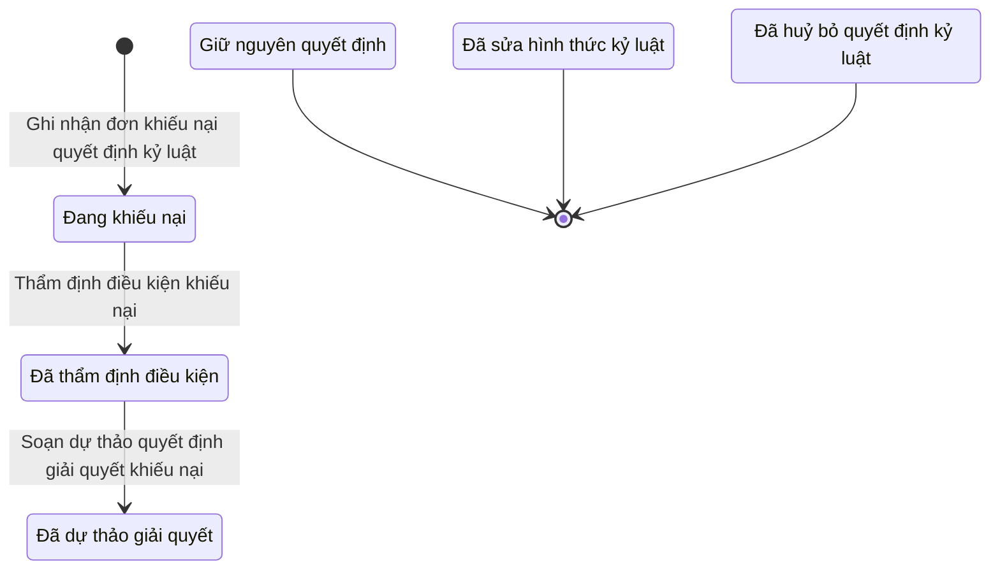

# qt-D15.complaint · Xử lý kỷ luật DQTV — Khiếu nại quyết định kỷ luật

<!-- máy sinh: tom-tat -->
> **Hồ sơ:** Khiếu nại quyết định kỷ luật (`DisciplineComplaint`)
>
> **Trong sổ phạm vi:** D15 · Xử lý kỷ luật DQTV — hồ sơ phụ complaint: khiếu nại quyết định kỷ luật — nhận, xét điều kiện, soạn, giải quyết (tầng 3)
>
> 13 bước · 6 chặng · 5 vai · 6 bảng quyết định · 0 hạn · 4 khớp nối.
>
> **Nguồn:** sổ nghiệp vụ `qt-D15.complaint` · khai báo của app: `dqtv-app/core/processes/discipline/workflow/discipline-complaint.yaml`. Các bảng do máy sinh từ nguồn này.
<!-- hết: tom-tat -->

## 1. Đường đi ngắn nhất qua các chặng

<!-- máy sinh: luong-chinh -->
Đường ít bước nhất từ lúc mở hồ sơ tới chặng kết thúc xa nhất. Máy chọn theo số chặng, không theo ý nghĩa nghiệp vụ — trình tự công việc thật xem phần Diễn giải và bảng "Việc làm ở từng chặng" ở mục 6.

| # | Ai làm | Làm gì | Hồ sơ sang chặng |
|---|---|---|---|
| 1 | Trợ lý Tác huấn | Ghi nhận đơn khiếu nại quyết định kỷ luật | Đang khiếu nại |
| 2 | Trợ lý Tác huấn | Thẩm định điều kiện khiếu nại | Đã thẩm định điều kiện |
| 3 | Trợ lý Tác huấn | Soạn dự thảo quyết định giải quyết khiếu nại | Đã dự thảo giải quyết |

<!-- hết: luong-chinh -->

## 2. Hồ sơ và việc nó để lại

<!-- máy sinh: muc-tieu -->
**App gọi quy trình này là:** Khiếu nại quyết định kỷ luật.
<!-- hết: muc-tieu -->

## 3. Khởi phát và kết thúc

<!-- máy sinh: khoi-phat -->
**1 cửa vào** — bước mở hồ sơ:

| Bước mở | Ai mở | Hồ sơ vào chặng | App bắt buộc nhập |
|---|---|---|---|
| Ghi nhận đơn khiếu nại quyết định kỷ luật | Trợ lý Tác huấn | Đang khiếu nại | `caseId`, chiến sĩ khiếu nại, nội dung khiếu nại |

**Kết thúc:** *Giữ nguyên quyết định* (`COMPLAINT_UPHELD`), *Đã sửa hình thức kỷ luật* (`COMPLAINT_FORM_CHANGED`), *Đã huỷ bỏ quyết định kỷ luật* (`COMPLAINT_ANNULLED`)
<!-- hết: khoi-phat -->

## 4. Vai trò

<!-- máy sinh: vai-tro -->
| Vai trong sổ | Tên trong app | Điều kiện | Làm những bước |
|---|---|---|---|
| `operator` | Trợ lý Tác huấn |  | Ghi nhận đơn khiếu nại quyết định kỷ luật · Thẩm định điều kiện khiếu nại · Soạn dự thảo quyết định giải quyết khiếu nại · Trình ký quyết định giải quyết khiếu nại · Ghi quyết định giải quyết khiếu nại đã ký ngoài hệ thống, đính kèm ảnh · Tạo yêu cầu báo cáo lên cấp trên |
| `system` | Hệ thống tự làm |  | Ghi giải quyết khiếu nại — quyết định đã phát hành · Ghi giải quyết khiếu nại (khoản 8) — quyết định đã phát hành |
| `provincialAssistant` | Ban Dân quân tự vệ, Bộ CHQS cấp tỉnh | thuộc cấp trên của chủ hồ sơ (`actorInSuperiorUnit`, công thức ở mục 7) | Trình ký quyết định giải quyết khiếu nại (quyết định gốc khoản 8) |
| `verifier` | Chỉ huy trưởng Ban CHQS xã |  | Ghi nhận giải quyết khiếu nại của Chủ tịch UBND cấp xã (văn bản đến) · Ghi nhận giải quyết khiếu nại của tiểu đội trưởng (quyết định nội bộ) · Ghi nhận giải quyết khiếu nại của trung đội trưởng, thôn đội trưởng (quyết định nội bộ) |
| `militaryRegionAuthority` | Tư lệnh quân khu | thuộc cấp trên của chủ hồ sơ (`actorInSuperiorUnit`, công thức ở mục 7) | Ghi nhận giải quyết khiếu nại của Tư lệnh quân khu (văn bản đến) |

*"Tên trong app" là tên app đặt cho mã chủ thể của vai. Hồ sơ thuộc đơn vị cấp khác thì người làm là người giữ vai ấy ở đơn vị nêu trong cột "Điều kiện" (nếu sổ có ghi) và ở cột "Người làm phải thuộc" của bảng "Theo khai báo của app" (mục 7).*
<!-- hết: vai-tro -->

## 5. Nhánh phụ

<!-- máy sinh: nhanh-phu -->
**Làm trong lúc hồ sơ đứng yên ở một chặng** — ghi nhận, bổ sung:

| Bước | Ai làm | Ở chặng |
|---|---|---|
| Trình ký quyết định giải quyết khiếu nại | Trợ lý Tác huấn | Đã dự thảo giải quyết |
| Ghi giải quyết khiếu nại — quyết định đã phát hành | Hệ thống tự làm | Đã dự thảo giải quyết |
| Trình ký quyết định giải quyết khiếu nại (quyết định gốc khoản 8) | Ban Dân quân tự vệ, Bộ CHQS cấp tỉnh (thuộc cấp trên của chủ hồ sơ) | Đã dự thảo giải quyết |
| Ghi giải quyết khiếu nại (khoản 8) — quyết định đã phát hành | Hệ thống tự làm | Đã dự thảo giải quyết |
| Ghi quyết định giải quyết khiếu nại đã ký ngoài hệ thống, đính kèm ảnh | Trợ lý Tác huấn | Đã dự thảo giải quyết |
| Ghi nhận giải quyết khiếu nại của Chủ tịch UBND cấp xã (văn bản đến) | Chỉ huy trưởng Ban CHQS xã | Đang khiếu nại, Đã thẩm định điều kiện, Đã dự thảo giải quyết |
| Ghi nhận giải quyết khiếu nại của Tư lệnh quân khu (văn bản đến) | Tư lệnh quân khu (thuộc cấp trên của chủ hồ sơ) | Đang khiếu nại, Đã thẩm định điều kiện, Đã dự thảo giải quyết |
| Ghi nhận giải quyết khiếu nại của tiểu đội trưởng (quyết định nội bộ) | Chỉ huy trưởng Ban CHQS xã | Đang khiếu nại, Đã thẩm định điều kiện, Đã dự thảo giải quyết |
| Ghi nhận giải quyết khiếu nại của trung đội trưởng, thôn đội trưởng (quyết định nội bộ) | Chỉ huy trưởng Ban CHQS xã | Đang khiếu nại, Đã thẩm định điều kiện, Đã dự thảo giải quyết |
| Tạo yêu cầu báo cáo lên cấp trên | Trợ lý Tác huấn | Giữ nguyên quyết định, Đã sửa hình thức kỷ luật, Đã huỷ bỏ quyết định kỷ luật |

<!-- hết: nhanh-phu -->

## 6. Các chặng và việc làm ở từng chặng

<!-- máy sinh: chang -->
| Chặng | Tên hiển thị | Vào bằng bước | Kết thúc? |
|---|---|---|---|
| `COMPLAINT_FILED` | Đang khiếu nại | Ghi nhận đơn khiếu nại quyết định kỷ luật |  |
| `COMPLAINT_REVIEWED` | Đã thẩm định điều kiện | Thẩm định điều kiện khiếu nại |  |
| `COMPLAINT_DRAFTED` | Đã dự thảo giải quyết | Soạn dự thảo quyết định giải quyết khiếu nại |  |
| `COMPLAINT_UPHELD` | Giữ nguyên quyết định | — | **kết thúc** — vẫn còn bước làm được |
| `COMPLAINT_FORM_CHANGED` | Đã sửa hình thức kỷ luật | — | **kết thúc** — vẫn còn bước làm được |
| `COMPLAINT_ANNULLED` | Đã huỷ bỏ quyết định kỷ luật | — | **kết thúc** — vẫn còn bước làm được |

### Việc làm ở từng chặng

Hồ sơ đang ở chặng nào thì làm được những bước nào.

| Hồ sơ đang ở chặng | Bước làm tại chặng (hồ sơ đứng yên) | Bước đưa hồ sơ sang chặng khác |
|---|---|---|
| **Đang khiếu nại** | Ghi nhận giải quyết khiếu nại của Chủ tịch UBND cấp xã (văn bản đến) — Chỉ huy trưởng Ban CHQS xã Ghi nhận giải quyết khiếu nại của Tư lệnh quân khu (văn bản đến) — Tư lệnh quân khu (thuộc cấp trên của chủ hồ sơ) Ghi nhận giải quyết khiếu nại của tiểu đội trưởng (quyết định nội bộ) — Chỉ huy trưởng Ban CHQS xã Ghi nhận giải quyết khiếu nại của trung đội trưởng, thôn đội trưởng (quyết định nội bộ) — Chỉ huy trưởng Ban CHQS xã | Thẩm định điều kiện khiếu nại — Trợ lý Tác huấn → *Đã thẩm định điều kiện* |
| **Đã thẩm định điều kiện** | Ghi nhận giải quyết khiếu nại của Chủ tịch UBND cấp xã (văn bản đến) — Chỉ huy trưởng Ban CHQS xã Ghi nhận giải quyết khiếu nại của Tư lệnh quân khu (văn bản đến) — Tư lệnh quân khu (thuộc cấp trên của chủ hồ sơ) Ghi nhận giải quyết khiếu nại của tiểu đội trưởng (quyết định nội bộ) — Chỉ huy trưởng Ban CHQS xã Ghi nhận giải quyết khiếu nại của trung đội trưởng, thôn đội trưởng (quyết định nội bộ) — Chỉ huy trưởng Ban CHQS xã | Soạn dự thảo quyết định giải quyết khiếu nại — Trợ lý Tác huấn → *Đã dự thảo giải quyết* |
| **Đã dự thảo giải quyết** | Trình ký quyết định giải quyết khiếu nại — Trợ lý Tác huấn Ghi giải quyết khiếu nại — quyết định đã phát hành — Hệ thống tự làm Trình ký quyết định giải quyết khiếu nại (quyết định gốc khoản 8) — Ban Dân quân tự vệ, Bộ CHQS cấp tỉnh (thuộc cấp trên của chủ hồ sơ) Ghi giải quyết khiếu nại (khoản 8) — quyết định đã phát hành — Hệ thống tự làm Ghi quyết định giải quyết khiếu nại đã ký ngoài hệ thống, đính kèm ảnh — Trợ lý Tác huấn Ghi nhận giải quyết khiếu nại của Chủ tịch UBND cấp xã (văn bản đến) — Chỉ huy trưởng Ban CHQS xã Ghi nhận giải quyết khiếu nại của Tư lệnh quân khu (văn bản đến) — Tư lệnh quân khu (thuộc cấp trên của chủ hồ sơ) Ghi nhận giải quyết khiếu nại của tiểu đội trưởng (quyết định nội bộ) — Chỉ huy trưởng Ban CHQS xã Ghi nhận giải quyết khiếu nại của trung đội trưởng, thôn đội trưởng (quyết định nội bộ) — Chỉ huy trưởng Ban CHQS xã | — |
| **Giữ nguyên quyết định** | Tạo yêu cầu báo cáo lên cấp trên — Trợ lý Tác huấn | — (kết thúc) |
| **Đã sửa hình thức kỷ luật** | Tạo yêu cầu báo cáo lên cấp trên — Trợ lý Tác huấn | — (kết thúc) |
| **Đã huỷ bỏ quyết định kỷ luật** | Tạo yêu cầu báo cáo lên cấp trên — Trợ lý Tác huấn | — (kết thúc) |
<!-- hết: chang -->

## 7. Bảng bước

<!-- máy sinh: buoc -->
| # | Bước | Mã bước | Ai thực hiện | Từ chặng | Sang chặng | Phải có trước | Ghi lại |
|---|---|---|---|---|---|---|---|
| 1 | Ghi nhận đơn khiếu nại quyết định kỷ luật | `fileDisciplineComplaint` | Trợ lý Tác huấn | — (mở hồ sơ) | `COMPLAINT_FILED` | `actorInCaseOwnerUnit`, `caseOpenForComplaint`, `noComplaintOpen` | `id`, nối tới Vụ việc kỷ luật, đơn vị chủ hồ sơ, chiến sĩ khiếu nại, nội dung khiếu nại, ngày ghi nhận khiếu nại |
| 2 | Thẩm định điều kiện khiếu nại | `reviewComplaintEligibility` | Trợ lý Tác huấn | `COMPLAINT_FILED` | `COMPLAINT_REVIEWED` | nội dung khiếu nại, người làm thuộc đơn vị chủ hồ sơ | điều kiện khiếu nại, căn cứ thẩm định điều kiện |
| 3 | Soạn dự thảo quyết định giải quyết khiếu nại | `draftComplaintResolution` | Trợ lý Tác huấn | `COMPLAINT_REVIEWED` | `COMPLAINT_DRAFTED` | điều kiện khiếu nại, người làm thuộc đơn vị chủ hồ sơ | dự thảo quyết định giải quyết |
| 4 | Trình ký quyết định giải quyết khiếu nại | `requestComplaintResolutionSignature` | Trợ lý Tác huấn | `COMPLAINT_DRAFTED` | giữ nguyên | khoản quyết định gốc, `complaintNotAgainstProvinceDecision`, người làm thuộc đơn vị chủ hồ sơ, `noComplaintResolvedDocumentOpen` | kết quả giải quyết, hình thức kỷ luật mới, nối tới Văn bản đi |
| 5 | Ghi giải quyết khiếu nại — quyết định đã phát hành | `resolveComplaintByCommune` | Hệ thống tự làm | `COMPLAINT_DRAFTED` | giữ nguyên | `complaintResolvedDocumentIssued`, `complaintNotAgainstProvinceDecision` | ngày giải quyết, ngày khép khiếu nại |
| 6 | Trình ký quyết định giải quyết khiếu nại (quyết định gốc khoản 8) | `requestComplaintResolutionSignatureByProvince` | Ban Dân quân tự vệ, Bộ CHQS cấp tỉnh (thuộc cấp trên của chủ hồ sơ) | `COMPLAINT_DRAFTED` | giữ nguyên | khoản quyết định gốc, người làm thuộc cấp trên của chủ hồ sơ, `complaintAgainstProvinceDecision`, `noComplaintResolvedDocumentOpen` | kết quả giải quyết, hình thức kỷ luật mới, nối tới Văn bản đi |
| 7 | Ghi giải quyết khiếu nại (khoản 8) — quyết định đã phát hành | `resolveComplaintByProvince` | Hệ thống tự làm | `COMPLAINT_DRAFTED` | giữ nguyên | `complaintResolvedDocumentIssued`, `complaintAgainstProvinceDecision` | ngày giải quyết, ngày khép khiếu nại |
| 8 | Ghi quyết định giải quyết khiếu nại đã ký ngoài hệ thống, đính kèm ảnh | `recordComplaintOffSystemDecision` | Trợ lý Tác huấn | `COMPLAINT_DRAFTED` | giữ nguyên | khoản quyết định gốc, người làm thuộc đơn vị chủ hồ sơ, `recordComplaintOffSystemDecisionFromIncomingDocumentUsable` | nối tới Quyết định ký ngoài hệ thống, nối tới Văn bản đến |
| 9 | Ghi nhận giải quyết khiếu nại của Chủ tịch UBND cấp xã (văn bản đến) | `resolveComplaintOffSystemByCommune` | Chỉ huy trưởng Ban CHQS xã | `COMPLAINT_FILED`, `COMPLAINT_REVIEWED`, `COMPLAINT_DRAFTED` | giữ nguyên | người làm thuộc đơn vị chủ hồ sơ, `resolveComplaintOffSystemByCommuneFromIncomingDocumentUsable` | ngày giải quyết, kết quả giải quyết, hình thức kỷ luật mới, ngày khép khiếu nại, nối tới Văn bản đến |
| 10 | Ghi nhận giải quyết khiếu nại của Tư lệnh quân khu (văn bản đến) | `resolveComplaintOffSystemByMilitaryRegion` | Tư lệnh quân khu (thuộc cấp trên của chủ hồ sơ) | `COMPLAINT_FILED`, `COMPLAINT_REVIEWED`, `COMPLAINT_DRAFTED` | giữ nguyên | người làm thuộc cấp trên của chủ hồ sơ, `resolveComplaintOffSystemByMilitaryRegionFromIncomingDocumentUsable` | ngày giải quyết, kết quả giải quyết, hình thức kỷ luật mới, ngày khép khiếu nại, nối tới Văn bản đến |
| 11 | Ghi nhận giải quyết khiếu nại của tiểu đội trưởng (quyết định nội bộ) | `resolveComplaintOffSystemBySquadLeader` | Chỉ huy trưởng Ban CHQS xã | `COMPLAINT_FILED`, `COMPLAINT_REVIEWED`, `COMPLAINT_DRAFTED` | giữ nguyên | người làm thuộc đơn vị chủ hồ sơ | ngày giải quyết, kết quả giải quyết, hình thức kỷ luật mới, ngày khép khiếu nại |
| 12 | Ghi nhận giải quyết khiếu nại của trung đội trưởng, thôn đội trưởng (quyết định nội bộ) | `resolveComplaintOffSystemByPlatoonLeader` | Chỉ huy trưởng Ban CHQS xã | `COMPLAINT_FILED`, `COMPLAINT_REVIEWED`, `COMPLAINT_DRAFTED` | giữ nguyên | người làm thuộc đơn vị chủ hồ sơ | ngày giải quyết, kết quả giải quyết, hình thức kỷ luật mới, ngày khép khiếu nại |
| 13 | Tạo yêu cầu báo cáo lên cấp trên | `escalateComplaintReport` | Trợ lý Tác huấn | `COMPLAINT_UPHELD`, `COMPLAINT_FORM_CHANGED`, `COMPLAINT_ANNULLED` | giữ nguyên | người làm thuộc đơn vị chủ hồ sơ | — |

### Khi không đạt điều kiện

Mặc định: không đúng người, hồ sơ không ở đúng chặng, hoặc thiếu thứ "phải có trước" thì bước bị chặn, hồ sơ giữ nguyên. Bảng dưới chỉ kê những bước có kết quả riêng.

| # | Bước | Kết quả riêng |
|---|---|---|
| 5 | Ghi giải quyết khiếu nại — quyết định đã phát hành | kết quả xét `complaint_form_changed` → hồ sơ sang *Đã sửa hình thức kỷ luật*; kết quả xét `decision_annulled` → hồ sơ sang *Đã huỷ bỏ quyết định kỷ luật*; bước dừng lại, hồ sơ giữ nguyên khi kết quả xét là: `wrong_authority`, `form_not_chosen`, `position_unknown`, `outcome_not_chosen`; nhánh `annulled`: hồ sơ sang *Đã huỷ bỏ quyết định kỷ luật*, ghi thêm ngày giải quyết, ngày khép khiếu nại; nhánh `form_changed`: hồ sơ sang *Đã sửa hình thức kỷ luật*, ghi thêm ngày giải quyết, ngày khép khiếu nại; nhánh `upheld`: hồ sơ sang *Giữ nguyên quyết định*, ghi thêm ngày giải quyết, ngày khép khiếu nại; bước này không do người nào bấm |
| 7 | Ghi giải quyết khiếu nại (khoản 8) — quyết định đã phát hành | kết quả xét `complaint_form_changed` → hồ sơ sang *Đã sửa hình thức kỷ luật*; kết quả xét `decision_annulled` → hồ sơ sang *Đã huỷ bỏ quyết định kỷ luật*; bước dừng lại, hồ sơ giữ nguyên khi kết quả xét là: `wrong_authority`, `form_not_chosen`, `position_unknown`, `outcome_not_chosen`; nhánh `annulled`: hồ sơ sang *Đã huỷ bỏ quyết định kỷ luật*, ghi thêm ngày giải quyết, ngày khép khiếu nại; nhánh `form_changed`: hồ sơ sang *Đã sửa hình thức kỷ luật*, ghi thêm ngày giải quyết, ngày khép khiếu nại; nhánh `upheld`: hồ sơ sang *Giữ nguyên quyết định*, ghi thêm ngày giải quyết, ngày khép khiếu nại; bước này không do người nào bấm |
| 9 | Ghi nhận giải quyết khiếu nại của Chủ tịch UBND cấp xã (văn bản đến) | kết quả xét `complaint_form_changed` → hồ sơ sang *Đã sửa hình thức kỷ luật*; kết quả xét `decision_annulled` → hồ sơ sang *Đã huỷ bỏ quyết định kỷ luật*; bước dừng lại, hồ sơ giữ nguyên khi kết quả xét là: `outcome_not_chosen`; nhánh `annulled`: hồ sơ sang *Đã huỷ bỏ quyết định kỷ luật*, ghi thêm ngày giải quyết, kết quả giải quyết, ngày khép khiếu nại; nhánh `form_changed`: hồ sơ sang *Đã sửa hình thức kỷ luật*, ghi thêm ngày giải quyết, kết quả giải quyết, ngày khép khiếu nại, hình thức kỷ luật mới; nhánh `upheld`: hồ sơ sang *Giữ nguyên quyết định*, ghi thêm ngày giải quyết, kết quả giải quyết, ngày khép khiếu nại |
| 10 | Ghi nhận giải quyết khiếu nại của Tư lệnh quân khu (văn bản đến) | kết quả xét `complaint_form_changed` → hồ sơ sang *Đã sửa hình thức kỷ luật*; kết quả xét `decision_annulled` → hồ sơ sang *Đã huỷ bỏ quyết định kỷ luật*; bước dừng lại, hồ sơ giữ nguyên khi kết quả xét là: `outcome_not_chosen`; nhánh `annulled`: hồ sơ sang *Đã huỷ bỏ quyết định kỷ luật*, ghi thêm ngày giải quyết, kết quả giải quyết, ngày khép khiếu nại; nhánh `form_changed`: hồ sơ sang *Đã sửa hình thức kỷ luật*, ghi thêm ngày giải quyết, kết quả giải quyết, ngày khép khiếu nại, hình thức kỷ luật mới; nhánh `upheld`: hồ sơ sang *Giữ nguyên quyết định*, ghi thêm ngày giải quyết, kết quả giải quyết, ngày khép khiếu nại |
| 11 | Ghi nhận giải quyết khiếu nại của tiểu đội trưởng (quyết định nội bộ) | kết quả xét `complaint_form_changed` → hồ sơ sang *Đã sửa hình thức kỷ luật*; kết quả xét `decision_annulled` → hồ sơ sang *Đã huỷ bỏ quyết định kỷ luật*; bước dừng lại, hồ sơ giữ nguyên khi kết quả xét là: `outcome_not_chosen`; nhánh `annulled`: hồ sơ sang *Đã huỷ bỏ quyết định kỷ luật*, ghi thêm ngày giải quyết, kết quả giải quyết, ngày khép khiếu nại; nhánh `form_changed`: hồ sơ sang *Đã sửa hình thức kỷ luật*, ghi thêm ngày giải quyết, kết quả giải quyết, ngày khép khiếu nại, hình thức kỷ luật mới; nhánh `upheld`: hồ sơ sang *Giữ nguyên quyết định*, ghi thêm ngày giải quyết, kết quả giải quyết, ngày khép khiếu nại |
| 12 | Ghi nhận giải quyết khiếu nại của trung đội trưởng, thôn đội trưởng (quyết định nội bộ) | kết quả xét `complaint_form_changed` → hồ sơ sang *Đã sửa hình thức kỷ luật*; kết quả xét `decision_annulled` → hồ sơ sang *Đã huỷ bỏ quyết định kỷ luật*; bước dừng lại, hồ sơ giữ nguyên khi kết quả xét là: `outcome_not_chosen`; nhánh `annulled`: hồ sơ sang *Đã huỷ bỏ quyết định kỷ luật*, ghi thêm ngày giải quyết, kết quả giải quyết, ngày khép khiếu nại; nhánh `form_changed`: hồ sơ sang *Đã sửa hình thức kỷ luật*, ghi thêm ngày giải quyết, kết quả giải quyết, ngày khép khiếu nại, hình thức kỷ luật mới; nhánh `upheld`: hồ sơ sang *Giữ nguyên quyết định*, ghi thêm ngày giải quyết, kết quả giải quyết, ngày khép khiếu nại |

### Điều kiện "phải có trước" bằng lời

Cột "Phải có trước" ở bảng bước có hai loại: ô dữ liệu thường (bước chỉ đòi ô ấy đã có giá trị) và điều kiện hệ tự xét. Bảng này diễn các điều kiện hệ tự xét theo đúng công thức sổ ghi; số ở cột cuối là số thứ tự bước.

| Điều kiện | Đúng khi | Bước đòi |
|---|---|---|
| `actorInCaseOwnerUnit` | có hồ sơ Xử lý kỷ luật DQTV (qt-D15) (gọi là src) chính là hồ sơ ghi ở ô nối `complaintOfCase` của hồ sơ đang làm mà người đang làm là người của đơn vị ghi ở ô đơn vị chủ hồ sơ của hồ sơ src ấy (theo danh mục người của đơn vị, `dm.unit-staff`) | 1 |
| `caseOpenForComplaint` | có hồ sơ Xử lý kỷ luật DQTV (qt-D15) chính là hồ sơ ghi ở ô nối `complaintOfCase` của hồ sơ đang làm mà hồ sơ ấy đang ở chặng `DECIDED` | 1 |
| `noComplaintOpen` | KHÔNG (có hồ sơ Xử lý kỷ luật DQTV — Khiếu nại quyết định kỷ luật (qt-D15.complaint) có ô nối `complaintOfCase` trùng với ô nối `complaintOfCase` của hồ sơ đang làm mà hồ sơ ấy đang ở chặng `COMPLAINT_FILED` hoặc `COMPLAINT_REVIEWED` hoặc `COMPLAINT_DRAFTED`) | 1 |
| `actorInOwnerUnit` | người đang làm là người của đơn vị ghi ở ô đơn vị chủ hồ sơ của hồ sơ này (theo danh mục người của đơn vị, `dm.unit-staff`) | 2, 3, 4, 8, 9, 11, 12, 13 |
| `decidingChannel` | ô hệ tự suy ra | 4, 6, 8 |
| `complaintNotAgainstProvinceDecision` | có hồ sơ Xử lý kỷ luật DQTV (qt-D15) chính là hồ sơ ghi ở ô nối `complaintOfCase` của hồ sơ đang làm mà KHÔNG (khoản quyết định gốc là Khoản 8 — Bộ CHQS cấp tỉnh (`khoan_8`)) | 4, 5 |
| `noComplaintResolvedDocumentOpen` | KHÔNG (có hồ sơ Việc luật giao kèm văn bản đến, đi — Văn bản đi (qt-1.outgoing-document) chính là hồ sơ ghi ở ô nối `complaintResolvedByDocument` của hồ sơ đang làm mà hồ sơ ấy đang ở chặng `DRAFT` hoặc `PENDING_SIGNATURE` hoặc `SIGNED`) | 4, 6 |
| `complaintResolvedDocumentIssued` | có hồ sơ Việc luật giao kèm văn bản đến, đi — Văn bản đi (qt-1.outgoing-document) chính là hồ sơ ghi ở ô nối `complaintResolvedByDocument` của hồ sơ đang làm mà hồ sơ ấy đang ở chặng `ISSUED` | 5, 7 |
| `actorInSuperiorUnit` | người đang làm là người của một đơn vị nằm trong ô cấp trên của chủ hồ sơ của hồ sơ này (theo danh mục người của đơn vị, `dm.unit-staff`) | 6, 10 |
| `complaintAgainstProvinceDecision` | có hồ sơ Xử lý kỷ luật DQTV (qt-D15) chính là hồ sơ ghi ở ô nối `complaintOfCase` của hồ sơ đang làm mà khoản quyết định gốc là Khoản 8 — Bộ CHQS cấp tỉnh (`khoan_8`) | 6, 7 |
| `recordComplaintOffSystemDecisionFromIncomingDocumentUsable` | khoản quyết định gốc bằng `khoan_1` HOẶC khoản quyết định gốc bằng `khoan_2` HOẶC có hồ sơ Việc luật giao kèm văn bản đến, đi — Văn bản đến (qt-1.incoming-document) chính là hồ sơ ghi ở ô nối `complaintDecisionFromIncomingDocument` của hồ sơ đang làm mà hồ sơ ấy đang ở chặng `RECEIVED` hoặc `DISTRIBUTED` | 8 |
| `resolveComplaintOffSystemByCommuneFromIncomingDocumentUsable` | có hồ sơ Việc luật giao kèm văn bản đến, đi — Văn bản đến (qt-1.incoming-document) chính là hồ sơ ghi ở ô nối `complaintCommuneResolutionFromIncomingDocument` của hồ sơ đang làm mà hồ sơ ấy đang ở chặng `RECEIVED` hoặc `DISTRIBUTED` | 9 |
| `resolveComplaintOffSystemByMilitaryRegionFromIncomingDocumentUsable` | có hồ sơ Việc luật giao kèm văn bản đến, đi — Văn bản đến (qt-1.incoming-document) chính là hồ sơ ghi ở ô nối `complaintRegionResolutionFromIncomingDocument` của hồ sơ đang làm mà hồ sơ ấy đang ở chặng `RECEIVED` hoặc `DISTRIBUTED` VÀ đơn vị chủ hồ sơ của hồ sơ đang xét bằng đơn vị chủ hồ sơ của hồ sơ này | 10 |

### Theo khai báo của app

Người làm phải thuộc đơn vị nào, ô người dùng phải nhập, bước có lặp được không, và căn cứ pháp lý — lấy từ khai báo quy trình trong app.

| # | Bước | Người làm phải thuộc | Bắt buộc nhập | Nhập nếu có | Lặp được | Căn cứ |
|---|---|---|---|---|---|---|
| 1 | Ghi nhận đơn khiếu nại quyết định kỷ luật |  | `caseId`, chiến sĩ khiếu nại, nội dung khiếu nại | — |  | TT75/2020/TT-BQP Điều 6 |
| 2 | Thẩm định điều kiện khiếu nại | đơn vị chủ hồ sơ | điều kiện khiếu nại, căn cứ thẩm định điều kiện | — |  | TT75/2020/TT-BQP Điều 6 |
| 3 | Soạn dự thảo quyết định giải quyết khiếu nại | đơn vị chủ hồ sơ | dự thảo quyết định giải quyết | — |  | TT75/2020/TT-BQP Điều 6 |
| 4 | Trình ký quyết định giải quyết khiếu nại | đơn vị chủ hồ sơ | kết quả giải quyết | hình thức kỷ luật mới, dự thảo quyết định giải quyết khiếu nại (PDF) |  | TT75/2020/TT-BQP Điều 6; NĐ30/2020/NĐ-CP Đ.13 |
| 5 | Ghi giải quyết khiếu nại — quyết định đã phát hành |  | — | — |  | TT75/2020/TT-BQP Điều 6 |
| 6 | Trình ký quyết định giải quyết khiếu nại (quyết định gốc khoản 8) | cấp trên của chủ hồ sơ | kết quả giải quyết | hình thức kỷ luật mới, dự thảo quyết định giải quyết khiếu nại (PDF) |  | TT75/2020/TT-BQP Điều 6; NĐ30/2020/NĐ-CP Đ.13 |
| 7 | Ghi giải quyết khiếu nại (khoản 8) — quyết định đã phát hành |  | — | — |  | TT75/2020/TT-BQP Điều 6 |
| 8 | Ghi quyết định giải quyết khiếu nại đã ký ngoài hệ thống, đính kèm ảnh | đơn vị chủ hồ sơ | — | văn bản đến là quyết định giải quyết khiếu nại đã ký, `signedBy`, ngày ký (để trống thì lấy ngày ghi trên văn bản đến), `decisionNumber`, `subject`, `scanPath` |  | TT75/2020/TT-BQP Điều 6 |
| 9 | Ghi nhận giải quyết khiếu nại của Chủ tịch UBND cấp xã (văn bản đến) | đơn vị chủ hồ sơ | kết quả giải quyết, văn bản đến là quyết định giải quyết khiếu nại | hình thức kỷ luật mới, `decisionId` |  | TT75/2020/TT-BQP Điều 6 |
| 10 | Ghi nhận giải quyết khiếu nại của Tư lệnh quân khu (văn bản đến) | cấp trên của chủ hồ sơ | kết quả giải quyết, văn bản đến là quyết định giải quyết khiếu nại | hình thức kỷ luật mới, `decisionId` |  | TT75/2020/TT-BQP Điều 6 |
| 11 | Ghi nhận giải quyết khiếu nại của tiểu đội trưởng (quyết định nội bộ) | đơn vị chủ hồ sơ | kết quả giải quyết | hình thức kỷ luật mới, `decisionId` |  | TT75/2020/TT-BQP Điều 6 |
| 12 | Ghi nhận giải quyết khiếu nại của trung đội trưởng, thôn đội trưởng (quyết định nội bộ) | đơn vị chủ hồ sơ | kết quả giải quyết | hình thức kỷ luật mới, `decisionId` |  | TT75/2020/TT-BQP Điều 6 |
| 13 | Tạo yêu cầu báo cáo lên cấp trên | đơn vị chủ hồ sơ | — | — |  | TT75/2020/TT-BQP Điều 6 |

### Điều kiện và ghi chú app khai cho từng bước

Lấy từ khai báo quy trình trong app. Lời trong ngoặc kép là câu app hiện cho người dùng. Chức danh người ký ngoài hệ app chỉ khai bằng mã.

| # | Bước | Điều kiện, ghi chú |
|---|---|---|
| 2 | Thẩm định điều kiện khiếu nại | · phải đã có ô "nội dung khiếu nại" — thiếu thì app báo: "chưa ghi nhận đơn khiếu nại thì chưa thẩm định được" |
| 3 | Soạn dự thảo quyết định giải quyết khiếu nại | · phải đã có ô "điều kiện khiếu nại" — thiếu thì app báo: "chưa thẩm định điều kiện khiếu nại thì chưa soạn dự thảo được" |
| 4 | Trình ký quyết định giải quyết khiếu nại | · chỉ làm được khi ô "khoản quyết định gốc" là Khoản 1 — Tiểu đội trưởng (`khoan_1`) hoặc Khoản 2 — Trung đội trưởng, thôn đội trưởng (`khoan_2`) hoặc Khoản 3 — Chỉ huy trưởng Ban CHQS (`khoan_3`) hoặc Khoản 5 — Chủ tịch UBND cấp xã, người đứng đầu cơ quan, tổ chức (`khoan_5`) hoặc Khoản 9 — Tư lệnh quân khu (`khoan_9`) — ngoài ra app báo: "khiếu nại quyết định của Bộ CHQS cấp tỉnh (khoản 8) do tỉnh giải quyết" |
| 5 | Ghi giải quyết khiếu nại — quyết định đã phát hành | · chỉ làm được khi ô "khoản quyết định gốc" là Khoản 1 — Tiểu đội trưởng (`khoan_1`) hoặc Khoản 2 — Trung đội trưởng, thôn đội trưởng (`khoan_2`) hoặc Khoản 3 — Chỉ huy trưởng Ban CHQS (`khoan_3`) hoặc Khoản 5 — Chủ tịch UBND cấp xã, người đứng đầu cơ quan, tổ chức (`khoan_5`) hoặc Khoản 9 — Tư lệnh quân khu (`khoan_9`) — ngoài ra app báo: "khiếu nại quyết định của Bộ CHQS cấp tỉnh (khoản 8) do tỉnh giải quyết" |
| 6 | Trình ký quyết định giải quyết khiếu nại (quyết định gốc khoản 8) | · chỉ làm được khi ô "khoản quyết định gốc" là Khoản 8 — Bộ CHQS cấp tỉnh (`khoan_8`) — ngoài ra app báo: "khiếu nại của vụ việc này giải quyết ở cấp đã ký quyết định gốc — không phải Bộ CHQS cấp tỉnh" |
| 7 | Ghi giải quyết khiếu nại (khoản 8) — quyết định đã phát hành | · chỉ làm được khi ô "khoản quyết định gốc" là Khoản 8 — Bộ CHQS cấp tỉnh (`khoan_8`) — ngoài ra app báo: "khiếu nại của vụ việc này giải quyết ở cấp đã ký quyết định gốc — không phải Bộ CHQS cấp tỉnh" |
| 8 | Ghi quyết định giải quyết khiếu nại đã ký ngoài hệ thống, đính kèm ảnh | · phải đã có ô "khoản quyết định gốc" — thiếu thì app báo: "chưa ghi khoản Điều 35 đã ký quyết định gốc thì chưa xác định được cấp giải quyết khiếu nại" · bước này ghi một quyết định ký NGOÀI hệ (`complaintAuthorizedBy`), người ký: `commune_chairman`, `military_region_commander`, `squad_leader`, `platoon_leader`, `organization_head`, `commune_commander` · tạo thêm một hồ sơ con: Quyết định ký ngoài hệ thống (`OffSystemDecision`) |
<!-- hết: buoc -->

## 8. Bảng quyết định, hạn, việc ngoài hệ

<!-- máy sinh: quyet-dinh -->
**Bảng `complaint-form-commune`** — xét ở bước *Ghi giải quyết khiếu nại — quyết định đã phát hành*; đầu vào: kết quả giải quyết, hình thức kỷ luật mới, `violatorPosition`. 8 dòng, dò theo số thứ tự sổ ghi, từ nhỏ đến lớn, dòng đầu tiên khớp thì dừng.

| Thứ tự dò (số sổ ghi) | Dòng | Khi | Thì |
|---|---|---|---|
| 0 | `outcome-unset` | chưa có kết quả giải quyết | `outcome_not_chosen` |
| 1 | `decision-annulled` | kết quả giải quyết là Huỷ bỏ quyết định gốc (`annulled`) | `annulled` |
| 1 | `form-not-changed` | kết quả giải quyết là Giữ nguyên quyết định gốc (`upheld`) | `upheld` |
| 2 | `form-unset` | chưa có hình thức kỷ luật mới | `form_not_chosen` |
| 3 | `position-unset` | chưa có `violatorPosition` | `position_unknown` |
| 4 | `k3-reprimand` | kết quả giải quyết là Sửa hình thức kỷ luật (quyết định vẫn có hiệu lực) (`form_changed`) và hình thức kỷ luật mới là Khiển trách (`reprimand`) và `violatorPosition` là `none` hoặc `squad_or_similar` hoặc `platoon_or_hamlet` | `form_changed` |
| 5 | `k3-warning` | kết quả giải quyết là Sửa hình thức kỷ luật (quyết định vẫn có hiệu lực) (`form_changed`) và hình thức kỷ luật mới là Cảnh cáo (`warning`) và `violatorPosition` là `none` hoặc `squad_or_similar` | `form_changed` |
| 6 | `otherwise` | mọi trường hợp còn lại | `wrong_authority` |

**Bảng `complaint-form-province`** — xét ở bước *Ghi giải quyết khiếu nại (khoản 8) — quyết định đã phát hành*; đầu vào: kết quả giải quyết, hình thức kỷ luật mới, `violatorPosition`. 8 dòng, dò theo số thứ tự sổ ghi, từ nhỏ đến lớn, dòng đầu tiên khớp thì dừng.

| Thứ tự dò (số sổ ghi) | Dòng | Khi | Thì |
|---|---|---|---|
| 0 | `outcome-unset` | chưa có kết quả giải quyết | `outcome_not_chosen` |
| 1 | `decision-annulled` | kết quả giải quyết là Huỷ bỏ quyết định gốc (`annulled`) | `annulled` |
| 1 | `form-not-changed` | kết quả giải quyết là Giữ nguyên quyết định gốc (`upheld`) | `upheld` |
| 2 | `form-unset` | chưa có hình thức kỷ luật mới | `form_not_chosen` |
| 3 | `position-unset` | chưa có `violatorPosition` | `position_unknown` |
| 4 | `k8-warning` | kết quả giải quyết là Sửa hình thức kỷ luật (quyết định vẫn có hiệu lực) (`form_changed`) và hình thức kỷ luật mới là Cảnh cáo (`warning`) và `violatorPosition` là `none` hoặc `squad_or_similar` hoặc `platoon_or_hamlet` hoặc `agency_or_company_chief` hoặc `battalion_or_naval_chief` | `form_changed` |
| 5 | `k8-demote-dismiss` | kết quả giải quyết là Sửa hình thức kỷ luật (quyết định vẫn có hiệu lực) (`form_changed`) và hình thức kỷ luật mới là Giáng chức (`demotion`) hoặc Cách chức (`dismissal`) và `violatorPosition` là `agency_or_company_chief` | `form_changed` |
| 6 | `otherwise` | mọi trường hợp còn lại | `wrong_authority` |

**Bảng `complaint-outcome-resolveComplaintOffSystemByCommune`** — xét ở bước *Ghi nhận giải quyết khiếu nại của Chủ tịch UBND cấp xã (văn bản đến)*; đầu vào: kết quả giải quyết. 4 dòng, dòng đầu tiên khớp thì dừng.

| Thứ tự dò (số sổ ghi) | Dòng | Khi | Thì |
|---|---|---|---|
| — | `annulled` | kết quả giải quyết là Huỷ bỏ quyết định gốc (`annulled`) | `annulled` |
| — | `form-changed` | kết quả giải quyết là Sửa hình thức kỷ luật (quyết định vẫn có hiệu lực) (`form_changed`) | `form_changed` |
| — | `kept` | kết quả giải quyết là Giữ nguyên quyết định gốc (`upheld`) | `upheld` |
| — | `unset` | chưa có kết quả giải quyết | `outcome_not_chosen` |

**Bảng `complaint-outcome-resolveComplaintOffSystemByMilitaryRegion`** — xét ở bước *Ghi nhận giải quyết khiếu nại của Tư lệnh quân khu (văn bản đến)*; đầu vào: kết quả giải quyết. 4 dòng, dòng đầu tiên khớp thì dừng.

| Thứ tự dò (số sổ ghi) | Dòng | Khi | Thì |
|---|---|---|---|
| — | `annulled` | kết quả giải quyết là Huỷ bỏ quyết định gốc (`annulled`) | `annulled` |
| — | `form-changed` | kết quả giải quyết là Sửa hình thức kỷ luật (quyết định vẫn có hiệu lực) (`form_changed`) | `form_changed` |
| — | `kept` | kết quả giải quyết là Giữ nguyên quyết định gốc (`upheld`) | `upheld` |
| — | `unset` | chưa có kết quả giải quyết | `outcome_not_chosen` |

**Bảng `complaint-outcome-resolveComplaintOffSystemByPlatoonLeader`** — xét ở bước *Ghi nhận giải quyết khiếu nại của trung đội trưởng, thôn đội trưởng (quyết định nội bộ)*; đầu vào: kết quả giải quyết. 4 dòng, dòng đầu tiên khớp thì dừng.

| Thứ tự dò (số sổ ghi) | Dòng | Khi | Thì |
|---|---|---|---|
| — | `annulled` | kết quả giải quyết là Huỷ bỏ quyết định gốc (`annulled`) | `annulled` |
| — | `form-changed` | kết quả giải quyết là Sửa hình thức kỷ luật (quyết định vẫn có hiệu lực) (`form_changed`) | `form_changed` |
| — | `kept` | kết quả giải quyết là Giữ nguyên quyết định gốc (`upheld`) | `upheld` |
| — | `unset` | chưa có kết quả giải quyết | `outcome_not_chosen` |

**Bảng `complaint-outcome-resolveComplaintOffSystemBySquadLeader`** — xét ở bước *Ghi nhận giải quyết khiếu nại của tiểu đội trưởng (quyết định nội bộ)*; đầu vào: kết quả giải quyết. 4 dòng, dòng đầu tiên khớp thì dừng.

| Thứ tự dò (số sổ ghi) | Dòng | Khi | Thì |
|---|---|---|---|
| — | `annulled` | kết quả giải quyết là Huỷ bỏ quyết định gốc (`annulled`) | `annulled` |
| — | `form-changed` | kết quả giải quyết là Sửa hình thức kỷ luật (quyết định vẫn có hiệu lực) (`form_changed`) | `form_changed` |
| — | `kept` | kết quả giải quyết là Giữ nguyên quyết định gốc (`upheld`) | `upheld` |
| — | `unset` | chưa có kết quả giải quyết | `outcome_not_chosen` |

<!-- hết: quyet-dinh -->

## 9. Dữ liệu của hồ sơ

<!-- máy sinh: du-lieu -->
Các ô mà bước trong sổ ghi hoặc đòi. Số trong hai cột cuối là số thứ tự bước ở bảng bước (mục 7).

| Ô dữ liệu | Mã | Kiểu (app) | Giá trị cho phép | Loại ô (sổ) | Bước ghi | Bước đòi | Mô tả trong app |
|---|---|---|---|---|---|---|---|
| — | `id` |  |  | lưu trên hồ sơ (`stored`) | 1 | — |  |
| đơn vị chủ hồ sơ | `ownerUnit` |  |  | lưu trên hồ sơ (`stored`) | 1 | — |  |
| chiến sĩ khiếu nại | `complainantMemberId` | chữ |  | đưa vào ở bước (`input`) | 1 | — | Chiến sĩ khiếu nại — phải là người bị kỷ luật trong vụ việc |
| nội dung khiếu nại | `complainantNote` | chữ |  | lưu trên hồ sơ (`stored`) | 1 | 2 | Nội dung khiếu nại |
| ngày ghi nhận khiếu nại | `complaintFiledAt` | ngày giờ |  | lưu trên hồ sơ (`stored`) | 1 | — | Thời điểm ghi nhận đơn khiếu nại |
| điều kiện khiếu nại | `complaintEligibility` | chọn một | Đủ điều kiện (`eligible`), Không đủ điều kiện (`ineligible`) | lưu trên hồ sơ (`stored`) | 2 | 3 | Kết quả thẩm định điều kiện khiếu nại (thời hạn, tính hợp lệ) |
| căn cứ thẩm định điều kiện | `complaintEligibilityNote` | chữ |  | lưu trên hồ sơ (`stored`) | 2 | — | Căn cứ thẩm định điều kiện khiếu nại |
| dự thảo quyết định giải quyết | `complaintDraftNote` | chữ |  | lưu trên hồ sơ (`stored`) | 3 | — | Dự thảo quyết định giải quyết khiếu nại |
| kết quả giải quyết | `complaintOutcome` | chọn một | Giữ nguyên quyết định gốc (`upheld`), Sửa hình thức kỷ luật (quyết định vẫn có hiệu lực) (`form_changed`), Huỷ bỏ quyết định gốc (`annulled`) | đưa vào ở bước (`input`) | 4, 6, 9, 10, 11, 12 | — | Kết quả giải quyết — giữ nguyên, sửa hình thức hay huỷ bỏ quyết định gốc |
| hình thức kỷ luật mới | `disciplinaryForm` | chọn một | Khiển trách (`reprimand`), Cảnh cáo (`warning`), Giáng chức (`demotion`), Cách chức (`dismissal`), Tước danh hiệu Dân quân tự vệ (`title_revocation`) | đưa vào ở bước (`input`) | 4, 6, 9, 10, 11, 12 | — | Hình thức kỷ luật mới khi giải quyết là sửa hình thức |
| ngày giải quyết | `complaintResolvedAt` | ngày giờ |  | lưu trên hồ sơ (`stored`) | 5, 7, 9, 10, 11, 12 | — | Thời điểm ký/ghi nhận quyết định giải quyết khiếu nại |
| ngày khép khiếu nại | `complaintClosedAt` | ngày giờ |  | lưu trên hồ sơ (`stored`) | 5, 7, 9, 10, 11, 12 | — | Thời điểm khép khiếu nại — mọi kết quả |
| — | `actorInCaseOwnerUnit` |  | có hay chưa | hệ suy ra (`derived`) | — | 1 |  |
| — | `caseOpenForComplaint` |  | có hay chưa | hệ suy ra (`derived`) | — | 1 |  |
| — | `noComplaintOpen` |  | có hay chưa | hệ suy ra (`derived`) | — | 1 |  |
| người làm thuộc đơn vị chủ hồ sơ | `actorInOwnerUnit` |  | có hay chưa | hệ suy ra (`derived`) | — | 2, 3, 4, 8, 9, 11, 12, 13 |  |
| khoản quyết định gốc | `decidingChannel` | chọn một | Khoản 1 — Tiểu đội trưởng (`khoan_1`), Khoản 2 — Trung đội trưởng, thôn đội trưởng (`khoan_2`), Khoản 3 — Chỉ huy trưởng Ban CHQS (`khoan_3`), Khoản 5 — Chủ tịch UBND cấp xã, người đứng đầu cơ quan, tổ chức (`khoan_5`), Khoản 8 — Bộ CHQS cấp tỉnh (`khoan_8`), Khoản 9 — Tư lệnh quân khu (`khoan_9`) | hệ suy ra (`derived`) | — | 4, 6, 8 | Khoản Điều 35 đã quyết định gốc lúc nộp khiếu nại — để lọc, hiển thị; phép chấm đọc thẳng vụ việc |
| — | `complaintNotAgainstProvinceDecision` |  | có hay chưa | hệ suy ra (`derived`) | — | 4, 5 |  |
| — | `noComplaintResolvedDocumentOpen` |  | có hay chưa | hệ suy ra (`derived`) | — | 4, 6 |  |
| — | `complaintResolvedDocumentIssued` |  | có hay chưa | hệ suy ra (`derived`) | — | 5, 7 |  |
| người làm thuộc cấp trên của chủ hồ sơ | `actorInSuperiorUnit` |  | có hay chưa | hệ suy ra (`derived`) | — | 6, 10 |  |
| — | `complaintAgainstProvinceDecision` |  | có hay chưa | hệ suy ra (`derived`) | — | 6, 7 |  |
| — | `recordComplaintOffSystemDecisionFromIncomingDocumentUsable` |  | có hay chưa | hệ suy ra (`derived`) | — | 8 |  |
| — | `resolveComplaintOffSystemByCommuneFromIncomingDocumentUsable` |  | có hay chưa | hệ suy ra (`derived`) | — | 9 |  |
| — | `resolveComplaintOffSystemByMilitaryRegionFromIncomingDocumentUsable` |  | có hay chưa | hệ suy ra (`derived`) | — | 10 |  |
| — | `violatorPosition` |  | `none`, `squad_or_similar`, `platoon_or_hamlet`, `agency_or_company_chief`, `battalion_or_naval_chief` | hệ suy ra (`derived`) | — | — |  |

26 ô. Cột "Loại ô" là cách sổ phân loại ô, in kèm đúng chữ của sổ; ô nào người dùng phải nhập xem bảng "Theo khai báo của app" ở mục 7.
<!-- hết: du-lieu -->

## 10. Khớp nối với quy trình khác

<!-- máy sinh: khop-noi -->
| Quy trình kia | Hồ sơ kia | Quan hệ | Nội dung (mô tả trong app) | Bước ghi mối nối | Tên ô nối |
|---|---|---|---|---|---|
| 1.incoming-document | Văn bản đến | gắn với nhau ở một bước giữa chừng | Văn bản đến là quyết định giải quyết khiếu nại của Chủ tịch UBND cấp xã (quyết định gốc khoản 5) | D15.complaint·resolveComplaintOffSystemByCommune | `complaintCommuneResolutionFromIncomingDocument` |
| 1.incoming-document | Văn bản đến | gắn với nhau ở một bước giữa chừng | Văn bản đến là quyết định giải quyết khiếu nại ký ngoài hệ (TT75/2020/TT-BQP Đ.6) | D15.complaint·recordComplaintOffSystemDecision | `complaintDecisionFromIncomingDocument` |
| 1.incoming-document | Văn bản đến | gắn với nhau ở một bước giữa chừng | Văn bản đến là quyết định giải quyết khiếu nại của Tư lệnh quân khu (quyết định gốc khoản 9) | D15.complaint·resolveComplaintOffSystemByMilitaryRegion | `complaintRegionResolutionFromIncomingDocument` |
| 1.outgoing-document | Văn bản đi | gắn với nhau ở một bước giữa chừng | Văn bản quyết định giải quyết khiếu nại về quyết định kỷ luật — TT75/2020/TT-BQP Điều 6 | D15.complaint·requestComplaintResolutionSignature, D15.complaint·requestComplaintResolutionSignatureByProvince | `complaintResolvedByDocument` |

4 khớp nối. ⊕ là bước tạo hồ sơ.

**Ô nối giữa các hồ sơ cùng mã quy trình, hoặc tới danh mục nền:** `complaintOfCase` (Khiếu nại quyết định kỷ luật → Vụ việc kỷ luật) — bước Ghi nhận đơn khiếu nại quyết định kỷ luật.
<!-- hết: khop-noi -->

## 11. Thông tin chung

<!-- máy sinh: thong-tin -->
| | |
|---|---|
| **Mã trong sổ** | `qt-D15.complaint` |
| **Quy trình trong app** | `discipline` (`workflow/discipline-complaint.yaml`) — mặt công tác: `political` |
| **Hồ sơ** | Khiếu nại quyết định kỷ luật (`DisciplineComplaint`) |
| **Cùng mã quy trình** | [qt-D15](qt-D15.html), [qt-D15.submission](qt-D15.submission.html) |
| **Căn cứ pháp lý từng bước** | cột "Căn cứ" ở bảng "Theo khai báo của app", mục 7 |
<!-- hết: thong-tin -->
